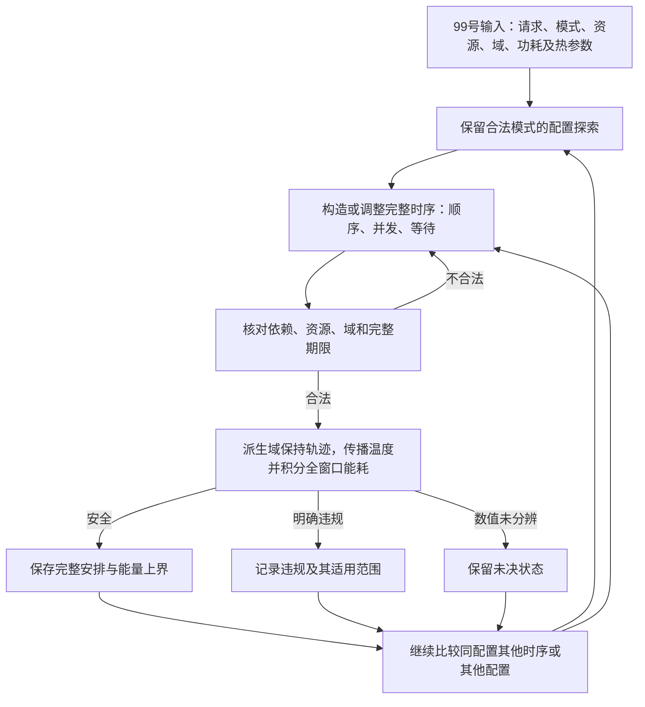

# 联合模型求解路线与适配边界

日期：2026-10-03。后续第3小目标，承接[99号模型骨架](99_端侧热约束节能联合模型骨架.md)。本轮只回答：在R86-v1不变的条件下，可以继承哪条求解路线，适配工作和保证边界是什么？不编程、不运行实验、不选数值或新增机制。

**建议采用“约束引导的配置与时序搜索＋完整热能耗评价”这一条路线。** 借用HaX共同表达映射与时间线的方式，用完整请求的能耗和热状态评价安排；借鉴Kim的组合选择与内层评价组织，但不沿用其候选裁减、执行政策或遗传算法。配置和时序都保留选择空间，温度既参与可行性检查，也通过漏电进入能量评价。

这确定的是可继承的求解组织，尚未确定具体搜索算法或求解器。原文工具足以支持这条组织思路；它们与R86全部接口的适配、计算效果及新颖性仍待落实。

## 1．为什么需要评价完整安排

99号的决策是Stage模式向量\(m\)和启动时刻向量\(s\)。模式给出设备、合法工作点、时长及活动功率；同一配置下，换序和等待会改变域状态保持时长、功率重叠及温度轨迹。因此，目标一般是\(E(m,s)\)，不是只由配置决定的\(E(m)\)。

设\(\mathcal S_T(m)\)为配置\(m\)下满足全部执行、期限和连续热约束的启动时刻集合，可写成

\[
J(m)=\inf_{s\in\mathcal S_T(m)}E(m,s),\qquad
E^*=\inf_m J(m),\qquad \inf\varnothing=+\infty.
\tag{100-1}
\]

该式只是按配置分组原问题的合法安排，没有删除动作。连续域用下确界，不额外保证每个子问题都能取得最小值；有限网格域在集合非空时可以改写为最小值。

**找到一张安全表，只取得该配置的一个可实现能量上界，尚未算出\(J(m)\)。** 两个配置的已找到安排可以比较，但不能据此宣告哪个配置的真实最优能量更低。内层暂未找到安全安排，也不能把\(J(m)\)置为无穷大。

例如，两个请求的可选Stage都偏好同一NPU时，可以比较共同排队、分配到不同设备、改变工作点或等待后的完整安排。即使映射不变，顺序变化仍可能改变后续保持状态和漏电能耗。这里没有认定哪项一定更省能；它说明求解过程不能只评价一条局部时间表，也不能只在末尾给温度打一个合格标签。

## 2．从原框架继承什么

以下原文均重新定位到正文，不以旧报告的概括代替源材料。标为“适配”的内容是本题的研究安排，不是原论文已经完成的功能。

| 来源与已核能力 | 本轮继承 | 对R86必须适配／不迁入的内容 |
|---|---|---|
| HaX-CoNN §3.4表3、式(1)—(11)，§3.5：映射、执行时间及资源关系进入同一个约束优化问题，目标包括吞吐或时延；使用通用约束求解工具 | 将合法映射与完整时间线共同表达；依赖与互斥约束用于构造和核查安排 | 加入合法工作点、域保持、完整请求期限与\(E(m,s)\)。原争用和转换模型不迁入；原问题的求解时间和最优性能力不能直接迁入新热能耗问题 |
| Kim §5.2、算法1—3：组合单应用候选，内嵌具体处理器分配、调频及可调度性／能量评价 | 组合选择接受内层完整评价，评价结果影响后续组合探索 | 本题原始域是全部合法Stage模式，时序可规划；不继承局部Pareto库的覆盖、跨场景共享部署、轮转分配、既定执行政策或贪心调频规则，不预定GA |
| F-DTM §IV-A2、式(2)—(6)：耦合RC、工作点相关温度功率和状态传播 | 给定工作点与活动状态后传播温度，为完整安排评价提供工具来源 | 使用本题计量组、单元注热和域保持；不继承内核分割、EDF次序、在线控制或恒定利用率下的温度结论 |

HaX的贡献不是“只选设备”，Kim也不是“先固定配置、之后不再评价”。本题借用这些已经存在的共同规划和内嵌评价能力，再处理自己的执行、控制和热能耗接口。将多个模块接在一起本身不证明贡献。

## 3．推荐路线的输入、处理与反馈

这是信息流，不规定深度优先、最佳优先、候选数量或处理预算，也不要求必须先穷尽一个配置再处理下一个。

**配置探索。** 输入全部合法模式，提出全请求模式组合。阶段活动能量、时长可作候选排序信息，但不能替代总能耗目标，也不据局部偏好永久删项。部分候选库可作为以后研究的实现选择，届时必须另报覆盖范围。

**配置内时序处理。** 输入模式和请求约束，选择冲突方向、并发及等待，输出完整安排。HaX的约束表达用于保留共同规划能力；不把某种固定排队政策默认为平台规定。固定模式及完整冲突方向后的无热最早传播可作可行性检查或初始安排，不能用“最早安排超温”排除整个方向或配置。

**统一评价。** 从同一安排派生工作点保持、活动注热和温度功耗反馈，计算完整窗口能耗及连续峰温。功率必须与当时温度一致；不能先在无温度反馈的功率下求温度，再把漏电单独加到能量上。空闲、等待及尾段均保留。

**评价反馈。** 安全安排更新目前可实现的低能量解；违规记录指出哪个安排、哪个约束失败；数值未分辨保留其状态。反馈可以影响同配置的时序继续探索或其他配置选择，但只有另有充分依据时才能扩大为分支排除。此处尚未设计局部修复或新的热切面。

| 接口输出 | 能支持的后续动作 | 不能据此执行的动作 |
|---|---|---|
| 合法、安全安排及能量 | 保存可行解，比较已知安全输出 | 自动关闭同配置全部时序；宣称配置最优 |
| 某安排明确超期、资源冲突或超温 | 拒绝该安排；如有独立必要条件，按其范围排除 | 因一条时间表失败而删除配置或其中单个Stage模式 |
| 搜索未完成 | 保留已得输出与剩余范围 | 把未找到方案解释为无解 |
| 温度或能量误差未分辨 | 保留候选，记录评价不足 | 按名义温度接纳／排除；按重叠的能量区间断言严格优劣 |

若评价器返回可靠能量包络\([\underline E_\sigma,\overline E_\sigma]\)，安全候选的\(\overline E_\sigma\)可以作可信上界；名义积分值须另列。要证明安排\(a\)严格比\(b\)省能，充分条件是\(\overline E_a<\underline E_b\)。本轮只确定这个接口要求，没有实现新的数值包络。

## 4．能否直接沿用HaX求解器或旧CTF-MILP

**可以继承执行约束的表达，不能据此认定完整问题仍是原来的可求解形式。** 模式、工作点和资源选择是离散决策；一般启动时刻连续；含温度反馈的完整能量及全过程温度是另外的适配部分。

在99号已明确代表温度映射为仿射、且段内参数固定的条件下，一个事件段满足

\[
\theta(t+\tau)=e^{A_k\tau}\theta(t)
+\int_0^\tau e^{A_k(\tau-u)}b_k\,du.
\tag{100-2}
\]

这里\(A_k\)可能随域工作点改变，\(\tau\)受启动时刻和事件顺序影响。即使段内ODE是线性的，作为调度变量函数的温度与能量也没有因此变成线性表达。若代表温度映射不是仿射，连该段传播形式也不能直接采用。实际表达与连续峰值方法须根据输入确定。

这带来三项明确适配：

1. **评价器需要跟随整条状态轨迹。** F-DTM式(5)—(6)提供条件传播参考；本题节点粒度、共享域、忙闲功率和有效温区不同，须核对内部峰值、尾段和误差。一般耦合系统不能只查端点。
2. **热反馈系数不能照搬。** 旧CTF-MILP在固定二节点RC与恒定基准下，将单选项温升贡献相加。R86的工作点相关漏电可能改变传播矩阵，单选项贡献会依赖其他选择形成的状态过程；同一组固定系数不再自动覆盖全部安排。没有有效性证明时，违规信息只用于拒绝该安排或指导探索。
3. **目标和下界需要重新对应。** 旧代码以固定配置能量排序，并在取得安全见证后关闭该配置；这不适用于一般\(E(m,s)\)。一个有效下界须覆盖允许的工作点、温度、保持时长及剩余模式，不能把旧恒定基准下界改名复用。本轮不开展新的下界或认证系统设计。

只读代码核对：`t76_coefficients.m`开头明确断言冻结对称二节点网络，随后构造恒定基准及单选项响应；`b64_search.m`第24、141行使用`safeConfigs`关闭已见安全配置。它们在历史模型下的含义不变，不能当作已支持99号。

因此，**本轮选择求解组织，不指定Z3、MILP或某个非线性求解器作为已经满足全部保证的引擎。** 也不把“HaX原问题可由通用求解器处理”扩大成“新问题可以原样处理”。这不是要求发明新算法，而是先确定现成工具将接收什么准确问题。

## 5．路线的保证与适用范围

| 层次 | 当前可以确立的内容 | 尚不能确立的内容 |
|---|---|---|
| 问题分组 | 式(100-1)按模式分组而不缩小原始合法域 | 某种有限候选策略已覆盖全部配置／时序 |
| 可行输出 | 完整执行与热评价均可靠通过的安排，可作为该输入模型下的安全解 | 对真实设备、模型误差或窗口之后的安全保证 |
| 质量比较 | 按同一\(E(m,s)\)比较安全输出；有误差时保留包络 | 首个安全解、局部内层最优等于全局最优 |
| 全局结论 | 需另有全域覆盖、有效界或排除证明，并交代数值证据 | 仅有循环、候选耗尽或求解器返回值就证明连续域最优／无解 |
| 有限网格参照 | 若以后明确采用有限域，原则上可逐安排评价；全部覆盖且判断充分时可核查对应域结论 | 本轮已经选择网格、能在预算内穷尽或保证连续域最优 |

至少保留以下已有工具足够的情况：约束规划给出的安全安排已达到一个独立有效下界时，无需额外协调规则；已有通用搜索配合完整评价已取得所需质量时，无需新增算法组件。在另行声明的恒定基准、零温度系数特例中，还可能退回固定配置能量，但不能用该特例替换R86。

目前路线的价值首先是**让共同决策与共同评价一致**。能否改善解质量、计算成本或证明能力，仍是后续验证问题。没有沿用原接口不等于已有方法失败，适配工作本身也不等于新算法成立。

## 6．本阶段完成与唯一下一步

本阶段已确定一条路线：以HaX式共同约束表达保留配置和时序选择，借鉴组合／内层评价组织，用R86完整热能耗决定已知安排的价值。尚缺的是可用参数、实际评价形式和由此选择的数值工具，不需要为这份路线说明再下载论文。

**下一小目标仅为第4项：整理最小数据闭合清单与公平验证方案。** 先明确哪些模式、计量／注热映射、代表温度函数及功耗热参数有来源，哪些需明确L3设定；再确定同问题、同评价、同启动域的比较需求。拟采用网格或特定代表温度映射时说明取舍，不能以实现方便悄悄收紧一般模型。本轮不进入数值冻结、算法细化、编码或实验。

## 原文及实现定位

本轮只复用本地全文和已有程序作定向核查，无新增网络检索。行号均指本地文本或源码，不作PDF页码。

| 索引 | 直接定位与用途 |
|---|---|
| H | Dagli、Belviranli，*Shared Memory-contention-aware Concurrent DNN Execution for Diversely Heterogeneous SoCs*，PPoPP 2024；§3.4表3、式(1)—(11)，§3.5；[本地全文提取](extracted/2024_Dagli_HaX_CoNN.txt)309—465行，[DOI](https://doi.org/10.1145/3627535.3638502)。本轮重点重读§3.5的约束求解组织，不迁入性能结论或笼统的求解器分类。 |
| K | Kim、Ha，*Energy-Aware Scenario-Based Mapping of Deep Learning Applications Onto Heterogeneous Processors Under Real-Time Constraints*，TC 2023；§5.2、§5.2.1—2，算法1—3；[本地全文提取](extracted/2023_Kim_Energy_Aware_Mapping.txt)453—575行，[DOI](https://doi.org/10.1109/TC.2022.3218991)。支持组合／内嵌评价及原有启发式边界，不证明其候选库适用于本题。 |
| F | Maity等，*F-DTM: Future-aware Dynamic Thermal Management in CPU-GPU Embedded Platforms*，RTSS 2022；§IV-A2式(2)—(6)；[本地全文提取](plain/2022_F-DTM_RTSS.txt)353—477行，[DOI](https://doi.org/10.1109/RTSS55097.2022.00041)。支持工作点相关热传播工具来源。 |
| R | [R86-v1](86_实验基础模型与假设确认总表.md)、[99号](99_端侧热约束节能联合模型骨架.md)。本题全部规则与数学对象的来源；[85号§5.1](85_实验基础建模假设核查与推荐.md)仅追溯旧实现迁移问题，不继承其旧非零开销建议。 |
| C | [t76_coefficients.m](matlab_config_value_src/t76_coefficients.m)1—29行、[b64_search.m](matlab_config_value_src/b64_search.m)24、141行；[77号§2.2](77_连续热反馈MILP实现与冻结对照.md)解释历史系数的适用条件。只读核查，没有运行或修改。 |

验收：回答了一条继承路线、三项主要适配及保证范围；原文事实、式(100-1)—(100-2)条件推导和本题路线建议分别标明。未新增基础假设，未将旧结果提升为R86验证，未把接口差异当作已证贡献。
