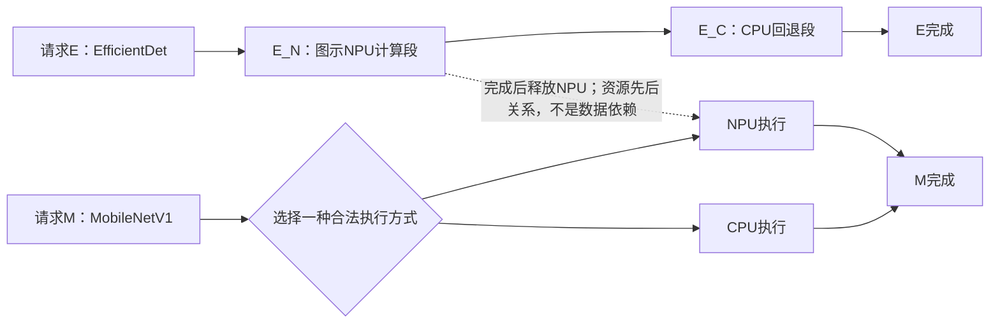
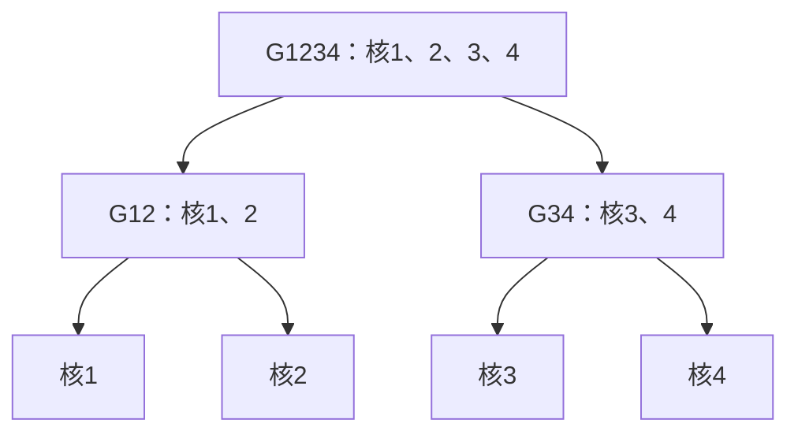

# Band与Crown：继承、适配及贯穿例子

范围更新（2026-09-24）：按用户确认，主线转为[41号固定执行单元上的Stage映射与并发](41_主线研究对象与固定执行单元边界.md)。可变核组保留、暂不展开；本文核组树／宽度选择接口属于历史扩展，当前仅保留适用的执行、排队、响应与热评价语义，不自动进入完整Band–Crown组合实现。

日期：2026-09-23。执行[31号计划](31_主干论文组合与研究收敛路径.md)。本文完成定向正文与关键原页核查、执行图和接口论证；不含完整数学模型、算法伪代码或仿真结果。

**主次修正（2026-09-23）：先论证任务相关响应、CPU–NPU时序与热状态何时改变配置的系统价值，再判断反馈更新的求解成本。** 条件推导和三组验证设计见[33号](33_配置价值变化的条件论证与验证设计.md)。本篇保留Band–Crown的执行框架与接口；后文局部重评、影响范围和缓存只是后续方法候选，不再作为当前主线中心。未运行实验、未证明实际收益或创新。

## 1. 原页核查后的三项修正

1. **Band图6不是“CPU前处理→NPU”的证据。** 图中EfficientDet在NPU执行一段后转入CPU回退，MobileNetV1可以利用由此空出的NPU。图中未显示该CPU回退之后还有NPU阶段，不能自行补出这样的依赖。依据：Band §3.2.2、图6，物理p.4–5／印刷238–239。
2. **该具体设备不支持我们直接假设NPU可调频。** Band §3.2.3在讨论图7所用移动加速器时将DSP/NPU称为单频处理器。贯穿例子默认NPU频率固定；27–28号其他平台的NPU响应模型不移植到Google Pixel 4的Edge TPU。依据：物理p.5／印刷239。
3. **Crown约束中的每核累计负载不是完整请求响应时间。** 原文按稳态轮次处理任务，明确不显式建模任务间依赖。其能耗目标和每核负载限制已核对原式(3)–(4)，不能直接替代请求期限及热可行性检查。依据：Crown §II-A、III-B，物理p.2–3。

上述修正缩小了可继承的结论，并不否定核组配置与端侧执行语义的结合。

## 2. 继承与适配对照

以下B指[Band原文](../papers/2022_Jeong_Band.pdf)，C指[Crown 2019原文](evidence_20260923/band_crown/Crown2019.pdf)。B页码同时列物理页与印刷页，C仅用物理页。

| 项目 | Band | Crown 2019 | 本研究处理与性质 |
|---|---|---|---|
| 任务表示 | 请求含模型、输入、SLO与完成状态；units及合法subgraphs覆盖计算（B §4.1–4.2，p.5–7／239–241） | 轮次内独立、可并行任务（C §II-A/III-A，p.2–3） | **继承＋适配：** 固定合法子图划分及依赖；每个计算阶段执行一次，不引入动态切分 |
| 合法动作 | 选择请求、子图和支持该子图的处理器；执行后将剩余工作入队（B §4.3，p.7–8／241–242） | 选择核组、宽度与频率（C §III-A，p.3） | **适配：** 为确有依据的CPU阶段增加核组模式；NPU保持单服务单元 |
| 已知信息 | 设备支持集合、队列、执行状态、时长profile、SLO（B §4） | 工作量、最大宽度、并行效率及配置功耗（C §III-A/B，p.3） | **适配：** 统一到合法模式及当前资源状态；没有数据的模式不能写成实测配置 |
| 调度触发 | 请求入队、worker完成、资源可用性变化（B §4.3，p.7–8／241–242） | 执行前求静态安排（C §II-A，p.2） | **继承＋适配：** 保留事件触发；静态核组配置可作初始偏好，不是未来资源预约 |
| 资源约束 | 单worker同一时刻运行一个子图；数量可配（B §4.1，p.6／240） | 层次核组限制候选（C图2，p.3） | **适配：** 核组必须整体空闲；重叠核组互斥；同域频率一致 |
| 目标 | 调度策略可插拔；默认LST按预计时延计算slack并选择请求（B §4.3，p.7–8／241–242） | 给定轮次期限最小化能耗等目标（C §III，p.3–4） | **适配：** 比较满足模型内请求期限和温度约束时的系统能耗；不是原LST目标不变的复现 |
| 排队与时长反馈 | 预计时延考虑已有占用；profile在线平滑更新（B §4.3.1–2，p.8／242） | 采用给定参数（C §III，p.3） | **直接保留＋适配：** 不删除Band已有反馈；若区分核组/频率，profile也需按模式区分 |
| 热处理 | 热不可用时禁用worker、将工作重新入队并监测恢复（B §4.3.1，p.8／242） | 已核目标与约束不提供我们的瞬态热轨迹保证（C §III-A/B） | **适配：** 增加统一热评价与合法动作反馈；不能称给Band首次加入温度 |
| 保证与参数 | 实验中的SLO表现不等于硬实时保证；§6.1使用两个单线程CPU worker（B p.9／243） | 保证限于其模型、候选空间与求解结果 | **不直接继承：** 平均响应参数只能支持所声明模型的期限评价，不能声称真实设备硬期限保证 |

Crown图2的核组是减少搜索空间的方法。我们借其层次结构，不继承全部静态次序或最优性结论。异构核不能仅凭核数相同就等价；是否采用同类核子树由合法模式明确。其§IV用合成任务及设定的并行效率进行实验，不是MobileNetV1或EfficientDet的核数响应参数库。

## 3. 固定执行边界与响应接口

### 3.1 本轮统一的工作范围

- 单台抽象CPU–NPU设备，多请求、固定计算量和精度、预先合法的子图；模型级依赖可保留，不强制固定两阶段流水线。
- 一个子图占用一个CPU核组或一个NPU；不同就绪子图可以并发，同一子图不做CPU–NPU拆分。
- CPU阶段启动前定核组，正常执行中不抢占、不迁移。无多核证据的阶段只有已支持模式。
- NPU一次服务一个子图。贯穿例子固定NPU频率；可调NPU是其他平台另行确认后的扩展，不属于本例。
- CPU配置遵守共享频率域。为避免隐含改变正在运行阶段的速度，本轮接口约定只在域内无阶段执行时切换域频率；这是起步控制限制，不是所有设备的能力描述。切换开销列为待补输入，不默认为零。
- “未启动”“运行中”“完成”“因故需重试”分开。Band式故障重新入队不等于支持任意抢占；若发生重试，必须记录重复计算的时间与能耗，不按零成本迁移处理。

### 3.2 效率模型究竟提供什么

| 工具或数据 | 可提供的信息 | 本轮仍缺的信息 |
|---|---|---|
| 28号CPU频率响应 | 固定实现与核组下，不同频率的时间/功率函数结构 | 每个推理阶段及核组的参数、模式有效范围、并发误差 |
| Crown并行效率 | 把核数与加速联系起来的方法 | 代表性CPU子图是否可多核、真实效率曲线、核组切换成本 |
| Band图6与运行时记录 | 混合执行、设备支持及显式回退的重要性 | 各段精确算子边界、线程数响应、功率与热标定 |
| 27–28号NPU响应 | 有相应平台与配置权限时的候选刻画 | 本例没有可调频依据，故不使用该自由度 |
| 既有RC评价 | 给定节点注热与参数后推进温度的方法 | 同平台热网络、初温、环境、阈值与CPU–NPU耦合强度 |

若用28号CPU响应，应对每个合法核组分别标定或声明抽象参数；不能把频率敏感系数当可并行比例，也不能无依据地将两条响应函数相乘。模式表中允许出现“未知”，不得用拟合公式掩盖缺失数据。

## 4. 三个模块如何衔接

这是研究接口说明，不是已经实现的算法或软件API。

| 模块 | 输入 | 输出与责任 |
|---|---|---|
| 配置选择 | 合法模式、时长/功率响应、剩余工作及请求期限、当前资源与域状态 | 候选核组/频率或NPU模式、预计时间/功率、适用条件；候选偏好不锁定资源 |
| 请求调度 | 候选模式、依赖、请求完成状态、资源日历 | 无资源冲突的暂定执行安排、请求预计完成时间；标明已执行、运行中和未提交部分 |
| 热评价与反馈 | 同一初始热状态、完整暂定功率轨迹、评价时域 | 预测可行性、违规时段/节点、调整建议；调整后回到调度与配置评价，不直接宣布仍满足期限 |

**信息条件：** 决策只使用当前已到达请求及已完成/运行状态。为评价未来热轨迹，可以为这些请求构造完整暂定后续安排，但不得借用未知未来到达或最优解。三类组合使用相同信息；贯穿例子只取已知的两个请求。

**评价口径：** 期限用请求释放时刻加允许响应时间定义，再与预计完成时刻比较；不能反复使用忽略已耗时间的相对SLO。能耗用同一固定评价窗口内的系统积分，包含等待、空闲及切换，公共功耗只算一次；各方法使用同一窗口、初温和热精度。窗口至少覆盖被比较的可行执行与约定尾段，未完成请求单列失败，不能把少完成计算当节能。系统功率与热节点注热的口径分别声明。

### 4.1 直接组合的顺序

1. 从固定合法划分及核组树产生模式，依据当前响应信息形成配置偏好。
2. 保留Band式事件驱动、排队感知与请求紧迫度评价，安排可执行阶段；CPU模式检查整个核组及共享频率域。其余已知工作只形成暂定安排。
3. 对暂定安排进行统一热与期限复核；必要时采用合法等待或未启动阶段的配置修复，并重新排时。
4. 执行反馈到来后更新时长profile、资源状态、剩余请求和热状态。只提交当前合法动作，不能因先前计划而冻结其他可执行请求。

该过程包含对Crown的适配，不是把其原ILP输出原封不动交给Band。本文只确定职责和顺序，配置优化的数学目标、具体求解器、并列决策规则留待完整建模阶段，不伪称基线已可运行。

### 4.2 一次性与反馈组合应公平地区别

| 层次 | 模式选择如何更新 | 必须共同保留的能力 |
|---|---|---|
| 一次性配置组合 | 初始偏好不主动重优化；若不可行，允许必要的等待/模式修复 | 排队时延重算、profile更新、热状态更新、资源不可用处理及执行前可行性检查 |
| 简单反馈组合 | 将修复后的预计完成时间、余量及热状态返回配置模块，重新考虑未启动模式 | 与上一行相同；加入反馈本身不预设为创新 |
| 待研究的协调方法 | 希望有依据地选择重评对象和候选，减少无效配置反复与重复评价 | 相同信息、合法动作和评价口径；效果须与简单反馈及完整重评比较 |

“一次性”仅指主动模式优化的次数，不能解释成明知参数改变仍按旧时刻执行。若后续比较求解效率，还需使用相同计算预算，并将完整重评保留作正确性对照。

### 4.3 反馈不能只沿任务后继传播

一次未启动阶段的核组或频率变化，至少可能影响四类对象：

- 数据依赖后继：就绪时刻改变。
- 共享核心或NPU的其他请求：占用窗口和等待次序改变，即使没有数据依赖。
- 共享调频域的阶段：配置兼容性与下一次切换时机改变。
- 受热历史影响的后续安排：若热网络有耦合，可能包含其他节点；即使无耦合，同一节点也有历史记忆。

**完整重评是起步参照。** 在没有证明独立性或误差界之前，不能把“没有共享核心”当成“无需热重算”，也不能在改动结束时恢复旧温度。局部更新的边界及其可行性保持，是可研究的结构问题；尚无安全局部更新规则或计算收益结论。

## 5. 贯穿例子：先画事实，再标假设

### 5.1 Band图6支持的执行关系

图6包含重复请求。下图只抽取一次EfficientDet和一次MobileNetV1的关系，省略微小准备段及具体时间；不声称恢复其完整算子DAG。M的两条路径是互斥选择，不能各执行一次。

EN与MN不能重叠占用本例的单NPU；EC与MN可以跨设备并发。图6支持把NPU的空闲窗口交给另一个请求，这已经是Band的贡献，不是我们的新增点。图中没有EC→MN的数据边，也不添加EC之后的虚构NPU阶段。

### 5.2 核组接口的抽象插图

下图是**四个同类CPU核的说明模型，不是Pixel 4硬件复刻，也不是图6已有测量**。只有后续确认EC与M的CPU实现支持对应模式时，才可将其用于该工作负载。

| 假设的模式组合 | 资源层面的结论 | 不能直接推出的结论 |
|---|---|---|
| EC占G12，M选择CPU并占G34 | 两段可以重叠；还须满足频率域兼容与热约束 | 不代表比NPU执行省能或更快 |
| EC占G1234，M选择任一CPU核组 | 两段必须错开 | 不代表四核必然更差，EC缩短可能补偿等待 |
| EC占合法核组，M选择NPU | CPU核组与NPU资源不互斥 | 不代表功率/温度互不影响，也不代表需要更多CPU核 |

此处不需要在核组树上加入NPU：NPU是独立的合法设备选项，不是与CPU同构的“第五个核”。

### 5.3 同一关系下的三个条件

| 条件 | 应如何解释 | 可支持或推翻什么 |
|---|---|---|
| 正常：NPU可用、预测热安全、请求有余量 | M可利用EN结束后的NPU空档，EC在CPU执行；直接组合应正常工作 | CPU多核配置可能只影响E，不能把M的收益强行归因于核数协调 |
| 资源：NPU要等待，而M的CPU执行也是候选 | 若存在合法多核模式，EC的核组大小改变M的CPU可启动窗口，进而影响M在CPU执行还是等待NPU | 可论证模式选择应结合资源占用；哪种更好仍取决于响应、期限与功率 |
| 热调整：M的NPU启动被预测热限制推迟，或EC的CPU模式需调整 | 对未启动M重新比较等待NPU与合法CPU模式，同时检查它对E完成时间和后续热状态的影响 | 说明需要一致更新；若简单反馈已选出合适模式，就应记录其足够有效 |

后两行是有条件的研究场景，不是Band图6报告的热实验。图6没有提供热网络和核数响应；不能把图中的性能差异归因于这些新增因素，也不能假设加核总是增温或CPU总会显著加热NPU。

## 6. 现有流程证据与参数缺项

本轮保留一组来源明确的双请求流程，不为凑数量再选不相关模型。

| 流程部分 | 已补齐 | 缺失及影响 |
|---|---|---|
| EfficientDet：NPU段后进入CPU回退 | Band图6及§3.2.2明确展示；CPU与NPU工作可分开调度 | 具体回退算子清单、可用线程数、各核组频率响应未由图6提供；暂不能断言该段适合多核 |
| MobileNetV1：CPU或NPU执行 | 图6显示两种安排，可利用另一个请求释放的NPU | 尚未得到该实现各模式的功率、核数响应及切换/交接参数 |
| 多核实现旁证 | Band图7的CPU标注3 Threads，但对象是ArcFace-ResNet50 | 只支持存在多线程CPU执行设置；不能代替上述两模型的加速曲线，更不能推出回退算子可扩展 |
| 热与控制 | 已有RC方法可表达预测；Band存在热不可用反馈 | 本例缺同平台热参数与可控频率域清单；当前只能提出明确假设的抽象研究 |

保持实测、文献设定与我们后续的合成部分分列。已有Crown功率profile和CPU服务器模型不能拼成同一真实手机；公共功耗不能按每个worker重复计入。

## 7. 剩余问题、方法价值与下一步

**第一层：为什么需要协调。** 任务相关的加速与能耗响应、共享资源及NPU时序、瞬态热可行域，何时会改变模式对完整请求的价值？先区分严格能耗反转、可行性变化与并列，不能由排队吸收时间收益直接推出能耗排序改变。33号给出条件和不变情形。

**第二层：怎样高效协调。** 在确认上述关系有实际决策意义，且完整评价确有明显成本后，再研究哪些未启动配置需要更新、更新范围如何确定。本篇接口与影响传播分析供该阶段使用，当前不设计增量算法。

| 工作层次 | 当前性质 | 后续能够支持它的证据 |
|---|---|---|
| 配置价值随任务与系统条件变化 | 当前优先问题 | 33号符号条件及共同模型下的能耗／可行性验证 |
| 核组互斥、请求期限、系统功耗口径 | 必要建模适配 | 统一执行图与完整可行性复核，不称单独创新 |
| 将排队与热反馈送回模式选择 | 合理的直接组合方法 | 与一次性配置相比的决策变化；无需预设所有场景都有收益 |
| 利用共享资源、依赖和热作用范围组织重评 | 暂列后续方法候选 | 先确认完整评价成本，再研究正确性或近似误差及同预算收益 |

这种方法工作不是由“函数非线性”自动推出：有限模式仍可查表。需要说明为何某些评价能复用、哪些改动必须传播、什么时候需要完整重评回退。当前没有复杂度降低证明，也未确认评估成本是瓶颈。

**下一步以33号为准：** 先补固定核组下的响应与功耗输入，判断任务响应、共享资源及热状态条件是否有实际适用区间；说明参数的文献、实测或抽象属性。多核规模只在解释资源竞争确有必要且模式合法时增加，不要求先证明全部核数组合。完成输入说明后，再按33号三组对照验证决策意义，最后检查评价成本；本轮仍不运行实验。

核数几乎不影响时长、NPU始终可用、热约束不活跃或完整重评已经很便宜，都是合理的无收益条件。简单反馈足够时保留这一结果；若只剩接口适配，再判断论文工作量，不从一个例子否定CPU–NPU热调度整体。

**一段话的研究说明：** 我们继承Band的合法子图与反馈、Crown的核组配置思想，先研究任务相关响应与资源、热条件如何改变配置的系统能耗或可行性，而非只看阶段快慢。必要时将这种系统价值传回模式选择；只有确认求解成本后，才研究低成本更新。若模式选择稳定或简单反馈已充分有效，就保留这一适用边界，不强行制造复杂协调算法。

## 8. 核查范围与验收

- Band：13页；定向读§3.2.2–3.2.3、§4.1–4.3、§6.1；目视物理p.4–9／印刷238–243，核图6–12与相关正文。不是全篇重新精读。
- Crown：5页；已从[会议官方入口](https://new.eurasip.org/Proceedings/Eusipco/eusipco2019/Proceedings/papers/1570528910.pdf)保存全文；目视p.2–4，核图1–2、§III-A时长式、式(1)–(4)和§IV参数设定。没有审计全部证明、附录或代码；不引用性能提升数字。
- CPU/NPU响应沿用27–28号核查，本轮未重新读取全部原论文。截图、哈希、来源与预检说明见[证据清单](evidence_20260923/band_crown/manifest.json)。Band已有预检与Crown新预检均UNAVAILABLE；原页可视核查不等于结构检查PASS。
- 执行图人工核查：NPU占用串行；M两种实现互斥；EC与MN之间没有数据依赖；抽象核组的父子组不得重叠执行；共享域与热约束另行检查。
- 已区分事实、适配和方法假设；未加入数据、性能百分比、完整模型或算法流程。未运行MATLAB、未修改实验代码。
