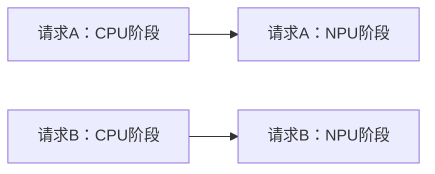

# 统一验证基座与参数依据

日期：2026-09-23。承接[33号条件论证](33_配置价值变化的条件论证与验证设计.md)。本轮交付问题定义、参数依据与验证合同，不含实验代码、仿真、数值收益、完整优化模型或新算法。

后续进展（2026-09-23）：[35号](35_配置价值首轮数值验证.md)完成无热R1/R2/N1数值复核，33项检查通过；[36号](36_热约束下等待与配置选择验证.md)完成15项固定参数热验证，40项检查通过，重排／等待保住无热最优配置，未出现F1。本文保留原定义阶段的证据边界，最新推进顺序见研究状态。

**结论：可以先在同一套抽象执行语义与评价规则下检查R1、R2及热条件，但尚无同平台端侧阶段参数库。R1与R2能给出相容的符号输入区间；F1目前仍缺保留等待、重排后排除全部高频安排的具体证据。** 固定核组是隔离频率响应的起点，不是已经完成多核资源分配研究。先做条件性机制验证，不预先承诺算法章节或真实设备收益。

## 1. 统一研究对象与执行合同

以下标记贯穿全文：**文献事实**指已核对材料的原有结论；**推导**指在列明假设下的数学关系；**抽象设定**指本研究为隔离机制选择的边界；**缺失**指尚无匹配输入。

箭头仅为请求内依赖。AC、BC共享一个固定CPU核组；AN、BN共享一个NPU。资源互斥不是请求间依赖，允许两条资源上的阶段并发。这是抽象CPU→NPU实例，**不是Band图6复刻**；Band实际图6的执行方向及回退边界仍以[32号§1、§5](32_Band与Crown继承适配及贯穿例子.md)为准。

| 项目 | 固定规则及含义 | 属性／边界 |
|---|---|---|
| 工作量 | 两请求各含一个CPU阶段、一个固定模式NPU阶段；阶段只执行一次，计算量与精度固定 | 抽象设定；不加入早退、批处理、重复计算 |
| CPU资源 | 两阶段共享同一核组G，包含固定的k个核；阶段全程独占G，不抢占、不迁移、不动态改核数 | k只说明资源含义，不用它自动缩放时长或功率；无对应任务多核实测依据 |
| CPU频率 | 同一频率域，合法集合为x∈{q,1}，0<q<1；仅域空闲时改变，启动后保持至完成 | 抽象频点，不冒称特定设备支持；其余同域核无本实例工作负载 |
| NPU | 固定频率／服务模式，单服务、不可抢占；两个阶段时长和功率可以不同 | 借鉴32号起步边界，不引入NPU调频或CPU–NPU拆分执行 |
| 时序动作 | 选择模式、资源次序和合法启动时刻，允许等待；评价某阶段模式时，其余未启动安排可重新优化 | 等待不预占未来资源；运行中的阶段不被改写 |
| 请求约束 | 到达a_r≥0，绝对截止期D_r>a_r；C_r为其NPU阶段完成时刻 | 约束为C_r≤D_r，非反复重置的相对预算；仅保证所声明模型内期限 |
| 信息 | 基础配对取a_A=a_B=0，两请求在决策时已知 | 若改变到达时间，明确离线参照知道完整输入；在线策略不得偷看未来请求 |
| 开销 | 基础交接和频率切换额外时间、能量均为零，无另占通信资源 | 为隔离机制的理想化设定，覆盖32号“开销待补”的本例特例，不修改一般框架 |
| 功能范围 | 不拟合新模型、不做自动热降频、不含温度相关漏电和并发访存干扰 | 热约束由合法调度满足；不可行不触发未声明的执行器 |

共享核组在服务时间内持续保留，包括响应模型中的频率不敏感部分；使用该模式的阶段平均活动功率。不得将该部分再当作可以无成本释放CPU的时间。

非零开销的后续检查需同时补：CPU完成到NPU就绪的延迟、CPU域切换的占用区间、相应能量和注热轨迹，以及最后一次配置恢复是否计费。它们一旦不为零，R1/R2的期限和能耗差都须重算；基础结果仅能称零额外开销边界下的结论。本轮不增设通信总线或其他资源。

## 2. 参数来源表与可用程度

来源定位优先指向已读原文及核查记录：

- **S1：** Da Costa，2025，[Hardware and application aware performance, power and energy models](../papers/2025_IRIT_Hardware-and-application-aware-performance-power-and-energy-models.pdf)，§3.2–3.3式(4)–(5)、§4、§5.4、Table 4；[28号§2](28_CPU响应模型与CoDVFS全文核查及接口方案.md)及其p.3、p.8原页记录。研究对象是服务器整应用，不是本例阶段库。
- **S2：** [Band，2022](../papers/2022_Jeong_Band.pdf)，§4.1–4.3、§6.1；[Crown，2019](evidence_20260923/band_crown/Crown2019.pdf)，§II-A、III-A/B；原页和继承范围见32号。Crown本身联合配置多任务，本报告的逐请求局部建议不称Crown算法。
- **S3：** [04号§1–2](04_热参数与创新成立条件.md)、28号§4；[HotSpot官方FAQ](https://lava.cs.virginia.edu/HotSpot/faq.htm)的“power trace”“thermal properties”“extract RC values”条目。本轮定向复核FAQ；节点功率与热网络需要匹配，其默认封装不是端侧标定值。
- **S4：** 33号R1、N1、R2、F1/N2是本研究已有条件推导，不是新增文献事实。

| 输入 | 单位／粒度 | 现有值或允许域及联系 | 来源与属性 | 缺失／不得外推 |
|---|---|---|---|---|
| G、k及频率域 | 核集合、整数 | 一个固定非空核组，两阶段共享；域内无其他活动阶段 | S2执行语义参照；具体集合为抽象设定 | 无具体DNN阶段的多核配置支持证明 |
| F_ref、q、x | Hz、无量纲 | x=f/F_ref，集合{q,1}，0<q<1 | S1归一化结构；两档为抽象设定 | 不填写虚构硬件GHz；比例机制检查可暂不绑定绝对Hz |
| 参考时长d̄_i | s／CPU阶段 | d̄_i>0；两种规划模型共享x=1的时长 | S1结构；数值缺失 | 服务器整应用时长不缩小后冒称推理阶段测量 |
| α_i | 无量纲／CPU阶段 | 基础解释0≤α_i≤1；d_i(q)=d̄_i[1+α_i(1/q−1)] | S1结构、S4推导；端点估计还需独立频点检验 | 原表存在α>1，不能静默裁剪；α不是并行比例 |
| Q_i(x)、u_i、v_i、β | W、W、W、无量纲 | 抽象活动增量Q_i=u_i+v_i x²，u_i≥0、v_i>0；β=2 | 借S1函数形状；增量解释及非负系数限制为本研究设定 | 原文整机p_0不等于u_i；尚无活动／空闲分解数据 |
| p_C^0、p_N^0、P_ext | W／核组、NPU、系统其余部分 | 均非负且频率无关；P_0=p_C^0+p_N^0+P_ext | 计量合同，抽象设定 | 真实闲置功率可能随频率变化；本轮不继承该变化 |
| n_r、w_r | s、W／NPU阶段 | n_r>0、w_r>0；固定服务时长及活动增量 | S2固定模式边界；数值缺失 | 不移植其他NPU或GPU的频率曲线 |
| a_r、D_r | s／请求 | 基础a_r=0，D_r>0；R2选取满足§4不等式的期限区间 | 抽象工作负载／S4 | 非真实应用SLO或WCET；期限不能因方法而改变 |
| h_r、s_switch、E_switch | s、s、J | 基础均为0；非零时需附动作及功率轨迹 | 抽象设定 | 不据零开销推断真实运行时可忽略 |
| C_C、C_N | J/K／热节点 | 严格为正，不由稳态热阻单独推断 | S3物理含义；数值缺失 | 无同平台热容与CPU–NPU瞬态辨识 |
| R_Ca、R_Na、R_CN | K/W／散热或耦合支路 | 正值；耦合断开对照用g=1/R_CN=0 | S3网络结构；二节点为抽象设定 | 缺几何／封装或阶跃数据；旧实验参数不默认继承 |
| T_a、T_0、T_max | °C／环境及两节点 | 环境固定；T_a<T_max逐节点；入口不超过上限 | 抽象输入，物理含义来自S3 | 不将环境温度当芯温，不采用不同器件阈值拼成平台 |
| H、h_tail | s／配对实例组 | H取整组全部被比较期限的最大值再加h_tail，h_tail>0预先固定 | 公平评价设定 | 尾段长度未指定为真实硬件充分冷却时间 |
| 时间网格、误差控制、计算预算 | s、J、°C、时间或评价次数 | 分别登记；本轮无数值执行，暂不赋运行值 | 未来运行合同必填 | 不能默认1 ms精确，不能执行后按收益选择容差 |

表中“缺失”不等于参数可以任意独立抽样。后续抽象输入须先满足下述联系，再声明取值；同一对照配对保持所有非干预输入相同。当前数据不足以给出端侧平台可信数值范围，本轮以相容的符号区间交付，不把符号表称为已标定参数集。

## 3. 响应、功率和热评价如何接起来

### 3.1 共同的时长与能量边界

共同评价模型取d_i(x)=d̄_i[(1−α_i)+α_i/x]。简单规划仅将α_i换为1，保持参考点、功率、频点、工作量不变。评价模型是声明的研究假设，不是实测真值。

设I_i^C、I_r^N为阶段运行指示，同种资源的指示至多一个为1。定义：

\[
P_{sys}(t)=P_0+\sum_i I_i^C(t)Q_i(x_i)+\sum_r I_r^N(t)w_r,
\qquad E_{sys}=\int_0^H P_{sys}(t)\,dt.
\]

在本例固定窗口、零切换、频率无关空闲基准及温度无关功率条件下，完整可行调度满足：

\[
E_{sys}=P_0H+\sum_i Q_i(x_i)d_i(x_i)+\sum_r w_r n_r.
\]

所以固定模式后，仅改变等待或次序不会直接改变该式的能耗；它们通过允许／排除其他模式改变最优能耗。不能把更长的等待额外加一次P_0而重复计费。提前完成后仍计空闲至H；未完成任务不得获得节能排名。若对照改变期限（如R2放宽D_B），H仍使用整组共同上界，不逐状态重算窗口。

活动增量Q_i不能直接由整机P(x)解释为每核功率。若未来同一计量边界的实测模型是P=p_0+p_1x²，且有对应P_idle，才可尝试u=p_0−P_idle、v=p_1；还需确认其他系统负载和空闲策略一致。u<0或显著频率相关空闲时，此处非负u族不适用，不能截断后继续声称复现。

### 3.2 R1对功率的额外要求

令q为低频比例，κ=1/q−1。由本例Q_i=u_i+v_i x²：

\[
r_i=\frac{u_i+v_i}{u_i+v_iq^2},\qquad
1<r_i<1/q\ \Longleftrightarrow\ u_i>v_iq,
\qquad
\alpha_{c,i}=\frac{v_iq(1+q)}{u_i+v_iq^2}.
\]

推导来自q(u_i+v_i)<u_i+v_iq²，约去1−q>0。于是：

- **相容的R1输入：** 任取0<q<1、v_i>0、u_i>v_iq，再取0≤α_i<α_c,i；当两个模式均可行、其他部分能耗相同且热不活跃时，简单反比偏好H、共同评价偏好L。α=α_c为并列，α>α_c为两者都偏好H。
- **强制保留的反证：** u_i≤v_iq时α_c,i≥1，在0≤α_i≤1内不能出现该严格R1反转；u_i=0即纯平方活动增量，属于此区间。
- u_i是**只在阶段执行期间存在**的频率不敏感活动增量。始终存在的P_0不属于u_i；用公共空闲功率提高u_i来满足条件会制造假翻转。

以上是我们的代数推导。S1支持函数形状，尚未提供当前端侧阶段满足u_i>v_iq的证据。R1参数区间非空，不等于真实CPU子图落在其中。

### 3.3 两节点热网络与功率账目

采用温升θ=(T_C−T_a,T_N−T_a)^T，C=diag(C_C,C_N)，g_C=1/R_Ca、g_N=1/R_Na、g=1/R_CN。基础模型为：

\[
C\dot\theta=-G\theta+p(t),\qquad
G=\begin{bmatrix}g_C+g&-g\\-g&g_N+g\end{bmatrix},\qquad
p(t)=\begin{bmatrix}p_C^0+\sum_i I_i^CQ_i\\p_N^0+\sum_r I_r^Nw_r\end{bmatrix}.
\]

明确设g_C,g_N>0、g≥0、C_C,C_N>0。因此G对称正定：det G=g_Cg_N+g(g_C+g_N)>0；−C^{-1}G稳定且非对角元非负，满足33号热入口单调性推导的正系统条件。两条热时间常数由C^{-1/2}GC^{-1/2}的正特征值λ_j给出τ_j=1/λ_j，不把单个R×C当作整个耦合网络的唯一τ。

本例将CPU与NPU活动增量全部注入各自聚合节点，节点内空间热点不分辨；P_ext计入系统能耗，定义为模型热边界之外、对这两个节点无显著反馈的恒定功率。因此P_sys=p_C+p_N+P_ext，能量账目一致，但不宣称两个节点覆盖整板所有发热。若所谓公共功率实际在共享片上部件发热，就不满足这个抽象：需重新分配注热或扩展网络，不能默默漏热。

初温是外部给定热入口，不在请求切换时重置；冷／热配对只改变θ_0并满足θ_hot≥θ_cold。可用θ_idle=G^{-1}(p_C^0,p_N^0)^T说明闲置平衡，但入口不必等于该平衡；若宣称来自某前序历史，须额外给出该历史。初温本身越界记输入不合法，不作为“高频失效”证据。

每次对全部事件区间及尾段评价温度，任务结束后仍可能出现跨节点迟滞峰温。固定功率段可用线性系统精确传播状态；精确端点不等于区间峰值已精确求出。逐节点约束max_{t∈[0,H]}T_n(t)≤T_n^max；H之外和重复运行安全不在本轮保证范围，终端温度随结果保留。

## 4. 条件覆盖与相容输入

不要求三层严格翻转同时成立。所有行共享§1执行语义、§3能量与热模型；每一行成对检查时只改变列明因素。下表是输入设计，不是已运行结果。

| 条件／干预 | 固定项与应覆盖区间 | 当前能否构造相容输入 | NPU作用／结论界限 |
|---|---|---|---|
| R1：规划响应不同 | 固定任务和功率；按§3.2选u>vq并覆盖α_c两侧、等号、α=1；两个模式均满足完整请求期限 | 符号区间成立；放宽期限、使热约束不活跃可隔离；无端侧数值证据 | 固定后缀；不能称NPU导致反转 |
| R1不变对照 | u≤vq、或共同期限只允许H、或两响应相同；其余一致 | 可给符号输入；期限排除与能耗排序分开报告 | 防止响应数字变了就声称系统收益 |
| R2：系统节能补偿 | 采用33号§3.2的时长／期限条件，比较Δe_B>Δe_A、<、=及放宽D_B | 可与同一响应／功率函数族相容，见下文；不要求使用R1同一数值参数 | NPU为固定尾段且不成为额外排队瓶颈 |
| N1：固定后缀排队 | 固定t、交接h、NPU服务n和两模式；u跨越快／慢CPU就绪点，保持两模式可行 | 局部公式成立；需要用另一请求的合法NPU占用生成u，不能凭空增加队列 | 时间收益可被吸收，能耗排序不自动变；固定后缀不是全局最优证明 |
| 完整NPU协调检查 | 相同d、Q及工作量下允许两NPU阶段合法重排，检查模式的条件系统价值 | 待后续统一实例验证；尚无本轮严格翻转充分条件 | 检查NPU顺序／占用是否改变其他模式机会，不预设一定有差异 |
| N2：热不活跃 | 固定任务，确认无热最优集合全部热安全；能耗不随初温改变 | 可定义条件区间；具体输入仍须计算轨迹 | 温度不改变最优集合；部分保留时只能说最优能耗不变 |
| 立即H失败、等待H可行 | 同一任务与入口，保留全部合法等待和重排 | 待热参数及轨迹核查，不能仅凭冷却直觉指定等待时长 | 排除把立即失败误记为H整体不可行 |
| F1：H整体不可行、L可行 | 冷态仅H最优；热态排除全部允许H安排且存在L可行；两模式边界不变 | 尚无相容热输入／不可行性证明；目前只有条件陈述 | CPU–NPU并发注热可能参与，不能提前认定为原因 |
| 整体不可行 | 同一约束下两模式所有允许安排均不可行 | 需参考求解或可证下界；策略失败不等于不可行 | 最优集合为空，不计算有效节能比例 |

**R2与响应族的相容性补充。** 保留33号记号：A的CPU时长d_H<d_L，B为b_H<b_L，NPU时长a、c；δ_A=d_L−d_H。取共同0<q<1、两阶段0<α_i≤1及0≤u_i<v_iq，则各自H更快、增量能耗严格高于L。令B参考时长满足b_H>δ_A，再以a≤b_H避免本条件中的NPU排队。期限取：

\[
d_L+a\le D_A<b_H+d_H+a,
\qquad
\max(d_H+b_L,d_L+b_H)+c\le D_B<d_L+b_L+c.
\]

区间非空，由33号证明强制CPU先A后B，并使A_L/B_H、A_H/B_L两分支可行。保持u_B/v_B比值而改变两者共同的正比例尺度，可在**符号输入族**中令Δe_B大于、小于或等于Δe_A，时长不变。这说明响应和能耗假设不矛盾，不是实际设备可以任意调节功率系数，也不是寻找胜例的实验策略；未来数值取值须先定来源或抽象范围，不能看到结果后改变范围。

R1与上述R2构造处于不同功率区间，但属于同一函数族、使用同一评价器，不强迫同一任务同时满足相反的条件。NPU、期限、热的具体作用靠对照区分，不能把这一相容性证明写成全部机制已联合验证。

**N1嵌回两请求的限制。** u只能由B已开始或已承诺的合法NPU占用产生；CPU先完成B再执行A可以形成这种状态。改变占用时应保持配对内A的模式之外安排相同，并单独说明跨状态改变了B的哪项输入。若无法在给定DAG中保持所需固定项，就只将N1列为局部代数对照，不伪造一个“唯一改变u”的完整实例。

## 5. 对照、回放与结果记录合同

### 5.1 方法及共同评价

1. **响应对照：** 分别用α=1与任务相关α作规划，再在共同任务相关环境中检查。保持规划的CPU／NPU资源次序、阶段模式及原计划启动时刻下界；遇到依赖或资源未释放，只向后延迟至可执行，不提前启动、不重新排序、不重选模式。先记录原时间表是否可执行，再报告该统一回放结果。热违规如实记录，不偷偷只给一方热修复。
2. **局部与系统：** 局部建议以请求单独存在、相同请求期限和最低阶段增量能耗为定义；系统比较固定被审查阶段的局部模式后重新安排其余阶段的条件价值，以及全部模式开放的结果。逐请求建议合并失败不等于某个模式全局不可行。此对照不是Crown复现，不通过换目标贬低原方法。
3. **热对照：** 比较无热限制参考与有热限制安排，以及同一任务的冷／热入口。所有输出均用同一RC环境检查；无热方案违规只作为参考。主动等待和简单协调应在后续方法比较中拥有相同动作及信息，不预先锁死NPU次序使其失败。

主目标只有E_sys；时长和温度分别作为期限及安全约束，不定义“毫秒／焦耳／摄氏度”的混合评分。NPU全部任务均完成时，固定模式NPU能耗项为常数，但NPU占用、依赖和注热仍可能限制CPU模式；必须由相应对照展示这种参与，不能仅凭NPU出现在公式中声称实质贡献。

### 5.2 数值协议：下一轮运行前必须固定

- 单位统一为s、W、J、°C，或统一换算后展示ms、mJ；F_ref只用于归一化，不混用Hz与GHz系数。
- 调度网格Δ_s、事件持续时间的表示方式、热峰值评价精度分别声明。采用网格时须说明是否向上取整时长；取整不能只对一种响应模型生效。离散参照仅对声明的离散问题有效，未经证据不声称连续时间最优。
- 能量、时间、温度的数值误差界／容差及计算预算在看结果前统一指定。差额未超过误差界记“未分辨”；热峰区间跨越阈值记“安全性未分辨”，继续细化，不能直接判安全。细采样本身不是连续安全证明。
- 参考解若超时，保存已找到可行解、最优界和终止状态，不把超时称不可行，也不把启发式输出称全部最优集合。计算预算按同一硬件、求解时间／评价次数说明；有限小例未显现成本不直接否定较大问题。
- 本轮不选择求解器、运行网格或数值容差，也未进行成本测试；以上是执行前输入项，不是已经可以直接运行的实验包。

### 5.3 结果必填项目

| 类别 | 记录内容 |
|---|---|
| 输入与出处 | 完整参数、来源标记、单位、模型版本、抽象范围、干预因素、H及h_tail、当前信息条件 |
| 执行 | 各阶段模式／起止时间／资源次序，各请求完成状态与C_r，原计划与统一回放的偏差、等待和修复 |
| 评价 | 系统总能耗及分项、各节点全窗口峰温与峰值时刻、终端温度、期限／资源／依赖／热违规原因 |
| 最优证据 | 完整最优配置组合及其关联，不将逐阶段集合任意相乘；不可行证据、界、容差及未分辨状态 |
| 归因 | 严格能耗变化、可行域变化、并列集合变化、预测变化但选择不变；NPU所扮演的具体角色 |
| 成本 | 共同预算、实际耗时与评价次数；本轮不填写假想耗时或收益 |

最优安排可能有连续的等待自由度；将“全部最优配置组合”与“列出每一条最优时间表”区分。仅获得一个最优见证不能证明该阶段最优模式唯一，必要时须对模式进行条件最优检查。

## 6. 完成情况、剩余证据与下一步

| 检查项 | 本轮结论 |
|---|---|
| 共同执行语义 | 已固定；非真实Band图6、多核规模暂不优化、NPU不调频 |
| 能耗与注热分账 | 已给出；公共功率仅计一次，节点外功率有显式热边界假设 |
| R1相容性 | 已推出u>vq及α阈值；纯平方增量为不翻转对照；真实阶段支持未知 |
| R2相容性 | 已给同一函数族下的符号构造及期限非空条件；不是数值结果或NPU特有证据 |
| 热模型合法性 | 二节点正参数保证稳定性和正性；具体热常数、入口和阈值未标定 |
| F1成立性 | 尚未补齐；完整高频分支不可行性不能由某条轨迹超温代替 |
| 模型／算法收益 | 均未实证；当前只准备机制验证，未确认评价成本或新增算法需求 |

**下一轮最小行动：** 先依据上述符号范围冻结一份带出处的抽象输入清单与数值协议，再按响应→系统协调→热状态检查。先查约束、功率账目、热平衡与单位一致性，再运行；需要真实平台主张时才补配套测量或公开数据验证。不得把等待数据完全补齐作为条件性机制研究的无限阻塞项，也不以任意单点胜负定选题。

若响应模型在明确范围内不改变有效选择，降低其作为核心机制的权重；若NPU只贡献固定常数，承认目前关系主要是共享CPU协调；若简单协调／等待已经足够，保留为合理方案。只有实际重评成本或其他求解困难明确后，才讨论32号影响范围、缓存或其他方法。

**阅读与检索边界：** 本轮盘点papers/仍50份PDF文件，复用28/32/04/33号及原页记录，未重读全部论文、未新增PDF原页核验。2026-09-23仅定向访问S1已给出的[Zenodo记录](https://zenodo.org/records/10982238)（当前工具不可访问，未获字段）与S3官方FAQ（上述三个条目可读）；未扩展关键词检索。访问失败不等于数据不存在。不请求重复下载现有论文，CPU数据获取状态不升级。沿用原PDF结构预检UNAVAILABLE的限制。
