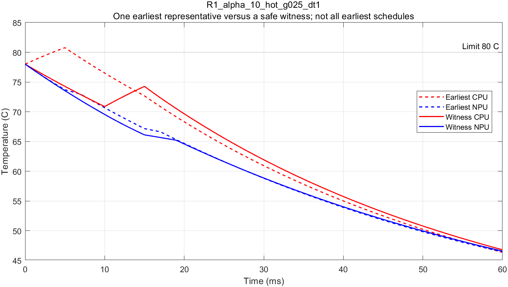

# 热约束下的等待与配置选择验证

日期：2026-09-23。承接[35号首轮无热验证](35_配置价值首轮数值验证.md)，按用户确认的固定热参数计划实施。**所有参数仍为抽象设定，不是设备标定；评价窗口仅为0–60 ms。**

2026-09-24说明：[37号原因与范围审查](37_热验证结果的原因与现实适用范围审查.md)已完成。本文“简单重排／等待足够”指参考搜索找到结构简单的安全见证；没有验证Band、Crown或在线修复策略能自主找到见证。原数值结果与输入不变。

**结论：15项预定案例全部找到了达到无热能耗下界的安全安排，最优模式组合和最低能耗均未改变。热约束排除了部分原本合法的时间表，但简单重排已足以保住最优配置；断耦合对照中的非最优HH配置可通过1 ms整体等待恢复安全。没有出现F1，也没有新算法必要性的证据。** 连续峰温计算、网格搜索及接口检查40/40通过。

## 1. 输入、实现与运行范围

独立热入口为[run_thermal_value.m](matlab_config_value_src/run_thermal_value.m)，操作与字段见[THERMAL_README](matlab_config_value_src/THERMAL_README.md)。35号的MATLAB源文件与其正式快照逐字节一致，没有改动原无热程序或案例。

三个任务实例分别为`R1_alpha_02`、`R1_alpha_10`和`R2_above_tight`，全部采用35号的任务相关响应；释放、期限、功率、固定核组和固定模式NPU不变。

| 热输入 | 冻结值／含义 |
|---|---|
| 环境及上限 | 环境25°C；CPU、NPU上限均80°C |
| 导热系数 | 对环境各0.05 W/K；耦合0.025 W/K |
| 热容 | 两节点均0.0025 J/K；两个热时间常数25、50 ms |
| 三种入口 | 冷态[30,30]、温态[70,70]、热态[78,78] °C |
| 能耗／注热 | CPU与NPU空闲及活动增量进入各自节点；其他0.5 W恒定功率位于热边界之外，但仍计系统能耗 |
| 时间范围 | 统一60 ms，持续计算完成后的空闲尾段；不承诺窗口外或重复运行安全 |
| 主搜索及复查 | 1 ms启动网格；三个耦合热态案例另用0.5 ms；时长不取整 |
| 温度带宽 | 10⁻⁶ °C；阈值带内记未分辨，不直接判安全或不可行 |

三实例×三入口为9项主案例；三个热态案例断开耦合为3项诊断对照；另有3项预定网格复查，共15项。未看到结果后增添研究案例、改变入口温度或调整热容。

正式运行目录：[run_20260923_204922_828](matlab_config_value_src/thermal_reports/run_20260923_204922_828/)。MATLAB R2023b，23.2.0.2365128，退出码0。所有研究案例均在60 s预算内完成，没有超时或阈值未分辨状态。

## 2. 热约束改变了什么

L/H指CPU低／高频，组合第一位为A、第二位为B。以下只把存在完整安全见证的模式计入可行集合。

| 实例 | 无热最优 | 冷态最优 | 温态最优 | 热态最优 | 热态下原最优模式的最早安全代表数 |
|---|---|---|---|---|---:|
| R1，α_A=0.2 | LL，84 mJ | LL，84 mJ | LL，84 mJ | LL，84 mJ | 4/4 |
| R1，α_A=1 | HL，89 mJ | HL，89 mJ | HL，89 mJ | HL，89 mJ | 2/4 |
| R2，补偿超过 | HL，71 mJ | HL，71 mJ | HL，71 mJ | HL，71 mJ | 1/1 |

断耦合的3项对照和0.5 ms网格的3项复查也保持同一最优组合与能耗。全部15项中，无热可行的模式组合都找到了热安全见证；60个“案例×模式”记录中55个可行，另外5个是R2的LL组合，**原本就违反期限，并非被温度排除**。

最优模式集合不变，不等于调度集合不变。R1的α_A=1热态下，部分HL时间表被排除，另一些HL时间表仍然安全，因此应报告“最优配置保留，但某些原最优时间表不再可用”，不能称严格配置翻转。

## 3. 一个具体例子：重排保住高频最优配置

`R1_alpha_10`热入口[78,78]°C，保持HL模式，即A高频、B低频。以下两条安排都满足两个请求40 ms期限：

| 阶段／指标 | A先执行的最早代表 | B先执行的安全见证 |
|---|---|---|
| A CPU | 0–5 ms | 10–15 ms |
| B CPU | 5–15 ms | 0–10 ms |
| A NPU | 5–7 ms | 15–17 ms |
| B NPU | 15–17 ms | 17–19 ms |
| CPU全过程峰温 | 80.773450°C，5 ms | 78°C，入口时刻 |
| NPU全过程峰温 | 78°C，入口时刻 | 78°C，入口时刻 |
| 总能耗 | 89 mJ；热违规，不能列为有效方案 | 89 mJ；本模型内热安全 |

先执行功率较低的B，使CPU在A开始前已有降温；随后A保持高频，仍能满足期限。这是**改变执行顺序恢复可行性**，没有更换模式，也不需要额外主动闲置。这里展示的是原4个最早代表中的一条失效安排，并不是声称所有最早安排都超温。

图中的实线见证并非通过最小化峰温选出；程序只需要找到安全见证，因此不能将它的峰温称为所有HL安排中的最低峰温。

## 4. 等待、耦合与NPU作用

### 4.1 等待确实有用，但未影响最优能耗

在断耦合热态下，两个R1案例的HH组合4个最早代表全部超温。以α_A=1为例：

- CPU顺序A→B的最早代表峰温80.950040°C。
- CPU顺序B→A的最早代表峰温80.175080°C。
- 将后一种合法安排整体延后1 ms：B CPU为1–6 ms，A CPU为6–11 ms，A NPU为11–13 ms，B NPU为13–15 ms；CPU峰温79.380694°C，NPU峰温78°C，期限满足。

HH的能耗仍为94 mJ；它不是该实例的最优配置（HL为89 mJ）。因此这组现象支持“立即或最早安排超温不能据此删除整个模式”，但**不能包装成等待改善系统最优能耗**。1 ms是已找到的可行等待，不是连续时间下最短等待的证明。

### 4.2 热耦合改变了轨迹可行性，但没有推翻最优配置

对同一HH模式、同一B→A最早CPU顺序和A→B NPU顺序：

| 耦合 | CPU峰温 | 判断 |
|---|---:|---|
| g=0.025 W/K | 79.772365°C | 安全 |
| g=0 | 80.175080°C | 违规 |

这说明断开耦合并不必然更安全。**模型内解释：** 此段CPU比NPU热，耦合支路可以把热量传向NPU节点；断开支路也去掉了这条散热途径。这里只改变耦合系数，任务与NPU功率保持不变。

仍需限定归因：本轮没有单独改变NPU负载来证明“NPU发热迫使CPU换配置”。能确认的是NPU节点通过网络影响CPU温度与部分时间表可行性；最低能耗及最优模式都不变。R2的补偿关系依然主要来自CPU共享与期限。

### 4.3 为什么有些案例本来就应当保持不变

在两节点都不高于80°C的边界上，一个节点达到80°C时，另一个节点不会向它输入正的耦合热流；该节点对环境至少散去0.05×(80−25)=2.75 W。因此，当两节点各自注热均不超过2.75 W时，[25,80]°C区域在当前正RC模型中保持不变。

本轮R2的CPU最大注热约1.5333 W，NPU最大1.3 W，满足此条件。R1的LL最优组合最大CPU注热2.7 W、NPU1.3 W，也满足。因此这些方案的安全不是靠“恰好取了一个有利顺序”；在本轮温度无关功率模型与入口范围内，功率边界本身就提供了不变条件。这里是本报告对冻结参数的代数解释，不是新增实验或真实平台安全保证。

## 5. 连续峰温、搜索与正确性

热评价按全部阶段起止事件分段。每段状态是平衡温升加两个实指数衰减项，除端点外，逐节点求导数零点；重复特征值退化为单指数。单段每节点至多一个孤立内部驻点，零系数或恒值情况单独处理。该方法适用于本轮稳定的二节点线性模型，不直接扩展为一般多节点峰值算法。

内部峰值不只是理论防护：例如`R1_alpha_02`冷态LL见证，NPU峰温32.301098°C出现在约20.774479 ms，晚于最后一个NPU阶段18 ms完成，CPU也已在16 ms完成。只查阶段结束点会漏掉这种尾段峰值。主判定没有使用采样最大值替代连续驻点检查。

参考搜索先评价全部最早资源顺序代表，再尝试合法整体延迟，必要时枚举全部四阶段网格启动时刻。先找见证只是搜索顺序，不删去其他合法候选。本轮研究案例中，所有无热可行模式都在最早代表或共同延迟中找到见证，无须走到完整枚举；R2的LL由资源／期限下界排除。

40项检查全部通过，覆盖：

- 稳定性、25/50 ms时间常数、空闲平衡、零输入均匀冷却、断耦合解析解与重特征值。
- 内部峰值单元例子：CPU初始温升0、NPU为40 K、零输入，CPU在ln(2)/20 s出现5 K内部峰值；不将非均匀零输入误称“每个节点都立即单调降温”。
- 逐段ODE交叉核对：内部峰例最大误差约1.42×10⁻¹⁴ K，完整功率轨迹端点误差约1.60×10⁻¹⁴ K；采样仅作诊断。
- 热入口单调性、阈值带未分辨、等待不重复计算空闲能耗、关闭热限制恢复35号结果。
- 全部55个安全见证的资源／期限、能耗、启动网格及连续峰温检查；0.5 ms网格直接重验1 ms的见证。
- 另设极小软件单元夹具，独立笛卡尔积数出每模式8条合法网格安排，检查穷尽分支没有漏枚举；该夹具的窄温度上限只用于软件检查，**不是新增研究案例、F1证据或用于选题的胜例**。

初次运行38项通过后，因研究案例未使用完整枚举分支，补充上述两项单元检查；正式运行40项通过。两次运行的15项研究输入内容哈希一致，未改变物理参数或任务条件。

**结论强度：** 一般网格搜索找不到方案只能说明该网格不可行。本轮更强的正面结论来自“安全见证的能耗已等于35号无热下界”：在声明的模型与数值安全判据内，即使允许更一般的连续启动时刻，也不能取得低于该下界的能耗。但这不是对全部连续时间表的枚举，更不是浮点舍入的形式化认证或设备实测保证；没有开展F1的连续时间不可行证明。

## 6. 交付、判断与后续边界

正式结果文件：

- [inputs.json](matlab_config_value_src/thermal_reports/run_20260923_204922_828/inputs.json)、[inputs.mat](matlab_config_value_src/thermal_reports/run_20260923_204922_828/inputs.mat)、[source/](matlab_config_value_src/thermal_reports/run_20260923_204922_828/source/)：执行前输入、环境和源码快照。
- [summary.csv](matlab_config_value_src/thermal_reports/run_20260923_204922_828/summary.csv)：15项结果；[modes.csv](matlab_config_value_src/thermal_reports/run_20260923_204922_828/modes.csv)：60项模式状态；[earliest.csv](matlab_config_value_src/thermal_reports/run_20260923_204922_828/earliest.csv)：175条最早代表；[witnesses.csv](matlab_config_value_src/thermal_reports/run_20260923_204922_828/witnesses.csv)：55条安全见证。
- [results.mat](matlab_config_value_src/thermal_reports/run_20260923_204922_828/results.mat)、[checks.csv](matlab_config_value_src/thermal_reports/run_20260923_204922_828/checks.csv)、[console.txt](matlab_config_value_src/thermal_reports/run_20260923_204922_828/console.txt)、[manifest.json](matlab_config_value_src/thermal_reports/run_20260923_204922_828/manifest.json)：完整结果、40项检查、日志和SHA256审计。
- [figures/](matlab_config_value_src/thermal_reports/run_20260923_204922_828/figures/)：三个耦合热态案例的PNG轨迹及对应CSV，已检查图像可读性。重叠曲线表示两方案相同，不代表缺少结果。

本轮应保留的研究判断是：**热状态确实影响某些时序安排，但在这组输入上，简单重排／等待已足够保住配置选择与能耗下界。** 不支持把“热状态必然导致模式翻转”或“需要增量更新算法”作为已成立主张，也不据此否定整个CPU–NPU热调度方向。

本轮到此停止，不追加参数搜索F1、不扩大规模、不开展连续时间排除证明。若继续深化，先审查实际端侧负载与期限是否限制了本轮使用的重排／等待余量，以及现有联合方法能否处理，再决定新的验证条件；不是为了出现翻转而任意收紧期限或提高功率。34–35号的响应与系统补偿结论保留，32号增量方法仍需成本证据。

本轮没有新增论文检索或全文下载；原文事实沿用既有核查，新增内容为程序、数值结果与显式抽象下的推导。目前无需补下载全文，真实平台数据仍是外部有效性缺口。
