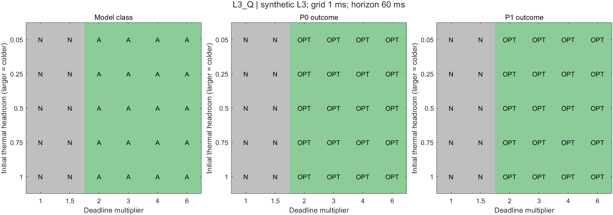
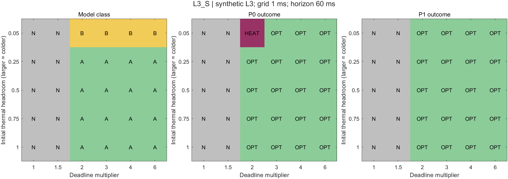

# 二维适用范围分类与策略对照验证

## Material Passport

日期：2026-09-24。类型：MATLAB数值验证；状态：已实际运行、实现检查通过。承接[39号协议](39_参数锚定与热约束作用分类协议.md)，使用两套L3抽象参数，不是设备标定或实测复现。60项新条件与15项历史回归分别统计；不新增论文、参数维度或算法。

**结论：60项中36项A、4项B、20项N，没有C、D或U。全部40项无热可行条件都保住唯一无热最优配置与最低能耗。P0在其中39项安全最优，1项完成任务但超温；P1通过一次热拒绝与重排修复该项，40项全部安全最优。** 热过滤有一次实际派发价值，没有能耗降低、配置更换或复杂算法需求证据。本次限定支线到此结束，不追加参数寻找C。

正式结果：[run_20260924_114714_075](matlab_config_value_src/scope40_reports/run_20260924_114714_075/)。MATLAB R2023b，23.2.0.2365128，退出码0；预检查31/31，执行后检查2067/2067。检查条数包含逐例重复核验，不是2098个独立研究实例。

## 1. 冻结输入与公平参照

两包分别继承R1_alpha_02与R1_alpha_10，除期限和入口状态外不变：两个已知CPU→NPU请求、固定独占CPU核组、CPU低／高频比例0.5／1、固定单服务NPU、允许合法等待和重排、零额外切换／交接开销。全部活动功率和二节点RC沿用36号，统一60 ms能耗／热评价窗口。

| 维度 | 冻结值 | 实际物理量与解释 |
|---|---|---|
| 期限倍率ρ_D | 1、1.5、2、3、4、6 | 两请求最快隔离时延均7 ms，期限均为7、10.5、14、21、28、42 ms |
| 入口热裕度h | 0.05、0.25、0.5、0.75、1 | 两节点同温77.25、66.25、52.5、38.75、25°C |
| 启动域 | 1 ms网格 | 结束时刻、截止期不取整；热评价仍检查连续段内驻点与端点 |
| 预算 | 每例参考60 s；每例每策略60 s | 参考包含无热规划；策略包含配置规划及全部并列组合；超时不作不可行 |

六档倍率与五档入口是39号事先声明的**合成取点**，不是文献报告的现实区间。没有看到结果后增点、改变热容／功率／耦合，或增加0.5 ms复查。

新增同域无热参考枚举4种模式组合×2种CPU顺序×2种NPU顺序，每次依赖／资源释放后向上对齐启动网格。固定模式能耗不随等待变化，所以该顺序的最早网格安排足以判断无热可行性。所有并列配置交给策略，但不交付参考时序；本轮60项的无热可行条件均为唯一最优组合。

P0/P1直接复用38号`h37_policy`，只新增同域配置适配器。**全部策略先执行，随后才运行热分类参考；策略不读见证或历史时间表。** N类没有可选无热配置，记“不执行”，不算派发失败。热违规或未完成方案不能凭能耗较低列为有效节能方案。

## 2. 模型分类结果及成立原因

| 参数包 | A | B | C | D | N | U |
|---|---:|---:|---:|---:|---:|---:|
| L3-Q：α_A=0.2 | 20 | 0 | 0 | 0 | 10 | 0 |
| L3-S：α_A=1 | 16 | 4 | 0 | 0 | 10 | 0 |
| 合计 | 36 | 4 | 0 | 0 | 20 | 0 |

A表示所有无热最优时间表都安全；B表示最优集合内安全与违规时间表并存；N表示无热已不可行。不是把某个算法的一条输出直接当作模型分类。40项可行条件的完整M₀均保留，热最优能耗与无热下界相等，没有并列组合缩小或未决成员。

### 2.1 期限会先改变无热最优配置，不能归功于温度

L/H分别为CPU低／高频，组合第一位为A，第二位为B。

| 参数包 | ρ_D=1、1.5 | ρ_D=2，D=14 ms | ρ_D=3、4、6，D=21／28／42 ms |
|---|---|---|---|
| L3-Q | 无热不可行N | LH，89 mJ；五种入口全部A | LL，84 mJ；全部A |
| L3-S | 无热不可行N | HH，94 mJ；最热入口B，其余A | HL，89 mJ；最热入口B，其余A |

两个CPU阶段即使都取最快模式也需要合计10 ms，最后一个请求的NPU阶段还需2 ms。因此共同期限7或10.5 ms时，共享资源和依赖本来就无解；这20项不能称为热不可行。

14 ms期限下，Q包LH可完成，而LL／HL的CPU总时长加末尾NPU分别至少18／17 ms，不能满足期限；S包只有HH能在期限内完成。放宽期限后分别恢复更低能耗的LL／HL。**这组配置变化由期限造成，在未施加热约束时已经发生；温度没有进一步改变配置。** NPU的2 ms尾段是上述必要完成时间界的一部分，但共享CPU竞争仍是主要关系之一。

### 2.2 A类的安全证据，不依赖一条幸运时间表

Q包所选LL／LH的CPU最大注热均不超过2.7 W，NPU不超过1.3 W。环境25°C、对环境导热0.05 W/K下，[25,79]°C矩形区域保持不变，入口也在其中。这给出其全部最优时间表安全的充分证明。

本轮在运行前另冻结了一个保守上界，用于补证冷入口，而非拟合结果。令M=max_n(T_n−T_a)，γ=min_n(g_n/C_n)，b₀=max_n(p_n^idle/C_n)。在本轮正RC模型、非负注热和T₀≥T_a条件下，最高温节点的耦合项不为正，故：

\[
D^+M\le-\gamma M+b_0+\frac{\sum_i Q_i I_i(t)}{C_{min}},
\qquad
T_n(t)\le T_a+\max\{M(0),b_0/\gamma\}+\frac{E_{activity}}{C_{min}}.
\]

活动能量包含两个CPU与两个NPU阶段；用指数核不超过1得到该上界，忽略部分散热，所以是保守充分条件。**上界超过80°C不意味着实际超温。** S包在h≥0.25的入口≤66.25°C；HH活动能量34 mJ，给出79.85°C上界，HL活动能量29 mJ给出77.85°C上界，均低于限制。这证明其16项A，无需枚举全部时序。该上界不是新调度算法，也不增加现实参数依据。

### 2.3 B类表示存在坏时序，不表示策略一定失败

S包最热入口77.25°C下，ρ_D为2、3、4、6的四项均有安全、违规无热最优安排。HH／HL的A先行安排会违规，B先行存在安全见证。前三轮证实的“重排保住配置”在本轮仍成立。

所有新条件的A由充分证明给出，B由两见证给出，没有主案例因超时而留U，也没有需要完整排除才能成立的C/D结论。默认报告域为1 ms网格。这里各模式的连续最早安排原本就在网格上，因此无热下界一致；充分界覆盖连续启动，B的两条网格见证也是连续域最优见证。此额外性质不能推广到任意非网格时长输入。

## 3. 策略表现：出现一次热过滤收益，但收益是安全性

| 版本 | 完整、热安全且达到参照 | 完成但热违规 | 无热无解、不执行 | 候选热评价／拒绝 |
|---|---:|---:|---:|---:|
| P0：排队／期限反馈 | 39 | 1 | 20 | 0／0 |
| P1：增加候选热检查 | 40 | 0 | 20 | 161／1 |

唯一差异为`L3_S_r20_h005`：两个请求均0到达、期限14 ms、入口77.25°C，无热最优为HH、94 mJ。

| 阶段／指标 | P0 | P1 |
|---|---|---|
| A CPU | 0–5 ms | 5–10 ms |
| B CPU | 5–10 ms | 0–5 ms |
| A NPU | 5–7 ms | 10–12 ms |
| B NPU | 10–12 ms | 5–7 ms |
| A／B完成时刻 | 7／12 ms | 12／7 ms |
| CPU全过程峰温 | 80.094822°C，违规 | 79.186639°C，安全 |
| NPU全过程峰温 | 77.25°C | 77.25°C |
| 配置／能耗 | HH／94 mJ，能耗仅作违规诊断 | HH／94 mJ，达到同域无热下界 |

0 ms时两请求预计完成时间与期限余量相同，P0按请求编号优先A；P1判A候选轨迹超温，拒绝A后继续检查B并立即启动B。5 ms启动A和B的NPU，10 ms启动A的NPU。CPU连续忙至10 ms，**没有新增主动等待**。日志中的`advances_without_start`是无新启动事件时的推进次数，包括设备正在忙，不能当作CPU等待毫秒数。

P0与同配置安全见证的首次启动决策差异为0 ms。这里只比较已找到的见证，不称其为唯一正确后缀，也不证明该时刻后的所有补救都不可能。P1自己的NPU顺序与参考首个安全见证不同，两者都合法，说明策略没有复制参考时间表。

另外三项B中，HL使B的CPU时长较长，P0的余量优先级自然选择B先行，P1无需拒绝。因此**模型为B并不必然要求新增热反馈动作**。

CPU峰温变化由完整功率轨迹评价。NPU参与依赖、共享服务及热耦合；本轮没有改变NPU功率或解除耦合的新增因果对照。P0的违规峰值出现在5 ms，不能把它直接解释为后续NPU活动发热迫使CPU改频，更没有NPU特有配置翻转证据。

## 4. 离散分类矩阵

每格是一个预定条件，不在格间插值。纵轴为热裕度，越大越冷；横轴为期限倍率。模型面板：A/B/N按前述定义；策略面板：OPT为完成、热安全且达到同域参照，HEAT为热违规，N为无热无解。若出现未决，绘图接口会明确标U，本次主条件无U。

两图均已目视检查。不能把有限格点面积或36／60、4／60解释为真实设备的发生概率，也不能从未出现C推定整个物理参数空间不存在C。

## 5. 历史回归与实现检查

原15项全部恢复原配置、84／89／71 mJ下界和P0/P1历史时间表；两版各15条都完整热安全。原10项A与3项B不变；39号保留的两个U获得更强证据：

| 历史项 | 新证据 | 更新后的分类范围 |
|---|---|---|
| R1_alpha_10冷态30°C | 活动能量上界为41.6°C | A，连续时间充分界 |
| R1_alpha_10温态70°C | 保守界81.6°C不能证明安全；检查4条最早代表后，完整枚举118900条不同合法HL网格安排，全部安全。共118904次评价，含重复检查的4条代表 | A，仅本1 ms启动域的穷尽结论；不升级为全部连续时刻证明 |

因此历史组现在为12 A、3 B、0 U；原15项数值、参数和策略结论没有被改写。温态参考耗时44.240756 s，在60 s预算内；没有为消除U提高预算。60项主条件参考最大0.014661 s；P0/P1每例版本最大约0.063770／0.048013 s，仅作预算记录，含初始化和规划，不用于算法速度或必要性论证。

预检查覆盖小网格独立四维笛卡尔积与参考枚举计数／集合一致、非网格结束、期限不取整、网格对齐、所有类别逻辑、单见证不足以判A、未排除最优模式不足以判C、并列模式、超时状态、配置接口隔离及关闭热过滤动作一致。类别逻辑夹具属于软件检查，不计研究案例。

执行后检查覆盖全部见证与完整策略轨迹的资源／依赖／期限、启动网格、能耗双算、连续热复核、证明／穷尽状态、历史时间表逐项相同及逐模式期限／入口单调性的一致证据。所有31＋2067条检查通过，无策略超时、阈值未分辨或参考超时。

程序冻结与失败记录：

- 首次MATLAB启动因默认偏好目录不可写而未进入程序，改用工作区`.runtime_scope40/prefs`；输入和预算不变。
- 首次程序运行`run_20260924_114531_532`在案例结构体数组初始化时报错，发生在输入冻结和研究执行之前；保存`failure.txt`、日志及`source_failed/`，统一修正空结构体追加方式。
- 正式运行`run_20260924_114714_075`在检查／执行前保存输入、规则、源码和SHA256。运行后核对冻结文件无变化；35号11份、36号21份、38号27份旧MATLAB源码均逐字节未改。新源码也与正式快照一致，见`audit.json`。

## 6. 交付与返回主线

运行入口：[run_scope40.m](matlab_config_value_src/run_scope40.m)，规则与复跑说明：[SCOPE40_README.md](matlab_config_value_src/SCOPE40_README.md)。正式目录含：

- `inputs.mat/json`、`source/`、`freeze_manifest.json`：执行前冻结材料。
- `results.mat`、`main_summary.csv`、`main_modes.csv`：参考、分类、配置集合与能耗上下界；未搜索的高能耗组合明确标“不影响已证最优值”，不伪称均已判热可行。
- `main_methods.csv`、`main_events.csv`、`main_schedules.csv`、`main_witnesses.csv`：方法结果、逐事件记录、时间表及分类见证。
- `regression_*`：15项历史回归，独立于60项统计。
- `preflight_checks.csv`、`post_checks.csv`、`console.txt`、`manifest.json`、`audit.json`：检查、日志与完整性审计。
- `figures/`：两张离散分类与方法表现矩阵。

**回到主线的判断：本轮界定了一个“固定配置＋热过滤派发已经足够”的具体范围。** 热约束在4项中排除部分最优时序，其中1项需要P1实际改变派发，其余由P0的队列／期限规则自然处理；没有热约束要求离开原最优配置的案例，也没有P1尚未解决的同配置时序缺口。

因此不再用这两套固定功率和RC追加扫描来寻找C。保留联合无热配置＋P1为后续合理基线；主线中的多核规模选择、端侧性能参数与更一般CPU–NPU关系仍未由本次支线验证。若主线继续，须围绕其实际待解决的关系提出下一项工作，而不是直接进入增量／缓存算法。本轮不把条件性结果外推为整个方向缺乏研究空间，目前无需新增全文。
