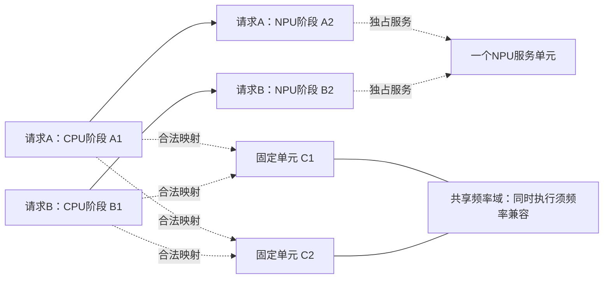

# 固定执行单元下的主线问题与方法定位

后续进展：[43号最小验证定义](43_多CPU单元配置协调最小验证定义.md)已固定任务／单元／频率域、10项L3输入及C0/C1直接组合规则；尚未写代码或运行。本文末尾“先冻结最小对象与规则”已完成，主线问题及方法开放边界保持不变。

日期：2026-09-24。承接[41号对象](41_主线研究对象与固定执行单元边界.md)，完成问题收敛与定向近邻核查；本轮没有新实验、完整数学模型或算法设计。40号限定支线结束，可变核组继续暂缓。

## 1. 推荐主线：执行配置与完整请求安排的一致性

建议围绕一个问题推进：**在固定执行单元的多核CPU–NPU端侧设备上，任务相关响应给出的映射／频率建议，怎样与多请求并发、NPU服务顺序和瞬态热状态协调，才能在端到端期限内实现系统节能？**

具体要研究的矛盾是：阶段配置的收益依赖它实际获得的频率、占用资源的时间，以及它提前完成是否会推进请求后继；配置模块和调度／热控制模块分别作出合法决定，并不自动保证组合后仍满足原先的能耗与期限判断。

这不是宣称所有分层方法都会失败。需要比较三种结果：原配置和时序均可用；配置可保留但需调整时序；需要重新选择配置。温度改变时序也有价值，不以出现最后一种情况作为主线成立的唯一门槛。

当前定位为**值得展开的问题设想**。已有条件推导和受限实例支持“配置要用系统目标评价”，尚无证据证明新对象上存在简单协调无法处理的损失，更没有形成算法贡献。Band、Crown及下述文献均为可替换工具和对照，不再用“Band–Crown组合”命名当前主线。

## 2. 先与最接近的工作对齐

| 来源与核查位置 | 已有内容／可借用内容 | 本题适配边界与反证作用 |
|---|---|---|
| Zhou等，2018，*Thermal-aware correlated two-level scheduling of real-time tasks with reduced processor energy on heterogeneous MPSoCs*，本地正文§3–5，印刷p.3–5 | 已联合处理DAG分配、频率、期限和温度；§3.1式(1)采用周期数除以频率，§3.3假设处理器间热传递可忽略；§5将频率档转为虚拟核 | “映射＋DVFS＋热”不是本题的新点。任务相关响应、耦合RC及CPU–NPU合法执行语义属于可讨论的适配；不能仅因替换这些模型就宣称新算法。原文含温度相关泄漏，不能说它忽略全部温度影响 |
| [JOSS，2023预印本](https://arxiv.org/html/2306.04615v1)，§5.2–5.3、PDF p.6–7 | 按任务响应选择配置，并对并发任务的共享频率需求作协调；采用当前频率与新任务建议的算术平均。性能要求为逐任务相对加速 | 不能称共享频率冲突尚无解决方法。它可作直接协调参照；逐任务加速目标与本题请求期限、NPU后继及热约束的接口仍需适配。冻结宽度／内存频率属于本题裁剪，不能称完整复现 |
| [Mei等，2021预印本](https://arxiv.org/html/2104.00486)，§III-A/B、§IV与§V-C/D | 非线性性能／功率模型、期限约束和任务分配已有结合，并允许牺牲任务运行能耗以减少系统空闲代价 | 原文是CPU–GPU集群、独立不可抢占任务，并假设足够服务器；不能直接继承到固定容量端侧DAG。其节能机制提示不能把阶段最低能耗当系统最优；本题固定窗口／恒定基准下也不能照搬关机收益 |
| Kim 2023、Band 2022，复用[10号](10_已有模型参数与简化审查.md)、[32号](32_Band与Crown继承适配及贯穿例子.md)、[37号](37_热验证结果的原因与现实适用范围审查.md)的正文定位 | 前者提供异构推理映射／配置参照，后者提供合法子图、worker、排队和反馈语义 | 保留各自已具备的联合与反馈能力；本轮没有重新逐页审查，不新增“作者遗漏了什么”的断言 |
| Crown、F-DTM，复用32／37号 | 联合配置、未来工作与热控制的不同方法参照 | Crown不是单阶段贪心；F-DTM不是完全被动阈值控制。无需为了维持论文配对而继承核组树、任务拆分或设备权限 |

Zhou本地来源：[PDF](../papers/2018_Zhou_Thermal_Heterogeneous_MPSoC.pdf)。本轮复核布局文本，关键式(1)及热独立假设与既有阅读一致；未新增PDF原页目视核查。JOSS的HTML正文与PDF文本交叉核对，网页截图工具失败，未声称完成原页目视检查。Mei按2021预印本版本记录，不用其书目版本替代后续出版版本。

**方法定位因此要开放：** 调度执行语义可借Band，配置／能耗建模可借CPU响应模型、JOSS或其他更贴合的方法，热联合优化应与Zhou、F-DTM等比较。论文最终按所解决的问题组织，不按借用了几篇文献组织。

## 3. 任务—单元—频率域—响应依据

| 对象 | 本轮明确的定义 | 依据状态／缺口 |
|---|---|---|
| 推理请求 | Stage级DAG、固定工作量和精度、请求到达与绝对期限 | 41号范围；Band提供端侧执行语义参照，尚未选定真实模型的完整Stage库 |
| CPU单元 | 固定占核集合、起步互不重叠；每个Stage只占一个合法单元 | 本题假设，单元可以单核或固定worker，均不选择宽度 |
| NPU单元 | 固定服务模式、一次一个Stage，可与CPU并发 | 起步抽象，不声称所有NPU都如此；Stage是否支持NPU逐项登记 |
| 频率控制域 | 单元所属域和合法档位作为输入；共享域不允许同时要求互相矛盾的频率 | Linux CPUFreq文档支持共享性能控制接口的存在；具体设备拓扑与权限尚缺 |
| CPU响应 | 每个合法“Stage—单元”有自己的时长／功率响应，可用函数或离散表 | 28号CPU论文支持任务相关频率响应形式；服务器参数不能当端侧子图参数 |
| 并发响应 | 起步可声明无额外访存干扰，功率按明确边界合成 | 这是简化而非实测事实；共享基准不能按任务重复计入。若真实并发数据不足，仅作L3条件研究 |
| 热响应 | 完整功率轨迹驱动RC网络；热节点与CPU单元数量不必一一对应 | 34–40号提供评价器与校验材料，不提供当前多核设备标定值 |

共享域证据见[Linux CPU Performance Scaling：policy、affected_cpus与related_cpus](https://docs.kernel.org/admin-guide/pm/cpufreq.html)。文档说明多个CPU可以共享性能控制接口；它不保证任意指定CPU可独立调频，也不意味着软件请求频率总等于实际频率。41号“域内有任务时不切频”是为保持阶段内频率不变采用的保守研究规则，**不是文档规定的硬件限制**。

当前仍缺同平台Stage时长／功率、合法支持集合及热参数。没有这些数据也可论证条件，但必须使用L3标记；不能把公开服务器响应、Jetson功率和旧二节点RC拼成真实CPU–NPU设备。

## 4. 一个贯穿例子：个体建议怎样变成组合问题

以下为抽象例子，不是Band图6，也不声称已经出现节能收益。两个请求为A₁→A₂、B₁→B₂；A₁、B₁只能在固定CPU单元C₁或C₂执行，A₂、B₂只能在固定模式NPU执行。C₁、C₂共享频率域。每个Stage始终只占一个单元，不拆分、不抢占。

图表示依赖和合法映射集合，不是同时占据所有虚线目标的时间表。

**第一步：阶段响应提供偏好，期限限定可行选择。** 假设在某个明确的请求完成时间要求下，A₁需要高频H，而B₁用低频L仍有期限余量，且其活动增量能耗满足e_B(L)<e_B(H)。这些是待用相容参数检验的条件，不是“计算密集必选高频、其他任务必选低频”的通则。

**第二步：偏好不能直接相加。** A₁在C₁用H、B₁在C₂用L的重叠执行，在此域定义下不合法。可以同用H并发、同用L并发，或错开执行并在域空闲时切频。不能将非法的独立频率方案作为有效基线；必须先给它合法协调规则。

一个有限的代数结论是：固定共同评价窗口，假定空闲基准恒定、零切换开销、活动能量只依赖模式；如果“A_H后B_L”的完整CPU–NPU安排满足期限和热约束，而比较方案为“A_H与B_H并发”，那么前者比后者少消耗e_B(H)−e_B(L)>0。若顺序安排不满足期限／热约束，或公共功耗随域频率变化，这个推导便不能直接使用，必须重新计算全系统能耗。它只比较两个方案，不证明全局最优，也不证明需要新算法。

**第三步：NPU决定CPU提前的价值。** 在固定NPU前缀、该请求后继是下一项服务且其余条件不变时，后继启动为max(C_CPU,b_NPU)。CPU提前可能被已有NPU工作吸收。若两个请求均待服务，改变CPU顺序也可能改变NPU排队，必须联合重排后再评价。不能把固定后缀公式当一般调度定理，也不能从时间收益被吸收推导高频一定不节能。

**第四步：热安全约束重叠方式。** 同用H并发会形成不同于串行方案的注热轨迹，但全过程峰温谁高仍由初温、时长、耦合及后继NPU轨迹决定。热过滤可尝试等待、换就绪顺序；只有这些仍不足时才讨论重新配置。不预设双CPU并发一定超温，也不预设低功率方案峰温更低。

这个例子明确了“响应偏好—实际频率—并发安排—后继服务—热轨迹”的接口。**共享域不是新的研究方向，也不是本题必须采用的拓扑；它是检验组合是否自洽的一个有依据条件。** 若平台支持独立域，该项限制消失，研究仍可聚焦资源与请求时序。若C₁、C₂完全对称，交换核编号没有系统收益，不能声称例子已证明异构映射价值；映射主张还需有依据的单元差异或合法支持差异。

## 5. 简单组合应当做到什么

所有比较使用相同目标：满足请求期限、资源／依赖、频率域和瞬态热约束，最小化共同窗口内系统能耗。公平对照必须保留已有模块能力。

| 对照层次 | 应具备的能力 | 能回答的问题 |
|---|---|---|
| 独立配置诊断 | 输出阶段偏好，但未兼容域约束前不算合法调度 | 偏好冲突来自哪里，不用于夸大性能差距 |
| 合法直接组合 | 对候选并发组比较合法公共频率，预测完整请求期限，保留候选轮询、热检查、等待／重排 | 简单适配是否已经足够 |
| 联合无热配置＋热反馈 | 同时选合法映射／频率，再允许热安全时序修复；必要时重新调用原配置模块 | 35–40号强基线向新对象扩展后能处理到哪里，不冻结一个故意差的初选 |
| 小规模共同参考 | 在同一动作空间联合比较配置与时序，保留全部并列最优组合 | 是否存在剩余损失，属于模型信息、合法动作还是策略选择 |

JOSS的执行中频率协调与41号阶段内固定频率并不相同：若裁剪到域空闲边界选择公共频率，应称“借鉴式适配”，不得用结果评价原JOSS的优劣。若以后放开执行中切频，需同时更新全部方法的工作进度模型和动作空间；本轮不放开。

保持零切换开销、功率可加等抽象时，应检查这些简化是否使问题直接可由枚举／局部修复解决。不能为了得到复杂度，随意增加频点、单元或请求数量。

## 6. 对应论文工作，以及下一项

第一部分可以围绕**系统配置评价与协调条件**形成实质工作：明确真实控制域与合法执行集合，说明任务响应如何影响完整请求的资源选择，区分配置收益与时序收益，建立共同参考和适用边界。贡献若成立，应落在具体协调规则、条件或可验证模型适配上，不落在公式更复杂或文献数量更多上。

第二部分再围绕**求解与运行时决策**展开：先看参考和合法直接组合之间是否有稳定差距，再看联合搜索是否出现实际成本。之后才决定需要改进配置筛选、修复顺序，还是分解求解。缓存、局部更新、影响范围目前仍是工具候选，不能预定为第二章贡献。

当前只保留一条主问题，不新增几个平行题目。下一项优先完成“阶段建议如何转成合法并发配置”的窄验证定义，主张为：

> 在明确的频率域、响应和端到端约束下，直接公共频率协调＋请求余量反馈＋热安全派发，是否已经达到共同参考的可行性与能耗；如果未达到，首次损失源自哪一项配置或时序决定？

在执行任何新实验前，先冻结一个最小任务／单元表、一个共同目标、合法直接组合规则和相容输入依据。无需同时引入异构核、可替代CPU/NPU映射、访存争用和可变宽度。共享域例子作为首个接口候选；若其规则适配过重，可选独立域并发实例，但需说明它实际检验的是另一项关系，不暗换主张。

必须保留的对照：任务偏好一致；NPU完全吸收提前量；热约束不活跃；简单枚举公共频率已足够；CPU单元对称时映射无收益。如果合法简单组合在声明范围内都达到参考，就保留为解决方案并降低专门算法的必要性；这不否定多核CPU–NPU题目。如果有差距，先排除不公平动作空间、预算和实现错误，再讨论改进。

本轮推进到了**具体问题与方法接口定位**，尚未到“模型定稿／算法设计”。新增两篇公开预印本已可读，本轮无需用户补下载；如后续需要复现其模型或算法，再做完整原页、代码和数据审查。历史实验、参数与评价器均不修改。
