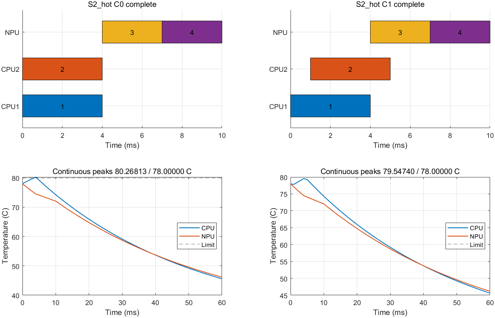

# 多CPU单元配置协调首轮验证

日期：2026-09-24。按[43号冻结协议](43_多CPU单元配置协调最小验证定义.md)完成MATLAB R2023b实际运行，未改变研究输入、增加案例或扩大预算。

**结论：C1在8项主案例和2项频率域诊断中全部自主完成、热安全并达到同域参考能耗。C0在两项共享域热态案例中超温；C1将B的CPU阶段延后1 ms，保留HH配置、最低能耗及两个请求完成时刻。没有发现当前强适配基线尚未解决的差距。**

与35–40号相比，这轮已实际实现双CPU单元并发和频率域约束。另一个结果是：紧期限下，共享域的最优配置为HH，独立域允许HL；这由控制域合法性造成，不是温度引起的配置翻转，也不是新算法节能。

## Material Passport

| 项目 | 记录 |
|---|---|
| 类型与状态 | 确定性、小规模、L3抽象仿真；正式运行完成，MATLAB退出码0 |
| 任务与输入 | 两条CPU→NPU请求，两颗对称固定CPU核、一个固定模式NPU；8项主例＋2项域诊断 |
| 执行环境 | MATLAB 23.2.0.2365128（R2023b）；工作区MATLAB_PREFDIR |
| 入口 | [run_coordination44.m](matlab_config_value_src/run_coordination44.m)，运行说明见[README](matlab_config_value_src/COORDINATION44_README.md) |
| 正式输出 | [run_20260924_164721_744](matlab_config_value_src/coordination44_reports/run_20260924_164721_744/) |
| 检查 | 24/24预检查、384/384执行后检查、192/192补充检查；共600项检查，不是600项研究案例 |
| 适用范围 | 1 ms启动网格、60 ms能耗／热窗口、冻结L3参数；没有设备测量、运行中调频或重复推理周期保证 |

## 1. 实现与公平性

新增独立`c44_*`模块，时间表按A₁、B₁、A₂、B₂保存单元、模式、起止时刻和活动功率。CPU聚合注热允许同时包含两个CPU阶段。旧`cv_validate`和`h37_partial`假设两个CPU阶段串行，不用于新并发时间表；只复用兼容的响应、能耗及底层RC传播函数。

无热集合完整枚举4种CPU模式组合、4种带核编号的分配及全部合法网格启动时刻，没有CPU标签对称剪枝。允许同频错开重叠、域清空同刻切频、CPU–NPU并发及合法等待。无热和热参考同域，时长／期限未取整。各参数族的完整合法安排数量为：

| 条件 | 合法无热时间表数量，每个温度案例相同 |
|---|---:|
| S1，共享域 | 20,468 |
| S2，共享域、紧期限 | 8 |
| S3，共享域、偏好一致 | 15,750 |
| S4，共享域、长NPU后缀 | 846 |
| S1，独立域诊断 | 26,576 |
| S2，独立域诊断 | 14 |

这些数量包含核编号对称的不同安排，不是互不等价的配置数。只要未启动阶段存在合法共同后缀，C0/C1都可以重新选择其频率、单元和顺序；没有永久锁定初始阶段建议。

两版分别在自己的60 s预算内生成无热集合，再按已执行前缀和本刻动作筛选，精确实现43号规定的条件无热配置评价。C0选首个最优评分动作；C1按同样顺序检查整个启动集合及已提交轨迹，只接受明确热安全者。未启动未来阶段不注热。无热集合是策略明确允许的模块，不是热参考；所有策略执行完毕后才开始热参考。

本轮各案例热参考能耗上下界相等，最优模式集合均已确定且唯一。参考对每个模式找到首条安全见证后可停止该模式的存在性搜索，所以**没有证明该模式的所有时间表都安全**，也没有穷尽所有热最优时间表。

## 2. 8项主案例结果

模式顺序为A／B。表中的C0/C1均完整执行且满足期限；C0违规能耗只作诊断，不列为有效节能方案。单位：能量mJ、温度°C。

| 案例 | 无热／热最优模式 | 热最优能耗 | C0 CPU峰温／热状态 | C1 CPU峰温／热状态 | C1能耗差 |
|---|---|---:|---|---|---:|
| S1冷：偏好不同、宽期限 | HL／HL | 80.25 | 34.810784，安全 | 34.810784，安全 | 0 |
| S1热 | HL／HL | 80.25 | 78.000000，安全 | 78.000000，安全 | 0 |
| S2冷：偏好不同、紧期限 | HH／HH | 82.00 | 35.958542，安全 | 35.958542，安全 | 0 |
| S2热 | HH／HH | 82.00 | 80.268127，违规 | 79.547397，安全 | 0 |
| S3冷：偏好一致、宽期限 | HH／HH | 82.00 | 35.958542，安全 | 35.958542，安全 | 0 |
| S3热 | HH／HH | 82.00 | 80.268127，违规 | 79.547397，安全 | 0 |
| S4冷：长NPU后缀 | HL／HL | 86.25 | 34.810784，安全 | 34.810784，安全 | 0 |
| S4热 | HL／HL | 86.25 | 78.000000，安全 | 78.000000，安全 | 0 |

C0为6/8安全最优，C1为8/8安全最优。全部模式与能耗在施加热约束前后保留；只有S2热、S3热的实际时间表改变。两项各发生一次当前启动集合热拒绝。没有超时、阈值未分辨或整体不可行。

逐节点峰温、各请求完成时间及原始精度见[summary.csv](matlab_config_value_src/coordination44_reports/run_20260924_164721_744/summary.csv)；参考能耗、完整模式集合状态及计数见[reference.csv](matlab_config_value_src/coordination44_reports/run_20260924_164721_744/reference.csv)。表中0包含浮点表示导致的约10⁻¹⁴ mJ差值，远小于预设容差，不是负能耗差。

## 3. 热检查究竟改变了什么

S2热的期限A/B为7/10 ms，入口温度78°C。S3热虽期限宽裕，两个版本也产生下述同样安排：

| 阶段 | C0 | C1 |
|---|---|---|
| A₁，CPU₁，H | 0–4 ms | 0–4 ms |
| B₁，CPU₂，H | 0–4 ms | **1–5 ms** |
| A₂，NPU | 4–7 ms | 4–7 ms |
| B₂，NPU | 7–10 ms | 7–10 ms |
| 系统能耗 | 82 mJ，热违规诊断 | 82 mJ，有效最优 |
| CPU峰温 | 80.268126886°C | 79.547396665°C |

0 ms时C1首选仍是两个CPU阶段一起启动，但整个集合的候选热检查违规。它继续检查下一个动作，先启动A₁；1 ms时再启动B₁。CPU并发重叠由4 ms缩为3 ms，CPU₁并未停止运行，NPU也没有被冻结。

B₁晚完成1 ms，但B₂原本就要等A₂释放NPU，因此B₂的启动和完成不变。这给出了具体链条：**热准入改变CPU重叠安排，NPU排队余量吸收该调整，配置和系统最低能耗得以保留。** 这不等于NPU发热造成CPU换配置；本轮没有热耦合消融，不能作该归因。

补充检查还验证：在这个入口状态下，两个CPU阶段单独启动的候选均安全，合并同时启动却违规。因此整组动作检查是必要的实现要求，不能分别准入后忽略合并功率。

图中阶段1/2/3/4依次为A₁/B₁/A₂/B₂；温度曲线采样只用于绘图，安全判定使用连续段内峰值。另两张预先指定图为[S1冷](matlab_config_value_src/coordination44_reports/run_20260924_164721_744/S1_cold_schedule_temperature.png)、[S1热](matlab_config_value_src/coordination44_reports/run_20260924_164721_744/S1_hot_schedule_temperature.png)，三图均已目视核对。

日志字段`wait_ticks`统计没有新启动的派发时刻，其中包含已有任务正在运行的正常时段，**不能直接乘1 ms当主动等待时间**。这里B₁的1 ms延后由两版时间表对照确认，并非读取该计数推断。

## 4. 2项频率域诊断：配置差异由谁造成

| 热态配对 | 共享域热最优 | 独立域热最优 | C0/C1在独立域的表现 |
|---|---|---|---|
| S1宽期限 | HL，80.25 mJ；A/B完成7/12 ms | HL，80.25 mJ；A/B完成7/10 ms | 均安全最优，CPU峰温79.137039°C |
| S2紧期限 | HH，82 mJ；A/B完成7/10 ms | HL，80.25 mJ；A/B完成7/10 ms | 均安全最优，CPU峰温79.137039°C |

S1中域分离允许A_H与B_L并发，缩短B请求完成时间，但能耗没有改善。

S2中A需在7 ms完成，其4 ms CPU加3 ms NPU已用尽期限。共享域无法让A_H与B_L重叠：A先运行再B_L，B的最早请求完成为12 ms，超过10 ms；B_L先运行则A失约。共享域的无热最优已是HH。独立域可让A_H与B_L同时启动，B在5 ms完成CPU后等待NPU至7 ms，10 ms结束请求。

82−80.25=1.75 mJ是两种**控制约束输入**下的最优能耗差；它在无热问题里就存在，不能称为C1节能、热约束贡献或真实硬件收益。CPU核本身仍对称，没有异构映射收益。

S4相对S1增加B₂服务6 ms，增加活动能量6 mJ；两版均保留HL，B完成从12变18 ms。这是更大NPU工作量的代价，不是跨案例算法能耗退化。其期限和热约束仍可由当前组合满足。

## 5. 检查、预算与失败记录

正式运行前已保存输入、43号规则、源码、环境及哈希。43号的JSON、规则文档与说明三个原有哈希运行后仍匹配；未给冻结文档添加状态提示，最新进展仅在本报告及研究状态中登记。

- 24项预检查含独立全笛卡尔小网格枚举：196条带核编号合法安排与新集合完全一致；非整数结束、并列最优、不可行、超时、阈值未分辨均覆盖。
- 连续RC传播与逐段ODE最大端点差约1.95×10⁻¹⁴°C；检查内部峰值、无耦合重特征值及旧串行见证的新旧热评价一致。ODE／采样没有替代峰值判定。
- 384项执行后检查复核完整资源／期限、能耗双算、提交前缀、C1每次准入及全部参考见证。
- 192项补充验收检查保存于[supplement](matlab_config_value_src/coordination44_reports/run_20260924_164721_744/supplement/)：在10项输入上关闭热过滤均复现C0动作；确认运行中NPU注热、拒绝双CPU集合后继续启动单个任务、未预订未来启动，以及策略没有读取参考文件。另用已保存C0热违规前缀验证首次失去全部最优续接的诊断为0 ms；仅为诊断检查，不新增研究案例或改变C1结论。

C1共90次候选热评价、2次拒绝。正式策略单例最大0.1367532 s，参考最大0.0823871 s，均未触及60 s预算。这些是小规模运行记录，不作为算法复杂度、部署开销优势或新算法必要性的证据；C0/C1包含完整无热集合生成，不能称已经验证轻量在线实现。

首次尝试[run_20260924_164525_002](matlab_config_value_src/coordination44_reports/run_20260924_164525_002/)在预检查旧案例适配处退出：旧NPU活动功率字段为`w`，测试漏转换为新接口的`npu_increment`。失败日志和源码保留；修复仅在新测试适配中完成，研究输入不变，首次没有进入正式10项。

正式运行后没有修改其执行器或参考源码。补充检查独立保存源码与哈希，并确认当前正式源码仍匹配运行快照。[audit.json](matlab_config_value_src/coordination44_reports/run_20260924_164721_744/audit.json)记录41份旧MATLAB源码保持不变；旧实验输入与历史结果未改。MAT／CSV、逐事件尝试及全部检查均在正式目录内。

## 6. 对主线的判断

这轮支持两项有限结论：**合法频率域与期限会影响系统配置选择；热状态会影响CPU并发时序，而NPU等待余量可以吸收修复。** 因而41–42号所说的协调关系已不只是文字例子。

同时，允许重配置的联合无热规划加当前动作热过滤，已经解决全部预定案例。C1没有剩余可行性或能耗差距；本轮不支持为同一组输入设计复杂算法、局部更新或缓存方法。响应真实性、异构单元映射和更多请求下的困难仍未验证，不能据此判整个主线缺乏空间。

按计划结束本轮，不追加功率、热容、初温或期限点寻找失败。保留C1和完整参考为新对象的基线。后续若继续主线，应先说明比本次“两个对称CPU单元＋固定归属Stage”多出的具体决策关系及其依据，再决定验证对象；不自动恢复可变核组或以扩大规模代替问题论证。

本轮没有新增文献检索或全文下载需求。结果为确定性案例描述，不作真实设备覆盖率、统计显著性或实际节能百分比推断。
