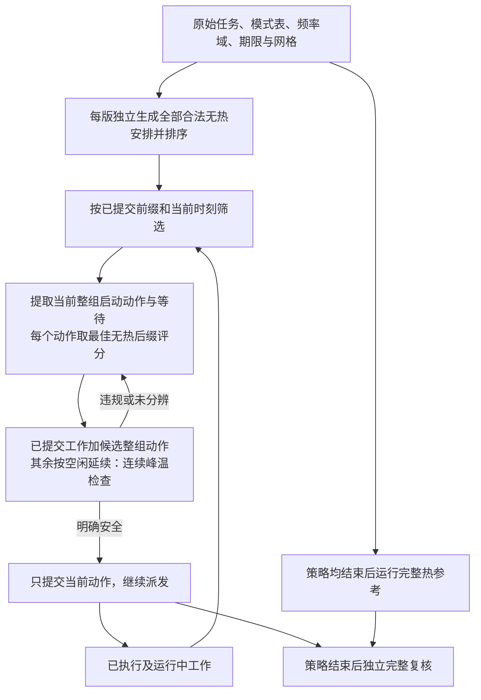

# 主线问题边界与求解任务论证

日期：2026-09-24。承接[41号对象](41_主线研究对象与固定执行单元边界.md)、[42号问题定位](42_固定执行单元下的主线问题与方法定位.md)与[44号验证](44_多CPU单元配置协调首轮验证.md)。本轮仅做代码、原文和既有结果审查，没有新实验、参数修改或算法设计。

**结论：优先论证“当前配置／启动动作是否保留热安全的完整请求后缀”，暂不转向求解加速。** C1已解决44号全部10项，不存在本轮新发现的失败；但其实现依靠完整无热安排枚举，热准入只检查已提交工作。因此，已有证据既不能说明一般问题已由轻量策略解决，也不能说明需要新算法。下一项先完成一项前缀续接条件论证与对照输入定义，不直接运行扩展实验。

## 1．主线定义与44号覆盖范围

研究对象继续是单台抽象多核CPU–NPU设备上的有限、已知、多请求推理Stage DAG。工作量和精度固定，每个Stage选择一个合法、规模固定的执行单元；启动后不可抢占、迁移或改频。CPU单元占核集合起步互不重叠；NPU采用固定模式、单服务单元，允许CPU与NPU并发。

共同目标是：在相同窗口内，满足依赖、资源、频率域、请求期限及瞬态温度约束，最小化系统能耗。窗口包含完成后的空闲尾段。模型内期限和热安全不等于硬件实测保证。

| 主线定义 | 44号实际覆盖 | 尚缺依据／不能声称 |
|---|---|---|
| 有限已知请求的Stage DAG | 两条CPU→NPU链，均在0到达 | 未验证一般DAG、持续请求或未知到达；不因此自动引入这些因素 |
| Stage合法执行集合 | 两个CPU阶段可在两颗对称CPU单元择一；两个后继固定NPU | CPU换编号无收益；没有CPU/NPU替代映射或异构映射收益证据 |
| 固定CPU执行单元 | 两颗固定单核单元 | 不选择Stage内部并行核数；可变核组仍暂缓 |
| 合法频率域 | 主案例共享域；两项独立域诊断 | 共享域是输入，不是所有平台事实；域全空闲才切频是研究限制 |
| 任务相关响应 | 每阶段两档时长／活动增量功率，L3合成 | 无端侧同平台匹配Stage数据；非线性响应可预计算成表，不自动改变求解类别 |
| 并发注热与热安全 | CPU聚合节点＋NPU节点；CPU活动功率求和；连续段内峰温 | 不刻画逐核热点，不能声称换核散热；60 ms外／重复运行未保证 |
| 能效和期限 | 同窗口、恒定基准、零交接／切换开销，确定性执行 | 时序不改变固定配置的活动能量是本模型性质，不是一般设备事实 |

合法支持集合、频率控制域、时长／功率响应、向热节点的功率分配应分别登记，不能从其中一项推定另外三项。Band提供合法子图、worker、并发请求和队列反馈语义；它没有为本研究提供成套多核时长／功率／RC数据。来源与边界见[32号](32_Band与Crown继承适配及贯穿例子.md)和[37号§2.2](37_热验证结果的原因与现实适用范围审查.md)。目前仍可做L3条件研究，不新增异构性、在线到达或访存机制来制造困难。

## 2．C1究竟做了什么

**C1是“精确无热联合规划＋局部热准入”的强组合，不是已经验证的轻量在线调度器。** 这里“精确”只限于声明的有限启动网格、确定性响应和能量比较容差。局部热准入中的“局部”指只纳入已提交工作，时间评价仍延续到窗口末端，不是只检查当前温度。

没有通过所有候选时，执行器记录受阻或未分辨；图中的重试不表示无限搜索。热参考不向策略提供顺序、时间表或分类信息。

| 模块与代码定位 | 输入→输出 | 实际保证与边界 |
|---|---|---|
| [c44_library](matlab_config_value_src/c44_library.m) | 原始案例→全部合法无热安排、模式能量、规范排序 | 枚举4种CPU模式组合、4种带核标签分配及四阶段全部合法网格启动；两设备顺序由启动关系覆盖，不只是最早安排。完整生成后才供策略使用 |
| [c44_prefix](matlab_config_value_src/c44_prefix.m) | 安排集合、已提交前缀、当前时刻→可续接行 | 固定已启动项的模式、单元与起点；未启动项不得回到过去。决策后检查要求未提交项严格晚于该决策时刻 |
| [c44_policy](matlab_config_value_src/c44_policy.m)、[c44_commit](matlab_config_value_src/c44_commit.m) | 可续接行→不同当前启动集合及其评分→提交项 | 按完整后缀能耗、请求完成时间之和、最晚完成时间、规范键排序；同动作以最佳无热后缀代表。整组动作包含该行全部同刻启动，不暗中给后缀增加同刻任务 |
| [c44_thermal](matlab_config_value_src/c44_thermal.m) | 已提交轨迹＋当前候选→安全／违规／未分辨 | 包含历史、全部运行中剩余与新启动集合，按并发CPU总功率注热；未启动后缀不注热；包含空闲尾段和段内峰值 |
| [c44_reference](matlab_config_value_src/c44_reference.m) | 相同原始输入→热见证、能耗界、配置集合状态 | 按能量层找见证；排除组合须穷尽且无未分辨项。最优能量已精确不意味着全部并列最优组合已确定，更不意味着所有时间表都安全 |

实现是在每例、每版开始时生成一次完整无热集合，派发时反复筛选；并非每个事件重新生成全部集合。C0/C1不跨版本共享预计算。生成、排序、筛选和热评价均计入各自预算，未完整生成不能使用部分集合冒充精确规划。

执行器的`complete`表示全部阶段已提交、已形成完整预计时间表，不等于硬件已经实测完成。44号有效结果另通过完整资源、期限、能量与热轨迹复核。

## 3．三个保证必须分开

令`p`为某一决策点的已提交前缀（包含运行中工作的全部剩余部分），`a`为本次整组启动或等待动作。在相同网格和合法动作域内定义：

- \(\mathcal F_0(p,a)\)：保持`p`与`a`，满足资源、依赖、频率域及全部请求期限的完整无热续接安排。
- \(Q(p,a)\)：只执行已提交及本次新增工作、其余按空闲延续至窗口末端时，轨迹明确热安全。
- \(\mathcal F_T(p,a)\subseteq\mathcal F_0(p,a)\)：完整轨迹明确热安全的续接安排。

这只是保证边界的集合定义，不是完整优化模型或新算法。

### 3.1 C1已经保证什么

在集合生成完整、未超时、确定性参数成立的条件下，每个被提取的动作都有一条对应完整无热安排，因此\(\mathcal F_0(p,a)\ne\varnothing\)。即使动作是等待，对应行也不能包含被偷偷延后的同刻启动。

C1另要求\(Q(p,a)\)成立。因此每次接受动作保留了“当前承诺可安全执行”和“无热后缀可完成”两项条件。若最终全部阶段已提交，部分轨迹就成为完整轨迹；此时通过完整复核的结果确实是可行解。

但程序**没有检查**\(\mathcal F_T(p,a)\ne\varnothing\)，也没有为该蕴含提供证明。后续每一步的候选集是否仍含安全动作，不能由前一步通过局部检查直接认定。这里是保证缺口，不是已构造的反例。

### 3.2 热准入是必要筛查，尚非充分续接证明

在44号的被动线性RC、固定公共功率、非负活动增量、已提交工作不可改变等前提下，任意完整续接的注热可写成

\[
P_{\mathrm{full}}(t)=P_{\mathrm{committed}}(t)+\Delta P(t),\qquad \Delta P(t)\ge0.
\]

温升模型为\(\dot\theta=A\theta+C^{-1}P\)，\(A=-C^{-1}G\)的非对角元非负，所以\(e^{A t}\)逐元素非负。相同入口状态下：

\[
\theta_{\mathrm{full}}(t)-\theta_{\mathrm{committed}}(t)
=\int_0^t e^{A(t-s)}C^{-1}\Delta P(s)\,ds\ge0.
\]

这是基于[thv_build](matlab_config_value_src/thv_build.m)及注热定义的本研究代数推导，不是新仿真或设备结论。由此：

- 已提交轨迹明确超温，可排除保持该承诺的所有完整后缀；未来不能靠增加非负工作抵消已经发生的超温。
- 已提交轨迹安全，仅给完整温度轨迹一个下界；下界安全不能单独证明完整后缀安全。
- 完整后缀若明确安全，其已提交部分也安全。因此此模型下，C1的**明确热违规拒绝**不会删除该动作的安全完整续接；问题若存在，更可能在已接受动作之间的无热评分选择，而不是需要放松安全检查。

\(10^{-6}\)°C判定带内仍是未分辨，不能用上述关系将它改记为已排除。结论也不直接外推到温度相关功率、主动制冷、可改写已提交工作或不同注热边界。

### 3.3 可完成与保留最优还不是一回事

若\(\mathcal F_T(p,a)\ne\varnothing\)，只证明还有热安全完成路径。还需检查其中是否存在达到全实例热最优能量的安排，才能说未损失最优性。

后续诊断分别记录“全部热可行续接丢失”和“仅全部热最优续接丢失”。无热建议的一条完整后缀超温，也不能证明该动作没有其他安全后缀；必须允许相同规则下的重排、等待和未启动配置重选。

44号每项C1都最终完成并达到参考，所以其实际走过的每个前缀都有最终方案作为热最优续接见证。**无需重跑原10项，就能知道它们不会提供C1首次丢失热最优后缀的反例。** 这不说明未走过的动作或其他输入也具有该性质。

### 3.4 必须保留的充分对照

若入口和所有合法功率轨迹均处于一个热安全不变区域，则无热可完成后缀也热可行。例如相同被动RC下，选择严格低于温限的上界向量\(\bar\theta\)，若\(\theta(0)\le\bar\theta\)且所有合法注热满足\(P(t)\le G\bar\theta\)，该区域前向不变。此时C1无须额外未来热信息；这沿用37号安全区域思想，不新增参数值。

另一种充分证据是一条保持当前前缀的完整安全后缀。验证它可以证明存在性；未验证出它或预算耗尽不能证明不存在。若简单完整后缀复核与重排修复已经足够，就保留它，不要求复杂方法胜出。

## 4．已有方法不是空白：需要适配哪个接口

本轮重读F-DTM、Zhou、Band相关正文片段；F-DTM另查看既有PDF原页图。没有新增论文，不作“前瞻热控制尚无人处理”等新颖性断言。

| 来源与定位 | 已有能力 | 对本研究的准确接口边界 |
|---|---|---|
| Maity等，*Future aware Dynamic Thermal Management in CPU-GPU Embedded Platforms*，RTSS 2022，[全文](../papers/2022_F-DTM_RTSS_Future_aware_Dynamic_Thermal_Management_in_CPU-GPU_Embedded_Platforms.pdf)，§III、§IV-B/C，印刷pp.399、402–405 | 固定EDF内核序列；LST反推未来期限；MPC预测未来配置和温度，DFBB／束搜索；LLC按执行反馈调整 | 原目标是期限内降低峰温，不是固定热限下最低能耗；一次一个内核，内核可跨CPU/GPU划分。本题多Stage并发、不可拆分、固定NPU、执行中不改频，不能直接照搬控制器或保证 |
| Zhou等，*Thermal-aware correlated two-level scheduling of real-time tasks with reduced processor energy on heterogeneous MPSoCs*，2018，[全文](../papers/2018_Zhou_Thermal_Heterogeneous_MPSoC.pdf)，§3–5，印刷pp.3–5 | DAG分配、DVFS、期限与峰温约束下能耗优化；频率转为虚拟核，已有联合配置／求解方法 | 响应采用周期数／频率；热传递忽略或可忽略，含温度相关泄漏。本题响应表、共享频率合法性与耦合热评价需要重新适配，原结构结论不能直接移植 |
| Jeong等，*Band: Coordinated Multi-DNN Inference on Heterogeneous Mobile Processors*，2022，[全文](../papers/2022_Jeong_Band.pdf)，§4.3，印刷pp.241–242；热反馈沿用37号§2.2定位 | 非FIFO选作业／子图／处理器，预计请求延迟与余量、执行时长更新；热不可用worker反馈 | 队列和反馈不是本题新贡献；Band没有给本题完整能量／热参数。不能把它降格为无反馈FIFO来制造差距 |

F-DTM明确提供未来期限与热信息的处理先例：若后续研究前瞻，应比较保留这类能力的适配，而非仅对比没有未来热信息的C1。其原伪代码索引、min/max及温峰近似边界见[11号§4](11_F-DTM模型与简化核查.md)，本轮不默默选取更容易失败的解释，也不声称复现原程序。

**当前可明确使用的强参照**是同动作域下、给定前缀的完整热续接枚举：它解决本研究自己的离散问题，不依赖移植F-DTM的权限或峰温目标。已有前瞻思想提供方法依据，枚举提供小规模可行性／质量标尺；两者不是同一层次的基线。

## 5．成本从哪里来，为什么还不能立题

| 成本来源 | 代码事实 | 本轮允许的判断 |
|---|---|---|
| 配置和映射 | 4种模式×4种带核编号CPU分配，无对称剪枝 | 对称重复是实现成本；消除标签重复本身不等于异构映射贡献 |
| 顺序与启动时刻 | 枚举各阶段的网格起点，包含等待；资源顺序由起点决定 | 泛化到n阶段时，直接笛卡尔枚举的粗上界可写为\(\prod_i |\mathcal M_i|\,|\mathcal K_i|\)，其中模式已含合法单元选择。不是再独立乘一个顺序阶乘，也不是计算复杂度下界 |
| 完整集合存储／排序 | 将所有合法行存入内存、按完整后缀键排序 | 可成为枚举实现瓶颈；没有证明所有求解器必须承受同样成本 |
| 派发点重规划 | 在已生成集合上筛前缀、归并当前动作、选择评分 | 不是每一步重新生成库；有重复扫描，但未测得其为主要耗时 |
| 热评价和热参考 | 当前动作的完整承诺轨迹评价；参考逐能量层寻找完整见证 | 参考可在首条安全见证停止某组合，不能把总安排数当实际热评价次数 |

既有[reference.csv](matlab_config_value_src/coordination44_reports/run_20260924_164721_744/reference.csv)显示主案例合法安排数为8、846、15750或20468；独立域诊断为14、26576。44号策略单例最大0.1367532 s、参考最大0.0823871 s。它们只说明这次桌面MATLAB小实验能运行，既不证明轻量，也不证明有性能瓶颈。

F-DTM已有板测求解开销与束搜索改进（§V、Table III，阅读边界沿用11号），但平台、任务、目标与窗口均不同，不能把它的成本移植成本题算法必要性。若以后走求解效率路线，必须先固定有依据的工作负载和可用计算预算，再与合理现成方法比较同解质量／同可行性下的成本；不能只胜过完整存表枚举。

## 6．论证链与方法对照任务

| 研究环节 | 当前可以写出的内容 | 证据状态 |
|---|---|---|
| 现实关系 | 不可抢占执行边界、请求依赖／排队、共享控制域及热状态会限制安排；已有方法利用未来工作 | 原文机制依据；具体端侧参数与控制权限仍未匹配 |
| 必要建模 | 用合法模式表、频率域与完整请求／功率轨迹统一评价配置；明确承诺和未启动项 | 对象／接口定义已具备；不是声称新建模因素 |
| 决策改变 | 44号域约束改变配置；热准入改变并发时序，NPU排队吸收延迟 | 已有L3数值支持；不是一般映射或热节能收益 |
| 剩余困难 | C1没有检查被接受动作是否保留热可完成后缀 | 代码保证边界明确；实际损失及简单修复后的困难未证 |
| 方法 | 完整续接枚举、已有前瞻热预测、完整后缀复核／合法局部修复作为工具 | 参照和适配要求；没有新算法或优势结论 |
| 验证 | 在同一输入与前缀下区分“有安全动作”和“该动作有安全完整续接” | 下一项条件论证与对照定义，不立即追加仿真 |

后续对照应保持同一能量目标、动作空间和信息：

| 对照 | 所用未来热信息 | 用途及限制 |
|---|---|---|
| 44号C1 | 未来无热精确规划；热检查仅已提交工作 | 保留原实现为强组合基线，不锁死初始配置 |
| 简单完整后缀复核／修复参照 | 检查无热规划给出的完整候选后缀；必要时合法等待／重排或重选未启动配置 | 属已有预测与修复思想的适配，不命名为新算法。具体修复顺序和预算须在任何运行前冻结；一条后缀不安全不能判动作不可行 |
| 同域完整热续接参考 | 全部允许的未来安排 | 判定存在性／最优性；排除须穷尽且无未分辨；超时保留上下界 |

三者必须使用相同输入信息，差异是使用多少未来热信息，不是把更准确参数独给某方法。若移植F-DTM式有限前瞻，还需另行定义并发状态、能耗目标、窗口截断与终端处理；这些适配尚未完成，因此不把它写成已可运行的第四版方法。

## 7．唯一推荐下一步：前缀热可完成性的条件论证与对照定义

**优先主张H45：在声明的有限已知请求与合法动作域内，C1实际选中的动作能否一直保留至少一条热安全、满足全部期限的完整续接？** 先审查可完成性，最优能耗保持作为分开的次级字段，不混成同一个失败。

当前选择“优先查保证边界”，不是已经确认“决策质量存在损失”。成本路线暂缓；没有当前平台成本证据，也不把一般枚举规模增长当贡献。

| 验证卡字段 | 下一项要求 |
|---|---|
| 单一待检验关系 | 已提交动作的注热会改变后继入口状态；后继最迟启动受请求期限及资源占用约束。检查C1接受动作后是否仍有联合满足这些要求的后缀 |
| 输入依据 | 复用41号语义、任务相关模式表及44号评价边界；以Band／F-DTM的依赖、期限与未来热控制机制为依据。端侧配套参数仍缺时明确L3，不先选有利数值 |
| 先做的条件论证 | 固定同一输入与前缀，对当前候选分别列出完整后缀允许的时间／配置集合和热约束；检查安全不变区域或已有安全后缀是否已经足以保证。若要主张失效，需证明某被选动作的全部合法后缀均不安全，同时存在另一合法动作的安全后缀；只展示某个建议后缀超温不够 |
| 改变因素 | 同一个实例、同一动作域，只改变决策是否利用完整候选后缀热信息；不顺带改变期限、工作量、功率、控制权限或NPU服务模式 |
| 简单替代 | 合法等待／重排、未启动配置重选、完整候选后缀复核；不能只与冻结初选或单一顺序比较 |
| 支持充分性的结果 | 得到带明确前提的充分条件；或在以后预先冻结的有限集合内，每条实际前缀均有安全续接。有限检查仅支持该集合，不升级为一般定理 |
| 推翻充分性的结果 | 原实例有安全完整解；C1实际选中一个动作后\(\mathcal F_T\)为空，且排除已证明、未混入超时／阈值不确定。单个任意未被选择的坏动作不能直接作为C1失败 |
| 次级质量字段 | 若仍有安全续接但全部热最优后缀消失，单列能耗质量损失；不称可行性失败。44号已有首次最优续接丢失诊断可作实现参照 |
| 共同评价 | 同一启动域、窗口、确定性响应、连续峰温与能量容差；独立检查完整合法性，保留全部并列配置；超时／未分辨／未穷尽一律不作排除证据 |
| NPU作用 | 单独说明后继释放、排队限制或节点注热。若论证仅依赖CPU自身热状态，不包装成NPU特有热机制 |
| 进入运行前的交付 | 只冻结一项有明确机制依据的前缀对照及正常条件，写清参数出处或合成理由、策略规则和预算。不能用44号成功轨迹反复重跑替代这一工作 |
| 停止与返回主线 | 若充分条件覆盖所选对象，或简单完整后缀复核／修复已足够，保留解决方案；若没有相容输入依据，报告未具备实验准入条件。不追加点寻找失败，不自动转向缓存或复杂算法 |

这项任务可以只得到条件结论，不要求立刻生成一个失败数值实例。只有确认哪些未来关系影响可完成性，才决定是否需要更强的预测／修复；只有另有求解成本证据，才讨论高效更新。两者不会自动构成已经成立的两章贡献。

## 8．材料、核查范围与交付状态

- 盘点`papers/`仍为50份PDF；读取41—44号及11、32、37号相关记录，静态核查C1集合／前缀／动作／热参考代码，读取44号已保存CSV。没有重新运行MATLAB。
- F-DTM重读已有布局文本§III、§IV-B/C；查看[印刷p.403原页](evidence_20260921/fdtm/p8.png)，确认DFBB、LST与束搜索。先前§V成本和伪代码歧义沿用11号阅读范围，本轮未重新测量或逐行复现。
- Zhou重读已有布局文本§3–5相关段落；Band重读§4.3相关段落。未新增这两篇的PDF原页核验，不把本轮称为全文精读。
- 本轮使用academic-research-suite的研究论证流程，未启用子代理或外部模型。没有新增网页检索／来源，未作新颖性结论；当前没有需要用户补下载的全文。
- 同步研究状态与证据记录。43号冻结规则、历史代码和35—44号结果保持不变；本轮只交付任务书，未产生新实验数据、完整数学模型或新算法。
- 交付检查：报告18个本地链接均可定位；57份当前MATLAB源码及43号三项冻结文件共60项，核查前后SHA256一致。此为文档／文件完整性检查，不计作实验样本或新增调度测试。
