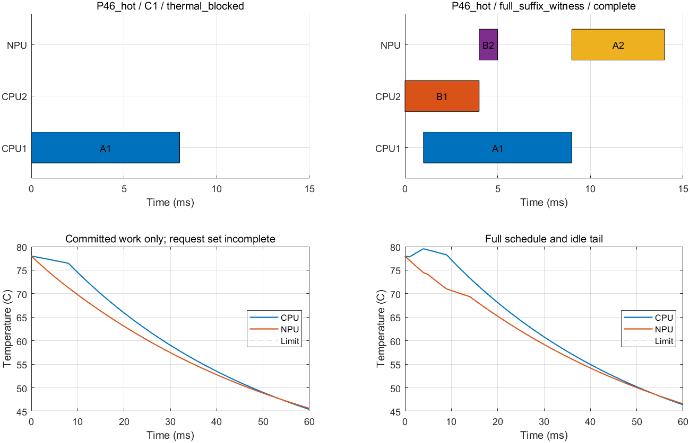

# 前缀热可完成性配对验证

日期：2026-09-24。按[46号冻结协议](46_前缀热可完成性条件与最小对照定义.md)，在MATLAB R2023b运行唯一热／冷配对。没有新增案例或改参，旧C1与历史源码保持不变。

**运行复现了解析结论：热态C1在0 ms接受A后丢失全部热安全后缀，1 ms派发受阻；简单完整后缀复核自主选出B先方案，安全达到同域最优90 mJ。冷态两者均直接完成。** 因而当前准入确有保证边界，但这项构造已由简单完整预测处理，不支持继续为它设计复杂算法。

本轮结束这项前缀检查。保留“精确无热规划＋完整候选后缀复核”为更强的适配对照，不追加温度、期限或任务规模来寻找它的新失败。结论只限本L3输入、1 ms启动网格与60 ms窗口，不代表端侧设备的实际失败率、节能率或一般性能保证。

## 1．运行与可复核材料

正式目录：[run_20260924_222121_128](matlab_config_value_src/prefix47_reports/run_20260924_222121_128/)。MATLAB版本23.2.0.2365128（R2023b），进程退出码0，工作区偏好目录`.runtime/matlab_prefs`。

| 材料 | 位置 |
|---|---|
| 原始冻结输入／解析规则 | [prefix46_design](prefix46_design/README.md)，本轮未修改；正式目录另存输入、46号和冻结清单 |
| 运行入口与说明 | [run_prefix47.m](matlab_config_value_src/run_prefix47.m)、[PREFIX47_README](matlab_config_value_src/PREFIX47_README.md) |
| 汇总／时间表 | [summary.csv](matlab_config_value_src/prefix47_reports/run_20260924_222121_128/summary.csv)、[schedules.csv](matlab_config_value_src/prefix47_reports/run_20260924_222121_128/schedules.csv) |
| 完整MAT | [results.mat](matlab_config_value_src/prefix47_reports/run_20260924_222121_128/results.mat) |
| 热态逐事件与前缀证据 | [C1事件](matlab_config_value_src/prefix47_reports/run_20260924_222121_128/P46_hot_C1.json)、[参考及前缀](matlab_config_value_src/prefix47_reports/run_20260924_222121_128/P46_hot_reference.json)、[18条参考安排](matlab_config_value_src/prefix47_reports/run_20260924_222121_128/P46_hot_reference_rows.csv) |
| 检查与日志 | [预检查](matlab_config_value_src/prefix47_reports/run_20260924_222121_128/preflight_checks.csv)、[事后检查](matlab_config_value_src/prefix47_reports/run_20260924_222121_128/post_checks.csv)、[console](matlab_config_value_src/prefix47_reports/run_20260924_222121_128/console.txt)、[audit](matlab_config_value_src/prefix47_reports/run_20260924_222121_128/audit.json) |

输入哈希保持`3AF923406A51E835BAF1FA7AE07C60D2D2D7D972700AD8ED12E46AD65ABB1901`。两个请求、两固定CPU单元、NPU、原RC／功率及预算不变；数据为46号构造，不是实测平台。α均1，本轮没有检验非线性响应的额外收益。

## 2．公平性与实现范围

- 新建`p47_cases`只读适配器，向方法传入case/thermal，移除预声明排序与时间表的访问路径。原`c44_cases`需要旧C0预算字段，因此没有强行复用或修改它。
- C1直接调用旧`c44_policy`，没有改变排序、候选动作、等待、频率或热判据。完整后缀见证对照在0时刻沿同一动作排序，每动作只检查一个最佳无热完整后缀代表，返回首条安全计划。
- 两种方法各自重新生成无热安排集合，不共享预计算或参考。参考在全部策略完成并保存后才运行。每例每方法及参考各60 s，包含无热集合生成；参考前缀诊断也在本次参考预算内。
- 原连续段内峰温评价器处理并发功率与空闲尾段；原能量积分与基准加活动增量两种计算互相核对。没有把图中的采样曲线用于安全判定。
- 完整后缀见证对照返回一次完整计划，C1逐事件提交；这是未来热信息使用方式的比较，不是在线适应性或求解速度竞赛。每动作的首个代表失败也不能证明该动作不存在其它安全后缀。

参考独立核对完整的18条合法无热安排，均为HH：CPU起点(0,0)、(0,1)、(1,0)、(1,1)分别对应8、4、4、2条带核标签时间表。热态6条安全、12条违规，冷态18条均安全；无未分辨安排。两种入口下唯一热最优配置均HH，能耗上下界均90 mJ。

## 3．实际结果

| 入口 | 方法 | 完成／热状态 | A／B请求完成时间 | 有效系统能耗 | 完整轨迹CPU／NPU峰温 |
|---|---|---|---|---|---|
| 78°C | C1 | 1 ms派发受阻，未完成 | —／— | 不参与排名 | 不作为完整方案报告 |
| 78°C | 完整后缀见证 | 完成且安全 | 14／5 ms | 90 mJ，与参考一致 | 79.547397／78°C |
| 30°C | C1 | 完成且安全 | 13／5 ms | 90 mJ，与参考一致 | 38.250706／33.058240°C |
| 30°C | 完整后缀见证 | 完成且安全 | 13／5 ms | 90 mJ，与参考一致 | 38.250706／33.058240°C |

热态C1只提交了A的CPU阶段，A的NPU后继也没有提交，不能把A_CPU完成视作请求A完成。CSV中的78／78°C只评价“已提交A加空闲尾段”，有明确`committed_only_not_complete`标记；它不是低温完成全部工作，也不是有效节能解。能耗和差距字段留空。

冷态完整CPU峰温38.250706°C高于46号列出的4 ms端点35.958542°C；两者没有矛盾：46号没有将那个端点称作全过程峰值，而是另用不变区域保证尾段安全。本次统一评价器检查了全部事件区间。

## 4．首次损失在哪里，简单复核怎样避开

热态C1的实际事件记录：

| 时刻 | 候选与决定 | 证据 |
|---|---|---|
| 0 ms | 两CPU同时H启动，两种对称核映射都被拒绝 | 已提交轨迹CPU峰温80.268126886°C，明确违规 |
| 0 ms | 接受仅A_H在CPU₁启动，计划执行0–8 ms | 已提交轨迹安全；其最佳无热后缀的完成时间和19 ms、最大值13 ms，排在B先的19／14 ms之前 |
| 1 ms | 只能尝试B_H在另一CPU启动；被热检查拒绝 | 完整承诺将产生CPU峰温80.073740733°C；更晚启动不能满足B期限，没有可续接的等待动作 |

**程序在1 ms受阻，但首次丢失全部安全后缀是0 ms接受A这一决策。** 参考固定实际前缀A_CPU₁@0，仅剩两条无热合法时间表；它们只差A_NPU在8或9 ms启动，都在5 ms出现相同CPU违规。参考已评价完两条，零安全、零未分辨、零未检查，因此这是同域排除证据，不是超时或只比较某条最优见证。

完整后缀见证对照并未读入46号答案。它自行重新生成无热安排，复核AB同时启动和A先动作的完整代表后，接受B先：

| 阶段 | 实际生成的执行单元 | 时间 |
|---|---|---|
| B₁ | CPU₂，H | 0–4 ms |
| A₁ | CPU₁，H | 1–9 ms |
| B₂ | NPU | 4–5 ms |
| A₂ | NPU | 9–14 ms |

CPU标签与46号一种解析写法互换，但单元对称，时间与功率轨迹相同，不能称为映射收益。完整对照热态作5次热评价，其中包含对称核标签的重复候选；不能把它描述为发现了5类不同机制。

左图明确只展示未完成方案的已提交工作；右图是完整安排。原“NPU热耦合导致CPU失败”说法仍不成立：本例直接超温发生在NPU工作开始前，NPU后缀主要通过期限和无热评分影响当前动作选择。

冷态对照图见[P46_cold](matlab_config_value_src/prefix47_reports/run_20260924_222121_128/P46_cold.png)。两张图均已目视检查，区分了部分承诺与完整执行。

## 5．检查、预算及失败记录

13/13预检查通过：包括独立笛卡尔约束掩码与18条安排逐行比对、响应与功率、唯一HH／90 mJ、策略输入隔离、实际固定核标签后的两条后缀，以及三方法在两案例副本上的超时状态。负预算副本是接口测试夹具，不计入研究案例，也未改变正式60 s预算。

45/45事后检查通过：包括资源／依赖／网格合法性、能耗双算、完整热安全、每个C1准入动作的独立复核、前缀不可改写、参考集合覆盖，以及46号解析预测与实际行为一致。合计58项检查，不是58个研究实例。

| 方法 | 热态耗时 | 冷态耗时 | 热态／冷态热评价次数 |
|---|---|---|---|
| C1 | 0.1607053 s | 0.0494285 s | 4／9 |
| 完整后缀见证 | 0.0476219 s | 0.0130969 s | 5／1 |

参考每例评价18条完整安排，全部结束且无超时、无阈值未分辨。上述耗时包含各自集合生成，但受到MATLAB初始化／缓存和不同调用方式影响，只作运行记录，不声称加速优势或据此立新算法。

两次实施失败均保留：

1. [run_20260924_221909_549](matlab_config_value_src/prefix47_reports/run_20260924_221909_549/)：MATLAB将域成员读为嵌套cell，新适配器直接转string失败；未进入预检查或正式案例。修正仅为解包单个共享域。
2. [run_20260924_222000_495](matlab_config_value_src/prefix47_reports/run_20260924_222000_495/)：独立枚举预检查要求浮点逐位相等，“毫秒除1000”与“网格编号乘0.001”存在末位差异；12/13通过，未进入正式案例。改为协议已有时间容差内比较，未改变排序器、参数或容差值。

正式运行保存了全部MATLAB源码、运行说明、输入、46号规则、环境及哈希。57份既有MATLAB源码未改变；43号及46号冻结文件哈希仍匹配。新入口与对照只写新文件，旧35—44号结果不改。正式运行后的代码未再修改。

## 6．结论与支线结束

本次确认了具体接口问题：**精确无热规划保留了期限可完成性，当前热准入又确认了已提交工作的安全，两者仍可能接受一个没有完整热安全后缀的前缀。** 同时也确认了当前构造的简单修正：把一个完整候选后缀送入原热评价器，就能避开这个前缀并达到同域最优。

这是一项可行性收益，不是热态两种有效方案之间的节能差；C1未完成，不能算节能百分比。配置始终HH，没有配置翻转；CPU单元对称、α=1，没有证明异构映射或非线性响应的贡献。解析构造加程序复核证明模型内存在性，不证明实际平台常见、通用递归可行性或一般算法优越性。

**按46号约定，本项到此结束。** 回到主线时保留现有前瞻／完整后缀复核能力，不再把只有当前动作热检查的C1当成最强对照；也不把这项已被简单办法解决的失败包装成复杂算法必要性。后续若讨论映射／配置或求解结构，应有独立的任务与方法证据，不自动追加本参数族、异构核、可变核组或规模测试。

本轮没有新增文献检索或下载需求。采用academic-research-suite实验执行／复核流程；文献机制边界沿用45—46号，所有新结果来自本次明确的L3模拟，未调用外部模型或硬件测量。
