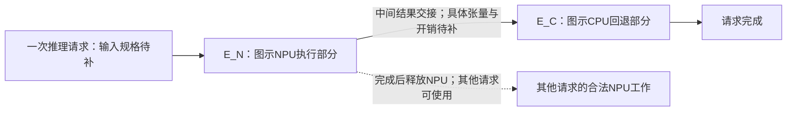

# 50．端侧代表性任务与模式数据边界

日期：2026-09-25。范围：Band论文、论文归档及作者直接链接的代码／模型；只读核查，没有构建Android、运行推理、MATLAB或新调度实验。41号固定执行单元对象、49号模式表结论和历史实验均保留。

## 1．结论：执行关系有依据，精确任务实例仍未锁定

**本轮正式判定为“暂不能选定可复核的模型级任务”，而非“已有部分参数锚定”。** 优先项EfficientDet的NPU执行→CPU回退关系有论文原页依据，但图6没有给出对应模型文件、输入规格、量化形式和算子分区。备用MobileNetV1有CPU／NPU整模型执行图示，也有归档直接链接的模型包；两者尚未建立同一工件的对应关系，不能用它补成EfficientDet式两阶段。

唯一保留的补证对象是**图6中Pixel 4上的EfficientDet回退流程**，尚不指定为Lite0或Lite2。它与“一个Stage由一个固定执行单元完成”的主线相容，但相容是执行抽象层面的判断：两颗独占CPU单元、两档可控CPU频率以及具体Stage模式表仍未由该材料证明。

取得的现实依据比旧合成实例多了三项：真实端侧CPU回退、回退期间可释放NPU、跨请求利用该空档。没有取得同平台的Stage多频点时长／功率／热参数，因此不能宣称设备复现、异构映射收益或热节能效果。**下面的依赖图是原文流程的语义图，不是已经恢复的算子级任务图。**

## 2．版本和材料身份

| 材料 | 本轮固定身份 | 使用边界 |
|---|---|---|
| Jeong等，Band: Coordinated Multi-DNN Inference on Heterogeneous Mobile Processors，MobiSys 2022 | [本地全文](../papers/2022_Jeong_Band.pdf)，[DOI](https://doi.org/10.1145/3498361.3538948) | 定向读§3.2.2、§4.1–4.3、§6.1、§6.4–6.5；复核图6及印刷p.243、245原页 |
| 论文归档v0.0.0 | [发布页](https://github.com/mrsnu/band/releases/tag/v0.0.0)，提交`f5e1655b3ace9417f1fbb70d5adc7867987b197d` | 发布页称MobiSys 22旧里程碑；README为TFLite 2.3.0。它是论文代码核查基点，不自动等于全部实验输入已归档 |
| 当前仓库补充快照 | 提交`8600d4960ccb6f121221f6d252da8dbef2db160b`，提交时间2024-07-24 UTC | README列TFLite 2.9.2／2.10；仅补充查模型与接口，不能倒填2022年模型身份 |
| 官方MobileNetV1模型入口 | 归档`tensorflow/workspace.bzl`第942–959行的TensorFlow官方包链接和预期SHA256 | 是归档直接引用的上游依赖，不是图6实验身份声明；本轮未取得可验证的压缩包内容 |

递归目录清单均未截断：归档6976项、当前快照330项。检索模型名、配置、profile路径后定向读取源码；没有下载并审阅全仓库每个文件。发布页显示两项Assets但网页展开失败，**不据此声称已排除独立附件**。在取得的目录与已读材料中，未找到能把图6任务、设备分区和测量表连接起来的工件。

版本树、选读源码、当前Lite0模型及其静态元数据保存在[证据目录](evidence_20260925/band50/README.md)。每份源码使用提交固定链接，见文末来源索引。

## 3．按预定顺序检查两个任务

### 3.1 优先项：EfficientDet

图6（印刷p.239）及§3.2.2明确展示Pixel 4的Edge TPU：EfficientDet先使用NPU，进入CPU回退期间，未协调运行时仍占住NPU；协调运行时可把NPU交给MobileNetV1。它证明的是**回退交接和跨请求资源复用**，没有提供可复用的全部算子编号、张量边或Stage频率表。[S1]

需要分开的三个名称：

| 身份 | 实际证据 | 不能进行的替换 |
|---|---|---|
| 图6的EfficientDet | 模型族名称、设备与CPU回退时间线 | 不自动写成某个Lite版本；不从时间线读几个长度当多模式profile |
| §6.2 Distream的EfficientDet-Lite2 | p.243脚注4明确列名及每帧平均调用数 | 这是另一工作负载的说明，未把图6绑定到Lite2文件 |
| 当前仓库`lite-model_efficientdet_lite0_int8_1.tflite` | 文件、Git blob、输入和图结构可静态核验 | 不是论文归档文件，也没有Pixel 4分区／profile，不能替代前两项 |

当前Lite0文件确已读取，非仅凭文件名判断：4561184字节，SHA256为`33a3b622c7cac0762f96089353cd61495f3e993968d133af7871bfc2d5396704`；Git blob校验匹配当前固定提交。FlatBuffer schema版本3，原始模型含一个`main`子图、267个算子、602个张量；输入`[1,320,320,3]`，类型为**UINT8**，量化scale为0.0078125、zero point为127。文件名的`int8`不能代替输入类型检查。输出元数据为FLOAT32；这些检查不等于证明所有内部算子都使用同一精度，也没有验证检测准确率。[S8]

这里“原始模型一个子图”是TFLite序列化结构，**不是Band动态生成的一个可调度Stage**。取得该模型本身仍不能静态决定某台设备的NPU委托分区。归档`interpreter.cc`第1689–1713行实际应用设备delegate，再把未委托节点加入`unsupported_ops`；当前实现也采用设备准备后检查`node.delegate`的办法。因此缺少设备／后端支持结果时，不把“所有卷积都支持”或“仅某个后处理算子回退”写成事实。[S3、S9]

### 3.2 备用项：MobileNetV1

图6展示MobileNetV1可在CPU或NPU上整模型执行，并通过改派和NPU空档缩短时间线。这可支持整模型替代执行的**图示关系**；它没有显示该任务存在EfficientDet式CPU回退，也没有给出可据以固定Stage边界的文件标识。[S1]

归档上游依赖直接列出MobileNetV1 1.0、224版本的float和quant模型包。quant包预期SHA256为`d32432d28673a936b2d6281ab0600c71cf7226dfe4cdcef3012555f691744166`。该值是**构建文件声明的预期值**，不是本轮下载校验结果。README的`mobilenet.tflite`及`1,224,224,3`只是通用配置示例；没有找到它与图6文件的对应说明。当前仓库列出的MobileNet模型则为V2，不替代V1。[S6]

本轮访问官方quant压缩包未完成；终止长时间无返回的请求，curl另报本机TLS凭据错误。即使随后取得该上游模型包，也只能补充模型静态身份，**不能独自补齐图6对应关系、NPU支持映射或设备profile**。因此不因有一个更具体的下载文件名就把备用项升级为最终推荐。

## 4．执行图、合法模式与固定单元接口

下图只抽取图6中一个EfficientDet请求的依赖语义。`E_N`、`E_C`为本报告标记，不是作者子图ID；张量集合、算子起止及是否各对应单个Band子图均未知。

此图保留**NPU→CPU**方向，不能为沿用旧程序改成CPU→NPU。它不表示任意EfficientDet都只有两个Stage，也不把与其他请求的虚线资源关系当成任务依赖。

| 部分 | 直接支持的合法性 | 还不能建立的模式 |
|---|---|---|
| `E_N` | 图6中的对应部分在Pixel 4 NPU运行 | 同一固定子图的CPU版本、时长、功率尚未取得；论文一般CPU支持说明不等于该工件的匹配测试 |
| `E_C` | 对应图示后端不支持而回退CPU | 不能继续声明它在同一NPU也合法；GPU可运行的讨论不自动纳入CPU–NPU模式集合 |
| CPU worker | §6.1两个单线程worker映射BIG核，用于CPU-only回退 | 不证明任意Stage都能交给它们，不证明每worker固定独占不同物理核，也不证明独立调频 |
| NPU worker | 每加速器一个worker，worker每次执行一个子图（§4.1、§6.1） | 不等同整个设备所有客户均由Band独占；不提供运行时改NPU频率的合法动作 |

Band §4.2先按相同支持集合构建unit，再组合相邻unit生成候选子图，保留小子图；调度可选择不同合法覆盖。**本研究固定Stage划分是对其候选集合的一个事先选择，不能把所有重叠候选同时当成必须执行的任务。** 应在取得实际分区后，选一个覆盖原算子且不重复的固定划分，登记张量依赖与逐Stage合法单元；本轮没有足够材料完成该选择。[S1、S3]

归档CPU affinity接口按`ALL/LITTLE/BIG/PRIMARY`设置掩码，后端设最大线程数；`cpu.cc`按最大频率分组构造核集合。两个`num_threads=1, cpu_masks=BIG`配置仍可能共享允许核集合，不能由此推导互斥的固定物理核。该代码读取最大频率是为了分组，并非设置任务运行频率。[S4]

因此与41号衔接需明确两个额外输入：worker的固定、互不重叠占核集合，以及合法频率域／频点。若采用这些输入作为L3假设，应直接标假设；不能冠以“论文已验证的两独立可调频CPU核”。

## 5．参数来源与可用性登记

标记：**测**＝原文报告的测量；**码**＝静态代码能力／文件事实；**运**＝须运行时产生；**规**＝论文规则／估计方法；**假**＝本研究仍需声明的输入。标记不代表L1/L2/L3等级：有一项实测数字，不会自动形成匹配参数包。

| 参数／信息 | 单位与粒度 | 来源和当前可用内容 | 属性、关联限制与缺口 |
|---|---|---|---|
| 图6模型身份、输入、精度 | 文件SHA、输入张量、量化／精度 | 图6仅EfficientDet名称；Lite2另属Distream；当前Lite0另有静态文件 | 码／待补。三者不合并；图6准确率指标也未取得 |
| Stage及依赖 | 算子索引、边界张量、支持集合 | §4.2；归档按delegate结果生成`unsupported_ops`及子图 | 规＋运。只有语义NPU→CPU，缺该模型的分区记录 |
| CPU线程及亲和性 | 每worker线程数、核集合 | §6.1两单线程BIG worker；源码掩码和线程上限接口 | 规＋码。论文实验设置有依据；实际独占核ID／同频域待补 |
| CPU频率与任务响应 | Hz、ms／Stage／频点 | profile以worker及子图边界索引时延；未见频率维度 | 运／缺。不能由一个时延点拟合α或`d(i,p,f)`；操作系统DVFS波动不等于作者主动控制频率 |
| NPU后端与模式 | 设备名、delegate、服务单元 | 图6Pixel 4 Edge TPU；归档列`google-edgetpu`等NNAPI设备名并建delegate | 测量场景＋码。driver版本、实际选中设备和每Stage支持dump缺失；固定NPU服务模式仍是研究限制 |
| 子图时延 | μs，model／root-leaf／worker | `ProfileSubgraph`重复Invoke后取平均；profile JSON可读写 | 码＋运。未取得目标任务匹配profile；不是p99、WCET或含排队请求时间 |
| 估计与实测区分 | μs／子图 | §4.3.2先测各设备最大子图，再按FLOPs与张量项估计其余，在线平滑 | 规＋运。profile条目可能是估计／更新值，不能统一标为隔离实测；缺样本、频点和采集状态 |
| 排队与交接 | μs／请求或交接 | §4.3.1请求预计时延还计worker占用；源码显式复制输入／输出 | 规＋码。worker更新时长的计时起点在输入复制后、终点在输出复制前；不能把该数当全部交接开销 |
| 阶段活动／空闲功率 | W／节点／任务／模式 | 目标模型profile和已读配置没有匹配功率字段 | 缺。未取得CPU／NPU空闲分量与活动增量，不能反算Stage能量 |
| 已有功率实测 | W，Pixel 4工作流平均 | §6.5表2：EagleEye(Crowded)，Monsoon，TFLite+MP 7.60、Band 7.99，后者说明无throttling时测量 | 测。不是EfficientDet Stage功率，也不是CPU或NPU单节点输入；不作为本题注热参数 |
| 到达 | ms、FPS／应用 | §6.4四应用各30 FPS请求；工具支持`period_ms`／`batch_size` | 规＋码。这一工作负载并非图6请求源；两次重复EfficientDet到达时间仍需另定义 |
| SLO | μs或ms／完整请求 | §6.4最快处理器隔离时延p99×倍率；归档另有默认helper，见下文 | 规。缺目标任务p99和该图SLO；不能拿均值替换后仍称原实验规则 |
| 切换／准备／调度开销 | μs或ms／事件 | 代码有准备、复制、调度；§5.1 Binder IPC通常小于1 ms，§4.3.1报告其他场景调度开销 | 测／码但粒度不匹配。不能给目标Stage填同一个常数，也不默认开销为零 |
| 温度、RC、热边界 | °C、W/K、J/K | §4.3.1有热不可用反馈；本材料未提供目标匹配RC与功率轨迹 | 码／缺。反馈能力不等于连续温度模型；旧二节点网络仍是独立L3假设 |

### 两个容易误读的接口

**profile接口不是公开profile。** 归档`profiling/util.cc`第26–122行的键为模型名、输入／输出算子边界和worker ID，值是时延；没有频率／功率／温度维度。当前测试配置指向`band/test/data/profile.json`，但当前递归树中没有该文件；该配置实际使用RetinaFace及3线程BIG／4线程LITTLE，不能拿来代表图6的EfficientDet或双单线程设置。测试中的常数、成功断言和示例配置均未作为实测数据。[S5、S10]

**论文SLO规则不等于归档默认helper。** 论文p.245使用最快处理器的隔离p99；归档`SetSLOBasedOnProfile`则在没有显式`slo_us`时，以`GetWorstDeviceProfileResult`取得的最大移动平均profile值乘`slo_scale`。后者遍历模型子图，并不计算最快整模型隔离p99。可能由论文实验显式传入`slo_us`或外部处理；本轮未取得对应配置，不能认定论文与实现矛盾，更不能混用这两个基准。[S1、S7]

## 6．最终可用性与唯一后续行动

| 判据 | 本轮状态 |
|---|---|
| 真实端侧CPU–NPU交接是否有依据 | 有：图6的NPU→CPU回退、NPU释放和跨请求复用 |
| 精确模型与固定Stage合法边界是否均确定 | 没有：当前Lite0文件确定，但不是图6身份／分区的证据；V1备用也未补齐 |
| 是否有目标Stage匹配性能数据可复用 | 未取得；接口和静态模型元数据不属于模式时长／功率测量表 |
| 能否形成部分参数锚定任务 | 本轮不能；没有把不同任务、版本、粒度的数据拼成L2 |
| 与当前主线是否相容 | 流程相容；真实独占CPU单元及可控频率需补证或明确L3。非线性响应、热收益与新算法必要性仍未获证 |

**下一步只补一个关键证据包：图6EfficientDet的“模型身份—设备分区对应记录”。** 所需内容是同一模型文件／SHA256、输入规格，以及Pixel 4所用NNAPI设备／后端版本下的NPU委托算子、CPU回退算子和边界张量。优先核对作者原始实验工件；模型文件和分区dump可以分开保存，但必须能相互对应。它解决“究竟调度哪些合法Stage”，优先级高于继续找零散时延或功率数字。

目前找到的公开入口只有[论文归档发布页](https://github.com/mrsnu/band/releases/tag/v0.0.0)和[当前Lite0文件](https://github.com/mrsnu/band/blob/8600d4960ccb6f121221f6d252da8dbef2db160b/band/test/data/lite-model_efficientdet_lite0_int8_1.tflite)，**尚无图6对应分区包的精确下载地址**；不虚构附件名称，也不要求重复下载已有全文。只下载当前Lite0或上游MobileNet包不能闭合此缺口。该补证未完成前，EfficientDet只作执行结构参考，不自动启动条件性仿真，也不因此否定固定单元主线。

## 7．来源、阅读边界与完整性

- **S1**：[Band全文](../papers/2022_Jeong_Band.pdf)，p.238–239图6及解释，p.239–242 §4.1–4.3，p.243 §6.1及脚注4，p.245 §6.4–6.5表2。原页沿用并复看`evidence_20260923/band_crown/band_p5.png`、`band_p9.png`和`evidence_20260924/result_scope/band-11.png`。
- **S2**：[归档README](https://github.com/mrsnu/band/blob/f5e1655b3ace9417f1fbb70d5adc7867987b197d/README.md)，版本、worker、profiling与示例字段；[当前README](https://github.com/mrsnu/band/blob/8600d4960ccb6f121221f6d252da8dbef2db160b/README.md)仅作版本差异说明。
- **S3**：[归档interpreter.cc](https://github.com/mrsnu/band/blob/f5e1655b3ace9417f1fbb70d5adc7867987b197d/tensorflow/lite/interpreter.cc)，第179–214行NNAPI设备，第1345行起回退分组，第1689–1713行支持检查。未运行delegate。
- **S4**：[cpu.cc](https://github.com/mrsnu/band/blob/f5e1655b3ace9417f1fbb70d5adc7867987b197d/tensorflow/lite/cpu.cc)第234–272行；[worker.cc](https://github.com/mrsnu/band/blob/f5e1655b3ace9417f1fbb70d5adc7867987b197d/tensorflow/lite/worker.cc)线程设置；S3第1139–1148行profile环境设置。
- **S5**：[profiling/util.cc](https://github.com/mrsnu/band/blob/f5e1655b3ace9417f1fbb70d5adc7867987b197d/tensorflow/lite/profiling/util.cc)第26–122行；S3第1113–1137行平均计时；[worker_device_queue.cc](https://github.com/mrsnu/band/blob/f5e1655b3ace9417f1fbb70d5adc7867987b197d/tensorflow/lite/worker_device_queue.cc)第107–123行复制与Invoke边界。未取得目标profile样本。
- **S6**：[tensorflow/workspace.bzl](https://github.com/mrsnu/band/blob/f5e1655b3ace9417f1fbb70d5adc7867987b197d/tensorflow/workspace.bzl#L942-L959)；[直接链接的MobileNetV1 quant包](https://storage.googleapis.com/download.tensorflow.org/models/mobilenet_v1_2018_08_02/mobilenet_v1_1.0_224_quant.tgz)。包内容未完成下载核查，不能称读取了模型。
- **S7**：[SLO helper](https://github.com/mrsnu/band/blob/f5e1655b3ace9417f1fbb70d5adc7867987b197d/tensorflow/lite/interpreter.cc#L2003-L2046)。默认实现核查，不是论文实验配置复现。
- **S8**：[当前Lite0文件](https://github.com/mrsnu/band/blob/8600d4960ccb6f121221f6d252da8dbef2db160b/band/test/data/lite-model_efficientdet_lite0_int8_1.tflite)，[本轮静态元数据](evidence_20260925/band50/lite0_metadata.json)。用FlatBuffer字段读取器检查已有二进制，不执行模型；TensorType枚举对照归档schema，Git blob与API目录记录一致。
- **S9**：[当前model_executor.cc](https://github.com/mrsnu/band/blob/8600d4960ccb6f121221f6d252da8dbef2db160b/band/backend/tfl/model_executor.cc#L137-L171)设备准备后取未委托算子；只作归档机制的补充核查，不将当前实现冒称论文代码。
- **S10**：[当前benchmark_config.json](https://github.com/mrsnu/band/blob/8600d4960ccb6f121221f6d252da8dbef2db160b/band/test/data/benchmark_config.json)、[benchmark说明](https://github.com/mrsnu/band/blob/8600d4960ccb6f121221f6d252da8dbef2db160b/band/docs/benchmark.md)。示例不是数据集。

本轮检索限于上述仓库、release及其直接模型链接；定位词`EfficientDet`、`MobileNetV1`、`model_profile`、`unsupported_ops`、`cpu_masks`、`num_threads`、`slo_scale`、`ProfileSubgraph`。没有新增方向或全面新颖性检索。“未取得”均限于本轮访问范围，不声称作者从未发布或不存在其他版本。

使用academic-research-suite证据审查与PDF原页阅读。新增50号、证据快照并同步BRIEF／03；旧源码、冻结输入及41–49号历史报告的哈希复核见[完整性记录](evidence_20260925/band50/audit.json)。模型静态检查不计推理实验或性能测量。
