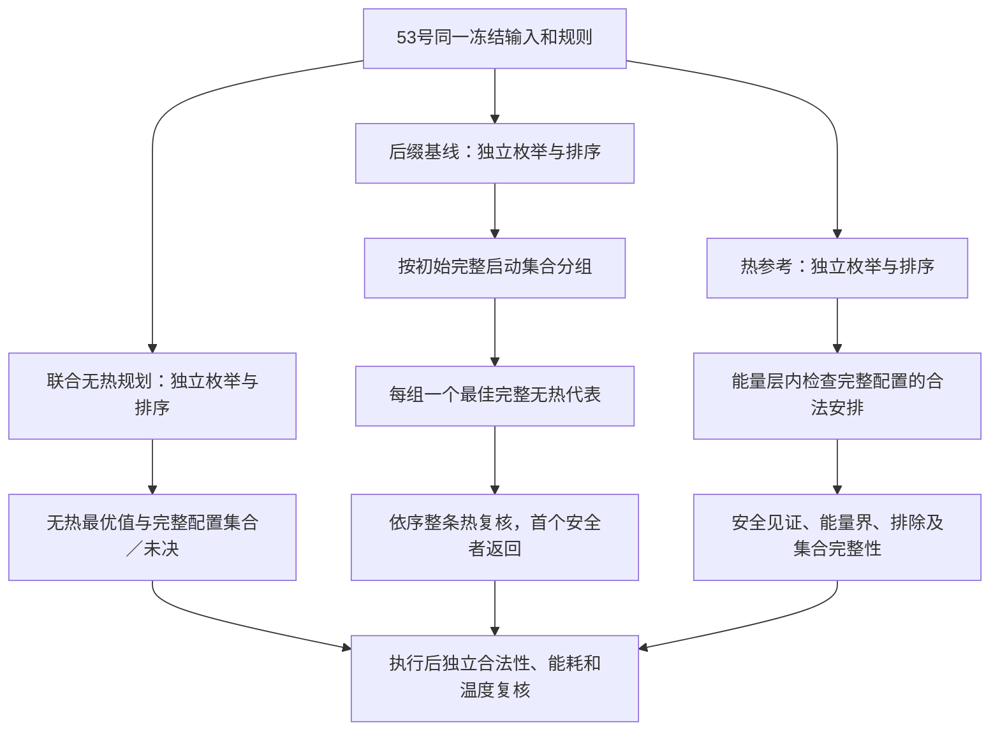

# 四Stage实现接口与预检任务书

日期：2026-09-25。承接[52号输入契约](52_四Stage任务输入契约与验证主张.md)与[53号冻结协议](53_四Stage任务L3参数冻结与比较协议.md)。本轮只静态阅读旧代码、确定未来实现与验收任务；没有新增实验程序、运行预检、调度搜索、热仿真或MATLAB。

**下一轮可以实施独立的八Stage验证入口，但必须先通过合法性、枚举覆盖与证据状态预检，再运行53号固定10项。** 方法不变：联合无热规划、每初始动作一个完整无热代表的热复核基线、同域热参考。首版采用透明的有限域枚举；不是提出求解加速算法，也不承诺60 s内能完成。

## 1．输入、入口与兼容边界

唯一研究输入为[inputs_v1.json](stage53_design/inputs_v1.json)，SHA256 `cb76929032f3ee457df95200af6e106aa4fdce97760790086aed74d04aace1cd`；唯一比较规则为[rules_v1.json](stage53_design/rules_v1.json)，SHA256 `bda369552628a36e6f39112e02f34f6dc774683392ab242493aa94a297b85a78`。参数、8主例＋2校验、预算、排序及统计口径均不变。54号只把规则落实为实现契约，不构成新参数版本。

后续在现有验证目录新增独立`run_stage55`入口，分为`precheck`和`frozen`两种显式模式。前者只运行测试夹具；后者先检查冻结哈希和已通过、源码哈希匹配的预检记录，再运行固定10项。未通过时停止，不绕过预检自动开展研究案例。旧35–47入口及结果保持原样，不让旧入口隐式读取新JSON。

未来使用已定位的MATLAB R2023b和工作区偏好目录。保存输入、规则、源码、版本、环境和哈希；先各自运行联合无热与完整后缀基线，保存结果，再运行热参考。任何方法独立重建其候选空间，不共享候选库、参考见证或安全映射提示；末尾统一评价模块才合并证据。实现异常可修复后重做受影响检查，保留失败日志；不能借修bug修改研究输入或增加预算。

### 统一数据接口

| 接口 | 输入→输出 | 必须保持的含义 |
|---|---|---|
| 输入加载与展开 | 冻结JSON＋case_id→只读case结构 | 四Stage类型展开A.S0…S3、B.S0…S3八行；显式依赖、请求ID、合法模式、终端Stage与单元种类；不得依据行号前后半判断设备 |
| 时间表 | 八行Stage＋选择→完整或部分schedule | 每行含Stage ID、单元、模式、启动格点整数k、start、finish、duration、increment；时长／功率从冻结模式表取，不允许计划自行改值 |
| 合法性检查 | case＋schedule＋完整／部分标记→分项结论 | 完整性、支持、响应一致、依赖、到达、期限、窗口、资源、频率域、启动网格分别报告；请求完成取S3 |
| 无热枚举 | case＋方法本地计时器→候选集合与覆盖状态 | 返回完整性标志、叶子数、完整配置ID、能量、请求完成和规范键；无热生成器不读取温度或参考结果 |
| 能量评价 | 完整合法schedule→总量／设备分量及双算误差 | 按实际选中设备分组；基准只计一次；部分计划不输出可排名的总能耗 |
| 热评价 | 完整或已提交schedule＋RC→节点峰温／时刻／终温／判定 | 按设备聚合并发注热，连续段内求峰，含入口和20 ms空闲尾段；部分计划只对已声明注热成立，不能代表未来可完成性 |
| 方法输出 | case＋方法→方案、证据与预算记录 | 将计划完整性、热状态、候选覆盖、最优性、配置集合完整性和预算状态分别存储，不压成一个success布尔量 |

部分轨迹未提交行统一用NaN／明确状态表示，不用零时长；已提交行单元、模式、启动不可改写。若后继已提交而前驱缺失或未按依赖结束，部分检查也应拒绝。当前基线返回完整计划，不需要新建在线滚动策略。

## 2．完整无热枚举：覆盖什么、何时可以下结论

首版按固定拓扑行序`A.S0…S3、B.S0…S3`赋值，逐Stage枚举全部合法`(unit,mode,k)`。这是**变量赋值顺序，不是时间执行顺序**：后赋值的B可以在A之前或同时执行。C1/C2不做标签对称剪枝，不合并不同初始动作；每个完整八行元组只生成一次。

对当前Stage，启动下界来自到达与已赋值前驱完成，上界来自请求期限减当前时长及后续Stage的乐观最短时长。后继最短时长逐项取所有合法模式的最小值，忽略竞争、频率域和未来网格损失，因而只能作为不高估的下界。上下界按53号时间容差向网格对齐，保留真正的非整数结束。不得把后续都按某个首选模式计算后剪掉其它合法模式。

赋值时检查所有已赋值Stage之间的区间关系：同执行单元不重叠；不同CPU若同域且重叠必须同频；NPU一次只服务一个Stage；全部显式依赖成立。域清空时的同刻切频按半开区间处理。检查任意两Stage，而不只是两个CPU行或两个固定NPU尾段。

合法叶子需再经过独立完整检查器。无热生成阶段不做热剪枝，不因高能量删模式，不只保留最早时间表，也不限制某一S1必须走NPU。允许所有四Stage的合法等待、CPU分配和跨请求交错。

### 能量层与代表必须等覆盖完成后确定

枚举完成后，依53号固定锚点规则对**合法安排实际出现的能量**分层，再按完成时间和规范键排序。可以先算每个配置的能量减少重复算术，但不能让没有合法安排的配置能量充当分层锚点，从而改变代表顺序。首版不改变排序定义或使用近似top-k替代。

若枚举／排序超时或资源耗尽，则`enumeration_complete=false`；已发现叶子只是覆盖的一部分：

- 已发现最小无热能耗是无热最优值的**上界**，不是下界，也不是已经找到全部最优配置。
- 一个总是有效的宽松能耗下界为`P_base×W + Σ_stage min合法模式(Qd)`；它忽略域、资源和期限，不能伪称可达到。
- 完整后缀基线不能从未完成候选库声称已选到“每动作最佳代表”；只能报告未决和诊断样本，不能把样本当正式基线成功或失败。
- 完整枚举为空才可判无热不可行；若使用53号4 ms链下界作提前排除，必须另列所用证明，不把未搜到当证明。

这一枚举是有限问题的共同参考工具，102,400配置上界不代表实际耗时。若预算内不能完整生成，不自动改网格、减模式、扩期限、取消候选或扩大预算。

## 3．能量、连续热评价与三种方法

### 可复用的底层与必须替换的包装

本轮复读[thv_step.m](matlab_config_value_src/thv_step.m)：两指数精确传播，端点加导数零点求峰；[thv_build.m](matlab_config_value_src/thv_build.m)构造被动二节点网络。可在不改旧文件的条件下复用，但新的调度包装仍须重新验证，不继承旧4-Stage测试通过结论。

[c44_thermal.m](matlab_config_value_src/c44_thermal.m)固定前两行CPU、后两行NPU，并调用旧检查器；[c44_validate.m](matlab_config_value_src/c44_validate.m)固定i+2依赖和3:4完成时间。两者不能直接用于新任务。[c44_library.m](matlab_config_value_src/c44_library.m)也只表达两个CPU阶段与两个固定NPU后继；不得仅扩大数组长度。

新的包装从实际单元种类生成全部开始／结束事件，以每个恒功率段的活动集合构造注热；两CPU并发增量相加，S1改走CPU后不得继续向NPU加热。公共0.5 W不注热；NPU未被选择仍保留0.3 W闲置功率。全窗口能耗的事件积分与`基准×窗口＋活动能量和`独立交叉核对。

事件时间不按网格取整，不用密采样代替连续峰值。保持真实有限事件值，精确相同事件合并；容差用于合法性检查，不任意合并相近的独立功率事件。初始和末端、各节点内部驻点都参与峰值比较；零时段不传播。相等特征值等数值分支通过独立夹具核查。

### 三方法的信息流与停止语义

**联合无热规划：**只有候选完整时才输出精确的无热最优能量层和全部最优完整配置。可按相同排序取一条代表作热诊断；该代表违规不能宣称全部无热最优安排违规。配置必须含八Stage单元与模式，不能只记录HH／HL或S1映射。

**完整后缀基线：**0时刻启动集合是动作，键逐项保存Stage ID、unit、mode，空集合是等待；不要套用旧十进制行位编码。枚举和排序完整后按动作保留首条，再按同一全局排序检查整条后缀。安全则返回固定完整计划；全部代表明确违规才报`no_safe_representative`，有阈值未分辨则保留未决。它没有穷尽同动作的其它等待、频率或S1映射后缀；不得静默增加第二个代表或改成完整热搜索。

**同域热参考：**完整无热库建立后，按能量层、既定排序检查。对同一完整配置，固定模式能量与等待无关，因此找到一个安全安排即可证明该配置可保留；其它安排可跳过，但不能因此宣称该配置所有时序都安全。排除配置需其全部合法安排明确违规；有未检查或未分辨时不得排除。

维护每个配置`unseen／safe_witness／excluded／unresolved`及检查数。当前仍未被排除配置的最低能量构成下界，已取得安全见证的最低能量构成上界。没有安全见证上界为Inf；仅当全域被证明排除，才报告同域热不可行。生成未完成时退回上述乐观能量下界，不能用当前观察到的最小值充当全域下界。

发现安全最优层后，完成该层所有配置的存在性／排除判定才能声明最优配置集合完整；不能只找到第一条见证就宣称全集。较低能量层存在未分辨时保持最优性未决。上下界相差落在能量容差内只标“按声明容差已证最优”，不写成无限精度数学相等。最优值已确定而配置集合仍未确定时分别输出，不互相覆盖。

每例每方法独立60 s，覆盖生成、排序、候选和热评价。关键循环及不可中断调用前后均查预算；调用返回时若已超时，不把超时后新完成计算当预算内证明，记录实际耗时与未决。内存／I/O错误单列资源／实现状态，不能当实例不可行或基线决策失败。执行后独立审计的耗时另列；审计只验证已输出方案，不替超时方法继续搜索或补齐代表。

## 4．预检清单与证据门槛

下表是**待实现、待运行**的检查，不是54号已通过的测试。夹具独立命名、与53号10项隔离；可用少量Stage／模式／格点暴力笛卡尔积形成独立真值，不修改研究输入。

| 检查组 | 必须覆盖的检查与预期 |
|---|---|
| 输入与展开 | 固定哈希匹配；3个参数包分别17模式；8个Stage、显式链、终端S3；A/B共享、C1/C2同频响应相等；缺字段、负值、非法NPU模式拒绝 |
| 枚举覆盖 | 小夹具分别用全笛卡尔积＋独立谓词与正式拓扑枚举比较**完整元组集合与计数**；不能只比最优能量；B先于A、同刻／错开并发、空启动动作均保留 |
| 八行索引 | 独立单模式短窗口八Stage夹具检查S3完成与六条依赖；把S1从CPU切NPU不改变Stage身份；交换全部CPU标签等价而同／异单元分配不强行等价 |
| 资源与控制域 | 同单元重叠拒绝、异CPU同频错开重叠允许、同域异频重叠拒绝、域清空同刻切频允许、NPU重叠拒绝、CPU与NPU并发允许 |
| 时间与完整性 | 非整数持续／完成保留、网格对齐、期限等号、非法提前执行、未提交NaN、已提交响应与前驱一致；部分计划不参与有效能耗排名 |
| 模式与能量 | S1三类设备能量关系；动态设备归类；CPU空闲合计只计一次；等待不重复加公共功耗；独立事件积分与活动求和满足53号能量容差 |
| 连续温度 | RC稳定／空闲平衡；两CPU注热相加；S1设备切换；入口、内部驻点、结束和尾段峰值；恒功率解析及逐段ODE交叉；热采样只作诊断 |
| 旧实现对照 | 对旧47号冻结完整见证构造专用通用数据夹具，新包装与旧包装能量／温度一致；不将旧任务转换成53号研究案例，不修改旧文件 |
| 初始动作和代表 | 动作键无碰撞、不同同刻启动集合不合并、空集合等待保留；每动作代表与独立全排序真值一致；不悄悄补第二代表；同动作的不同S1映射可被遗漏且有记录 |
| 能量分层 | 固定锚点而非链式相等；无合法安排配置不参与分层；规范键可重复；CPU标签并列不算收益；P_tie不预设系统并列 |
| 状态与界 | 阈值带安全／违规／未分辨；单安全见证不能证明全部时序安全；代表耗尽不等于无解；配置有一个未分辨安排不能排除；最优值与最优集合分别完成 |
| 中断与隔离 | 用受控测试计时器触发生成／排序／热阶段超时，保留已有证据，局部库不称精确；内存／I/O异常不判无解；策略接口无参考输入、各方法不共享预计算库 |

独立枚举真值必须有自己的直接资源／依赖谓词，不能调用正式枚举的同一剪枝函数再声称独立验证。浮点数用冻结容差核对，不要求普通数值路径逐位一致；必须通过的结构集合则使用格点整数、Stage ID及模式ID比较。

ODE交叉检查未来沿用已有检验尺度：RelTol=1e−10、AbsTol=1e−11、MaxStep≤0.1 ms，状态误差≤1e−6°C；端点／内部驻点的解析夹具另作高精度核对。它只验证数值实现，不升级为硬件温度准确度，也不替代连续峰值判定。

53号冷态上界44.682809°C是未来一致性检查：完整合法冷态安排不应被新评价器判成超温；若发生，先检查注热、时间、单位和实现，不能调整53号温度。4 ms校验无热不可行是另一解析锚点。两者都不用于给热态方法额外的参考后缀。

## 5．正式运行的进入条件与输出

未来只有在冻结输入／规则哈希保持、预检全部通过、旧源码未改且方法没有参考信息输入后，才按53号原顺序运行8主例＋2校验；每方法重新独立计时。不得因某例未决自动追加更粗网格、更大预算或删模式重跑。

正式输出至少包含：每方法覆盖与预算日志、初始动作代表列表／拒绝原因、完整方案及设备映射、请求完成、能耗双算、逐节点连续峰温、参考上下界与配置存在性状态。见证图只画完整合法安排；部分结果显式标注，不进入有效节能比较。保存MAT、CSV及运行日志，温度图标注固定20 ms窗口与L3身份；主例与校验分表。

若基线完整安全且达到已证参考，保留“在该例足够”；若只有参考有安全安排或更低能量见证，定位是代表未覆盖映射、频率还是时序，不立即认定需要新算法。若候选生成／参考未完成，报告未决，不能用超时推翻H52或用102,400组合数证明论文算法必要性。

## 6．本轮审查结果与唯一下一步

本轮确认：旧RC底层可以作为条件性复用对象，旧安排库／检查器／注热包装不能直接用于八Stage；旧[p47_witness.m](matlab_config_value_src/p47_witness.m)保留的是每动作一代表能力，旧[p47_reference.m](matlab_config_value_src/p47_reference.m)的两模式编码、3:4完成时间及全单层配对不能照搬。

54号补清了部分枚举的上下界方向、代表选取必须等待覆盖完成、最优值与配置集合完整性的区别，以及每方法预算和失败处理。没有发现或声称新策略失败，没有修改53号参数／规则。此次仅阅读与文档交付；保护快照与链接检查见[54审计](stage54_review/audit.json)。沿用academic-research-suite的内联实验规划，无新网页检索或论文下载。

**唯一下一步：实现上述独立入口和预检，预检通过后运行53号冻结10项，并如实报告预算未决。** 这是已定义问题的实现与验证，不扩请求规模、不加可变核组、不做参数扫描，也不预设新算法或映射收益。
