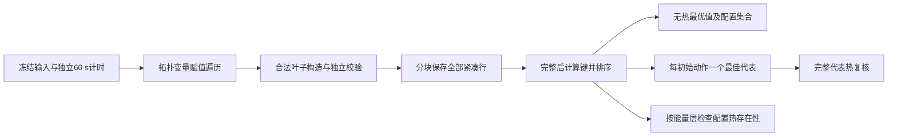

# 56：枚举成本与等价精确接口审查

日期：2026-09-25。结论：**完整时间表库不是取得精确基线代表的必要条件；本冻结输入允许以流式精确摘要替代其保存与全库排序。该等价性不证明运行时间会降到60 s以内，更不证明H52在宽期限案例成立。** 热参考不能仅保留每配置一个无热代表，仍须有覆盖等待／重排的安全存在性或排除证据。

本轮只读代码、53号冻结数据和55号已有结果，进行有理数代数核查；没有调用MATLAB、枚举调度、运行热传播、性能测试或修改实验源码。三方法预算、十项输入、历史结果保持不变。

## 1．材料、定位与证据状态

### Material Passport

| 项目 | 本轮记录 |
|---|---|
| 对象 | H52验证工具的实现与精确接口，不是新增调度算法 |
| 材料 | 53号输入／规则；54号覆盖契约；55号源码、CSV及交付审计 |
| 阅读范围 | 下表所列函数正文、规则全文、55号结果与预算记录；不重新核查任务论文或新颖性 |
| 核查类型 | ANALYZED：静态代码、已有记录与代数分析；未重现实验 |
| 证据属性 | 代码事实、已有运行记录、本研究条件推导、待实现／待测分列 |
| 辅助记录 | [静态检查](stage56_review/static_review.json)、[历史保护清单](stage56_review/protected_before.json)、[交付审计](stage56_review/delivery_audit.json) |

| 来源 | 正文定位与用途 |
|---|---|
| [53输入](stage53_design/inputs_v1.json)、[冻结规则](stage53_design/rules_v1.json) | packages.modes；ordering、energy_layers、baseline、budget：本轮等价性的边界 |
| [枚举器](matlab_config_value_src/s55_enumerate.m) | L3–8乐观尾长；L13、29–34分块保存及拼接；L36–67递归；L38–45逐叶结构、校验、能量与保存 |
| [排序器](matlab_config_value_src/s55_sort.m) | L3–9展开时刻与键；L10–17固定锚点层；L18–20全库排序 |
| [方法入口](matlab_config_value_src/s55_method.m) | L17–29独立生成；L38–53初始动作代表；L56–80配置热检查；L85–102能量界与集合状态 |
| [加载器](matlab_config_value_src/s55_load.m)、[时间表](matlab_config_value_src/s55_schedule.m) | 模式固定排序、八Stage选项编号及浮点开始／结束计算 |
| [合法性检查](matlab_config_value_src/s55_validate.m)、[热包装](matlab_config_value_src/s55_thermal.m)、[预算](matlab_config_value_src/s55_budget.m) | 独立叶子复核、连续热评价与中断语义 |
| [55报告](55_四Stage任务首轮验证.md)§3–4、[结果摘要](stage55_review/result_summary.json) | 已完成／未决及原证据范围，不能由静态审查改写 |

本地检索词：`visit`、`s55_validate`、`chunks`、`ranks`、`canonical`、`unique`、`bestRank`、`optimal_set_complete`。没有外网检索、新增论文或原始参数。本轮没有关于通用求解器能力、新颖性或现实设备耗时的断言。

## 2．55号究竟卡在何处

已有30次调用中，15次超时全部是4项10 ms主例及并列校验的无热枚举未完成；热调用均0，排序未完成。4项6 ms主例完整覆盖，各有288条合法安排；4 ms校验由隔离链下界排除。它们仍分别是“已完成”“未决”“无热不可行”，不是方法强弱的新证据。

| 环节 | 当前工作与潜在成本 | 正确性要求／已知边界 |
|---|---|---|
| 变量遍历 | 固定A链后B链的赋值顺序，逐模式逐格点，对先前Stage检查资源／频率域 | 不限制真实执行先后；必须保留B先行、等待、所有设备／频率和CPU标签 |
| 尾长与窗口 | 乐观剩余时长收紧启动上界；释放／依赖向上对齐网格 | 是安全剪枝，不可换成仅枚举最早安排；时长和结束不取整 |
| 逐叶复核 | 重建八Stage结构；独立检查再次核对模式、依赖、期限及两两冲突 | 与增量剪枝存在重复，但这是验证保障，不能未经等价预检直接删除 |
| 能量计算 | 每叶重算同一配置的活动能量 | 冻结模型中能量不依赖等待，可按配置复用；计入方法自身预算，不跨方法共享缓存 |
| 保存 | 16个uint16字段／叶子，4096行分块；最终vertcat复制 | 完整库只是一种实现；部分库不能当精确规划 |
| 排序 | 重新展开各叶时长、完成时间、24列规范键，分层并全排序 | 本次15次超时尚未到此，不能把排序称为已测瓶颈 |
| 代表选择 | 已排序行按完整初始动作stable unique | 最优代表精度来自完整候选覆盖和排序，不是unique本身 |
| 热参考 | 同配置首个安全见证后可停止；排除须穷尽该配置时序 | 全部配置热安全性与全部时间表热安全性不同；连续热评价器保留 |

若有N条完整安排，紧凑行本身为32N字节。现有超时保留计数83,812–119,614，对应约2.68–3.83 MB的纯行载荷，不含容器、复制或其他状态，**不足以指认内存耗尽**。排序中的行、finish、canonical、key逻辑数组合计504N字节，另有能量、索引及临时量；这是字段尺寸分析，不是测得的驻留峰值。

已有日志只有访问／叶子计数和总耗时，没有各环节计时。**“枚举阶段超时”已有证据；“逐叶校验最慢”“保存全库是主要原因”均未证实。** 流式组织可以减少保存及全库排序需求，但若访问与校验占主导，仍可能超时。

## 3．三种方法真正需要的输出

令F为当前输入在1 ms启动域内全部合法无热完整安排；m(s)为八Stage完整配置，a(s)为0时刻全部实际启动项；K为53号冻结排序键。

| 方法 | 必需输出 | 不必同时保存的内容 |
|---|---|---|
| 联合无热规划 | 最低能量层、该层全部配置、K最小代表；实际J值与证明状态 | 所有非最优时间表、同配置的全部重复时序 |
| 完整后缀基线 | A={a(s):s∈F}；每动作唯一最佳代表r(a)；按K排列代表后首个明确热安全者 | 不是该动作最佳代表的其他完整时间表 |
| 热参考 | 每配置是否有合法安全安排；见证／排除／未决；热最优能量及最优配置集合状态 | 可逐配置处理而非同时驻留所有安排，但不能丢弃待核实的时序可能性 |

精确动作查询定义为：

\[
F_a=\{s\in F:a(s)=a\},\qquad r(a)=\arg\min_{s\in F_a}K(s).
\]

空集F_a必须有无热排除证明；非空时只有证明没有更小K的安排，才是最佳代表。完整规范键包含所有Stage的启动／单元／模式；本冻结模式表无重复选项，因而完全相同规范键指向相同时间表。

动作约束是**等号**：指定项按指定模式在0启动，其余项不能在0偷偷启动。空动作意味着所有Stage均不在0启动；不是只将一个请求延后。由于释放均0且Stage时长严格正，0时刻只可能启动A.S0和B.S0。语法候选上界为：空动作1＋单Stage动作8＋不同CPU、同频的双Stage动作4＝13。**13不是实际有完整合法后缀的动作数**；55号6 ms基线记录实际为6，期限可能排除其他动作。

该小动作数只说明摘要规模可很小，不说明求每动作代表容易；查询仍包含S1设备选择、频率、CPU分配、等待及后继安排。

## 4．冻结输入下的排序等价性

### 4.1 能量层可以用精确格值表达

53号的活动能量如下，单位mJ；CPU标签不改变数值：

| Stage | CPU H／L | NPU |
|---|---|---|
| S0 | 2／2.5 | 不合法 |
| S1 | 4／3.75 | P低1；P高4；并列包3.75 |
| S2 | 4／5 | 不合法 |
| S3 | 2／1.5625 | 不合法 |

公共基准为20 mJ。每项均是δ=0.0625 mJ=0.0000625 J的整数倍；八Stage总能量也在此格上。即使不施加任何资源、期限约束，总能量也不超过47 mJ，所以比较容差最大为4.7×10⁻¹⁰ J，远小于δ。删掉非法配置只会形成格点子集，不会缩小不同精确能量的间隔。

按通常有限正常数binary64计算、正确转换冻结十进制输入的前提，输入舍入、八项乘加和基准计算的保守γ₆₄相对误差界约为7.11×10⁻¹⁵，乘47 mJ得3.34×10⁻¹⁶ J，亦远小于绝对容差。这里的64是覆盖这些基本舍入操作的保守界，不是性能计数；不含消减、溢出或下溢情形。本轮以有理数读取模式表核查格值，没有执行MATLAB数值回归。

因此，对**本冻结输入**：同一精确能量格的浮点扰动均在一个锚点层内，不同格绝不会被合并；使用整数格号q(E)=E/δ比较层先后，与原固定锚点层序等价。整数格号不必等于原连续rank编号，但给出相同先后与并列关系。

这解决了流式处理尚不知道全部合法能量锚点的问题。对一般近似能量数据则不成立：不能对每动作局部重新分层、链式合并或把全部语法配置的能量当实际合法锚点。未来实现必须检查冻结哈希及格值适用条件，不满足时回到原分层契约，不能默默推广。

### 4.2 时间和规范键不能顺便改掉

冻结K依次是：能量层、请求完成时间之和、最大完成时间、逐Stage启动／单元／频率。时间排序使用未取整数值，1 ns容差只用于合法性，不用于次级键并列。

未来K比较可用整数能量格代替层编号；其余仍应复用`start=tick*grid`、`finish=start+duration`及原sum／max计算路径。不能只因时长也是有理数，就未经预检将完成时间改成整数刻度排序——数学上相等的完成时间，原浮点表达式是否给出相同键仍须核对。也不能按原始J值先区分同层内微小舍入差，否则会越过53号的层内完成时间优先级。

能耗记录仍保留原J公式与独立积分核对；最低实际浮点能量和规范代表可分别记录。**禁止任意权重加权和替代字典序，禁止仅凭最优能耗相同判定代表等价。**

## 5．三条实现路径及结论

| 路径 | 等价性条件 | 可减少什么 | 不解决什么／本轮判断 |
|---|---|---|---|
| 保留全库，减少重复工作 | 合法叶子域、K、独立验证不变 | 预构造选项、复用配置能量、减少结构转换／复制 | 仍保存并排序N条；适合作为低风险实现整理，尚无耗时占比证据 |
| 完整遍历，流式精确摘要 | 每合法叶子处理一次；使用§4全域一致K；结束后才认证覆盖 | 两个无热消费方不再保存／排序全部时间表；只存最优组合和每动作代表 | 不自动减少节点访问、合法性校验；**优先进入实现任务设计** |
| 每动作精确查询 | 动作等号、全域模式／时刻、完整K和最优性／无解证书 | 可不生成所有完整行 | 接口数学上等价，但具体求解、共享约束、证书与预算接入未实现；不是当前已证明的加速手段 |

### 5.1 流式摘要的精确性理由

对已访问叶子集Fₜ，分别维护全局最佳层及该层全部已见配置、K最小代表，以及每动作K最小代表。每加入一个叶子，只需按全序比较更新；归纳可得摘要始终与“将Fₜ完整排序再提取”的结果相同。**只有Fₜ=F被证明后，才得到原无热方法和基线所需精确结果。**

每动作保留一行最多13行，最优配置集合仍可能很大，不能省略；独立CPU标签保留。生成过程还可保留配置存在性／叶子计数，为参考接口提供本方法内部证据，但不能免费传给另一方法。

在按相同K排好全部已证代表后，沿用原热评价、阈值带和首个安全早停，基线尝试序列及返回时间表应与55完全一致。摘要不是top-k近似，也不锁死全局最低能量配置；较高能量动作代表仍保留。

前述归纳以原遍历的完整性为前提，不授权删叶子检查。首版仍保留独立合法性检查；若以后考虑移动检查位置，须单独证明增量约束覆盖、用独立小域元组集合回归，并完整核查所有输出见证，不能将删除防错逻辑当作已经验证的提速。

### 5.2 每动作查询等价，不代表无需覆盖证明

{F_a}对F构成互不重叠分区。若所有非空分区均返回已证r(a)，则排序这些代表与原`stable unique`取得的首行集合相同；全局K最小代表也在其中。该结论**不**推出仅用这些代表就能得到全部无热最优配置，因为某配置可能从不是任何动作的最佳代表。

未来查询输出至少区分`proved_optimal`、`proved_empty`、`unresolved`及incumbent／有效界；部分动作有精确代表而其他动作未完成，不足以按当前冻结基线开始返回计划。本轮优先保留“全部动作代表及排序完成后热复核”的原门槛，不引入跨查询提前返回的新策略。

## 6．热参考必须另外保留的证明能力

对完整配置m定义F_m={s∈F:m(s)=m}。所需查询是：F_m是否为空；若非空，是否存在经连续峰温评价明确安全的s。**固定配置下能量相同，但温度随启动、并发与等待变化，因此无热最佳代表的热违规不能排除F_m。**

同域热参考可不同时存储全部F_m，但其逻辑接口必须返回：

| 字段／状态 | 可成立的证据 |
|---|---|
| 无热配置不存在 | F_m穷尽为空或等价精确排除证书 |
| 安全可保留 | 一条完整、合法且明确热安全的见证；可停止该配置存在性检查 |
| 热排除 | F_m完整覆盖且全部明确违规，无阈值未分辨；或另有经过验证的排除证明 |
| 未决 | 覆盖未完、预算用尽或阈值未分辨；不能记排除 |
| 热可行上界 | 已找到安全见证的最低能量 |
| 热最优值 | 上界与有效全域下界在容差内一致 |
| 完整最优配置集 | 最优能量层所有可能配置均完成存在性／排除，且更低层已排除 |

不同配置按能量层处理可支持最优证据；找到某层安全见证后，只能停止更高层，仍需完成更低层排除和同层集合判定。未知配置必须留在下界所覆盖的域内。没有安全见证的Inf上界是“未知”，不是实际最优值无穷；全部无热合法配置被严格热排除后才可称网格热不可行。

**只做流式无热摘要不足以完成热参考。** 后续任务书须明确如何继续覆盖同配置全部合法时序，例如保留完整遍历能力并按配置／能量层组织检查；必要的再遍历必须计费。这是待规定的实现组织，不是本轮已实现的新搜索方法。

参考的等价性指合法域、最优值／配置集合及证据正确性相同，不要求存在性搜索返回与旧实现逐字相同的见证；若改变访问次序，有限预算内覆盖和耗时可能不同，必须显式登记。基线则必须保留相同代表和尝试顺序。预算到点时，证据多少不同并不构成完整域等价性的反例，也不能隐去未决。

## 7．未来接口与状态约定（本轮未实现）

只定义职责，不指定新算法／外部求解器：

| 接口 | 输入 | 输出与完成条件 |
|---|---|---|
| 无热精确摘要 | 冻结case、排序契约、本方法计时器 | 最优层／代表／配置集合、每动作代表、覆盖状态、有效界；全域完成前均不冒充最优 |
| 动作精确查询 | 同一case、完整动作等号、K、本方法计时器 | 已证最优代表／已证无合法后缀／未决；作为替代实现契约，暂不新增依赖 |
| 配置热存在性 | 同一case、完整配置、RC、连续热评价器、本方法计时器 | 安全见证／严格排除／未决及覆盖范围；不能读取另一方法结果 |
| 参考汇总 | 本方法获得的配置证据与未覆盖域界 | 上下界、最优值和最优集合分别判定 |

不跨方法共享库、摘要、热见证或计算缓存；常量公式和源代码可以复用，执行成本不能免费转移。每方法自行加载／准备需要的索引、生成候选、完成排序与热检查，并计入60 s。诊断采样、超时后额外排序或离线证书补算不得并入正式预算内结果。

不为恢复宽期限结论使用冷态充分界替代精确代表生成，也不向基线提供已知热安全映射或参考时间表。冷态界继续只作独立一致性锚点。

## 8．后续等价预检协议：只定义，不执行

| 检查 | 必须比较／允许结果 |
|---|---|
| 独立小域完整覆盖 | 独立笛卡尔积与生成器的完整(选项、启动格点)集合及计数，不仅最优值 |
| 流式归纳实现 | 小夹具每个访问前缀的摘要对照该前缀完整排序；完成前不得报告全域最优 |
| 初始动作 | 全部实际有合法后缀的动作集合、空动作、每动作规范代表、代表排序完全一致；非指定项不得同刻启动 |
| 能量键 | 冻结格值与原锚点层对应；不合法配置不生成虚假层；一般近容差夹具不得擅用冻结格值捷径 |
| 次级键 | 同能量不同完成时间、相同sum不同max、规范键并列；包括1.25 ms结束且后继对齐网格 |
| 执行合法性 | 同域异频冲突、同频并发、域清空切频、S1 CPU/NPU切换、等待、B先行、CPU标签不剪枝 |
| 55号完成案例 | 4项D6的288条合法域、38／44 mJ、P低32个最优配置、P高104个；基线1／1／1／2次热尝试及返回时间表一致 |
| 热参考 | 高功率热态80安全／24排除、其余已证集合保持；不同合法安全见证可接受，但值、集合与排除域必须一致 |
| 状态与中断 | 动作只部分完成、已知最优值但集合未完、有安全上界但更低层未排除、阈值未分辨、资源不足、空代表集各自正确标记 |
| 不可行与隔离 | 4 ms链下界；基线代表全拒绝不称整体无解；方法不读参考、不共享预计算结果，预算均60 s |

宽期限旧未决项没有可比较的已证最优真值，不能要求新实现与其部分库最小值一致；未来若取得证据，应作为新版本结果并保留55历史。本轮不运行这些检查，也不授权重跑研究案例。

如以后批准性能诊断，分别记录候选访问、叶子校验、结构／存储、摘要／排序、热评价及总耗时，计数与耗时范围均说明；递归包含时间不能再与其内部阶段相加。诊断计时有扰动，不能把诊断与正式预算拼接。没有端侧代表性工作负载证据前，仍只讨论验证程序实现成本。

## 9．交付判断与唯一下一步

| 问题 | 本轮答案 |
|---|---|
| 可以减少哪些开销？ | 全部时间表的驻留和全库排序、重复配置能量计算存在可消除或复用的工作；收益未测，逐叶验证首版保留 |
| 可否精确替代每动作代表？ | 可以：流式最小摘要在完整覆盖后等价；每动作精确查询也有分区等价证明，但具体实现尚缺 |
| 热参考能否同样只留代表？ | 不能。仍须覆盖同配置不同安排，或取得等价排除证书；单代表不能证明配置无安全后缀 |
| 是否已解决55超时？ | 没有。没有减少已证必需搜索域，也没有测量新实现；本轮不新增H52结果 |
| 是否足以推进？ | 足以制定“流式无热精确摘要＋热参考配置存在性接口”的实现与预检任务，尚不直接实施或选择外部求解器 |

**唯一后续行动：制定上述等价实现与预检任务书。** 以保留现有有限域遍历和独立检查为起点，先使无热／基线输出不依赖全库驻留，再明确热参考的配置覆盖与预算计费；这是同一个验证工具改造任务。按动作求解仅保留为已定义接口，不同时启动第二条求解器路线。

55号四项已完成主例的成功、四项主例未决及高功率热态104→80配置收缩原样保留。研究对象、L3证据等级和H52未变；此次等价推导不是新算法贡献，不扩大请求数、追加参数或恢复可变核组。
