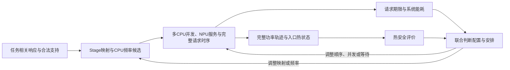
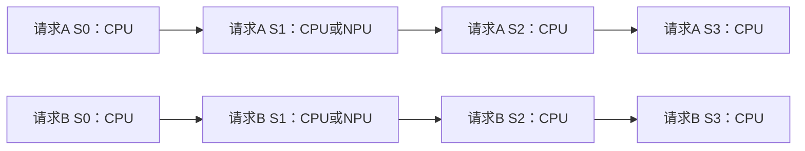

# 57：主线研究故事与两章核心工作构想

日期：2026-09-25。当前阶段：**先形成可与导师讨论的论文构想，再细化模型、方法与实验。** 本文给出一条主线及两章核心工作，不将拟研究内容写成已取得贡献。56号的实现改造暂停，已有未决结果原样保留。

## 1．先把整篇论文讲清楚

建议保留题目范围，暂定论文题名为：

> **《面向端侧推理的多核CPU–NPU温度感知高能效任务调度研究》**

具体主线可概括为：**任务相关执行模式与完整请求时序的热能效协调。** 不用某两篇论文的组合命名研究，也不把某个频率响应公式写进题目。

### 可直接向导师介绍的研究概述

端侧推理的不同阶段具有不同的设备支持和执行效率，某些阶段只能由CPU处理，另一些阶段可以选择CPU或NPU；不同CPU阶段的升频收益也不相同。因此，一个阶段局部最省能的模式，并不一定能与其他阶段组成满足请求期限的完整安排。多个请求共享CPU、频率域和NPU时，映射与频率会改变资源占用和后继就绪时间，而这些阶段的并发、先后及等待又共同形成温度轨迹，限制哪些配置能够真正执行。本文拟先建立任务相关模式下的配置—时序联合评价问题，分析局部配置偏好与系统可行性的关系；再研究利用完整请求的期限、资源冲突及热反馈组织配置选择和时序调整的方法，在统一的可行性要求下考察能耗与计算成本的取舍。

**核心问题不是“加上温度后公式怎样变复杂”，而是：局部配置建议怎样变成完整、合法、热安全且节能的请求安排？** 这已经可以作为一条完整的研究构想推进，不需要先证明每一种简单方法都会失败。

## 2．现实矛盾：阶段模式有偏好，系统安排有条件

### 2.1 四个因素各自承担什么作用

| 因素 | 在论文中的实质作用 |
|---|---|
| 任务相关响应 | 给出同一Stage在不同合法设备／频率下的时长和功率；决定局部能量代价及可释放的执行时间 |
| 多CPU资源 | 决定不同Stage能否同时执行、哪些工作需要串行；共享频率域进一步限制合法并发组合 |
| NPU | 对支持的Stage提供可替代实现，同时形成服务竞争；选择NPU会改变CPU占用及后继CPU阶段的就绪时刻 |
| 温度 | 根据入口状态和完整注热历史约束安排；可能只改变等待／重排，也可能排除某些配置 |
| 能效目标 | 在相同工作量、评价窗口和约束下比较系统能耗；不能把低功率、短时延或低峰温分别当作最终目标 |

任务响应不必由我们重新发明。已有响应函数或明确的离散模式表可以提供输入，研究工作在于如何将其用于系统决策。[28号](28_CPU响应模型与CoDVFS全文核查及接口方案.md)提供模型工具及其数据边界，[49号](49_任务相关模式表与Zhou排序依据适用性审查.md)已说明任务相关表可能破坏统一排序因子，但这不必然造成排序变化，更不自动需要新算法。

这张图表达一个离线规划中的协调关系，不表示已经实现了在线控制器，也不要求每次反馈都改变配置。

### 2.2 一个贯穿两章的任务例子

沿用[51号](51_模型分区证据补全与研究数据边界.md)恢复的EfficientDet-Lite0四Stage结构。其依据是固定模型工件、作者后续PR中的支持报告及本地静态依赖核验，不是Band图6复现或本研究的设备实测。

S0、S1、S2、S3分别覆盖算子0、1–65、66–265、266；CPU／指定NPU的类别支持沿用51号阅读边界。将其展开到两个对称固定CPU单元及频率模式，是[52号](52_四Stage任务输入契约与验证主张.md)明确声明的研究假设。同Stage跨请求共享响应，不给A、B人为设置不同性能。两个请求便于解释，论文一般对象仍是有限已知请求DAG。

**第一步，局部模式比较。** 对S1比较CPU与NPU的时长和活动能量；对CPU阶段比较不同频率。不预设NPU必然节能，也不因某模式最快就称其最优。不同Stage的频率敏感性可不同，但不是由算子数量直接推算。

**第二步，放入完整请求。** 若两个S1都选择NPU，它们需要共享单服务单元；一个S1改走CPU可能减轻NPU等待，也可能占用另一个请求后继CPU阶段所需的资源。S1更早完成的价值还取决于S2能否接着执行，因此不能只比较S1自身的时间。

**第三步，检查并发是否合法。** 两个CPU单元同属一个共享频率域时，不能让重叠Stage分别执行互不兼容的频率。可比较同频并发和不同频率错开；哪种安排满足期限且更省能，应按完整工作量判断。此共享域是起步条件，不推广为所有CPU平台事实。

**第四步，评价完整热轨迹。** 把工作移到NPU会同时改变CPU与NPU的注热、持续时间和后继入口状态，不等于“移到NPU就降温”。某安排超温后，可以等待、减少某段重叠、调整服务顺序，也可以重选S1设备或CPU频率；所有动作都需重新核对后继期限。

**第五步，比较完整方案。** 可以出现原模式直接可用、原模式经重排可用、部分模式被排除等不同结果。这里提出比较理由，不填入新的合成收益，也不要求例子每一层都发生翻转。

55号提供一个已有事实锚点：其高功率热态、6 ms期限、1 ms启动网格下，104个无热最优配置中80个可保留、24个被热排除，而最低能耗仍为44 mJ。完整后缀基线已找到安全最优方案。[55号§3.2](55_四Stage任务首轮验证.md)中的映射和时序同时变化，不能把效果单独归于NPU迁移或热耦合；它支持“联合评价有实际对象”，不证明当前基线不足。

### 2.3 故事成立所需的关键区分

在现有固定窗口、恒定基准、零额外开销假设下，固定完整模式组合的能量不随等待改变。**时序的主要作用是决定该配置能否满足期限与温度条件；配置改变才可能改变活动能量。** 因此“系统状态改变模式价值”首先可以是可行性改变，而不一定是同一模式的能量数值改变。

同构CPU也有实质资源分配问题：两个Stage放在同一单元还是不同单元，会改变串行／并发机会；整体交换CPU编号则等价。聚合CPU热节点只能表示CPU总注热，不能声称换核编号改善局部热点。CPU/NPU替代映射则是另一类选择，必须有合法实现支持。[48号§2–3](48_主线剩余问题清单与配置映射定位.md)

## 3．第三章：任务相关响应下的CPU–NPU热约束联合调度建模与分析

### 3.1 本章要回答什么

> 哪些阶段模式可以组成完整、合法、满足期限和温度约束的系统安排；怎样用同一目标比较这些安排？

本章的实质工作是**给出可分析、可求解、可公平评价的问题定义，并说明配置选择为何不能脱离时序**。不只是汇总几个已有公式，也不把一个非线性表达式当作独立创新点。

### 3.2 概念级问题定义

| 内容 | 采用范围 |
|---|---|
| 工作负载 | 固定工作量与精度；有限且已知的请求集；各请求有释放时间、绝对期限和预先给定Stage DAG |
| 资源 | 多个资源集合固定且不重叠的CPU执行单元，一个固定服务模式NPU；单元内每次执行一个Stage |
| 模式输入 | 每Stage的合法执行单元、CPU频率、时长及同计量边界的功率；可以用函数生成，也可以直接查表 |
| 系统输入 | 频率域及其合法规则、公共／空闲功率、窗口、入口温度、热网络；来源或L3假设逐项注明 |
| 决策 | Stage执行单元及CPU频率；各单元上的顺序、启动时刻与合法等待 |
| 约束 | 合法支持、不可抢占／不迁移／执行中不改频、资源互斥、频率域、DAG依赖、请求期限及全窗口温限 |
| 起步简化 | 对称CPU可作为基准；确定性模式表、活动功率可加、零额外交接／切换开销；不是实际平台的通用属性 |

为说明关系，只记模式组合为m、完整时间安排为π：

\[
\min_{m,\pi}\ E_{\mathrm{sys}}(m,\pi),\qquad
C_r(m,\pi)\le D_r,\quad T_n(t;m,\pi,T_0)\le T_n^{\max},
\]

另须满足上述支持、依赖、资源与控制域条件。该式是概念性问题，不是本轮已经完成的数学规划。

在当前简化下，能量可写为：

\[
E_{\mathrm{sys}}=P_{\mathrm{base}}W+\sum_i Q_i(m_i)d_i(m_i).
\]

公共基准只计一次，等待及完成后的尾段均在同一窗口；各节点注热另按物理边界分配。温度来自完整功率轨迹的热响应，不从总能量或瞬时功率直接判定。本章需明确热耦合造成的评价联系，但不预设其在所有负载下显著。

概念问题不把两个请求、两档频率、20 ms窗口或旧RC参数固定成普遍条件。未来任何网格参考仅对声明的启动域给出精确性；目前不选择连续或离散求解器，也不扩大实验规模。

### 3.3 三项拟完成的实质产出

1. **统一表示与边界。** 将任务相关模式、物理单元、频率域和热节点区分开，保证模式合法不被误当成并发合法，阶段节能不被误当成系统可行。
2. **条件分析。** 分析频率敏感性何时改变局部能量偏好、排队何时吸收加速收益、时序何时能保住原配置，以及温度何时仅排除部分安排／配置。沿用33、49号已推导的条件，明确新对象尚需扩展的部分；不要求证明每类现象必然出现。
3. **共同参照。** 定义完整安排的能耗、期限和热可行性评价，以及小规模最优值／界／未决口径，为第四章提供质量标准。参照的具体工程实现后置，不将56号数据结构整理写成本章创新。

本章结束时，读者应知道：给定一组模式，怎样判断它是否存在合格安排；不同模式之间怎样公平比较；哪些推断只能局部成立。它向下一章交付的是**明确的问题结构与评价标准**。

### 3.4 建议小节

| 小节 | 内容及输出 |
|---|---|
| 3.1 应用场景与问题描述 | 固定执行单元上的多请求端侧推理；四Stage贯穿例子 |
| 3.2 任务相关执行模式与合法控制条件 | 支持集合、响应表、资源／频率域、参数证据边界 |
| 3.3 完整请求能耗与瞬态热约束 | 同窗口计能、完整功率轨迹、期限与资源条件 |
| 3.4 配置偏好与系统可行性的关系 | 变化／不变条件、配置与时序两类作用 |
| 3.5 联合问题及共同参照 | 决策关系、评价口径、小规模参照与证明范围 |
| 3.6 模型关系验证与本章小结 | 验证表示和机制，不提前宣称新方法优势 |

## 4．第四章：面向完整请求的配置与时序协调求解方法

### 4.1 本章要回答什么

> 在第三章定义的同一问题上，怎样利用任务响应、资源竞争与完整热评价来组织候选和修复，使有限计算投入用于更有价值的配置—时序选择？

这是拟研究的方法目标，不是已证明“现有方法太慢或质量不足”。主张应落在**如何利用问题结构组织决策，以及这种组织在什么条件下有效**，而非为了第二章强行加入另一个机制。

可利用的结构已经可解释：模式决定时长、活动能量和注热位置；给定模式后仍需安排资源与依赖；完整时序决定期限和热可行性；评价得到的问题又指向模式或时序的调整。这里可以组织两个决策层次，但不能声称它们独立，或声称固定映射后所有请求就可分别优化。

### 4.2 一条主要方法构想

采用“**配置候选—完整安排—约束诊断—联合调整**”作为方法骨架。以下是职责与设计理由，不是伪代码或已确定算法。

| 环节 | 接收／输出 | 拟利用的关系与具体工作 |
|---|---|---|
| 配置候选 | 输入合法模式与任务响应；输出若干可继续评价的映射／频率组合 | 将活动能量差与时长差作为候选信息；同时保留缓解CPU或NPU占用的替代模式，不只按阶段最低能量锁死配置 |
| 完整请求安排 | 输入候选、依赖、资源／频率域、释放与期限；输出覆盖全部Stage的安排或尚未找到安排状态 | 将模式收益放到后继就绪、资源占用和请求完成时间中评价；允许合法等待、跨请求重排，不把两个请求拆成独立最优 |
| 完整可行性评价 | 输入完整安排与入口热状态；输出期限、资源及热检查，系统能耗和需解释的冲突位置 | 保留当前强基线的全轨迹热检查，包含未来工作与尾段；一次建议安排违规不等于配置不可行 |
| 配置／时序调整 | 输入诊断和已有候选；输出需要重新评价的安排或模式组合 | 对照重排／等待与换设备／换频率的影响，检查修复是否把损失转移到其他请求或后继Stage |
| 方案比较 | 输入已验证的完整方案及搜索状态；输出最佳已知可行方案和未决信息 | 先满足硬约束，再比较同窗口能耗；运行时间是独立指标，不把不完整或违规方案列为节能结果 |

候选优先级只用于组织尝试，除非另有证明，不作安全剪枝。某模式时长和活动能量较大，也可能有不同的注热位置或功率形状，不能直接按局部二维支配永久删除。时间、能量与温度也不混成无依据的“性价比”比值。

### 4.3 反馈为何可能需要改配置，而不只是等一等

仍用同一四Stage例子。若两个S1走NPU造成后续S2释放过迟，仅延后执行不会修复该请求的期限；可考察改变NPU服务顺序，或让一个S1走CPU。后者可能多用CPU时间，但减少NPU排队，也可能反过来阻塞另一个S2——所以必须重建完整安排。

若主要问题是CPU重叠造成的热违规，错开同一配置可能足够；如果等待后无法赶上期限，则值得同时评价减少CPU活动功率、改变某个可替代Stage的设备等选择。但高频更短、低频更久，NPU自身也发热，均无预定优劣。

这不是先断言“等待失败”，再发明换配置；而是在同一问题内**同时保留不同修复手段，研究怎样根据冲突关系安排评价**。具体如何构造候选、识别受影响阶段和取舍修复，是第四章拟完成的工作。

诊断不能简单归咎于温峰处正在执行的一个Stage。热状态包含先前功率历史，期限问题也可能来自资源排队；对“调整了什么、影响了谁、完整约束是否仍满足”需有明确记录。是否采用局部修改、怎样限定范围，后续再设计，不在本轮预设影响范围算法。

### 4.4 与现有强基线相比，准备研究什么

| 部分 | 已有能力 | 本章拟开展内容／尚待验证 |
|---|---|---|
| 模式与动作空间 | 强基线已允许全部合法映射、频率和能量层 | 不靠扩大本方法权限或限制基线来制造收益 |
| 全局信息 | 请求和确定性模式表均已知；已有无热联合规划 | 同样使用这些信息，探索响应与系统冲突如何引导候选组织 |
| 未来热信息 | 每初始动作的一条最佳无热完整代表已作全轨迹复核 | 保留完整复核；拟研究是否值得评价同动作下的其他配置／时序，以及怎样选择它们，而非只重新引入局部热准入 |
| 配置与修复 | 基线按无热排序生成代表，首个安全者返回 | 拟把完整安排中的资源／期限／热诊断用于后续候选调整；不是断言基线已失败 |
| 质量与成本 | 55号4项主例基线已达热参考，其余主例未决 | 比较同预算下的可行性／能耗，也比较达到相近质量所需成本；允许某些条件下两者相同 |

方法可能以改善质量、减少求解成本或提供更清楚的适用条件体现价值，不要求三者同时改善。**目前只确定这组评价目标，不承诺其中哪项最终形成贡献。** 如果简单完整后缀方法已足够，也可以成为最后方案的重要部分；章节应据结果调整主张，而不是保留无收益复杂步骤。

普通的候选生成、列表安排和修复都有前例。本章的实质工作需要具体落到：适合本题的候选信息、同时遵守频率域与请求依赖的安排、利用完整约束反馈的调整规则，以及这些规则的代价与适用范围。光画出四个模块、换算法名或增加循环不够；这些规则目前是待开展工作，不能冒称已经解决。

### 4.5 建议小节

| 小节 | 内容及输出 |
|---|---|
| 4.1 联合问题的结构与方法目标 | 配置和时序的双向影响、质量／成本目标及可用信息 |
| 4.2 任务相关配置候选的组织 | 响应差异、资源替代、候选覆盖与保留条件 |
| 4.3 面向完整请求的合法安排 | 依赖、CPU/NPU占用、频率域及端到端期限 |
| 4.4 完整热反馈下的配置与时序调整 | 冲突诊断、同配置修复和替代配置的比较 |
| 4.5 方法边界与计算代价 | 能保证什么、不能保证什么、成本来源；不把55号超时当一般定理 |
| 4.6 方法比较、消融与适用条件 | 同模型同预算对照、质量与成本、无收益／未决结果 |

## 5．两章如何连起来，以及拟贡献怎样表述

第三章回答**“什么才是合格且节能的解、哪些关系使选择相互制约”**；第四章回答**“怎样组织搜索和调整去得到这样的解”**。两章共享工作量、合法执行模式、完整能耗／热评价和约束含义。第三章的小规模参照提供质量标准，第四章方法返回同一问题的解，不能用放松期限或降低热精度换得表面优势。

[21号师兄论文复盘](21_师兄论文研究链条复盘.md)§3–5的借鉴点是：先明确相互制约的决策，再按结构组织已有求解工具，并比较质量、可行性与成本。本文不复制跨场景共享映射，不预定MILP＋启发式，也不强行让两章各提出一个新算法。

**可用于研究计划的拟贡献表述：**

1. 拟建立面向任务相关执行响应的多核CPU–NPU配置与时序联合评价框架，统一表达合法支持、共享控制域、请求期限及完整热约束，分析局部配置偏好转化为系统选择的条件。
2. 拟研究面向完整请求的配置与时序协调方法，利用资源、期限及热反馈组织候选和修复，在统一约束下考察方案质量与求解成本的取舍。
3. 拟构建结构有来源、数值假设透明的验证体系，分别检验模型关系、协调机制和方法代价，给出简单方法足够与进一步协调可能有价值的适用条件。

第一项的价值要由具体条件分析与现有模型的准确区别支撑；第二项要落到规则及验证；第三项服务前两项，不默认独立构成创新。三项均为拟开展工作，不使用“首次”“显著优于”或未获得的收益数字。

就工作量而言，统一问题、条件分析、共同参照、协调规则、保证边界与方法比较能够形成两章相互支撑的任务。**目前可认为工作构成完整，尚不能认为创新和论文质量已被证明。** 本轮先把这一构成说清，不再要求每个小环节先打败最强基线才能继续写下一节。

## 6．已有材料在故事中的位置

| 材料 | 已有支撑 | 放入论文的用途／不能替代的工作 |
|---|---|---|
| 21号与main.pdf既有定位 | 师兄的问题—模型—方法—验证结构 | 参考章节衔接；不继承其创新结论、跨场景约束或性能数据 |
| [32号](32_Band与Crown继承适配及贯穿例子.md)、42／45／48号 | Band的合法子图与排队反馈；JOSS的响应／共享频率协调；Zhou的DAG映射、DVFS与热优化；F-DTM的未来期限与热预测 | 作为已有能力和工具来源，不能描述成这些问题无人处理；适配后不冒称完整复现 |
| 28／33／35／49号 | 响应刻画、局部偏好变化的条件及受限数值验证 | 支撑导师效率刻画建议的具体位置；不将服务器参数当端侧实测，不因非线性就宣称算法困难 |
| 36—40号 | 温度可能只改变时序；多个原配置可经等待／重排保留 | 为无收益条件和强简单对照提供依据，不证明所有平台如此 |
| 41—44号 | 固定执行单元、多CPU合法并发、频率域与共同评价 | 作为对象和验证基础；对称核编号变化不算异构映射收益 |
| [47号](47_前缀热可完成性配对验证.md) | 局部热准入的保证边界，以及完整后缀修正配对 | 保留完整未来热信息的基线；支线结束，不再次把已解决的失败当新算法动机 |
| 51—53号 | 有工件／支持来源的四Stage对象和显式L3模式表 | 提供贯穿任务与验证契约；不能证明真实设备功率、频率响应或温度 |
| 55号 | 热态可收缩部分最优配置；已完成4主例强基线最优、另4主例未决 | 支撑研究对象和约束作用；不支持最低能耗必升、基线普遍失败或硬件节能 |
| [56号](56_枚举成本与等价精确接口审查.md) | 完整候选库可以与精确输出需求分开审查 | 验证工具备料，当前暂停实现；不作为论文主要贡献 |

近邻事实复用已核查位置：Band §4.1–4.3；JOSS §4–5；Zhou §3–5及49号对§5算法／排序的复核；F-DTM §III、IV-B/C，原目标与并发／划分语义差异见45号§4。它们足以说明工具基础，本轮不新增“作者遗漏”的断言，不开展全面新颖性检索。

当前明确的缺口有三个：同平台匹配性能／功率／热参数仍缺；第四章的具体规则尚待设计；这些规则相比强组合的质量或成本价值仍待验证。缺口应引导后续工作，不再把它们都变成本轮讲完整故事的前置门槛。

## 7．后续实验如何服务故事：本轮只分工

| 验证层次 | 要回答的问题 | 对照与边界 |
|---|---|---|
| 模型关系 | 响应差异是否影响模式偏好，资源／期限与热状态怎样改变可行安排或配置集合？ | 响应模型对照统一回放；有／无热约束统一热复核；同时保留偏好不变、热不活跃、等待足够情形 |
| 协调机制 | 利用完整请求评价和反馈，比相同输入下的直接组合增加了什么？ | 保留联合无热规划＋完整候选后缀热复核，不能只挑弱局部热准入；拆分候选组织与反馈调整的作用 |
| 方法质量 | 可行率、合法安全方案能耗和参考差距如何？ | 同域小规模参照；无热违规方案仅诊断；并列最优集合、超时与未分辨分别报告 |
| 计算代价 | 达到相同或相近质量所需多少计算？有限预算下返回何种证据？ | 全部生成、修复及评价计费；保留合理现成方法或通用求解参照，不能只胜过低效全存表实现 |
| 适用条件 | 方法何时有用，何时简单方法已经足够？ | 紧／松期限、响应偏好一致／不同、热活跃／不活跃等条件事先定义，不为寻找优势追加参数 |

同样能量但不同安全配置是有效的机制信息，不强写成节能收益；方法能耗相近但计算成本不同，只有公平测量后才作成本结论。质量比较同时报告失败／未决，能耗配对使用共同可行输入，并单列额外完成的输入，不能只比较各自成功的不同样本。

这些是未来验证的职责，不是新案例清单或执行计划。代表性工作负载、参数范围与计算预算待主线认可后再确定；不把53号十例升格为全部论文实验，也不马上扩大规模。

## 8．阶段判断与唯一下一步

**当前已经有一条能贯穿两章的故事：任务相关模式提供局部代价，完整CPU–NPU安排决定这些模式能否满足期限与热安全；研究先统一表达和分析这种关系，再利用这种关系组织协调求解。**

这条故事的价值主张是条件性联合决策与可解释的方法设计，不依赖“过去所有人都没考虑温度”，也不依赖我们先造出一个强基线失败例。它仍需要后续方法和实验兑现，不能靠叙述本身代替贡献。

本轮交付后，唯一下一步是**先与用户／导师审阅主线和两章工作是否自然、连贯且实质充分，再决定先细化哪一章**。56号实现任务、超时重跑、新参数冻结和新算法代码均暂停；已完成历史记录不回写。若主线获得认可，再将章节构想转成具体模型或方法任务，而不是自动返回枚举优化。

阅读边界：本轮复用21、28、32—56号的既有核查，定向重读41／42、45、48／49、51／52及55／56相关段落；没有重新宣称读完各论文或复现实测。采用academic-research-suite的内联结构与论证流程，无子代理，无新增实验。文件完整性与链接核查见[交付审计](stage57_review/delivery_audit.json)。
