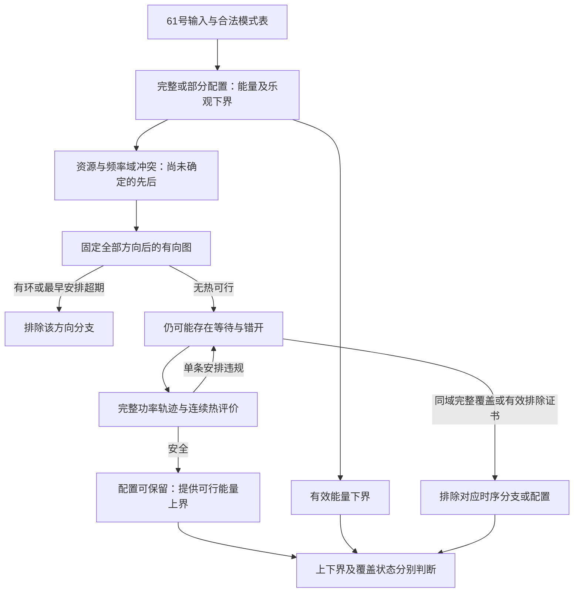

# 结构性求解困难与第四章任务定位

日期：2026-09-25。承接[61号正式模型](61_第三章正式模型与适用边界.md)，采用academic-research-suite的内联论证流程。本轮复用已核查原文记录，静态读取现有枚举、排序、方法与热评价代码，只作集合、图与RC性质推导；不运行研究案例、性能测试或热仿真，不修改程序和冻结输入。

**结论：第四章可以围绕“低能量配置的完整热安全时序寻找及有依据的排除”展开。** 本轮补上的结构依据是：固定配置及全部冲突先后后，无热期限可行性可以精确判定；但这一判定不解决热安全时序的存在性。能量下界、无热排除和条件性热排除可组织候选搜索，安全见证可提供质量上界。它们给出方法设计的依据，尚不证明新算法必要、现有强基线失效或实际计算瓶颈已成立。

## 1．从完整模型拆出真正还没确定的决策

沿用61号记号。Stage集合V、依赖A、所选模式m、启动向量s；模式包含固定单元与频率，时长 \(d_i=d_i(m_i)>0\)，活动增量 \(Q_i=Q_i(m_i)\ge0\)。能量为

\[
E(m)=P_{\rm base}W+\sum_i Q_i d_i.
\]

合法模式有限，但连续启动时序无限；网格版本的时序有限。两者不能共用未经说明的排除结论。本文对精确数学值推导，历史数值容差及预算另行保留。

| 固定哪些决策 | 还需确定什么 | 已可利用的处理 | 尚未解决的部分 |
|---|---|---|---|
| 只固定输入 | 模式、冲突顺序、启动时间 | 模式表给出局部代价和合法支持 | 模式改变能量及可行安排，不能仅凭逐Stage最低能量定案 |
| 固定完整m | 同单元／域冲突先后，以及合法等待 | E(m)直接计算；依赖链等可作必要检查 | 固定能量是否有完整安全安排，尚不能由一条时序判断 |
| 再固定所有冲突先后 | 满足这些先后及期限的启动时间 | §2给出精确无热最早传播 | 尚未处理温度；固定冲突先后也不固定所有可并发Stage的重叠 |
| 再给定完整s | 无调度决策；只需评价合法性与温度 | 连续段内端点／驻点热评价 | 一条安全见证证明存在，一条违规见证不能证明不存在 |
| 固定m与先后，并要求热安全 | 是否存在合适的等待／错开 | 无热必要条件、热单调性及完整安全见证 | 需要搜索或其他证明，不能用无热最早时序替代存在性判定 |

这里有三种不同来源：资源顺序和离散模式选择是原联合调度已有的组合关系；任务相关响应修正改变模式代价、占用长度及旧排序的适用条件；瞬态温度使完整功率历史参与可行性。**不能把三者全部称为非线性响应新引入的困难。** 响应已经查表后，没有必要为其公式曲率另造连续优化难题。

图中返回箭头只表示问题还没判定，不规定修复算法或无限重试。排除一个方向分支不等于排除整个配置；预算结束仍可返回未决。

## 2．固定配置与冲突顺序：无热部分可以精确解决

### 2.1 用冲突方向完整表达合法资源关系

给定m，定义无序冲突对集合 \(\mathcal B(m)\)：一对不同Stage i、j满足下列任一项便冲突：

1. 使用同一个执行单元，包括NPU；
2. 均使用CPU，属于同一频率域，且频率不同。

不同CPU单元的同频Stage不因此冲突；CPU与NPU也不因热耦合直接互斥。为每个冲突对选择一个方向 \(i\to j\) 或 \(j\to i\)，全部方向组成 \(\sigma\)。连同原依赖构成图

\[
H(m,\sigma)=(V,\ A\cup A_\sigma),\qquad
s_j\ge s_i+d_i\quad\text{对每条边 }i\to j. \tag{1}
\]

已有依赖强制的方向可直接保留，重复边合并。这里只是完整定义，不要求算法显式遍历所有方向。

**覆盖理由：** 对固定m，任意无热合法时间表都使每个冲突对不重叠。由于时长严格为正，它为该对确定一个先后方向，从而属于至少一个对应的方向子问题。反过来，满足完整冲突方向的时间表同时满足全部资源／域互斥。因此

\[
\mathcal S_0(m)=\bigcup_\sigma \mathcal S_0(m,\sigma). \tag{2}
\]

此覆盖没有删去同频错开并发、NPU两种次序或等待。仅指定“每个CPU上的顺序”仍可能不够：不同CPU上的同域异频Stage也需要互斥方向。把域当作永远互斥的一台机器又过强，会误删合法同频并发。

### 2.2 连续域：有环排除与最早开始传播

若H存在有向环，把环上(1)相加可得 \(0\ge\sum_{i\text{在环上}}d_i>0\)，矛盾。因此该方向分支无热不可行。

若H无环，按其拓扑序定义最早起点

\[
\ell_i=\max\left\{a_{r(i)},\ \max_{j\in\operatorname{Pred}_H(i)}(\ell_j+d_j)\right\}, \tag{3}
\]

无前驱时只取到达时间；\(\operatorname{Pred}_H(i)\) 是H的直接前驱集合。令 \(b_i^{\rm early}=\ell_i+d_i\)。

**命题1：** 固定m与完整方向 \(\sigma\) 后，该无热子问题可行，当且仅当H无环且所有Stage满足 \(b_i^{\rm early}\le D_{r(i)}\)（输入已有 \(D_r\le W\)）。

**证明：** 拓扑归纳可得任意满足到达与(1)的s都有 \(s_i\ge\ell_i\)。若某个最早完成仍超过所属请求期限，其他安排只能更晚，因而不能可行。反之，s=ℓ满足所有到达、方向和期限；方向覆盖所有冲突，所以构成合法无热安排。对每Stage检查期限与检查全部请求汇点等价，因为原DAG的非汇点均通向汇点。证毕。

图已给定后，拓扑判环与一次传播的工作量随顶点和边数线性增长；这由每点、每边处理一次得到，不包含构造所有配置或方向的成本。**固定顺序下的无热判定并不是本题尚未解决的核心。** 方向未知时，还需找到合适方向；不能拿某个方向超期推断所有方向超期。

### 2.3 网格域：每一步传播对齐，不只对齐最终结果

定义 \(\lceil t\rceil_\Delta=\Delta\lceil t/\Delta\rceil\)。固定相同m、σ，网格最早起点为

\[
\ell_i^\Delta=\left\lceil\max\left\{a_{r(i)},\ \max_{j\in\operatorname{Pred}_H(i)}(\ell_j^\Delta+d_j)\right\}\right\rceil_\Delta. \tag{4}
\]

向上对齐函数单调，同样的拓扑归纳证明它不晚于任何合法网格起点；用 \(\ell_i^\Delta+d_i\) 检查期限给出固定方向网格可行性的充要判定。时长、结束与期限均不取整，不能先算连续最早表再把每个起点独立取整，因为后继还受前驱对齐后的真实结束约束。

这些结论依赖61号的确定时长、零额外交接／切换、无资源日历等边界。时间容差是实现规定，不应出现在精确命题的逻辑中。对一般额外约束不能不经证明继续沿用(3)—(4)。

## 3．热约束留下的是存在性问题，而不是一次最早安排检查

固定m、σ后的无热可行时序满足线性先后与期限关系，但其完整热轨迹由起止事件形成的功率历史决定。方向固定仅要求冲突Stage有序；非冲突Stage仍可重叠、错开或等待，事件顺序也可能变化。即使进一步固定全部事件顺序，事件间隔仍会通过RC状态传播影响温度。

由61号热动力学，令 \(A_T=-C_{\rm th}^{-1}G\)，则

\[
\theta(t)=e^{A_Tt}\theta(0)+\int_0^t e^{A_T(t-\xi)}C_{\rm th}^{-1}p(\xi;m,s)\,d\xi. \tag{5}
\]

最早时间表在起点上逐分量最小，**不代表其注热在每个绝对时刻逐分量最小，也不代表其峰温最小**。移动一段工作会在一些时刻减少注热、在另一些时刻增加注热；相同总能量不能给出温度轨迹顺序。因此：

- 最早时间表热安全：它已是一条该配置、该方向的热可行见证。
- 最早时间表超温：只排除该时间表；该方向下的等待或错开仍可能有效。
- 该方向全部热不可行：还不能排除其他方向。
- 全部方向均被有效排除，才可排除整个配置；有限网格穷尽只得到对应网格结论。

这是一项保证范围分析，不声称已构造55号强基线的失败。37号等待／重排分析、47号完整后缀成功和55号配置收缩记录支持保留完整时序的重要性；它们没有证明每个固定方向都必须进行困难的连续优化。

本轮不宣称该连续子问题已经被证明凸、非凸或具有某个复杂度下界。已明确的是：最早传播解决的无热判定不能自动代替式(5)下的全时域热存在性判定。瞬态RC系数稳定也不意味着每个温度分量在每段都单调；连续段内驻点仍须检查。

## 4．可以利用的性质与安全边界

### 4.1 部分配置下界、完整配置代价与安全上界

对一个模式选择分支，令已固定Stage集合为J，其余Stage仍允许非空集合 \(\widehat M_i\subseteq M_i\)。定义

\[
L(J,\widehat M)=P_{\rm base}W+\sum_{i\in J}Q_i(m_i)d_i(m_i)
+\sum_{i\notin J}\min_{v\in\widehat M_i}Q_i(v)d_i(v). \tag{6}
\]

该分支所有完整可行配置都逐项不低于(6)，即使独立最小模式彼此不兼容，下界仍有效。集合 \(\widehat M_i\) 必须覆盖分支真正剩余的所有模式；用未经证明的剪枝缩小它，会失去相对于原分支的下界保证。剩余集合为空可排除该分支，但要区分合法排除与输入缺失。

当J=V，下界成为完整配置的精确能量E(m)，**不是该配置已热可行的证明**。一条完整合法安全安排提供全问题上界U；无热可行但热违规安排不能提供热问题有效上界。

若一族已登记分支覆盖全部尚可能的更优解，且每个分支都已证明无解或具有 \(L\ge U\)，则当前安全见证已证最优值。等价地，完整配置m的安全见证出现后，排除所有能量严格小于E(m)的其他可能配置也可证明其最优。

**最优值与完整最优配置集合分开：** 为证明一个最优值，可以跳过下界等于U、只可能提供并列解的分支；为列全最优配置，则这些分支仍需处理。严格 \(L>U\) 的分支才可在两种目标下都不再考察。数值处理中应使用有误差控制的界和声明容差，不能把“当前看到的最低能量”当成覆盖全域的下界。

60号宽期限下界达到证书属于上述已有方法足够的条件；它不依赖新剪枝，也不要求重新枚举整个时间表库。

### 4.2 RC单调性：比较的是完整时间轴上的注热

61号被动RC有 \(A_T\) 非对角元素非负。取足够大的 \(\beta\)，使 \(A_T+\beta I\) 逐元素非负；由矩阵指数级数，\(e^{A_Tt}=e^{-\beta t}e^{(A_T+\beta I)t}\) 逐元素非负。于是相同热网络、环境与窗口下，若

\[
\theta^{(a)}(0)\le\theta^{(b)}(0),\qquad
p^{(a)}(t)\le p^{(b)}(t)\quad\text{逐节点、几乎处处}, \tag{7}
\]

由(5)相减得到 \(\theta^{(a)}(t)\le\theta^{(b)}(t)\) 对所有t成立。初温大小也必须逐节点比较，不能仅比较两节点平均温度或平台最大值。

**需要纠正的笼统说法：** 若只在相同执行区间、相同注热节点降低功率，其他轨迹与入口不变，(7)确实保证温度不升高。不能把这也说成“降功率不保证降温”。不能直接保证的是：降频同时延长区间、换设备改变注热位置、改变重叠或整体延后的情形，因为此时(7)未必成立。

整体延后也不自动单调降温。例如等待时状态仍按基准功率传播；若某节点入口低于其空闲平衡温度，等待可以先使其升温。该说明来自(5)的空闲输入解，不是新增数值反例或现实统计结论。

对固定承诺轨迹，未来未启动工作只增加非负注热，则“承诺轨迹＋空闲尾段”给出所有保持该承诺续接的温度下界。若该下界明确超温，可排除这些续接；若下界安全，不能保证未来工作安全。这是45号已有推导在61号边界下的复用，不重新恢复前缀热支线。它只排除保持该承诺的分支，不能排除可以改起点／顺序的整个配置。

### 4.3 固定起点模式替换的充分支配条件

考察同一Stage i的旧模式v与替代模式w。令 \(\chi(v,n_j)\) 表示它与另一Stage j的模式 \(n_j\) 是否属于§2.1定义的冲突对。以下是一组充分条件：

1. w是该Stage合法模式，与v使用相同执行单元、相同注热节点；
2. \(d_i(w)\le d_i(v)\)，\(Q_i(w)\le Q_i(v)\)，活动增量非负；
3. 对所有其他Stage及其允许模式，\(\chi(w,n_j)\le\chi(v,n_j)\)，即不增加任何重叠冲突。相同CPU频率是满足该条的直接充分条件；不同频率不能仅凭“同一频率域”认定兼容关系不变；
4. 其余模式、全部启动时刻、入口状态、基准功率与热网络保持不变。

**命题2：** 在上述条件及61号假设下，任何使用v的完整热安全安排都可将其替换为w，保持完整合法和热安全，且能量不增加。

**证明：** 替换后的执行区间是旧区间的子集，原前驱约束保持，后继仍按旧起点启动因而不会违反依赖。条件3使新增重叠冲突不可能出现；相同单元排它也保持。该Stage更早结束，请求期限与窗口不恶化，起点原样保留故网格合法性保持。相同注热节点上，新活动增量在全部时刻不大于旧值；由(7)，新温度不更高。非负时长／功率逐项不增给出 \(Q_i(w)d_i(w)\le Q_i(v)d_i(v)\)。证毕。

这不是“按局部能量排序即可删模式”。更低的Qd可能伴随更长占用、更高瞬时功率、不同频率兼容性或注热位置，均不符合本命题。CPU→NPU替换不能使用“同单元”证明；整体换CPU标签也需保持支持、域与全部输入对称，不能当作一般模式支配。

**适用范围要如实收紧：** 当前模式表通常每个单元／频率只有一项，严格同频支配可能没有可删项。53号CPU-H较短但功率更高，CPU-L功率较低但更长；CPU/NPU又改变单元，均不能由上述简单条件直接删除。该性质是安全边界，不是已经获得有效加速规则。

如果替换严格降低能量，则被替换模式不可能出现在完整热最优配置中；如果仅能量相等，可以保持一个最优值，却可能删掉不同的并列最优配置。要报告完整原配置集合，必须保留或另行判定被删模式，不能通过一个替代见证恢复所有原配置的可行性。替换也可能改变初始动作及规范代表；**即使对优化值安全，也不授权改动53号冻结基线的动作集合和代表选择。**

### 4.4 条件性质汇总

| 性质 | 可可靠获得的证据 | 不能推出 |
|---|---|---|
| 固定m及全部冲突方向，图无环并最早表按期 | 该方向无热可行的充要判断 | 最早表热安全，或配置已经热可行 |
| 固定方向有环／最早超期 | 排除该方向分支 | 所有方向或其他配置均无解 |
| 部分模式独立能量下界 | 未排除分支的乐观代价 | 达到该代价的合法安排一定存在 |
| 安全见证达到全域有效下界 | 最优值已证 | 全部并列配置已找到 |
| 固定承诺的温度下界已违规 | 排除保持同一承诺的所有续接 | 可以重排的完整配置也无解 |
| 相同时间轴逐点注热／入口不增 | 温度逐节点不增 | 任意等待、降频或换设备都满足前提 |
| 命题2固定起点替换 | 安全可行性保留、能量不增 | 一般频率／设备模式都可按局部能量删除 |

## 5．已有方法、代码事实与通用精确接口

### 5.1 既有方法能处理什么

本节复用已核查的正文定位，不将本轮描述为新一轮全文精读。新增外部来源0项。

| 方法／来源 | 已有能力 | 对61号的适配要求与判断 |
|---|---|---|
| Zhou等，2018，*Thermal-aware correlated two-level scheduling of real-time tasks with reduced processor energy on heterogeneous MPSoCs*，§3–5、印刷p.4–8 | 映射／频率虚拟模式，期限与热检查，动态能量因子及first-fit选择；已合并同物理处理器容量 | 模式表示可以接受任务表，但原因子排序不普遍保留；逐请求期限、逐时互斥、共享域、耦合热与能量口径需适配。利用率合并不能直接替代§2冲突图。没有发现或复现原方法失败 |
| Maity等，*Future aware Dynamic Thermal Management in CPU-GPU Embedded Platforms*，RTSS 2022，§III、§IV-B/C，印刷p.399、402–405 | 固定EDF序列、未来期限/LST、MPC与搜索及低层反馈，已有前瞻热控制 | 原来一次一个内核、可跨CPU/GPU划分，主目标为期限内降峰温；本题多Stage并发、不可拆分、能量目标、固定NPU须适配。端点近似不能直接替代本题连续峰值；不能删除其未来信息后制造弱对照 |
| 47号完整后缀与55号四Stage基线 | 每个完整初始动作取一条最佳无热完整代表，按规则复核完整热轨迹，首个安全者返回 | 查表及完整未来热评价已有；未覆盖同动作全部其他后缀，代表失败不排除该动作或配置。这个覆盖边界不是已测失败 |
| 55号同域热参考 | 完整无热安排库；按能量层与配置找安全见证，排除需覆盖全部该配置时序且无未分辨 | 能给网格存在性、最优值及集合状态；不能外推连续时序排除，也不是必须采用的生产级求解方式 |

原文链接：[Zhou全文](../papers/2018_Zhou_Thermal_Heterogeneous_MPSoC.pdf)、[F-DTM全文](../papers/2022_F-DTM_RTSS_Future_aware_Dynamic_Thermal_Management_in_CPU-GPU_Embedded_Platforms.pdf)。详细已读范围见[49号](49_任务相关模式表与Zhou排序依据适用性审查.md)、[59号](59_主线建模缺口与系统决策影响核查.md)及[11号](11_F-DTM模型与简化核查.md)、[45号§4](45_主线问题边界与求解任务论证.md)。F-DTM旧记录中的伪代码索引／min-max歧义仍保留，本轮没有据此构造失败。

### 5.2 本轮静态代码核查

| 文件与位置 | 核查到的实际行为 | 对本轮任务的意义 |
|---|---|---|
| [s55_enumerate](matlab_config_value_src/s55_enumerate.m)，L3–8、L36–67 | 乐观尾长；按拓扑变量顺序遍历模式／格点，实际执行可B先行；逐对检查同单元及异频域重叠 | 已包含合法等待和全部模式；并非§2固定方向最早传播，也不能称只查最早时序 |
| 同文件L38–45、L29–34 | 合法叶子结构重建、独立复核、能量计算、分块全库保存 | 重复计算与存储是实现选择；本轮不测成本占比、不删检查 |
| [s55_sort](matlab_config_value_src/s55_sort.m)，L10–20 | 固定锚点能量层，再按完成时间与规范键排序 | 数学能量比较不授权更改冻结代表语义；56号格值等价仅对原输入 |
| [s55_method](matlab_config_value_src/s55_method.m)，L17–29、L38–54 | 完整枚举／排序后，按0时刻完整启动集合分组，每组一代表，安全早停 | 基线保留较高能量动作代表；不能描述成只看全局无热最优配置 |
| 同文件L56–98 | 每配置首条安全见证后跳过其余时序；排除需完成该配置检查且无未分辨；分别输出最优值／集合 | 安全存在与全部时间表安全不同，值已证与集合完整不同 |
| [s55_thermal](matlab_config_value_src/s55_thermal.m)，L4–21；[thv_build](matlab_config_value_src/thv_build.m) | 按完整事件划分并发CPU/NPU注热，含尾段，调用连续段峰值；构造被动网络 | 相同热评价器可以继续作为共同评价，不能替代搜索覆盖证明 |

55号15次未决发生于完整无热枚举，尚未进入排序与热评价；56号未取得分环节耗时。既不能称热评价是已测瓶颈，也不能称保存全库是主要瓶颈。替换存储方式可能改善实现成本，但与本文论证的冲突方向及热存在性不是一回事。

### 5.3 通用精确求解需要保留的接口

本轮不指定外部求解器。就数学表达而言，有限模式选择、资源／域互斥析取、到达和期限可按61号编码；固定模式与方向的线性先后关系由§2直接给出。完整模型还包括模式依赖的功率事件、RC指数传播与全时域温度约束，**不能只完成离散模式和线性时序编码就声称已经精确求解热模型**。

| 所需接口 | 精确证据要求 | 暂不能替代它的结果 |
|---|---|---|
| 固定模式／方向无热查询 | 按§2给见证或排除 | 启发式没找到安排 |
| 固定配置热存在性查询 | 返回完整安全见证；或覆盖该域的排除证书；或未决 | 一个无热最佳代表超温 |
| 全问题最优值 | 有效安全上界与覆盖剩余域的下界相合 | 部分枚举中的最低能量 |
| 完整最优配置集合 | 最优能量层全部可能配置已判定 | 已找到一个最优解 |
| 连续温度评价 | 段内峰值或有误差控制的全段上界 | 只查网格温度或阶段末温度 |

有限网格可以通过完整覆盖与连续峰温核验得到精确到声明数值准则的参考；连续启动域则需相应全域证明能力，有限采样不能直接给排除证书。若采用热近似、离散化或通用数值优化，必须说明误差、可行性复核和全局保证范围；没有这些资料时，不替任何现成求解器承诺保证或性能。

### 5.4 保留现有方法已经足够的条件

若55号能力等级的基线返回一个完整安全代表，且其能量达到已证无热最优值，它已是热最优。更一般地，代表集合包含热最优安全安排、按不降能量完成复核且更低能量代表的状态已明确时，首个安全代表也达到热最优值。未分辨与超时必须单列，不能默认为已排除。

这里先后关系按精确能量陈述；对53／55号固定锚点能量层的实现，应按原容差解释最优性，不能将层内规范排序视为按实际浮点能量严格递增。本轮不改变原排序或早停规则。

若有足够的热安全不变区域证明，使全部无热合法安排都安全，热存在性进一步退化为无热可行性，此时无需复杂热搜索。若逐Stage下界已有安全见证达到，也无需为最优值继续搜索。55号已完成案例、60号冷态证书均须保留，不为第四章寻找失败而改参数。

## 6．第四章任务卡：只聚焦一个问题

**暂定任务：在声明的启动域内，利用配置能量与完整时序可行性的分离，组织低能量配置的安全时序寻找及有依据的排除。** 不是再次提出“预测未来温度”，也不是把模式查表包装为新算法。

当前能落实的是求解组织及证明边界。为避免同时研究多个方向，后续方法首先以**相同预算下的完整热安全解质量**为主要比较指标；成本完整计费，并作为达到同等质量时的辅助指标。证明能力是结果可信性的要求，不预先承诺所有实例获得全局最优证书。尚未有证据表明该组织比强基线更好或更快。

| 项目 | 固定要求 |
|---|---|
| 输入 | 61号DAG、模式表、单元／域、期限、能量和RC边界；不新增异构核、可变核组、在线到达或参数扫描 |
| 研究域 | 推导同时区分连续／网格；首版可核查方法以声明网格子问题及连续温度为参照，网格值待具体协议，不在本轮冻结新实例或承诺连续全域排除 |
| 主要输出 | 完整合法热安全安排及能量上界；有依据的下界／排除范围；预算与未决状态。最优值和完整配置集合状态分开 |
| 拟利用性质 | 可加能量及部分配置下界；固定方向无热精确判定；被动RC下固定轨迹比较；完整见证与分支排除的范围管理 |
| 首要需要设计的关系 | 怎样从低能量候选进入时序判断；一次超温后还保留哪些同配置方向／等待可能；何时只能换候选，何时真正有证据排除 |
| 方法边界 | 允许启发式决定搜索顺序，但启发式失败只能报未找到；不能将局部低能、最早超温或被删代表直接当安全剪枝 |
| 强基线 | 保留联合无热规划＋每初始动作一个最佳完整后缀的热复核，含全部合法模式及未来轨迹；小域保留完整热参考。未来实现有额外能力必须明确计费 |
| 主要质量比较 | 相同域／输入／信息／预算下，完成率、合法热安全方案能量、可证最优差距；部分完成／违规不参与能耗排名，参考未决不报精确差距 |
| 次级成本比较 | 同等解质量／可行性下的时间、节点访问及热评价等；生成、修复、界计算和评价全部计入，不免费共享候选库 |
| 已有支持 | 60号支持响应模型决策意义；55号支持热约束收缩配置；本报告支持无热图判定、条件支配和界的正确使用 |
| 尚缺证据 | 具体候选／时序规则、有效剪枝数量、同预算质量收益、代表性规模成本及真实Stage配套参数；结构推导不能替代这些验证 |
| 不成立也应保留的结果 | 强基线已达到参考；下界过松；安全支配无可删模式；增加覆盖只增加成本；未决点不能当方法失败 |

这里的潜在贡献应落实为**如何利用已证明结构保留有价值的时序选择，并避免没有根据的配置排除**，最终由具体规则和公平比较兑现。配置—时序分离、图传播和RC正性本身不自动构成新的算法贡献；若最终仅得到可靠的普通适配，就按实际范围表述。

## 7．验收、证据状态及唯一下一步

| 验收事项 | 本轮结论 |
|---|---|
| 冲突方向覆盖 | 包含同单元及跨CPU同域异频，保留同频并发；式(2)给覆盖理由 |
| 无热判定 | 正时长排除有向环；连续／网格最早传播均有归纳证明，固定方向才是充要判定 |
| 热判定 | 最早不等于最冷；完整安全见证与排除全部时序分开 |
| 支配与界 | 保留兼容关系、单元和注热位置；区分值、并列集合及冻结代表语义 |
| 已有方法对照 | 已有联合配置和未来热信息能力保留，未把覆盖边界称为已发生失败 |
| 历史结论 | 47号已解决配对不重开；55号超时不变；60号证书不重复实验 |
| 方法定位 | 相同预算下有效解质量为首要待验证指标，成本辅助；不承诺已获优势 |

本研究推导是§2、§4及其适用边界；文献事实复用11、45、49、59号正文定位；代码事实为本轮读取的s55／thv实现；数值仅复用47、55、60号已有结果。没有新的网页检索、论文或现实测量，不作新颖性结论。所有公式只进行静态逻辑核对，不将其表述为新增调度／热实验。

交付核对：7个编号公式顺序唯一，显示公式及代码块定界符配对，12个本地链接均可定位。除本报告与03证据记录外，research下1,680个既有文件按路径排序后的SHA256聚合值前后一致（`2cc578a509222beb7741de22d5d342d0babff3d47839bdf46b82730f3bdb1339`）；53号输入和规则各自哈希仍与冻结记录相同。RESEARCH_BRIEF按计划同步。这是文件／文档核对，不是新的性能测试。

**唯一下一步：围绕本任务卡细化第四章方法规则。** 要写清候选保留与优先级、完整时序构造、失败后的同配置继续检查和有证据的排除、停止与界输出；每条规则标为有证明依据或启发式选择，并与完整后缀强基线逐项对应。本轮三组核心性质已有充分条件与证明，可进入规则设计；未证明的更强支配不作为必需前提，也不为此另开扫描支线。不自动实施56号枚举优化，不在本轮指定算法名、伪代码或求解器。
