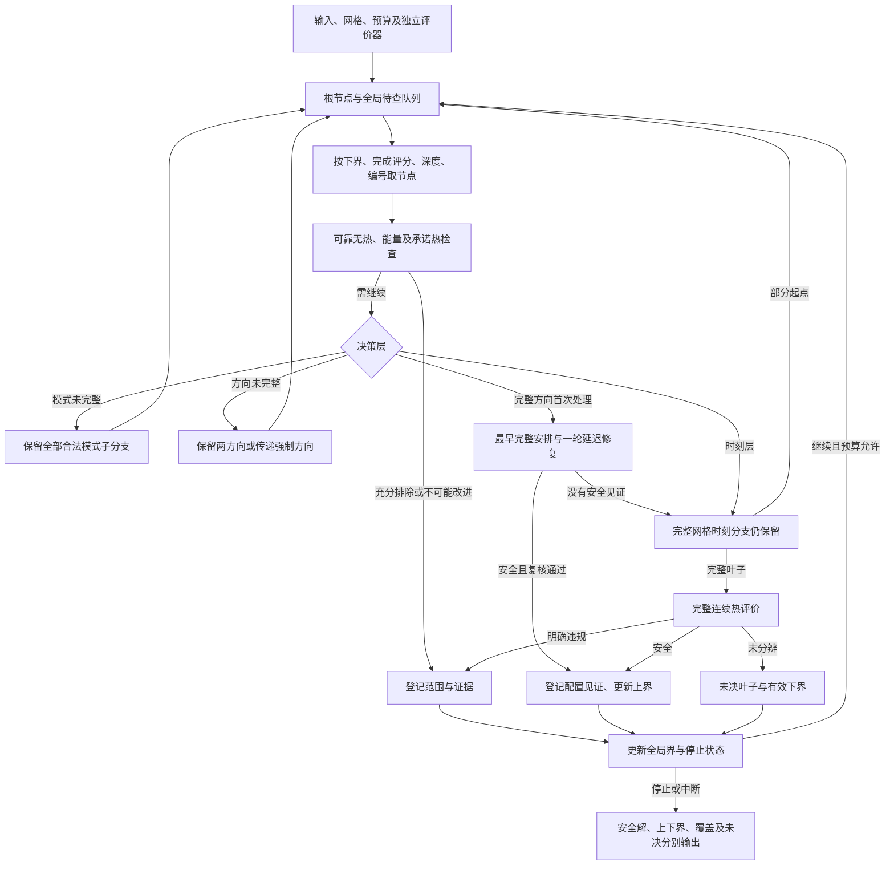

# 第四章有界搜索与启发式协调规则

日期：2026-09-26。承接[61号正式模型](61_第三章正式模型与适用边界.md)与[62号结构论证](62_结构性求解困难与第四章任务定位.md)。采用已确认的“有界搜索框架＋启发式候选排序＋有限热安全修复＋完整热评价”，沿用academic-research-suite的论证组织流程。本轮仅形成规则、流程、概念伪代码及纸面正确性审查，没有实验程序、案例运行或参数扫描。

**本章方法的具体任务是：在有限预算内优先寻找低能量的完整安全安排，同时保留尚未处理的可能解；只有满足充分条件时才剪枝。** 启发式负责优先顺序和快速见证，证明负责覆盖、界和排除。采用这一组织不等于已成立算法创新，质量和计算收益仍待验证。

## 1．对象、输出与首版取舍

使用61号同一输入：有限已知请求DAG、合法固定CPU单元及其频率域、固定服务模式NPU、Stage模式表、固定窗口、到达／期限及二节点RC。首版解的是给定启动网格Δ的受限问题，温度在完整窗口内连续评价；网格、预算和物理参数由输入协议给定。本轮不选新的数值，未来复用53号时沿用原网格和每例每方法预算。

目标是找到一个最低能量的安全解或预算内的最好安全见证，**不以列全并列最优配置为首版目标**。保留CPU标签，不做对称剪枝；不启用一般模式支配删除；不先保存全部无热时间表。每个方法独立承担输入展开、节点生成、排序、界计算、修复、热评价及见证复核的成本。

| 输出 | 含义 |
|---|---|
| 安全见证与上界U | 完整合法、明确热安全的安排；没有见证时U=+∞表示尚无上界 |
| 全域下界L | 覆盖全部尚可能优于当前见证的分支；不是只看已访问叶子 |
| 最优值状态 | 已证精确／声明容差内最优，或未决；与是否找到安全解分开 |
| 网格不可行状态 | 仅在全部可能安排均有有效排除证据时成立 |
| 配置集合状态 | 记录已见安全配置；默认不声称集合完整 |
| 预算、数值、覆盖状态 | 分别记录中断、未分辨和是否已覆盖，不揉成一个“失败” |

输入信息缺失、数值非法和方法未找到安全解也分开处理；缺失参数不能用零补齐。所有“安全”均限于输入模型、声明启动域与窗口，不是实机或窗口后运行保证。

## 2．三层搜索及节点语义

### 2.1 统一顺序与节点表示

先对原DAG取确定性拓扑序：每次在就绪Stage中选输入规范ID最小者。跨请求Stage的ID顺序固定，不用其作为执行先后约束。单元和频率采用输入规范顺序；不改变53号历史ID规则。

每个节点N表示一组完整安排，记为 \(\Omega(N)\)，而非一条近似时间表。节点按三层依次固定：

1. **模式层：** 已赋值的Stage模式及尚未赋值集合；
2. **方向层：** 完整配置m和已确定的冲突方向；
3. **时刻层：** 完整配置、完整方向，以及部分已固定网格起点。

节点保存类型、上述约束、有效能量下界、乐观完成评分、已固定项数、生成编号和必要的处理游标。固定起点只表示搜索分支的承诺，**不是运行时已经派发**；拓扑变量顺序也不要求这些工作按赋值顺序真实执行。

运行中区分：待查队列Q、正在处理节点A、完整安排数值未分辨集合Z，以及已处理证据记录。热评价缓存不替代这些集合的覆盖职责。

### 2.2 模式分支

按原固定拓扑序选择下一个未赋值Stage。所有合法模式均生成子分支，按以下键分配确定性生成顺序：

\[
\bigl(Q_i(v)d_i(v),\ d_i(v),\ u(v),\ \nu(v)\bigr). \tag{1}
\]

NPU使用固定模式标记，不将其强行解释为CPU频率。活动能量、时长是优先级，不授予删模式的权利。每个子分支固定该Stage一个模式，因而完整、互斥地覆盖父分支的模式选择；同请求重复Stage仍使用同一输入响应表。

### 2.3 冲突方向分支

模式完整后建立62号冲突对：同执行单元，或跨CPU但同频率域且异频。冲突对按原Stage规范顺序组成的有序二元键排列。不存在冲突的同频跨CPU工作不添加串行边。

取第一个尚未解决的冲突对。如果现有依赖／方向图已经有 \(i\leadsto j\) 路径，则方向被强制为i在j前，不再分支；反向路径同理。否则同时保留 \(i\to j\)、\(j\to i\) 两子节点，规范ID较小者在前的方向先生成。新增有环方向可按62号正时长证明排除。

每个合法完整安排都必须选择冲突对的一种先后；传递强制仅省略不可能的另一方向，不删除等待。方向完整也不意味着所有事件先后和所有并发重叠已经确定。

### 2.4 启动时刻分支

方向完整后，对该有向图取确定性拓扑序，同刻就绪仍用规范ID破并列。选择下一个未固定起点的Stage i。其前驱起点此时均已固定，枚举

\[
s_i=k\Delta,\qquad
\left\lceil\frac{\max\{a_{r(i)},\max_{j\in\operatorname{Pred}(i)}(s_j+d_j)\}}{\Delta}\right\rceil
\le k\le
\left\lfloor\frac{\min(D_{r(i)},W)-d_i}{\Delta}\right\rfloor. \tag{2}
\]

空前驱最大值忽略。按k升序生成所有子节点，空区间是该时刻分支的无热排除证据。结束时间、时长、到达和期限不取整。后续传播可进一步排除超期分支，但不能只保留最早格点。

式(2)覆盖当前固定方向下每一种可能起点；后继持续分支便覆盖全部合法等待。不同方向共同覆盖整个配置的无热安排。首版不使用未证明的时间跳跃、热等待阈值或强制最早启动缩减这一域。

## 3．界、评分与节点检查

### 3.1 节点能量下界

设节点已固定模式的Stage集合为J，尚允许的模式为 \(\widehat M_i\)。采用

\[
L_N=P_{\rm base}W+\sum_{i\in J}Q_i(m_i)d_i(m_i)
+\sum_{i\notin J}\min_{v\in\widehat M_i}Q_i(v)d_i(v). \tag{3}
\]

不按启发式偏好缩小 \(\widehat M_i\)。方向层和时刻层的 \(L_N=E(m)\)；能量已知不等于可行。公共基准全窗口计一次，活动期间固定开销仍留在Q内。

### 3.2 乐观完成评分及无热必要检查

模式层对未赋值Stage取最小合法时长，对已赋值者取真实时长，只在原依赖图上做网格最早传播；暂忽略尚未确定的资源／域冲突。方向层使用完整真实时长及当前已有方向；时刻层进一步固定已赋起点。

传播处理已固定起点时必须保持其等号，不能把它推迟来修复分支：若依赖最早要求已经晚于固定起点，直接判该分支无热不可行。未固定起点逐次向上对齐网格。所有Stage的最早结束须不晚于其请求期限及窗口。

这是包含原分支可行安排的松弛。图有环、固定起点冲突或乐观最早超期可可靠排除；部分图传播通过只代表必要条件通过。完整方向、没有额外固定起点时，对无热可行性才具有62号充要保证。

令 \(\widehat c_r(N)\) 是上述传播的请求汇点完成时刻，队列键固定为

\[
K_N=\left(L_N,\ \sum_r\widehat c_r(N),\ -q_N,\ \mathrm{id}_N\right), \tag{4}
\]

其中 \(q_N\) 为已固定模式数、已解决冲突对数及已固定起点数之和；强制方向计入已解决项。\(\mathrm{id}_N\) 依确定性生成顺序赋予，子节点按§2顺序生成。完成评分和更深节点优先都是启发式，不能因评分较差删除节点。该排序可能长时间优先处理某低能配置，有限预算下并不保证迅速取得首个安全解；这是后续需检验的取舍，不在本轮追加配额或随机跳转。

## 4．最早安排、有限修复与完整时刻覆盖

### 4.1 每个完整方向的一次构造尝试

完整方向首次被处理时，按62号传播构造最早完整安排s⁰，独立检查资源、依赖、频率域、网格和期限，再评价全窗口连续热峰。

- 明确安全：经完整见证复核后登记该配置可保留，更新U。
- 明确违规：进入下述一轮修复；违规只标记s⁰，不排除方向。
- 数值未分辨：不启动基于违规峰的修复，直接保留该方向的完整时刻搜索；缓存未分辨结果。

每个配置／完整方向只作这一轮尝试；恢复中断节点时读取处理游标，不能无限重复尝试。构造与修复中的起点均未成为搜索分支的固定承诺，除非进入§2.4的系统赋值。

### 4.2 按历史温升贡献排序的单步延迟修复

在s⁰中，对每个明确违规节点取其全过程峰值及最早达到该峰值的时刻。在这些节点峰值之间选择最早时刻t*，同刻按节点编号选n*。这不是第一次越过温限的时刻，不能混用二者。

令 \(A_T=-C_{\rm th}^{-1}G\)，\(\mathbf e_h\) 为注热节点h的单位向量。Stage i对所选峰点的活动温升贡献为

\[
w_i=\mathbf e_{n^*}^{\mathsf T}
\int_{s_i^0}^{\min(b_i^0,t^*)}
e^{A_T(t^*-\xi)}C_{\rm th}^{-1}\mathbf e_{h(i)}Q_i\,d\xi,
\quad s_i^0<t^*;\qquad w_i=0\text{ otherwise}. \tag{5}
\]

它来自线性RC的活动输入分解，包含已结束Stage的余热及跨节点耦合；基准功率和入口状态单独存在，不错误归给某个Stage。贡献非负不表示该Stage可以单独承担“超温原因”，也不保证延后它会降低新峰温。

所有Stage按w降序、规范ID升序尝试，零贡献Stage也保留。贡献只是优先级；数值贡献无法可靠区分时按规范ID处理，不能据此删候选。每次均从原s⁰重新出发，只给目标Stage j增加一个网格步长的启动下界，其余起点以s⁰为下界。沿固定方向图拓扑传播：

\[
\widetilde s_i=\left\lceil
\max\{a_{r(i)},s_i^0+\Delta\mathbf1_{i=j},
\max_{k\in\operatorname{Pred}(i)}(\widetilde s_k+d_k)\}
\right\rceil_\Delta. \tag{6}
\]

每个Stage至多被选作一次目标。传播不提前其他Stage，不改映射／频率／方向；后继若受影响可以延后多步。超期便结束该次尝试，其余候选做完整合法性和连续热复核。首个安全者登记并结束此配置的时序搜索；未分辨与违规均继续下一个目标，直至本轮耗尽或预算结束。

不从上一次修复后的方案继续迭代，不改变Δ，不据结果追加温度点。最多有|V|个修复候选，加一条最早安排；重复安排允许命中本方法缓存，贡献计算、传播、查找及评价都计费。

### 4.3 修复失败之后究竟继续查什么

一轮没有安全见证时，创建该完整方向的时刻搜索根：所有起点仍未固定，按照§2.4枚举。最早安排和修复候选的评价缓存可复用，但不能仅保留这些代表或跳过尚未检验的多步等待。

时刻树中的完整违规叶子只排除该叶；完整未分辨叶子进入Z。方向的全部时刻分支有明确排除后，该方向才可记热不可行；配置全部方向均被排除且没有未分辨后，配置才可排除。任何时候其他配置仍按全局队列规则保留，不强制等当前配置被完全证明后才允许另一配置出现，也不承诺排序一定会优先访问它。

若某配置已有安全见证，其其他方向及时间表无需继续搜索最低能量：固定配置的E相同。记为“配置已取得安全见证／停止冗余搜索”，**不能记为这些时序无解**。它们可以从Q、A的剩余分支及Z中移除相应部分；其他配置和部分模式父节点不能一并误删。

## 5．可靠剪枝、证据状态与数值边界

### 5.1 规则分类

| 规则 | 分类 | 可靠结论／禁止扩大 |
|---|---|---|
| 图有环、固定起点冲突、乐观最早超期 | 可靠无热排除 | 排除当前节点代表的分支，不是其他方向／模式 |
| 固定起点工作＋基准尾段明确超温 | 可靠热排除 | 排除保持这些绝对起点和模式的续接；未赋起点工作只是暂不注热 |
| 已有安全U且 \(L_N\ge U\) | 可靠非改进剪枝 | 可跳过为最优值服务的搜索，不证明不可行；可能遗漏并列配置 |
| 完整配置已有安全见证 | 可靠目标等价停止 | 此配置其他时序不会给更低能量，不声称它们都安全 |
| 模式按局部能量／时长排序、队列完成评分和深度键 | 启发式优先级 | 只决定先查什么，不改合法域 |
| 最早安排及贡献排序的一轮延迟 | 启发式构造／修复 | 找到安全解才形成见证；没找到没有排除权 |
| H/L或CPU/NPU模式按局部偏好删除 | 首版禁用 | 62号充分支配条件不普遍成立 |

固定起点集合J_s的承诺功率为基准加这些Stage的实际活动区间，其余阶段不注热，完整窗口仍含尾段。任意保持这些承诺的完整安排只增加非负活动注热，故62号RC正性支持“下界轨迹违规→该分支无安全续接”。这些已固定区间可能位于未来，未固定Stage也可能在更早绝对时刻执行；证明靠注热逐点包含，不靠赋值顺序等同时间顺序。

承诺轨迹安全不能接纳完整解。承诺轨迹未分辨也不暂停整棵子树：不作热剪枝，继续分支，后续更多固定注热可能形成明确排除或完整可判定结果。只有**完整安排**未分辨才进入Z；构造候选未分辨由尚未展开的搜索节点覆盖，不用把整个配置封存。

### 5.2 数学不等式与计算证据分别处理

以上证明使用精确数值。实际实现须另有可靠的下界与上界计算：能量下界向保守方向处理，安全见证能量给有效上界，不能把队列排序的浮点近似值直接用于剪枝。严格非改进剪枝使用经支持的 \(L_N^-\ge U^+\)；近似相等仅能产生声明容差内的结论。

53号能量格值在56号已经单独审查，可在其原输入边界下用于等价精确能量比较；这不是一般新输入都具有的性质。原基线固定锚点分层不改，新方法不冒称其规范代表等价。

热接口返回明确安全、明确违规或未分辨，以及峰值时刻、完整／承诺轨迹标识和评价依据。若采用旧浮点评价器，沿用其带宽及核验范围，并在未来预检中核对误差是否足以支持剪枝；不能把带宽本身叫作已经证明的误差上界。缺少支持时保持未分辨，不把临界候选推到任一侧。

贡献评分、预计完成评分即使只作近似，也不能渗入排除逻辑。由数值误差造成的无法判定不是模型不可行。

式(2)与传播中的ceil／floor也属于覆盖边界：计算不确定时不得向内缩小候选格点范围，临界格点应保留并复核。原53号时间容差仍是其数值契约，不能把容差处理默认为精确数学等式；后续预检须覆盖非整数结束及期限恰落边界的情形。

## 6．覆盖、上下界与预算中断

### 6.1 覆盖不变量

根节点覆盖全部模式与网格起点。模式、方向和时刻分支分别按§2完整展开；可靠排除移除无解子域，非改进剪枝及配置安全停止移除不可能改善当前值的子域。每个尚可能更优的完整安全安排，要么位于Q中的节点、正在处理A的节点或Z的完整叶子中，要么已经以安全见证登记。

**探测不是展开。** 检查最早安排或修复候选只增加证据，不替换父节点所覆盖的其余安排。缓存中的一个未分辨探测不单独承担覆盖；其安排尚由父节点／后续分支表示。

对子节点的生成采用事务语义：生成、检查及入队准备期间，父节点一直留在A，子节点先放临时缓冲；全部子域都已准备或有效排除后，才原子地以子节点替换父节点。预算在中途结束，保留父节点及处理游标，不能仅留下已生成的一部分子节点。临时缓冲不重复计作独立覆盖；有效见证和已经取得的证据可以保留。

若资源不足而无法保留这些信息，返回资源／覆盖未决，保留已知安全见证及根下界，不报告精确覆盖或不可行。首版不通过悄悄丢弃队列节点来维持运行。

### 6.2 全局界与已关闭配置

精确数学下，有安全上界U时，可用

\[
L_{\rm global}=\min\bigl(\{U\}\cup\{L_N:N\in Q\cup A\cup Z\}\bigr) \tag{7}
\]

作为全问题下界；Z叶的下界为该完整配置能量。没有见证时去掉U，只用剩余域的下界。已排除分支无安全解；非改进分支下界不低于当时U，后来U只会降低；已取得安全见证的完整配置目标已知。因此式(7)不会遗漏仍可能更低的目标值。

**数值区间版本不能简单用U⁺充当下界。** 若关闭的安全配置能量只知区间 \([E_m^-,E_m^+]\)，记录这些配置下界的最小值 \(L_C=\min_m E_m^-\)；上界 \(U^+=\min_m E_m^+\)。下界取 \(\min(L_C,\min_{N\in Q\cup A\cup Z}L_N^-)\)，无安全配置时 \(L_C=+\infty\)。非改进剪枝使用 \(L_N^-\ge U^+\)，因而不影响这一覆盖下界。这样即使队列清空，也不会因把某个向上舍入的能量当下界而伪造精确最优。

### 6.3 何时停止、能说什么

| 条件 | 结果 |
|---|---|
| 已有安全U，全部剩余分支下界均不低于U | 精确数学下最优值已证；不保证并列集合完整 |
| 可靠数值界满足 \(U^+-L^-\le\varepsilon_E\) | 声明能量容差内最优；\(\varepsilon_E\) 取输入协议，不能据结果放宽 |
| 无安全见证，Q、A、Z均空，且所有关闭分支有有效无解证据 | 声明网格问题不可行；不能外推连续启动域 |
| Q空但Z非空、尚不能用有效能量界结束 | 数值未决；不是已穷尽并排除 |
| 预算结束且有安全见证 | 返回见证、界及未决字段；不能把“当前最好”写为已证最优 |
| 预算结束且没有安全见证 | 尚未找到安全解；不是实例无解 |

能量界已经足以证明最优时，Z中较高或并列能量的未分辨安排不必继续处理，但数值未分辨记录仍保留，不能改写成热排除。首版 `optimal_configuration_set_complete` 默认不作完成声明。

总预算B从本方法开始处理输入起计时。耗时调用前后均检查预算；调用结束时才获知的新证据若已超过B，只能另存为预算外诊断，不能计入预算内方法结果。处理中断保留A；输出序列化与事后独立复核不能替方法补做搜索。若事后复核否定见证，必须撤回依赖它的上界／最优结论，不能用参考时间表修补输出。

## 7．流程与概念伪代码



图中全部入队替换均按§6事务规则执行，预算中断可发生在任一环节。以下为文档级伪代码，不是已实现程序。

```text
初始化：展开输入并计费；建立根节点及其可靠下界；Q={root}，A=空，Z=空
        安全配置表C=空，热评价缓存=空，U=+∞

只要预算允许且尚未获得停止证书：
    若Q为空：按Z、C及覆盖记录输出相应状态，结束本次运行，不作默认不可行判断
    按固定键从Q取N；立即登记为正在处理A，覆盖仍包含N
    若可靠能量界证明N不可能改进，或N完整配置已有安全见证：
        按“非改进/已解决配置”关闭N，不记无解；更新界；继续
    对N作有证据的无热必要检查
    对时刻层已固定起点的非空集合，评价承诺轨迹
    若明确无热不可行或承诺热违规：登记分支排除；关闭N；继续

    若模式未完整：事务式生成全部合法模式子分支
    否则若仍有冲突对未定向：事务式保留两方向或强制方向
    否则若该完整方向的构造尝试尚未结束：
        先查最早完整安排；若明确违规，按§4尝试一轮独立单步延迟
        每条候选：先合法性检查，再查/写本方法缓存，再完整热复核
        若取得预算内且独立复核通过的安全见证：
            更新C与U；停止该配置其余时序搜索；不影响其他配置
        否则：标记构造轮已结束，把同方向全起点域交给时刻搜索
    否则若尚有未固定起点：事务式生成式(2)全部起点子分支
    否则：
        完整叶子独立合法性检查并复用/执行完整热评价
        安全→更新C与U；违规→只排除此叶；未分辨→将此叶放入Z

    只有父节点的完整替代覆盖或关闭证据成立后，才从A移除
    同配置安全见证只关闭其完整配置分支；部分模式节点保持原覆盖
    计算包含Q、A、Z以及安全配置能量记录的全局界，检查停止证书

预算/资源中断：保存A及游标、Q、Z、C、界和覆盖状态
事后独立核对已输出见证；不再搜索、不用参考结果补齐
```

对非法叶子不能当作普通热违规隐藏：按理论规则本应合法的完整叶子若被独立检查器否定，记实现／契约错误，停止相应证明声明并保留诊断，待后续修复。研究输入不能因此改动。

### 7.1 重复评价的复用边界

完整缓存键包含本次输入／评价规则身份、规范Stage顺序下全部模式及精确网格起点。条目保存合法性、能量、热状态及证据范围；不能仅凭“同能量”“同配置”复用不同时间表的温度。承诺轨迹的缓存必须另带已固定Stage掩码，不能与完整结果混用。

缓存只在本方法本次运行内复用，首次计算、查找与保存全部计费；不得读取55号参考见证或跨方法共享已算结果。未分辨缓存可避免同精度的机械重复，但不能转换成安全或排除；未来提高精度属于另行说明的操作，首版不自动反复计算。同配置一条安全见证是目标等价关闭依据，而不是把所有同配置轨迹缓存为安全。

## 8．保证、局限及与强基线的关系

**条件正确性：** 若各分支规则覆盖完整、下界和排除证据可靠、完整评价正确，则每条被接纳见证合法安全，能量界有效；预算截断不会把未决改成排除。有限模式、有限方向、有限网格和每方向有限构造尝试保证不受预算限制时系统搜索树有限；只有全部必要数值判定均明确且资源足够时，才能进一步谈搜索完成后的精确结论。这是规则层论证，尚未由实现预检证明。

新方法与旧基线的关系：

| 能力 | 53／55号冻结基线 | 本次规则 |
|---|---|---|
| 模式与合法动作 | 全部合法无热安排中的模式，含较高能量代表 | 相同原模式域；不锁死全局无热最优配置 |
| 候选组织 | 完整库排序，每初始完整动作一个最佳代表 | 模式—方向—起点节点及有效能量界 |
| 未来热信息 | 完整代表全窗口连续评价 | 同样完整评价；另可用承诺热下界作可靠筛查 |
| 同配置时序覆盖 | 不保证覆盖该配置全部时序 | 在预算允许下保留全部网格时序分支，尝试一轮修复加快找见证 |
| 停止依据 | 首个安全代表；代表耗尽不等于整体无解 | 安全见证、界证书、覆盖完成或预算；未决单列 |
| 代价 | 生成、排序、代表评价 | 生成、队列、界、修复、热评价及复核，均计费 |

本次是不同搜索策略，不是56号“与旧代表完全等价”的存储优化。不能改变旧代表、缩小旧模式集或赠送新方法参考答案来显示优势。将来比较仍采用同输入、信息、启动域、期限、热精度、窗口与预算。

比较依据只读复用[53号规则文件](stage53_design/rules_v1.json)、[55号已完成／未决结果](55_四Stage任务首轮验证.md)及[56号等价接口边界](56_枚举成本与等价精确接口审查.md)，不将本轮文档写成已经实现这些新规则的代码说明。

额外覆盖可能找到旧代表未包含的安全低能安排，也可能只增加成本；分支下界可能很松；一轮修复可能无效；低能分支优先可能使限时首解变慢。这些都是待检验关系。本轮没有新的方法质量、加速或复杂度实验结论。

拟研究的差异应落在“任务相关模式代价、冲突方向必要检查和完整热时序反馈如何组织有限预算的搜索”上；分支定界名称、最早传播或RC正性本身不作为新颖性主张。证明框架与启发式可以并存，不需要把方法先贴成纯精确或纯启发式。

## 9．纸面验收与下一步

以下检查仅核对控制流与逻辑后果，不设置或运行数值夹具。

| 情形 | 按本规则必须发生的行为 |
|---|---|
| 最早安排安全且达到有效全域下界 | 见证复核后直接获得最优值；不强行继续修复 |
| 最早超温而某单步延迟安全 | 登记同配置安全见证；能量仍E(m)，不是等待带来能量下降 |
| 一轮修复失败，需多步等待或其他方向 | 保留式(2)全部起点与其他方向；不能判配置无解 |
| 同频跨CPU并发／同域异频／NPU排队 | 冲突对分别“不添加／添加／同单元添加”，不漏约束也不过度串行 |
| 并列配置或并列能量 | 允许为一个最优值作非改进剪枝，明确未列全配置集合 |
| 空闲等待及非整数结束 | 根起点可晚于到达，后继按真实结束后再对齐；尾段仍计热及基准能量 |
| 最早探测未分辨／部分承诺未分辨 | 不据此剪掉时刻域；完整系统叶子未分辨才以Z承担覆盖 |
| 生成一半子节点时预算结束 | A中父节点保留全部尚未提交覆盖，不把半库当完整分支 |
| 一个安全配置已关闭，后来找到更优配置 | 保留见证及其能量记录；全局界不因关闭节点被错误抬高 |
| 所有候选都没有安全见证 | 只有全域有效排除且Z为空才判网格不可行，否则未决 |
| 缓存命中不同时间表／部分轨迹 | 不允许跨键复用；所有输出另做完整独立检查 |
| 事后核验不通过 | 撤回见证和依赖它的证明，保留实现错误；不从参考补答案 |

本轮沿用61—62号证明和53／55号基线定义，不新增外部来源、算法效果证据或现实机制。上述规则是设计交付；覆盖归纳已在文档中展开，但代码尚不存在，不能称预检通过。

交付检查：7个编号公式顺序唯一，显示公式与代码块定界符配对，5个本地链接有效。按62号留存的路径／哈希口径复核1,680份历史文件，聚合SHA256仍为`2cc578a509222beb7741de22d5d342d0babff3d47839bdf46b82730f3bdb1339`；53号输入／规则各自SHA256与冻结记录一致。该历史口径排除03证据记录、62号及本次63号；本轮实际只写63号、RESEARCH_BRIEF和03证据记录。检查属于文档／文件核对，不是执行伪代码或覆盖测试。

**唯一下一步：审查这套规则的覆盖正确性与方法差异，确定必要的预检和对照，然后进入实现。** 审查重点是事务式展开、未分辨叶子、配置安全关闭、保守界及修复只作探测这几处是否被准确实现；比较应能分别识别搜索组织和一轮修复的作用，不立即运行新参数扫描或扩展主线。63号不自动恢复56号，不为方法命名或承诺收益。
