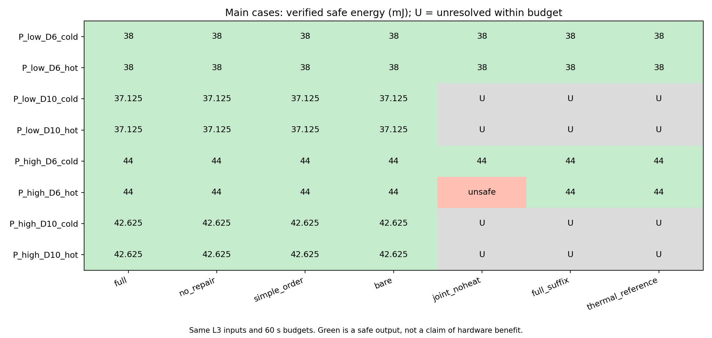
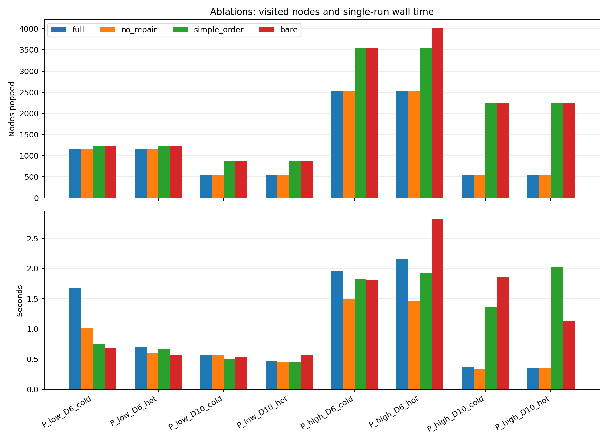
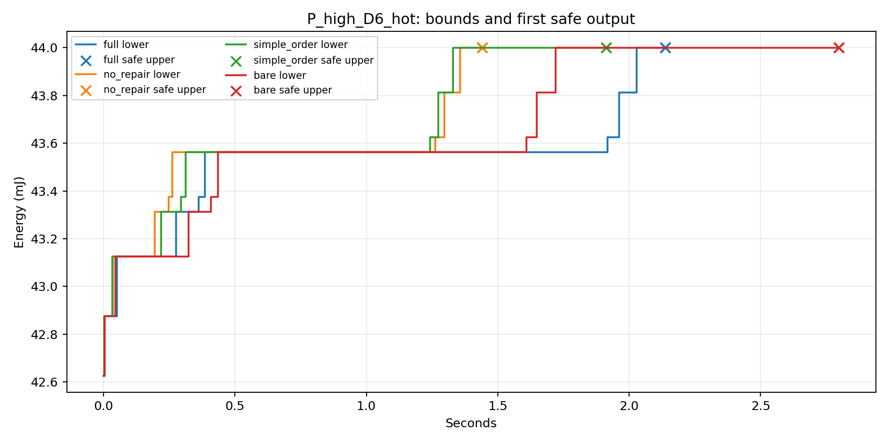

# 有界搜索实现与冻结案例对照

日期：2026-09-26。承接[63号方法规则](63_第四章有界搜索与启发式协调规则.md)。本轮实现并检验第四章方法，不增加研究机制、数值案例或扫描维度。性能、功率、热参数仍为53号L3抽象设定，任务结构来源不使这些数值成为设备测量。

**结论：63号已实现，并完成70次冻结比较。四个新版本均解决全部8项主案例，取得安全见证和已证最优值；没有新增能耗改善。完整排序减少本组访问节点，但耗时优势有条件；有限修复仅在简化排序的一项热态案例中减少搜索工作。** 这些结果支持保留有界搜索与排序作为第四章方法主体，修复作为可选辅助；不等于已证明普适加速、实际设备收益或算法新颖性。

## 1．实现及规则边界

材料登记（Material Passport）：输入为53号冻结JSON与规则；数据等级L3；任务为63号算法实现及固定案例验证；环境MATLAB R2023b；新方法与旧方法使用相同工作量、信息、启动域和评价窗口；本轮没有真实设备测量、外部新增文献或随机抽样。

独立入口为[run_search64](matlab_config_value_src/run_search64.m)，包含`precheck`与`frozen`。全部新搜索模块以`b64_`开头，原35—60号程序不修改。按[执行说明](search64_audit/README.md)运行，冻结入口要求预检通过且源码／输入哈希一致。

正式入口当前承接53号八Stage输入及其数值适配契约；三层搜索结构不依赖只有两个Stage，但本轮没有完成61号全部可能输入、任意RC网络或连续启动域的通用求解实现。

模式、冲突方向和起点分三层赋值。模式保留CPU标签及全部合法频率、S1的CPU/NPU替代映射；方向覆盖同单元、同频率域异频的互斥，同频跨CPU不强制串行；起点保留全部合法网格等待。变量赋值顺序不是实际执行顺序。

完整方向先构造最早安排，明确超温时才作一轮单Stage延迟修复。各次独立从原最早安排出发，保持映射／频率／方向，所有Stage（含零贡献者）按原规则依次尝试；无安全见证仍进入完整起点树。不同映射／频率由其他配置分支处理。

| 操作 | 实现中的证据作用 |
|---|---|
| 模式能量、乐观完成时间、深度排序 | 只改变访问顺序，不删模式或时序 |
| 环、乐观期限冲突、固定起点不满足先后 | 仅排除对应无热分支 |
| 固定起点注热子轨迹明确违规 | RC正性支持排除保持这些承诺的续接 |
| 能量下界不低于安全上界 | 非改进关闭，不称为不可行；允许遗漏并列配置 |
| 完整配置已有安全见证 | 关闭该配置其他等能安排，不称它们均安全或均无解 |
| 单步修复失败 | 不产生排除；多步等待、其他方向仍保留 |
| 完整叶子温度未分辨 | 保留叶子及能量下界；不排除配置 |
| 预算中断 | 保留待查队列、处理中父节点及未分辨叶，不以部分子集替代完整父域 |

缓存只在同一方法调用内使用，键含模式、精确起点及未固定掩码的NaN位置；输入／热参数在一次调用内固定。不同时间表不共用温度判断。安全见证复核、缓存、候选生成和队列维护全部计入预算。

## 2．精确格值与连续热误差包络

53号时长／释放／期限／窗口可精确表示为0.25 ms整数，启动间隔仍为1 ms。能量为0.0625 mJ整数格。因此本轮的覆盖边界和能量界比较使用整数，不用近似相等替代可靠下界。适配器拒绝不符合格值契约的输入；这不是一般模式表都具有的性质。

热节点维持连续时间。令CPU/NPU相对环境温度的共模、差模分别为M、D，对本轮对称网络有

\[
\dot M=-20(M-10(p_C+p_N)),\qquad
\dot D=-40(D-5(p_C-p_N)).
\]

在每个恒功率段，以z=exp(-20t)表示，每节点温度都是e+a z+b z²；检查区间端点及内部驻点，不用时间采样代替峰值。旧特征分解评价器提供名义峰值、峰值时刻与交叉检查，新包络决定安全接纳／剪枝。

区间基本运算向外扩8个浮点间距；exp采用24阶Taylor和25阶绝对余项上界。本窗口每段20Δt≤0.4，有限数值范围内无溢出／下溢。系数或驻点位置不明确时取保守区间包络。该实现依赖IEEE754基本运算语义及本轮确切RC有理数定义，不宣称一般RC认证求解器。

峰温上界低于80°C−1e−6°C才接纳，某节点峰温下界高于80°C+1e−6°C才作热排除，否则未分辨。误差包络和温度分类带宽分别存在；ODE交叉检查本身不充当误差证明。评价覆盖20 ms完整窗口及尾段，不保证重复执行或窗口后的热安全。

## 3．预检与公平比较

[预检记录](matlab_config_value_src/search64_reports/precheck_20260926_114835_246/prechecks.csv)为101/101通过。其中包括66项旧评价／基线回归，十项输入格值核查及新增覆盖、四版最优值、中断、资源异常、单步修复、多步等待和数值未决检查。

独立小域笛卡尔积得到58条合法完整元组，与三层树逐条一致且无重复。另核对依赖、独立频率域的覆盖；每个新版本均达到该域独立最优值。微型测试中，单步修复成功与单步失败后多步等待成功均保留；它们属于实现夹具，不计入研究案例。

全部小域时间表的热包络包含旧解析极值，最大包络宽约1.208e−12°C。另沿用旧验证器的内部峰值、逐段ODE、双CPU注热、非整数结束及47号历史见证核对。输入、源码和环境均随预检归档；正式运行使用同一哈希凭据。

| 方法 | 队列优先级 | 有限修复 | 其他能力 |
|---|---|---|---|
| full | 下界、乐观完成之和、深度、生成号 | 开启 | 63号完整覆盖与界 |
| no_repair | 同full | 关闭 | 其他规则相同 |
| simple_order | 下界、生成号 | 开启 | 子分支生成规则不变 |
| bare | 下界、生成号 | 关闭 | 其他规则相同 |
| joint_noheat | 55号原规则 | 无 | 原完整无热枚举／排序 |
| full_suffix | 55号原规则 | 无 | 每初始动作一个最佳完整后缀，完整热复核 |
| thermal_reference | 55号原规则 | 无 | 原同域热参考及最优配置集合 |

每个案例每方法独立60 s，共70次；主例8项与校验2项分别统计。输入重新加载计费，不跨方法共享候选或热缓存。策略先保存，热参考后运行。预算外独立复核只核对已输出方案，不搜索、不补救；历史60号证书只用于事后核对。

单次确定性运行的墙钟受MATLAB预热和系统负载影响，耗时不作统计显著性结论。原完整集合参考的任务比新方法多，不能将二者耗时比直接作为等任务加速比；原完整后缀基线的全库生成也与搜索组织不同。

逐例MAT检查点会保存剩余队列及全部既有结果，文件序列化在方法预算外。因而表中`elapsed_s`是方法调用计时，不是整轮实验端到端时间；较快的方法调用不能直接写成相同比例的整套流程加速。源程序和日志保留这一开销，没有在正式运行中修改保存策略。

## 4．冻结结果

### 4.1 已完成的策略结果

四个新版本在8项主案例中均找到完整、合法、明确热安全的安排，最终能量上下界闭合为下表值；这里比较最优值，不要求它们输出相同映射或相同时间表。

| 主案例 | 四版共同最优能量/mJ | full弹出节点 | simple_order弹出节点 | 原完整后缀基线 |
|---|---:|---:|---:|---|
| P_low_D6_cold | 38 | 1147 | 1232 | 完成，38 mJ |
| P_low_D6_hot | 38 | 1147 | 1232 | 完成，38 mJ |
| P_low_D10_cold | 37.125 | 548 | 876 | 60 s未决 |
| P_low_D10_hot | 37.125 | 548 | 876 | 60 s未决 |
| P_high_D6_cold | 44 | 2527 | 3546 | 完成，44 mJ |
| P_high_D6_hot | 44 | 2527 | 3546 | 完成，44 mJ |
| P_high_D10_cold | 42.625 | 556 | 2240 | 60 s未决 |
| P_high_D10_hot | 42.625 | 556 | 2240 | 60 s未决 |

两项独立校验单列：阶段能量并列案例四版均取得42.625 mJ最优值，但未声称完整最优配置集合；4 ms期限小于5 ms最快隔离链，四版均由无热必要条件判不可行，原无热／后缀基线也返回无热不可行。

40项[独立界核对](matlab_config_value_src/search64_reports/frozen_20260926_114942_794/independent_bound_checks.csv)全部通过。宽期限按原JSON用Decimal独立计算Stage能量下界，紧期限沿用60号独立核验的无热排除证书；入口变热不降低无热下界。对保存的全部界记录检查L不超过该值、U不低于该值、L单调不降和有限U单调不升。最终安全见证达到这些下界即可证明最优值，不需要把超时热参考伪装成已完成。此检查没有重新搜索，也没有向方法传递证书。

### 4.2 排序和修复分别带来了什么

完整排序在本组8项均减少节点，但耗时并非处处更短。高功率宽期限冷态，full/no_repair为0.367/0.339 s，simple_order/bare为1.354/1.858 s；热态对应0.350/0.355 s与2.025/1.128 s。低功率案例没有稳定墙钟优势，不能从节点数量直接推断普遍加速。

full和no_repair在所有主例的第一个完整探测安排均安全，各只作一次搜索热评价，修复完全未触发。这里不支持把修复写成完整版成功的必要机制。

P_high_D6_hot的简化排序提供了一个有限正例：simple_order先尝试延迟B.S2，因超期放弃；再独立延迟A.S2一格，并传播A.S3，取得44 mJ安全安排。其两请求均在6 ms完成。它共弹出3546节点、作2次搜索热评价；关闭修复的bare弹出4017节点、作7次评价后同样得到44 mJ，记录耗时为1.927与2.816 s。**这是指定访问顺序下的搜索工作减少，不是能耗改善，也不是修复普遍有效。**

本次没有新增“比已完成强基线更低能耗”的结果。宽期限新方法取得预算内安全解与最优值，而旧全库实现超时，支持这一搜索组织对本实现的可用性；不能据此证明更好的精确求解实现或其他已有算法必然失败。

### 4.3 强对照、热参考与未决

| 方法 | 主例合法热安全输出 | 本轮结果边界 |
|---|---:|---|
| full / no_repair / simple_order / bare | 各8/8 | 各8项最优值已证；不列全最优配置 |
| 原joint_noheat | 3/8 | 4项无热最优值已证，其中1条安排超温；4项超时 |
| 原full_suffix | 4/8 | 4项输出达到同域热参考；4项超时，不判方法理论失效 |
| 原thermal_reference | 4/8 | 4项最优值及配置集合完成；4项超时 |

热参考再次确认P_high_D6_hot的104个无热最优配置中80个可保留、24个排除，最低能耗仍44 mJ，与55号一致。新方法不要求完整集合，因此不能把其耗时直接与这一额外输出任务作等工作量比较。

三种旧方法在4项宽期限主例及阶段并列校验上分别超时，共15次；均发生在原无热枚举阶段，未进入代表选择或热参考检查。未扩大预算、未调整案例或修改旧代表规则。这些未决记录保留，不用64号新见证改写55号历史方法结果。

图中U表示预算内未决，不是无解；绿色能量格表示输出合法热安全，不自动表示该方法自己给出了最优证明。界图的叉号是首次安全上界，曲线为搜索下界；第一条安全见证在这些案例恰好闭合界，不代表一般情况下总如此。

### 4.4 检查、归档与可重复运行

- 预检101/101、完整输出独立复核184/184、事后能量界核对40/40通过。检查分别承担实现合法性、输出安全及界一致性，不能替代真实平台标定。
- 70份逐方法MAT检查点齐全；完整时间表、修复／热拒绝状态、能量界、事件、组件耗时和环境信息已归档。新方法内部无参考时间表输入，无跨方法候选或热缓存。
- [历史哈希核对](search64_audit/history_after_check.json)显示实施前登记的1,682个研究历史文件全部未改；53号两份冻结JSON哈希不变。仅增加本轮程序／记录并按计划同步研究状态与证据记录。
- 正式运行期间没有代码修复、扩大预算或重跑超时案例。图表补绘及40项界核对只读取保存结果，不属于追加实验；图表已作视觉核对。

主要入口与证据：

| 内容 | 文件 |
|---|---|
| 运行与数值契约 | [执行说明](search64_audit/README.md) |
| 汇总CSV | [70次调用结果](matlab_config_value_src/search64_reports/frozen_20260926_114942_794/summary.csv) |
| 全部检查点与队列状态 | [results.mat](matlab_config_value_src/search64_reports/frozen_20260926_114942_794/results.mat) |
| 输出独立检查 | [184项复核](matlab_config_value_src/search64_reports/frozen_20260926_114942_794/postchecks.csv) |
| 主例与校验汇总 | [comparison_summary.json](matlab_config_value_src/search64_reports/frozen_20260926_114942_794/comparison_summary.json) |
| 运行记录 | [console.txt](matlab_config_value_src/search64_reports/frozen_20260926_114942_794/console.txt) |
| 正式源程序／输入一致性 | [audit.json](matlab_config_value_src/search64_reports/frozen_20260926_114942_794/audit.json) |

## 5．方法判断与下一步

**目前可以主张的，是一套按配置能量和时序可行性组织的有界搜索已经实现，并在冻结对象中取得可复核的安全最优值；不能主张新增热协同节能，或从旧全库超时推出所有已有精确方法都慢。** 四个新版本都成功，说明本组结果不依赖全部启发式组件同时存在。

第四章宜作以下收缩：

1. 保留配置能量下界、完整时序覆盖、可靠排除和完整热评价作为方法主体。它们提供的是预算内求解组织与可信证据，不把分支定界框架本身称为新颖贡献。
2. 完成时间／深度排序作为有局部依据的候选优先级：本组节点数减少，高功率宽期限耗时较少；紧期限原完整后缀基线仍更快，低功率新版本间耗时并不稳定。
3. 单步热修复降为可选辅助。完整版没有触发，不能把它写成普遍必要；简化排序下的一个有效案例保留为有限正例。承诺热剪枝及更复杂等待覆盖通过预检，但本组主例尚未显示它们的实际性能收益。
4. 55号全库基线与新搜索的实现组织不同，本轮尚不能区分所有收益中哪些来自通用存储／遍历组织、哪些来自本题专门设计；也没有加入等能力的其他精确求解实现。因此“算法创新及普适效率改善”仍待更有针对性的论证，不能用本组耗时定论。

**唯一下一步：根据本轮消融与保证边界，收缩并固化第四章的方法与贡献表述，把有界搜索主体、启发式排序和可选修复的作用写清楚。** 本轮不追加参数寻找优势，不自动扩大规模、引入新机制或恢复56号改造；未来是否补充更强的等能力求解对照，须由具体论文主张决定。
