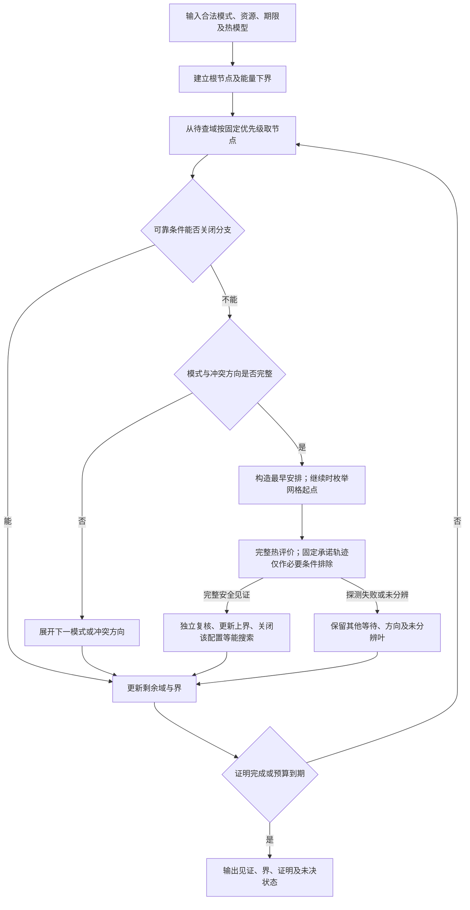

# 第四章主方法收敛与对照需求

日期：2026-09-27。承接[63号规则](63_第四章有界搜索与启发式协调规则.md)与[64号实现和结果](64_有界搜索实现与冻结案例对照.md)。本轮只审查已有代码、规则和保存结果，无程序修改、实验、参数扩展或新机制检索。

**决定：第四章以64号 `no_repair` 为主版本，采用描述性名称“配置能量下界引导的热安全有界搜索”。现有证据支持方法实现、正确性边界和L3案例中的条件性有效性；若要主张利用本题结构取得算法效率优势，还需一个等能力的通用精确求解参照。** 章节整理继续，有限热修复保留为可选扩展。

## 1．版本选择及其证据

主版本选择依据是简洁性与已验证覆盖结果。主例中 `full` 与 `no_repair` 均8/8取得合法热安全最优值，总弹出节点均9556，每例第一个完整最早安排探测即安全。删去修复未损失本组结果，也没有改变三层分支和可靠排除能力。**不能把两版单次耗时差解释为修复开销：这些运行没有执行修复。**

| 历史版本 | 候选排序 | 单步修复 | 本轮定位 |
|---|---|---|---|
| no_repair | 下界、乐观完成时间、深度、生成编号 | 关闭 | 第四章主版本；保留原标识，不改程序 |
| full | 同no_repair | 开启 | 主版本加可选修复；保留历史“完整版”含义 |
| simple_order | 下界、生成编号 | 开启 | 排序与修复的交叉消融 |
| bare | 下界、生成编号 | 关闭 | 隔离组合候选排序的对照 |

修复的有限正例仍成立：`P_high_D6_hot` 中，simple_order相对bare将节点4017降至3546、搜索热评价7次降至2次，能量均44 mJ。它支持“指定候选顺序下，单步修复可能减少后续搜索”，不支持修复必要性、普遍能耗改善或主版本必须包含修复。

数据定位：[64号汇总CSV](matlab_config_value_src/search64_reports/frozen_20260926_114942_794/summary.csv)及[保存结果汇总](matlab_config_value_src/search64_reports/frozen_20260926_114942_794/comparison_summary.json)。本轮未重新运行这些方法。

## 2．主方法的输入、流程与保证边界

### 2.1 第三章到第四章的接口

[61号](61_第三章正式模型与适用边界.md)在固定窗口、恒定基准和模式内活动功率、零额外交接／切换开销下给出：

\[
E(m)=P_{\mathrm{base}}W+\sum_i Q_i(m_i)d_i(m_i),\qquad
\min_{m:\mathcal S_T(m)\ne\varnothing}E(m).
\]

第四章利用这一分离组织搜索：配置给出代价，完整时序决定该代价能否实现。较低能量配置优先受到检查，但没有热安全安排的配置不能成为输出。这个组织依据不是新算法的充分证明。

| 接口 | 内容与边界 |
|---|---|
| 任务与平台输入 | 已知请求DAG、到达与期限、合法Stage模式、固定执行单元及频率域；不新增在线到达、可变核组或异构参数 |
| 评价输入 | 固定窗口、启动网格、基准与活动功率、注热节点、RC与入口状态、数值判定契约及预算 |
| 决策 | 完整模式组合、资源／同域异频冲突方向、网格起点；阶段结束不取整 |
| 主要输出 | 完整安全时间表及能量上界、有效下界、最优值／网格不可行证明状态 |
| 独立状态 | 预算、数值、覆盖是否未决；默认不要求全部并列最优配置 |

61号是一般模型；当前实现接收53号八Stage输入及数值适配契约，使用1 ms启动网格、20 ms窗口和冻结对称二节点RC。0.25 ms时间单位、0.0625 mJ能量单位是该输入的精确格值，不是一般输入都具备的性质。一般RC、连续起点或温度相关功耗下的扩展不属于已验证能力。

### 2.2 保留的主流程

这里没有单步修复。最早完整安排超温后，主版本依靠保留的网格时刻分支及其他冲突方向继续寻找；不把单个代表失败变为配置排除。图中的“关闭”区分不可行排除与能量非改进关闭，后者不表示无解。

| 规则 | 性质 | 保留理由／源码定位 |
|---|---|---|
| 模式→冲突方向→起点；保留单元标签、全部模式与等待 | 覆盖组织 | [b64_expand](matlab_config_value_src/b64_expand.m)；同频跨CPU允许并发，同单元及同域异频产生冲突 |
| 子模式按活动能量、时长及规范键生成 | 启发式优先级 | 只改变访问次序，不直接删去CPU/NPU或H/L模式 |
| 队列按有效下界、乐观完成时间之和、固定项数降序、生成编号排序 | 启发式优先级 | [b64_search](matlab_config_value_src/b64_search.m)；完成时间与深度不独立构成排除依据 |
| 图有环、乐观最早完成超期、已固定起点违背先后 | 可靠无热排除 | [b64_propagate](matlab_config_value_src/b64_propagate.m)及62号证明；部分方向图通过仅是必要条件 |
| 完整方向先检查最早安排 | 启发式构造 | 取得安全见证即可；失败后仍有同方向等待分支 |
| 固定承诺轨迹明确超温 | 有条件的热排除 | 非负活动注热和被动RC正性；只排除保持这些起点的续接 |
| 有效下界不低于安全上界 | 能量非改进关闭 | 仅搜索更优值，允许遗漏并列最优配置 |
| 完整配置已有安全见证 | 等能搜索关闭 | 固定配置能量不随等待改变；不声称该配置全部时序安全 |
| Q待查、A处理中、Z完整未分辨叶共同保留 | 覆盖与证据管理 | 父节点在子分支完整生成前不丢弃；中断不能制造虚假穷尽 |

能量下界为已固定模式活动能量、其余Stage独立最小活动能量与公共基准之和。当前实现用精确整数能量单位比较；完整安全见证给出上界U。剩余域下界与U闭合才能证明值最优；无见证时须完成可靠排除才可证明网格不可行。超时或阈值未分辨独立保留，不能当作排除证据。证明依据复用[62号性质](62_结构性求解困难与第四章任务定位.md)和63号，不另加剪枝规则。

[b64_thermal](matlab_config_value_src/b64_thermal.m)对冻结RC的恒功率段检查端点及内部极值，并使用保守误差包络判断；温度分类带宽不代替计算误差界。包括已运行／已承诺工作、完整窗口与空闲尾段，CPU并发功率相加，边界外公共功率只计能耗。连续峰温评价不意味着连续启动域已搜索。

## 3．贡献表述收敛

| 方法设计 | 已有依据 | 当前可写表述 | 不能推出什么 |
|---|---|---|---|
| 配置能量与时序可行性分离 | 61—62号条件推导 | 据此组织模式与时序搜索 | 分离本身即新算法；加入泄漏／开销后仍原样成立 |
| 不预生成完整时间表库 | 64号三层按需展开实现 | 避免以完整库生成作为输出见证的前置步骤 | 不需要存储、始终低内存；全部收益均由这一项造成 |
| 完成时间／深度候选排序 | no_repair与bare主例9556 vs 16259节点；8项逐例均减少 | 本组减少访问节点，部分案例减少调用时间 | 两个排序项各自有效；普遍或统计显著加速 |
| 完整热评价、可信界与中断覆盖 | 63号证明；64号预检和输出核对 | 给出有适用边界的安全输出与证明状态 | 有保证即有创新；一般RC、真实平台或连续起点保证 |
| 承诺轨迹热排除、多时序覆盖 | 理论与实现预检 | 保留这两项正确处理能力 | 8项主例已经证明二者显著提速 |
| 单步修复 | 简化排序下1项有限正例 | 可选辅助，可能减少指定路径的搜索工作 | 主方法成功依赖修复，或修复带来节能 |
| 冻结验证 | 8主例四新版本均安全最优，2校验单列 | L3小规模输入上的条件性有效性 | 实际设备节能、规模性验证或全面优于已有方法 |

通用技术包括分支定界、乐观图传播、下界排序和事务式中断管理。本题适配包括共享频率域冲突表达、模式对应注热、同配置多时序覆盖与连续热判定接口。其组合已经实现，但是否形成可主张的效率贡献，仍需更针对性的对照；不把“通用技术＋任务名称”当作新颖性证明。

可用于论文的保守表述如下，均限定于当前已完成工作：

> 针对模式能量与时序可行性可分离的CPU–NPU调度模型，构建配置能量下界引导的热安全有界搜索。方法分层处理执行模式、资源冲突方向和网格起点，在保留合法等待及并发安排的同时，结合无热必要条件和完整连续热评价，输出安全见证、能量界及独立的未决状态。

> 在预先冻结的8项L3主案例中，该实现均取得安全安排并证明对应网格最优值。与仅按下界和生成编号排序的版本相比，组合候选排序减少了本组访问节点，部分案例的调用耗时下降；各新版本的最终能量一致。

拟进一步研究的表述应另写为：**将在同问题、同输出要求和同预算的通用精确求解参照下，检验上述结构组织是否具有额外效率价值。** 当前不写“提出显著优于现有算法的新算法”。

限制性结果须和正例一起保留：原完整后缀基线在4项紧期限案例更快；四个新版本没有能量差异；完整版未触发修复；宽期限旧方法超时发生在全库生成，不能据此认定已有方法理论失效。单次计时受预热和负载影响，节点数减少也不等价于墙钟必然下降。

## 4．现有比较回答了什么

| 对照 | 已能回答 | 尚不能回答 |
|---|---|---|
| no_repair vs bare | 在同一搜索骨架、无修复条件下，组合排序改变了多少访问工作及记录耗时 | 该骨架优于其他求解组织；完成时间与深度各自的独立贡献 |
| full vs no_repair | 本组结果不依赖修复 | 主例未触发修复，不能用耗时差估计修复成本 |
| simple_order vs bare | 特定热态案例中，修复减少后续节点和热评价 | 不同候选顺序或其他工作负载中仍有效 |
| no_repair vs 原full_suffix | 固定预算内是否产生可用安全输出；紧期限原基线足够且更快 | 全库生成、代表覆盖及搜索组织的作用没有隔离，不能归因全部速度差 |
| no_repair vs 原thermal_reference | 已完成案例可核对值与见证 | 参考还枚举完整最优配置集合，不能称为相同输出任务的整体加速 |
| 60号解析证书 | 特定冻结实例的最优值与下界核对 | 自主方法的求解速度、覆盖效率或一般输入表现 |

因此，**等能力对照有必要，但它是效率主张的证据要求，不是暂停第四章整理的理由。** 现有材料足以写清方法及条件性验证；尚不足以把旧全库超时和新搜索成功全部解释为本题结构利用的算法优势。即使未来通用参照已经足够，也可据实收缩效率主张，保留建模、结构与求解接口工作。

## 5．唯一后续对照任务卡

任务：**核查一个通用精确求解参照能否求解相同有限启动域问题，并输出与no_repair相同等级的证据。** 此处定义能力，不选定求解器，不安装、不编程、不运行。

| 项目 | 必须满足的共同条件 | 待核查的适配缺口 |
|---|---|---|
| 单一比较主张 | 在相同输出要求与预算下，主方法是否更早取得安全解／闭合界，或保留更好的安全上界与有效下界 | 不预设参照失败；未决不算性能反例 |
| 输入与目标 | 同53号冻结模式、时长、功率、请求、RC及初温；最小化同20 ms窗口能量 | 是否准确接收Stage相关模式表与CPU/NPU可替代映射 |
| 合法域 | 同1 ms起点，真实结束不取整；全部映射、频率、等待、依赖、单元互斥与共享频率域 | 能否覆盖同频错开并发、异频串行和域清空切频；允许有证明的等价消除，但不能删合法解后冒称完整 |
| 热条件 | 同节点注热及空闲尾段；连续段内峰温，而非只验启动格点 | 能否给出可靠安全判断及排除证据；事件内峰值与误差如何处理 |
| 输出任务 | 一条安全见证、有效上下界、最优值及网格不可行状态、预算／数值／覆盖未决 | 不要求枚举全部并列最优配置；不同算法不必使用相同树结构 |
| 信息与计费 | 每例每方法独立60 s；建模、生成、预处理、排序、缓存和热检查均计费 | 不免费共享候选库、见证或60号答案；硬件、线程配置与初始化费用明确登记 |
| 共同复核 | 输出方案统一检查合法性、能耗与完整热轨迹 | 预算外复核不能替方法修复、补搜索或补最优证明 |
| 指标 | 首安全解时间、终端安全能量、可信界差、证明状态、调用时间；组件工作量辅助解释 | 不同实现的“节点”不直接等价；单次计时不能支持统计稳定性 |
| 数据保留 | 超时、未分辨、无解证明及无收益均保留；主例与校验分列 | 新参照是否提供可核查的界与中断状态，而非只有当前最好解 |

热适配尤其不能以“最后统一复核”掩盖求解问题改变：

- **放松热约束或采用连续起点放松**：最小化所得界在关系证明成立时可用作原网格问题下界；所得最优安排未必合法热安全，放松问题最优不等于原问题最优。
- **保守收紧热约束**：安全方案经复核可给上界，但收紧问题无解不能排除原问题；也不能直接将其最优值当作原问题下界。
- **候选完整热复核**：一条失败仅排除该时间表。若参照依靠反复候选检查取得精确性，须说明如何继续覆盖其他时序、怎样形成可靠排除及终止证明，不能只检查每配置一个代表。
- **近似热曲线或仅格点测温**：须单列为近似参照，不能在没有误差／包含关系证明时冠以等能力精确对照。即使一条最终方案安全，其内部排除或最优界仍需另行核查。

支持效率主张需要同任务的可核查比较，而不只是某个库名称。如果参照达到同等或更好结果，收缩主方法效率表述；如果只有实现组织差异能解释结果，按实现收益报告。如果参照热保证或覆盖不匹配，先记录缺口，不以不等价比较给出胜负。

## 6．第四章组织与本轮交付边界

建议章名：**配置能量下界引导的热安全有界搜索方法**。

| 小节 | 实质内容与当前状态 |
|---|---|
| 4.1 求解任务与结构依据 | 引用第三章的能量／时序分离，定义网格子问题和输出任务；不重复完整模型 |
| 4.2 分层搜索及候选优先级 | 模式、冲突方向、起点的覆盖与确定性排序；明确启发式与可靠条件 |
| 4.3 可行性检查、能量界与安全输出 | 无热传播、承诺热排除、完整热评价、配置关闭及独立复核 |
| 4.4 中断与数值未决管理 | 剩余域覆盖、上下界、最优值和不可行证明边界；不要求列全并列配置 |
| 4.5 实现与冻结验证 | 64号主例／校验，no_repair与bare、原强基线及参考；保留限制性结果 |
| 4.6 方法适用范围与对照缺口 | 等能力参照需求；修复作为可选扩展简述，不列为主算法必要步骤 |

本轮代码定位核对的是b64_search的版本开关、队列／界／状态管理，b64_expand的三层分支，b64_propagate的网格传播及固定起点语义；数值依据复用64号已归档验证。没有新增正确性或性能实验，也未改写63／64号方法含义。主版本的固定只改变论文组织与研究状态。

交付静态检查：本报告10个本地链接均可定位，代码围栏与公式定界配对；研究状态与E225—E229记录已同步。对验证目录顶层MATLAB源码、53号两份冻结JSON及64号正式summary.csv共93个文件作本轮前后SHA256比较，全部一致。该核对范围不冒称重新审计所有历史结果。

**唯一下一步：按第5节任务卡，核查一个通用精确求解参照的合法域、连续热保证、输出证据与计费接口。** 尚不启动对照实验，不恢复56号改造，不新增机制或参数扫描，也不同时展开多个求解器分支。
