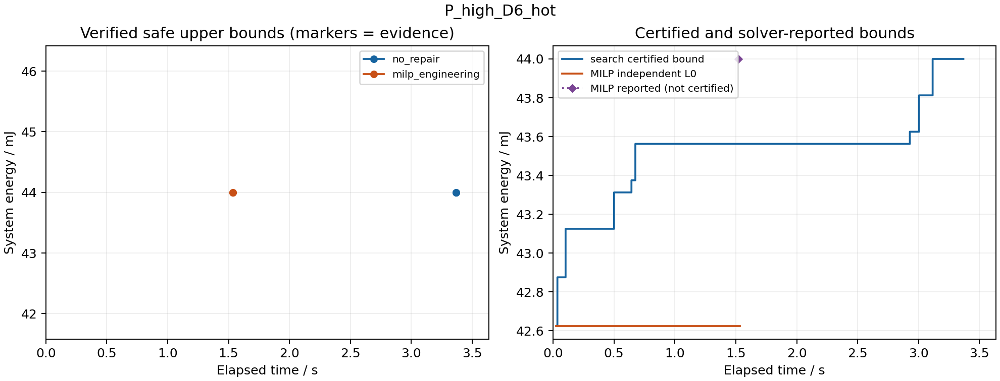

# 68号：工程级MILP参照实现与冻结对照

日期：2026-09-27。承接[67号](67_有限认证接口审查与工程级参照准入.md)，回到第四章方法比较。所有数值均为53号L3抽象输入，结论限于1 ms启动域、20 ms窗口及冻结对称RC。

## 1．结论

**工程级MILP参照能够表达本组有限网格调度问题，并采用与no_repair相同的完整连续热安全接纳标准。两方法在8项主例均取得安全解，能耗逐项相同；阶段能量并列校验也相同。** 20次独立方法调用均在60 s内完成，没有追加案例或重跑研究输入。

MILP在两项高功率紧期限主例更快，no_repair在其余6项主例更快；这是本次单次墙钟记录，不支持普遍加速或统计稳定性主张。9项可行输入的MILP均只用一轮、一个不同的完整候选便找到安全解，**没有触发热排除，也没有实际整数分支树展开**（求解器报告numnodes=0）。因此不能用本组结果证明多轮热排除是瓶颈，或主方法在困难热可行性搜索中已有优势。

证据等级分开：no_repair在9项可行输入均独立证实最优；MILP在4项宽期限主例及并列校验通过U=L₀独立证实最优，4项紧期限仅记“求解器报告收敛＋独立热安全见证”。4 ms不可行校验中，no_repair独立证实网格不可行，MILP仅报告无解；没有借用历史解析证明升级MILP输出。

## 2．实现与合法域

入口为[run_milp68.m](matlab_config_value_src/run_milp68.m)，包含precheck与frozen。新增模块如下，原b64／s55程序未改：

| 模块 | 功能及边界 |
|---|---|
| b68_build | Stage—模式—格点选项，稀疏唯一选择、依赖、资源和频率域约束；不生成完整时间表库 |
| b68_decode | 整数容差检查、二元解码、精确格值矩阵复核、独立时间表合法性及能耗双算 |
| b68_method | intlinprog回调、剩余预算管理、完整候选热检查、完整赋值排除、U／L₀／内部界分列 |
| b68_tests | 独立小域覆盖、实际许可证与回调、数值和中断夹具；复用已有热与调度检查 |
| b68_export | 只读取保存结果，独立复核输出、导出CSV及图表；不搜索或修复 |

对Stage i的选项a=(m,t)，令yᵢₐ∈{0,1}。每Stage唯一选择；对依赖i→j，以选项加权结束≤加权开始约束。不同Stage的两选项若真实半开区间重叠，且占同执行单元，或占同一CPU频率域而频率不同，则加入yᵢₐ+yⱼᵦ≤1。CPU标签保留，同频错开并发允许，NPU互斥；非整数结束不对齐或取整。启动选项受到达、请求期限和窗口约束，完整链依赖再排除不可完成的选择。

时间系数为0.25 ms整数单位，启动格距为4单位；活动能量为0.0625 mJ整数单位。目标为活动能量和，输出补回固定公共基准20 mJ。L₀由原始模式的逐Stage最小活动能量加公共基准独立计算：低功率包37.125 mJ，高功率包及并列校验42.625 mJ。L₀不假设各Stage独立最小模式能在共同资源／期限下实现。

该编码与66号的双向对应一致：合法时间表选择相应列即可满足矩阵；整数矩阵解逐Stage解码后得到原网格安排。实现的独立小域对照分别核对58、21、62个合法安排，覆盖依赖、共享／独立频率域、等待、可替代NPU映射及非整数结束。小域检查支持实现正确性，不替代一般表达的代数依据。

## 3．热循环、预算与证据

使用MATLAB **23.2.0.2365128 (R2023b)**，Optimization Toolbox许可实际可用；偏好目录为工作区`.runtime/matlab_prefs`。固定AbsoluteGapTolerance=0、RelativeGapTolerance=0、ConstraintTolerance=1e−9、IntegerTolerance=1e−6，其余选项默认，完整选项对象及显示结果随环境归档。没有安装新求解器或改变线程选项。

每次方法调用重新读输入并计费。MILP一次总预算60 s，每轮MaxTime仅为剩余预算；矩阵、求解器预处理、回调、解码、缓存、热复核和排除约束构建均在计时内。no_repair直接调用原b64_search，不读取MILP见证。两者没有共享候选库或热缓存。

回调记录实际lowerbound、fval、phase、time等字段；根LP的fval不作为整数候选。新整数候选须先满足整数容差，再通过独立精确格值和完整合法性检查。完整热检查使用[b64_thermal](matlab_config_value_src/b64_thermal.m)的连续段极值及向外误差包络，包括空闲尾段；该保证限定于原冻结对称RC，未推广到任意网络。

回调只保存安全U，不改变约束或修复候选。主动停止条件为预算或U=L₀；数值异常终止为未决。返回后的最终候选再检查。若明确违规，只加

\[
\sum_{a\in I(\hat y)}y_a\le n-1,
\]

删除该完整Stage—模式—起点组合；同配置其他起点保留。热未分辨候选不删除，保留并结束为数值未决。最终候选安全且solver报告收敛时记工程级收敛。预检已覆盖多轮排除、剩余预算减少、同配置等待安全及未分辨不排除；这些是夹具，不计入主实验收益。

| 字段 | 本轮含义 |
|---|---|
| U | 预算内完成独立资源、期限、能耗和连续热检查的完整安全时间表代价 |
| MILP认证下界 | 独立L₀；不将内部界取整升级 |
| solver_bound／gap／flag | 原样保存，内部界统一补回公共基准；非独立证书 |
| independent_optimal | MILP仅在安全U=L₀时成立；no_repair沿原覆盖与界规则 |
| infeasible | 区分独立排除、solver-reported无解、预算及数值未决 |

热判断超过预算后不能补记安全输出；原始返回状态可以保留为诊断，但不能补作预算内证明。正式案例没有预算、热未分辨、内部界高于U或数值异常。

## 4．冻结结果

运行目录：[frozen_20260927_113720_286](matlab_config_value_src/milp68_reports/frozen_20260927_113720_286)。下表t为完整方法调用墙钟，包含输入读取；t₁为首次安全见证时间。单位为s，能量为mJ。原顺序执行每例no_repair后MILP，未交换顺序或重复计时。

| 主案例 | 两方安全能量 | no_repair t₁ / t | MILP t₁ / t | MILP独立最优 |
|---|---:|---:|---:|---|
| P_low_D6_cold | 38 | 2.099 / 2.100 | 2.712 / 2.713 | 否，仅内部收敛 |
| P_low_D6_hot | 38 | 1.711 / 1.712 | 1.886 / 1.886 | 否，仅内部收敛 |
| P_low_D10_cold | 37.125 | 0.630 / 0.630 | 4.105 / 4.128 | 是，U=L₀ |
| P_low_D10_hot | 37.125 | 0.672 / 0.672 | 4.497 / 4.518 | 是，U=L₀ |
| P_high_D6_cold | 44 | 2.989 / 2.992 | 1.715 / 1.717 | 否，仅内部收敛 |
| P_high_D6_hot | 44 | 3.366 / 3.368 | 1.534 / 1.534 | 否，仅内部收敛 |
| P_high_D10_cold | 42.625 | 0.775 / 0.775 | 4.559 / 4.567 | 是，U=L₀ |
| P_high_D10_hot | 42.625 | 0.797 / 0.798 | 4.179 / 4.188 | 是，U=L₀ |

两方主例均8/8完整、合法、热安全；no_repair均独立证最优。MILP的四个紧期限内部界分别达到38或44 mJ，但认证下界仍为37.125或42.625 mJ；二者绝不混写。

| 独立校验 | no_repair | MILP |
|---|---|---|
| 阶段能量并列，D10冷态 | 42.625 mJ，独立最优；t₁/t=1.578/1.578 s | 42.625 mJ，U=L₀；t₁/t=4.411/4.424 s |
| 无热不可行，D4冷态 | 独立网格不可行；0.031 s | solver-reported无解；0.111 s，未提供独立排除证书 |

不把阶段能量并列改写为完整最优配置集合已枚举。summary中不可行行energy_mJ=Inf表示没有有限安全上界，不是实际消耗无限能量。

18份安全时间表均通过事后独立资源／依赖／频率域／网格／期限检查、能耗双算及连续峰温包络检查。峰温、请求末Stage完成时间和完整模式映射可在逐行时间表与保存结果中复核。所有安全温度都低于80°C减判定带；不同最优时序可以有不同峰温，未把峰温更低当作能量改进。

图中点表示已形成的证据；MILP内部界与认证L₀分开。本例MILP更早取得相同安全能量，而独立L₀尚未闭合，不能据认证状态判MILP“更慢”。其他9例图见同目录figure_01—10.png；没有见证时不画伪有限上界。

## 5．差异能归因到哪里

**安全解质量没有差异。** 两方9项可行输入能量一致，no_repair的能量／状态也与64号历史10项逐一相符。60号证书仅在事后支持既有目标值认知，未向任何方法注入答案。

**本组不支持热搜索效率比较。** 两方每项可行输入都只需一次不同完整轨迹热评价。MILP的9项均一轮，最终exitflag=1，报告根节点终止、numnodes=0；D4则报告无解。外层热排除总数为0，没有新热切面、修复或对称剪枝。不能把没有触发的机制当成本轮优势来源。

**墙钟差异主要落在不同求解组织，细分归因有限。** MILP主例矩阵构建约0.050—0.121 s；由每轮求解前剩余预算时间戳与返回时间戳推导的调用区间约1.454—4.442 s，包含预处理、LP、回调及检查开销，不等于某一个内部算法阶段。no_repair耗时包含配置／方向／时刻节点生成、评分与队列维护。二者节点定义不同，不比较“节点数加速比”。

已发现并保留一项分项计时缺陷：原新代码的嵌套回调与父函数共用变量timer，使5项触发回调候选检查的MILP记录中solver_inclusive偏小。**预算／总耗时／首解使用独立clock，不受影响；原始MAT不覆盖。** [cost_diagnostics.csv](matlab_config_value_src/milp68_reports/frozen_20260927_113720_286/cost_diagnostics.csv)标记无效分项，另列由原有时间戳推导的round_wall_span。该区间只能定位整段求解调用，不能补造预处理或LP内部计时。当前源码改用独立命名计时器，并补充预检；没有重跑研究案例。

检查点序列化、事后复核和出图在方法预算外，不补搜索；本次未单独测量每次序列化耗时，不能把全过程墙钟减去方法时间后当作精确I/O归因。固定执行顺序、JIT／系统状态及单次采样同样限制耗时解释。

共同L₀差距可以公平比较：低功率D6为0.875 mJ，高功率D6为1.375 mJ，宽期限与并列校验为0，两方相同。no_repair更强认证界使其认证差距为0；MILP可行结果的内部gap报告为0。三种口径分列，不能混排。

## 6．预检、版本和可复核材料

正式运行前[预检凭据](matlab_config_value_src/milp68_reports/precheck_20260927_113432_803/receipt.mat)124/124通过，含复用101项检查。实际许可、回调字段、返回候选、精确解码、覆盖、未分辨及注入超时均检查。两次早期123/124记录保留：重复候选夹具错误地依赖求解器必须重复回调；修正为显式重复输入测试，不改研究参数。

20次求解结果保存后，导出发生结构体容器赋值错误，保留failure.txt；仅修改导出容器并重做结果复核与图表，没有重跑求解。随后修正上述诊断计时器，增加1项计时一致性检查。当前代码[预检](matlab_config_value_src/milp68_reports/precheck_20260927_114309_369/prechecks.csv)125/125通过，带新哈希凭据。**当前源码与正式求解快照的3个差异（导出、诊断计时及其预检）明列于audit.json，不把新凭据冒充正式运行时凭据。** 未来frozen调用必须使用匹配当前源码的凭据；本轮不再调用。

| 材料 | 位置／内容 |
|---|---|
| 正式总表 | [summary.csv](matlab_config_value_src/milp68_reports/frozen_20260927_113720_286/summary.csv)，20行 |
| 独立安全复核 | [postchecks.csv](matlab_config_value_src/milp68_reports/frozen_20260927_113720_286/postchecks.csv)，18行通过 |
| 原始证据 | 同目录results.mat、case01—10_method01/02.mat；每方法独立记录 |
| 输入／环境／源码 | 同目录inputs_environment.mat、environment.json、source/、source_hashes.json及receipt.mat |
| 时间表／界／事件 | schedule_*.csv、bounds_units_*.csv、solver_trace_units_*.csv；逐事件与排除日志在MAT及saved_diagnostics.json |
| 版本审计 | [audit.json](matlab_config_value_src/milp68_reports/frozen_20260927_113720_286/audit.json)、history_after.json、history_result_consistency.json |
| 运行与事后脚本 | [milp68_audit/README.md](milp68_audit/README.md)、summarize_saved.py、finalize_saved.py、plot_saved.py；后3者不调用求解器 |

实施前登记的93项历史文件哈希保持不变，范围为原MATLAB源码、53号两份JSON及64号历史总表；不声称本次重新哈希了全部历史附件。正式源码／输入快照逐项与其运行哈希相符。53号输入SHA256为`cb76929032f3ee457df95200af6e106aa4fdce97760790086aed74d04aace1cd`，规则为`bda369552628a36e6f39112e02f34f6dc774683392ab242493aa94a297b85a78`。源文件、诊断更正及失败记录均可追踪，未覆盖旧35—64号代码或结果。

## 7．返回第四章的结论

可写：在固定L3四Stage实例和同预算下，所实现有界搜索与通用MILP工程参照均获得相同热安全能量；有界搜索保留可核查界，候选排序的作用由64号消融支持；两种组织的单次耗时各有优劣。

不可写：自研方法普遍优于MILP、热耦合使MILP难以求解、外层热排除产生显著代价，或本轮证明新增节能／真实设备收益。主方法与工程参照的最优性证据等级不同，不能把证书差异当作运行效率优势。

**唯一下一步：返回第四章正文，按本次结果收敛方法贡献及实验结论。** 保留“问题结构→有界搜索组织→可信证据管理→条件性消融与通用参照”的论证，不继续MILP认证，不追加调参、算法组件或规模实验寻找优势。
