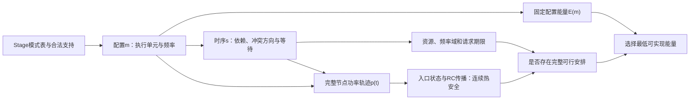

# 第三章 任务相关响应下的CPU–NPU热约束联合调度模型

> 格式调整：正文现以[LaTeX章节](latex/chapter03.tex)为主版本，[编译入口](latex/main.tex)。本文件保留转换前历史稿及文末证据对应，不再同步维护正文；后续第四章同样直接用LaTeX撰写。

> 正文初稿，2026-09-28。采用已确定的可加功率模型，供导师审阅。本章数值均复用既有条件性验证；原始来源、结果位置及作者审阅说明列于正文之后。

## 3.1 问题背景与建模动机

端侧推理请求包含执行特性和设备支持不同的计算阶段。一个阶段在CPU上采用较高频率，可能缩短自身执行时间，但其对完整请求的价值还取决于后继是否就绪、所需资源是否可用以及请求期限是否紧迫。对于可由CPU或NPU执行的阶段，设备选择同时改变执行时间、CPU占用、NPU排队和注热位置。因此，阶段的局部能量偏好需要放入完整请求安排中评价。

本章研究有限、预先已知请求下的离线联合规划问题：每个Stage选择一个合法执行模式及启动时刻，在满足依赖、资源、频率域、请求期限和瞬态温度约束的条件下，最小化固定评价窗口内的系统能耗。工作量在不同方案中保持一致，因而本章以能量作为能效比较指标，不将较低瞬时功率或较短执行时间单独视为节能结论。

执行时间的频率刻画是该问题的一项建模依据。Zhou等的热感知任务映射与DVFS模型以任务执行周期和处理器频率确定执行时间，即采用固定周期的反比缩放形式[1]。其模型已经包含任务活动差异以及温度相关泄漏，不能概括为所有任务具有相同效率或未考虑温度。本章关注的具体条件是：如果某Stage包含不能随CPU频率等比例缩短的执行部分，固定周期缩放是否仍能正确评价各频率模式。

已有应用响应研究区分了频率敏感与相对不敏感的时间部分，为采用任务相关时长表提供了依据[2]。这类依据说明统一反比缩放存在适用边界，但其服务器应用参数不能直接移植为端侧DNN Stage参数。为说明二者差别，令无量纲频率为\(x=f/F_{\rm ref}\)，参考时长为\(\bar d_i\)，可比较

\[
\widehat d_i^{I}(x)=\frac{\bar d_i}{x},\qquad
\widehat d_i^{R}(x)=\bar d_i\left[(1-\alpha_i)+\frac{\alpha_i}{x}\right].
\tag{3-1}
\]

当\(0<x\le1\)、\(0\le\alpha_i\le1\)时，两者之差为\(\bar d_i(1-\alpha_i)(1/x-1)\ge0\)。在同一正活动功率下，这一时长差也改变该模式的能量估计。不同Stage和频点上的差异不必相同，因而可能改变模式偏好；但若\(\alpha_i=1\)、仅使用参考频点，或期限使不同刻画只能采用相同模式，则决策可以保持不变。式(3-1)用于解释和构造条件性验证，不是一般模型必须采用的响应函数，也不是对原文所有拟合参数的重新约束。

本章的最小修正是以Stage相关的合法模式表提供时长和活动功率，并使时长修正同时进入资源占用、依赖、期限和温度评价。只更改能量列而保留旧占用时间，会产生不一致的规划问题。另一方面，查表和联合规划原则上能够表达这种修正，响应更精细本身并不证明需要新的求解算法。

本章随后给出统一问题定义，并用既有小规模证据分别回答两个问题：响应修正是否能够影响可实现的系统能量；热约束是否会限制原有配置。前者与后者对应不同因果关系，不合并表述为已经验证的热协同节能。

## 3.2 任务与执行平台

### 3.2.1 请求、Stage及结构依据

设请求集合为有限集合\(\mathcal R\)。每个请求\(r\)对应一个非空DAG \(G_r=(V_r,A_r)\)，其中\(V_r\)为Stage集合，\(A_r\)为依赖边集合。各请求的Stage实例互异，记\(V=\bigcup_rV_r\)、\(A=\bigcup_rA_r\)，并以\(r(i)\)表示Stage \(i\)所属请求。请求到达时间\(a_r\)和绝对期限\(D_r\)均已知，固定评价窗口为\([0,W]\)，满足\(0\le a_r<D_r\le W\)。Stage划分在规划之前确定，本章不决策算子切分或合并，也不假设提前知道尚未给定的在线请求。

贯穿实例采用EfficientDet-Lite0模型的四Stage划分。作者仓库PR #226报告了四组算子及其CPU/NPU支持关系[3]；对应固定提交中的模型文件可追溯[4]，对该文件的静态依赖检查得到下表和图3-1。该对象来自作者后续分区工件，不等于2022年Band论文图6的实验复现。

| Stage | 算子范围，含端点 | 作者报告的CPU–NPU支持子集 | 在本章实例中的作用 |
|---|---|---|---|
| S0 | 0 | CPU | 请求首阶段，完整保留 |
| S1 | 1–65 | CPU、所报告后端条件下的NPU | 可替代设备映射阶段 |
| S2 | 66–265 | CPU | 依赖S1输出的CPU阶段 |
| S3 | 266 | CPU | 产生最终输出，决定请求完成 |

图3-1 四Stage结构及条件性设备支持。模型批量维为1，各Stage覆盖全部267个算子且不重复；箭头为静态数据依赖。多个请求分别复制同一任务图，共享平台资源。

作者记录支持的是所用后端条件下的分区和准备能力，不包含本题所需的完整多频点性能、活动功率与RC测量。其测试配置中的两个CPU worker分别采用3线程BIG和4线程LITTLE设置[5]；本章实例将CPU类别展开为两个对称固定单元，属于研究假设，不继承这些worker的实际性能。算子数量、张量尺寸与支持集合不能直接给出Stage的频率敏感性。

### 3.2.2 固定执行单元与频率域

平台包含至少两个CPU执行单元，集合记为\(\mathcal U_C\)，以及一个固定服务模式NPU \(u_N\)。全部单元为\(\mathcal U=\mathcal U_C\cup\{u_N\}\)。各CPU单元占用的物理资源集合互不重叠，一个单元一次执行一个Stage；单元可以代表一个核或一个预先固定占核集合的worker，其内部线程数与规模均不是决策变量。NPU一次执行一个Stage，可以与CPU并发工作。

CPU单元所属频率域由已知映射\(h:\mathcal U_C\to\mathcal D\)给定，域\(\delta\)具有有限合法频点集合\(F_\delta\)。起步实例采用两个对称CPU单元和一个共享频率域；一般定义保留域拓扑作为输入，不把共享或独立调频作为所有平台的事实。域内存在运行Stage时保持频率，域清空后允许切换。不同单元的频率标签必须表示一致的物理频率状态，不能以不同参考频率下相同的比例值冒充同频。

每Stage在一个合法单元上完整执行，不可抢占、迁移或执行中改频。允许跨请求并发、重排和等待。额外交接与切换时间、能量均设为零，但依赖约束仍然保留；这是一项理想化边界，不能据此断言实际设备的数据搬运免费。

### 3.2.3 运行假设

本章采用确定性模式输入：执行时长与活动功率只由Stage和所选模式决定，不因同时运行者、温度或排队而变化。CPU并发活动增量相加，节点空闲与边界外公共功率在整个窗口恒定。热系统采用固定参数二节点RC网络。这些假设共同构成后续能量分解的前提，不是对任意SoC的硬件描述。

相同模型、工作量的重复Stage复用相同响应表。同类型Stage在对称CPU单元及相同频点下具有相同响应，不按请求编号人为制造差异。真实运行中的自动热节流、休眠、并发干扰、参数不确定性及温度相关泄漏未纳入本章，因此模型内期限约束也不等同设备上的最坏情况硬实时保证。

## 3.3 任务相关执行模式与决策变量

Stage \(i\)具有有限合法模式集\(M_i\)。一个模式\(m\in M_i\)提供执行单元\(u(m)\)、CPU频率\(\nu(m)\)或NPU固定标记、持续时间\(d_i(m)>0\)及活动增量功率\(Q_i(m)\ge0\)。CPU频率满足\(\nu(m)\in F_{h(u(m))}\)。不同Stage的NPU时长和功率可以不同，但NPU不增加可调频变量；不支持的设备模式不进入\(M_i\)。若必需Stage的模式集为空，请求不可执行，不能用零时长模式替代。

模式表可以由匹配测量提供，也可以由明确的响应函数生成；本章小实例使用L3合成输入。L3表示结构或机制有来源、性能与热数值为声明的抽象设定，不表示某个真实平台已经标定。一般模型无需采用式(3-1)，也不要求所有任务共享一个响应参数。

决策变量为每个Stage的模式\(m_i\)和启动时刻\(s_i\)。完整配置记为\(m=(m_i)_{i\in V}\)，启动向量为\(s=(s_i)_{i\in V}\)。结束时刻\(b_i\)、半开执行区间\(I_i\)和运行指示\(z_i\)定义为

\[
b_i=s_i+d_i(m_i),\qquad I_i=[s_i,b_i),\qquad z_i(t)=\mathbf1_{I_i}(t).
\tag{3-2}
\]

选择一个模式同时确定映射与频率，不再引入可与之矛盾的独立频率变量。资源顺序由各Stage的实际执行区间导出。

对称CPU中的映射需要区分三种含义。交换所有CPU标签可能只产生同一个物理解的重命名；将两个Stage放在同一单元或不同单元则改变串行与并发机会，即使单元对称也具有调度意义；将S1从CPU改到NPU会改变服务资源、响应和注热位置，属于设备替代。模型不表达异构CPU偏好或按核热点迁移，不能把CPU编号变化作为这两类收益。

表3-1给出本章统一符号。内部时间、功率与能量单位分别为s、W和J；数值例子可转换为ms、mJ展示。

| 符号 | 含义 | 类型／单位 |
|---|---|---|
| \(\mathcal R,V_r,A_r,V,A,r(i)\) | 请求、Stage、依赖与归属 | 输入集合／映射 |
| \(a_r,D_r,W\) | 到达、绝对期限、固定窗口 | 输入，s |
| \(\mathcal U_C,u_N,\mathcal D,h,F_\delta\) | CPU单元、NPU、频率域及合法频点 | 输入；频率用Hz或一致标签 |
| \(M_i,u(m),\nu(m),d_i(m),Q_i(m)\) | 模式及其单元、频率、时长、活动增量 | 输入，s、W |
| \(m_i,s_i,m,s\) | 模式与启动决策及其向量 | 决策，s |
| \(b_i,I_i,z_i(t),c_r,V_r^{\rm sink}\) | 结束、区间、指示、请求完成及汇点集合 | 派生，s、0/1或集合 |
| \(\Delta,k\) | 启动网格及非负整数索引 | 网格输入，s；整数 |
| \(p_C^0,p_N^0,P_{\rm ext},P_{\rm base}\) | 两节点空闲、边界外公共及总基准功率 | 输入／派生，W |
| \(p(t),p_C(t),p_N(t),P_{\rm sys}(t),E\) | 注热向量、节点功率、系统功率与能量 | 派生，W、J |
| \(C_C,C_N,C_{\rm th},g_C,g_N,g,G\) | 热容、环境／耦合导热及矩阵 | 输入／派生，J/K、W/K |
| \(T_a,T_n^0,T_n^{\max},\theta(t),A_T\) | 环境、初温、上限、温升与状态矩阵 | 输入／状态，°C、K、s⁻¹ |
| \(\mathcal S_0(m),\mathcal S_T(m),\mathcal M_0,\mathcal M_T\) | 无热／热可行时序及配置集合 | 定义集合 |
| \(\mathcal M_0^*,E_0^*,E_T^*,L_0,L(J)\) | 无热最优配置集、最优值与能量下界 | 派生，集合、J |
| \(H,\eta,J,\widehat M_i\) | 冲突方向图、最早起点、已定Stage集、剩余模式集 | 结构分析符号 |
| \(x,F_{\rm ref},\bar d_i,\alpha_i\) | 说明性响应函数参数 | 无量纲、Hz、s、无量纲 |

## 3.4 资源与请求约束

每个Stage恰好选择一个合法模式，到达后启动并在窗口内完成：

\[
m_i\in M_i,\qquad s_i\ge a_{r(i)},\qquad b_i\le W,\qquad \forall i\in V.
\tag{3-3}
\]

这里采用集合元素选择表达唯一模式；若实现采用二元编码，仍须保持这一语义。对于每条依赖边，后继不能在前驱完成之前执行：

\[
s_j\ge b_i,\qquad \forall(i,j)\in A.
\tag{3-4}
\]

令\(V_r^{\rm sink}\)为请求\(r\)的汇点集合，请求完成时间与期限约束为

\[
c_r=\max_{i\in V_r^{\rm sink}} b_i,\qquad c_r\le D_r,\qquad\forall r\in\mathcal R.
\tag{3-5}
\]

有限DAG中各非汇点均通向汇点，式(3-4)和式(3-5)共同确保完整请求按期完成。四Stage链必须以S3结束计算完成时间，不能把S1的NPU结束时间作为请求完成。

相同执行单元上的两个不同Stage必须互斥：

\[
u(m_i)=u(m_j)\ \Longrightarrow\ b_i\le s_j\ \lor\ b_j\le s_i,\qquad i\ne j.
\tag{3-6}
\]

该约束同时处理CPU单元占用和NPU排队。不同CPU单元不会因共用一个聚合热节点而被强制串行。对属于同一CPU频率域的Stage，还要求

\[
\begin{aligned}
&u(m_i),u(m_j)\in\mathcal U_C,\quad h(u(m_i))=h(u(m_j)),\quad I_i\cap I_j\ne\varnothing\\
&\hspace{30mm}\Longrightarrow\nu(m_i)=\nu(m_j).
\end{aligned}
\tag{3-7}
\]

同频Stage可以在不同CPU单元同刻或错开并发；异频Stage即使使用不同单元也不能在同域重叠。由于每Stage执行中频率固定，重叠连接形成的整个域忙区间保持同频。半开区间允许域内全部工作完成的同一时刻切频，但只释放一个单元、域内仍有其他工作时不能切频。

一般问题采用连续启动时刻。给定网格\(\Delta>0\)后，受限问题额外要求

\[
s_i\in\{k\Delta:k\in\mathbb Z_{\ge0},\ k\Delta\le W\}.
\tag{3-8}
\]

时长、结束和期限均不取整。例如某Stage在1 ms格点启动、持续1.25 ms，其真实完成时刻保留小数；后继只能在不早于该完成时刻的合法格点启动。两种启动域必须分别报告最优值：网格见证也是连续域见证，网格无解却不能排除格点之间存在解。只有另有连续域有效下界且网格见证达到它，才能据此认定连续域最优。

这些约束允许主动等待和跨请求重排，没有“就绪即执行”或预设NPU顺序。已启动Stage不可改写属于执行语义；离线求完整时间表不等于已经定义在线反馈控制器。

## 3.5 系统能耗与瞬态温度

### 3.5.1 公共基准与活动能量

设\(p_C^0\)为全部CPU单元的聚合空闲功率，\(p_N^0\)为NPU空闲功率，\(P_{\rm ext}\)为热边界外恒定公共功率，三者均非负。节点注热和系统功率定义为

\[
\begin{aligned}
p_C(t)&=p_C^0+\sum_{i:u(m_i)\in\mathcal U_C}Q_i(m_i)z_i(t),\\
p_N(t)&=p_N^0+\sum_{i:u(m_i)=u_N}Q_i(m_i)z_i(t),\\
P_{\rm base}&=p_C^0+p_N^0+P_{\rm ext},\qquad
P_{\rm sys}(t)=p_C(t)+p_N(t)+P_{\rm ext}.
\end{aligned}
\tag{3-9}
\]

CPU活动增量按所有运行Stage求和，聚合空闲项只计一次。即使某方案不使用NPU，其空闲功率仍计入窗口。\(Q_i\)是相对于共同基准的活动增量，不能直接用未扣除公共部分的整机功率代替；只在任务活动期间出现的固定开销属于\(Q_i\)，不属于全窗口基准。

每个Stage在窗口内执行一次，故积分得到

\[
E(m,s)=\int_0^W P_{\rm sys}(t)\,\mathrm dt
=P_{\rm base}W+\sum_{i\in V}Q_i(m_i)d_i(m_i)
\equiv E(m).
\tag{3-10}
\]

固定配置下，各Stage活动能量和窗口基准能量均固定。等待与重排改变功率出现的时刻，但不改变其积分。这一性质同时依赖固定窗口、恒定基准、固定模式响应和零额外开销，不意味着等待一定可行或一定降温。

### 3.5.2 二节点RC模型

将CPU和NPU分别视为聚合热节点。设环境温度\(T_a\)恒定，温升向量\(\theta(t)=[T_C(t)-T_a,T_N(t)-T_a]^{\mathsf T}\)，注热向量\(p(t)=[p_C(t),p_N(t)]^{\mathsf T}\)。热容与导热矩阵为

\[
C_{\rm th}=\operatorname{diag}(C_C,C_N),\qquad
G=\begin{bmatrix}g_C+g&-g\\-g&g_N+g\end{bmatrix},
\quad C_C,C_N>0,\quad g_C,g_N>0,\quad g\ge0.
\tag{3-11}
\]

\(g_C,g_N\)表示节点对环境导热，\(g\)表示节点间耦合导热，单位为W/K。对非零向量\(v\)，有\(v^{\mathsf T}Gv=g_Cv_C^2+g_Nv_N^2+g(v_C-v_N)^2>0\)。因此\(G\)正定，\(-C_{\rm th}^{-1}G\)与负定对称矩阵相似，系统渐近稳定。\(g=0\)是合法无耦合特例，而非另一个热模型。

温度由确定的动力学和入口状态生成：

\[
C_{\rm th}\dot\theta(t)=-G\theta(t)+p(t),\qquad
\theta(0)=[T_C^0-T_a,T_N^0-T_a]^{\mathsf T}.
\tag{3-12}
\]

\[
T_a+\theta_n(t)\le T_n^{\max},\qquad n\in\{C,N\},\quad \forall t\in[0,W].
\tag{3-13}
\]

式(3-9)中的边界内电功率作为对应节点注热，是本章明确采用的热边界假设。\(P_{\rm ext}\)只计系统能量，不任意注入CPU；若实际外部热源显著影响这两个节点，就需要扩展边界。CPU聚合节点无法区分按核热点，因此改变对称CPU标签不能被解释为热点迁移收益。

设\(A_T=-C_{\rm th}^{-1}G\)。在长度为\(\tau\)的恒功率段内，入口状态\(\theta(t_0)\)精确传播为

\[
\theta(t_0+\tau)=e^{A_T\tau}\theta(t_0)
+\int_0^\tau e^{A_T(\tau-\xi)}C_{\rm th}^{-1}p\,\mathrm d\xi.
\tag{3-14}
\]

全部启动和结束事件划分恒功率段。连续温度评价需检查段端点以及内部驻点；只在启动网格或Stage结束处取样不足以保证式(3-13)。初温只在窗口入口给定，等待时温度继续传播，不能在每次派发时重置。最后一个任务完成后的空闲尾段仍计入评价，耦合可能使某节点在自身停止活动后继续升温。

数学约束与计算判定需要分开：模型要求全过程不超过上限；数值评价应报告运算误差和边界未分辨状态。采样或ODE交叉核对能够检查实现，却不能自动替代全段峰值保证。本章安全结论限定在\([0,W]\)，不保证窗口之后或重复连续运行安全。

## 3.6 联合优化问题与结构性质

### 3.6.1 配置与完整时序的统一定义

在连续启动域上，本章问题为

\[
\boxed{\min_{m,s}\ E(m)\quad
\text{s.t. 式(3-2)—(3-7)、式(3-9)—(3-13)。}}
\tag{3-15}
\]

网格问题另加式(3-8)。热状态由动力学确定，不能作为自由降温变量选择。映射、频率通过模式改变能量、占用长度、冲突关系和注热位置，时序再决定这些模式能否满足所有约束。图3-2给出二者关系。

图3-2 配置能量与时序可行性的关系。图示为问题结构，不规定先配置后调度的一次性算法，也不排除反馈修改配置。

对固定\(m\)，令\(\mathcal S_0(m)\)为满足全部无热约束的启动向量集合，令\(\mathcal S_T(m)\)为其中温度轨迹满足式(3-13)的子集。定义\(\mathcal M_0=\{m:\mathcal S_0(m)\ne\varnothing\}\)、\(\mathcal M_T=\{m:\mathcal S_T(m)\ne\varnothing\}\)，配置均取自\(\prod_iM_i\)。由式(3-10)，有

\[
\boxed{\min_{m,s\in\mathcal S_T(m)}E(m)
=\min_{m:\mathcal S_T(m)\ne\varnothing}E(m).}
\tag{3-16}
\]

**命题3-1：** 式(3-16)与联合问题具有相同的可实现目标值集合。

**证明：** 任意联合可行解\((m,s)\)均对应\(m\in\mathcal M_T\)，能量为\(E(m)\)；反之，\(m\in\mathcal M_T\)意味着存在完整安全时序\(s\)，二者组成联合可行解。模式集合有限，\(\mathcal M_T\)非空时最低配置能量可以取得。若其为空则问题不可行，不以部分完成轨迹代替完整请求计算能量。证毕。

固定配置已有安全见证，足以证明该能量可实现；一条时序失败却只说明该安排不可行，不能推出\(\mathcal S_T(m)=\varnothing\)。排除配置需要覆盖该域的全部时序或提供充分排除证明。寻找一个最优值、枚举全部最优配置与列出全部最优时间表，也是不同的输出任务。

### 3.6.2 最优配置收缩与能量下界

设无热问题可行，\(E_0^*=\min_{m\in\mathcal M_0}E(m)\)，无热最优配置集为\(\mathcal M_0^*=\{m\in\mathcal M_0:E(m)=E_0^*\}\)。若热问题也可行，最优值记为\(E_T^*\)。由于\(\mathcal M_T\subseteq\mathcal M_0\)，有

\[
E_T^*\ge E_0^*,\qquad
E_T^*=E_0^*\ \Longleftrightarrow\ \mathcal M_T\cap\mathcal M_0^*\ne\varnothing.
\tag{3-17}
\]

交集中任意配置的安全见证都能达到无热下界；反之，若热最优值等于无热最优值，其配置必属于交集。因此，排除部分原最优配置不必提高最低能量。只有原最优配置全部被排除、同时仍有其他热可行配置时，有限配置集合才保证最优能量严格提高；全部配置被排除则是不可行。

对于非空模式集，逐Stage最小活动能量给出共同下界

\[
L_0=P_{\rm base}W+\sum_{i\in V}\min_{m\in M_i}Q_i(m)d_i(m)
\le E_0^*\le E_T^*.
\tag{3-18}
\]

不等式在相应问题可行时成立，证明来自每个所选模式的活动能量均不低于该Stage独立最小值。该界忽略资源、域与期限耦合，可能无法实现；若一条完整安全安排恰好达到它，则无需枚举所有最优时间表即可证明最优值。

对已确定Stage集合\(J\)及其余Stage的非空剩余模式集\(\widehat M_i\subseteq M_i\)，同理得到该分支的乐观下界

\[
L(J)=P_{\rm base}W+\sum_{i\in J}Q_i(m_i)d_i(m_i)
+\sum_{i\notin J}\min_{m\in\widehat M_i}Q_i(m)d_i(m).
\tag{3-19}
\]

完整配置的代价可直接计算，未定配置分支则使用乐观界。安全见证提供上界，下界与安全上界相合才能证明最优值；在数值实现中还须区分可靠界与求解器报告值。仅有阶段能量较小并不足以删除其他模式，因为时长、设备占用和频率兼容性可能不同。

### 3.6.3 固定冲突方向的无热判定

固定模式后，同单元Stage对以及跨CPU单元的同域异频Stage对构成互斥冲突。同频的不同CPU单元Stage允许重叠，不属于这种互斥对。为全部冲突选择先后方向，并与原依赖边合并得到有向图\(H\)。任意合法安排都给出一组这样的方向；相反，满足完整方向图的安排已满足全部资源和频率域互斥。

若\(H\)有环，由严格正时长沿环求和会要求零不小于正的总时长，故该方向不可行。若无环，按拓扑序定义连续域最早起点

\[
\eta_i=\max\left\{a_{r(i)},\max_{j\in\operatorname{Pred}_H(i)}[\eta_j+d_j(m_j)]\right\}.
\tag{3-20}
\]

无前驱时只取到达时刻。拓扑归纳表明任意可行起点均满足\(s_i\ge\eta_i\)，所以该固定方向无热可行当且仅当图无环且所有\(\eta_i+d_i(m_i)\le D_{r(i)}\)。网格域在传播的每一步将该最大值向上对齐到\(\Delta\)格点，再使用真实时长传播后继；不能只在连续传播结束后独立取整各起点。

这个判定不包含温度。最早起点逐分量最小，不意味着同一绝对时间轴上的注热逐分量最小；推迟工作会在一些时刻减少注热、在另一些时刻增加注热。因此最早安排安全可提供见证，最早安排超温不能排除该方向下的其他等待时序。这里留下的求解任务是：在低能量配置中寻找完整安全时序，并只在证据充分时排除其余可能性。

以上性质分别适用于同一连续域或同一声明网格域。它们给出方法组织依据，不把模式表的非线性形式、候选数量或某次实现超时当作算法困难的证明。

## 3.7 条件性验证与适用范围

### 3.7.1 验证对象及共同评价

本节整理已经完成的L3验证，不新增数值或运行。对象为两个0时刻到达的四Stage请求、两个对称CPU单元、一个共享CPU频率域及固定模式NPU；启动网格1 ms，评价窗口20 ms。CPU参考时长依次为1、2、2、1 ms，\(\alpha\)依次为1、0.5、1、0.25；频率比例为L=0.5、H=1，活动增量\(Q(x)=1+x^2\) W。S1在NPU上固定持续1 ms，两个主参数包的NPU活动增量分别为1 W和4 W。参数包是不同问题输入，不是可由调度器选择的NPU功率档。

CPU聚合空闲、NPU空闲与外部公共功率分别为0.2、0.3、0.5 W，所以各方案共同基准能量为20 mJ。二节点热容均为0.0025 J/K，对环境导热均为0.05 W/K，耦合导热为0.025 W/K；环境25°C，两节点上限80°C。这些性能和热值均为L3设定，模型结构依据不把它们升级为真实Lite0测量。

响应对照使用式(3-1)的反比规划I与任务相关规划R，保持模式、功率、资源、期限、热网络和求解能力一致。两者得到的安排均按R原样复核，R是本研究声明的共同评价模型，不是实测真值。该对照隔离反比时长假设，未采用Zhou原文的完整功率、泄漏和算法，因而不构成对其完整方法的复现或否定。

### 3.7.2 响应改变的决策及不变条件

表3-2列出已有证书核验结果。响应对照入口均为两节点30°C；热配置对照则固定R响应，仅改变入口状态。各行能量只在相同输入和评价口径下比较。

| 检验关系 | 参数包／共同期限 | 对照结果 | 支持的结论 |
|---|---|---|---|
| 响应，冷态 | 低NPU功率／6 ms | I最优安排回放38 mJ；R最优38 mJ | 紧期限下无能量差异 |
| 响应，冷态 | 高NPU功率／6 ms | I最优安排回放44 mJ；R最优44 mJ | 紧期限下无能量差异 |
| 响应，冷态 | 低NPU功率／10 ms | I最优安排回放38 mJ；R最优37.125 mJ | 末Stage频率选择具有系统能量意义 |
| 响应，冷态 | 高NPU功率／10 ms | I最优安排回放44 mJ；R最优42.625 mJ | S1与S3偏好改变可组成更低能量完整安排 |
| 热配置集合，R响应 | 高NPU功率／6 ms／入口30°C | 104个无热最优配置均可保留；最优44 mJ | 该最低能量层不因热约束收缩 |
| 热配置集合，R响应 | 高NPU功率／6 ms／入口78°C | 104个无热最优配置中80个可保留；最优仍44 mJ | 排除部分配置，但最低能量不变 |

在I中，所有CPU Stage的低频活动能量均严格高于高频。低功率包的S1选择NPU，高功率包的S1在CPU-H与NPU之间能量并列；已有合法安全安排达到逐Stage下界。因此所有I最优解的CPU阶段只能选择H，且H和固定NPU在I/R中的响应相同，原样回放能量均保留38或44 mJ。这个结论覆盖I的并列最优选择，不依赖挑选一条不利代表。

在R中，S3-L的活动能量为\(1.25\times1.25=1.5625\) mJ，低于H的2 mJ；S1-CPU-L为\(1.25\times3=3.75\) mJ，低于CPU-H的4 mJ。对低功率、10 ms期限，两个请求都采用S1-NPU、S0/S2-H和S3-L。一个达到下界的完整安排为：两S0在0–1 ms并发，两个S1依次在1–2、2–3 ms使用NPU，两个S2在2–4、3–5 ms占各自CPU，两个S3等待域在5 ms清空后共同低频执行至6.25 ms。其能量为

\[
20+2(2+1+4+1.5625)=37.125\ {\rm mJ}.
\tag{3-21}
\]

该安排保留了NPU排队、共享域切换及非整数结束，没有把低频S3与仍在运行的高频S2重叠。对于高功率、10 ms期限，两个请求各占一个CPU，分别按H–L–H–L同步执行，区间为0–1、1–4、4–6、6–7.25 ms，S1均走CPU。其能量为\(20+2(2+3.75+4+1.5625)=42.625\) mJ。两个见证均达到式(3-18)的对应下界，并通过完整热轨迹核验，因而证明相应问题的最优值。

紧期限下，上述低能模式不一定能进入完整安排。S2-L和S1-CPU-L单请求最快链已需7 ms，超过6 ms期限；S0-L会占用共享域和后续NPU时段，使另一请求无法同时按期完成；S3-L则必须在4 ms启动，与另一请求为满足期限而必须执行的高频S2发生域冲突。既有解析核验在该1 ms网格、双请求及共享域条件下排除了这些低频情况，故R也只能采用全H的CPU阶段并达到38或44 mJ。这个无收益条件不外推至独立频率域或任意连续起点。

以上差异说明响应修正能够改变可实现系统能量，但不表明在所有约束条件下都有效。低功率例子的差异主要来自CPU末Stage频率，不能称为NPU特有收益；高功率例子则涉及S1的CPU低频偏好。能量下降也不必伴随峰温下降：高功率宽期限中，R见证CPU峰温约38.008570°C，高于所核验I代表约37.258995°C，二者均安全。这组响应对照中的温度承担可行性核验，而不是收益的已证原因。

### 3.7.3 热可行域收缩的独立证据

固定R响应、高功率包和6 ms期限，热态入口78°C时，无热首选代表CPU峰温约80.103114°C，违反80°C上限；另一完整安排通过改变S1设备选择、CPU分配及启动时序，在保持44 mJ能量的同时取得CPU/NPU峰温约78.698026/78.401247°C。这些动作共同改变功率轨迹，不能由这一对安排分离归因于某一个动作。

完整网格参考进一步表明，104个无热最优配置中80个存在安全时序，24个的全部合法网格时序被排除。两个S1都选CPU的16个配置全部失效，混合CPU/NPU配置仍有安全成员，两个S1均选NPU的32个配置均可保留。计数保留CPU标签，不能解释为104种不同物理平台。最优值仍为44 mJ，恰好对应式(3-17)的交集非空情形。

该结果证实的是本参数和网格下配置可实现性的变化，不是所有最优配置失效、最低能量提高或必须全部使用NPU。它与响应对照分别支撑模型中的热约束和任务响应两部分，不能相加为未经独立验证的联合节能量。方法能否自主发现这些安排、运行成本及对照结果属于第四章，不由本节的已知见证代替。

### 3.7.4 适用边界

本章结论适用于声明的模式表、合法动作和热边界。它具有结构来源和可复核的条件性决策证据，但尚无同平台Lite0 Stage多频点时长、活动功率、空闲功率及RC的配套标定。更多L3实例不能消除这一现实数据缺口；真实设备效果和普遍收益仍需另行验证。

式(3-10)还要求能量可加且固定模式响应不依赖时序。若并发改变持续时间、活动功率、休眠状态或温度泄漏，或搬运和切换代价依赖安排，通常需要恢复\(E(m,s)\)。正在审查的并发功率扩展可写为在可加能量之外加入重叠相关修正，但目前仅有条件论证和输入契约，未进入本章正式模型。即使总功率修正为零，节点间功率重新分配仍可能改变温度。

一旦目标依赖时序，固定配置的一条安全见证不再自动确定该配置的最低能量，式(3-18)的下界也须重新核查，尤其不能直接忽略可能为负的修正项。因此，这类扩展需要同时重审模型性质和求解保证，不能在现有公式中增加一项后原样沿用第四章结论。本章保留加性假设，扩展只作为适用边界。

## 3.8 本章小结

本章针对有限已知CPU–NPU推理请求，建立了任务相关模式下的映射、频率与时序联合调度模型。合法模式表描述Stage的执行支持和响应，资源及频率域约束决定并发机会，请求期限约束完整执行链，连续RC模型则根据入口状态和全部功率历史判断热安全。系统能耗在固定窗口内统一计量，公共基准只计一次。

在可加功率等假设下，本章证明配置决定能量、完整时序决定该能量能否实现，并给出独立能量下界、固定冲突方向的无热判定和热配置集合变化的边界。既有四Stage验证表明，任务相关响应在宽期限条件下可以改变可实现能量，紧期限下也可能无差异；热约束可以缩小原最优配置集合而保持最优值不变。

这些结果将第四章的任务明确为：利用配置能量及其下界组织候选，在资源、频率域和期限约束下寻找完整热安全时序，并对无法继续的候选作有依据的排除。模型并不预设某种求解器或保证某种方法优于已有联合规划；方法的解质量、覆盖能力与计算成本需在同一问题和评价标准下另行比较。

---

## 本章参考来源与证据对应

以下编号为章内临时编号，合入学位论文时统一编排。原论文和作者工件是外部事实来源；本研究输入、结果和推导另列，不伪装为文献结论。本轮复用既有阅读记录，没有新增外部检索。

| 编号 | 来源与定位 | 本章用途／本地核查记录 |
|---|---|---|
| [1] | Junlong Zhou, Jianming Yan, Kun Cao, Yanchao Tan, Tongquan Wei, Mingsong Chen, Gongxuan Zhang, Xiaodao Chen, Shiyan Hu，*Thermal-aware correlated two-level scheduling of real-time tasks with reduced processor energy on heterogeneous MPSoCs*，Journal of Systems Architecture，82，1–11，2018；[本地全文](../papers/2018_Zhou_Thermal_Heterogeneous_MPSoC.pdf)，§3.1式(1)、§3.2式(2)–(3)、§4式(8)–(10)、§5，印刷p.4–7 | 固定周期时长及已有动态／泄漏模型边界；[原文核查](59_主线建模缺口与系统决策影响核查.md) |
| [2] | Georges Da Costa，*Hardware and application aware performance, power and energy models for modern HPC servers with DVFS*，Sustainable Computing: Informatics and Systems，46，101106，2025，[DOI](https://doi.org/10.1016/j.suscom.2025.101106)；[本地全文](../papers/2025_IRIT_Hardware-and-application-aware-performance-power-and-energy-models.pdf)，§3.2–3.3式(4)–(5)、§4、§5.4，图2 | 响应结构及服务器计量边界；[公式与数据核查](28_CPU响应模型与CoDVFS全文核查及接口方案.md)。不复用其服务器数值 |
| [3] | Band作者仓库，PR #226，*Subgraph support part 1 (Partition)*，[正文](https://github.com/mrsnu/band/pull/226)，2023合并；MergeUnitSubgraph／FallbackPerWorker日志 | 作者报告的四组边界、CPU/NPU支持及NNAPI版本限制；[结构核查](51_模型分区证据补全与研究数据边界.md) |
| [4] | 同仓库提交`5af78b1644f77069b5f128bcc14f896cc65d8f5f`中的[Lite0模型文件](https://github.com/mrsnu/band/blob/5af78b1644f77069b5f128bcc14f896cc65d8f5f/band/test/data/lite-model_efficientdet_lite0_int8_1.tflite) | 模型SHA256 `33a3b622c7cac0762f96089353cd61495f3e993968d133af7871bfc2d5396704`；[本研究静态依赖结果](evidence_20260925/band51/stage_graph_static.json)，不代表设备推理测量 |
| [5] | 同提交[tfl_subgraph_test.cc](https://github.com/mrsnu/band/blob/5af78b1644f77069b5f128bcc14f896cc65d8f5f/band/test/backend/tfl_subgraph_test.cc)，第39–42行及模型注册测试 | 3线程BIG／4线程LITTLE worker与本章对称单元假设的区别；核查范围同[51号记录](51_模型分区证据补全与研究数据边界.md) |

| 本研究证据 | 原始或直接记录 | 使用范围 |
|---|---|---|
| 模式与L3边界 | [冻结输入](stage53_design/inputs_v1.json)、[规则](stage53_design/rules_v1.json)、[参数说明](53_四Stage任务L3参数冻结与比较协议.md) | 本章只复述，不改参数，不生成新输入 |
| 响应决策证书 | [独立核验](60_四Stage响应模型解析证书独立核验.md)、[12次评价CSV](stage60_verification/run_20260925_210740_491/summary.csv)、[完整见证](stage60_verification/run_20260925_210740_491/schedules.json) | 表3-2前四行及宽／紧期限解释；证书证明值，不声称枚举全部最优集 |
| 热配置收缩 | [验证记录](55_四Stage任务首轮验证.md)、[配置存在性CSV](matlab_config_value_src/stage55_reports/frozen_20260925_173727_619/postprocess_20260925_175539_529/P_high_D6_hot_reference_configurations.csv) | 表3-2后两行，104→80、44 mJ不变；限定原网格与数值判定 |
| 正式定义与推导 | [模型依据](61_第三章正式模型与适用边界.md)、[结构论证](62_结构性求解困难与第四章任务定位.md) | 正文符号重组、等价性、能量界及最早传播；不是新增实验 |
| 未纳入扩展 | [并发条件论证](71_并发代价与调度决策影响的条件论证.md)、[双Stage契约](72_双Stage并发功率对照输入契约.md) | 仅用于§3.7.4的假设边界，不宣称已验证pair收益 |

## 作者审阅说明（不作为正式章节正文）

本稿按已批准章节结构，沿用academic-research-suite的正文写作与证据整合流程完成，未运行实验或修改程序。正文已经形成“具体时长假设—任务相关修正—完整系统决策—正式模型—求解结构”的论证链，但链条成立的证据等级仍是条件性研究。

本章目前可以表述的工作是：给出合法Stage模式与完整请求约束的一致表达；在固定L3对象中论证响应修正何时改变系统能量、何时不改变；推导配置能量与安全时序存在性的分离及其适用条件。模式查表、RC与通用调度约束均非本研究首创，第三章是否形成足够的新颖贡献，仍需结合近邻工作的覆盖和整篇论文的方法、实验共同判断。

尚缺的现实证据集中在同平台Stage多频点时长、匹配活动／空闲功率、控制权限与热参数。当前没有据此认定真实Lite0存在同幅度损失，也未证明原论文完整方法失效。原文参数不移植为本题实测值，真实结构不等于真实性能。本稿参考文献为可追溯章内条目，论文题名、作者和卷页按现有全文文本核对；最终全篇排版时统一格式与编号，不猜写缺项。

正文审阅优先检查三点：任务相关修正的动机是否清楚；贡献表述是否与条件性证据匹配；配置能量与时序可行性的关系是否自然引出第四章。并发功率支线暂留边界讨论，不是本章成稿的前置条件，也不自动成为新实验安排。

交付静态核对：3.1—3.8齐全，21个公式编号连续且引用有效，显示与行内数学定界符配对，19处本地来源链接均可定位。复读历史CSV确认响应表能量及热态配置104行中80／24的状态计数，与原报告一致。53号输入／规则SHA256仍分别为`cb76929032f3ee457df95200af6e106aa4fdce97760790086aed74d04aace1cd`、`bda369552628a36e6f39112e02f34f6dc774683392ab242493aa94a297b85a78`。这些是文档和历史记录检查，不是重新运行研究案例。
