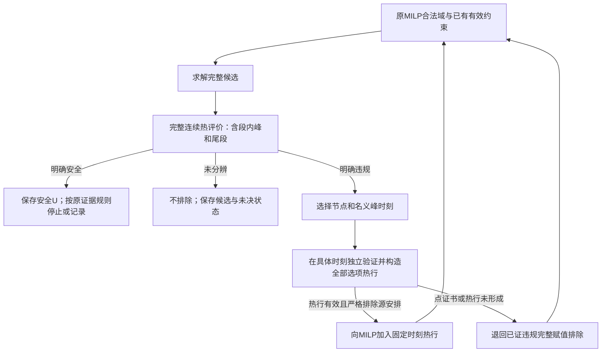
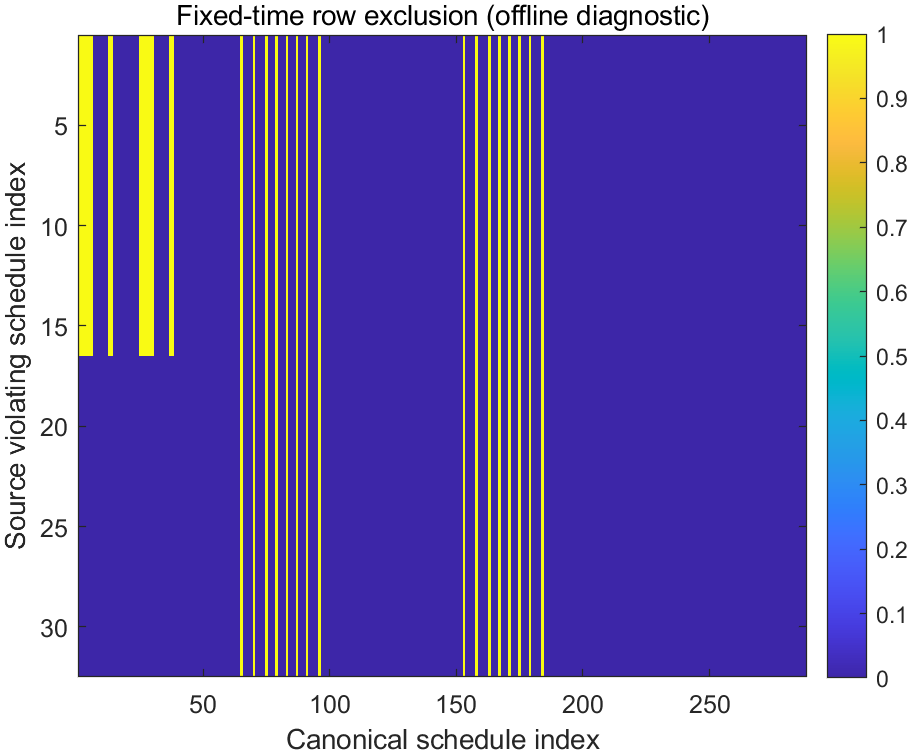

# 76号：连续热约束反馈方法论证与最小验证

日期：2026-09-28。沿用61号可加功率模型、53号冻结输入和67—68号证据等级。本文是研究与验证记录，暂不修改第三章LaTeX贡献结论，也不改变第四章方法。

**结论：固定时刻热行的有效性、实现和离线信息复用均得到支持，建议进入完整MILP反馈实现及公平比较。** 原冷热两例各重建288条合法无热安排。冷态全安全；热态256条安全、32条违规。对每条违规安排生成的热行均可靠排除源安排，另外排除其他违规安排，未误删安全安排。单行排除16或32条，合并全局CPU标签交换后仍为8或16类。

这一结果支持“一个违规点可以约束其他安排”，**不支持已减少MILP轮次或获得加速**。32份热行只有2条不同的行，且原68号求解器在这两个输入上首次候选已经安全。下一轮完全可能不触发反馈或只增加开销，应保留该结果。

## 1．本轮解决哪一个接口

原工程MILP先生成满足映射、依赖、资源、频率域和期限的完整安排，再检查连续温度。若安排超温，原方法只排除这一完整模式—起点组合。它知道“这条安排不行”，但未将导致超温的温度关系传回规划层。

本轮将接口具体化为：**从一条违规完整轨迹中选出一个节点和一个时刻，生成对所有合法选项组合都成立的温度必要条件。** 改变起点、执行设备或频率后，选项的贡献随之变化；不能沿用原温升，也不能因一次超温删除整套配置。

任务相关响应修正与本轮求解反馈分开归因。前者改变模式的时长、能量和可实现偏好，已有59—60号条件证据；后者不改模型、工作量或目标，只改变如何利用违规信息约束后续候选。本轮没有重新证明响应收益，没有恢复非加性并发功率支线。

### 1.1 近邻能力与拟开展工作

| 已有能力 | 本题适配 | 本轮可主张的工作 | 仍缺什么 |
|---|---|---|---|
| Zhou的处理器／频点模式与联合调度；JOSS的任务相关配置和共享频率协调 | 由Stage模式表提供实际时长、功率和合法设备 | 复用合法模式及共享控制域表达 | 查表不是新概念；现实配套模式数据仍不足 |
| Pierson等将热演化、资源放置和能量目标写入MILP | 本题采用有限启动选项、不可抢占DAG及连续耦合RC | 明确选项到固定时刻温度的映射 | 不能把“加入RC”认作新增贡献 |
| 有限主问题、违规分离、增约束的通用流程 | 将连续时间作为约束索引，具体构造热响应系数 | 给出有效热行、数值方向和终止条件 | 不是新优化原理，尚未证明一般效率优势 |
| 原68号完整赋值排除 | 将组合身份信息扩展为共同温度条件 | 证明并验证整数安排域内可扩大排除范围 | 尚未完成强化MILP的端到端运行 |

Pierson等的作者稿§4明确以步长Δt离散时间，§5.1式(10)在离散时刻约束温度；§5.3讨论DVFS扩展，但明确后续实验仍使用式(26)，没有采用该扩展。其每步入口温度固定的RC近似与本题连续耦合RC不同，**不能由其使用离散模型就断言原模型漏掉峰值**。[原文及定位](https://henricasanova.github.io/files/papers/pierson_cluster2019.pdf)

Subramanyam等§3的有限主问题、分离问题及步骤4—6提供了约束逐步生成的直接先例；其§3.2有限收敛定理含专门假设，不能直接充当本题定理。本轮只借鉴组织思想，下面的热行有效性和有限域终止另行证明。[正式全文§3](https://link.springer.com/article/10.1007/s12532-019-00174-2)

定向核查新增2篇来源，没有开展全面新颖性综述。Zhou与JOSS复用[49号](49_任务相关模式表与Zhou排序依据适用性审查.md)、[48号](48_主线剩余问题清单与配置映射定位.md)的正文定位。完整题录、阅读范围、检索词与可访问限制见[来源记录](thermal76_design/literature_notes.md)。当前不能宣称“首次”或“既有研究无人处理”；可以继续论证本题具体适配是否形成有价值的方法贡献。

## 2．选项到温度的线性关系

### 2.1 共同调度域不变

沿66—68号，对每个Stage $i$建立选项 $o=(i,m,k)$：模式 $m$给出执行单元、频率、时长 $d_o$及活动增量功率；起点 $s_o=k\Delta$，结束 $e_o=s_o+d_o$。每Stage唯一选择二元变量 $y_o$。启动离散，结束不取整。

唯一选择、到达、依赖、半开区间资源互斥、同域异频互斥和期限约束保持原样。相同频率的跨CPU并发、NPU排队、CPU/NPU替代映射、等待及CPU标签均保留。目标仍为

\[
E(y)=P_{\mathrm{base}}W+\sum_o Q_o d_o y_o.\tag{76-1}
\]

不存在热约束时，不预先锁定一个配置或最低能量代表。本文诊断也完整重建合法安排，未使用第四章搜索器产生候选。

### 2.2 连续RC与固定时刻系数

令 $A=-C^{-1}G$、$B=C^{-1}$，入口温升为 $\theta_0$，固定空闲注热为 $p^0$。选项 $o$的活动注热向量 $v_o$仅进入相应CPU聚合节点或NPU节点。边界外公共功率计入式(76-1)，不进入热方程。

在模式内恒定功率、线性时不变RC、固定入口状态和可加注热假设下，定义绝对基准温度和选项贡献：

\[
\begin{aligned}
b_n(t)&=T_a+\left[e^{At}\theta_0+\int_0^t e^{A(t-u)}Bp^0\,du\right]_n,\\
h_{n,o}(t)&=\left[\int_{s_o}^{\min(t,e_o)}e^{A(t-u)}Bv_o\,du\right]_n,
\quad t>s_o;
\end{aligned}\tag{76-2}
\]

当 $t\le s_o$时 $h_{n,o}(t)=0$。由线性叠加，任意完整安排满足

\[
T_n(t;y)=b_n(t)+\sum_o h_{n,o}(t)y_o.\tag{76-3}
\]

被动RC的状态矩阵为Metzler矩阵、活动注热非负，故 $h_{n,o}(t)\ge0$。同一节点、同一具体时刻 $\bar t$上的约束

\[
\sum_o h_{n,o}(\bar t)y_o\le T_n^{\max}-b_n(\bar t)\tag{76-4}
\]

是原全过程温度约束的一条线性必要条件。它约束全部选项，而非只给源安排的8个选项赋值。

有限条式(76-4)通过，仍不足以接受一条完整轨迹：其余时刻、段内峰值和窗口尾段可能尚未检查。**安全接纳始终由完整连续温度评价器完成。** 若更换为温度相关泄漏、非加性pair功率或时长受并发影响的另一模型，式(76-2)的固定选项响应需重新审查，不能直接复用。

## 3．反馈规则与必要证明

### 3.1 固定流程



首版节点选择为“峰值下界超过上限与判定带之和最多的节点”，同值取小节点编号；选该节点名义峰时刻作为待验证的具体时间。**全局峰值下界不能移植成名义峰时刻的下界**，必须在该时刻重新构造可靠响应区间。

本轮只实现图中的系数、热行和离线覆盖检查，未将该流程接入`intlinprog`正式求解。未来所有轮次仍共享原60 s总预算，数值、覆盖和求解器状态沿67—68号分列。

### 3.2 数值热行为什么不误删

记 $\beta_T=10^{-6}\ ^\circ\mathrm C$。对于选定 $(n,\bar t)$，计算可靠包络

\[
\underline b_n\le b_n(\bar t)\le\overline b_n,
\qquad 0\le a_o:=\max(0,\underline h_{n,o})\le h_{n,o}(\bar t).
\]

右端取向外放宽的值 $r$，满足

\[
r\ge T_n^{\max}+\beta_T-\underline b_n.
\]

实际反馈使用存储的下界系数和右端：

\[
\boxed{\sum_o a_o y_o\le r.}\tag{76-5}
\]

**性质1：式(76-5)保留全部原热安全安排。** 若某安排严格违反此行，则

\[
T_n(\bar t;y)\ge\underline b_n+\sum_o a_o y_o
>\underline b_n+r\ge T_n^{\max}+\beta_T.
\]

因此它确实超温，不可能属于原安全集合。用判定带放宽右端只减少可排除的安排，不放宽最后的安全接纳标准。

**性质2：源安排是否被排除需要单独证据。** 对源安排选项集 $J^*$，使用可靠区间求和，只有

\[
\underline{\sum_{o\in J^*}a_o}>r\tag{76-6}
\]

才登记热行成功。名义温度超限、和的上界超限、普通浮点结果略大于右端，均不足以代替式(76-6)。若全轨迹已确证违规而此条件未成立，回退到原完整赋值排除。热状态未分辨时，两类排除均不生成。

这里的判定带不是计算误差界。计算误差另由解析余项及逐运算向外包络覆盖；不能自行指定一个“小保险量”后声称可靠。

### 3.3 与完整赋值排除的范围关系

原no-good为

\[
\sum_{o\in J^*}y_o\le N-1,\qquad N=8.\tag{76-7}
\]

在逐Stage唯一选择的整数域中，式(76-7)只排除源完整安排。若式(76-6)成立，任何满足式(76-5)的整数解都不能选择全部 $J^*$，所以也满足式(76-7)。热行的整数排除范围至少包含原no-good的单条安排。

**严格扩大所需条件：** 存在另一合法整数安排 $y\ne y^*$，满足 $\sum_o a_o y_o>r$。该条件不能仅从“热行系数很多”推定，需见证或域内核查。本轮同时统计全局CPU标签对称商集，进一步排除“只是删掉同一安排的换核标签副本”的解释。

以上是整数安排域的关系，不声称热行在LP放松中处处支配no-good。理论上，可从非负热贡献中另找超限选项子集构成cover；本轮没有实现cover、起点组泛化或强化组合，也不把它们计入贡献。

**性质3：不能由一条安排排除整个配置。** 起点是选项的一部分，改起点就必须使用新 $h_{n,o}(\bar t)$。固定配置可能有违规和安全时序；热行只根据各自系数判定。观察时刻之前未启动的选项贡献为零，执行结束后的贡献按散热继续衰减，不能把开始或结束后贡献错误地视为整段常数。

### 3.4 理想有限域终止与实际状态

有限网格、有限模式和有限期限产生有限个完整整数安排。在精确主问题、精确连续热判定且每次加入全域有效并严格排除当前违规候选的约束条件下，不会再次得到同一违规候选，故经过有限次反馈后得到安全安排或排空合法域。

若每轮取得当前松弛的真正最低能量候选，且该候选完整热安全，它同时达到原热问题最优值：松弛最优值不高于热问题最优值，而安全候选又是热问题可行上界。这个理想论证不等于浮点`intlinprog`的独立最优证书。

实际实现继续区分安全 $U$、独立 $L_0$、solver-reported界／退出和数值／预算未决。有效热行不能自动认证求解器内部界；遇到未分辨、超时或非最优主问题停止，不能借有限性宣称已经排尽。**本轮不恢复MILP认证研究。**

## 4．冻结网络的可核查实现

### 4.1 对称二节点的响应公式

本轮数字仍为53号L3设定：$C_C=C_N=0.0025\ \mathrm{J/K}$，环境导热均 $0.05\ \mathrm{W/K}$，耦合 $0.025\ \mathrm{W/K}$，环境25°C、上限80°C。CPU/NPU空闲为0.2/0.3 W，边界外公共功率0.5 W；20 ms窗口、1 ms启动网格。两请求期限均6 ms；仅入口由冷态30/30°C改为原热态78/78°C。

定义共同／差分温升 $M=(\theta_C+\theta_N)/2$、$D=(\theta_C-\theta_N)/2$，有

\[
\dot M=-20M+200(p_C+p_N),\qquad
\dot D=-40D+200(p_C-p_N).\tag{76-8}
\]

因此空闲平衡为 $M_\infty=10(p_C^0+p_N^0)$、$D_\infty=5(p_C^0-p_N^0)$，基准按这两个模态传播并补环境温度。

对单位功率选项，令 $u=\max(0,\min(t,e)-s)$、$\ell=\max(0,t-e)$，定义

\[
a=10(1-e^{-20u})e^{-20\ell},\qquad
b=5(1-e^{-40u})e^{-40\ell}.\tag{76-9}
\]

同注热节点的响应为 $Q(a+b)$，另一节点为 $Q(a-b)$。注意 $u$只包含到观测时刻已经执行的部分；活动增量 $Q$不能漏乘。跨节点下界必须用“第一项下界减第二项上界”，不能两项都直接代下界。

### 4.2 浮点与热判断的边界

新系数函数用32阶Taylor近似 $e^{-x}$，对 $0\le x\le1$采用 $x^{33}/33!$余项绝对值界；实际20 ms窗的指数参数至多0.8，向外包络后仍落在该证明域。基本加、减、乘、正数除法逐步向外扩张端点，覆盖IEEE binary64舍入；采用8个表示间距，绝非拿温度带代替误差分析。输入时间的1/4000 s格值转换、功率小数转换也纳入区间。

对每次基本运算，实际结果被相邻浮点端点包围；端点自身的向外加减也需舍入，因此留足表示间距。代码约束有限正常量级，不处理溢出、非IEEE运算或任意网络认证。区间乘法保留所有端点组合，特别包括可为负的差分基准；脉冲贡献的非负截取依赖RC正性。

完整轨迹复用原`b64_thermal`：恒定功率段精确模态传播，检查端点、内部驻点和空闲尾段，分别输出峰值上下界。新固定点系数实现与旧逐段实现独立组织计算；ODE与60位数值交叉核对只用于查错，不代替区间证明。

这些数值保证只覆盖本轮冻结对称RC；式(76-2)的理论表达适用于一般相容线性RC，不能据此声称程序已认证任意 $C,G$。

## 5．预检、运行和覆盖结果

### 5.1 输入、预算与独立性

诊断规则在运行前保存于[rules_v1.json](thermal76_design/rules_v1.json)。复用53号原JSON和原规则：输入SHA256为`cb76929032f3ee457df95200af6e106aa4fdce97760790086aed74d04aace1cd`；规则为`bda369552628a36e6f39112e02f34f6dc774683392ab242493aa94a297b85a78`。

每例独立60 s，包含重新读输入、全域枚举、原规范排序、选项矩阵、连续热分类、全部热行构造和288条覆盖检查。冷热之间未共享候选或热结果。两例均一次完成，未扩大预算、未补跑超时例。文件序列化、图表导出及事后只读核对另列，不补作预算内证据。

实现沿原拓扑变量顺序完整枚举、使用`s55_sort`的能量层／完成时间／规范键排序；没有能量剪枝，包含全部合法模式和等待。每例288条互异安排与55号计数一致；其恰好全部为44 mJ，是本组紧期限可行域的结果，不是先筛选能量层导致。

### 5.2 预检

最终[20项预检](matlab_config_value_src/thermal76_reports/precheck_20260928_163022_306/prechecks.csv)全部通过，正式入口核验源码、输入及规则哈希匹配后才运行。包括：

- 非整数结束、CPU/NPU注热、跨请求并发、全窗口尾段；选项叠加与逐段传播一致。
- 独立内部峰值解析夹具与逐段ODE；外部公共功率不改变热输入；能耗积分／阶段求和一致。
- 同配置违规／安全等待、全局CPU换标、重复选项拒绝、未分辨不排除、名义峰时刻失败回退no-good。
- 实际阈值带未分辨、超出冻结RC拒绝、测试中断以及Taylor证明域。

第一轮17/18项通过，失败原因是内部峰值测试夹具本身没有内部极大值。将**测试夹具**改为具有显式驻点 $e^{-20t}=0.75$的双模态轨迹，并增加解析值及重复选项检查后20/20通过。初始失败目录保留，53号研究输入未修改。没有研究结果失败后调温或调参数。

选项叠加与逐段传播的中点差最大约 $1.53\times10^{-11}$°C，ODE终端交叉误差约 $1.68\times10^{-11}$°C。这些误差是实现核对记录，可靠接纳／排除仍由包络决定。

### 5.3 完整域分类

| 原案例 | 全部合法安排 | 全局换标后类数 | 安全／违规／未分辨 | 配置总数／可保留 | 最低安全能量 | 预算内墙钟 |
|---|---:|---:|---:|---:|---:|---:|
| `P_high_D6_cold` | 288 | 144 | 288／0／0 | 104／104 | 44 mJ | 2.499 s |
| `P_high_D6_hot` | 288 | 144 | 256／32／0 | 104／80 | 44 mJ | 2.539 s |

热态80个可保留配置中，72个配置的全部安排安全，8个配置同时含安全和违规安排；另外24个配置全体安排违规。因此，32条违规安排不等于32个配置被排除。两例逐配置合法安排数和可保留状态与55号一致，未改写旧结果。

峰值包络宽度最大约为冷态 $1.75\times10^{-10}$°C、热态 $1.07\times10^{-10}$°C；没有阈值未分辨。冷态无需反馈，是本轮保留的无收益对照。

### 5.4 热行比no-good多排除了什么

每条热态违规安排分别生成一条热行，32/32均形成可靠点证书，无no-good回退。对每行逐条核对整个288安排域，没有误删安全安排、没有行比较未分辨。源安排违反数值热行的最小可靠余量约为0.1031129706°C。

| 生成热行的节点／时刻 | 对应源安排数 | 单行排除安排数 | 排除安排涉及的换标类数 | 被排除的不同聚合注热轨迹 | 误删安全安排 |
|---|---:|---:|---:|---:|---:|
| CPU，5 ms | 16 | 32 | 16 | 2 | 0 |
| CPU，6 ms | 16 | 16 | 8 | 1 | 0 |
| 原完整赋值no-good | 每条源安排各1份 | 1 | 1 | 1 | 0 |

热行涉及的每个换标类都包含两条安排，且两条均被该行排除；no-good的“1类”仅表示命中该类的一个成员，另一个CPU换标副本仍保留，不表示no-good已经删除整个对称类。

**32份记录只有2条不同的系数行，不是32条独立强化约束。** 5 ms行的单行覆盖已包含全部32条违规安排，6 ms行的覆盖为其子集。此处“包含”是本组整数安排域内的覆盖关系，不是全空间LP支配性。覆盖扩大不是先取32行并集后形成的假象。

合并CPU全局标签交换后仍严格扩大，但还需避免另一种夸大：这288条安排只有12种不同的CPU/NPU聚合注热轨迹，违规轨迹只有2种。6 ms行排除8个换标后安排类，却都属于同一种聚合轨迹；5 ms行则同时覆盖两种。这体现聚合热模型对不同安排复用共同热信息，不能写成发现了16种独立热机制或按核热点迁移收益。



图中列是原规范排序的288条安排，行是32条违规源安排的顺序；亮格表示可靠违反对应热行。前16行为5 ms证书，后16行为6 ms证书。图不代表MILP实际搜索路径或迭代次数。

### 5.5 一组保留同配置等待的具体证据

按 `A.S0,A.S1,A.S2,A.S3;B.S0,B.S1,B.S2,B.S3`排列，源行1的模式编号为

\[
(2,2,2,2;\ 4,5,4,4),
\]

其中2为CPU1高频，4为CPU2高频，5为S1的NPU模式。起点为

\[
(0,1,3,5;\ 0,1,2,4)\ \mathrm{ms}.
\]

其CPU峰温约80.1031139707°C。对同一模式组合，仅把B.S3起点从4 ms改成5 ms，得到行66：

\[
(0,1,3,5;\ 0,1,2,5)\ \mathrm{ms}.
\]

该安排仍满足6 ms期限，CPU峰温约79.8543920826°C，完整轨迹安全，能量仍44 mJ。所有新增热行都保留了这条安全安排；源配置的另外三条安全时序也保留。

源行1产生的5 ms热行使用基准区间约

\[
b_C(5\ \mathrm{ms})\in[73.34156144225813,\ 73.34156144227195]\ ^\circ\mathrm C,
\]

右端向外值为6.658439557741993°C，源选项贡献的可靠和大于该右端。上述数字仅便于读者核对，**正式证书以保存的binary64系数和区间为准**，不使用排版截断的小数重新构造约束。

同一5 ms行还排除两请求S1均在CPU执行的另一类安排；该类的最大峰值位于6 ms，约81.256120203°C。因此单行的额外排除不仅包含原轨迹的CPU换标副本，还包含不同CPU/NPU映射与功率轨迹。它依然没有删除整个映射配置类，而是检查具体起点选项。

### 5.6 成本记录的解释

| 分项 | 冷态 | 热态 |
|---|---:|---:|
| 合法安排生成与排序 | 0.472 s | 0.233 s |
| 选项编码及身份核对 | 0.281 s | 0.102 s |
| 完整连续温度分类 | 1.634 s | 1.149 s |
| 热行构造与覆盖检查 | <0.001 s | 1.017 s |

总时间还包含输入读取等小项。这里只记录独立离线诊断成本，不比较冷热快慢，也不把“每行多删31条”换算成31轮求解节省。没有调用MILP、没有检查新增行对LP松弛、预处理或分支树的作用。

尤其是68号这两例的MILP均首轮得到安全候选，0次热排除。**现有结果同时容许“反馈表达更有信息，但正常求解没有收益”这一结论。** 只有真正接入求解循环并同预算比较，才能区分触发机会、行构造代价和求解收益。

## 6．复现、记录与完整性

入口为[run_thermal76.m](matlab_config_value_src/run_thermal76.m)，只新增`t76_*`模块；原`s55_*`、`b64_*`、`b68_*`未修改。主要接口如下：

| 模块 | 输入／输出 |
|---|---|
| `t76_coefficients`、`t76_iv` | 固定时刻、节点与全部选项 → 基准区间、活动响应区间、系数下界及右端 |
| `t76_cut`、`t76_point` | 完整选项集合及其热状态 → 热行／no-good回退／不排除，并保留源证书 |
| `t76_diagnose` | 一个原案例 → 合法安排、全部温度状态、每行覆盖与预算状态 |
| `t76_option_ids`、`t76_orbits` | 选项身份与全局CPU标签商集；不做调度对称剪枝 |
| `t76_tests`、`t76_export` | 预检凭据、原始MAT、CSV、覆盖图 |

运行方式：

```matlab
addpath('F:/by/11111/research/matlab_config_value_src');
p = run_thermal76('precheck');
run_thermal76('frozen', fullfile(p,'receipt.mat'));
```

使用MATLAB R2023b，工作区偏好目录`.runtime/matlab_pref76`。复现会独立产生新目录，不覆盖本轮记录；本轮没有通过重复运行选择有利耗时。

- [正式运行目录](matlab_config_value_src/thermal76_reports/frozen_20260928_163059_270)：输入／源码／规则快照、环境、哈希、MAT、日志、逐安排温度、逐源热行与覆盖CSV。
- [汇总CSV](matlab_config_value_src/thermal76_reports/frozen_20260928_163059_270/summary.csv)、[热态全部安排](matlab_config_value_src/thermal76_reports/frozen_20260928_163059_270/P_high_D6_hot_schedules.csv)、[热行记录](matlab_config_value_src/thermal76_reports/frozen_20260928_163059_270/P_high_D6_hot_cuts.csv)。完整上下界及全部168个选项的热系数保存在MAT。
- [两条不同热行](matlab_config_value_src/thermal76_reports/frozen_20260928_163059_270/postcheck/unique_cuts.json)、[逐选项系数CSV](matlab_config_value_src/thermal76_reports/frozen_20260928_163059_270/postcheck/unique_cut_coefficients.csv)，由保存结果导出，无再搜索。
- [数学独立审阅](thermal76_design/math_review.md)、[CSV结果独立审阅](thermal76_design/result_review.md)、[只读复核脚本](thermal76_design/postcheck76.py)、[复核摘要](matlab_config_value_src/thermal76_reports/frozen_20260928_163059_270/postcheck/audit.json)。60位计算复核两条热行的全部168个响应包络与基准方向，未替换正式区间证据。
- 首轮失败预检保留在`precheck_20260928_162936_972`；通过凭据在`precheck_20260928_163022_306`。正式结果保存后没有重跑研究案例。

初始保护清单含737个历史文件。核对时732个完全不变；5个LaTeX正文／编译文件在本轮期间被其他工作写入，本轮未写入或回退它们，变化路径已单列。**登记的历史实验源码、53号输入及55／64／68号结果均未变。** 不能把LaTeX并行变化掩盖成“全部737项不变”。

## 7．本轮判断与两章衔接

| 判断层次 | 当前结论 |
|---|---|
| 表达与正确性 | 固定时刻线性热行有效；冻结RC实现具向外误差包络；源安排逐条严格排除，全部安全安排保留 |
| 违规信息利用 | 比完整赋值排除扩大了本组整数安排覆盖，且不只是CPU全局换标；存在2条不同热行和2类违规聚合轨迹 |
| 完整求解与计算价值 | 未接入MILP反馈，不能回答是否减少轮次、提高预算内成功率或加速；旧求解未触发热排除是实质限制 |
| 创新定位 | 可作为“任务相关模式下的联合建模与连续热约束反馈求解”的具体候选；已有约束生成思想、模式查表、RC及MILP不是新发明，新颖性和收益仍需限定 |

本轮不是通过增加机制、改变参数或削弱旧基线制造差距。它完成了一个明确接口：从“只排除一条组合”推进到“用同一温度必要条件排除其他组合”，给出了有效性条件、数值方向、有限域理想性质和小域覆盖证据。这比只有方法名称或模块串接更具体，但尚不能宣布第三章方法贡献已经充分成立。

**唯一下一步建议：进入该固定时刻反馈的完整MILP实现与公平性能验证。** 保持原目标、动作、输入、求解器设置、总预算与热安全标准，比较原no-good流程和新热行流程；第四章有界搜索在后续比较中纳入强化MILP。若实际仍首轮安全或构造成本抵消收益，应如实收缩效率主张，不追加参数寻找优势。此处不再加cover、缓存组件、pair机制或新的认证工作，也不立即改写第三章贡献结论。
