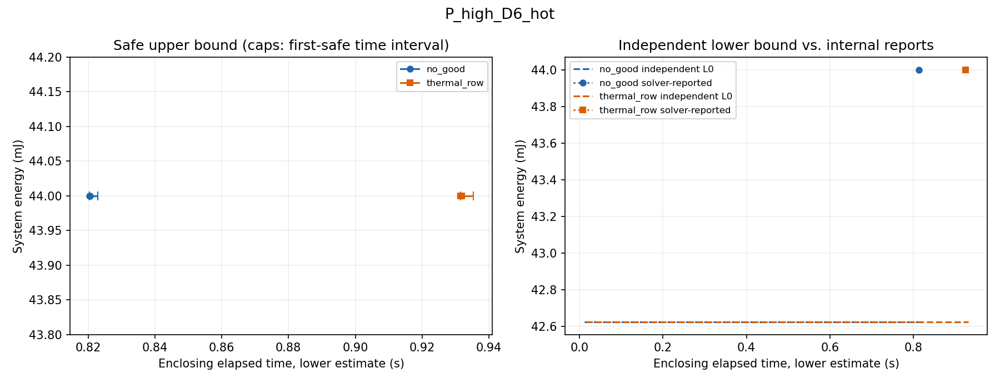

# 连续热反馈MILP实现与冻结对照

日期：2026-09-28。

**固定时刻热行已接入完整MILP循环，预检通过；原10项案例的两方法共20次独立调用完成。两方法在8项主例和能量并列校验上均取得相同的安全能量、相同时间表，所有可行输入均首轮安全，热行与no-good触发数均为0。** 本轮支持“反馈接口能够正确工作”，没有验证反馈减少求解轮次、改善安全输出或加速求解。

第三章目前可以保留“连续热约束的有效反馈表达与实现”这一候选定位；76号的离线覆盖扩张证据仍成立，但不能升级为已观察到的端到端计算收益。没有增加温度点、改变候选排序、注入正式候选或追加实验寻找优势。

## 1．比较对象与冻结范围

本轮两方法使用同一有限网格合法域、可加功率模型、连续峰温评价与证据等级。

| 项目 | 原完整赋值排除 | 固定时刻热反馈 |
|---|---|---|
| 正式调用 | 未修改的 b68_method | 新增 f77_method |
| 无热编码 | Stage—模式—启动格点二元选项 | 原 b68_build 编码 |
| 安全接纳 | 完整合法性、能耗与连续热复核 | 相同，热行检查不替代它 |
| 收敛返回的违规候选 | 排除该完整赋值 | 优先生成有效固定时刻热行；不能可靠生成时回退no-good |
| 回调 | 保存内部界、检查整数候选并保存安全U | 相同；回调不添加约束 |
| 结果证据 | 安全U＋独立L₀＋solver-reported界 | 相同 |

按53号顺序，原8项主例、2项独立校验，每例先运行原方法，再运行反馈方法。每次重新读入输入，独立60 s；没有跨调用共享候选、见证、热缓存或热行。保留CPU标签、所有合法映射、等待及能量层，没有cover、修复或对称剪枝。

原输入SHA256为 cb76929032f3ee457df95200af6e106aa4fdce97760790086aed74d04aace1cd；原规则SHA256为 bda369552628a36e6f39112e02f34f6dc774683392ab242493aa94a297b85a78。仍为1 ms启动网格、真实非整数结束、20 ms评价窗口，以及0.25 ms时间单位、0.0625 mJ能量单位。所有性能与热参数均为L3抽象设定。

使用MATLAB 23.2.0.2365128（R2023b）及Optimization Toolbox，工作区偏好目录为 .runtime/matlab_pref77。固定两项gap容差为0、ConstraintTolerance为10⁻⁹、IntegerTolerance为10⁻⁶，其余使用R2023b默认值；完整选项随每次结果归档。每轮MaxTime仅分配剩余时间，不重新领取60 s。

## 2．热反馈如何接入原求解器

### 2.1 整数结构与浮点热行分开

原解码器按整数系数精确复核唯一选择、依赖、执行单元冲突和共享频率域冲突。新实现因此保留两个层次：结构矩阵只含原整数约束及后续整数no-good，继续交给原解码器；求解器矩阵另加入浮点热行，热行通过可靠区间求和单独检查。

候选先满足原近整数容差，再解码为精确选项集合、真实执行区间和活动能量。完整资源、依赖、期限、频率域和能耗检查通过后，才进入连续温度评价。求解器内部“满足约束”不能替代这些独立检查。

完整候选的温度结果可以缓存，因为其模式与起点没有变化；**缓存命中后仍重新检查当前全部热行**。否则新约束加入前缓存的候选可能绕过后来加入的约束。这一处理不增加候选覆盖或向求解器提供参考答案。

### 2.2 行的数值方向及接纳规则

对于节点n和具体时刻t，沿用76号的叠加表达：

\[
T_n(t;x)=b_n(t)+\sum_o a_{no}(t)x_o.
\]

固定入口状态和空闲功率包含在基准响应b中，选项响应a只计该选项的活动注热。对全部合法选项计算可靠区间，而非从当前候选的活动集合猜测其他安排。

设响应下界为 \(\underline a_{no}\)，基准下界为 \(\underline b_n\)，温度判定带宽为 \(\delta_T=10^{-6}\ ^\circ\mathrm C\)。采用向外放宽的右端：

\[
\sum_o\underline a_{no}x_o\le\overline r_n,\qquad
\overline r_n\ge T_n^{\max}+\delta_T-\underline b_n.
\]

原热安全安排必满足该必要条件。只有源候选的可靠左端下界严格超过右端，才能把它作为有效排除行加入MILP。名义峰值时刻只用于定位，必须在该具体时刻重新形成点证书。温度带宽用于分类，不能冒充计算误差界。

| 行比较与完整轨迹 | 处理 |
|---|---|
| 行未违规，完整轨迹明确安全 | 保存安全U |
| 行比较未分辨，完整轨迹明确安全 | 可保存U，保留行未分辨状态；不能只据此宣称数值收敛 |
| 行明确违规，完整轨迹却明确安全 | 数值异常，不接受相互矛盾的证据 |
| 完整轨迹未分辨 | 不作热排除；保留候选并结束为数值未决 |

若安全U与独立L₀闭合，最优性来自这两项独立证据，不依赖内部界或热行等号判断。热系数及完整轨迹保证只适用于已核对的冻结对称二节点RC实现，含20／40 s⁻¹两个模态、端点、内部驻点及空闲尾段；没有宣称当前程序认证任意RC网络。

### 2.3 反馈、回退与停止

~~~mermaid
flowchart TD
    A[独立读入并建立整数调度编码] --> B[用剩余预算调用intlinprog]
    B --> C[回调及返回候选独立解码与完整热复核]
    C --> D{可信U与L0闭合?}
    D -- 是 --> E[保存独立最优证据]
    D -- 否 --> F{返回状态与最终候选}
    F -- 安全且内部收敛 --> G[安全U与工程级收敛]
    F -- 热未分辨或中断 --> H[保留已有证据和未决状态]
    F -- 收敛且明确超温 --> I[具体节点和时刻的点证书]
    I --> J{形成新有效热行?}
    J -- 是 --> K[加入固定时刻热行]
    J -- 否 --> L[仅排除当前完整赋值]
    K --> B
    L --> B
~~~

回调不修改约束。只有求解器返回收敛、最终候选完整轨迹明确违规时，才执行外层反馈。日志保留源选项、时间表、节点、时刻、系数下界、右端、源分离余量、类型和回退原因。

不能形成点证书但全轨迹已证违规时，使用原整数约束：

\[
\sum_{o\in O(x^\star)}x_o\le |V|-1.
\]

每个Stage恰好选择一个选项，故只删除源完整模式／起点赋值，不删除该配置下的其他等待安排。

热行按完整存储系数向量及右端精确相等去重。重复行，或求解器再次返回明确违反既有热行的违规候选，记容差事件并退回该候选的整数no-good。候选若又违反既有整数no-good，立即记数值异常，不反复重启。实现错误单独保留，不能解释为正常回退。

有效热行说明原安全域未被误删，**不认证intlinprog内部lowerbound或无解结论**；仍采用67—68号的工程级证据口径。

## 3．预检：实际求解与候选回放分开

正式运行使用178/178通过的预检凭据，包含原68号125项、76号20项以及33项新增接口检查。正式后补充错误防护检查，当前代码179/179通过。

| 检查范围 | 预检证据 |
|---|---|
| 原编码覆盖与物理评价 | 复用整数编码小域核对、同频并发／异频冲突、CPU/NPU映射、等待、非整数结束、能耗双算和连续峰包络检查 |
| no-good兼容性 | 新流程切为仅no-good测试模式，实际MILP结果与原方法核对合法域、目标、停止语义及该夹具时间表 |
| 真实MILP加行重启 | 独立单Stage夹具在入口即明确超温；实际求解、加热行、再次求解后报告无解；不冒称独立整数无解证明 |
| 确定性“违规→热行→安全” | 明确标记的候选回放使用历史同配置坏／好安排，真实解码和热评价；它验证分支，不验证求解器会自主选择这些候选 |
| 同配置等待保留 | 沿76号证据核对安全等待不被另一条安排的热行删除 |
| 重复与容差 | 回放重复候选检查缓存重新验行、重复行回退、整数no-good再违规停止 |
| 数值三态 | 行等号未分辨、完整热未分辨、近整数非法、行与完整轨迹矛盾分别处理 |
| 预算与错误 | 构造前后到期不提交新排除，全部轮次共用剩余时间；及时U可保留，晚证据与实现错误不升级为正常结果 |

回放入口必须显式声明test_only。正式入口只传案例，不传注入参数；保存结果逐项核对没有回放标志、没有注入候选事件。预检夹具不计入原10项，也不计入正式成功率、反馈次数或时间收益。

### 3.1 计时包络与事后防护修正

两方法均由同一外部墙钟包装，包含重新读入输入、建模、求解器调用、回调、热评价、行构造及缓存。原方法内部计时起点与外部调用存在入口／返回开销，首解采用区间记录：

\[
t_{\mathrm{first}}^{\mathrm{outer}}
\in t_{\mathrm{first}}^{\mathrm{local}}
 +[\Delta_{\min},\Delta_{\max}].
\]

下端为已测输入读取时间，上端保守吸收方法调用未单列的开销。只有证据时刻加上端仍在60 s内，才进入预算内比较。summary中的first_safe_s为下端，first_safe_upper_s为上端，不能将下端称为精确外部首解时刻。最终收敛状态及内部界另记是否在预算内形成。

正式运行期间，独立审查发现：共同预算包装的超时分支可能覆盖原error状态，影响入口的错误断言。运行结束后增加“检查原始raw_method_status”的防护及纯数据检查，当前预检179/179通过。**正式20次调用均少于2.613 s、原始状态与包装后状态相同、错误消息为空，该分支未触发。** 保留正式运行的178项凭据与源码快照，不重写历史、不重跑研究案例；当前源码与正式快照的三处差异仅为该错误防护及其检查。

## 4．正式结果

18份完整安全输出均通过独立事后复核，包含资源、依赖、频率域、期限、真实结束、能耗双算及完整连续峰温。两方法在每个可行案例的时间表逐项相同；最大保存CPU峰温上界约78.611400°C，NPU约78.408332°C，均明确安全。没有参考时间表输入或事后修复。

### 4.1 八项主例

下表共同能量是两方法各自实际取得的系统能量。墙钟只记录本次调用，不表示稳定速度差异。

| 案例 | 共同安全能量/mJ | 独立L₀/mJ | 原no-good墙钟/s | 热反馈墙钟/s | 两方预算内证据 |
|---|---:|---:|---:|---:|---|
| P_low_D6_cold | 38 | 37.125 | 1.900 | 0.966 | 安全＋内部收敛 |
| P_low_D6_hot | 38 | 37.125 | 0.887 | 0.907 | 安全＋内部收敛 |
| P_low_D10_cold | 37.125 | 37.125 | 2.613 | 2.418 | U=L₀，独立最优 |
| P_low_D10_hot | 37.125 | 37.125 | 2.393 | 2.290 | U=L₀，独立最优 |
| P_high_D6_cold | 44 | 42.625 | 0.919 | 0.875 | 安全＋内部收敛 |
| P_high_D6_hot | 44 | 42.625 | 0.823 | 0.936 | 安全＋内部收敛 |
| P_high_D10_cold | 42.625 | 42.625 | 2.453 | 2.329 | U=L₀，独立最优 |
| P_high_D10_hot | 42.625 | 42.625 | 2.422 | 2.327 | U=L₀，独立最优 |

每种方法主例8/8取得安全输出，其中4项由U=L₀独立证明最优，4项紧期限保留安全解和内部收敛。紧期限的独立绝对差距分别为0.875 mJ、1.375 mJ；内部gap为0不能把这两个差距洗成独立证明。60号解析证书没有注入方法，也没有事后补写其独立最优标志。

### 4.2 两项独立校验

| 校验 | 两方结果 | 原no-good墙钟/s | 热反馈墙钟/s | 证据边界 |
|---|---|---:|---:|---|
| check_stage_energy_tie | 安全42.625 mJ，U=L₀ | 2.369 | 2.315 | 独立最优值；不要求列全并列配置 |
| check_noheat_infeasible | 无安全候选，求解器报告无解 | 0.048 | 0.043 | 两方均非独立MILP无解证书 |

4 ms校验没有时间表，事后检查字段为“无见证、未执行安排复核”，没有把空结果算成复核通过。原输入另有最快隔离链5 ms的无热不可行依据，但本轮方法输出仍保留solver-reported等级。

### 4.3 轮次、候选与反馈

| 每种方法的统计 | 8项主例 | 2项校验 |
|---|---:|---:|
| 调用次数 | 8 | 2 |
| 安全输出 | 8 | 1 |
| 求解器轮次总数 | 8 | 2 |
| 不同完整候选总数 | 8 | 1 |
| 完整热评价次数 | 8 | 1 |
| 热行／no-good／回退／重复行 | 全部0 | 全部0 |
| 热未分辨／数值异常／预算未决 | 全部0 | 全部0 |

每次可行调用只有一个不同完整候选。宽期限和并列校验中，同一个候选可在回调及最终返回时各检查一次：两方法合计28次候选访问、10次缓存命中、18次实际完整热评价。不能把28次访问写成28条不同候选。

两方法全部20次均只有一轮求解，求解器报告分支节点数为0。没有任何正式候选明确超温，所以热反馈构造函数未被正式调用；原方法也没有构造no-good。**这不是“用更强约束更快排除了违规”，而是本组正常求解根本没有遇到需要排除的最终候选。**

76号热态小域确有32条违规安排，但本轮求解器自主返回的是其他安全安排。违规安排存在不等于求解轨迹一定会访问它们，也不等于离线覆盖扩张一定产生求解收益。

## 5．时间、成本与界的解释

首解完整区间保存在CSV和MAT。代表性记录如下：

| 案例 | 原no-good首解区间/s | 热反馈首解区间/s |
|---|---|---|
| P_low_D6_cold | [1.880959, 1.899253] | [0.949284, 0.965231] |
| P_high_D6_hot | [0.820379, 0.822977] | [0.931585, 0.935322] |
| P_high_D10_hot | [2.415641, 2.417960] | [2.319752, 2.322232] |

所有首解区间均完全落在预算内。计时区间不改变能量排名；它防止漏算入口开销后，把临界证据错误记入预算。

八项主例分项合计如下，单位为秒：

| 计时项 | 原no-good | 热反馈 |
|---|---:|---:|
| 外部总墙钟 | 14.4110 | 13.0468 |
| 矩阵构造 | 0.3492 | 0.2823 |
| 求解器调用（含回调） | 13.5157 | 12.4735 |
| 完整热评价 | 0.1598 | 0.0363 |
| 解码 | 0.0943 | 0.0225 |
| 热行检查 | 不适用 | 0.0265 |
| 排除约束构造 | 0 | 0 |

求解器调用时间包含回调，热评价和解码分项又可能在回调内发生，**这些列不能直接相加**。空热行集合的接口检查和首次调用初始化也有开销；0次构造不意味着热行生成没有成本，而是该成本本轮未被测到。

反馈版本次在6项主例墙钟更短、2项更长，但时间表、轮次和候选完全一致，反馈次数为0。固定“原方法先、新方法后”的顺序、MATLAB初始化／即时编译及单次波动均可能影响记录，本轮没有分离这些因素。因而不计算“热反馈加速比”，不将总和差异归因于扩大违规信息利用，也不宣布普遍快慢结论。

图只重绘保存的时间戳与能量证据：左侧标记为首次安全U，横向短线为计时区间；右侧42.625 mJ为独立L₀，44 mJ点为内部报告。图中没有多轮热反馈过程，不插值成不存在的迭代改善。

## 6．记录、复现与完整性

入口为[run_feedback77.m](matlab_config_value_src/run_feedback77.m)，只增加f77模块。旧b68、t76、b64、s55代码均未修改。

| 新文件 | 作用 |
|---|---|
| f77_method | 独立MILP循环、候选缓存、结构与热行隔离、证据输出 |
| f77_rows | 当前热行的区间求和及三态判断 |
| f77_feedback | 点证书、全选项热行、重复判定及no-good回退 |
| f77_budget_audit | 共同外部预算审核、首解时间区间与晚状态分离 |
| f77_tests | 原检查复用、实际MILP夹具与独立回放夹具 |
| f77_export | 保存结果独立复核、CSV／JSON及图表导出，不重新搜索 |

当前源码复现方式如下，每次产生独立目录，不覆盖既有运行：

~~~matlab
addpath('F:/by/11111/research/matlab_config_value_src');
p = run_feedback77('precheck');
run_feedback77('frozen', fullfile(p,'receipt.mat'));
~~~

本轮只有一次正式20调用，不通过重跑选择有利结果。已保留：

- [冻结规则](feedback77_design/rules_v1.json)与[历史保护清单](feedback77_design/protected_before.json)；
- [正式目录](matlab_config_value_src/feedback77_reports/frozen_20260928_172132_129)：输入、规则、环境、116项源码／输入哈希及逐份快照、20个检查点、原始MAT；
- [汇总](matlab_config_value_src/feedback77_reports/frozen_20260928_172132_129/summary.csv)、[独立复核](matlab_config_value_src/feedback77_reports/frozen_20260928_172132_129/postchecks.csv)、[分项成本](matlab_config_value_src/feedback77_reports/frozen_20260928_172132_129/cost_diagnostics.csv)，以及逐案例时间表、候选事件、内部界和空反馈日志；
- 正式前[178项预检](matlab_config_value_src/feedback77_reports/precheck_20260928_172035_620/prechecks.csv)及凭据；当前[179项预检](matlab_config_value_src/feedback77_reports/precheck_20260928_172321_051/prechecks.csv)和源码快照；更早176项通过记录亦保留；
- [接口审阅](feedback77_design/code_review.md)、[结果独立审阅](feedback77_design/result_review.md)、[只读核对脚本](feedback77_design/postcheck77.py)及[核对结果](matlab_config_value_src/feedback77_reports/frozen_20260928_172132_129/postcheck_readonly.json)；
- [保存数据绘图脚本](feedback77_design/plot_saved77.py)与10张图，仅增强单点标记和计时区间显示，没有求解、温度重算或补入新结果。

登记的1,750个历史文件哈希全部不变，包括原源码、输入、55／64／68／76结果和LaTeX文件。正式运行116份快照哈希逐项核对通过；当前代码相对正式快照的三个防护修改已明列，没有伪称正式案例由修改后代码重新运行。两方法能量及证据标志与68号历史MILP逐项一致，历史结果未回填。

## 7．判断及两章衔接

| 问题 | 本轮回答 |
|---|---|
| 固定时刻热行是否正确接入？ | 是。矩阵隔离、区间验行、点证书、回退、缓存重查和实际加行重启通过预检；正式入口保持原问题与安全接纳标准 |
| 正式案例触发了什么？ | 没有热反馈、no-good或回退；可行案例均首轮安全 |
| 是否改善安全输出和求解轮次？ | 没有。两方安全能量、时间表、轮次和不同候选数相同 |
| 是否证明计算加速？ | 没有。单次时间差不能归因于未触发的热行 |
| 76号信息利用证据是否保留？ | 保留。它证明小域内更广的有效排除；本轮未把该离线性质转化为已测性能收益 |

能够写入方法论证的是：**针对本题离散选项，连续热违规可以转化为带可靠数值方向的固定时刻必要条件，并在不降低最终连续热安全接纳要求的前提下接入MILP。** 原热模型、查表、通用约束生成思想并非新发明；本组不能支撑“反馈减少求解轮次”“热反馈实现加速”或“第三章创新已经充分成立”。

第四章仍研究配置能量引导的有界搜索，后续对照应交代反馈参照的实际触发情况，不能只因换了方法名称就称基线更强并已带来收益。本轮不改写第三章贡献结论、不改变第四章程序，也不继续MILP认证、pair或参数扫描。

**下一步仅返回第三章方法定位与措辞审阅：把“有效反馈表达和实现”与“尚未验证的计算收益”分开，再安排与第四章的衔接。** 当前不自动追加实验或组件。
