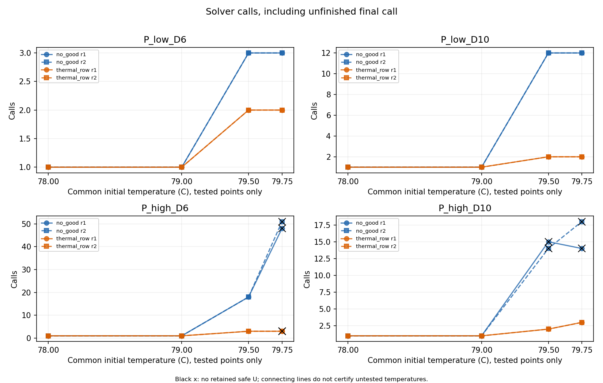
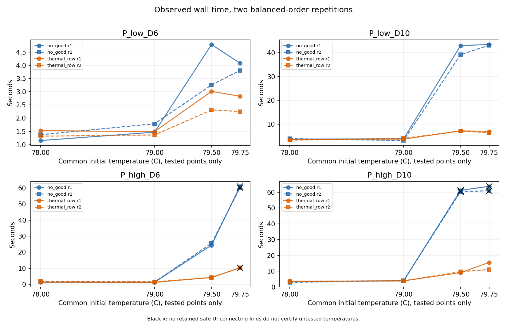

# 入口热压力下连续热反馈对照

日期：2026-09-28。

**受控热压力使反馈在正常求解中触发，并取得了条件性的端到端收益。** 正式16项各重复两次，原no-good取得26/32次安全输出，固定时刻热反馈取得30/32次；双方都成功的26个配对调用能量相同。5项案例两遍均减少轮次并缩短墙钟；另2项高功率宽期限案例中，原方法两遍均超时无安全解，热反馈均取得安全解且与独立L₀闭合。

仍保留8项零反馈案例，以及1项双方均无安全输出的案例。后者热反馈仅为求解器报告无解，没有独立不可行证明。本轮没有调功率、RC、期限、网格、候选排序或算法；66次调用按冻结顺序全部完成，未追加点或扩预算重跑。

## 1．为什么调整入口，而不修改原算法

原参数未发现自相矛盾。原来的冷态充分安全界、P_high_D6_hot的288条合法安排中256条安全，以及该紧期限对象所有安排能量相同，适合检查模型和实现，但不能保证MILP会遇到需要热反馈的候选。此前两种方法均首轮安全，说明既有输入没有激活所比较的反馈机制，不能据此证明热行无用，也不能把未触发时的耗时差解释为算法收益。

本轮只改变入口温度，保留原任务、可执行模式、功率、RC、期限及无热MILP。这样初始无热候选问题不变，改变的是这些候选在完整热评价中能否被接纳。研究问题限定为：**当正常求解遇到热违规候选后，对全部选项有效的固定时刻热行，是否比逐条完整赋值排除更有效地利用违规信息？**

这是预先限定的L3热压力验证，不是设备标定、真实入口分布估计或对所有热参数的扫描。既有记录保留，不把新增压力案例替换进原53、68、76或77号统计；没有修改第四章方法。

## 2．输入、顺序与证据等级

### 2.1 发现性诊断与正式组分开

任务仍为两个同模型请求，各含S0→S1→S2→S3；两个对称固定CPU单元，S1另可选择固定模式NPU，其他Stage只能使用CPU。P_low／P_high仅沿用原NPU执行S1时的1／4 W活动增量，NPU时长均1 ms；CPU模式表保持53号原值。每例两个请求使用共同的6或10 ms绝对期限，均在0到达。

| 分组 | 工作量／参数包与期限 | 两节点共同入口/°C | 调用数 |
|---|---|---|---:|
| 发现性诊断 | 原P_high、D=6 ms | 79.45 | 两方法各1次，共2次 |
| 正式热压力组 | 原P_low/P_high × D=6/10 ms | 78、79、79.5、79.75 | 16项 × 两方法 × 两次，共64次 |

正式组温度取自距80°C上限的入口裕量2、1、0.5、0.25°C，按减半规则预先确定。79.45°C诊断点则根据既有轨迹推导，明确属于发现性构造。二者在任何新增求解前一并冻结；诊断结果没有改变正式点、调用顺序或算法。

第一遍按四种参数包／期限组合、各四个入口的顺序运行，每例先no-good、后热反馈；第二遍保持案例顺序，每例先热反馈、后no-good。两遍只检查在交换调用先后的情况下观察是否一致，不构成重复次数充分的统计稳定性证明。

机器输入逐字段从原四个热态对象派生，仅修改案例标识及热模型initial字段。启动仍为1 ms网格，真实结束时刻不取整，评价窗口20 ms；零额外交接／切换开销、CPU共享频率域及CPU/NPU合法模式均不变。

### 2.2 入口变化的数学影响

原对称二节点网络的环境导热均为0.05 W/K，耦合导热0.025 W/K，热容均为0.0025 J/K。两节点共同增加入口温度\(\Delta T_0\)，在任意相同功率轨迹下有

\[
\Delta T_C(t)=\Delta T_N(t)=\Delta T_0e^{-20t},\qquad t\text{以秒计}.
\]

因此改变的是初值响应；模式活动注热的选项响应系数、无热MILP的变量／约束／目标均不变。热行必须用新入口重新计算基准响应和右端，不能直接复用旧热行。

数值评价继续使用原对称RC的分段连续峰温包络，包括内部驻点、事件端点和空闲尾段。入口改变不改变该实现的20/40 s⁻¹模态及误差分析形式，但每条轨迹仍重新计算区间，不能把旧安全标记沿用到新温度。

### 2.3 方法与预算不变

原方法直接调用未修改的b68_method，新方法直接调用已有f77_method。前者在返回的完整候选确证超温后添加整数no-good；后者优先添加76号定义的可靠固定时刻热行，不能可靠形成时才按既定规则回退。两者安全接纳均依赖完整合法性、能耗及连续热复核。

R2023b选项保持AbsoluteGapTolerance=0、RelativeGapTolerance=0、ConstraintTolerance=\(10^{-9}\)、IntegerTolerance=\(10^{-6}\)，其余默认值随环境和每次结果归档。没有cover、局部修复、对称剪枝、候选注入、历史答案或额外排序调整。

每次调用独立60 s，包含重新读取／展开输入、矩阵构造、所有求解轮次、回调、缓存、热评价及热行构造；每轮MaxTime只取剩余预算。检查点序列化和事后独立复核单列。外部墙钟超过60 s时允许记录停止延迟，晚形成的状态或证据不补作预算内成果。

安全首次获得时间记为外部时间区间，按上端判断是否在预算内。完整原始时间戳保留，导出用于比较的U只来自共同预算审计。三种证据口径保持分离：

- 安全上界U：完整轨迹独立复核，且证据在预算内形成。
- 独立下界L₀：固定公共基准加各Stage独立最小活动能量；两种功率包分别为37.125、42.625 mJ。
- solver-reported界／状态：保留内部收敛或无解信息，但不升级为独立最优／不可行证书。

## 3．预检与发现性点证书

最终284/284项预检通过，包含原反馈实现的179项检查、派生输入与MILP矩阵核对、66次调用顺序、入口响应叠加、发现性证书及导出检查。原编码、连续峰包络、整数结构与浮点热行分离、缓存命中重新验行、预算防护及数值未分辨检查均沿用。

首次预检在零时刻指数区间的非负域检查处中止。修正限于新预检：已知非负的指数参数在向外包络后与非负域取交；矩阵一致性比较对案例标识元数据归一化。失败记录与源码快照保留，未改变研究输入或b68/f77方法。通过凭据与正式源码／输入／规则哈希匹配后才启动66次调用。

对发现性诊断，旧首选安排的首1 ms内两节点总注热为4.2/0.3 W。以原78°C入口解析传播CPU温度，再叠加1.45°C共同初值增量，得到

\[
T_C(1\text{ ms})=
89.5+8e^{-0.02}-19.5e^{-0.04}+1.45e^{-0.02}.
\]

独立向外区间为

\[
[80.02748339927437,\ 80.02748339928272]\ ^\circ\mathrm C.
\]

全选项响应叠加独立得到包含该值的区间
\([80.0274833992544,80.02748339932866]\)°C。两者都在具体1 ms时刻确证超温，没有把旧全局峰值下界与名义峰时刻拼成点证书。

已有替代安排在78°C下的逐节点全窗口峰温上界约为78.504687847549、78.401246595374°C。因初值增量不超过1.45°C，独立保守的共同全窗口上界小于79.954687847549°C；新入口下完整复核的逐节点上界约79.790722480789、79.766805169071°C。故发现性点同时具有确证违规代表和确证安全替代。

上述时间表只属于预检证据，普通方法调用不接收它们。正式日志必须另外验证求解器自主产生候选、加入反馈并寻找后续安排；点证书本身不是算法性能结果。

## 4．结果

### 4.1 发现性诊断：正常求解自主触发反馈

| 方法 | 安全能量/mJ | 求解轮次 | 完整热评价 | 排除约束 | 墙钟/s |
|---|---:|---:|---:|---|---:|
| no-good | 44 | 18 | 18 | 17条no-good | 24.826 |
| 固定时刻热反馈 | 44 | 3 | 3 | 2条热行 | 4.205 |

两方法没有收到预检的坏／好安排，均在普通MILP调用中自主处理违规并找到安全替代。该点证明正常接口确实能够触发；能量没有降低。独立L₀为42.625 mJ，两方仅记录安全U与内部收敛，不借历史解析结论补写独立最优状态。此点不计入下文正式16项的成功数量或耗时汇总。

### 4.2 正式16项

下表每格“第一遍／第二遍”；相同轮次只写一次。U的“—”表示没有预算内安全见证，不是能量为零。超时轮数包含已开始但未完成的末轮；超过60 s的墙钟为停止延迟，不表示方法获得更大有效预算。两方法主例每版32次独立调用，诊断不在其中。

| 参数包 | D/ms | T₀/°C | no-good U/mJ | 热反馈U/mJ | no-good轮次 | 热反馈轮次 | no-good墙钟/s | 热反馈墙钟/s |
|---|---:|---:|---:|---:|---:|---:|---|---|
| P_low | 6 | 78 | 38 | 38 | 1 | 1 | 1.155／1.375 | 1.528／1.319 |
| P_low | 6 | 79 | 38 | 38 | 1 | 1 | 1.472／1.789 | 1.494／1.368 |
| P_low | 6 | 79.5 | 38 | 38 | 3 | 2 | 4.785／3.255 | 3.013／2.312 |
| P_low | 6 | 79.75 | 38 | 38 | 3 | 2 | 4.081／3.804 | 2.830／2.254 |
| P_low | 10 | 78 | 37.125 | 37.125 | 1 | 1 | 3.756／3.912 | 3.617／3.290 |
| P_low | 10 | 79 | 37.125 | 37.125 | 1 | 1 | 3.844／3.136 | 3.728／4.053 |
| P_low | 10 | 79.5 | 37.125 | 37.125 | 12 | 2 | 43.005／39.204 | 7.220／7.117 |
| P_low | 10 | 79.75 | 37.125 | 37.125 | 12 | 2 | 43.445／43.129 | 6.965／6.440 |
| P_high | 6 | 78 | 44 | 44 | 1 | 1 | 1.300／1.564 | 1.338／1.854 |
| P_high | 6 | 79 | 44 | 44 | 1 | 1 | 1.290／1.394 | 1.196／1.527 |
| P_high | 6 | 79.5 | 44 | 44 | 18 | 3 | 24.339／25.517 | 4.223／4.175 |
| P_high | 6 | 79.75 | — | — | 48／51 | 3 | 61.048／60.164 | 10.274／10.250 |
| P_high | 10 | 78 | 42.625 | 42.625 | 1 | 1 | 3.588／2.919 | 3.593／3.419 |
| P_high | 10 | 79 | 42.625 | 42.625 | 1 | 1 | 3.861／3.959 | 3.857／3.899 |
| P_high | 10 | 79.5 | — | 42.625 | 15／14 | 2 | 61.133／60.309 | 9.067／9.639 |
| P_high | 10 | 79.75 | — | 42.625 | 14／18 | 3 | 63.701／60.887 | 15.532／11.016 |

6 ms下的安全输出为“安全＋内部收敛”：P_low的U−L₀为0.875 mJ，P_high为1.375 mJ，没有独立最优证明。10 ms下所有已取得的安全输出都满足U=L₀，独立证最优。P_high、6 ms、79.75°C两遍均为原方法超时无U、热反馈solver-reported无解；两方独立不可行标志均为false。

两遍每次均为13项双方安全且能量相同、2项仅反馈方法取得安全解、1项双方无安全解。安全输出比例是本次预算内方法表现，不等于模型可行实例比例。特别是两个高功率宽期限案例已有热反馈安全见证，能明确排除“原方法未找到所以模型不可行”的解释。

### 4.3 热压力与信息复用

78、79°C的8项案例，两方法两遍的首个不同整数候选都安全，均一轮、零排除。79.5、79.75°C的8项案例，首个不同候选都明确违规。逐事件核对还确认32个方法配对的首候选选项集合完全相同；因此正式组按预定入口规则激活了反馈，无需人为投喂坏候选或改变并列排序。

| 正式组指标（32次/方法） | no-good | 热反馈 |
|---|---:|---:|
| 预算内完整安全输出 | 26 | 30 |
| U=L₀独立证最优 | 12 | 16 |
| 安全＋内部收敛 | 14 | 14 |
| 超时，无安全U | 6 | 0 |
| 求解器报告无解，无安全U | 0 | 2 |
| 独立已证不可行 | 0 | 0 |
| 求解轮次（含未完成末轮） | 272 | 54 |
| 已记录不同候选／完整热评价 | 282／282 | 56／56 |
| no-good条数 | 240 | 0 |
| 固定时刻热行条数 | 0 | 22 |
| 热行回退／重复／行违规返回 | 0／0／0 | 0／0／0 |
| 热未分辨／数值异常／内部界冲突 | 0／0／0 | 0／0／0 |

一轮求解可能通过回调访问多个整数候选，故完整热评价次数可以多于轮数；同一候选重复检查可命中缓存，不能将每次回调当成不同时间表。不同候选数是保存日志中选项集合去重后的数量，超时末轮可能没有形成完整事件，不把它当成全域访问计数。

22条正式热行均由当前运行候选的可靠点证书生成，无no-good回退；同一调用中未出现重复行或容差返回事件。两遍在每个案例的热行数一致。该记录与较少的后续违规候选、较少的外层求解相对应，提供了76号“单行可复用更多违规信息”在完整求解循环中的证据，而不只是离线覆盖数量。

图中黑叉表示无预算内安全U，不能读成独立不可行；连线仅连接测试点，不证明中间温度的变化规律。

### 4.4 首解、成本与预算

首解区间的上端均已用于预算准入。举例，第一遍P_low、10 ms、79.5°C，原方法首次安全时刻在[42.9927118,42.9982603] s，热反馈在[7.2079107,7.2117306] s。高功率宽期限的首解记录如下；原方法四次对应调用均无安全U。

| 入口/°C | 重复 | 热反馈首次安全区间/s | 热反馈总墙钟/s | U/mJ |
|---|---:|---|---:|---:|
| 79.5 | 1 | [9.0557946,9.0611491] | 9.067 | 42.625 |
| 79.5 | 2 | [9.6243398,9.6302196] | 9.639 | 42.625 |
| 79.75 | 1 | [15.4129712,15.4187089] | 15.532 | 42.625 |
| 79.75 | 2 | [10.9142422,10.9188969] | 11.016 | 42.625 |

完整66次首解区间见summary.csv，最大区间宽度约0.033492 s。无见证时字段为NaN，不填超时时刻冒充首解。

| 正式组累计计时/s | no-good | 热反馈 | 计费解释 |
|---|---:|---:|---|
| 外部墙钟 | 642.120 | 153.409 | 包含停止延迟，不将总和直接解释为通用加速比 |
| 读取／展开 | 1.252 | 1.359 | 各调用独立执行 |
| 矩阵构造 | 1.951 | 1.940 | 原编码一致 |
| 求解器调用 | 637.717 | 148.935 | **包含回调，不能再与下列热评价等直接相加** |
| 完整热评价 | 1.095 | 0.211 | 既可能在回调内，也可能在返回后 |
| 候选解码 | 0.815 | 0.134 | 同上，属于诊断分项 |
| 排除约束构造 | 0.042 | 0.602 | no-good与固定时刻行的不同构造成本 |
| 热行区间复核 | 0 | 0.042 | 热反馈额外检查 |

本组热行构造开销高于单条no-good，但累计不足1 s，未抵消所观察到的求解轮次减少。求解器调用时间占主要记录；本轮没有拆分其内部预处理、LP或分支树，因此不进一步声称是哪种内部操作获得加速。

另核对全部347个保存轮次（含诊断），求解器报告的分支节点数均为0。因此这里的轮次减少具体指外层反复求解减少，不能写成“已经减少整数搜索树展开节点”；零节点也不表示预处理、LP及整数候选求解没有成本。

原方法6次超时墙钟为60.164—63.701 s；超出部分仅记录停止延迟，未恢复任何晚安全见证，未补记晚收敛或无解为预算内证明。方法没有重新获得60 s。计数中保留已启动末轮，完整日志不裁掉不利记录。

全部已记录候选事件与约束生成时间加外部偏移上端均未超过60 s，最大已提交约束时间上端约59.904800 s。六次超时的原始状态均为timeout、U均为Inf、最终状态／内部界的预算标志为false，没有被包装为数值异常或模型不可行。

8项零反馈案例形成16个配对，热反馈恰为8次更快、8次更慢，不能归因于未执行的热行。5项双方安全且轮次减少的案例，两遍均表现为反馈更快；对应10个配对的时间表有所不同，能量相同。但两次重复不足以估计方差、置信区间或普遍加速。高功率79.75°C宽期限的两遍反馈墙钟差异也保留，不只报告较快的一次。

安全能量与独立／内部界的时间记录分别作图，例见[高功率宽期限79.5°C](matlab_config_value_src/pressure78_reports/frozen_20260928_183250_962/plots/bounds_trial_16.png)。图只读取保存的预算内时间记录，未进行新搜索或热仿真；solver-reported界与独立L₀不合并。

## 5．结果解释与第三章定位

**本轮可以把第三章的证据从“有效表达＋离线信息复用”推进到“限定热压力案例下的求解收益”。** 它并未改变模型能耗表达，改进的是遇到违规候选之后如何利用信息：原方法只删一个完整赋值，热反馈用同一时刻对全部选项成立的必要条件减少后续无效尝试。

| 判断 | 本轮依据 | 仍不能推出 |
|---|---|---|
| 热压力生效 | 8项较热案例正常首候选违规；其中7项由反馈找到安全替代 | 实际设备通常处于这些入口，或温度越高收益必然越大 |
| 信息复用有效 | 正式22条热行，无回退；触发案例外层轮次更少 | 线性RC或约束生成原理是新发明 |
| 条件性计算收益 | 5项同安全能量案例两遍更少轮次且更快；2项原方法超时而反馈取得独立最优值 | 在全部输入、规模和求解器设置下占优 |
| 安全能量结果 | 双方都有见证时能量相同，新增输出也遵循原能量下界 | 降低了设备运行能耗，或改变了实际硬件能效 |
| 无安全输出 | 最强紧期限压力点两方均无U；反馈内部报告无解 | 已独立证明整个网格域不可行 |

可以用于第三章的表述是：

> 在固定有限网格与完整连续热复核下，将违规点温度转化为对全部调度选项有效的线性必要条件。与逐条完整赋值排除相比，在预先限定的入口热压力案例中，该反馈减少了重复求解，并在部分60 s调用中取得了原方法未获得的热安全最优值见证；无反馈和无安全输出条件同时保留。

这里“最优值”只用于U=L₀的宽期限输出；紧期限沿用安全U及内部状态。该论证比只展示热约束能够加入MILP更具体，但**反馈触发、计算收益、新颖性仍是三个判断**：新颖性须沿76号近邻对照，说明本题的离散选项表达、连续违规点及可靠反馈之间的具体适配，不能仅凭这组有利结果认定创新充分成立。

本轮到此停止，不追加温度、RC、功率、请求或组件。**唯一后续行动：按76—78号证据修订第三章的热反馈方法与实验定位，并将强化MILP列为第四章后续比较参照。** 本次不自动改写正文，不重新运行第四章实验或恢复pair支线。

## 6．复现与完整性

输入与规则见[pressure78_design](pressure78_design/README.md)，入口为[run_pressure78.m](matlab_config_value_src/run_pressure78.m)。新模块仅承担派生输入、预检、独立计时、保存及导出，原方法源码不变。

- 输入SHA256：d0b02bc3531cabb6f2d6709ed56afbdf4dafc2abf6793cfb738dd86af0c58d4a。
- 规则SHA256：e29e61f8b1fc882c17fda3071d1bbeeabc6a78318533248a466a9adf76f12f40。
- 保护清单SHA256：62c89f151597f3c14084b9b1a503ddac7bc6617dc3e6952c2ea847273509c324。
- 通过凭据：[precheck_20260928_183105_883](matlab_config_value_src/pressure78_reports/precheck_20260928_183105_883/receipt.mat)。
- 正式目录：[frozen_20260928_183250_962](matlab_config_value_src/pressure78_reports/frozen_20260928_183250_962)。

~~~matlab
addpath('F:/by/11111/research/matlab_config_value_src');
p = run_pressure78('precheck');
run_pressure78('frozen',fullfile(p,'receipt.mat'));
~~~

正式目录保存逐调用MAT检查点、汇总MAT／CSV、输入／规则／源码／环境快照、全部候选事件、逐轮求解记录、内部界、热反馈证书、完整安全时间表与事后复核。JSON非有限值可能为null，MAT为权威原始记录；无安全见证的空时间表不算复核通过。

58份预算内安全输出（正式56份、诊断2份）全部通过事后独立复核，包含模式／资源／依赖／期限／频率域／网格、能耗双算及完整连续热包络；最大CPU／NPU峰温上界分别约79.971831／79.813894°C。没有事后修复、补搜索或恢复晚证据。78°C的四种原对象在两遍中的能量、状态及独立最优标志，与77号一致。

正式122份源码／输入／规则快照与当前哈希一致。保护清单共3,212份文件，3,206份未变；六个LaTeX编译产物（main.aux、.fdb_latexmk、.fls、.log、.pdf、.synctex.gz）在清单登记后、正式运行前发生变化，本任务未编译、修改或回退它们。chapter03.tex等LaTeX源文及全部登记历史实验源码、输入、结果均未变。首次只读核对的整体断言因此失败，已保留失败记录及逐文件前后哈希，没有将差异抹去或重跑研究。

具体入口：

- [66次汇总](matlab_config_value_src/pressure78_reports/frozen_20260928_183250_962/summary.csv)、[独立复核](matlab_config_value_src/pressure78_reports/frozen_20260928_183250_962/postchecks.csv)、[成本分项](matlab_config_value_src/pressure78_reports/frozen_20260928_183250_962/cost_diagnostics.csv)。
- [只读一致性与哈希核对](matlab_config_value_src/pressure78_reports/frozen_20260928_183250_962/postcheck_readonly.json)、[入口与接口审阅](pressure78_design/math_review.md)、[独立结果审阅](pressure78_design/result_review.md)。
- [保存数据作图脚本](pressure78_design/plot_saved78.py)、[只读审计脚本](pressure78_design/postcheck78.py)。两者不调用调度或热仿真。

本轮不新增文献检索。方法与模型依据分别复用[53号](53_四Stage任务L3参数冻结与比较协议.md)、[67号](67_有限认证接口审查与工程级参照准入.md)、[76号](76_连续热约束反馈方法论证与最小验证.md)和[77号](77_连续热反馈MILP实现与冻结对照.md)。
