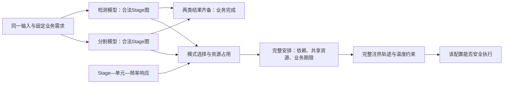

# 以任务相关频率响应为核心的应用背景与研究对象核查

日期：2026-09-29。性质：扩展检索、定向正文核查与研究对象比较。使用academic-research-suite的文献核查流程；未修改论文正文、程序、输入或历史结果，未运行实验。本报告提出选择建议，不替换[61号正式模型](61_第三章正式模型与适用边界.md)。

**后续选择已确认（2026-09-29）：** 用户同意将候选A的应用范围概括为“固定工作流的多模型端侧推理”，不限定视觉、音频或其他具体领域。下文的视觉例子与三候选比较保留为当时核查记录；当前采纳的术语、范围和与原模型的关系见第12节。此选择不自动改变61号数学假设或历史实验。

## 1．结论：优先讨论固定视觉工作流中的多DNN协同推理

**推荐以HaX-CoNN为主要框架来源，讨论“固定视觉工作流中，任务相关响应下的CPU–NPU配置与热安全协调”。** 具体对象可以是同一图像同时进入检测与分割模型，两个结果齐备后才完成一次感知业务。模型内部再按后端实际支持形成不可拆分的Stage。这里借鉴的是“业务—模型—Stage”的组织与部署时机，不是移植HaX-CoNN的GPU–DLA参数，也不是认定这种层次划分本身具有创新性。

HaX-CoNN §5.2已经讨论同输入的两个模型并行后同步、两个模型前后串接及串并混合；§3.5说明固定尺寸输入和固定模型为何允许执行前准备计划。因此，“一项业务为何包含这些任务、为什么需要一起安排、何时可以知道结构”有了直接来源。与仅说“给定有限Stage集合”相比，它补实了**业务完成条件及模型间先后／汇合关系**。这首先是应用语义的补充；共同期限下的零成本汇合不必增加数学耦合，不能据此预先宣布模型增量。[原文R6](../papers/2024_Dagli_HaX_CoNN.pdf)

主线仍从任务相关频率响应出发：不同Stage改变频率后，时长和能量的变化不同；这些变化先影响各条路径与共享资源的占用，再影响一次业务的完成时刻，以及完整功率轨迹是否热安全。**应用背景提供任务的来由；响应修正提供建模问题；热约束判断该配置和安排能否执行。** 三者不能互相替代。

本轮还比较NeuOS式异步多模型服务，以及Kang式单个推理应用内部的异质阶段。前者响应协调依据直接，但需要运行期信息和控制语义；后者最接近现有模型，但增加的任务组织较少。80号持续推理仍有来源，却不再被预选为唯一方向：重复执行和持续热保证可在需要时另定，不把任务相关响应让位于周期升温问题。

这项推荐的限制也明确：HaX-CoNN已经处理映射、设备转换与并发争用；NeuOS、JOSS已经处理层／任务相关配置。**尚不能把“多模型＋查表＋温度”写成已证创新。** 真正待核的是：对选定业务，响应修正是否改变合法且热安全的配置选择；已有联合规划加完整热复核是否已经足够。

## 2．本轮怎样重新阅读，而不是沿用旧印象

### 2.1 范围与版本

初筛纳入下表**19项材料**，包括已有全文重审和新增公开入口；其中R1—R8完成本轮指定章节的定向正文核查。不是19篇新下载，也不是8篇全文逐页精读。R9—R14复用已有核查，R15—R19保留有限阅读范围。搜索中无关命中不计入材料数。

| 编号、来源与版本 | 进入本轮前的阅读状态 | 本轮实际阅读范围与用途 |
|---|---|---|
| **R1 Kang等，2020**，*Scheduling of Deep Learning Applications Onto Heterogeneous Processors in an Embedded Device*；[正文](../papers/2020_Kang_Heterogeneous_DL_Scheduling.pdf)，[DOI](https://doi.org/10.1109/ACCESS.2020.2977496) | 已下载、初筛；不能视为此前已逐项核清频率假设 | §I、§III—IV、§V—VII相关段落及Table 2；核应用、profile、反比校正和实机边界 |
| **R2 Band，MobiSys 2022**；[正文](../papers/2022_Jeong_Band.pdf)，[DOI](https://doi.org/10.1145/3498361.3538948) | 已核支持集合、回退及工件身份；51号不是整篇应用背景审查 | §2应用、§3—4注册／划分／派发、§6.1、§7热状态实验；补任务来源与业务完成含义 |
| **R3 MEDEA**，*A Design-Time Multi-Objective Manager for Energy-Efficient DNN Inference on Heterogeneous Ultra-Low Power Platforms*；[v3书目](https://arxiv.org/abs/2506.19067v3)，[v3正文](https://arxiv.org/html/2506.19067v3) | 新增入口 | v3日期2026-08-17，首版2025；书目列TECS 2026及DOI 10.1145/3841170。本轮按v3 §3、§4.1/4.3、§6核查，不混用不同版本页码 |
| **R4 NeuOS，ATC 2020**；[正式入口](https://www.usenix.org/conference/atc20/presentation/bateni)，[本地正文](<../papers/2020_NeuOS_A_Latency-Predictable Multi-Dimensional.pdf>) | 已下载／提取，主要停在摘要和入口 | §§1—4、Algorithms 1—2、Table 1、§5.1/5.2.1/5.3/5.4；补足多实例决策与层响应正文 |
| **R5 ADMS**，*Optimizing Multi-DNN Inference on Mobile Devices Through Heterogeneous Processor Co-Execution*；[正文](../papers/2025_ADMS_Optimizing_Multi-DNN_Inference_on_Mobile_Devices.pdf)，[DOI](https://doi.org/10.1109/TMC.2025.3647031) | 已核子图划分、派发与温度监测 | §§I—III、§IV-D/E/F；重查人脸业务、请求到达和SLO。在线2025，所读卷期为TMC 25(6)，2026；不按文件名误记为2025卷期 |
| **R6 HaX-CoNN，PPoPP 2024**，*Shared Memory-contention-aware Concurrent DNN Execution for Diversely Heterogeneous SoCs*；[正文](../papers/2024_Dagli_HaX_CoNN.pdf)，[作者全文](https://mehmet.belviranli.com/papers/ppopp24.pdf)，[DOI](https://doi.org/10.1145/3627535.3638502) | 此前侧重并发减速、功率口径与profile | §§1、3.1—3.5、5.2—5.4，Table 3、式(1)—(11)；重新核清层组、CFG、模型间依赖及部署时机 |
| **R7 PED，JSA 2024**；[正文](../papers/2024_Chen_PED.pdf)，[DOI](https://doi.org/10.1016/j.sysarc.2023.103051) | 已下载、初筛 | §3、§4.2.2/4.3.1、§5.1—5.2；核已知图与未知到达、软期限及共享频率 |
| **R8 JOSS，2023预印本v1**；[固定版本正文](https://arxiv.org/html/2306.04615v1) | 已核§4—5响应及联合配置 | 重查§2—5与§6应用表；区分计算／停顿响应、共享频率协调与端到端期限 |
| R9 Da Costa等，2025，硬件与应用相关性能／功率／能量模型；[正文](../papers/2025_IRIT_Hardware-and-application-aware-performance-power-and-energy-models.pdf) | 28号已核§3—6相关正文 | 复用28、49号：响应函数与参数依据。服务器CPU材料不能承担端侧工作流来源 |
| R10 Kim与Ha，TC 2023，场景感知映射；[正文](../papers/2023_Kim_Energy_Aware_Mapping.pdf) | 80号已核应用、模型、决策 | 复用§1、§4、§5.2.3；共享部署与场景内调频继续作为比较，不预选场景 |
| R11 DELIA，2023；[正文](../papers/2023_DELIA_A-Pipelining-Based-Heterogeneous-Scheduling.pdf) | 80号已核§II、§III-C、§V-A等 | 固定网络输入流与部署复用；不把连续帧写成严格周期或已知未来到达 |
| R12 F-DTM，RTSS 2022；[正文](../papers/2022_F-DTM_RTSS_Future_aware_Dynamic_Thermal_Management_in_CPU-GPU_Embedded_Platforms.pdf) | 11、80号已核任务及前瞻控制 | 周期如何提供未来信息、MPC与低层反馈；不把其已有热预测当新缺口 |
| R13 RT-TAS，2019；[正文](../papers/2019_Lee_RT_TAS.pdf) | 已核§5—7 | 周期车载视觉、CPU/GPU段和热协调；抢占／互斥语义与本题不同 |
| R14 EdgeEngine，2023；[作者稿](../papers/2023_Ahmadi_EdgeEngine_author.pdf) | 已定向核查动机、控制变量与方法 | 保留温度状态下CPU/GPU/内存频率联合控制的近邻压力；本轮未重读全部方法 |
| R15 CoDL，MobiSys 2022；[作者代码说明](https://github.com/csu-eis/CoDL)，[DOI](https://doi.org/10.1145/3498361.3538932) | 相关初筛材料 | 本轮读官方说明与摘要层信息；同算子CPU/GPU协同划分与代价预测是思想来源，不等于固定单元Stage模型 |
| R16 Twill，2025；[v1](https://arxiv.org/abs/2507.00491v1)，[正文入口](https://arxiv.org/html/2507.00491v1) | 扩展入口 | 摘要、引言和§II相关段落：复合推理、GPU/DLA及运行期功率控制；未核完整算法。动态生成与迁移不进入主候选 |
| R17 *When NPUs Are Not Always Faster*，2026；[v1](https://arxiv.org/abs/2605.27435v1) | 扩展入口 | 仅摘要：不同推理阶段的CPU/NPU选择线索；不能据此声称已获得CPU频率曲线或原方法遗漏温度 |
| R18 SANI，OSDI 2026，*Unleash All Cores: Asymmetry-Aware Scalable DNN Inference on Mobile CPUs*；[正式入口](https://www.usenix.org/conference/osdi26/presentation/sang) | 既有初筛／引言记录 | 本轮核官方摘要，保留核／内核适配思想；核数与非对称核收益不直接当频率敏感性证据 |
| R19 Kim、Son、Ha，Access 2023，*A Novel Technique to Support Deep Learning Applications in a Model-Based Embedded Software Design Methodology*；[机构记录](https://snu.elsevierpure.com/en/publications/a-novel-technique-to-support-deep-learning-applications-in-a-mode/)，[DOI](https://doi.org/10.1109/ACCESS.2023.3281913) | 新增入口 | 仅官方摘要／元数据：DL映射候选再与数据流任务共同配置。具体应用图与方法正文尚未核清，不作缺口判断；与R10不是同一篇 |

HEFT作为静态DAG工具沿用80号，不再计入本轮19项。上述“本轮阅读”均是工具辅助核查，不表示用户本人已读。旧PDF结构预检多为`UNAVAILABLE`；主要使用章节、公式、表号和本地提取文本定位，不声称本轮重新完成逐页图像或结构认证。

### 2.2 检索覆盖与排除理由

检索日期为2026-09-29。三条入口交叉使用：`DNN preprocessing postprocessing heterogeneous scheduling DVFS`、`multi DNN workflow pipeline energy thermal scheduling`、`layer specific frequency sensitivity inference`、`MEDEA 2506.19067`、`NeuOS layer DVFS cohort`、`HaX-CoNN control flow graph scenario`、`compound AI workflow DVFS DLA`，并用准确题名核版本与作者工件。

优先作者全文、USENIX、arXiv固定版本、DOI及机构记录；二手搜索摘要只用于找到原入口。未把服务器响应研究、CPU–GPU实测和NPU能力拼成同平台数据。没有全面检索所有近义主题，结论是**本次覆盖范围内的对象推荐，不是新颖性穷尽证明**。

精度切换、提前退出、LLM可变生成、云卸载、单Stage可变核组可启发决策组织，但不进入三项主候选的动作空间。没有因为其题目更复杂而优先选择。

## 3．八篇正文核查改变了哪些判断

以下用**F：原文事实；I：本研究推断；V：待验证假设／数据**区分。表内定位承担证据作用，不将研究报告代替原论文。

| 来源与正文定位 | F：已核能力或假设 | I：本题可以借什么 | V：不能直接继承什么 |
|---|---|---|---|
| **Kang §IV-A、Table 2；§VII** | 用2.31/1.79频率比校正CPU时长，作者明确指出反比假设是预测误差来源之一；卷积层的GEMM、Col2Im和同步组成不同。已有映射、通信和配置探索；hot-plug后更新profile并重跑原方法可消除相应误差 | 这是“具体应用使用简化频率校正”的依据，比泛称反比模型不准更具体 | 核数加速差异不是逐频点响应测量；误差也可能来自通信或核数变化。原NPU代价有假设成分，不能复用为实测 |
| **Band §2、§4.1—4.3、§7** | 有同一输入的多DNN分析、前后串接、上下文引起的调用变化；模型注册时分析合法子图，请求到达后按SLO、profile和资源派发。设备因热不可用后已有重新协调 | 任务模板提前注册、请求实例后来产生；业务完成不一定等于某一个模型完成 | 不能从动态业务例子补造固定跨模型边、每帧请求数或未来到达。运行时温度反应不等于连续峰温证明 |
| **MEDEA v3 §3、§4.3、§6** | 生医Transformer包含预处理、编码与分类；设计时为固定串行内核序列选PE和V–F，以MCKP/ILP处理期限与能量。时长仍按周期数除频率 | 具体应用可解释阶段为何不同，离线模式选择已有强方法 | 单RISC-V＋NMC＋CGRA不是多核CPU–NPU；时序／功率来源也不同。串行情形已有方法可能足够 |
| **NeuOS §3.1、§4.1—4.3、Algorithms 1—2** | 各层最佳DVFS配置不同；多DNN实例通过共享状态协调同一硬件配置。到层完成时查询各实例当前状态，不假设提前知道所有重叠 | **响应不同与共享配置矛盾已有直接联系**；任务相关性不必依赖跨模型数据边 | 图中配置同时含频率和激活核数，不是纯CPU频率曲线。MA仍可近似；固定精度需重新限定动作，不能继承原结果 |
| **ADMS §III、§IV-D/E/F** | 人脸业务中包含检测、身份验证等模型；形式模型是各DNN内部算子图。已做异构支持／回退、子图profile、请求队列与温度／频率监测 | CPU/NPU实际后端语义与离线准备／运行派发可作补充 | 未给完整业务图、每脸派生数量和共同硬期限。SLO压力不等于硬期限；监测频率不等于具有任意调频权 |
| **HaX-CoNN §3.1—3.5、§5.2** | 以合法层组为映射单元；联合映射、转换和重叠争用。固定CFG可预备；变化CFG有D-HaX。明确讨论模型并行同步、串接及混合 | **将业务完成关系落到图中**，同时解释部署时图为何已知 | 原目标为吞吐／时延，§3.4正式变量不含硬件频点和温度约束；这不等于不能扩展。GPU–DLA/DSP结果不能改名为CPU–NPU |
| **PED §3、§4.2.2/4.3.1、§5.1—5.2** | 应用DAG已知而job到达未知；真实通信／雷达任务混合。簇共享频率，训练与外部DVFS已有处理；目标先减少平均拖期再节能 | 模板、job实例、在线信息三者应分开；共享域不是本题特有 | 正式问题是软期限，没有硬期限保证；FFT等专用单元不能当通用NPU。模拟器有热模型不代表调度已有硬温度约束 |
| **JOSS §2—5、§6应用表** | 分开计算与停顿，对CPU／内存频率及任务特征建模，运行期建表，协调共享频率；工作负载含CNN。性能目标是相对自身节能点的加速需求 | 是响应修正及已有联合配置的强近邻，不能只与统一反比式比较 | 原性能目标不同于完整业务硬期限，CPU平台响应参数不自动适用于端侧Stage或NPU |

因此需要同时保留两条判断：**统一反比校正在具体系统中确有适用限制；任务相关响应与配置协调本身也已有充分先例。** 第三章不能只靠前一条论证新颖性，也不能因为后一条就否认其在本题中的决策意义。

### 3.1 三个尤其容易误读的地方

第一，HaX-CoNN并非只让独立模型争资源。其§5.2 Scenario 2是两个模型处理同一输入后同步，Scenario 3连接前一模型末层与后一模型首层，Scenario 4混合串并关系。但这仍不是已经验证任意业务DAG的证明；示例下游运动规划是作者假定的消费方，不能写成作者完成了整套机器人控制系统。

第二，NeuOS实例间共享的是进度／控制状态，不是模型输出依赖。其层响应与配置协调已经是方法核心。若采用固定精度版本，需要去掉近似动作、重定可行性和失败处理；不能把原MA直接叫作固定精度基线，也不能沿用原文“保证”措辞遮盖其§5.2.1报告的期限错失。

第三，ADMS确有人脸业务关联，不能称其全文只有独立模型；但该段未给完整跨模型图。不能擅自增加裁剪、对齐、逐脸分支，再将这些节点及期限归给作者。Band已有EfficientDet工件支持证据同样不能填补另一工作流的设备支持。

## 4．频率响应如何成为应用背景中的实质问题

### 4.1 先区分三种证据

| 证据类型 | 本轮取得什么 | 仍不能推出什么 |
|---|---|---|
| 计算阶段的组成／设备偏好不同 | Kang的计算、搬运和同步组成；HaX-CoNN的层组—设备代价；MEDEA的不同内核 | 不同CPU频率下的时长曲线已经测出 |
| 硬件配置的阶段偏好不同 | NeuOS逐层配置选择；JOSS任务相关频率／停顿模型 | 配置包含核数、内存频率等时，不能把全部收益归于CPU频率 |
| 统一反比校正的具体适用限制 | Kang §IV-A明确的换算与误差说明；59—60号本研究L3决策证据 | 新工作流上已发生多少实测损失，或CPU–NPU响应参数已匹配 |

在本研究的模式表中，Stage $i$ 选模式 $m$ 后具有 $d_i(m)$ 和活动增量功率 $q_i(m)$。统一反比式是这些时长的一种受限生成方式；不把查表本身作为新方法，也不预设所有Stage必须偏离反比式。

### 4.2 以同输入双模型汇合说明关系

设检测路径与分割路径都要完成，业务才有完整输出；它们的末端完成时刻分别为 $C_{\mathrm{det}}$、$C_{\mathrm{seg}}$，则所考察感知部分的完成时刻为

\[
C_{\mathrm{svc}}=\max\{C_{\mathrm{det}},C_{\mathrm{seg}}\},\qquad C_{\mathrm{svc}}\le D_{\mathrm{svc}}.
\]

这是选定“两个结果都需要”的业务语义后得到的**研究表达I**。$D_{\mathrm{svc}}$ 必须来自应用需求或显式研究假设，不声称HaX-CoNN给出了这个硬期限。

这里须保留一个等价性：若汇合不产生额外工作，则
\[
\max\{C_{\mathrm{det}},C_{\mathrm{seg}}\}\le D_{\mathrm{svc}}
\quad\Longleftrightarrow\quad
C_{\mathrm{det}}\le D_{\mathrm{svc}},\quad C_{\mathrm{seg}}\le D_{\mathrm{svc}}.
\]
因此，同输入和共同汇合首先解释业务语义，未必比旧两个同期限请求增加约束。是否产生额外结构，要由实际模型间依赖、交接或其他业务条件决定；不能为了增量强加这些条件。共享资源与热历史仍然使两条路径的选择相关。

局部加频若落在已经有余量的路径，可能不改善业务完成时刻；但若释放了另一条路径所需的CPU单元、NPU或频率域，其系统价值又可能改变。因此不能只按“该Stage省了多少时间”排序。不同响应使这些占用长度和局部能量不同，热约束再限制完整重叠／等待组合。

图是拟议对象的关系示意，不是实际设备执行图或新实验结果。业务图给出“哪些输出缺一不可”，Stage图给出“后端实际怎样执行”；不能随意拆算子来增加调度自由度。

在61号加性功率及固定时长假设继续成立时，仍可用

\[
E(m)=P_{\rm base}W+\sum_i q_i(m_i)d_i(m_i)
\]

评价配置，再判断是否存在资源、期限及温度均合法的时序。**若继承HaX-CoNN的并发减速，$d_i$可能依赖同时运行的任务，此式及独立Stage下界就要重审。** 本轮不把争用忽略掉后冒称完整继承其模型，也不自动引入71—72号非加性功率。第一版究竟限定隔离／可忽略争用，还是接收匹配争用表，应在对象选择后明确。

## 5．三个候选的同尺度比较

### 5.1 候选A：固定视觉工作流中的多模型协同推理——推荐讨论

**主要框架：HaX-CoNN。** Band、ADMS补充端侧执行语义，Kang、NeuOS、JOSS补充响应依据与已有处理能力。

| 必答项 | 内容、证据与边界 |
|---|---|
| 应用与任务来源 | **F**：同一传感输入有多种分析模型，可能并行同步或前后串接。**I**：首版选一个固定输入尺寸、固定模型／精度、固定控制路径的感知工作流，不同时纳入人脸数量等数据相关分支 |
| 决策时机与可知信息 | **F**：HaX-CoNN §3.5允许固定CFG执行前准备。**I**：部署／应用配置阶段，规划一轮业务的模式与合法安排；所需信息来自固定图、后端支持、profile和声明期限。输入数值不必预知，未来所有触发时刻也不必预知。入口资源／温度条件须声明，不能假定每次自动恢复 |
| 响应的作用 | **I**：各Stage响应改变分支进度、共享资源占用及局部能量；汇合期限约束最终输出。**V**：需同Stage、同精度、同线程和占核边界的跨频点数据；原设备加速比不能充当它 |
| 继承与最小修正 | 继承固定工作流、合法层组、设备资格及交接语义；在目标平台补模式表、CPU频率控制域、统一能量与热评价。保留原争用处理的能力；若不继承，明确研究适用假设。原时延／吞吐目标改为期限下节能是研究选择，不是修正作者错误 |
| 已有方法是否足够 | HaX式代价表扩展＋联合规划，或一般模式表MILP＋完整热复核均是强替代。若更新响应后联合求解直接得到安全最优计划，建模关系有意义也不推出新算法必要 |
| 第二／三／四章分工 | 第二章：DAG、DVFS、RC、MILP等通用工具。第三章：业务完成条件、模型与Stage的对应、支持／频率域、响应修正及热反馈求解。第四章：对相同对象组织配置与安全时序搜索；继承强化MILP作对照 |
| 验证条件与风险 | HaX有图组织、profile方法和公开工件；CPU–NPU支持需按目标后端核，频率／功率／RC尚未匹配。不得用旧两请求四Stage代价代表检测＋分割。若只能L3，结论须限定为真实组织语义下的条件分析 |

**可用于第三章的背景示例，尚非正文：**

> 端侧感知的一次输出可能同时依赖多个推理模型。例如，同一图像经目标检测与语义分割分别获得目标和区域信息，相关输出齐备后才能交由后续模块使用。模型及其内部依赖可以在部署时确定，但不同计算阶段对CPU频率和可用执行单元的响应并不必然一致。局部加速是否有用，需要结合另一条处理路径、共享资源和完整业务期限判断；相应配置是否能执行，还取决于完整安排形成的温度轨迹。本研究拟在固定模型与精度下，对这一配置与时序关系进行统一评价。

这段增加的是**任务如何共同构成一次业务及何时规划**。只有将实际依赖、交接或业务约束落实到模型，才不只是更换引言名称；若与旧双请求同期限问题等价，应如实保留这个等价关系。把业务图展开为DAG仍是通用建模操作，不单列为创新。

### 5.2 候选B：异步多DNN服务中的共享配置协调

**主要框架：NeuOS。** ADMS补充多模型服务、请求队列与异构后端，PED补充“图已知但到达未知”的区分。

| 必答项 | 内容、证据与边界 |
|---|---|
| 应用与任务来源 | **F**：自主系统同时运行多个DNN实例，各有进度和时延要求；NeuOS实例间不要求数据依赖。不能为其补造一项共同业务的汇合点 |
| 决策时机与信息 | **F**：层完成事件触发，读取当前实例状态；原文不假定离线知道所有重叠。**I**：若采用本框架，应明确运行控制或有限预测窗口，不能沿用“所有未来请求已知” |
| 响应作用 | **F**：同一共享配置对各实例当前层的SpeedUp／PowerUp不同。**I**：固定精度后，调频仍会协调多个进度和功率轨迹。CPU–NPU控制域及不可抢占边界另核 |
| 继承与修正 | 继承分层profile、实例进度和共享配置协调；去掉近似动作，并加入目标平台合法模式与热约束。运行中切频规则若与61号不同，必须重新定义，不能混用保证 |
| 已有能力／剩余问题 | 原文已经处理核心响应协调，简单重评价＋热准入可能足够。可能剩余的是热控制后期限仍否可完成，但必须先查完整未来信息与简单预测反馈；47号结果不能被遗忘 |
| 两章及验证 | 第三章须增加实例释放、状态和控制时机；第四章研究相同信息条件下的运行决策，而非把60 s离线搜索直接部署。缺固定精度基线、CPU–NPU配套数据、可用运行预算；迁移成本较高 |

**背景示例：**

> 端侧设备的不同应用可以独立提交推理请求，使正在执行的模型层组合随时间变化。模型结构可以提前注册，当前进度则在运行时获知。由于共享硬件配置同时作用于多个实例，按单个层的节能偏好选择频率可能改变其他请求的完成进度；温度状态又限制可采用的配置。该框架研究已到达实例的共同配置选择，而不预知全部未来到达。

它比通用DAG增加**实例生命周期、状态可知时刻与共享控制冲突**。响应出发点最直接，但NeuOS已经解决其中相当部分，且与当前离线完整安排的距离最大，因此本轮不优先推荐。

### 5.3 候选C：固定推理应用内部的异质阶段配置

**主要框架：Kang。** MEDEA提供预处理—推理—分类的具体应用例子；Band补充合法子图与CPU回退。

| 必答项 | 内容、证据与边界 |
|---|---|
| 应用与来源 | **F**：固定网络由不同计算组成的层／内核构成，先profile再部署；MEDEA提供生物信号推理链。**I**：选择一个具体应用的完整处理图，不擅自增加未获工件支持的前后处理 |
| 决策时机与信息 | 部署前已知模型结构、精度、输入规格和后端；只在代价对未知输入有适用保证时提前规划。均值profile不能当最坏执行时间 |
| 响应作用 | Kang提供明确反比校正简化；修改阶段响应可能改变频率与设备选择、后继余量。不同阶段的非反比程度仍需数据，不从算子数估算 |
| 继承与修正 | 继承应用内部图、合法配置与交接表达；借鉴可调度性分析思路，并按本题执行语义重新建立条件。固定执行单元替代其可变核配置是范围调整，不能继承其周期／优先级分析保证。MEDEA已经提供逐内核V–F配置优化，不将模式表重新包装成空白 |
| 已有能力与不足 | 更新profile＋原映射搜索可能足够。严格串行、加性代价、无有效热限制时，模式表＋MCKP／普通ILP即可；若图内无并行，不能为体现多核而人为拆分 |
| 两章及验证 | 第三章增加真实阶段边界及频率模型依据；第四章沿用共同求解任务。迁移较小，但与现四Stage工作的应用组织增量有限。除NPU/热数据外，还缺目标生医CPU–NPU平台为何受到热限制的依据；MEDEA目前只承担应用结构来源 |

**背景示例：**

> 固定端侧推理应用通常由多类计算阶段组成，各阶段可能在计算、数据转换与同步上具有不同开销。模型部署时可以确定其依赖及后端支持，但按统一反比关系换算所有阶段时长，可能改变模式优劣和完整请求的时间余量。因此，拟按阶段描述合法执行模式，并在统一期限和温度条件下选择配置与安排。

它比通用DAG增加**具体应用实现与代价来源**，但若只是把旧Stage换成真实名字而无匹配边界和数据，仍未补足用户所担心的任务背景。

## 6．为什么推荐A，而不是预选周期或场景

| 选择标准 | A 固定协同工作流 | B 异步多模型服务 | C 单应用异质阶段 |
|---|---|---|---|
| 应用前提 | 原文有并行汇合／串接例子 | 原文有多实例与事件决策 | 原文有固定网络／生医链 |
| 任务响应的位置 | 决定各路径与共享占用，仍是待验证核心 | 原文已直接研究共享配置下的层响应 | 对反比校正的修正最直接 |
| 新增任务含义 | 业务完成关系与模型层次 | 未知到达、进度与控制时机 | 阶段实现与代价来源 |
| 保留固定工作量／精度 | 容易明确限定固定控制路径 | 需移除原近似动作并重定保证 | 容易限定 |
| 现有成果迁移 | 中等：可展开有限DAG，但支持和代价需重建 | 高：需在线语义和新覆盖依据 | 低至中：模式和评价接近 |
| 最大风险 | 频率／争用与CPU–NPU参数未匹配；简单联合规划可能足够 | 直接近邻很强，不能忽略其已有协调能力 | 仍可能只有常规模型适配，背景辨识度提升有限 |

A的优势是**有具体业务完成关系，同时不必立即增加未知到达、动态精度或无限期热安全**。这更符合当前希望补实任务背景、保留响应修正并贯穿两章的需求。它不意味着A更容易制造收益，也不意味着B、C已被证伪。

80号建议的固定节奏持续推理回答“为什么计划能反复使用”，本轮A回答“为什么这一组模型和Stage必须一起决策”。二者可以以后结合，但此时没有必要同时引入周期资源占用与稳态热保证。Kim跨场景共享部署也有实质协调，不因本轮暂不选择而降低其意义。

## 7．保留的强替代与最小验证主张

### 7.1 先承认已有方法可以做到什么

1. **正确模式表＋已有联合规划。** 为固定业务提供匹配的Stage—设备—频点代价，再使用相同资源、期限和热评价的通用规划。这是首要强替代，不能把原方法限制成只优化单个Stage。
2. **联合无热规划＋完整候选热复核。** 保留47、55号能力等级与后续热反馈MILP。不能只复核一条坏代表后宣称所有简单方法失败；候选覆盖、求解预算与未决状态分别登记。
3. **原框架能力的适配对照。** HaX-CoNN式映射／转换／争用、NeuOS式响应协调各有已有能力。若改目标、模式和热评价，须称“基于其思想的适配”，不冒称原算法完整复现。

至少有三种足够条件应保留：热约束在所考察域不活跃且响应修正未改变最佳合法集合；更新profile后原联合方法已经取得共同下界对应的安全见证；严格串行、代价可分且热约束不活跃或已被完整满足时，普通模式选择已经解决全部决策。串行执行本身不能消除热状态累积与等待关系。这些条件都允许研究得到无收益结论。

### 7.2 单一H81：响应刻画是否改变完整业务的有效配置选择

> **H81（待验证）：** 在固定工作量、精度和业务完成条件的协同推理工作流中，将统一反比时长刻画改为有明确来源或明确L3属性的Stage相关响应，是否会改变共同评价模型下可实现的最优配置集合、期限／热可行性或最低有效系统能量？

本轮只定义主张，不冻结数值和研究案例。

| 项目 | 后续最小对照要求 |
|---|---|
| 输入依据 | 先固定一个有出处的工作流、后端合法Stage和支持集合；缺少匹配的跨频点／功率／RC时逐项标L3，不使用旧表冒充测量 |
| 唯一改变因素 | 规划所用的时长响应刻画；统一反比模型与Stage相关模式表。功率函数口径、工作量、精度、合法单元／频点、频率域、资源／交接假设、期限、初温和热网络一致。因时长不同产生的能量及注热持续时间变化属于被检验效应 |
| 共同评价 | 两方输出原样放回同一声明的响应及热评价模型；不修复其中一方、不改变起点。固定响应表不是未经证据确认的真实设备真值。时间／能量／热安全与搜索完成状态分列 |
| 业务作用 | 同时记录路径完成、汇合完成、共享占用与模式；判断变化究竟影响业务完成还是只改变局部预测。无需为对照虚构跨模型依赖 |
| 求解能力 | 使用同合法域、同信息和同预算的联合方法；小域参考尽量完整，未完成不称最优。响应刻画改变与启发式／覆盖差异必须分开 |
| 支持条件 | 存在已证的最优集合变化、有效方案能量差，或在共同评价下真实违反期限／温度；须给独立检查与机制解释 |
| 可推翻／收缩条件 | 响应数值不同但全部最优选择／有效能量不变；差别仅在对称标签或并列代表；更换正确表后已有方法完全处理，则不把困难归于响应查表 |
| 未决处理 | 最优集合未穷尽、热数值未分辨、超时或输入边界不匹配均单列；不能当模型失效、算法反例或真实设备收益 |

**期限效应、响应效应与热效应分别解释。** 59—60号证明的是旧有限L3对象中的条件性响应决策意义，不能移植成H81已经成立；55号配置收缩和78号求解收益也不承担新工作流的模型验证。

## 8．数据在哪里、还缺什么

| 必需材料 | 已取得的结构／能力依据 | 具体缺口与使用限制 |
|---|---|---|
| 业务工作流与完成条件 | HaX-CoNN §5.2的结构实例；Band §2的多模型应用 | 推荐的是工作流类型，尚未选定可复现模型对与完整实际输入输出接口；不能声称已形成可运行案例 |
| 模型文件与合法Stage | HaX层组规则；Band／ADMS后端支持与回退语义；51号仅对应当时工件 | 新工作流各模型的文件、精度、张量交接、融合边界及CPU/NPU支持须独立对应。旧Lite0结构不能覆盖它们 |
| 图／profile工件 | [HaX-CoNN作者仓库](https://github.com/ismetdagli/HaX-CoNN)、[工件归档](https://zenodo.org/records/10225025)提供复现入口 | 本轮只核说明和入口，未构建／运行。[69号§3](69_基于模型假设的新切入点检索.md)已登记公开层组时长和交接数据，但演示求解脚本部分transition／bandwidth数组为dummy，不能当实测；尚非本题完整标定包。当前仓库也不自动等于论文版本或全部频率表 |
| CPU频率响应 | Kang的反比校正说明；NeuOS、JOSS的层／任务相关配置依据 | 同一Stage、固定线程／核占用、同输入和精度下的跨频点时长；核数、设备、内存频率效应必须拆开 |
| NPU及控制域 | Band／ADMS说明后端资格不同，可能回退 | 目标NPU服务模式、CPU频率控制权限、同域约束；没有来源就显式假设，不能默认独立调频 |
| 并发／交接 | HaX已有争用与转换处理 | 频率变化是否改变争用profile、传输时间和功率；若忽略，须有测量或范围限定。不能改了频率还无条件复用原争用系数 |
| 功率与温度 | 61号模型和76—78号条件性评价能力 | 同平台节点空闲／活动功率、RC、入口与上限；整机功率不任意拆节点。允许L3，但不能称实机复现 |
| 规划与使用条件 | HaX静态CFG提供执行前准备来源 | 服务期限由谁提出、计划何时使用、入口资源是否空闲及热条件是否满足。60 s求解预算不是在线调用延时保证 |

部署前规划可以依赖固定输入规格和声明的代价界，不必知道每张图像的像素；但这要求代价对该输入范围适用。若输入内容改变分支或时长，须固定路径／给出有依据的界，或承认超出首版范围。计划可复用也不等于多次调用始终热安全：只在声明入口与执行域内保持保证，连续服务的跨轮关系另行定义。

## 9．现有工作怎样迁移，而不是全部推倒或直接照搬

| 现有材料 | 可以保留 | 必须重审／不能外推 |
|---|---|---|
| 51—53号四Stage结构与输入 | 结构证据和L3字段契约的写法；支持与假设分离 | 不能将旧模型身份／算子划分移给检测＋分割；旧数值不证明新工作流 |
| 59—60号响应对照 | “修正可能改变系统决策，紧期限也可不变”的机制证据 | 新业务中的幅度、选择及物理真实性均未验证 |
| 61号正式模型 | 在固定时长／加性功率等条件成立时，有限DAG、模式、资源、共享域及温度表达可用 | 业务汇合、交接和争用需准确落入；输入内容／并发引起的代价变化不能藏在常数表里 |
| 62—65号结构与搜索 | 配置代价和安全时序分离的条件性质；有界搜索组织 | 若时长或能量依赖并发，原下界、支配与安全配置关闭须重证。新对象覆盖和效率须重新验证 |
| 66—68、76—78号MILP与热反馈 | 固定选项注热可叠加时的编码、完整评价和有效热行思想；作为强参照 | 新模式／注热／时间域需预检；浮点保证仍限已有评价器边界，旧温度压力结果不能当新业务收益 |
| 80号周期建议 | 对释放信息与长期热保证的区分 | 本轮尚未选择周期；不自动加稳态温度、跨周期资源或恢复旧场景方向 |
| 第三／四章正文 | 现有问题—模型—方法—验证组织及历史结果 | 本轮不改写。选定对象之后才修改任务背景，不能仅改引言而保留不对应的定义与实验 |

对A可先继承一般数学表达，而不必马上继承旧专用程序。旧程序多项接口按两个请求、固定四Stage和特定RC实现；“一般模型可表达”与“现代码可运行”必须分开。

## 10．本轮判断与唯一后续行动

本轮找到了比“预先已知任务集”更具体、且不偏离任务相关响应的对象来源：**固定协同感知业务通过多个模型的依赖／汇合定义完成，Stage响应再影响实现这项业务的设备、频率和时序。** 推荐A不是认定新工作流已经获得配套参数，也不是宣布组合创新已经成立。

现有方法已经足够的情形、目标平台迁移条件及无收益结果均保留。第三章未来可以增加业务图到Stage图的明确对应及响应—业务完成—热可行关系；第四章仍针对同一合法动作空间组织求解。两章的实质贡献还需由具体差异与证据支撑，而非按章分配创新名额。

**唯一下一步：讨论并选定是否采用候选A。** 若接受，再形成一个具体工作流的对象契约，核清模型、Stage边界、完成条件和部署入口；此处尚不启动数据冻结、论文修改或实验。不再以80号周期推荐作为既定选择。

## 11．关键原文定位与静态验收记录

本地文本供快速回查，正式技术主张仍引用原文：

| 来源 | 回查定位 |
|---|---|
| Kang | [提取文本](extracted/2020_Kang_Heterogeneous_DL_Scheduling.txt)：§IV-A约274—344行（频率校正、计算组成），§IV-C（NPU假设），§VII（hot-plug、更新profile与实测限制） |
| Band | [提取文本](extracted/2022_Jeong_Band.txt)：§2约117—228行；§4模型注册／worker／请求；§7约943—960行热不可用处理 |
| NeuOS | [提取文本](<extracted/2020_NeuOS_A_Latency-Predictable Multi-Dimensional.txt>)：§3.1/Fig.3约253行，§4.1约307行，算法约437行，MA约580行，期限错失约705行 |
| ADMS | [提取文本](extracted/2025_ADMS_Optimizing_Multi-DNN_Inference_on_Mobile_Devices.txt)：§III-B约321行、监测364行、队列/SLO448行、FRS/ROS576行、实验618行 |
| HaX-CoNN | [单栏提取文本](plain/2024_Dagli_HaX_CoNN.txt)：§3.1约347行，§3.5约878—895行，§5.2约1493—1535行。频率一词在§5.4涉及传感处理速率，不能当DVFS变量 |
| PED | [提取文本](extracted/2024_Chen_PED.txt)：§3约236—307行，训练频率443—466行，平台584—655行，DVFS711—719行 |
| JOSS、MEDEA | 使用§2表所列固定版本HTML的节／式号；不将搜索引擎近期收录时间当发表日期 |
| 旧材料 | 28、49、51及[80号](80_已有论文思想借鉴与主线框架比较.md)已记录的阅读范围；本轮未将旧“下载”状态自动升级为精读 |

纸面验收：19项初筛、8项定向正文核查、3项主候选；每项均有主要框架来源、背景示例、决策时机、响应证据、强替代及缺口。固定精度／工作量、CPU–GPU迁移、未知到达、共享频率权限和图边界均有显式限制。未将同构CPU换标签写成映射收益，未将通用DAG或模式查表称为新发明；未将80号推荐当作选题决定。仅交付本报告及状态／证据更新。

静态核对通过：本报告本地链接均存在，公式分隔符成对，来源R1—R19及新增证据E301—E305齐全；第三章chapter03.tex与预览入口main.tex的SHA256与本轮开始一致。三路只读原文审阅后已修正零成本汇合等价性、串行热约束条件和原分析保证的迁移措辞。未运行调度、热仿真或LaTeX编译。

## 12．后续确认：泛化应用领域，保留明确的任务组织

用户在比较新旧框架后认可以下方向：

> **面向固定工作流的多模型端侧推理，研究任务相关响应下的温度感知节能调度。**

这是应用与研究对象的表述，不是另立一套算法，也尚未作为论文定稿题目。视觉、音频等可作为背景或验证实例，不限制一般模型；具体例子的合法支持与数据仍须分别核查，不能把领域泛化解释为所有端侧应用均已验证。

### 12.1 术语与规划范围

| 层次／术语 | 当前采用的含义 | 不能据此默认的内容 |
|---|---|---|
| 应用工作流模板 | 一项应用所需的多个模型调用及其已确定的执行关系；可并行，也可存在数据依赖 | 不强制所有模型两两依赖，不补造未有依据的跨模型边 |
| 工作流请求实例 | 对模板的一次调用；应用要求给出其释放条件、所需输出和完成期限 | 一次请求不再必须等于一次单模型推理；也不能假定未来所有调用时刻已知 |
| 模型调用 | 工作流中的一次模型执行，使用确定的模型、精度和输入规格 | 模型文件与调用实例不同；同一模型的多次调用需建立不同的Stage实例 |
| Stage实例 | 一次模型调用内部按实际后端划分的执行单元，模式选择仍限定于其合法支持集合 | 不按需要任意拆分算子，不由工作流泛化推断CPU/NPU支持 |
| 固定工作流 | 本次规划的模型组成、控制路径、工作量／精度及合法Stage划分已经确定 | 不指设备映射、频率或时序已固定；不代表严格周期释放、独立调频或无限期热安全 |
| 规划时机 | 可在应用配置／部署时准备条件性计划；计划只在声明的入口资源与热条件下使用 | 不能把60 s离线求解写成毫秒级在线响应能力；多个实例竞争时仍需明确本次规划已知的实例及释放信息 |

工作流完成由应用所需输出定义。若这些输出由多个终端Stage产生，可直接使用61号已有的“终端Stage完成时刻最大值”，无需增加约束或结点；若汇合还需要真实计算或搬运，则需有依据地计入。示意图中的零成本汇合只作逻辑说明，不作为可调度Stage，避免破坏Stage时长严格为正的定义。

### 12.2 与原模型的衔接

在固定时长、加性功率、合法交接边界及有限DAG等原假设成立时，可把一次工作流调用展开为一个请求DAG：模型内部依赖与实际模型间依赖共同构成边，Stage实例构成结点。多次调用则形成不同请求实例。因此，新增层次首先补足任务来源、业务完成语义和规划依据，未必需要扩大数学问题。

相互依赖的模型调用须放在同一请求图内；现有“各请求内部边的并集”不直接表示跨请求依赖。单次调用可用相对释放时刻描述，不必预知日历触发时间；但若联合规划多次调用，原模型仍要求本次输入中的释放时刻和期限已知。仅知道模板，不能满足这一信息要求。

若两个模型没有数据依赖，只要求在同一期限内完成，零成本汇合与原两个同期限请求可以等价。只有实际业务关系改变合法安排或评价，才有相应建模增量；不为区别第二章而强加新的耦合。

响应仍是研究出发点：Stage相关时长／功率决定局部模式偏好，资源、依赖和应用期限改变其系统价值，完整热轨迹决定相应安排能否执行。原MILP连续热反馈与有界搜索继续作为技术基础，能量分解等性质继续服从原假设，不因更换背景自动扩展保证。

### 12.3 写作与证据处理

第二章介绍DAG、DVFS及RC等通用工具；第三章明确工作流模板、调用实例、模型与Stage的对应，说明信息来源和完成条件，再给出原联合模型与求解；第四章在同一模型、合法域和评价标准下研究搜索组织。

当前正文仍把“请求”解释为一次单模型推理，后续需先调整这一术语及3.1—3.2的应用叙述，再核对下文一致性。旧EfficientDet四Stage双请求实验保留其原身份，可作为模型的受限实例及机制证据，不能直接改称多模型协同工作流的验证。本文正文仍以LaTeX为主，不另建Markdown正文。

本次仅记录方向选择和术语边界，未选定新的具体模型对或数据、未修改正文／代码、未运行实验。下一步先据此整理第三章应用背景与任务模型的衔接；具体应用实例及配套验证另行落实。
