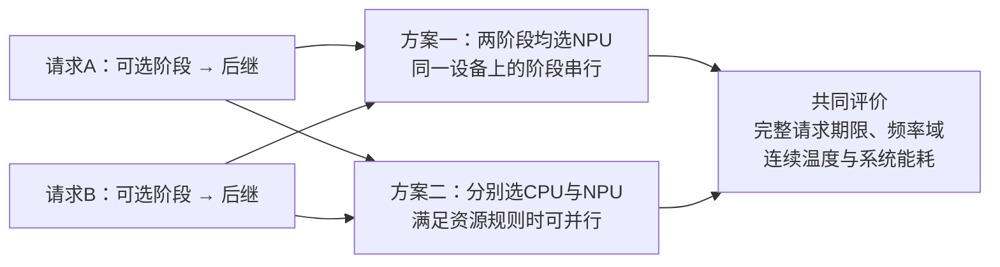
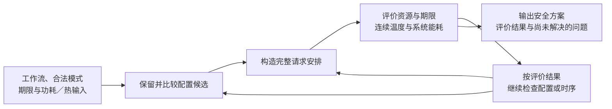

# 端侧推理联合调度研究构想汇报

日期：2026-10-02。用途：导师阅读与研究主线讨论。

## 一、研究对象与应用需求

本课题面向端侧推理工作流，研究多个计算阶段共享CPU、GPU、NPU时的高能效调度。不同阶段具有不同的设备与频率偏好，但局部高能效选择受到资源竞争、完整请求期限和热状态制约。拟通过联合选择执行配置与完整时序，使阶段执行效率转化为满足期限和温度要求的系统节能。

端侧应用的一次请求可以包含多个模型调用及前后处理，只有全部必需输出完成，才算完成该请求。调度前，将实际计算划分为具有依赖关系的计算阶段（Stage），并确定各Stage能够使用的设备及频率—电压工作点。多个请求共同使用平台资源时，一个阶段执行得更快，不一定使整个请求更早完成；一个阶段单独执行时更省电，也不一定使整个工作流能耗更低。

CPU、GPU、NPU在本课题中提供不同的执行选择。CPU按固定执行单元调度，GPU和NPU按设备调度，其内部并行能力体现在阶段响应中。具体设备数量、Stage支持集合和可控工作点由输入给出。研究关注的是这些选择在完整工作流中的价值，不预设NPU总是优于CPU，也不要求每个Stage都能使用三类设备。

期限、温度和能耗承担不同作用：期限约束完整请求何时必须完成；温度约束整个执行过程能否安全采用；能耗用于比较满足上述要求的安排。阶段等待、设备空闲及任务完成后的尾段均在共同评价窗口内计入，不能只比较某个加速器的计算能量。窗口覆盖本次规划的全部期限，具体长度随实验输入确定，不固定为旧实例的数值。

本次研究采用有限、预先已知请求的执行前规划，工作流、精度和Stage划分固定。Stage不可抢占、迁移或执行中改频；共享频率域内同时运行的Stage必须同频，域清空后才可换点。采用确定响应、可加活动功率和零额外交接／切换开销，保留工作点相关基准、温度漏电及耦合热状态。这些是已确认的研究假设，配套实验数据仍需确定。

## 二、核心矛盾与贯穿例子

考虑两个已知请求，各包含一个可选择CPU或NPU的计算阶段及其后继。假设在给定参考条件下，两个可选阶段单独使用NPU时都具有较好的时延和活动能量。若只按局部指标把二者都放到同一个合法NPU设备，该设备的独占规则会使两个阶段串行执行；当它们原本可以同时启动时，排队还可能推迟后继。这里限定的是示例选择的设备，不把一般平台限制为单NPU。

把其中一个阶段放到CPU，可能释放NPU并缩短某条请求路径上的等待，但是否值得这样做，还取决于CPU可用时间、共享频率域、后继期限和完整功耗。若入口热状态偏高，原安排可能超温，替代安排也未必安全；当前较冷的CPU单元同样不保证后续温度和系统能耗更优。

图1　贯穿示意。合法支持及局部偏好是本例的条件，不是已取得的实测结论；图中未给出数值，也不预言方案二更优。GPU保留在一般平台范围中，不要求本例覆盖所有设备。

由此产生第一个研究问题：按照单阶段或单应用指标筛选配置后，是否仍保留了完整工作流中有价值的选择？若提前删除某个CPU模式，后续时序调整无法恢复它；但若所有必要模式已保留，已有联合规划也可能足够处理。因此，需要核查具体筛选规则，而不能从设备竞争直接认定已有方法失效。

第二个问题发生在配置选定以后。不同顺序、并发和等待可能改变功率轨迹、工作点保持时间及温度相关漏电积分；相关积分相同时，系统能耗也可以不变。找到一条安全安排，只说明该配置可以采用，尚未说明其系统能耗已最低。两类问题共同指向：**一个执行选择的价值，应由满足完整请求要求的安排及其系统能耗决定。**

## 三、已有研究与问题入口

已有工作为本课题提供了响应建模、联合规划和热预测工具。NeuOS、JOSS已利用任务特征协调共享配置；HaX-CoNN、Kim已组织映射和完整执行关系；Zhou、F-DTM已考虑温度或温度相关功率。因此，研究动机不能概括为“现有方法只独立优化任务”，也不能以加入NPU、温度或查表本身作为贡献。

| 研究类别与代表 | 已有能力 | 本题需要核查的接口 |
|---|---|---|
| 任务偏好与共享配置：NeuOS[1]、JOSS[2] | 使用层／任务响应评价配置，协调共享频率及并发需求 | 其选择依据适配完整请求期限、固定合法动作和热能耗评价后，是否仍保留有价值的模式 |
| 联合映射与时序：HaX-CoNN[3]、Kim[4] | 联合设备映射与时间线，或生成候选再组合映射和调频 | 原候选指标与本题完整系统评价是否一致；采用全模式联合规划是否已足够 |
| 热预测与能耗：Zhou[5][7]、F-DTM[6] | 温度相关功耗、热预测、前瞻控制及余量分配已有处理 | 相应策略适配本题并发、等待、共享域及热状态后，能否找到低能耗安全安排 |

表1　代表性研究及本题核查入口。来源与正文位置见附录，表中不是全面研究现状或新颖性排名。

例如，Kim先在各处理器最大频率下，按单应用平均时延及处理器平均功率形成候选，再组合应用并调频。这提供了候选组织思路，但其筛选指标是否适合本题的入口热状态、完整注热轨迹和漏电积分，需要重新核查，尚不能断言它已删除本题最优解。Zhou等已有通过余量分配改善温度并减少漏电的研究，同样限制了“调整时序节能”的新颖性表述。

因此，本课题拟从已有方法的具体规则与共同评价之间的关系切入：明确哪些局部信息能够可靠筛选，哪些必须进入完整安排评价；先检验查表、完整复核或重新规划是否足够，再研究仍然存在的质量或成本问题。

## 四、拟开展的核心工作

第三章拟建立任务相关响应下的热约束联合调度模型。输入包括工作流依赖、请求释放和期限、合法执行模式、频率控制关系、功耗参数、入口状态及热网络。决策包括Stage的执行单元、工作点和启动时刻；目标是在完整请求按期完成、资源合法且全过程热安全的条件下，最小化系统能耗。

任务相关响应用于确定各模式的时长和活动功率，可以由测量、函数或模式表提供。模型的意义在于保留阶段差异并把它们放入共同评价，不要求求解器必须调用某个特定公式。第三章拟分析局部偏好在哪些条件下能够保留、何时需要其他配置或时序，以及这些变化是否真正影响有效系统能量。

第四章拟围绕这一模型研究协调求解。配置候选阶段保留合法设备与频率选择，时序阶段依据依赖、资源和期限构造完整安排，评价阶段计算连续温度和系统能耗。若安排超期、超温或能耗仍有改善空间，反馈应指出需要继续检查的配置或时序，而不能把一条时间表失败直接等同于整个配置不可用。

图2　拟研究的信息流。表示方法组织，不预定算法名称、搜索规则或停止证明。

第一个问题统领“哪些资源与工作点选择值得保留和比较”，第二个问题解释“怎样确定这些选择的可实现能耗”。两章使用同一合法动作空间和评价模型。后续拟贡献分为三项：统一阶段模式与完整安排的评价关系；核查局部选择依据对系统决策的影响；据此研究配置与时序的求解组织。其价值分别需要模型对照和方法对照支持，普通模块串接不能直接算作算法创新。

小规模质量参照与完整热复核继续保留，现有候选方法也作为强替代。新功耗模型下，同配置能量不再必然固定，旧安全配置关闭、能量界和固定系数热反馈需要适配；这些接口变化提供具体研究任务，但尚不证明适配后一定需要新算法。

## 五、已有支撑与当前缺口

目前已有三类有限证据。第一，旧四Stage实例的独立核验表明：宽期限下，任务相关响应的已证最优能量为37.125／42.625 mJ，统一反比规划最优安排在共同响应模型中回放为38／44 mJ；紧期限下两者仍为38／44 mJ。它说明响应刻画可以影响可实现的系统选择，也保留明确的无变化条件。[证据E1](60_四Stage响应模型解析证书独立核验.md)

第二，一项热态实例中，原无热最优配置由104个收缩为80个可保留配置，最低能量仍为44 mJ。第一条无热代表超温，简单完整后缀复核找到安全代表并达到同域参考。它说明热可行性影响配置能否采用，却不必提高最低能量，也说明简单方法在所测条件下可以足够。配置计数包含对称CPU标签。[证据E2](55_四Stage任务首轮验证.md)

第三，限定入口热压力下，完整赋值排除与固定时刻热反馈分别取得26/32次和30/32次预算内安全输出，双方共同成功的26个配对能量相同。部分条件减少轮次和耗时，也有零反馈条件。它支持利用完整违规信息继续研究求解组织，不支持普遍加速或节能结论。[证据E3](78_入口热压力下连续热反馈对照.md)

这些结果均属于旧CPU–NPU、抽象数值和声明启动网格，不是设备实测，也不是当前三设备、温度漏电模型的验证。当前尚缺同一工作负载的模式响应、工作点基准、漏电系数和匹配热参数，尚未证实候选筛选损失或同配置不同安全时序的能耗差。已有实验是构想的支撑，新模型和方法仍须单独适配与验证。

## 六、验证路线与导师讨论事项

后续验证分三步。先在共同工作量、合法域、期限和热评价下，比较局部配置依据与完整评价是否产生实际选择或能耗差异；保留选择不变、并列和不可行情形。再检验全模式联合规划、完整热复核及简单合法时序调整能够处理到哪里，避免把已有工具足够解决的关系继续复杂化。

只有发现明确的剩余问题，才比较拟方法的解质量、预算内安全输出和求解成本。各方法使用相同信息与评价边界，失败或超时不算不可行，不能仅凭某个旧实现枚举慢就认定普遍瓶颈。若共同评价已取得可靠最优，便保留该结论并收缩方法主张。

数据准备需逐项区分实测、文献复用和抽象设定。若没有匹配实机数据，可以开展声明条件下的研究，但不能拼接不同平台参数称为设备复现；这项限制也应进入论文贡献判断。

本次希望与导师重点讨论三件事：以“局部执行效率如何转化为系统节能”为主线是否具有研究价值；联合模型与协调求解能否形成两章实质工作；应优先补齐哪项输入或完成哪项针对性验证。当前汇报用于确定研究构想，不预定新的实验数值和算法组件。

---

## 附录A：基础假设与必要数学表达

基础规则以[86号R86-v1](86_实验基础模型与假设确认总表.md)为唯一维护入口；本附录只说明正文依赖的条件，不另建模型版本。

- 固定工作流、模型／精度／划分；有限已知请求的执行前规划。一般规模不限于两请求或四Stage，不恢复多场景共享部署。
- CPU固定执行单元，GPU/NPU设备级调度；合法支持、资源数量、控制域与热节点分别输入。每执行单元同时一个Stage，设备内部并行已包含在响应中。
- Stage不可抢占、迁移或执行中改频；共享域忙时不切点，同频可合法并发。入口工作点给定，空闲及尾段保持上次工作点，不优化休眠或空闲任意调频。
- 确定响应和可加活动增量；基准按计量组去重，保留局部线性温度漏电。零额外交接／切换开销不删除原有计算、等待功耗或依赖。
- CPU按固定执行单元区分热状态，GPU/NPU按设备级表示，保留必要耦合。计量组功率与热节点、代表温度的映射需有配套依据；不从整机功率任意拆分。
- 共同固定窗口覆盖全部期限，连续温度检查包含等待及空闲尾段；窗口之后不提供持续安全保证。一般启动时刻连续，有限网格是另行声明的受限版本，只离散起点、不取整时长及结束。

记完整配置为 \(m\)、启动安排为 \(s\)，Stage模式时长与活动增量分别为 \(d_i(m_i)\)和 \(q_i(m_i)\)。计量组 \(b\)的保持工作点为 \(f_b(t)\)、代表温度为 \(T_b(t)\)。若计量组跨多个频率控制域，\(f_b(t)\)表示对应的工作点向量；代表温度由明确的热状态映射给定。在声明的有效温区内，系统能量表达为

\[
E(m,s)=E_{\mathrm{ext}}+\sum_i q_i(m_i)d_i(m_i)
+\sum_b\int_0^W\left[B_b(f_b(t))+\lambda_b(f_b(t))(T_b(t)-T_{\mathrm{ref}})\right]\,dt.
\]

其中 \(E_{\mathrm{ext}}\)为固定窗口内热边界外公共能量；\(B_b\)为参考温度下基准功率，\(\lambda_b\)为温度系数。\(d\)、\(t\)、\(W\)单位为s，\(q\)、\(B\)为W，\(\lambda\)为W/K，能量为J；温差可采用一致的K或°C差值。功耗在有效范围内须非负，基准和漏电不重复计入。固定配置只确定活动能量和，基准保持与漏电积分仍可能依赖时序；若基准恒定且温度系数为零，则恢复旧固定配置能量特例。

记 \(\mathcal S_T(m)\)为配置 \(m\)的全部同域合法、按期、热安全安排，则

\[
V(m)=\inf_{s\in\mathcal S_T(m)}E(m,s),\qquad
V(m)=+\infty\ \text{当}\ \mathcal S_T(m)=\varnothing.
\]

联合问题为 \(\inf_m V(m)\)；非空有限网格域上可用min。资源选择问题关注保留和比较哪些配置，时序评价问题关注其V怎样取得或界定。一条安全安排只提供上界，单条违规安排不能排除整个配置。可靠排除与最优状态需要独立有效依据，不由求解器退出标志或有限尝试耗尽自动得到。

线性RC中加入温度功率后，传播矩阵可能随工作点历史变化。旧固定选项的仿射热行及冻结二节点误差包络不能直接继承；是否还能生成对全部安排有效的反馈约束，需要在模型适配时核查。这里不预定MILP、求解器或第四章具体搜索实现。

## 附录B：代表文献与已核位置

正文文献事实复用[90号§3、§8](90_联合框架证据比较与主线收敛.md)已有原文核查，本轮不新增检索。下表是本次论证采用的代表材料，不是完整国内外研究现状。原文条件不直接变成本课题设备事实。

| 编号 | 文献及可核查入口 | 正文定位与本报告用途 |
|---|---|---|
| [1] | Bateni、Liu，*NeuOS: A Latency-Predictable Multi-Dimensional Optimization Framework for DNN-driven Autonomous Systems*，USENIX ATC 2020；[本地全文](<../papers/2020_NeuOS_A_Latency-Predictable Multi-Dimensional.pdf>)、[作者会议入口](https://www.usenix.org/conference/atc20/presentation/bateni) | §3.1、§3.3、§4.1—4.3，算法1—2：逐层偏好、LAG及共同配置；不继承动态精度或资源宽度 |
| [2] | Chen等，*JOSS: Joint Exploration of CPU-Memory DVFS and Task Scheduling for Energy Efficiency*，2023预印本v1；[固定正文](https://arxiv.org/html/2306.04615v1) | §4.2—4.3、§5.2—5.3：任务响应、共享基准及频率协调；不是本题三设备参数源 |
| [3] | Dagli、Belviranli，*Shared Memory-contention-aware Concurrent DNN Execution for Diversely Heterogeneous SoCs*，PPoPP 2024；[本地全文](../papers/2024_Dagli_HaX_CoNN.pdf)、[DOI](https://doi.org/10.1145/3627535.3638502) | §3.1—3.5、§5.2：联合映射和时间线；其争用／交接能力如实保留，本题不恢复相关机制 |
| [4] | Kim、Ha，*Energy-Aware Scenario-Based Mapping of Deep Learning Applications Onto Heterogeneous Processors Under Real-Time Constraints*，IEEE TC 2023卷期／2022在线；[本地全文](../papers/2023_Kim_Energy_Aware_Mapping.pdf)、[DOI](https://doi.org/10.1109/TC.2022.3218991) | §5.1—5.2.4、表3、算法1—3：参考最大频率条件下的单应用候选与后续组合；不认定本题已经发生候选损失 |
| [5] | Zhou等，*Thermal-aware correlated two-level scheduling of real-time tasks with reduced processor energy on heterogeneous MPSoCs*，JSA 2018；[本地全文](../papers/2018_Zhou_Thermal_Heterogeneous_MPSoC.pdf)、[DOI](https://doi.org/10.1016/j.sysarc.2017.09.007) | §3—5：映射、DVFS及温度漏电；统一周期缩放、共同期限和热独立不自动继承 |
| [6] | Maity等，*Future aware Dynamic Thermal Management in CPU-GPU Embedded Platforms*，RTSS 2022；[本地全文](../papers/2022_F-DTM_RTSS_Future_aware_Dynamic_Thermal_Management_in_CPU-GPU_Embedded_Platforms.pdf)、[DOI](https://doi.org/10.1109/RTSS55097.2022.00041) | §III、§IV-A—C，式(2)—(6)、算法1—3：未来内核、耦合RC及温度功率；目标、内核动作空间与本题不同 |
| [7] | Zhou等，*Thermal-Aware Task Scheduling for Energy Minimization in Heterogeneous Real-Time MPSoC Systems*，IEEE TCAD 35(8):1269—1282，2016；[作者公开正式版](https://chinagator.github.io/papers/J16.pdf)、[DOI](https://doi.org/10.1109/TCAD.2015.2501286) | §II、§IV、§V，命题2、算法2：固定工作点下温度余量与漏电优化；稳态条件不替代本题瞬态轨迹 |

师兄论文用于学习“问题—模型—方法—实验”的组织和章节衔接；多场景、共享部署及加入NPU不移植为本课题独有贡献。写作采用[项目指南](论文写作风格指南.md)，先说明需要，再引入概念，技术细节和历史追踪集中于附录。

## 附录C：历史结果入口与本次交付范围

| 证据 | 原始入口 | 本报告采用的结果与限制 |
|---|---|---|
| E1，模式代价 | [60号§3—5](60_四Stage响应模型解析证书独立核验.md) | 两个宽期限共同评价差值0.875／1.375 mJ；紧期限差值0。核验已有证书，不是新算法自主搜索，也不证明候选覆盖损失 |
| E2，完整可行性 | [55号§3.1](55_四Stage任务首轮验证.md) | P_high_D6_hot，104→80，仍44 mJ，第二完整后缀代表安全。计数含CPU标签；其宽期限枚举未决不写作基线失败 |
| E3，求解反馈 | [78号§2、§4](78_入口热压力下连续热反馈对照.md) | 正式16条件各两次，每方法32次独立60 s调用；26→30安全输出，共同成功26配对能量相同。零反馈及无输出条件保留，不作统计稳定性或实机收益推断 |
| 当前条件结构 | [86号§5](86_实验基础模型与假设确认总表.md)、[90号§5—7](90_联合框架证据比较与主线收敛.md) | E(m,s)及旧接口适配需求属于条件推导；新模型数据、实现、候选损失和同配置能耗差均待验证 |

本次仅形成导师汇报稿，并同步研究状态和证据记录。基础版本仍为R86-v1，不改正文、程序、输入及历史结果，不运行实验、不新增文献筛选。后续先审阅汇报主线与工作量，再确定一项需要补齐的证据或验证任务。
