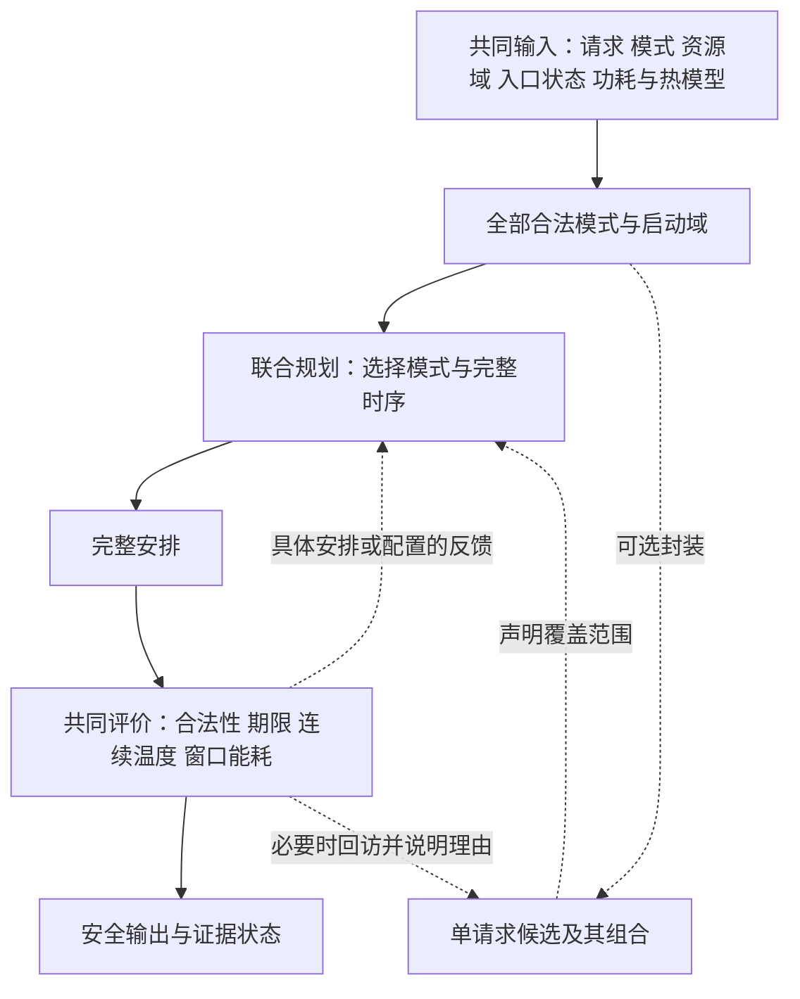

# 端侧推理配置选择与完整时序联合规划框架

日期：2026-10-02。基础版本：**R86-v1**。本报告定义研究问题、候选层次和评价接口，不新增基础假设，不冻结数值，不设计具体算法，不运行实验。

## 1．研究主线：先定义共同问题，再选择求解组织

**研究固定端侧工作流中Stage的执行设备、工作点和执行时序如何共同决定完整请求的能耗与可行性。** 不同Stage可以偏好不同设备或频率；多个请求共同执行时，这些局部选择还要接受资源竞争、后继期限、频率域和热状态的共同评价。目标是在完成相同工作量、满足请求期限和温度限制的条件下，降低固定窗口内的系统能耗。

这一表述对应题目中的四项内容：端侧推理提供工作流、合法设备支持及阶段响应；任务调度决定资源、工作点和执行时间；温度参与配置与安排选择；高能效以完整系统能耗评价。GPU保留在一般平台范围，具体任务不必同时使用全部设备类型。

用户已选择92号的A方向，并进一步确认**先定义完整联合问题**。因此，本报告首先保留全部合法模式及安排；“候选库—组合—完整评价—反馈重选”只是一种可研究的求解组织，不预设两阶段结构、Pareto规则、搜索算法或求解器。B方向的完整热能耗评价作为共同问题的一部分，不另开研究分支。

当前准备研究的具体接口是：**局部候选信息是否足以支持完整请求价值判断；评价结果应以什么证据和范围影响后续选择？** 本报告给出这个接口的含义与边界，没有证明现有方法已发生候选误删，也没有把多个模块组合认定为创新。

## 2．四个层次：模式、单请求配置、全请求配置与完整安排

### 2.1 输入、选择与评价结果分开

设已知请求集合为\(\mathcal R\)，请求\(r\)包含Stage实例集合\(I_r\)，所有Stage实例组成\(I\)。同一工作流的不同请求有各自的Stage身份、释放时间与期限；重复计算可以共用有依据的响应参数，但**不强制共用执行模式、映射或时间安排**。

每个Stage实例\(i\)的合法模式集合记为\(\Omega_i\)。模式\(m_i\)指定一个具体执行单元和该单元的合法工作点，模式表给出\(d_i(m_i)\)和\(q_i(m_i)\)：前者为执行时长，单位s；后者为活动增量功率，单位W。它们是输入参数，选择\(m_i\)是决策。工作点对应合法频率—电压组合，不把电压另作任意自由变量。

\(q_i\)不是整个设备的总功率，也不包含随完整轨迹变化的全部漏电能量。一个模式可以来自测量、响应模型或明确的条件设定；同一模式表给定后，规划器使用同一组参数。任务相关响应保留为输入组成，不要求规划器在搜索时重新计算某个特定响应公式。

| 层次 | 本报告的定义 | 已固定什么 | 仍未固定什么 |
|---|---|---|---|
| Stage合法模式 | \(m_i\in\Omega_i\)：具体单元＋合法工作点，附模式响应 | 单个Stage的资源、工作点、时长及活动增量 | 启动时刻、与其他Stage的关系、完整温度和系统能量 |
| 单请求配置候选 | \(m_r=(m_i)_{i\in I_r}\)：该请求全部Stage的模式向量 | 该请求各Stage模式 | 起点、可调整的次序／等待，与其他请求的共同安排 |
| 全请求配置 | \(m=(m_r)_{r\in\mathcal R}\)：所有实例的模式向量 | 全部Stage模式 | 同一配置下的全部合法时序及其能耗差别 |
| 完整安排 | \(\sigma=(m,s)\)，其中\(s=(s_i)_{i\in I}\) | 模式与起点，因而导出结束、资源顺序、并发及等待 | 是否满足完整约束、能量与热轨迹须据共同输入核查 |

“单请求配置候选”是便于组织求解的封装，不增加新的物理决策。若它附带一条单独执行时间表，该表只是代表安排或评价样本，不能变成所有组合必须沿用的唯一起点。

### 2.2 全部合法模式构成原始域

\[
\mathcal M_r=\prod_{i\in I_r}\Omega_i,\qquad
\mathcal M=\prod_{r\in\mathcal R}\mathcal M_r.
\]

\(\mathcal M\)包含全部模式组合，**不保证每个组合都存在共同可行安排**。后端不支持、工作点不合法等可以从\(\Omega_i\)中排除；资源冲突、期限或热约束则通常要结合多个选择及安排判断。

一种方法可以只保留\(\mathcal C_r\subseteq\mathcal M_r\)，再从其组合中选择。此时必须说明候选库覆盖了什么、遗漏了什么，以及是否允许重新进入原始域。局部代价较差、暂时未被搜索、某次组合失败，不会自动使原本合法的模式成为非法模式。

CPU单元身份、设备身份与工作点均保留。只有在响应、资源／域、入口热状态、耦合和其他输入均满足相应对称条件时，才可另论等价；本轮不默认对称剪枝，不把换CPU编号写成映射收益。

## 3．完整联合问题

### 3.1 共同输入与必要约束

基础规则以[86号总表](86_实验基础模型与假设确认总表.md)为唯一维护入口，93号只提取本框架所需接口。

| 输入组 | 必需内容与用途 |
|---|---|
| 请求与任务图 | 有限已知释放、绝对期限、固定Stage划分、依赖及全部必需输出；确定完整请求何时完成 |
| 模式与资源 | 每Stage支持集合、具体CPU单元／GPU／NPU设备、合法工作点、时长与活动增量；确定可选动作及占用 |
| 控制关系 | 单元—频率域关系、入口工作点、域忙不换点及空闲保持政策；确定并发和切换合法性 |
| 功耗与计量 | 工作点相关基准、温度漏电系数及有效温区、公共功率边界、计量组与代表温度；避免基准重复 |
| 热系统 | 耦合RC、功率注入与温度映射、入口温度、环境和节点上限；决定完整轨迹 |
| 评价域 | 共同窗口\(W\)、启动域及判定精度；限定比较和证明范围 |

给定模式与启动时刻，结束时刻为\(c_i=s_i+d_i(m_i)\)，不因起点采用网格而取整时长或结束时刻。请求完成时间取其全部必需汇点的最晚结束，不能用某个NPU阶段完成代替完整请求完成。

| 约束 | 本框架中的含义 |
|---|---|
| 唯一选择与执行 | 每Stage选一个合法模式；一次执行完成，不抢占、不迁移、不在执行中改点 |
| 释放与依赖 | 不早于请求释放；全部必要前驱结束后才能开始；额外交接为零仍保留真实计算与依赖 |
| 执行单元 | CPU固定单元和GPU／NPU设备按R86独占；不同资源允许合法并发，区间采用\([s_i,c_i)\) |
| 频率域 | 同域重叠Stage必须同频；域有工作期间不换点，域清空后可瞬时换点；不得改写正在执行Stage的响应 |
| 请求期限与窗口 | 全部必需输出在请求期限内完成，执行及评价落在声明窗口；等待和尾段仍需计量 |
| 热安全 | 从给定入口状态传播，在整个\([0,W]\)满足各节点上限，包含段内峰值与空闲尾段 |

一般问题采用连续起点。未来使用网格时，须显式声明受限启动域并让比较双方一致；本轮不继承旧1 ms、20 ms窗口、能量格值或60 s预算。

### 3.2 系统能量由完整轨迹决定

\[
E_{86}(m,s)=\int_0^W P_{\mathrm{sys}}(t;m,s)\,\mathrm dt.
\]

系统功率按R86由各计量组的工作点相关基准、局部线性温度漏电、运行Stage的活动增量及边界外公共功率组成。基准在相应计量组只计一次；活动增量按实际执行单元汇入匹配热节点，公共功率是否注热遵守计量边界。CPU单元可共享频率或计量组，但不因此共享同一个热状态。

给定\(m\)只确定活动能量和\(\sum_i q_i(m_i)d_i(m_i)\)。启动、顺序和等待还可能改变各域工作点保持的时间及温度漏电积分，因此完整能量一般是\(E(m,s)\)。等待仍耗电、较早完成仍有尾段；不能仅用峰温更低或完成更早替代能量比较。也不能把逐请求独立计算的窗口能量相加，因为共享基准和共同热历史尚未正确处理。

温度由同一完整安排的功率和RC系统共同决定。漏电系数随工作点变化时，等效热状态矩阵也可能变化；本报告不继承旧恒定功率模型的固定热系数、配置关闭规则或下界。具体传播、连续峰值与误差处理尚须按R86适配，不能把93号的接口定义当成已有实现。

### 3.3 共同优化与配置价值

令\(\mathcal S_{86}(m)\)为给定配置下满足上述全部约束的时序集合。完整问题的最优值写为：

\[
E^*=\inf_{m\in\mathcal M,\ s\in\mathcal S_{86}(m)}E_{86}(m,s),
\qquad
V_{86}(m)=\inf_{s\in\mathcal S_{86}(m)}E_{86}(m,s).
\]

空可行集的值记为\(+\infty\)。连续域采用下确界，避免未经证明就假定最优一定取得；有限且非空的网格可行集可用最小值。这是同一联合问题的两种观察方式，不规定必须先配置、后时序求解。

找到一条安全安排只能得到\(V_{86}(m)\le E_{86}(m,s)\)。如果存在可信下界并与该能量闭合，才可在相应范围报告最优。不能把旧恒定基准下的独立Stage能量下界直接搬入R86，尤其不能未经证明删去按参考温度定义、可能取负值的漏电修正项。

## 4．框架继承：已有能力与拟研究接口

| 来源及原文能力 | 可借鉴内容 | R86下的必要适配 | 尚待研究的关系 |
|---|---|---|---|
| HaX-CoNN §3.1—3.5：层组映射、依赖、时间线、设备冲突及共同评价；公开示例有等待与次序变量 | 用模式和起点共同表达一个完整安排，借鉴约束组织与profile流程 | 按R86设备／工作点支持、释放／期限、频率域和热能耗目标重建对应约束；不加入争用慢化、转换开销或示例切换次数限制 | 这一完整规划能力如何接收不同候选组织，是否已有足够质量与可接受成本 |
| Kim §5.1—5.2、算法1—3：单应用候选、组合评价、组合内调频和期限检验 | 组合表示、测量与评价分离、既有候选库内的组合重选与嵌套评价 | 原候选含网络切分／整应用驻留映射，频率在内层选择；本题单请求候选已含逐Stage工作点，二者不能直接等同 | 局部候选信息在完整资源与热能耗评价下是否足够；何时有必要保留或回访更多选择 |
| R86及既有热模型资料 | 工作点、共享域、入口状态、计量和完整热动力学的共同输入 | 三设备／多单元热状态、保持工作点与温度漏电尚须匹配参数及实现 | 哪些反馈只是安排调整，哪些需要改变模式，何种结论足以排除某一范围 |
| MEDEA的模式选择与目标化简，作为辅助参照 | 局部代价压缩、紧凑联合模式优化及简单成本修正的思路 | 不引入tiling、休眠或固定串行顺序；原标量成本不能自动代表R86窗口能量 | 成本可分离时直接查表／改成本是否已足够，避免过早设计复杂反馈 |

上述继承是问题表达和方法工具的借鉴，不是原算法完整复现。Kim已有内层调频与期限反馈，HaX已有时间决策，Zhou也已有热失败后的重新分配；因此不能把“增加反馈”“映射加时序”“增加温度”分别当作已成立的新贡献。

HaX公开代码只用于确认变量表达能力，92号已登记示例时间约束、切换限制与dummy数据的边界，不能据此认证新实现。Kim原平台中的CPU前后处理与GPU／DLA推理支持，也不证明本题每个Stage都能跨三类设备替代。

## 5．规划、评价与反馈接口

### 5.1 接口职责，不预设实现分层

完整联合问题可以由一个规划器直接处理，也可以通过候选组合、完整安排评价及必要回访逐步处理。下图划分的是职责；虚线部分是可选组织，不是93号已选定的算法。

反馈发生在**执行前的规划过程**。这里的入口温度是已知输入，后续热状态由模型预测；不引入未知在线到达或运行期迁移／调频。某种未来实现若采用单体联合求解，仍须满足同一输入、评价和输出约定，无须人为拆出一个候选库。

| 接口 | 输入 | 输出 | 必须保留的边界 |
|---|---|---|---|
| 合法模式与候选封装 | 原始模式表、Stage身份、工作流关系 | 全部合法域；可选的单请求候选及覆盖说明 | 合法性排除、启发式裁减、未搜索三者分开；封装不固定时序 |
| 完整规划 | 全域或显式候选子域，全部请求信息、资源／域及完整评价输入 | 完整安排，或附范围的求解／排除／未决状态 | 给定配置的查询与可改模式的查询须区分；保留等待、合法并发和其他资源次序 |
| 共同评价 | 完整模式与起点、相同入口温度／工作点、窗口及参数 | 合法性、各请求完成时间、能量、逐节点峰温及发生时刻、数值状态 | 不补做搜索或暗改输入；完整安排不合法时，不作为有效能量比较对象 |
| 反馈与证据登记 | 评价结果、已覆盖域和已有证明／界 | 可继续调整的对象、带作用范围的排除或优先级信息 | 反馈结论不得强于证据；观察到冲突不等于证明某个模式永远无价值 |

共同评价器必须区分“输入缺失／不适用”和“模型内不可行”。例如缺少某模式热参数，属于输入未齐；不能把它悄悄当成不允许使用的设备。未来需要报有效能量时，只接受完整、合法且明确热安全的方案；部分轨迹可供规划诊断，不充当完整请求输出。

### 5.2 候选至少传递什么

若使用单请求候选，每项至少保留请求及Stage身份、各Stage具体模式、关联依赖和原始参数引用。独立时延、活动能量或一条代表安排可作为附加信息，但要注明条件和作用：**估计、排序信息、见证或证明不能混用。** 不要求本轮设计紧凑摘要、缓存格式或评分函数。

联合规划仍读取其他请求、共享资源／域、入口状态和共同热模型。单请求温度终态不是可随意拼接的接口：请求可能交错执行，热状态又有耦合，不能分别计算后简单连接。类似地，各请求单独可行，不推出共同可行。

如需用摘要代替完整信息，后续必须说明它保留了哪些可行性与目标关系；目前不假定“局部能量＋时延”已经充分。多个共享域和计量组的状态也不能无说明压成单一频率或单一温度。

### 5.3 反馈能够支持哪些动作

| 返回状态／证据 | 可以据此做什么 | 不能推出什么 |
|---|---|---|
| 一条完整合法安全安排 | 保存见证及能量上界；继续比较其他安排或配置 | 不证明该配置或全局最优，不要求立即关闭配置 |
| 该安排资源／域冲突或超期 | 丢弃或调整此安排，考虑换序、等待、改模式 | 不证明同配置全部安排失败；也不证明某请求候选永远不能使用 |
| 该安排明确超温 | 调整此安排或探索其他模式；记录违反节点、时刻与共同状态 | 不把高温节点自动解释为某Stage单独导致；不据一表排除配置 |
| 某一完整配置已被证明无可行安排 | 排除这一配置及证明明确覆盖的范围 | 不能自动删除组成它的单请求候选；换其他请求配置后可能可行 |
| 一个明确子域被证明无可行安排 | 排除该子域；保留域外组合 | 不能把子域结论扩大成原始全域无解 |
| 预算内未找到完整安全安排 | 记录已查范围和未决；可选择继续或转查其他候选 | 不等于不可行，不支持永久删除 |
| 热判断或其他数值结论未分辨 | 保留候选及数值状态，禁止据该判断接纳安全或排除 | 不能用温度容差替代可靠判定，更不能修改温限求过关 |
| 有独立依据的能量下界 | 与同范围的安全上界比较，支持有证据的非改进或最优判断 | 不能由局部预测、未认证内部界或旧模型下界自动取得 |

反馈可以改变下一次尝试的优先级，即使尚不支持严格排除；采用这种启发式时应如实标记。将“优先尝试其他配置”和“证明当前配置无价值”分开，才能比较方法的质量和证据能力。

### 5.4 覆盖与停止状态

输出分开登记原始域、实际允许搜索的候选域、已查部分和未决部分。候选耗尽但其只覆盖原始域的一部分时，最多说明该候选域的结果；即便候选域内已证最优，也不自动得到原始问题最优。

覆盖状态、数值状态和预算状态分别记录。例如可以同时“已有安全解、候选覆盖不完整、预算结束”；不能用一个“成功／失败”字段遮蔽这些差别。当前不规定如何枚举、缓存或维护这些状态，只要求未来方法准确说明其输出范围。

## 6．贯穿例子：局部NPU偏好怎样进入完整评价

考虑已知请求A和B，各含一个可选择CPU或同一NPU设备的Stage \(X_A,X_B\)，以及必须完成的后继 \(Y_A,Y_B\)。示例假设两请求的可选Stage单独使用NPU时，时延和活动能量较好；后继使用输入表允许的CPU模式。该支持关系是条件设定，没有指定真实网络、数值或实验规模，也不把一般平台限定成单NPU。

| 步骤 | 要作的判断 | 本例说明什么 |
|---|---|---|
| 局部模式比较 | 查看\(X_A,X_B\)在合法CPU／NPU模式下的时长和活动增量 | 形成偏好或排序信息，不直接认定完整系统最优 |
| 组合选择 | 两者都选同一NPU，或者一个改选CPU | 都选NPU须按独占规则排队；分开设备可能形成并发，但CPU替代也会占用后继所需资源 |
| 完整时序构造 | 决定谁先用NPU、后继何时执行、哪些Stage可并发或等待 | 不能只看NPU计算结束，要看\(Y_A,Y_B\)及各自完整请求期限 |
| 频率域核查 | 若所选CPU单元共享频率域，检查重叠Stage是否要求同频 | 不合法的异频并发可尝试错开或换模式，不能改动运行中Stage的频率 |
| 热与能耗评价 | 从共同入口状态传播完整轨迹，计入基准、漏电、等待及尾段 | 热安全、完成更早、能量更低是不同判断；较冷CPU也未必是更优替代 |
| 根据结果继续选择 | 调整同配置的顺序／起点，或换工作点／设备，再共同评价 | 一次失败可能需要调时序，也可能需要改配置；没有提前规定哪一种必然有效 |

例如，入口NPU温度较高时，两个NPU阶段连续执行的安排可能超温；合法等待能否解决，要连同后继期限检查。若等待仍满足期限且能量合适，已有完整复核与调整就可能足够。若CPU替代可提供另一条安全路径，应比较完整能量，而不能凭“转移到较冷设备”直接宣布节能。

这段例子没有证明双NPU选择一定较差，也没有证明必须扩大候选库。资源竞争、共同规划及反馈已有文献先例；它的用途是让候选层次和接口可理解，研究差异仍须落到具体评价条件与求解组织。

## 7．单一研究问题、强替代与两章衔接

### 7.1 H93：局部候选信息与完整选择的一致性

> **在R86规定的完整联合问题中，局部候选信息是否足以支撑完整期限与热能耗下的配置选择；若不足，完整评价需要反馈什么信息，才能支持合理重选？**

这里的“反馈”指完整评价怎样影响后续决策，可以在同一联合规划器内部完成。若直接完整规划已经足够，不要求另设候选库或外层反馈回路；研究仍以资源／工作点与完整时序的共同组织为主线。

这里允许三类结果：局部组织已经足够；简单补充信息／回补已经足够；仍存在值得研究的决策或求解问题。提出问题无需先证明某个旧算法错误，最终贡献也不能停在“接入更多模块”。

设一种方法保留的全请求候选域为\(\mathcal C\subseteq\mathcal M\)，在同一完整评价下其最优值为\(E^*_{\mathcal C}\)。若在候选域内取得安全见证、能量为\(U\)，则：

\[
E^*\le E^*_{\mathcal C}\le U.
\]

这只给出限制候选后可能损失的方向，不证明严格差距。等号可能成立，也可能只是两个不同配置具有相同价值。将一个局部代表的预测值当成\(V_{86}(m)\)，或把搜索未完成造成的差距归给候选模型，都不成立。

### 7.2 保留的两类强替代

| 对照能力 | 承担的职责 | 比较时需要防止的混淆 |
|---|---|---|
| 全部合法模式＋已有联合规划 | 在相同问题中保留完整动作空间；可用来检查候选组织是否限制了有价值选择 | 是能力要求，不宣称旧HaX或现有本地程序已支持R86；未取得完整求解证明时，不冒称精确参考 |
| 候选库＋完整复核＋简单回补／重新规划 | 检查最小反馈是否已经解决接口问题 | 不能故意只允许等待、禁止原有改配能力；具体回补规则需后续明确，不在本轮预设弱基线 |

未来比较共同使用相同工作量、合法支持、响应、释放／期限、启动域、入口、功耗／热模型及窗口。候选生成、评价、回补和必要预计算的成本应一并交代；预算后续单独制定，本轮不设数字。

模型修正与方法效果分别核查：前者比较评价关系怎样改变决策，后者在同一R86模型上比较安全解质量、求解成本及证明范围。仅因某方法采用更弱热模型、更少动作或预算外候选库而取得的差异，不能混成方法优势。

### 7.3 两章各自承担什么

| 章节 | 实质工作 | 目前已具备／仍待研究 |
|---|---|---|
| 第三章：任务相关响应下的端侧推理联合规划 | 明确合法模式、资源／频率域、完整请求及热能耗关系；定义同一评价问题与可比较参照；分析局部配置评价何时足够、何时需要完整评价 | 已有R86基础规则、成熟框架与本报告接口；配套数据、新模型实现和具体条件证据仍待补齐 |
| 第四章：配置选择与完整时序的协调求解 | 在第三章同一域内研究候选组织、完整规划和必要反馈，说明采用何种信息、保留何种能力及取得何种质量／成本取舍 | 已有可借工具；候选裁减、反馈规则、最终算法与性能贡献未定 |

二者通过同一输入、合法动作和评价器衔接，不把B另立为新的物理机制题目。可用的保守构想是“建立共同评价关系，并研究使局部选择与完整请求价值一致的求解组织”；尚不能写成“提出新算法并显著节能”。如果通用联合规划或简单回补已足够，按这一结果收敛方法主张。

## 8．纸面验收、资料缺口与完成边界

### 8.1 纸面情形核对

下表是概念与接口审查，不是执行过的测试或新实验结果。

| 情形 | 93号必须给出的解释 | 核对位置 |
|---|---|---|
| 局部偏好与全局选择相同 | 允许候选组织无损、简单方法足够；不为寻找差异调参 | §7.1—7.2 |
| 局部偏好与完整评价不同 | 记录完整期限／资源／热能耗条件；先排除搜索覆盖和信息不同的混淆 | §5、§6、§7.2 |
| 两个配置并列 | 改选配置不等于能耗收益；对称换标号不自动算映射收益 | §2.2、§7.1 |
| 单请求分别可行，组合冲突 | 重新核查资源、共享域、期限及共同热状态，不能直接拼接局部表 | §5.2、§6 |
| 同配置一表失败、另一表可能安全 | 保留未被证明排除的时序；不删除整个配置 | §5.3 |
| 某全请求组合已证不可行 | 排除该组合；单请求候选与其他组合仍可能有效 | §5.3 |
| CPU同域异频重叠／NPU排队 | 按R86处理冲突，允许合法错开、换序或重新选模式 | §3.1、§6 |
| NPU阶段按时，后继超期 | 按完整请求完成判违约，不能以中间结果代替请求完成 | §3.1、§6 |
| 一条安全安排 | 记录能量上界；不自动关闭同配置能量搜索 | §3.3、§5.3 |
| 预算结束或热判断未分辨 | 分列预算、数值与覆盖状态；不能升级成安全或无解证明 | §5.3—5.4 |
| 候选域内无解或最优 | 结论限定候选域；没有覆盖／证明不能扩大到原始全域 | §5.4、§7.1 |
| 输入热参数缺失 | 记输入未齐；不静默删模式，也不据此认定模型无解 | §5.1 |

可以的，就按照这个顺序推进，如果可以的话，我建议你将目标分阶段的进行，也就是分为多个小目标。不然我担心你容易跑偏或者出现幻觉，但是这方面我也不太懂，你可以根据官方文档或者网上资料看怎么样操作是比较好的

### 8.2 文献依据与下载用途

本轮复用92号已核正文，不新增文献筛选。主要来源为：

| 来源 | 本报告使用的范围 |
|---|---|
| [R86-v1](86_实验基础模型与假设确认总表.md)，§2—5 | 本题输入、执行与评价规则；是已确认研究假设，不是匹配设备实测 |
| [92号](92_成熟框架决策边界与联合建模入口筛选.md)，§3—5 | Kim／HaX等的能力与迁移边界、候选选择及原文定位 |
| Kim、Ha，*Energy-Aware Scenario-Based Mapping of Deep Learning Applications Onto Heterogeneous Processors Under Real-Time Constraints*，TC 2023／2022在线；[本地全文](../papers/2023_Kim_Energy_Aware_Mapping.pdf)、[DOI](https://doi.org/10.1109/TC.2022.3218991) | §5.1—5.2、表3、算法1—3；不继承原跨场景、抢占、切分及候选定义 |
| Dagli、Belviranli，*Shared Memory-contention-aware Concurrent DNN Execution for Diversely Heterogeneous System-on-Chips*，PPoPP 2024；[本地全文](../papers/2024_Dagli_HaX_CoNN.pdf)、[DOI](https://doi.org/10.1145/3627535.3638502) | §3.1—3.5及92号已核[公开求解入口](https://github.com/ismetdagli/HaX-CoNN/blob/ismet-dagli/src/z3_solver_multi_dnn.py)；只借能力与变量组织，不认证示例代码或移植争用机制 |
| MEDEA，[固定v3](https://arxiv.org/html/2506.19067v3)，§3、§6 | 沿92号复用模式／局部成本的辅助参照；不继承休眠、tiling或串行政策 |

仍需补齐的直接前身为Kang、Kang、Yang、Ha，**Real-time co-scheduling of multiple dataflow graphs on multi-processor systems，DAC 2016**：[DOI 10.1145/2897937.2898077](https://doi.org/10.1145/2897937.2898077)，[IEEE入口7544400](https://ieeexplore.ieee.org/document/7544400)。93号计划阶段已定向检查作者／机构入口，仍未取得可读正文；本次本地盘点也未发现新增全文，不重复开展同一检索。

需要的内容是系统模型、单图候选形成、多图组合与反馈／可调度分析。取得前，只能依据Kim相关工作把它登记为两阶段共同调度前身，不能断言它删除了哪些候选、没有回访或漏掉全局优解。**该缺口不阻挡本报告定义R86问题，只暂缓以Kang为对象的具体差异判断。**

### 8.3 当前结论与下一步

93号落实了完整问题、四个候选层次、共同评价与反馈的证据范围；A由此成为可继续细化的联合规划框架。原始合法域先于候选库，完整安排先于能量／热结论，反馈的排除范围不得大于证明范围。现有本地程序是否支持这些接口仍需后续适配，本文没有给出新算法或收益结果。

本轮只新增本报告并同步研究状态、证据记录；R86、正文、程序、参数及历史报告不改。**下一步先审阅这份框架的连贯性、接口是否清楚及两章工作是否实质充分，再确定一项方法细化任务。** 不自动运行实验或命名算法；Kang全文到位后只补对应接口依据，不重新展开方向筛选。

完成检查：两项只读交叉审查核对数学／R86一致性及文献继承，明确Kim重选限于既有库内，并避免将逻辑反馈写成必选架构。文档静态检查确认一张框架图、12项纸面情形、11张表列数一致、5处本地链接有效及公式环境配对；130项指定受保护文件前后SHA256一致，范围为R86／90／91／92、55／60／78号报告、LaTeX顶层TeX及原验证目录顶层M／JSON。此项只确认所列文件未变，不是实验或全项目正确性认证。
