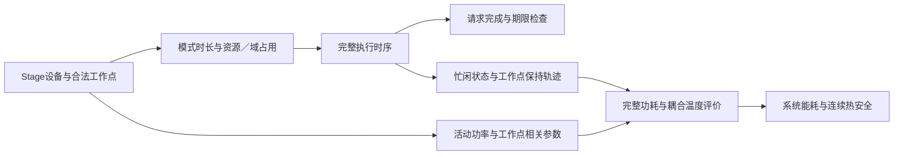

# 联合模型继承与修改清单

日期：2026-10-02。承接已确认的[97号问题定位](97_以HaX为基座的联合问题定位.md)，完成后续六个小目标中的第1项。基础假设仍为[R86-v1](86_实验基础模型与假设确认总表.md)。本轮只确定模型构件怎样继承和衔接，不展开完整数学模型、算法或实验。

## 1．本轮结论

**以HaX的设备映射和完整时间线为表达基座，把工作点选择同时接入执行时长、共享域合法性及功耗计算，再通过完整时序评价温度和总能耗。** 需要协调的具体关系是：设备间并行可能减少排队，较低工作点或等待可能占用更多期限余量；这些选择又改变功耗和热历史，必须按完整请求及完整功耗轨迹共同判断。

这里的“期限余量”只是对可用时间的解释，不新增一类分配变量或算法。局部低功率、较短时长和较冷设备均可能有用，但没有哪一项单独决定系统最省能的安排。

本轮落实三类内容：**继承已有联合表达、按R86替换不相容口径、接通工作点—时间线—热能耗之间的联系。** 前两类是基础工作；第三类是本题拟研究的协调关系，尚不意味着新颖性或收益已获证明。

## 2．具体继承与修改表

下表“原构件”为已核原文事实；“本题处理”和“作用”为R86内的适配决定与条件分析。修改的是未来模型表达，不是本轮改写程序。

| 构件 | 原文已有表达 | 本题继承或修改 | 对共同决策的具体作用 |
|---|---|---|---|
| **计算对象与设备映射** | HaX表3、式(1)：层或层组选择加速器；§3.1先确定分组 [H1] | 保留原子计算对象选择合法设备的关系；使用给定工作流的Stage实例和支持集合。选择项细化为“执行单元＋合法工作点”，不优化划分 | 设备选择同时确定占用资源、可选工作点及活动功率注入位置；无控制权限的设备仍可只有一个模式 |
| **模式响应与时长** | HaX式(2)、(5)、(7)—(8)：单独执行成本结合争用慢化与转换；Zhou式(1)：固定周期数除以频率 [H2][Z1] | 按R86直接读取Stage／单元／工作点的确定时长及活动增量；不继承争用慢化、额外转换成本或统一反比缩放 | 改工作点须同步读取对应时长与功耗，重新核对结束及后继时间线；不要求各项数值必然变化。响应查表不能单独算创新 |
| **依赖与完整时间线** | HaX表3和式(4)—(6)包含起止及重叠时间关系 [H3] | 保留开始、结束和重叠；按本题释放时间、全部前驱及模式时长建立关系，保留合法等待。一般DAG不能直接套原层前缀累计式 | 换设备、换工作点或推迟某Stage后，需要重新核对后继与完整请求。已有等待和次序能力不再作为新增点 |
| **执行资源与频率域** | HaX式(9)处理同设备占用冲突，正文允许用于误差处理的微小重叠ε [H3] | 按R86采用严格互斥的半开区间，不继承ε重叠；另外接入共享域同频、忙时不换点、空闲保持规则 | 两个Stage在不同CPU单元上不冲突，仍可能因同域不同频而不能重叠。合法性不能只检查设备编号 |
| **请求完成与优化目标** | HaX式(10)、(11)分别优化吞吐和最大DNN时延；Zhou式(12)—(14)已有总能耗目标及峰温、期限、依赖条件 [H4][Z2] | 使用每请求全部必需输出的完成时刻及绝对期限；目标改为声明窗口内系统能耗，温度与期限作约束 | 从“尽量快”改为“按时且热安全时怎样更省能”；不要求所有请求尽早完成，也不把中间设备结束当完整完成 |
| **功耗与热状态** | Zhou式(2)—(4)、(8)—(10)已有温度漏电、动态功率、RC及帧内能量；F-DTM式(2)—(6)提供CPU／GPU耦合热模型与传播参考 [Z1][Z2][F] | 使用R86的计量组基准、Stage活动增量及工作点相关温度漏电；匹配注入耦合热节点。Zhou热独立模型及F-DTM具体设备／控制假设不直接迁入 | 时间线决定同时注热的工作和工作点保持过程；温度影响漏电，进而影响能量及温度。完整评价须同时满足这些关系 |
| **空闲与窗口尾段** | Zhou式(9)在整个帧D计算漏电，所列式使用电压下标vₘ,₁ [Z2] | 保留全窗口计量思想，但按R86实际工作点保持轨迹计基准及漏电；入口、等待和尾段均在评价范围内，不默认休眠或空闲降频 | 固定各Stage模式后，总能耗也未必固定；顺序／等待可能改变不同工作点的保持时长和漏电积分 |

上述不是“完整HaX加几个新项”。HaX的争用与转换机制没有迁入R86，本题改变了评价范围；其原性能和最优性结果不能随表达框架一起继承。Zhou已经提供热约束节能联合研究，因此也不能把“映射＋调频＋温度”这个组合本身称为首次。

两处物理表达须保留原义：动态／静态功耗不等于活动增量／空闲基准，后者要按计量边界重新对应；F-DTM的固定配置、利用率条件及热参数不能直接成为本题的连续峰值保证。耦合热模型及温度漏电的传播条件需要在下一步统一核对，不能仅移植一条温度公式。

## 3．首先需要接通的关系

**第一处接口是工作点选择与完整时间线，随后由同一时间线驱动功耗和温度。** 接口不要求先后锁死决策；下图表示评价依赖，不是求解步骤或在线控制流程。

用一个不填数值的变化说明必须同步处理什么：两个请求各有一个CPU／NPU可选Stage及后继，初始考虑都在同一NPU执行。若把其中一个改到CPU并选较低工作点，则应同时发生以下更新：

1. **更新占用。** NPU队列改变；CPU单元是否空闲、同域运行Stage的频率是否兼容，都须检查。不同设备不等于任意模式可以同时执行。
2. **更新完整时间线。** 新模式时长影响当前Stage和后继完成。较低工作点不是任意可用的节能按钮，仍受请求期限约束。
3. **更新完整功耗与热轨迹。** 活动注热位置改变；CPU／NPU的忙闲、工作点保持和漏电过程也可能改变。低活动功率不自动意味着低总能耗或低峰温。

三项仍描述同一份安排。只改功率而沿用旧完成时间，或只增加等待而漏计等待功耗，都会使模型各部分对应不同的执行过程。这是需要避免的融合错误，**不是声称原论文存在这些错误**。

R86的时长保持为确定模式参数，不因这里引入温度评价而新增温度相关时长、节流或争用响应。温度影响当前模型中的漏电和安全性；设备与工作点重新选择仍属于规划，不引入执行中迁移或调频。

本题拟协调的取舍由此明确：**在同一完整期限内，何时采用局部高效模式并接受排队，何时用替代设备创造并行，何时改变工作点或等待，才能得到更好的完整热能耗结果。** 这些是待比较的合法选择，没有预设某一类总是更好，也没有预定搜索顺序。

## 4．拟贡献与下一步边界

可用于后续构想讨论的一条表述是：

> 面向共享异构资源上的端侧完整推理请求，拟在设备映射与执行时间线联合表达的基础上，统一描述合法工作点、共享频率控制及温度相关的全窗口能耗，使设备、工作点和时序在同一组期限与热约束下共同选择；研究局部执行效率怎样通过资源与时间协调转化为系统节能。

这条表述的着力点是**完整请求下的共同决策及一致评价关系**。查表、加入一种设备或把多个模型并列，都不单独构成贡献。需要进一步研究的是：这个统一问题的模型关系和求解组织能支持哪些具体结论；已有联合方法经适配就能处理的情形也应保留。

选择不变是合理结果：若局部偏好组合已经满足所有期限与热要求，且在共同评价中最低能耗，联合规划无需改变它。在恒定基准、无温度漏电等另行声明的特例中，固定配置能量还可能与时序无关；不能用该特例替代R86，也不能假定每个R86实例一定出现能量差。

**下一小目标仅为第2项：依据这张清单形成一致的联合模型骨架。** 届时明确输入、决策、依赖／资源／频率域约束及能耗—热关系，不写整章正文、不确定算法。本轮没有自动推进这一步。

配套数据仍缺：合法支持与工作点、模式时长／活动功率、计量组基准／漏电及其热注入映射、匹配RC与入口状态。数据可获得性在模型整理中持续登记，后续再集中确定验证输入；旧L3结果不升级为R86证据。现有全文足以完成本清单，无新增下载要求。

## 原文定位与核查范围

本轮复用已有全文并定向重读，没有新文献筛选。行号指本地提取文本，不是PDF页码；模型事实、适配分析和拟贡献分别见上文。

| 索引 | 原文位置 | 本地来源 |
|---|---|---|
| H1 | HaX-CoNN，PPoPP 2024，§3.1—3.2，§3.4表3及式(1)；原子对象与映射见314—384行 | [HaX全文提取](extracted/2024_Dagli_HaX_CoNN.txt)，[DOI](https://doi.org/10.1145/3627535.3638502) |
| H2 | §3.2—3.4，式(2)、(3)、(5)、(7)、(8)；重点334—388、392—420行 | 同上；争用与转换不迁入本题 |
| H3 | §3.4，式(4)—(6)、(9)，354—364、421—432行 | 同上；一般等待／跨DNN次序能力沿用[94号§3.2](94_成熟框架固定决策与分阶段边界核查.md)的公开示例核查，不重做代码认证 |
| H4 | §3.4—3.5，式(10)、(11)，433—465行 | 同上；本轮不选择其求解器或继承运行性能 |
| Z1 | Zhou等，JSA 2018，§3.1—3.3，式(1)—(7)，276—370行 | [Zhou全文提取](extracted/2018_Zhou_Thermal_Heterogeneous_MPSoC.txt)，[DOI](https://doi.org/10.1016/j.sysarc.2017.09.007)；热独立明示于359—364行 |
| Z2 | §4，式(8)—(14)，338—439行 | 同上；式(9)不据此扩写为本题的空闲工作点政策 |
| F | F-DTM，RTSS 2022，§IV-A1—2，式(2)—(6) | [F-DTM全文提取](plain/2022_F-DTM_RTSS.txt)，[DOI](https://doi.org/10.1109/RTSS55097.2022.00041)；借鉴热模型关系，不继承内核分割、EDF序列或运行中调频控制 |
| R | R86-v1：T1—T4、R1—R6、D1—D2、P1—P3、H1—H5、S1—S3及§5 | [86号](86_实验基础模型与假设确认总表.md)；全部基础假设仍以该文件为准 |

验收：已把97号概述落实到原子对象、模式代价、时序、资源／域、目标及热能耗构件；保留原文已有能力和本题删改；提出一条拟贡献而未承诺收益。只交付本清单并同步状态／证据，不改正文、程序、参数或历史结果，不运行实验。
