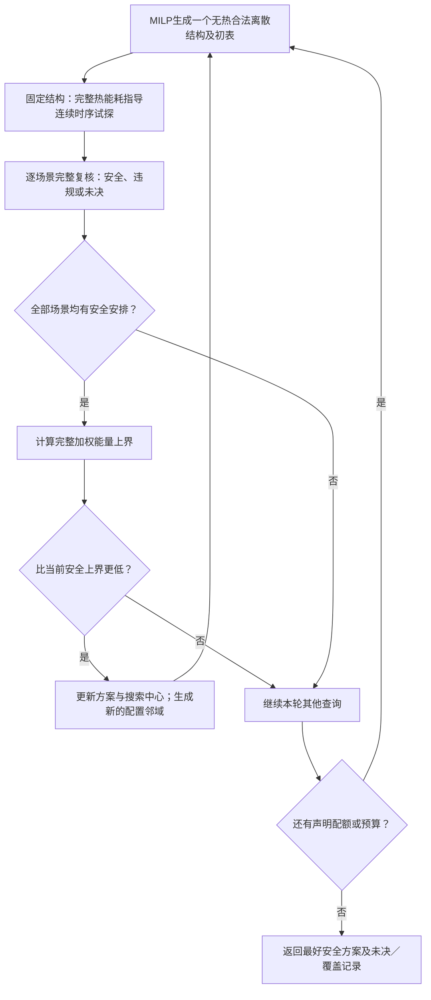

# 多场景共享部署：共同模型与求解接口说明

2026-10-12｜K.55／D72／E494｜阶段一交付，供共同审阅。沿用[R86-v1](86_实验基础模型与假设确认总表.md)及[S1＋I1＋G1](Kim多场景共享部署_一页方案.md#Kim能耗选择更正)，不选实验数值或算法规则。

**研究问题：** 给定多个端侧应用组合，离线共同选择各应用固定Stage的执行单元，分别安排各场景的工作点和启动时刻；全部场景满足请求期限及连续热安全，按给定权重最小化完整窗口系统能耗。共享部署使场景关联，任务相关响应改变工作点代价，热状态参与安排可行性和能耗评价。

## 1．共同决策与合法安排

场景集合为\(\mathcal C\)。场景\(c\)给出有限请求集合\(\mathcal R_c\)、Stage实例及依赖图、释放时间\(r_{c\rho}\)、绝对期限\(D_{c\rho}\)和覆盖全部期限的外给窗口\(W_c\)。各场景从各自完整入口开始，首版无未完成工作。

令\(\tau(c,i)\)标识实例\(i\)所属的“应用—固定Stage”，\(\rho_c(i)\)标识其请求；不同应用的同名Stage不绑定。资源集合\(\mathcal U\)包含不重叠的固定CPU执行单元及设备级GPU／NPU。合法模式\(k\in\mathcal K_{ci}\)给出单元\(u(k)\)、合法频率—电压工作点、正时长\(d_{ci,k}\)和活动增量\(q_{ci,k}\)。

| 决策 | 含义与共享范围 |
|---|---|
| \(x_{\tau u}\in\{0,1\}\) | 固定Stage部署在具体单元\(u\)，各场景及其请求实例共用 |
| \(z_{ci,k}\in\{0,1\}\) | 各场景分别选模式，单元受共享部署约束 |
| \(s_{ci}\ge0\) | 各场景分别选连续起点；结束\(F_{ci}\)由时长导出 |

\[
\sum_{u\in\mathcal U}x_{\tau u}=1,\qquad
\sum_{k\in\mathcal K_{ci}}z_{ci,k}=1,\qquad
\sum_{\substack{k\in\mathcal K_{ci}\\u(k)=u}}z_{ci,k}=x_{\tau(c,i),u}.
\]
链接对每个实例及全部单元成立；没有合法模式时左侧为空和0。这样，某场景不支持的部署不能因漏写链接而被采用。共享的是部署，每个请求仍分别执行。

有匹配频点数据的任务响应可显式写为输入函数
\[
d_{ci,k}=d^{\rm ref}_{ci,u(k)}
g_{ci,u(k)}(f_k;f^{\rm ref}_{u(k)},\eta_{ci,u(k)}),\qquad
F_{ci}=s_{ci}+\sum_kz_{ci,k}d_{ci,k}.
\]
\(g\)为无量纲响应，\(\eta\)为已知校准参数；本轮不另选公式版本或参数值；固定服务模式可直接给定时长。有限合法频点下，公式值作为系数与同值查表等价；换设备或输入条件不默认复用原参数。

| 必要约束 | 表达与执行含义 |
|---|---|
| 释放、依赖 | \(s_{ci}\ge r_{c,\rho_c(i)}\)；依赖边\(i\to j\)要求\(s_{cj}\ge F_{ci}\) |
| 请求期限 | 请求全部必需汇点均满足\(F_{ci}\le D_{c\rho}\) |
| 窗口 | \(0\le s_{ci}<F_{ci}\le W_c\)，时长和结束不取整 |
| 单元互斥 | 同单元两实例满足\(F_{ci}\le s_{cj}\)或\(F_{cj}\le s_{ci}\) |
| 共享频率域 | 同域重叠要求同频及相容合法工作点，异频必须先后；同频不同单元可并发，同GPU／NPU设备仍互斥 |
| 执行与换点 | Stage不可抢占、迁移或执行中改点；域清空后瞬时换点。空闲保持上一工作点，首段前由入口工作点确定，尾段保持最后工作点 |

域关系按输入处理，不凭设备名推定独立控制；空闲工作点由入口和事件重建，不另开放空闲降频。一般启动域连续，不沿用旧网格／窗口。

**例子：** A＋B和A＋C共用A某Stage的部署。B占NPU、C占CPU时，两场景对A的设备偏好可能不同。共同设备选定后，可分别改工作点、次序或等待；响应影响占用长度，入口温度及完整功率轨迹决定安全性与能耗。共同方案不必优于允许各场景自由换部署的理想方案，也接受独立最优恰好相同。

## 2．完整能耗与连续热评价

计量组、频率域和热节点分别定义。令\(\pi(u)\)为单元计量组，\(\xi_{cg}(t)\)为组涉及的控制工作点状态，跨独立控制域时取向量。组功率为
\[
P_{cg}(t)=B_g(\xi_{cg}(t))
+\lambda_g(\xi_{cg}(t))[T^{\rm rep}_{cg}(t)-T_g^{\rm ref}]
+\sum_{i:\pi(u_{ci})=g}q_{ci}\,\mathbf1_{[s_{ci},F_{ci})}(t).
\]
\(u_{ci},q_{ci}\)由场景\(c\)实例\(i\)的所选模式给定。\(B_g\)是参考温度下的空闲基准，已含参考漏电；温度修正在工作与空闲均计入。基准每组一次，活动按实际映射求和；修正可为负，但声明温区内总功率须非负。

\[
E_c=\int_0^{W_c}\left[P_{\rm ext}(t)+\sum_gP_{cg}(t)\right]dt,
\qquad
\min_{x,z,s}\ \bar E=\sum_{c\in\mathcal C}p_cE_c.
\]
\(p_c\ge0,\sum_cp_c=1\)，为完整评价片段的外给次数权重，候选和方法之间固定，数值及来源待定，不直接当驻留时间占比。各场景窗口固定，不强制同长。全部场景含零权重均须满足期限与热安全。

\[
C\dot\theta_c=-G\theta_c+p^{\rm heat}_c(t,\theta_c),\qquad
\theta_c(0)=T_c^0-T_a\mathbf1,\qquad
T_a+\theta_{cn}(t)\le T_n^{\max}\quad(0\le t\le W_c).
\]
\(C\)为正热容对角阵，\(G\)为连接环境的被动导热网络。**组基准／漏电和单元活动分别用给定注热映射**；活动注入实际执行单元对应节点，共用计量组不表示把活动平均分摊各CPU节点。公共功率只有确在RC边界外才不注入该网络。

若已给固定线性代表温度映射\(T_g^{\rm rep}=T_a+(L\theta)_g\)，工作点与活动状态固定的片段为仿射线性ODE；功率仍随温度变化。任意代表温度不能默认线性。漏电随工作点变时状态矩阵可能变化，被动RC不自动保证反馈后的稳定性。

评价覆盖入口、内部峰值、等待和空闲尾段，并核对全过程在功耗／热参数的声明有效范围内。单位为s、W、J、J/K、W/K，漏电斜率W/K；温差采用一致K或°C差值。当前只覆盖有限窗口，场景由共享\(x\)耦合，不加入切换或长期重复。一般\(E_c\)依赖配置与时序，不能沿用旧“固定配置能量已确定”的分解。

## 3．规划与评价分工

| 部分 | 已明确的表达 | 尚待落实的接口 |
|---|---|---|
| 共享部署、模式与时长 | 二元选择、链接及已知响应系数可线性表达 | 实例身份与支持检查 |
| 释放、依赖、期限与互斥 | 有界窗口内可用方向变量及有效有限界编码无热合法域 | 具体矩阵及独立核对；本轮不展开big-M实现 |
| 空闲控制 | 由完整安排和入口重建保持轨迹 | 一般共享计量组及控制状态接口 |
| 真实能耗 | 完整轨迹积分目标已定义 | 活动能量代理不默认等于真实目标或可靠下界 |
| 连续温限 | 完整候选检查全过程 | OPP相关漏电、连续片段时长下的可靠传播／峰值检查 |
| 反馈与最优性 | 安全见证提供上界，排除须有明确范围 | 代理目标、有效反馈、真实下界及覆盖方法留待阶段二 |

**完整数学问题已定义，尚不是完整MILP精确求解方案。** 原77号固定传播核热反馈不能直接移植到工作点相关漏电矩阵；一张时间表失败也不能直接排除部署。

评价器接收完整问题、共享部署及全部场景安排，分别返回：输入／执行合法性、全窗覆盖、热安全／违规／未分辨、能量区间、违规见证及预算状态。全部场景完整合法且明确安全后才发布有效加权能量；若\(E_c\in[E_c^-,E_c^+]\)，可行上界为\(\sum_cp_cE_c^+\)，前缀或无效路径能量不参与排名。

真实违规只否定对应安排，未分辨既不接纳也不排除。轨迹超出功耗模型有效温区或无法确认适用范围时，标模型适用范围未决，不靠外推发布安全结论或有效能耗。安全见证不证明该部署最低能量，MILP代理内部界不自动成为真实下界。旧Joint的持续证书不作为I1有限场景的必需门槛。

## 4．输入完备性与阶段结论

| 最低输入 | 已有依据 | 尚需填写，可先符号表达 |
|---|---|---|
| 场景与共享身份 | S1、Kim共同部署 | 应用组合、实例到固定Stage身份；哪些Stage跨场景出现 |
| 请求 | R86固定DAG、有限释放、完整期限 | 依赖、释放／期限／汇点、输入标签；不强制四Stage |
| 资源与控制 | 固定单元、设备级GPU／NPU、共享域 | 数量、支持、域／计量关系、OPP及权限 |
| 响应与活动功率 | 参数化响应及profile思路、旧特例 | 匹配工作量／设备的\(d^{ref},g,\eta,q\)或同值表 |
| 基准与温度功耗 | R86计量结构 | \(B,\lambda,T^{ref}\)、有效温区和公共边界 |
| 热系统 | RC／漏电传播原理、旧实现 | \(C,G\)、组／活动注热、代表温度映射及稳定性核对 |
| 入口、窗口与权重 | I1、G1 | 各场景\(T^0,\xi^0,W,p\)及误差要求 |

尚无与全方案匹配、已冻结的输入包。允许文献移植或明确L3设定，逐项标来源与条件，不要求先取得实测，也不把多平台拼接称设备复现。

现有continuous_planner可借连续起点／方向编码，查询目标仍为活动能量代理；V1已有漏电传播及能量积分，但一般共享组／注热映射、各请求不同期限和跨场景共同部署尚需适配。旧切换、整轮平移及持续安全盒不搬入本问题。

**阶段结论：** 问题与评价已收拢，无热调度有可用表达；真实目标及连续热约束如何进入求解，是下一项明确任务。本轮未发现必须改S1／I1／G1或R86的冲突，未运行实验或证明收益。下一步只讨论一条可实施求解路线，先解决真实能耗与MILP候选规划的连接，不同时展开多个算法。

来源与复用边界：

- [Kim，TC 2023](../papers/2023_Kim_Energy_Aware_Mapping.pdf) §4.2、§5.2.3—5.2.4：共享部署与跨场景评价；不继承统一1/f和抢占／FIFO语义。
- [HaX-CoNN，PPoPP 2024](../papers/2024_Dagli_HaX_CoNN.pdf) §3.4式(1)—(9)：映射、时序和互斥组织；不搬争用、吞吐目标或微小重叠容差。
- [F-DTM，RTSS 2022](../papers/2022_F-DTM_RTSS_Future_aware_Dynamic_Thermal_Management_in_CPU-GPU_Embedded_Platforms.pdf) §III—IV-A式(2)—(6)，[Zhou，JSA 2018](../papers/2018_Zhou_Thermal_Heterogeneous_MPSoC.pdf) §3.2—3.3式(2)—(7)：已核功耗／热关系；不把其硬件参数视为本题匹配数据。
- [师兄main.pdf](../main.pdf) §3.5.1、§3.5.4用于共享结构及目标对照；[85号§4](85_实验基础建模假设核查与推荐.md)保存计量／热关系推导，[R86](86_实验基础模型与假设确认总表.md)维护基础规则。具体来源事实与自主表达分开，本轮不作新颖性全面检索。

## 5．阶段二：候选生成、真实评价与反馈

2026-10-12｜K.56／D73—D74／E495。用户已确认首版采用“合法候选搜索＋完整评价择优”，允许连续域最优性未决；不改S1／I1／G1及R86。以下给出一条可实施路线，具体代表协议、配额和停止限额仍待共同审定，不直接继承旧实验设置。这里的“真实能耗”指完整声明模型的能耗，不是实测值。

### 5.1 MILP生成什么

MILP同时接收全部场景，选择共享部署\(x\)、各场景模式\(z\)、实际资源冲突方向及连续起点。约束使用§1的合法支持、释放、依赖、逐请求期限、窗口和频率域规则。非统一响应先在合法工作点上计算时长系数，系数进入期限与资源占用表达，并不要求求解器把响应函数当成未知变量。

建议首版查询目标为
\[
J_{\rm act}=\sum_cp_c\sum_{i,k}q_{ci,k}d_{ci,k}z_{ci,k}.
\]
它把活动能量较小的模式放到前面；零权重场景也保留全部合法性约束。它没有计入完整的工作点保持和温度漏电，故只用于引导候选，不用其最优退出或内部界宣布真实目标最优，也不直接拿它与真实安全上界剪枝。

令离散结构\(\beta\)包含共享部署、场景模式及全部**被所选模式实际激活**的冲突方向；未激活的辅助二元量不另造结构。MILP返回一个结构及起点后，先独立复核；浮点可行状态不能代替合法性检查。

**候选怎样具体形成：** 固定\(\beta\)后，时长与先后边均已固定。对每个场景前向传播释放与先后约束，得到最早向量\(s^E\)；用窗口及各请求必需输出的期限形成节点上限，再逆向传播，得到最晚向量\(s^L\)。确认方向图无环、最早安排不超节点上限后，两者均属于同一无热起点多面体，因而
\[
s^M=\tfrac12(s^E+s^L)
\]
也合法。三者均为连续起点，结束时刻不取整；各自仍须完整热评价。这是一种可实施的候选构造示范，**不是本轮自动冻结旧E／M／L协议**。它可能漏掉内部等待和其他并发形态，代表用完不等于结构查完。一般逐请求期限需要新适配，不能直接套旧共同轮级期限程序。

### 5.2 评价器怎样得到完整能耗

| 步骤 | 处理与输出 |
|---|---|
| 完整合法性 | 核共享部署、支持、依赖、释放、请求完成、资源及域控制；不合法方案不参与能量排名 |
| 重建事件 | 汇集0、全部真实起止及\(W_c\)，同刻按半开区间处理结束与开始；从入口OPP重建每域控制状态 |
| 重建功率 | 域忙时不换点，空闲／尾段保持上一OPP；每计量组基准一次，活动按实际映射加入；计能耗与节点注热分别处理 |
| 联合传播 | 每个工作点与活动状态固定的片段，连续传递温度并积分功率；温度不会在事件或场景内重置 |
| 形成回执 | 全窗温限、有效温区和误差核查；返回安全／违规／未分辨、能量区间及见证 |

**K.57补充条件：** 下式把组基准和温度修正共同乘以\(H_B\)，以两者具有相同注热分布为前提；一般输入可以分别给出映射，R86并未默认二者相同。当前系统模型汇总见[审定稿](第三章系统模型_审定稿.md)，本段保留为条件性求解接口推导。

若输入已给线性代表温度映射\(T^{\rm rep}=T_a\mathbf1+L\theta\)，令片段内\(a\)为单元活动增量向量，\(H_B,H_U\)分别为组基准／漏电和单元活动的注热映射，\(\Lambda=\operatorname{diag}(\lambda_g)\)，\(\widetilde B_g=B_g+\lambda_g(T_a-T_g^{\rm ref})\)，则
\[
\dot\theta=A\theta+b,\qquad
A=C^{-1}(-G+H_B\Lambda L),\quad
b=C^{-1}(H_B\widetilde B+H_Ua).
\]
设备电能累计量满足
\[
\dot e=\mathbf1^T\Lambda L\theta+
\mathbf1^T\widetilde B+\mathbf1^Ta.
\]
将\((\theta,e,1)\)作为增广状态，可用分段矩阵指数同时传播，边界外公共电能再按原窗口加入。无需假定\(A\)可逆，也不能把经过注热分配的节点功率再加总计一次电能。全过程峰值及误差包络另行核查，不能只看事件端点。

该推导以已给线性温度映射为条件，不替输入自动选择平均温度或最大温度。若映射未定／非线性，登记为评价接口待定；输入阶段再讨论，不擅自改变R86。V1已有上述方程的一计量单元一节点特例，一般注热映射与独立请求期限仍需适配；本路线不需要旧无限运行验证器。

### 5.3 怎样把评价结果反馈给搜索

反馈分为**更新可用方案、安排下一次查询、有依据地排除**，三者分别记录。

| 评价结果 | 返回给搜索的信息 | 首版处理 |
|---|---|---|
| 全部场景完整安全 | 各场景时间表与\([E_c^-,E_c^+]\) | 以\(U=\sum_cp_cE_c^+\)更新最好安全输出；安全不关闭该配置其他时序 |
| 安全但能量较大 | 完整能量及基准／活动／漏电分项 | 按真实能量评价已见方案，继续查询其他时序或结构；不把这张表的代价推广为整个结构的代价 |
| 明确超温 | 失败场景、节点、时刻及可靠违规见证 | 拒绝这张表，保留同结构其他起点；再查其他冲突方向、OPP或共享部署 |
| 无热方向图有环／最早超期 | 完整固定结构及可复核的冲突依据 | 可排除对应无热结构；不扩大到其他方向或模式 |
| 数值／模型适用范围未决 | 原候选、未决原因及已有证据 | 不接纳、不作热排除，继续其他查询或按已定限额停止 |

**下一候选如何避免重复：** 同结构内查询别的连续时序；结构间可在当前MILP查询中暂加模式／实际方向的no-good，转查其他结构。其含义只是“暂不重复访问”，被跳过结构的未查连续起点仍在原问题的未决台账中。这个查询域限制不能记成热不可行剪枝，也不能用查询域耗尽证明原问题无解。正式的时序再查顺序、代表数量及重访规则留待最小协议审定。

首版不把一次能量评价直接写成对其他时间表有效的线性代价，也不照搬旧77号热切面：连续起点的响应不再是固定格点选项系数，OPP相关漏电还会改变传播矩阵。只有另证对声明域有效的必要约束，才能作可靠热排除；本轮不新增此类组件。评价器的直接作用是决定接纳谁、谁更值得保留，以及哪些安排需要另查，不承诺每次反馈都能缩小可行域。

### 5.4 多场景如何组合，何时停止

I1下，给定同一个共享部署\(x\)后，各场景入口、窗口和约束互不衔接。因此，各场景已找到的相容安全安排可以直接重组；模式、方向和起点不必相同，全部场景包括\(p_c=0\)仍须有安全安排。无需把每场景已查的时序代表做笛卡尔积再评价。可按各场景安全能量上端择优，得到组合上界；区间重叠时不宣称严格优劣，更不称各场景已最优。

例如A＋B和A＋C共用A的NPU部署：前一场景最早表超温，可查错开后的表；后一场景可以保留原安全表。若两场景都有安全安排，即可评价这一共同部署。若再查得到A部署CPU的安全组合，就按完整加权能量比较；活动能量代理只决定谁先查，不决定最终保留谁。若NPU结构的有限候选都失败，只登记该结构未决，不宣布NPU部署不可行。

首版在共同预算／候选限额到达时，交付最好完整安全安排、有效\(U\)、已有可靠下界及覆盖／数值／预算状态；限额尚未冻结，不沿用旧60 s或三代表数量。只取得安全解即可完成工程输出，没有安全解时报告尚未取得，不凭候选用尽宣布无解。

如输入有效温区及全部控制状态已有可靠界，可令\(\underline b_{cg}\)为组基准加温度修正的全域下界，得到独立弱界
\[
L_0=\sum_cp_c\left[
E_{{\rm ext},c}+W_c\sum_g\underline b_{cg}
+\sum_i\min_{k\in\mathcal K_{ci}}q_{ci,k}d_{ci,k}\right].
\]
不能默认温度不低于参考温度或删除负修正；各组分别取最小忽略了相容、资源与热限制，只会使界更弱。缺少可靠输入界时明确不提供该界，不用MILP内部报告替代。只有可信上下界闭合等独立条件成立，才另报最优证明；本轮不恢复MILP认证支线。

**本阶段结论：** 首版的可实施闭环是“活动能量引导的MILP结构查询—连续时序候选—完整评价与实际择优—时序／结构继续查询”。用户已确认保证等级；候选覆盖规则仍是建议，下一小目标只审定最小候选协议及对应预检要求，不选研究数值、不编程或实验。

依据：Kim §5.2.2—5.2.3及算法1提供共同部署逐场景评价组织；F-DTM §IV-A式(2)—(6)提供OPP相关仿射热传播基础；旧[CP1说明](continuous_planner/README.md) §1及`planner.py`的结构重构提供有限代表工程来源；[77号§2](77_连续热反馈MILP实现与冻结对照.md)用于核清旧热行适用边界。上述候选组织、场景重组及下界推导为本题方案／代数分析，不写成来源论文已实现本题完整模型。

## 6．完整能耗驱动的时序调整与配置重选（建议稿）

2026-10-13｜K.61／D80／E500。承接用户同意的K.60计划及[独立审查§7](Kim多场景共享部署_求解路线独立审查.md)。本节给出一条可执行到步骤层面的工程路线，供共同审阅；具体规则为本轮建议，不是已实现算法。§1—5保留历史讨论，原问题仍以[系统模型稿§6](第三章系统模型_审定稿.md)及R86为准。

**建议采用“离散配置查询—完整能耗指导连续时序调整—安全结果改变配置搜索中心”的双层迭代。** MILP负责合法离散选择和无热时序关系；连续端直接比较原模型的完整能耗，不只比较活动项。评价器从一次性验收工具变成每次调整都调用的计算部件。安全方案已有时仍继续优化，超温不是触发反馈的唯一条件。

### 6.1 借鉴什么，不直接移植什么

| 已核原文 | 可继承的处理思想 | 本题必须自己完成的适配 |
|---|---|---|
| Bao等，*Temperature-Aware Idle Time Distribution for Leakage Energy Optimization*，TVLSI2012，§VI-A式(24)—(38)、图5，本地PDF第7—8页 | 固定任务次序和电压，优化连续空闲长度；热分析与漏电能量计算参与每轮更新 | 原文临时固定任务末温才得到所述凸子问题，真实末温随安排改变后采用迭代启发式。本题不固定真实末温，也不移植低功耗空闲态、周期热稳态或单处理器假设 |
| Huang、Quan，*Leakage Aware Energy Minimization for Real-Time Systems under the Maximum Temperature Constraint*，DATE2011，§2式(7)，PDF第2页；§3.1式(8)—(11)，第3—4页；§3.2式(12)—(16)，第4页 | 固定工作点片段的温度与能量一起计算，用总能量指导选择 | 原文搜索单处理器两速度交替次数，涉及执行中切速及切换开销；本题仍保持Stage内不改点。多节点、共享域、共享部署和连续起点优化须另作适配 |

两篇支持“热计算进入优化”，没有直接提供本题的双层算法。以下可行方向、离散邻域及状态规则是本题建议；不将通用局部搜索或模块组合写成已证创新。来源：[Bao本地全文](../papers/2012_Temperature-Aware_Idle_Time_Distribution_for.pdf)、[Huang本地全文](../papers/2011_Leakage_Aware_Energy_Minimization_for_Real-Time_Systems_under_the_Maximum.pdf)。

### 6.2 一次连续优化固定什么

记离散结构为\(\beta=(x,z,b)\)：共享部署、各场景已选模式及**实际激活冲突**的方向。无冲突辅助位不参与结构身份。固定\(\beta\)后，各Stage时长和活动增量已知，场景\(c\)的无热起点可行集为
\[
\mathcal P_c(\beta)=\{s_c:\text{满足释放、依赖、逐请求期限、窗口及全部激活先后关系}\}.
\]
在控制状态输入完备且[系统模型稿§7.2](第三章系统模型_审定稿.md)的冲突编码覆盖C5时，它是有界凸多面体；无热有向环或期限矛盾可单独排除。输入不能唯一确定域保持状态时先报输入未齐，不能通过外部评价补造功率轨迹。

连续子问题的目标始终为
\[
\min_{s_c\in\mathcal P_c(\beta)} E_c(z_c,s_c),
\quad \max_{t\in[0,W_c]}T_{cn}(t;z_c,s_c)\le T_n^{\max}\quad\forall n,
\]
并满足原模型有效域。它不是已证明的凸问题。共享部署固定后，I1允许各场景分别处理；最后按G1汇总，零权重场景也须安全，不需额外跨场景热连接。

**不会再固定全部跨设备事件顺序。** 每个新起点向量都重新排序真实开始／结束事件、重建域保持状态及功率片段。两个无资源冲突的Stage可以从并发变错开，其变化由连续端处理；不能一直复用旧片段的矩阵和时长。一次内层调整保持\(z,b\)，换设备、工作点或实际冲突方向交外层。

### 6.3 完整能耗怎样决定下一张时间表

为说明可实施性，建议首版用**线性可行方向＋完整评价回溯**，不先要求能量梯度或事件次序固定。可借现成LP生成合法方向，无需自行开发通用非线性求解器；这是有限的局部改进程序，不宣称求得上述子问题最优。

1. **确定起点。** 优先使用同一\(\beta\)已保存的合法时间表；首次可按全部释放、先后和逐请求期限生成最早无热安排。热安全尚须检查。
2. **产生不同的调整方向。** 在\(\mathcal P_c(\beta)\cap\{v:\|v-s^k\|_\infty\le r_k\}\)中，逐Stage分别最小化和最大化其起点，得到若干LP目标点\(v\)。主目标并列时先最小化相对\(s^k\)的总位移，再按固定Stage编号破并列；去除重复和零方向。LP可能同时移动相关Stage，以满足依赖和期限，而非机械地只改一个起点。
3. **连续回溯。** 沿
\[
 s^{\rm trial}=(1-\eta)s^k+\eta v,\qquad
 \eta=1,\tfrac12,\tfrac14,\ldots
\]
在声明次数内试探。两端属于同一凸多面体，故试探点无热合法；热安全不由此推出。\(r_k\)是搜索半径，\(\eta\)是数值步长，不给Stage增加固定启动网格，也不取整时长。
4. **每个试探都计算完整轨迹。** 重新生成事件和OPP保持，从该场景原入口传播至\(W_c\)，返回完整能量区间\([E_c^-,E_c^+]\)、全窗峰温包络及状态。包括工作、等待和尾段；不以局部某Stage节能代替全场景比较。
5. **由完整能量决定移动。** 当前已有安全表时，只用完整合法且明确安全的试探更新中心；比较集合包含当前安全表，只有\(E_{c,\rm trial}^+<E_{c,\rm current}^+\)才接受。一轮中保留上端最小者，与当前表并列时保持当前表，试探表之间并列按固定规范键处理。这保证已知安全能量上界不增；只有\(E_{\rm new}^+<E_{\rm old}^-\)才称已证实际能量严格降低，区间交叠不强判真实排序。
6. **没有改进就缩小搜索半径后再试。** 达到最小半径、连续评价次数或总预算限制时返回已有安全结果与局部搜索记录。数值未分辨的点单独保留；有限方向／步长用尽只表示本次未再改进，不证明局部最优或配置无解。

这样，每次接受的真实能量结果都会改变下一轮的\(s^k\)、方向与试探范围。候选不是事先固定的早／中／晚三张表；但有限方向仍可能漏掉有利的联合移动，须把这一搜索限制留给后续预检和对照。

**没有安全初表怎么办？** 先在相同合法起点域作有限可行性恢复，所有节点均参与。只有完整、有效域内的热计算才可给搜索评分，例如峰温上端形成的\(v_c^+=\max(0,\max_n[\overline T_{cn}^{\rm peak}-T_n^{\max}])\)。先接受明确安全表，否则用较小\(v_c^+\)指导继续试探；正评分只表示尚不能认证安全，不必然是真实违规。首个安全表取得后改用完整E进行上述能耗改进。输入不齐、有效域越界或不完整传播不按低评分处理；恢复限额耗尽则记结构未决，外层继续别的查询。此评分仅用于找可行起点，不改变原能耗目标。

### 6.4 完整能耗怎样改变设备和工作点选择

维护一个**当前最好全场景安全方案**作为外层搜索中心，保存共享部署\(\bar x\)、逐场景模式／方向／起点和\(U=\sum_cp_cE_c^+\)。若暂时没有这样的方案，先用无热MILP生成不同结构并调用上述内层；活动能量可以作为首个结构及查询并列的辅助顺序，不作真实能量剪枝。首个结构安全也不立即结束。

建议以当前中心形成三类有限邻域查询，均由MILP核完整无热合法性：

| 邻域动作 | 放开什么、保留什么 |
|---|---|
| 一个固定Stage改部署 | 将该Stage改到另一个合法具体单元，所有场景及实例同步；这些实例的合法工作点重新选择，其余部署／模式保留；受影响场景重新选择实际冲突方向并求合法起点 |
| 一个场景的一个频率域改工作点 | 共享部署保持，释放该场景所有映射到该域的实例工作点选择，其余模式保留；相容调频可涉及多个实例，不限为一项独立调频；该场景重新选择实际冲突方向 |
| 一个场景换资源次序 | 部署和模式保持，尝试翻转一个实际冲突方向，其余实际方向保留；有依赖或期限矛盾则该查询无热不成立。非冲突并发不强加方向 |

按Stage、单元、场景及域编号给查询确定顺序。每项查询在预先声明的有限候选配额内生成结构；同查询内可用活动能量排序，但不能只因较高活动能量就永久排除。每个结构都进入完整能耗的内层调整。若第一次候选已访问，查询去重后可继续下一结构；去重只改变本次查询域，不证明被访问结构已热不可行或已最优。

当新结构的全部场景都有安全安排且\(U_{\rm new}<U_{\rm current}\)时，保存新结果并**以新方案重建下一轮邻域**。因此完整能耗不仅决定末端排名，还决定后续哪些设备替换、域工作点和次序修改被查询；接受规则不要求活动能量也下降。没有改进则继续本轮其他邻域，全部声明邻域已试完或总限额到达时停止。多次同时换部署等方案可能不在这些邻域内，不能据此宣称整个联合域已经优化完。

这是基于已评价完整能量的工程反馈，不拟合未经证明的全局代价，也不把局部结果写成Benders最优性切面。相同共享\(x\)下，各场景的安全安排可以分别缓存并重组；不同\(x\)的场景回执不能混用。整体中心更新前，必须确认所有场景含零权重都有匹配回执。

### 6.5 接口、去重与停止

| 情况 | 下一步与输出口径 |
|---|---|
| 已安全但能量还可降低 | 先继续内层时序改进，再检查外层邻域；安全不是提前停止条件 |
| 某表超温 | 内层可试其他起点，外层可试其他结构；只否定这张完整表 |
| 局部无改进或可行性恢复失败 | 按声明配额换查询，保留未查时序；不报配置最优或不可行 |
| 数值未分辨 | 保存状态；在有限精度／计算限额内可重查，仍未分辨就继续别的查询；不补成安全或违规 |
| 重复候选 | 完全相同输入、结构、起点与评价要求才复用完整回执；同结构不同起点不能只按结构键跳过。已查方向／种子记录用于限制重复工作，不构成物理排除 |
| 全部查询／预算停止 | 输出最好全场景安全方案、能量区间与U，以及已试范围和未决。没有安全表时只报尚未取得；不把有限邻域耗尽当原问题无解 |

初始半径／最小半径、回溯次数、内外评价次数、邻域配额、数值精度及总预算是待预检协议填写的方法参数，不在此填研究数值。建模、MILP、LP、温度能量计算、缓存和重访均须纳入后续同一计费口径。没有梯度、凸性或全域切面证明，不阻挡有限工程路线；也不据此声称原连续域已得最优。

### 6.6 无数值示例：完整能耗两次改变下一步

A＋B和A＋C共用A的一个Stage部署。假设当前部署为NPU0，各场景已有无热初表。在A＋B中，连续端尝试将一个Stage的起点移动，并带动必要后继；完整评价若确认新表安全且能量上界更低，就以新表为下一轮试探中心。若只是峰温下降而总能耗上升，能耗改进阶段不因此接受。延后也可能把高功耗保持状态留得更久，所以不预设等待必然省电。

随后外层尝试将A该Stage共同部署到CPU1，两场景都必须重构合法模式和时序。其活动能量即使较高，只要两场景完整安全且加权完整能量上界更低，仍可成为新中心；下一轮便围绕CPU1方案查询频率与次序。相反，若未降低能量就保留NPU0，继续其他查询。这里展示反馈通道，不宣称两种改善必然出现。

非统一响应在外层换工作点时进入：所选频率通过D76公式确定Stage时长，改变内层的可用时间余量、重叠关系和注热持续时间；完整热能耗计算再决定该工作点及其时序是否值得保留。α仍是给定参数，内层不通过修改响应来取得改进。

### 6.7 必需输入、实现工作与完成边界

| 内容 | 现有基础与新增工作 |
|---|---|
| MILP／LP合法性 | 可借`continuous_planner/planner.py`的模式冲突和连续起点表达；须适配共享x、逐请求期限、一般资源及域控制。本轮公式与协议不等于旧代码已支持 |
| 连续方向与回溯 | 新增§6.3局部控制流程，替代旧固定E／M／L代表；记录每步完整能量为何促成／拒绝移动，不需要实现通用全局优化器 |
| 完整评价 | 可借V1的温度—漏电能量增广传播和误差核查；一般计量组／注热分布、逐请求期限与多场景回执须适配。现有每计量单元对应节点的实现不能直接充当一般接口 |
| 外层重选 | 新增邻域查询、同步共享部署、真实U更新搜索中心及同x场景组合；不得沿用旧持续切换证书替代I1有限窗口检查 |
| 输入先决条件 | 明确域完整控制映射、组代表温度函数及各注热映射、有效域。线性代表温度映射可沿用仿射传播；其他关系须有对应评价方法，不默认平均温度、均分注热或改成线性 |

**本轮结论：存在一条不改变原物理模型的有限工程路线，完整能耗可在内层指导起点接受，在外层改变后续配置邻域。** 该结论是接口与代数层面的可实施性，不是性能验证；有限方向／邻域和局部停止是公开的方法限制。候选、参数范围、预算及评价支持范围仍需审定，不自动编程或实验。

下一步只共同审阅这份方法草案，尤其确认有限连续试探与邻域重选是否作为首版；确认后再合并明确输入支持、方法限额和必要预检。不另加热机制，不要求先构造节能正例，不恢复全局认证或长期切换分析。

## 7．完整热能耗MILP参照：最小取舍与表达草案（待确认）

2026-10-14｜K.62／D81／E501。承接提交`81e6bee`的[独立审查§8](Kim多场景共享部署_求解路线独立审查.md)。本节核查第三章参照，不执行§6的局部搜索；§1—6保留历史，R86与系统模型尚未改版。用户授权审查简化及工作价值，**没有确认以下启动域、调频粒度或物理映射限制**。

**建议首版收紧控制自由度，保留热能耗关系：共享部署不变，各场景每域首次启用时采用一个离线选定工作点并保持至窗口结束；启动从声明的有限集合选择，真实时长不取整；保留任务相关响应、多节点动态RC及温度漏电。** 这能形成有明确条件的完整能耗MILP构造，而非只用活动能量选表。优先理由是接口较少、仍保留实质协调关系，不是已证速度优势或创新结论。

### 7.1 哪些可以简化，哪些应保留

| 项目 | 首版建议与代价 | 性质／确认状态 |
|---|---|---|
| 同场景调频 | 每域首次有工作时换到一个所选OPP，此后不再换；此前保持入口OPP，无工作的域一直保持入口OPP。不同场景、不同域仍可选不同点 | **可选控制范围限制**。减少反复换点和空闲保持逻辑，失去同场景逐忙段调频；不是MILP化的必要条件，待用户确认 |
| 启动域 | 预先声明有限合法候选起点，允许其中的等待、并发与换序；结束等于起点加响应时长 | **本节构造的关键限制**。形成固定有限事件集，可能遗漏连续域方案；不预设等间距，更不继承旧1 ms或预算，待确认 |
| 温度与注热映射 | 首版表达支持已知的线性／仿射代表温度及按控制状态已知的注热分布，参数须符合计量边界 | **表达前提／输入范围**。不默认平均温度、均分注热或一个计量组等于一个热节点；一般非线性映射不在本构造内，待确认支持范围 |
| 响应与模式 | 保留D76公式、Stage—设备参数、全部声明合法设备和工作点 | 降频收益随Stage不同；不能为了凑整数时长修改响应。有限工作点下公式提供已知系数，本项不新增限制 |
| 共享与服务条件 | 保留S1、I1、G1、逐请求期限、依赖和固定窗口；包括零权重场景 | 共同问题的骨架。固定共享映射不能降为各场景任意换设备；不添加真实场景切换过程 |
| 热状态与完整能耗 | 保留入口、多CPU单元／设备热状态、声明热耦合、热容、全窗口温限以及基准、活动和温度漏电积分 | 保留温度影响可行性和能耗、时序影响能耗的关系。没有必要先删漏电、改稳态或合并所有温度 |
| 研究规模 | 小规模实例用于MILP参照，数量以后依据参数来源及符号成本确定 | 实验范围，不把一般模型固定为两请求、四Stage或单NPU；小规模也不等于假设所有Stage都能去所有设备 |

“场景内一个域工作点”与“每个Stage独立调频”不同：同域Stage共同受一个频率影响，但其时长响应不同。也不同于所有设备都固定一个频率，更不是从时刻0擅自覆盖入口工作点。若保留原逐忙段调频，有限事件构造原则上仍成立，只需另编码每次合法清空换点及保持；本轮不把它作为首版优先路线。

### 7.2 用有限起点得到固定事件集

以下为**本题代数构造**。给场景\(c\)的实例\(i\)、合法模式\(m\)声明有限起点集\(\mathcal G_{cim}\)。每个选项\(o=(i,m,t)\)已有确定起点\(t_o\)、时长\(d_o\)、结束\(f_o=t_o+d_o\)、单元和工作点。仅预删违反释放或窗口等已知必要条件的选项，不预选“节能模式”或一条代表表。

收集
\[
\mathcal B_c=\{0,W_c\}\cup\{t_o,f_o:o\in\mathcal O_c\}
=\{e_{c0}<\cdots<e_{cK_c}\},\qquad
\delta_{c\ell}=e_{c,\ell+1}-e_{c\ell}>0.
\]
这是**所有可能事件**的并集，不是先知道最终安排。每个选项在每段\([e_\ell,e_{\ell+1})\)是否活动是已知常量\(\chi_{o\ell}\in\{0,1\}\)。没有事件的间隔也保留为一段；每种候选都有共同分段，包括空闲尾段。

若起点位于某个统一网格而时长不整除网格，其结束照样进入\(\mathcal B_c\)，形成非均匀分段。**限定起点不等于取整时长，也不等于用时间步长近似微分方程。** 这一步减少的是可选安排；热传播与全过程检查仍使用声明的连续模型。

### 7.3 调度与控制状态怎样完整编码

令\(y_{co}\in\{0,1\}\)表示选项是否选中，\(x_{\tau u}\)仍为共享部署。基本约束为
\[
\sum_{o:i(o)=i}y_{co}=1,\qquad
\sum_{o:i(o)=i,\,u(o)=u}y_{co}=x_{\tau(c,i),u},\qquad
\sum_u x_{\tau u}=1.
\]
全部实例—单元都链接，不支持单元的空和为0。由
\[
s_{ci}=\sum_{o:i(o)=i}t_oy_{co},\qquad
F_{ci}=\sum_{o:i(o)=i}f_oy_{co}
\]
直接施加释放、依赖、每个请求必需输出期限及窗口约束。同一执行单元互斥写为
\[
\sum_{o:u(o)=u}\chi_{o\ell}y_{co}\le1\quad\forall u,\ell.
\]
区间是半开的；前工作在事件结束、后工作同刻开始不会被误作并发。不需要再为每一对冲突增加可自由选择的方向，所选起止已导出次序。

在推荐的一次OPP范围内，令\(u_{ch}\)为域是否被使用的OR指示，\(z_{chk}\)表示该域选点；满足\(\sum_k z_{chk}=u_{ch}\)以及每个本域选项\(y_{co}\le z_{ch,k(o)}\)。这里\(k(o)\)必须明确完整域状态，不只是一个频率数值。再用前缀启动指示\(a_{ch\ell}\)表达首次启用：
\[
a_{ch\ell}=\bigvee_{o:\gamma(u(o))=h,\,t_o\le e_{c\ell}}y_{co}.
\]
OR用“\(a\ge y_o\)”和“\(a\le\sum y_o\)”精确线性化，空集合给0。令\(w_{ch\ell k}=a_{ch\ell}z_{chk}\)，施加\(0\le w\le a,z\)、\(w\ge a+z-1\)，得到实际域状态指示
\[
\rho_{ch\ell k}=w_{ch\ell k}+\mathbf1_{k=k^0_{ch}}(1-a_{ch\ell}).
\]
入口点若不在工作候选集中，相应\(z,w\)取0而仍作为保持状态保留。\(a=0\)时采用入口，\(a=1\)时采用所选点，包括之后全部空闲与尾段。无需预知哪一个Stage先启用该域，也没有自由选择提前换频的变量。

完整域状态向量记为\(\omega\)，每段以\(r_{c\ell\omega}\)唯一选择：\(\sum_\omega r_{c\ell\omega}=1\)，并逐域逐点链接\(\sum_{\omega:\omega_h=k}r_{c\ell\omega}=\rho_{ch\ell k}\)。它**不能成为独立于Stage、入口和保持规则的自由状态**。若一个计量组涉及多个控制域，其系数由这个完整向量确定。CPU同频并发、GPU／NPU设备互斥和合法替代映射均保留。

双向对应：任一该受限域合法安排选中每个实例的唯一选项，必满足上述关系并产生唯一控制轨迹；反向，由整数组合可恢复完整起止、部署和保持轨迹，各个真重叠区间都包含在某一事件片段内，故互斥检查无遗漏。此结论只对应声明的有限起点和一次OPP政策，尚须加上后续物理约束。

### 7.4 温度与完整能耗为何可以进入同一个MILP

省略场景下标。令\(v_\ell=(\chi_{o\ell}y_o)_o\)表示本段活动选项。在线性代表温度和已知注热映射下，控制状态\(\omega\)固定时，系统可写为
\[
\dot\theta=A_\omega\theta+b_\omega+D_\omega v_\ell,\qquad
\dot E^{\rm net}=\beta_\omega+\lambda_\omega^\mathsf T\theta+\eta_\omega^\mathsf T v_\ell.
\]
第一式的\(A_\omega\)已经含温度漏电反馈；第二式按电能计量组累计，第一式按各自注热分布进入节点。二者不要求同一映射。活动增量\(q_o\)已包含在已知系数中，不再把热输入另计一份电能。\(\theta\)用K温差，功率用W、时间用s、能量用J，换用ms须统一换算系数。

固定\(\delta_\ell\)后，温度传播及该段电能成为
\[
\theta_{\ell+1}=\Phi_{\ell\omega}\theta_\ell+\psi_{\ell\omega}
+\Omega_{\ell\omega}v_\ell,\tag{K62-1}
\]
\[
\Delta E_\ell=\mu_{\ell\omega}^{\mathsf T}\theta_\ell+\zeta_{\ell\omega}
+\nu_{\ell\omega}^{\mathsf T}v_\ell.\tag{K62-2}
\]
例如\(\Phi=e^{A_\omega\delta_\ell}\)、\(\psi=\int_0^{\delta_\ell}e^{A_\omega t}b_\omega dt\)、\(\Omega=\int_0^{\delta_\ell}e^{A_\omega t}D_\omega dt\)；能量系数由把温度解代入第二式并积分得到，也可用增广状态一次求出。**所有系数是已知量，不含待优化的片段长度。** 不要求\(A_\omega\)可逆，也不额外假定所有OPP热系统都渐近稳定；有限窗内仍检查有效域和温限。

用\(r_{\ell\omega}=1\)激活两条仿射等式，其他状态关闭。给出温度有效范围及相应能量范围后，可将条件等式转成有依据的big-M或有界变量析取；M必须覆盖未激活行在声明变量域上的完整残差，不能沿用调度约束的\(M=W\)。矩阵指数是计算系数的工具，不再是MILP中的变量函数。活动向量保留线性输入，无需枚举所有活动Stage子集。

完整目标直接为
\[
\min\sum_cp_c\left(E_{{\rm ext},c}+\sum_{\ell=0}^{K_c-1}\Delta E_{c\ell}\right),
\qquad \theta_{c0}=T_c^0-T_a\mathbf1.\tag{K62-3}
\]
其中已经同时计入基准、活动、工作／等待／尾段温度漏电，**不得再叠加\(\sum q_od_oy_o\)而重复计活动能量**。目标会随工作点、设备和起点共同改变；完整评价器不再承担“把代理解重新排名”这一主要职责，而是独立核对同一个物理目标及全过程合法性。

### 7.5 连续热约束、反馈与参照保证

事件端点温限是必要条件，不足以保证全段。候选返回后，评价器按所选选项与真实入口重建全窗轨迹，检查段内峰值、入口、尾段及物理有效域。

若第\(\ell\)段的状态为\(\omega^*\)，在段内\(\tau^*\)处节点\(n\)确实超温，则可反馈
\[
r_{\ell\omega^*}=1\ \Longrightarrow\
e_n^{\mathsf T}\left[\Phi_{\omega^*}(\tau^*)\theta_\ell+
\psi_{\omega^*}(\tau^*)+\Omega_{\omega^*}(\tau^*)v_\ell\right]
\le T_n^{\max}-T_a.\tag{K62-4}
\]
这是对**该段同控制状态下所有安排**成立的必要温限：不同前序已反映在\(\theta_\ell\)，不同并发体现在\(v_\ell\)。更换OPP时不能无条件复用旧系数，须用条件行或相应新状态的系数。模型有效域中的温度上／下边界同样按全段核查，线性边界可用同类条件行。实际数值行还需处理系数误差；仅因评价超出工具支持范围而未分辨，不作违规。

若暂未实现可靠条件热行，有限域仍有完整的最低反馈方式：对已经独立证实违规的该场景完整选项集合\(\mathcal O_c^*\)，加入
\[
\sum_{o\in\mathcal O_c^*}y_{co}\le N_c-1,
\]
其中\(N_c\)为该场景必须执行的实例数。这只删除该完整安排，保留同映射／频率下其他起点；它覆盖全部相关选项且入口和物理输入固定。该后备说明有限域的覆盖可以闭合，不预言逐表删除具有可接受的运行速度。

数学依据：若主问题保留所有热安全安排、目标确为同一完整E，且全局最优候选经完整热检查安全，则它已是所声明受限域的最优解；否则一个更低能量热安全安排也在主问题中，会与主问题最优矛盾。主问题全局无解仅在有效排除和完整覆盖成立时推出受限问题无解。有限选项下，明确违规整表排除会减少尚存安排，因此理想精确判定可有限结束，但安排数可能极大；超时和未分辨不满足该结束证明。

数值执行须分清三个层次：

| 层次 | 能报告什么 |
|---|---|
| 精确系数下的上述数学表达 | 对有限启动域和声明调频政策的完整对应，以及有效反馈下的最优／无解推理 |
| 浮点MILP与数值系数、独立完整复核 | 已核安全安排和能量区间；求解器内部界／收敛单列为solver-reported，不能仅凭最终安全就证明真实RC目标已最优 |
| 对真实E进一步声明差距或最优 | 还须把传播／积分系数误差、有效热行及下界依据纳入差距说明；不在本阶段发展完整浮点MILP认证系统 |

需保证原可行域不被热切面误删时，系数误差应向保留可行域的方向包络；直接把近似温限收紧为保守充分条件，会改变参照可行域。传播系数的近似等式也不能单靠末端复核变成精确等式。**完整表达、数值保证与限时求解完成是三件事**；本路线先解决第一件，并把后两件列为实现与预检必须报告的口径。

### 7.6 成本来自哪里，简化能减掉什么

对场景\(c\)，令\(N_c\)为实例数，\(O_c=\sum_{i,m}|\mathcal G_{cim}|\)为选项数，\(K_c\)为事件片段数，\(n\)为热节点数。域\(h\)有\(k_h\)个合法OPP，连同可能不同的入口状态，完整控制向量至多\(H_c\le\prod_h(k_h+1)\)种；只统计物理相容状态。

| 对象 | 符号规模或影响 |
|---|---|
| Stage—模式—起点选择 | \(O_c\)个二元变量，不生成完整时间表库；共享部署另有\(\sum_\tau|\mathcal U_\tau|\)个变量 |
| 事件分段 | \(K_c\le2O_c+1\)；大量起止重合时更少，但非整数结束可能使其接近选项规模 |
| 温度和能量 | \(n(K_c+1)\)个边界状态、\(K_c\)个段能量量；没有把温度固定成几个等级 |
| 条件控制与传播 | 直接联合状态表达约\(K_cH_c\)个状态选择量、\(O(K_cH_c(n+1))\)组标量传播／能量条件行；单行含状态和活动选项系数，行数不等于稀疏矩阵存储量 |
| 系数预计算 | 每个不同片长／控制状态需要一组传播与积分系数；规模受\(K_cH_c\)、节点数及活动输入维度共同影响，预计算须计入比较成本 |
| 连续温限反馈 | 行数随实际违规位置及状态增长；全表排除最坏可能遍历有限安排，有限不等于快 |

一次OPP政策减少**可达控制序列及约束逻辑**，未必降低每个片段最坏的\(H_c\)乘积上界。它不是解决所有规模问题的万能简化。初次实现优先控制实例、可用点和候选起点数量，同时完整保留已声明选项；不能以预删高功率模式或CPU标签暗中降低参照能力。

### 7.7 简化后剩下什么实质研究

例：A的同一Stage出现在A＋B和A＋C中，必须共用CPU1或NPU0的部署。A＋B的NPU还要服务B，A＋C的入口NPU可能更热；两场景各自选择域OPP和起点。即使每域只选一次频率，A与其同域其他Stage的\(\alpha\)不同，同幅度降频仍改变不同的占用时长、后继余量和重叠。热轨迹再影响持续温限和漏电积分。规划须共同评价该共享映射，同时安排每个场景；不是每场景独立选一个局部能量最低模式再拼接。

该例是条件关系，不填“必然改选”的数值。若各场景独立最优刚好共用同一映射，或温度／时序不影响选择，简单方法可以足够，参照也应返回这种结果。

| 实质工作 | 本题需要完成什么 | 贡献定位 |
|---|---|---|
| 共同模型 | 将共享部署、场景域工作点、非统一响应、独立入口及完整热能耗置于一致目标和约束中，区分计量组、控制域和热节点 | 有范围的建模适配与关系分析；不能单独把引用响应公式或加入温度称为新颖性 |
| 第三章参照 | 建立选项／事件／状态的双向对应，完整漏电目标和条件热反馈，处理半开区间、首启用、非整数结束及连续峰值；实现并核对 | 明确的求解表达、实现与验证工作；有限事件、析取线性化等基础技术据实归属 |
| 第四章后续 | 在同一输入、能量、热标准和声明动作域下研究较低成本求解，利用共享部署与完整评价组织搜索，再同参照公平比较 | 可能形成方法工作；目前不定算法、不预告加速。K.61不能未经适配直接当作新参照的同域对照 |

**工作量具备可具体落实的内容；新颖性强度仍取决于完成的表达、方法及对照。** 没有必要靠增加抢占、动态到达、任意场景切换、并发时长干扰或更细热网格来增加篇幅。本阶段也不以先找到节能翻转作为继续条件。

### 7.8 出处、完成判断与集中选择

| 来源与定位 | 本题可借之处及边界 |
|---|---|
| 师兄根目录[main.pdf](../main.pdf)，§3.5.1式(3-24)、(3-26) | 每处理器／场景唯一频点可供粒度取舍参考。本轮沿用独立审查§8.2的已核记录，未重新阅读该PDF；本题“入口保持到首次工作”及共享频率域不是其原句规则 |
| [Chantem、Hu、Dick，TVLSI2011](../papers/2011_Temperature-Aware_Scheduling_and_Assignment_for.pdf)，§IV-A，PDF第5—6页，式(9)—(22)、(28) | 可借映射、连续起止、互斥及能量目标表达；原MILP将式(2)(3)热容置零，使用分阶段稳态。不能将其称为本题瞬态RC积分的现成参照 |
| 同文§IV-B／C，PDF第6—7页，式(30)—(36)及离散电压扩展 | 可借温度功耗与有界乘积的编码思想；本节仍用既有有效温区内的局部线性漏电，不新增跨温区自动切换。其电压按任务／处理器选择，并非每场景一次OPP。§V-B／VI第9页瞬态分析与插入等待属于启发式 |
| [Bao，TVLSI2012](../papers/2012_Temperature-Aware_Idle_Time_Distribution_for.pdf)，§VI-A与图5 | 沿用E500直接复核：连续空闲长度与温度漏电共同优化一般有非凸性，不把固定其他量的凸子问题扩大为整体MILP |

**有限事件、条件传播与反馈的完整组合是本题推导，不称上述论文已给出的整套算法。** 具体读取范围及凭据见E501。

纸面结论为：**存在可继续形成完整参照的条件表达路径，暂不需要删除温度漏电。** 首次启用、活动集合、完整能量和连续温限已有相容接口；尚未实现数值系数误差管理与一般评价器，实例参数也未选定。这里的“可继续”不等于已验证运行成本。

建议集中确认一个首版范围包：**有限起点＋每域首次启用后保持一个OPP＋已知线性代表温度／注热映射支持，保留其余动态热能耗关系。** 起点如何取、精度和实例数值在范围确认后再依据资料及预检确定。备选是有限起点仍保留原逐忙段DVFS，工作量增加在控制轨迹编码；连续起点K.61保留为方法备查，不充当当前完整MILP参照。

本轮止于此项表达与取舍核查。下一步仅由用户确认首版范围，再据此修订系统模型／问题定义与MILP表达；不自动把本节建议写入R86，不编程、不实验，也不同时开展第四章方法设计。

### 7.9 用户选择更新：保留逐忙段调频（2026-10-14）

D82已确认：**一般模型暂保留原R86的逐忙段调频，一次OPP作为简化版本或对照。** §7.1及§7.8的一次OPP推荐未被采用；§7.3的首次启用后固定OPP编码仍是该受限政策的草案，不自动覆盖逐忙段调频。选择及理由唯一登记于RESEARCH_BRIEF.md，本处只标记本节适用状态。

下一项先补“启动需要的工作点—持续工作禁止改点—清空后允许换点—空闲保持”的状态链接，比较新增成本，再接入§7.4—7.5的条件热能耗表达。一般模型起点仍连续；有限启动域、物理映射支持范围及数值参数尚待确认。此更新不改系统模型、程序或输入，不运行实验。

## 8．逐忙段调频的控制表达与新增成本

2026-10-14｜K.63／D82／E503。**纸面结论：在§7的有限起点与线性物理接口条件下，逐忙段调频可以接入同一完整热能耗MILP构造；需要替换控制状态链接，无须预先划分或编号忙段。** 这保留D82选择，不要求退回一次OPP，也不说明两种政策求解一样快。

本节使用academic-research-suite的论证核对方式，依据[系统模型§6的C5、§7.2](第三章系统模型_审定稿.md)与本文件§7作代数推导，不新增文献事实。**有限启动集合和线性代表温度／注热支持范围仍待确认。** 以下是在这些条件下审查表达，不把一般连续时间模型改成有限域，也不进入实现或实验。

### 8.1 需要输入什么，保留哪些表达

复用§7.2全部合法选项\(o=(i,m,t)\)、正时长\(d_o>0\)、真实结束\(f_o=t_o+d_o\)、固定事件集\(\{e_0,\ldots,e_K\}\)及半开活动系数\(\chi_{o\ell}\)。省略场景下标；各场景独立建立以下关系，共享部署\(x\)仍跨场景链接。

本构造要求选项明确给出所属域\(h(o)\)及**完整域控制状态**\(\kappa(o)\)，不能只给频率数字而遗漏影响功耗的电压或控制状态。域\(h\)的状态集\(\mathcal K_h^+\)包含合法工作状态和给定入口状态\(k_h^0\)。若模式只给未细分的多种相容状态，须补齐输入定义后再判断本构造是否适用，不能由编码任意补选空闲功耗；这沿用系统模型§7.2已有边界。

§7.3的选项唯一选择、共享单元链接、真实起止、释放／依赖／逐请求期限和单元占用全部保留。替换的是一次OPP专用的\(u,z,a,w\)及其全窗绑定关系。尤其不能保留\(y_o\le z_{h,\kappa(o)}\)这一“全域只选一个点”的约束，否则实际上仍禁止逐忙段调频。

### 8.2 三组关系即可决定完整控制轨迹

**第一，记录每段的实际状态。** 用\(\rho_{h\ell k}\in\{0,1\}\)表示域\(h\)在\([e_\ell,e_{\ell+1})\)采用状态\(k\)：
\[
\sum_{k\in\mathcal K_h^+}\rho_{h\ell k}=1,
\qquad
\rho_{h,-1,k}=\mathbf1_{k=k_h^0}.
\tag{K63-1}
\]
\(-1\)仅是入口常量索引，不是额外负时间片段。\(\ell=0,\ldots,K-1\)；窗口末端不另设可自由换点的状态。

**第二，正在执行的Stage锁定该域状态。** 对每个\(\chi_{o\ell}=1\)的选项写
\[
y_o\le\rho_{h(o),\ell,\kappa(o)}.
\tag{K63-2}
\]
相同域状态、不同执行单元可以并发；不同状态不能正长度重叠。一个Stage若跨越某事件继续执行，会同时锁住前后两段，故即使另有Stage在该事件启动，也不能把正在执行的Stage改频。资源占用仍由原单元互斥约束处理，不能用同频相容代替设备互斥。

**第三，没有新工作启动，就保持原点。** 定义当刻新启动数这一线性表达
\[
J_{h\ell}=\sum_{o:h(o)=h,\ t_o=e_\ell}y_o,
\]
并逐状态写
\[
-J_{h\ell}\le\rho_{h\ell k}-\rho_{h,\ell-1,k}
\le J_{h\ell}\quad\forall h,\ell,k.
\tag{K63-3}
\]
\(J\)不必另设变量，也不是累积启动数。整数解中，\(J=0\)强制保持；\(J\ge1\)才允许变化，所选新Stage通过式(K63-2)确定新点。多个Stage同刻启动时，\(J\)可以大于1，但状态差的绝对值至多1，且活动链接仍要求它们同点，因此不会增加非法自由度。

三组关系合起来的含义是：**只有有新启动、且没有旧Stage持续跨界时，域才能换点；允许不换。** 无需额外的“域清空”二元量、“第几次换点”变量或忙段编号。若输入没有正时长或完整状态要求，上述论证不能直接沿用。

### 8.3 为什么没有遗漏或额外加入安排

**由合法安排到编码。** 选定其唯一模式—起点选项，按R86重建域状态。运行Stage与该状态一致，所以满足式(K63-2)；没有新启动时入口、空闲及尾段保持，所以满足式(K63-3)。合法切换时\(J\ge1\)，每个状态分量的变化在\([-1,1]\)内。原资源、依赖、期限与共享链接也成立。

**由整数解到合法安排。** 唯一选项恢复每个Stage的起止和映射。若某边界没有新启动，式(K63-3)阻止改点；若有持续Stage跨界，它在相邻两段的式(K63-2)阻止改点；若有新启动且无持续工作，新Stage锁定新的共同点。按边界归纳，入口及每段域状态均由所选工作唯一确定，没有免费空闲降频。全部潜在起止已纳入事件集，任意正长度重叠都落在某个片段中，因此没有漏过异频冲突。

下表是**纸面边界核对，不是已运行的预检**：

| 情形 | 应有结果与编码依据 |
|---|---|
| 0时刻无启动／有启动 | 前者保持入口；后者由首批选项锁定工作点。入口无未完成工作 |
| 所有旧Stage在\(e_\ell\)结束，新Stage同刻开始 | 旧Stage不活动于右侧片段，新Stage活动；允许异频端点相接，不强加正长度空闲 |
| 一个Stage跨界继续，另一个同域Stage启动 | 持续者同时锁住两侧；新者要求不同状态则冲突，同点可在不同单元并发 |
| 域已空闲但尚无新启动／全部任务完成后的尾段 | \(J=0\)，保持最近点；结束事件本身不授权降频 |
| 事件只来自未选选项，或其他域的工作 | 本域\(J=0\)，不因此获得调频机会；有持续工作时也被活动链接锁定 |
| 域整个窗口未使用 | 从入口归纳始终保持\(k_h^0\)，仍计基准、漏电与注热 |
| CPU同点并发、NPU排队、设备替代映射 | 状态相容与原单元占用分别约束；共享部署不允许跨场景随意改设备 |
| 时长不是启动网格整数倍 | 真实结束仍是事件，且\(\chi\)按真实半开区间计算；不取整、不插入额外时间步 |

示意：同一域中的Stage A用H点结束后，若B尚未开始，域继续保持H；B启动时域已清空，才可按B所选模式换L。若另一个同域Stage C一直跨过B的启动时刻运行在H，则B不能在该时刻用L启动。调整B起点或模式才能解除冲突。这是执行规则示例，不是新的实验或收益结论。

在**同一**选项集合、物理输入、入口及目标下，一次OPP安排都是逐忙段政策允许的安排，故\(\mathcal F_{\rm once}\subseteq\mathcal F_{\rm busy}\)。两者存在最优解时，\(E^*_{\rm busy}\le E^*_{\rm once}\)；可以相等。没有由此推出严格节能、较短计算时间或新颖性。

### 8.4 热传播与完整能耗可以复用到哪里

每段的联合状态选择\(r_{\ell\omega}\)仍用§7.3的唯一选择与逐域边际链接连接\(\rho\)，不能独立于工作自由取值。活动向量仍为\(v_\ell=(\chi_{o\ell}y_o)_o\)。**本次变化是允许哪些状态先后出现，不是改变一段固定状态下的物理方程。**

因此，在§7.4相同线性物理前提下，式(K62-1)—(K62-3)的条件温度传播、完整能量积分与加权目标保持原样。此前热历史由\(\theta_\ell\)传入，当前工作点通过\(\omega\)选择\(A_\omega,b_\omega,D_\omega\)等系数。合法换点不会重置温度，温度和累计能量跨边界连续；零额外切换开销仍是原假设，没有新加瞬时热量或能量罚值。

连续热反馈式(K62-4)也可复用：它依赖段入口、当前完整控制状态和活动，而非“这是第一次使用该频率”。新安排若改变\(\omega\)，必须使用相应系数；仅因某域频率相同而复用错误的全平台状态系数不成立。活动能量已在完整积分中，不另加一次。

复用有三个实际条件：系数表覆盖逐忙段政策允许的状态／片长；温度、能量及big-M界覆盖扩大后的域；系数缓存身份包含物理输入、完整状态及片长。若原实现曾凭一次OPP政策删状态或收紧界，不能直接沿用这些删项和界。当前只有表达草案，未声称已有实现满足这些条件。

事件端点仍不足以保证段内峰温；入口、片内、等待及尾段均须完整检查。§7.5的有效条件热行、整表排除后备及数学／浮点保证分层不变。控制编码完整，不等于求解器浮点收敛已成为独立最优证明。

### 8.5 新增成本：表达规模与搜索难度分开

仍对同一场景，令\(O\)为选项数、\(K\)为事件片段数、\(n\)为热节点数，\(p_h=|\mathcal K_h^+|\)，\(P=\sum_hp_h\)，\(H\le\prod_hp_h\)为物理相容联合状态数上界；令\(Q=\sum_o\sum_\ell\chi_{o\ell}\le OK\)为活动链接数。

| 对象 | 逐忙段表达及相对一次OPP的变化 |
|---|---|
| 选项、共享部署、事件、资源与期限 | 同一合法选项域下数量不变；无需枚举额外完整时间表或显式忙段 |
| 域状态 | \(KP\)个\(\rho\)，一次OPP构造已有这层指示；替换其来源关系。状态指示由选项／入口确定，不是新增独立物理控制权限 |
| 逐段链接 | \(2KP\)条保持不等式及\(Q\)条活动链接，另有每域每段唯一状态等式；\(J\)可直接代入，不增换点二元量。一次OPP专用\(u,z,a,w\)及关系可移除 |
| 联合状态与热能耗 | 最坏仍为\(KH\)个联合状态选择、\(n(K+1)\)个边界温度、\(K\)个段能量；条件传播／能量标量行量级仍为\(O(KH(n+1))\) |
| 系数与存储 | 在状态全集和片长全集相同时可复用系数；行数不代表非零元数量，\(J\)、活动项及物理映射的稀疏程度仍影响构造／内存 |
| 整数搜索 | 一次OPP的全窗同点限制被解除，可选状态序列更多；放松强度、分支过程及热反馈轮数可能改变，耗时不由上述量级决定 |

**不能把“保留逐忙段”说成必然新增一整层忙段组合变量，也不能据矩阵量级未变说它不增加求解难度。** 此构造使新增控制逻辑具体且有限，但规模风险还包括所有潜在起止形成的大\(K\)、联合状态乘积\(H\)和反复连续热反馈。具体输入尚未确定，暂不填内存或秒数预测。

### 8.6 本轮判断与下一项选择

控制状态这一接口已获得条件明确的表达及双向对应，**暂没有数学理由为了保留MILP名称而删掉逐忙段调频或温度漏电**。非统一响应继续改变各合法选项的时长与事件位置；热状态和保持功耗继续影响完整目标与约束，无须新增物理机制。

当前边界可分为：

- **已核清：** 本节控制编码、合法切换边界、条件热能耗复用及符号规模。
- **仍待用户选择：** 第三章参照是否采用预先声明的有限启动集合；一般模型的连续启动不因此被替换。
- **仍待明确的输入支持：** 完整域状态、线性／仿射代表温度与已知注热映射、有效温区及相应界；不默认平均温度或均分注热。
- **仍待实现核查：** 数值传播／积分系数、可靠连续检查、误差与限时状态管理及实际成本。本轮没有运行这些检查。

**下一小目标建议只确认参照的启动域。** 若接受有限集合，说明其覆盖与对照范围，再明确物理接口支持；若坚持连续域完整参照，则本节固定片长构造不能直接使用，需要另审连续时长的非线性处理。不自动采用旧1 ms、旧预算，也不把连续域备选局部搜索升级为完整参照。

## 9．第三章参照的启动域取舍与用户选择

2026-10-14｜K.64／E504。**建议一般问题继续允许连续启动，第三章MILP参照采用预先声明的有限启动集合；逐忙段调频、真实时长、连续热安全和完整能耗均保留。** 本节给取舍依据，不采用具体集合、网格间隔或旧预算。本节先给取舍说明；用户随后确认采用有限启动参照，见§9.5。一般模型仍连续，具体集合与物理接口不由本次选择代定。

### 9.1 选择的含义

| 比较项 | 连续启动问题 | 有限启动参照 |
|---|---|---|
| 起点 | 在窗口内选择任意满足约束的实数时刻 | 每个Stage—模式从事先声明的有限集合\(\mathcal G_{cim}\)选择 |
| 时长与结束 | 响应公式确定时长，结束等于起点加时长 | 相同；不取整时长或结束 |
| 热与能耗 | 连续轨迹、保持功耗及温度漏电积分 | 相同；不是只在格点测温，也不自动改为离散温度或Euler近似 |
| 当前求解表达 | 连续片长与热方程耦合，本轮尚无完整MILP构造 | 在§7—8物理接口条件下，已有固定事件与条件仿射表达 |
| 可行域 | 包含全部连续合法起点 | 其中一部分，可能漏掉更优或可行安排 |
| 比较口径 | 可作为一般问题定义 | 全部参照与启发式采用同一集合时，能够比较同一受限问题的求解能力 |

有限集合不必等间距，统一网格只是以后可以选择的一种形式。也不是为每个模式提前保存一张代表时间表：集合内的配置、顺序、并发和等待仍由规划共同选择。若采用数据相关的候选时刻，生成规则及覆盖范围必须公开；不能借参考答案挑点。

### 9.2 为什么这项限制有用，但有代价

MILP允许连续变量。问题在于：保留瞬态热与温度漏电时，即使工作点已固定，片段传播仍含\(e^{A_\omega\delta}\)，而连续起止使\(\delta\)也是决策。当前线性表达不能直接把这项关系作为已知系数。有限起点连同全部真实结束形成固定事件集后，每个\(\delta\)已知，才可沿§7.4建立条件仿射热传播及能量积分。

因此，本构造限制的是**调度起点的选择域**，没有因此近似热微分方程。浮点系数误差及限时求解未完成是另外两件事。有限起点也不是任何MILP表达的数学必要条件，只是目前已推导这条完整热能耗构造的条件；若保留连续域，需要另有非线性处理或有误差说明的近似，不能继续沿用固定片长结论。

一个仅说明期限的假想例子：释放为0的请求包含\(A\rightarrow B\)，两Stage时长均为1.3 ms，请求截止时刻2.6 ms；其余约束不活跃。下表不是实验或新输入设定。

| 起点范围 | A | B | 期限结果 |
|---|---|---|---|
| 连续 | 0—1.3 ms | 1.3—2.6 ms | 满足 |
| 假设仅允许1 ms整数倍启动 | 0—1.3 ms | 最早2—3.3 ms | 不满足 |

这说明：**没有取整结束时间，有限起点仍可能增加等待。** 不能仅凭“网格比热变化快”判断损失小，因为期限、资源衔接和频率域也受起点限制。这个例子不支持选用1 ms或任何其他间隔。

### 9.3 能报告哪些结论

在同一物理输入与执行规则下，若对每个Stage—模式都有嵌套起点集合\(\mathcal G^{(1)}\subseteq\mathcal G^{(2)}\)，则
\[
\mathcal F_{\mathcal G^{(1)}}\subseteq\mathcal F_{\mathcal G^{(2)}}
\subseteq\mathcal F_{\rm cont}.
\]
在相应最优值存在时，
\[
E^*_{\rm cont}\le E^*_{\mathcal G^{(2)}}\le E^*_{\mathcal G^{(1)}}.
\]
这是可行域包含关系，不是已测损失界，也不保证限时运行在更大集合上获得的最好解更优。更小间隔本身不保证集合嵌套，例如1 ms与0.6 ms网格；使用上述单调关系时须逐集合核对包含，不能只比较间隔大小。

| 已有证据 | 能推出什么 |
|---|---|
| 有限域找到完整合法热安全安排 | 该安排在同模型的连续域也合法、安全，能量是连续最优值的可行上界 |
| 有限域最优已得到有效证明 | 只证明该集合内最优；不证明连续域最优 |
| 有限域无解已得到有效证明 | 只排除该集合；不排除其他连续起点 |
| 有限域MILP给出下界 | 一般不能直接当连续问题下界；对两域都成立的独立分析下界须另有依据 |
| 两个嵌套集合的结果相同 | 说明这些集合上的结果一致，不能直接证明等于连续最优 |

本轮不主张任意加密必然收敛或已有损失上界。后续若采用有限域，至少应安排有边界的启动域敏感性核对；具体集合、间隔和计算预算另定，不在本轮运行。两章主比较应统一启动域；如启发式开放连续起点，须将动作域变化与算法效果分开，不直接以其能量低于受限参照证明算法更强。

### 9.4 推荐与停止位置

推荐有限启动参照，是因为它可沿已核表达推进，同时保留本题主要关系：共享部署、Stage相关响应、逐忙段工作点、资源／期限协调、瞬态温度及完整能耗。代价是主动限制起点，尚无数据表明该限制损失多小；这项代价需要用户明确接受；本轮后续答复见§9.5。

本轮只提出一个选择：**接受有限启动参照，还是继续审查连续域路线。** 不把选择捆绑为已选1 ms、旧20 ms窗口、特定求解器或线性代表温度定义。选择前停在比较；用户已选有限域，下一项只明确物理接口支持范围，再进入具体MILP输入与预检设计。

### 9.5 用户选择更新：第三章采用有限启动参照

用户明确选择“采用有限启动集合：沿当前完整热能耗MILP构造推进，最优或无解结论限定于该集合”，已登记D83。一般问题继续允许连续起点；第三章另定义受限参照，保留D82逐忙段调频、真实时长／结束和连续热安全。集合中全部声明合法选项参与规划，不降为每配置一条代表表。

本次没有选定统一网格、具体间隔、窗口、预算、求解器或数值近似，也没有确认代表温度及注热映射的具体形式。当前构造仍有§7—8的物理接口条件，不能仅凭启动域已确认便称全部MILP前提已落实。下一小目标只核清该物理接口的首版支持范围，不立即写代码或实验。正式系统模型保持一般连续域，后续需明确增加有限启动受限版本，而非抹去原模型。

## 10．功耗取哪个温度、功率注入哪里（K.65／D84）

2026-10-14。用户已选择**按来源分别计算温度修正并本地注热，共享基准另按给定分布处理**。本节明确物理接口和例子，不选数值参数、不写程序或实验；原§1—9保留推导历史。涉及组标量温修正再整体分配的旧表达，现按本节及R86-v1.1修订；固定事件、逐忙段控制和条件仿射表达继续保留。

### 10.1 两个方向，分别回答两个问题

| 方向 | 要回答的问题 | 当前采用方式 |
|---|---|---|
| 温度→电功率 | 计算这项温度相关功耗时，用哪个温度？ | CPU单元、GPU／NPU设备各用对应本地节点温度，来源及工作点决定系数 |
| 电功率→节点注热 | 这部分电功率在哪里转化为热？ | 本地温修正和活动功率注入对应节点；共享基准另按明确分布注入 |
| 节点之间传热 | CPU1的热怎样影响CPU2、GPU或NPU？ | 由RC导热关系传播；不先把CPU1活动功率任意分给其他节点 |

频率域、计量组和热节点不是同一划分：两个CPU单元可以共用工作点、共享一次基准计费，同时保留不同温度。每节点仍独立检查温限，平均温度不能替代热点检查。

### 10.2 当前表达与输入要求

暂省场景下标。对组\(g\)在节点\(n\)的温度相关来源，写
\[
\Delta P^\lambda_{gn}(t)=\lambda_{gn}(\xi_g(t))[T_n(t)-T_g^{\rm ref}],
\qquad
P_g(t)=B_g(\xi_g(t))+\sum_n\Delta P^\lambda_{gn}(t)
+\sum_{i:\pi(u_i)=g}q_i\chi_i(t).
\]
\(\chi_i=\mathbf1_{[s_i,F_i)}\)。\(B_g\)为参考温度下的组基准，\(\lambda_{gn}\ge0\)单位W/K，没有来源处为0；系数不按Stage变化，工作和空闲共用。基准已含参考漏电，所以这里只加温度修正；低于参考温度允许修正为负，不能单独截零或重复计算完整漏电。

令\(a^B_{ng}(\xi_g)\)为已知基准分布，\(h_{n,u}\)在单元对应节点为1、其余为0，则
\[
p_n^{\rm heat}(t)=\sum_g a^B_{ng}(\xi_g)B_g(\xi_g)
+\sum_g\Delta P^\lambda_{gn}(t)
+\sum_i h_{n,u_i}q_i\chi_i(t).
\]
对全部功率均在热网络内的计量组，\(a^B_{ng}\ge0,\sum_n a^B_{ng}=1\)，从而\(\sum_n p_n^{\rm heat}=\sum_gP_g\)。基准分配不额外增加电能；边界外\(P_{\rm ext}\)另计能量且不注入这些节点。共享或“公共”功率不自动位于边界外。

来源—节点归属、各工作点系数、基准分布和有效温区均为物理输入，不能由优化器挑选。共享部分若本身温度相关，也须有来源及温度定义；没有配套信息时保留输入缺口，不补造CPU／GPU／NPU功率。只给整组功率、温度均值不足以识别这些局部分量。声明有效范围内须核完整节点／组功率，不能仅核组总数非负。

### 10.3 一个教学例子：总功率相同，热位置仍可不同

以下数值只解释接口，不是实验参数。CPU1、CPU2共用频率域和计量组；组基准2 W，示例假定已知各分1 W；参考温度40°C，本地斜率各0.01 W/K。当前CPU1为60°C、CPU2为40°C，只有CPU1执行活动增量3 W的Stage。

| 节点 | 本地温度 | 分得的基准 | 温度修正 | Stage活动 | 最终注热 |
|---|---:|---:|---:|---:|---:|
| CPU1 | 60°C | 1 W | 0.2 W | 3 W | 4.2 W |
| CPU2 | 40°C | 1 W | 0 W | 0 W | 1.0 W |
| 合计 | — | 2 W | 0.2 W | 3 W | 5.2 W |

组电功率为5.2 W，节点注热也合计5.2 W。CPU2虽然没有Stage活动，仍消耗基准功率，也可能经导热升温；随后自己的温度修正会跟着变化。GPU／NPU同理，只是采用设备节点及各自系数。

若先取CPU平均温度50°C，用组斜率0.02 W/K算修正，也得到0.2 W；但再均分就变成两个节点各0.1 W，最终注热为4.1／1.1 W。**当前总电功率一样，空间位置不一样，后续温度及漏电能量可能不同。** 不能用总功率相同证明两种热模型等价。

一般地，旧组表达以\(\Phi_g(T)=w_g^TT\)算标量修正，再由固定向量\(h_g\)分配，温度反馈为\(h_g\lambda_gw_g^T\)，秩至多1。两个本地正斜率的反馈为\(\operatorname{diag}(\lambda_{g1},\lambda_{g2})\)，通常秩为2。D84因此是一项明确接口细化，而不是只填旧式参数。

若保留组斜率记号，可令\(\lambda_g=\sum_n\lambda_{gn}\)，在\(\lambda_g>0\)时令\(w^\lambda_{gn}=\lambda_{gn}/\lambda_g\)。用该加权温度可重现组总功率，但注热仍要保留各本地分量。\(\lambda_g=0\)时全部本地斜率为0，无须定义权重。

### 10.4 对完整热能耗MILP表达的影响

固定一个联合域状态\(\omega\)，记\(\ell_n=\sum_g\lambda_{gn}(\xi_g)\)、\(b_n^\lambda=\sum_g\lambda_{gn}(\xi_g)(T_a-T_g^{\rm ref})\)，并令\(H_B=(a^B_{ng})\)。在\(\theta=T-T_a\mathbf1\)下，热方程为
\[
\dot\theta=
C^{-1}\bigl[-G+\operatorname{diag}(\ell)\bigr]\theta
+C^{-1}\bigl[H_BB+b^\lambda+H_Uq^{\rm act}(t)\bigr].
\]
这里\(q^{\rm act}\)为各单元当前活动增量，\(H_U\)为其到节点的映射。固定状态下，\(H_B\)、\(\ell\)、\(b^\lambda\)都是输入常量；全系统电功率的温度部分同样是\(\ell^T\theta\)加参考偏置。因此**本地表达仍保持片段仿射热方程及仿射功率**，能接入§7—8的固定事件转移、完整能量积分和连续温限检查。

需重建的是温度反馈矩阵、传播／能量系数及相容变量界，不能直接复用旧组均分系数。RC被动不自动保证加入漏电反馈后的渐近稳定；有限窗口传播也不要求先假定稳定，仍须核有效温区与温限。这里是代数兼容性，不代表矩阵或数值误差实现已经完成。

### 10.5 来源、范围与下一步

| 依据 | 已核原文及本题用途 | 未借入的内容 |
|---|---|---|
| [F-DTM，RTSS 2022](../papers/2022_F-DTM_RTSS_Future_aware_Dynamic_Thermal_Management_in_CPU-GPU_Embedded_Platforms.pdf) | §IV-A2式(2)以设备\(i\)功率驱动自身RC、通过\(R_{ij}\)耦合；式(3)\(PD_i^f=\phi_i^f+\psi_i^f\theta_i^f\)使用自身温度；式(4)—(6)形成状态方程 | 原设备级模型不是本题逐CPU单元的实测依据，不移植参数或在线控制 |
| [Chantem等，TVLSI 2011](../papers/2011_Temperature-Aware_Scheduling_and_Assignment_for.pdf) | §II-B式(2)本地核功率与导热；§IV-B式(30)\(P(j,m)=K_1(j,m)T_m+K_2(j,m)\)使用核\(m\)温度 | 其任务相关系数不变成本题逐Stage漏电参数；稳态MILP不当作本题瞬态求解方法 |
| 本题D84 | 共享基准单计、本地温度修正与来源注热统一表达 | 不宣称两篇已验证这一组合或提供NPU局部参数 |

用户确认已登记D84；R86-v1原文保留，追加v1.1，系统模型§4及相关公式同步。本轮未改变共享部署、场景入口、能量权重、热节点、逐忙段DVFS及连续温限，也未给定网格间隔、物理数值或预算。

**下一小目标：合并已确认的D82—D84，整理一份第三章受限MILP的输入与表达清单，核清还缺哪些数据和数值处理。** 保留一般模型连续起点，不新增运行机制，不自动开始实现或实验。

## 11．第三章MILP输入与表达清单（K.66）

2026-10-14｜E506。合并D82逐忙段调频、D83有限启动参照、D84本地温度与本地注热。本节是当前查阅入口，§7—10保留推导与取舍过程；§7.3的一次OPP控制链接已由§8替换，旧组标量整体分摊已由§10替换。一般模型仍见[系统模型§6](第三章系统模型_审定稿.md)，本节只整理其第三章受限参照，不写程序、不实验、不设定数值。

**当前结论：调度和控制已有直接线性表达；物理输入给齐后，固定事件段的温度传播和完整能耗有条件仿射表达；全过程温限与数值可靠性仍须独立检查。** 目前没有与D82—D84冲突的新基础选择，也没有可直接运行的完整输入包。

### 11.1 已确认的模型，不再混入旧建议

| 项目 | 当前采用的规则 | 依据 |
|---|---|---|
| 场景与共享 | 多个已知应用组合；同一应用的固定Stage跨场景共用具体执行单元，各请求实例分别执行；工作点和时序分别规划 | S1、系统模型§1／§6 |
| 入口与目标 | 各场景给定独立完整入口，无未完成工作；按外给次数权重最小化完整窗口能耗，全部场景均须安全，含零权重场景 | I1、G1 |
| 执行与控制 | 固定CPU单元、设备级GPU／NPU；不可抢占、迁移或执行中改点；同域并发同点；清空后为新工作换点，空闲／尾段保持 | R86、D82 |
| 任务响应 | \(d=d^{\rm ref}[(1-\alpha)+\alpha f^{\rm ref}/f]\)，\(\alpha\)按Stage／设备给定；活动增量另给，当前不随并发或温度改变 | D76、R86-D1／D2 |
| 功耗与热 | 共享基准单计、活动可加、本地线性温度修正及本地注热；基准分布另给，耦合动态RC与连续温限保留 | R86-v1.1、D84 |
| 时间域 | 一般模型连续；第三章仅从声明有限起点集合选择，真实时长和结束不取整，温度不离散成几个等级 | D83 |

场景之间不串接温度轨迹；本轮没有恢复无限运行／任意切换，也没有采用每场景一次OPP或活动能量代理目标。额外交接和换点开销沿既有零开销假设，不重新引入切换事件成本。

### 11.2 输入总表：结构已定，实例仍需填写

“待填”表示所选实例尚缺完整配套取值；已有旧程序／L3参数不自动成为本版输入。

| 输入组 | 必须提供的字段 | 当前状态与完整性要求 |
|---|---|---|
| 场景和任务身份 | 场景\(\mathcal C\)、请求及Stage实例、固定Stage身份\(\tau(c,i)\)、请求归属、DAG边、全部必需输出 | 组织规则已定，具体组合／DAG／实例待填；同名不代替共享身份，不能漏掉请求实例 |
| 服务与统计 | 各请求释放\(r\)、绝对期限\(D\)，窗口\(W_c\)，次数权重\(p_c\) | 待填并交代依据；窗口覆盖全部期限且不随候选变化，\(p_c\ge0,\sum_cp_c=1\) |
| 资源和合法支持 | CPU占核集合、GPU／NPU设备；单元→频率域\(\gamma\)、单元→计量组\(\pi\)、单元→热节点；各Stage支持模式 | 设备数量／拓扑／合法支持待填；固定单元占核不重叠，不把所有Stage默认设为三设备通用 |
| 控制状态 | 各域合法完整OPP状态集及入口状态\(k_h^0\)；每模式的域\(h(m)\)和完整要求\(\kappa(m)\)；物理相容的联合状态集合及其到\(\xi_g\)的映射 | 要能唯一恢复工作及空闲功耗；仅同频而电压／状态不明尚不够。入口点即使没有Stage使用也须有功耗定义 |
| 响应与活动功率 | 每Stage／设备的\(d^{\rm ref},f^{\rm ref},\alpha\)、适用频率范围；各合法点活动增量\(q\) | 公式已定，参数待配套；\(0\le\alpha\le1,d>0\)，相同工作量／单元／点跨场景一致，时长不能反推功率 |
| 电功率及来源 | \(B_g(\xi_g),\lambda_{gn}(\xi_g),T_g^{\rm ref}\)，基准分布\(a^B_{ng}\)、活动映射\(h_{n,u}\)，边界外给定功率及其窗口积分\(E_{{\rm ext},c}\) | D84形式已定，系数／归属待填；组基准不重复，温修正不截零，边界内分配守恒 |
| 热系统与入口 | 节点热容\(C\)、导热\(G\)、环境\(T_a\)、初温\(T_c^0\)、节点上限\(T_n^{\max}\)；功耗／热模型有效温区及物理有效性条件 | 拓扑／数值待填；与上述来源和控制状态对应，逐场景入口无遗留工作；逐节点检查，不用均温代替 |
| 有限启动域 | 每实例—模式起点集合\(\mathcal G_{cim}\)，生成规则、精确时间表示及必要删项记录 | 有限范围已确认，集合／间隔未选；不默认1 ms，结束不向格点取整，全部保留选项参与规划 |
| 数值与执行契约 | 单位、系数精度及误差处理、变量界及来源、连续安全判定、求解器／版本／选项、整体预算与中断记录 | 尚未制定；不能继承旧60 s或把任意小容差当严格误差界，现有程序是否适配须以后核查 |

所有物理数值须标明匹配实测、原始来源数据、文献移植或L3设定。后端不支持属于合法性排除；为减规模删模式、删CPU标签或只留一条代表安排属于改变候选覆盖，不能混在输入清洗中。

三个输入边界须明确：\(W_c\ge\max_\rho D_{c\rho}\)只是覆盖条件，不默认取等号；一个计量组跨多个控制域时，\(B,\lambda,a^B\)须对相关完整状态给值，不能擅自相加各域单独表；本构造每模式占用一个声明执行单元，若后端另需CPU宿主计算或同时占用其他资源，应先核其是否已作为Stage／明确资源需求表达，不能删掉真实工作后声称覆盖。

由这些输入**可以派生、无须再次让用户选择**的量包括：合法点时长、选项起止、事件并集、片长、活动指示、控制状态系数，以及有依据的变量界和条件行松弛界。派生需要计算与验证；本轮只列关系，没有执行这些计算。

### 11.3 可直接编码：共享部署、时序和逐忙段控制

先由\(o=(i,m,t)\)、\(t\in\mathcal G_{cim}\)形成选项，记\(f_o=t_o+d_o\)。所有候选起点、真实结束及0／\(W_c\)排序成\(e_{c0}<\cdots<e_{cK_c}\)，\(\delta_{c\ell}=e_{c,\ell+1}-e_{c\ell}>0\)。\(\chi_{o\ell}\)表示选项是否覆盖该半开片段。只预删确实违反释放／窗口等必要条件的选项；这不是预生成完整时间表库。

| 变量／表达 | 性质 | 编码职责 |
|---|---|---|
| \(x_{\tau u}\) | 二元部署变量 | 跨场景共用具体单元 |
| \(y_{co}\) | 二元选项变量 | 每实例选一个设备／工作点／起点组合，开放所有声明选项 |
| \(s_{ci},F_{ci},z_{cim}\) | 可由\(y\)导出，无须增加独立自由度 | 恢复起止及原模式变量，连接一般模型 |
| \(\rho_{ch\ell k}\) | 二元域状态指示 | 被入口、启动和持续Stage锁定，不能自由选择空闲降频 |
| \(r_{c\ell\omega}\) | 二元联合状态指示 | 连接全平台域状态与热／功率系数 |
| \(\theta_{c\ell},\Delta E_{c\ell}\) | 连续状态／段能量变量 | 由下节物理关系约束；不是温度档位或任意能耗评分 |

当前线性调度关系为
\[
\sum_u x_{\tau u}=1,\qquad
\sum_{o:i(o)=i}y_{co}=1,\qquad
\sum_{o:i(o)=i,\,u(o)=u}y_{co}=x_{\tau(c,i),u},
\]
\[
s_{ci}=\sum_{o:i(o)=i}t_oy_{co},\quad
F_{ci}=\sum_{o:i(o)=i}f_oy_{co},\quad
z_{cim}=\sum_{o:i(o)=i,\,m(o)=m}y_{co}.
\]
全部实例—单元链接均保留，不支持单元的空和为0。释放\(s\ge r\)、依赖\(F_i\le s_j\)、每请求必需输出\(F_i\le D\)及窗口界直接代入这些线性表达；请求的精确完成时间在输出时求最大值。每单元每片段满足
\[
\sum_{o:u(o)=u}\chi_{o\ell}y_{co}\le1.
\]
同刻完成与下一启动不冲突；其他实际次序由所选起止导出，无须在本表达中另设一层冲突方向变量。

控制沿§8的三组关系：每段域状态唯一，活动选项满足\(y_{co}\le\rho_{ch(o)\ell\kappa(o)}\)，且
\[
J_{ch\ell}=\sum_{o:h(o)=h,\,t_o=e_{c\ell}}y_{co},\qquad
-J_{ch\ell}\le\rho_{ch\ell k}-\rho_{ch,\ell-1,k}\le J_{ch\ell}.
\]
前态\(\rho_{ch,-1,k}=\mathbf1_{k=k_h^0}\)。活动链接只对\(\chi_{o\ell}=1\)写；跨界Stage锁两侧，无新启动时保持。联合状态满足
\[
\sum_{\omega}r_{c\ell\omega}=1,\qquad
\sum_{\omega:\omega_h=k}r_{c\ell\omega}=\rho_{ch\ell k}.
\]
因此同频并发、异频冲突、清空后换点、未使用域及空闲尾段都在同一编码内。非统一\(1/f\)在合法点给出已知\(d_o\)，不在MILP内引入未知频率的除法。

### 11.4 输入给齐后可编码：完整能耗和事件间温度

D84在固定联合状态\(\omega\)下给出
\[
\dot\theta=A_\omega\theta+b_\omega+D_\omega v_\ell,\qquad
\dot E^{\rm net}=\beta_\omega+\ell_\omega^T\theta+\eta_\omega^Tv_\ell,
\quad v_\ell=(\chi_{o\ell}y_o)_o.
\]
\(A_\omega=C^{-1}[-G+\operatorname{diag}(\ell_\omega)]\)，其中\(\ell_{\omega,n}=\sum_g\lambda_{gn}(\xi_g)\)；基准分布与参考温差偏置进入\(b_\omega,\beta_\omega\)，活动的注热与电功率分别进入\(D_\omega,\eta_\omega\)。固定状态、已知片长下，积分得到§7.4的系数，条件激活
\[
r_{c\ell\omega}=1\Rightarrow
\begin{cases}
\theta_{c,\ell+1}=\Phi_{c\ell\omega}\theta_{c\ell}+\psi_{c\ell\omega}+\Omega_{c\ell\omega}v_{c\ell},\\
\Delta E_{c\ell}=\mu_{c\ell\omega}^{T}\theta_{c\ell}+\zeta_{c\ell\omega}+\nu_{c\ell\omega}^{T}v_{c\ell}.
\end{cases}
\]
入口为\(\theta_{c0}=T_c^0-T_a\mathbf1\)，目标是
\[
\min\sum_cp_c\left(E_{{\rm ext},c}+\sum_{\ell=0}^{K_c-1}\Delta E_{c\ell}\right).
\]
其中已含基准、活动、温度修正、等待和尾段，不能再加一遍Stage活动能量。**完整能耗直接指导MILP的设备、工作点和起点选择，外部评价器复核同一目标。** 不退回“活动能量生成候选、事后才计算真实排名”的早期分工。

这里“可编码”有三项待落实：所有相容状态／片长的系数覆盖；来自有效范围或可靠推导的温度／能量变量界；条件等式的有界析取表达及数值误差。big-M须覆盖未激活行的全部残差，不能用\(W_c\)代替物理行的界，不能为了缩小M擅自缩紧原可行域。精确实数系数下的仿射关系与实际浮点编码的误差分别记录。

### 11.5 仍需外部处理：连续安全及证据等级

| 部分 | MILP中的职责 | 外部分析／复核的职责 |
|---|---|---|
| 事件温度和能量 | 连接选项、控制、传播和完整能量；加入入口、事件端点温限／有效域必要约束 | 按输出安排独立重建控制、连续温度及完整电能，核一致性 |
| 全过程温限 | 接收有依据的必要温限行；单靠端点行尚是放松 | 检查片内峰值、入口、等待和尾段，不用启动集合或密集采样代替连续保证 |
| 有效温区与物理有效性 | 已知线性有效域边界可直接约束，并接收相应反馈 | 核整段是否仍在模型有效范围，工具算不清与已证违规分开 |
| 违规反馈 | 同一事件段／完整状态的必要温限可条件激活；可靠整表排除只删除该场景完整选项赋值 | 给出节点、时刻、状态、误差依据和覆盖范围；热未分辨不作删项，单表失败不排除整配置 |
| 求解结果 | 保留内部目标、界、gap和退出状态的原始含义 | 独立安全方案／能量区间与solver-reported状态分列，不用安全接纳认证内部最优界 |

§7.5的条件热行与整表后备已有数学表达，本轮没有选定其数值实现策略。前者的系数误差必须以保留原可行域为方向处理；单纯收紧温限可能得到保守安全域，却不能冒称同域完整参照。传播近似等式也不能只靠最终热检查消除其搜索偏差。

理想精确系数与覆盖正确时，完整目标主问题的全局最优候选若通过连续检查，可证明**所声明有限启动域**最优。实际浮点、预算或未分辨状态未满足这些条件时，只报告已核安全见证、相应能量／界来源和未决原因。零权重场景也要完成安全检查；任一场景无效，不能用其前缀能量组成有效加权总能耗。

### 11.6 缺口分工、纸面核对与下一步

| 类别 | 具体事项 | 后续怎样补 |
|---|---|---|
| 需要共同审定的实例取舍 | 场景／DAG／资源规模、服务条件与窗口、使用权重、物理数据来源口径、有限启动集合生成方式 | 一次形成配套输入草案并列出处／L3字段，再集中讨论；不把本表当这些数值已获批准 |
| 数据给定后可自主派生 | 时长、选项与半开覆盖、事件并集、联合状态和系数、守恒检查、有依据的变量界 | 按已确认模型生成并检查；缺数据时不能用任意常数代替 |
| 实现前须制定的数值协议 | 系数及峰值误差、有效域判定、反馈误差方向、预算／中断和证据字段 | 后续形成明确协议及可复跑预检，不发展通用MILP认证系统 |
| 本轮不需要重新选择 | 共享具体单元、逐忙段控制、本地温度、完整目标、连续温限及一般／受限启动域的区别 | 沿已确认选择，不为便于实现改回一次OPP或删温度漏电 |

纸面核对覆盖：跨场景同Stage部署一致但时序可不同；同域同点并发与持续Stage锁点；同刻清空换点及空闲保持；非整数结束；未用设备基准／漏电与尾段；零权重场景；单表违规与未分辨；完整能量无重复活动计费。上述核对只说明清单与现模型相容，不记为可执行测试通过。

本轮没有新增必须立即交给用户的模型选择，因此不再拆出一个参数提问。**下一小目标建议：据本表一次形成小规模、配套的第三章输入草案，先核数据来源及缺口，再集中审阅有限启动域与实例数值；仍先不实现或运行。** 不要求输入产生收益，不把教学例子或旧四Stage结果直接登记为当前模型验证。
