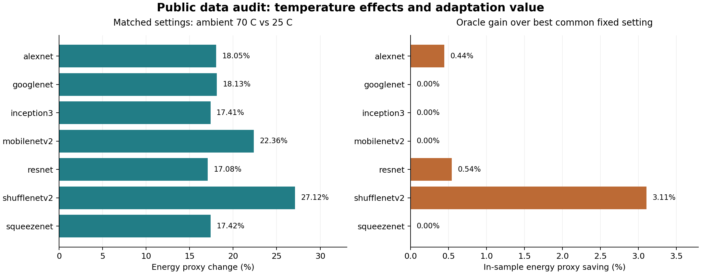

# A2 热感知选择性并发：第一轮机制核查

2026-11-15。**结论：有条件保留 A2，现有公开数据不可辨识冷热最优并发关系是否反转。尚未验证新算法收益。**

## 报告与结果

- [完整报告（HTML，下载后浏览）](A2_机制核查报告.html)：数据可用性、文献差异、轻量重分析、最小实验及研究决策。
- [计算结果](a2_reproducibility/edgeengine_results.json)、[聚合画像](a2_reproducibility/edgeengine_aggregates.json)、[JLL 日志抽查](a2_reproducibility/jll_sample_audit.json)。
- [验证记录](a2_reproducibility/validation.json)、[来源版本与阅读范围](a2_reproducibility/provenance.json)、[文件校验表](a2_reproducibility/SHA256SUMS.json)。



## 数据核查

| 来源 | 平台与公开内容 | 对 A2 的支持边界 |
|---|---|---|
| [EdgeEngine](https://github.com/DependableSystemsLab/EdgeEngine) | TX2；7 模型、环境 25/70°C、多组频率下的时延及分项功率数组 | 单任务，无并发/启动偏移实验；没有固定窗口的整机能耗。仓库未发现明确 LICENSE。 |
| [HaX-CoNN](https://github.com/ismetdagli/HaX-CoNN) | Xavier/Orin；GPU/DLA 画像、争用、转移时延、预期结果与可下载归档 | 适合复用执行框架；缺同平台同步温度×功率×延迟×偏移记录。Zenodo 归档标 CC BY 4.0，第三方组件另核。 |
| [Jetson Latency Lab](https://github.com/dankang21/jetson-latency-lab) | Orin Nano Super/NX；时延、功率、温度、实际频率与干扰日志 | 适合计量与 EMC 混杂对照；未形成自然冷热×异构双任务错开实验。Apache 2.0，模型另核。 |

不能把 TX2 温度功率数据、Xavier 争用画像和 Orin 频率日志拼成同平台实测。

## 已完成的计算

EdgeEngine 共 100 文件、8,354 记录、4,176 对同配置数据。按作者功率截取方法计算推理能耗代理 Ê，不等于完整整机能耗。

| 模型 | 原有期限 / ms | 温度适配相对共同最佳固定配置的样本内收益 |
|---|---:|---:|
| AlexNet | 15 | 0.4437% |
| GoogleNet | 18 | 0 |
| Inception3 | 60 | 0 |
| MobileNetV2 | 14 | 0 |
| ResNet | 15 | 0.5413% |
| ShuffleNetV2 | 16 | 3.1083% |
| SqueezeNet | 13 | 0 |

两温态各权重 1/2；同数据选优并评价，未计额外调度成本。三项正值均涉及期限可行域变化，不能写成两个均可行配置之间的能耗排序反转。ShuffleNetV2 的低温最优配置在高温仍更省能，但时延 16.295 ms 超过 16 ms 期限。

同频配置的能耗代理随环境升温增加约 17.1%–27.1%（各模型配对变化的中位数），并未对应同量级适配价值。缺独立会话重复及仪表不确定度，不能宣称小差值显著。

## 文献边界与最小实验

HaX-CoNN 已处理映射、重叠争用和转移时延；IceEdge 已结合并发控制与热管理。[Mediator 官方摘要](https://pure.korea.ac.kr/en/publications/mediator-characterizing-and-optimizing-multi-dnn-inference-for-en/)已覆盖温度、争用与系统能耗，本轮没有取得全文，不能宣称其未考虑主动错开。BIDENT v2 的并发能耗近似及热状态边界见完整报告。

候选平台为同一块 AGX Xavier 32GB，ResNet101 + GoogleNet、FP16、batch=1、GPU + DLA0；完整编译、精度和 GPU 回退路径先验证。首轮固定映射，2 自然温态 × 7 动作 × 5 重复，共 70 个测量窗口；动作包括同时启动、4 种部分错开和2种串行。热状态准备时间另计，70 窗口不是完整因果确认的全部成本。

固定工作量、精度、期限和能耗窗口；纳入 CPU、搬运、等待、监测、调度与尾段。区分严格能耗反转、期限/热安全可行域变化和普通争用收益；核对实际频率、EMC、热/过流限频。独立确认必须比较最佳固定动作、争用感知策略和简单温度阈值策略，扣除开销并报告误差。

**决策：**先补同平台数据及 Mediator 全文；若只能使用当前公开数据，暂缓 A2 算法主线。只有两个温度点时，不能据此证明复杂算法优于简单阈值。没有启动硬件实验、热参数拟合、大型 MILP 或认证缓存优化。

## 复现

在本目录执行（Python 3.10+；分析只用标准库）：

```sh
python a2_reproducibility/download_sources.py --out INPUT
python a2_reproducibility/analyze_public.py --edge INPUT/EdgeEngine --jll INPUT/jll_samples --out reproduced
```

下载脚本固定官方提交并验证原始文件 SHA-256。已有相应数据时，直接指定本地目录即可离线重算；将生成的四个 JSON 与 `a2_reproducibility/` 内同名文件比较。

已完成独立 pandas/NumPy 汇总交叉检查、100 个 EdgeEngine 与10个 JLL 文件校验；归档脚本离线重跑的四份 JSON 一致。结果不代表 A2 机制或统计显著性验证。

`ANALYSIS_PROTOCOL.txt` 是计算前写下的分析规则，不是第三方预注册。公开副本仅将3份 PDF 结构检查记录的本机绝对路径改为 `papers/文件名`，PDF 哈希与检查结果保持，文件校验表已重建。原始数据、论文下载件、临时浏览器文件和 ZIP 不提交。

## 背景与授权边界

背景固定方向筛选 [a1c2c1f](https://github.com/YBEMR/paper/commit/a1c2c1f4829d7ae58c3fbf73da765b67381e916e) 与认证复用 [569d1ad](https://github.com/YBEMR/paper/commit/569d1ad0dac22c09ac24dc152d719d3831125b3c)，不将这些分支内容默认为 main。

本提交归档用户要求的本轮报告、脚本和结果；“有条件继续”是研究建议，不表示已确认创新点或已获后续硬件实验授权。
