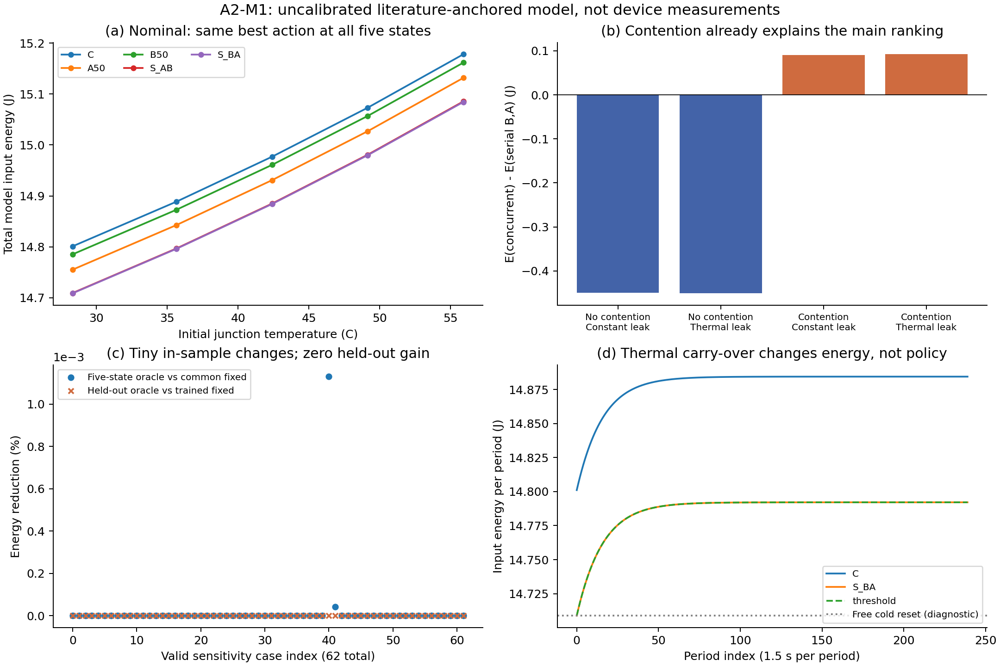

# A2 最小机制验证：固定映射与频率下的启动偏移

**结论：本轮没有得到值得开发专门热感知调度算法的收益证据。** 名义模型在五种初态下均选择 B→A 串行；62 组有效敏感性参数中，仅两组出现微小最佳动作变化，九候选内样本内理想增益最大 **0.0011303%**，留出温态增益均为 **0**。所有正式计算均未触发热降频，不能据此评价降频活跃区域。

这是**文献锚定、关键参数未标定的机制仿真**，不是 Xavier 实测，也不是对整个 A2 方向的否定。研究判断、推导和边界见 [REPORT.md](REPORT.md)；来源逐项见 [SOURCES.md](SOURCES.md)。上轮公开数据核查见 [GitHub 归档](https://github.com/YBEMR/paper/tree/bb299a4e8fa9211137b2707478eab2171d587c84/research/a2_mechanism_audit_20261115)。



## 复现

Python 3.12；首次运行需要安装 `requirements.txt`。精确环境记录在 `validation_results.json`，本次为 numpy 1.26.4、scipy 1.13.1、numba 0.61.2、matplotlib 3.10.0。不同软件版本可能改变抽样或浮点末位，应优先使用这些版本复算。

```sh
python -m pip install -r requirements.txt
python validate_model.py
python run_experiment.py --out replay
python validate_results.py --replay replay
python plot_results.py
python verify_manifest.py
```

`run_experiment.py` 默认写入 `results/`；上面的命令写入独立 `replay/`，保留归档结果。`validate_results.py` 重做两组微小排序变化的数值与周期诊断、比较复算文件，并更新验证记录；`plot_results.py` 从归档 CSV 绘图。清单验证针对归档副本；跨软件版本重生成验证文件或图片后，清单差异不等于科学数据错误。

正式计算约 17 秒，含启动约 21 秒；随后做一次完整确定性复算及有界数值诊断。无硬件调用、无 MILP、无参数寻优。报告中的“最优”仅指九个离散候选。

## 文件

| 文件 | 内容 |
|---|---|
| `protocol.json` / `freeze.json` | 计算前冻结的参数、动作、对照、判据及来源哈希 |
| `SOURCES.md` | 文献定位、参数转换、未标定项 |
| `model.py` / `run_experiment.py` | 双节点电热模型、有限枚举与消融 |
| `validate_model.py` / `validation_model.json` | 解析能量、事件、独立 RC 解与守恒检查 |
| `validate_results.py` / `validation_results.json` | 微小差值复核、开销分析、确定性复算记录 |
| `results/single_window.csv` | 5,670 条单窗记录及完整能耗分解 |
| `results/periodic.csv` | 预定的 280 次周期运行汇总 |
| `results/posthoc_*.csv` | 结果后选择的两组诊断，单独标识，未改参数 |
| `results/overhead_sensitivity.csv` | 监测/调度增量开销敏感性 |
| `plot_results.py` / `figures/` | 图及复现代码 |
| `RUNLOG.md` / `execution*.log` | 执行记录及两次实现错误的保留说明 |
| `MANIFEST.sha256` / `verify_manifest.py` | 交付文件完整性核验 |

没有重分发第三方论文、模型权重或原始设备数据；只使用注明出处的少量表值及自生成结果。上游参数来源不代表其许可证授予本报告新的权利，本目录未擅自添加第三方许可。
