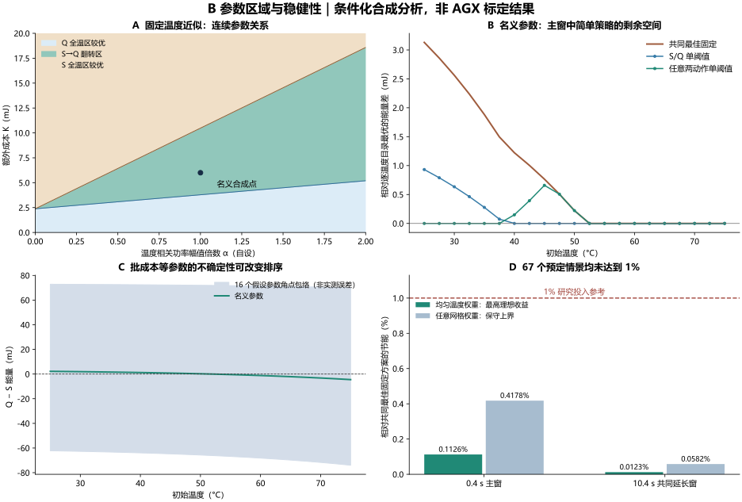

# B方向：参数依据、翻转区域与稳健性分析

2026-11-14｜仅公开资料与仿真｜材料状态：ANALYZED（数值验证通过，未做硬件验证）

**当前证据不支持为这套B机制投入复杂MILP或启发式。** 在冻结的67个合成情景、21个初温点和92个候选动作内，零决策开销的逐温度目录最优，相对共同最佳固定方案的最高平均节能为 **0.1126%（0.4秒主窗）/0.0123%（10.4秒共同延长窗）**。39个情景存在跨温度共同最优固定动作。参数不确定性足以改变S/Q排序，而实际参数误差尚不可辨识。1%仅作为本轮研究投入参考，未按结果调参追逐门槛。

结论限于这套工作负载、候选目录和假设域；不证明真实AGX没有收益、不排除其他负载，也不否定整个CPU–NPU热调度方向。AGX Xavier在此只是CPU–GPU证据参照，不能写成CPU–NPU实证。

## 1. 哪些参数有物理依据，哪些仍未知

本轮核对原厂资料与作者原文，并沿用上轮固定版本公开数据审计。**物理机制存在、同芯片资料可用、目标动作参数可辨识，是三个不同判断。** 表中“未知”在机器文件中保持 `null`；没有从P40、NX或Orin拼接系数。

| 参数或关系 | 可核对的同平台依据 | 对本模型可用程度 |
|---|---|---|
| GPU频率、并发响应时间、六路平均功率 | LoudVA固定版本有14档配置、1772个频率—并发记录；并发1响应时间27.193–267.158ms，并发1/2六路功率5.64039–26.7909W | 描述性参照。并发不是单批次，响应时间含排队，六路总和不是GPU动态功率；不得填入批执行成本 |
| 单批次1/2的时间、动态能量 | 未找到与目标模型、精度、状态匹配且去除排队的成对记录 | **未知**；40/65ms和4/5W沿用旧合成锚点 |
| SoC结到热传导板TTP的热阻 | 原厂热设计指南Table3-1：平衡负载典型0.35K/W，集中负载典型0.65K/W | 有条件典型值，非统计上下界；不等于CPU/GPU各自到环境的热阻 |
| 结到板级热阻 | 同表给5.5K/W，用于两电阻模块表示 | 不能当CPU↔GPU互热阻；热容、外部散热边界仍缺失 |
| 节点热容、到环境热导、跨域热导 | 指南的节点与边界不匹配现有两节点RC，公开日志也未完成瞬态辨识 | **三项均未知**；禁止把上面三个热阻直接塞进RC矩阵 |
| GPU关断/低功率状态是否可能 | NVIDIA文档区分Active中的GPU供电轨关断与整机SC7挂起 | 机制依据。不能推出本负载每个短空隙都能有效休眠 |
| 有效休眠功率、进入阈值、唤醒时延/能量 | 缺目标运行栈与负载的状态标记、切换轨迹 | **四项均未知**；模型瞬时无成本进入休眠是理想化假设 |
| 漏电幅值、温度系数 | 未取得同配置分离动态功率后的温度扫描 | **未知**；不能把闲置SM功率或整轨静态功率全叫漏电 |
| 温度测量 | NVIDIA R35.6.0文档有SOC_THERM 0.5°C精度裕量描述 | 不是完整实验的同步、位置、漂移总误差；±0.5/±2°C只作敏感性情景 |
| 完整系统能耗与成对差值重复性 | 上轮日志不足以辨识系统边界与毫焦耳级成对误差 | **未知**；外部0.3W也是合成值，不能声称真实整机节能 |

来源：[LoudVA固定作者仓库](https://github.com/iloudaros/LoudVA/tree/2b4b15efa5231d445b85d500ea5ef51d381a64c3)、[上轮数据审计](https://github.com/YBEMR/paper/blob/7bd4e7f85cb36b59d69e1a68ecc568733f754ff8/research/b_parameter_audit_20261114/REPORT.md)、[NVIDIA热设计指南§3.1.1、Fig3-1、Table3-1，印刷页8–9](https://www.diamondsystems.com/files/binaries/Jetson_AGX_Xavier_Thermal_Design_Guide_v1.0.pdf)、[NVIDIA R35.6.0功率与热管理文档](https://docs.nvidia.com/jetson/archives/r35.6.0/DeveloperGuide/SD/PlatformPowerAndPerformance/JetsonXavierNxSeriesAndJetsonAgxXavierSeries.html)。指南的80°C是TTP表面边界，不能据此把模型80°C节点限制说成AGX结温规范。

sBEET的AGX Xavier 16GB实验在固定670MHz下统计GPU轨功率，并用10分钟平均值刻画功率；作者认为其试验中温度变化影响较小，因此没有建模该项。这支持核查温度机制强度，不能替我们生成温度系数、同模型批成本或完整系统能耗。其1ms软件采样设置也不等于传感器有效带宽证书。[作者原文§II-A、IV-A、V-A](https://intra.engr.ucr.edu/~hyoseung/pdf/rtss2021_sBEET.pdf)

完整表包含23项，其中16项目标参数为未知；见 [参数表](parameter_identifiability.csv)、[物理证据与适用边界](physical_evidence.json)、[阅读范围](SOURCE_NOTES.md)。**本轮动态计算没有使用上述热阻拟合“真实AGX”。**

## 2. 最佳批次何时翻转：连续关系

沿用S=(2,1,1)、Q=(2,2)，分别等待(20,0,0)ms、(20,20)ms。在温度暂时固定、两动作的有效休眠结构保持不变时：

`ΔE(T) = E_Q − E_S = K − d·F(T)`，`F(T)=A+B·exp[β(T−40)]`。

- `K=t₂p₂−2t₁p₁+E_wake`：Q多一次batch2、少两次batch1，并多一次唤醒的净直接成本。
- `d=2t₁−t₂−t_wake`：Q节省的总awake时间。
- `A=0.17ψ W`，`B=0.17αψ W`；α为温度相关功率幅值倍数，ψ为有效休眠对比度，β为温度系数。这些均为合成模型的符号化关系。

当 `d>0、B>0、β>0`，对温区 `[T_L,T_H]` 有：

| 条件 | 区域 |
|---|---|
| `K ≤ dF(T_L)` | Q在全温区不差于S |
| `dF(T_L) < K < dF(T_H)` | 低温S、高温Q；阈值 `T*=40+ln[(K/d−A)/B]/β` |
| `K ≥ dF(T_H)` | S在全温区不差于Q |
| 等号 | 边界温度并列，不删除平局 |

若d为负，单调方向相反；d=0则比较K即可。B=0、β=0或无有效休眠ψ=0时，这条温度相关休眠收益通路消失。**它不是所有热耦合机制的普遍不可能性证明。** 唤醒成本增加抬高K，可使S/Q不再翻转；其他批等待动作仍可能交叉。

名义锚点为 `K=6mJ、d=14ms、A=B=0.17W、β=0.035/K`，固定温度近似给T*=51.982°C；动态模型的21点网格最佳S/Q切点为51.25°C。两者模型不同；51.25只是50与52.5°C之间的网格分割代表值，均不是可部署的AGX阈值。

误差判据应比较**能量差与误差界**，不能只看温度变化：若同温度下 `sup_θ ΔE(T,θ)<0` 才能确定Q稳健较优，若 `inf_θ ΔE(T,θ)>0` 才能确定S稳健较优，否则排名未定。对固定温度、固定β/ψ/唤醒时长，本式关于t₂、p₂、α、E_wake是多重仿射函数，所声明独立参数盒的极值恰在16角点取得。K与d共享t₂，不能把两者当独立区间再冒充精确界。

这些解析结果见 [连续区域表](results/analytic_regions.csv) 和 [解析误差包络](results/analytic_uncertainty_envelope.csv)。动态ODE另算，未将角点结果包装成连续参数盒证书。

## 3. 冻结设计与强简单基线

[运行前协议](PROTOCOL.md) 与 [冻结配置及哈希](design_freeze.json) 在首次扫描前写入。已有发现性结果事先可见，故不是盲态预注册。本轮没有为达到1%扩域或筛掉无收益情景。

| 项目 | 统一设置 |
|---|---|
| 负载与约束 | 4请求在0/50/100/150ms到达，各相对截止期250ms；先到先服务；合成温限80°C |
| 动作目录 | 原46种批结构/0或20ms等待组合，各允许DPM开/关，共92个动作 |
| 温度 | 25–75°C，步长2.5°C，共21点；主扫描CPU/GPU同初温，另算CPU固定40°C的名义对照 |
| 参数情景 | 36个漏电幅值×休眠对比度×唤醒能量组合；1个β=0对照；14个单因素扰动；16个不确定盒角点，共67个 |
| 单因素 | C与全部热阻分别×0.5/2，batch2时间/功率分别×0.8/1.2，β×0.5/1.5，唤醒时长×0.5/2，环境20/30°C |
| 不确定盒 | batch2时间和功率各±10%、温度相关功率幅值±20%、唤醒能量±50%；**人为敏感性范围，非文献置信区间** |
| 能量边界 | 主窗0.4s；再延长共同10s。CPU/GPU基础、动态、温度相关功率、唤醒和外部基础功率均计入 |

延长窗内所有动作使用同一CPU awake/GPU最低可用状态；不同终态温度造成的后续能量差继续计入。它是统一的有限观察窗，不是无限冷却至同温、周期稳态或真实设备系统校准。进入sleep瞬时且无成本、控制开销为零，使理想收益估计偏乐观；DPM开/关选项与无有效休眠对照均保留。

在每个参数情景下，全部基线共享同一已知参数与约束，依次比较：

1. 立即执行单请求：DPM开与关均记录，仅作弱基线。
2. **共同最佳固定方案**：在21个初温上始终采用同一个动作，使平均能量最小；动作可含固定等待和DPM。
3. **S/Q最佳单阈值**：允许S→Q、Q→S及常数策略，DPM同开或同关。
4. **任意两动作最佳单阈值**：在全目录中选两动作、一个切点；包含固定方案。
5. **逐温度目录最优**：每点取92动作中最小能量。它是有完美参数信息、零决策开销的有限目录节能上限；不是无限调度空间的全局最优算法。

平均收益定义为 `100·(平均E_fixed−平均E_policy)/平均E_fixed`，不是逐点百分比平均。阈值在同网格求最佳用于结构比较，不声称训练/测试泛化。不存在自适应空间时，覆盖率记NA。

## 4. 结果：比立即执行强，但绝对空间仍很小

名义参数、21温度等权时，共同最佳固定为Q。原来40/60°C两点的等权结果与当前温度分布不同，固定赢家变化不构成矛盾。

| 名义情景：相对共同最佳固定Q | 0.4s主窗 | 10.4s延长窗 |
|---|---:|---:|
| 固定Q平均能量 | 1.015553J | 7.540174J |
| S/Q单阈值节能 | 0.069025% | 0.009332% |
| 任意两动作单阈值节能 | 0.074846% | 0.010130% |
| 逐温度目录最优节能上限 | 0.083886% | 0.011348% |
| S/Q覆盖潜在节能 | 82.28% | 82.23% |
| 任意两动作阈值覆盖潜在节能 | 89.22% | 89.27% |
| 两动作阈值之后剩余空间 | 0.009040个百分点 | 0.001218个百分点 |

**不能写“S/Q已经覆盖95%”。** 它未达本轮95%描述标准；任意两动作阈值也未达。可以说复杂方法剩余的绝对空间极小。最优两动作阈值在低温选B-1111-0100-on，高温选Q，网格切点46.25°C；单请求中加入固定等待也是必须允许的简单竞争者。

| 全部67情景 | 0.4s主窗 | 10.4s延长窗 |
|---|---:|---:|
| 最高逐温度目录最优收益 | 0.112581% | 0.012254% |
| 共同固定在所有温度均最优 | 39/67 | 39/67 |
| S/Q出现排序翻转 | 23/67 | 23/67 |
| 理想收益达到1% | 0/67 | 0/67 |
| 两动作阈值后最大剩余空间 | 0.014546个百分点 | 0.001966个百分点 |
| 正收益28情景中S/Q覆盖≥95% | 6/28 | 6/28 |
| 正收益28情景中任意两动作覆盖≥95% | 14/28 | 14/28 |

主窗最大情景为温度相关功率幅值×2、休眠对比度0.5、额外唤醒能量0；延长窗最大为β×1.5。情景计数描述设计覆盖，**不是现实发生概率**。CPU固定40°C对照的名义理想收益为0.086923%/0.011766%，未改变判断。

无收益与弱效应对照全部保留：

| 对照 | 主窗理想自适应收益 | 解释边界 |
|---|---:|---|
| 温度相关功率幅值为0 | 0 | 本模型能量不再随初温变化 |
| β=0，保留温度无关功率 | 0 | 功率仍消耗，但本模型不产生热状态收益 |
| 无有效休眠ψ=0 | 0 | DPM有效关闭，不强行支付无益唤醒成本 |
| 额外唤醒能量10mJ | 0.014738% | S/Q已不翻转，其他动作仍有微小切换收益，不能说全部收益归零 |

完整逐情景表、逐温度政策和所有动作汇总见 [scenario_summary](results/scenario_summary.csv)、[temperature_results](results/temperature_results.csv)、[all_action_aggregates](results/all_action_aggregates.csv)。不可行记录保留在原始数组；不以删掉失败或零收益项提高均值。

### 不依赖均匀温度权重的检查

令 `E*(T)=min_a E_a(T)`，在所有网格点都可行的固定动作中求

`r = min_a max_T [(E_a(T)−E*(T))/E_a(T)]`。

取达到r的动作a，对每点均有 `E*(T)≥(1−r)E_a(T)`。任意非负归一化温度权重下，平均共同最佳固定能量不超过该动作的平均能量，故理想自适应相对共同最佳固定的收益不超过r。

67情景中这个保守上界最大为 **0.417840%/0.058247%**。因此，仅改变这21点上的温度权重也不能达到1%。该证书**不覆盖温度网格之间、不同参数情景的混合、目录之外动作或其他负载**。

## 5. 参数不确定性是否足以淹没收益

在所声明16角点中，**全部21个温度点的Q−S差值都出现两种符号**；两个窗口合计42组均如此。解析近似对这个参数盒给出精确符号不确定界；动态ODE只验证所算角点，未证明整个连续盒的极值位置。

更接近部署的检查是：在名义参数选择动作/阈值后冻结，原样应用到扰动参数，再与该真实参数下重新选择的共同最佳固定方案比较。下表不给参数未知的策略重新调阈值。

| 冻结名义策略，无温度观测偏移 | 主窗最差相对收益 | 延长窗最差相对收益 | 主窗负收益角点 |
|---|---:|---:|---:|
| 名义固定Q | −14.3540% | −1.9841% | 5/16 |
| 名义S/Q阈值 | −10.5051% | −1.4526% | 14/16 |
| 名义两动作阈值 | −8.1257% | −1.1241% | 16/16 |

这些负值是**假设参数误差下、相对知道真实参数的强固定参照的损失**，不是实测AGX损失，也不说明阈值一定不如同样误配参数的固定方案。它表明毫焦耳级热状态收益不足以容忍该假设盒内的批成本误配。

仅在固定温度近似、固定batch2时长下，batch2能量的独立误差会等量进入Q−S差值：Q比S多一次batch2。其名义动态能量325mJ；约1.2mJ排序余量仅相当于约0.37%的该项能量。这个局部算术尺度不能替代完整误差传播或实测重复性。

另保留±0.5/±2°C观测偏移。±0.5°C在本网格没有改变阈值动作，是切点离网格样本1.25°C的离散效应，**不构成连续温度鲁棒性证据**。±2°C以及14个单因素的完整回放均在 [frozen_policy_transfer](results/frozen_policy_transfer.csv)。

## 6. 1%投入参考与停止边界

若监测/决策增加平均能量c，要保住1%收益必须满足 `c ≤ 0.99·E_fixed−E_policy`。全部67情景的理想目录最优预算已为负；名义情景为 **−9.304mJ（主窗）/−74.546mJ（延长窗）**。这不是负的物理开销，而是说明即使c=0也达不到参考门槛。

因此，本轮建议：**保留B的条件化翻转边界及无收益区域，暂停为该机制开发复杂算法。** 不追加按结果调参的扫描，不凭未知物理系数扩张收益。重新投入需要新的同配置公开记录或已有论文模型，足以约束批成本、有效休眠和温度功率差，使收益界与参数误差可以同时评价；不以获得硬件为前提，也不自动恢复此前暂停的其他问题族。

这是一项助手的研究投入建议，不是用户最终选题确认。新的独立负载、候选空间或完整物理模型可能改变结论，应另行说明问题与证据，不能把本轮有限目录证书外推。

## 7. 验证与复算

- 主扫描：67×92×21=129444个候选状态；另1932个CPU固定40°C对照。两窗口均输出能量；扫描57.89秒。
- 与旧实现选定动作逐项复核：能量最大差1.73×10⁻¹²J，旧结果未覆盖或改写。
- 独立标量DOP853复核144条典型及最大收益情景相关轨迹；能量最大差4.01×10⁻¹¹J，峰温采样差2.14×10⁻¹²°C。547项数值/政策检查通过。
- 分项能量守恒残差≤6.49×10⁻¹⁴J。该精度支持代码结果一致性，**不代表参数已识别或现实测量准确到这一量级**。
- 数值可行性用采样峰温判断，不宣称连续时间安全认证；没有硬件测量、统计显著性检验或模拟样本置信区间。

复算入口见 [README](README.md)，数值核验见 [numerical_validation](results/numerical_validation.json)，研究完整性自审见 [REVIEW](REVIEW.md)。原始全动作数组随本地复算ZIP保存；GitHub提交全部文本结果、配置与脚本，可重新生成数组。
