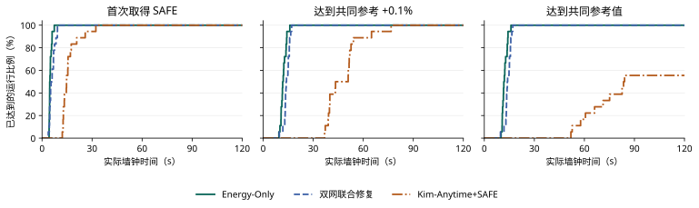
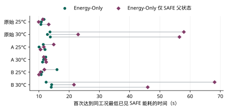

# 第三章主算法选型

**建议选用 Energy-Only 作为主算法。** 它和双网联合修复在六个工况、每工况三个种子的 18 个配对中均取得相同的最低已见 SAFE 能耗。Energy-Only 在其中 16 对更早达到共同参考 +0.1%，其完整单网切点扫描与有限名额交换已经足够，无需在论文主算法中加入每对网络的联合枚举或热点定向排序。双网联合修复保留为结构邻域对照。

## 同预算结果

三法各做 18 次新运行，每次从进程启动前计时、上限 120 s。共同参考为同负载、同温度下三种主方法所有种子的最低已认证能耗，达到参考值采用 10⁻⁷ J 容差。“进入 +0.1%”以参考能耗乘 1.001 为阈值。首次 SAFE、命中质量目标与最终结束是三个不同事件。

| 方法 | 最终 SAFE | 首次 SAFE 中位 s | 进入 +0.1% 次数 / 中位 s | 命中参考值次数 | 20 s 内命中参考值 | 搜索结束中位 s |
|---|---:|---:|---:|---:|---:|---:|
| Energy-Only | 18/18 | 4.69 | 18/18 · 11.87 | 18/18 | 18/18 | 116.01 |
| 双网联合修复 | 18/18 | 5.70 | 18/18 · 13.89 | 18/18 | 18/18 | 116.01 |
| Kim-Anytime+SAFE | 18/18 | 14.70 | 18/18 · 47.17 | 10/18 | 0/18 | 73.00 |

Energy-Only 对 Kim 有 **8 次能耗较低、10 次持平、0 次较高**，按同种子 Kim 最终焦耳作分母，配对节能均值 **0.0291%**，最大 **0.0754%**。双方的 18 个最终方案均在共同参考 +0.1% 以内。更明显的差别在短预算：20 s 时 Kim 已有 15 张 SAFE 证书，均未进入 +0.1%；60 s 时有 16/18 次进入，90 s 时为 18/18。Energy-Only 与双网修复均在 20 s 前找到全部最终最佳解，之后仍按冻结预算探索。Kim 在候选池查完后提前结束。以上证据支持“较早取得接近最低能耗的安全方案”，不能推出 Energy-Only 的整次搜索耗时更短。[逐次改善](tables/improvements.csv) · [同种子配对](tables/paired.csv) · [固定墙钟统计](tables/checkpoint_summary.csv)

[最终能耗差距分布（每点一种子）](figures/final_gap.svg)，可编辑 SVG 已提交；绘图脚本同时导出 PDF。

## 负载、温度与稳定性

原始负载选正序近等长场景，帧数 62/63/62/63；A 将帧数改为 100/100/25/25，四网请求数 200/125/125/50；B 将活跃网络改为 01、02、13、23，帧数 62/63/63/62，四网各 125 次。三个流均含 500 个独立核验的请求，使用 25 FPS、40 ms 期限、10 s 服务和 40 ms 尾窗；温度仅取 25°C、30°C。全部使用冻结的 FP16 代理图、四网常驻、完整系统计能及四节点连续热和漏电模型。原流摘要与历史逐字节一致。

| 负载 | 环境 °C | 本工况参考 J/窗 | Energy-Only 峰温上界 °C | 双网修复命中 | Kim 命中 | 进入 +0.1% 中位 s，Energy-Only / 双网 / Kim |
|---|---:|---:|---:|---:|---:|---|
| 原始 | 25 | 41.72532 | 72.405 | 3/3 | 2/3 | 10.79 / 13.80 / 51.03 |
| 原始 | 30 | 42.34993 | 77.950 | 3/3 | 2/3 | 13.66 / 15.90 / 43.25 |
| A 请求份额 | 25 | 32.15280 | 68.081 | 3/3 | 2/3 | 11.44 / 13.43 / 51.51 |
| A 请求份额 | 30 | 32.70781 | 73.593 | 3/3 | 2/3 | 11.54 / 15.65 / 39.96 |
| B 网络共现 | 25 | 41.71039 | 73.194 | 3/3 | 1/3 | 10.73 / 13.23 / 39.20 |
| B 网络共现 | 30 | 42.33500 | 78.739 | 3/3 | 1/3 | 14.08 / 12.96 / 39.01 |

Energy-Only 六个工况各 3/3 命中参考值，均选择 X4139374 与四场景 LLL/LLL/LHL/LHL；所有 18 张证书的最小请求期限裕量均为 0.731332 ms，最窄热裕量为 1.261°C。B 的 30°C 工况中双网修复的命中中位时间更短。Kim 八次略高的方案均为 X4139372，频率相同，差别是 YOLOv3 的 DLA1 前缀止于第 10 层，X4139374 延伸到第 12 层。A 的焦耳变化包含请求份额变化，不能据此计算相对原负载的算法节能率。[同工况汇总](tables/case_summary.csv) · [逐个证书和路径](tables/runs.csv)

## Kim 基线的公平性

保留原版 24 个体、64 代上限、SetFreq、Lexicase、原交叉与变异。每个完整代从累计有效池中按原代理排序选最高的未查映射，做一次全窗热认证并更新最优 SAFE。已查标记和 SAFE 结果只供认证使用。搜索结束后按剩余代理顺序继续检查。代理、认证和候选排序均计时。18 次中 17 次完成 64 代；A、25°C、种子 20261123 在 95 s 生成时限前完成 57 代。实际认证 202–282 个不同映射。原负载的六个运行全部与同种子历史 Kim 的 64 代种群及可行场景数逐代一致，共核对 384 代。原负载首次 SAFE 中位数由旧归档的 56.21 s 提前到本轮的 15.10 s，历史数据来自另一批次；主比较的三法在同机同批交错运行。[原 Kim 六个历史对照](tables/historical_kim_original.csv) · [公平基线实现](kim_anytime.py)

## 机制、因果证据与边界

主算法的决策是用全窗共享的 DLA 名额约束协调各网的合法切点、物理绑定和场景频率。它完整扫描轮换网络的一个切点坐标，保留有限的名额交换及单场景换频提案，利用资源服务需求和父方案温度估算候选能耗；期限可行且暂时超温的低能耗状态可作为离线父方案，在线部署只取通过完整连续认证的 SAFE 档案。这一实现沿用 9324f7e，算法差异和伪代码见[机制表](mechanisms.md)。

- **候选空间的收益。** 旧四个 25°C 工况中，同负载扩展域的 SAFE 见证比原 81 域已证最优低 3.19%–3.38%。该差额属于切点扩展；同域 Kim 也能找到这些见证。本轮两个新负载没有 81 域的最优参照。[原域与扩展域对照](../ch3_cooperative_cuts/README.md)
- **双网和热定向动作。** 历史 60 对 joint/single 的最终能耗全部相同。热点定向对普通超温保留在 60 对中也全部等能耗；其对已证超温父状态的总体局部修复率高 2.69 个百分点，到 30°C 优势消失。已有证据不足以将最终收益归因于联合枚举或热点预测。[双网/单网消融](../ch3_joint_repair/README.md) · [热点定向消融](../ch3_energy_repair/README.md)
- **Energy-Only 自身的超温父状态消融。** 只屏蔽超温档案的父状态资格，保留同样的起点、提案、准确证书及重启规则。对照也 18/18 SAFE、18/18 命中相同最终能耗，但到 20 s 只有 12/18 命中。原始 30°C 的命中中位数从仅 SAFE 父状态的 56.48 s 降至 13.66 s；B 的 30°C 从 45.99 s 降至 14.08 s。这六个配对全部更早，合并其中位数为 51.24 s 对 13.72 s，六条获胜方案的首次发现路径均经过已证超温父状态。其余 12 次完整版本的获胜路径均未经过超温父状态，两版本在 20 s 内都命中。直接消融支持热压力下更早到解；在给定 120 s 预算下，未观察到最终能耗增益。消融与主比较分批在同机相同核配置执行，秒级差异需结合逐种子记录解读。[18 个同种子配对](tables/paired.csv) · [父状态与获胜路径](tables/runs.csv)

- **适用范围。** 三种负载共享同一组四网、场景执行顺序及合成平台，六个工况具有同一最低已见部署。选型支持这些负载扰动下的重复性；每工况三个随机种子不能建立普遍胜率，也没有扩展域全局最优证书。20 s 结果为已观察时间点，尚未建立一般提前停止规则。
- **板端可信度。** 四个前缀及跨切点活跃张量均通过冻结图核查；四份作者 ReLU 图在冻结结构字段上也逐块对齐。尚无匹配权重身份、无回退 FP16 构建、真实 DLA 放置、分段输出一致性或板端热能耗测量。[四网定点核查](hardware.md)

共完成 54 次主比较与 18 次直接消融。72 份运行均在硬上限内结束，无超时或运行故障；已从封存归档逐项核对所选方案的 36,000 条请求完成记录和 754 次严格改善事件。

## 第四章接口与复算

向 M2 交付每个请求流和环境温度的可行能耗上界，附部署、四网切点和物理绑定、四场景频率及 base-27 编码、峰温、最小期限裕量和原始证书哈希。M2 只有在请求、域、性能和热模型匹配，并重验可行性后才能使用该上界。旧 81 域的最优证书范围保持独立。本轮未运行 M2 或 MILP。[六个可行上界](tables/m2_incumbents.jsonl) · [参数表](formal_experiment_config.csv) · [原始归档](archives/manifest.json) · [复算说明](reproduce.md)
