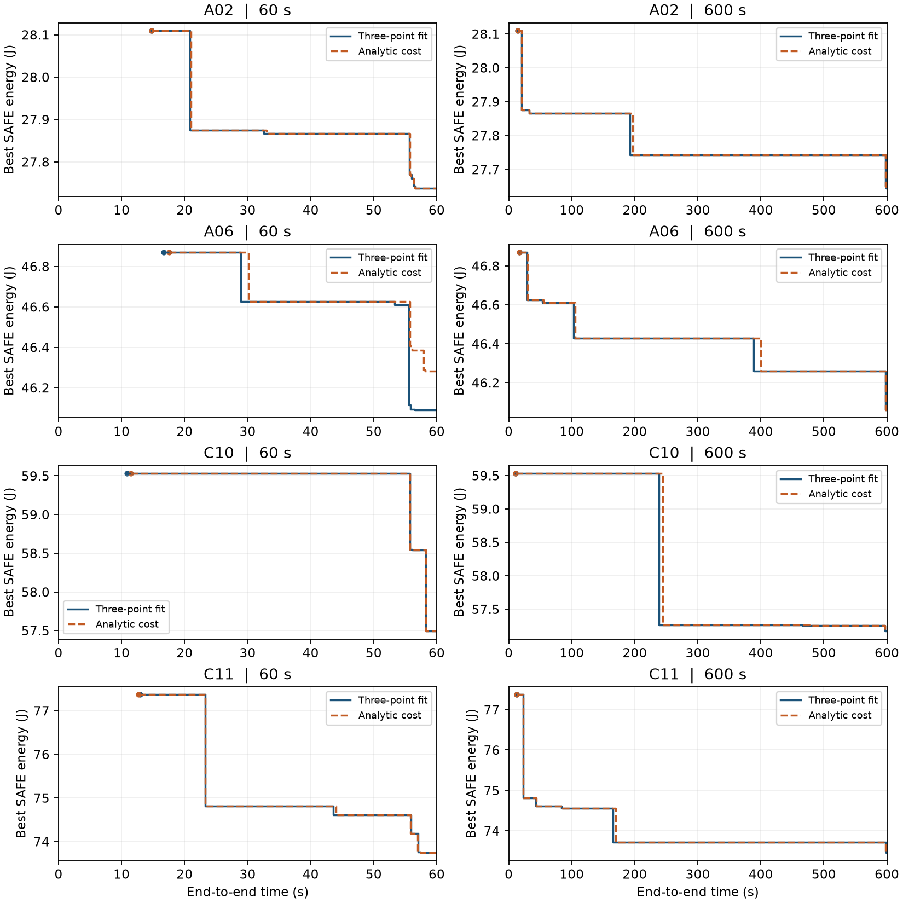

# 三点参考能耗拟合能否由解析画像成本替代

**四流初筛支持继续验证解析替代。** 解析版在 600 秒内对四条流均达到或优于现行 60 秒端点。三个锚点仍保留，正式第三章继续采用原冻结版本。

## 从空排程出发的完整算法结果

能耗含全部设备执行、空闲、切换和温度相关项。差值取解析版减拟合版。严格胜负要求胜方证书能耗上界低于对方下界。

|任务流|预算 s|拟合 J|解析 J|差 J|差 %|证书判定|
|---|---|---|---|---|---|---|
|A02|60|27.737318|27.737318|0.000000|0.0000|区间重叠|
|A02|600|27.643975|27.643975|0.000000|0.0000|区间重叠|
|A06|60|46.091065|46.283000|0.191935|0.4164|拟合胜|
|A06|600|46.061610|46.061610|0.000000|0.0000|区间重叠|
|C10|60|57.493693|57.493693|0.000000|0.0000|区间重叠|
|C10|600|57.173187|57.173187|0.000000|0.0000|区间重叠|
|C11|60|73.750845|73.750845|0.000000|0.0000|区间重叠|
|C11|600|73.466495|73.466495|0.000000|0.0000|区间重叠|

60 秒下，安全覆盖为拟合 4/4、解析 4/4；解析严格胜 0、重叠 3、严格负 1、缺配对 0。

600 秒下，安全覆盖为拟合 4/4、解析 4/4；解析严格胜 0、重叠 4、严格负 0、缺配对 0。

## 多给解析版求解时间后的能耗

|任务流|拟合 60 s（J）|解析 600 s（J）|差 J|差 %|证书判定|
|---|---|---|---|---|---|
|A02|27.737318|27.643975|-0.093343|-0.3365|解析胜|
|A06|46.091065|46.061610|-0.029455|-0.0639|解析胜|
|C10|57.493693|57.173187|-0.320506|-0.5575|解析胜|
|C11|73.750845|73.466495|-0.284350|-0.3856|解析胜|

每条流的长、短预算从独立进程启动。跨预算结果同时含有额外搜索时间的收益；拟合本身的作用应结合相同预算和相同父状态的比较判断。

## 三点拟合实际上改变了哪些选择

每条流从拟合版 60 秒正式账本取首次经过首窗、中窗、末窗时的第一个父状态；恢复其完整前缀、设备状态及温度。每个状态逐一固定 30 组合法 GPU/NPU 频档，两版使用相同容量切片、网格和候选数。每组单独展开，排除其他频档的跨组去重干扰。诊断结果不计入正式成绩。

|流|共同组|配额集合相同|顺序也相同|共有候选槽／全部槽|解析漏较低参考能耗|拟合漏较低参考能耗|最低参考能耗持平|缺共同合法|
|---|---|---|---|---|---|---|---|---|
|全部|360|345|344|2621/2646|3|2|290|65|
|A02|90|86|85|657/665|1|1|72|16|
|A06|90|86|86|655/660|0|0|65|25|
|C10|90|87|87|658/663|1|0|74|15|
|C11|90|86|86|651/658|1|1|79|9|

在 360 个共同组中，替换系数实际改变 15 组候选集合。漏选低参考能耗按两版各自保留集合的最低合法 FIFO 值比较，数值容差为 1e−10 J，比较范围限于两版所选候选的并集。共同状态取自拟合版首次搜索路径，这一比例只描述所抽取的状态。

原拟合估计 FIFO 前缀累计的参考增量；解析式只计算本窗口主推理相对于最低空闲基准的增量。两者绝对值包含的项目不同。以每组同一个中心锚点对齐后再比较误差，可消去父前缀和其他共同常数。训练锚点、时序失败候选不计入以下误差统计。

|流|合法非锚点|拟合平均绝对误差 J|解析原值与账本平均绝对差 J|解析中心对齐后平均绝对误差 J|
|---|---|---|---|---|
|全部|541|0.009445|15.728675|0.011405|
|A02|142|0.007152|8.885022|0.008189|
|A06|97|0.003763|12.862603|0.002513|
|C10|137|0.008822|21.350183|0.009678|
|C11|165|0.015277|18.635713|0.020834|

[逐候选的配额、实际参考能耗、期限余量、热风险及误差](diagnostic/candidates.csv) · [逐组实际系数与最低值](diagnostic/groups.csv)

## 候选发生分歧的一个实例

A02 第 6 窗，GPU 频档 6、NPU 频档 1。下表仅列两版选择不同的配额。风险为原热延拓分数，最终安全状态由全流连续认证给出。

|入选版本|A/B 配额|FIFO 合法|参考增量 J|热风险 °C|余量 ticks|
|---|---|---|---|---|---|
|拟合|0/0|是|17.782468|84.035|379|
|解析|33/0|是|17.740139|78.354|48|

## 映射、频率和热安全

|流|预算 s|设备不同请求数／总数|同设备但频档不同|解析搜索访问拟合最佳映射|解析认证过该映射|峰温上界 °C 拟合／解析|最小余量 ms 拟合／解析|
|---|---|---|---|---|---|---|---|
|A02|60|0/480|0|是|是|71.608／71.608|1.200／1.200|
|A02|600|0/480|0|是|是|70.988／70.988|0.600／0.600|
|A06|60|203/800|95|否|否|73.377／73.141|0.400／0.100|
|A06|600|0/800|0|是|是|72.980／72.980|0.600／0.600|
|C10|60|0/960|0|是|是|78.137／78.137|0.000／0.000|
|C10|600|0/960|0|是|是|78.058／78.058|0.100／0.100|
|C11|60|0/1280|0|是|是|78.030／78.030|0.000／0.000|
|C11|600|0/1280|0|是|是|77.986／77.986|0.100／0.100|

“访问”包含已进入完整闭合 FIFO 评价的映射及已认证映射。“认证”要求已有完整物理证书。逐流配对表还记录了解析版在拟合最佳映射上实际交付的最小 SAFE 能耗。单次限时搜索的胜负也可能受截止时已完成的工作量影响。

[两版逐请求的设备与频档](tables/request_assignments.csv)

## 能耗随求解时间变化

曲线从首次取得 SAFE 时起画；此前的能耗留空。每次下降都可追溯到在线落盘的证书。[指定时间点](tables/checkpoints.csv) · [逐次改善](tables/improvements.csv)

## 运行耗时和不利结果

|流|预算 s|版本|首次 SAFE s|构造 s|搜索认证 s|普通／温度 DP s|调频认证 s|SAFE／HOT／模型外／未决|闭合 FIFO 失败调用|
|---|---|---|---|---|---|---|---|---|---|
|A02|60|拟合|14.79|19.03|24.10|0.91／0.76|0.49|378/0/0/0|2235|
|A02|600|拟合|14.47|313.54|269.61|0.90／0.55|0.42|4037/0/0/0|48751|
|A02|60|解析|14.80|19.56|23.69|0.91／0.74|0.55|372/0/0/0|2253|
|A02|600|解析|14.63|321.97|261.13|0.90／0.55|0.48|3946/0/0/0|49089|
|A06|60|拟合|16.71|40.92|6.41|1.04／0.79|0.74|77/8/0/0|7802|
|A06|600|拟合|16.84|335.99|251.05|1.04／0.81|0.68|2671/8/0/0|69294|
|A06|60|解析|17.51|19.89|26.95|1.05／0.81|0.70|323/13/0/0|3632|
|A06|600|解析|17.21|346.29|240.71|1.05／0.81|0.61|2664/8/0/0|69272|
|C10|60|拟合|10.84|23.25|24.42|1.24／0.94|0.75|15/253/0/0|1787|
|C10|600|拟合|10.83|409.78|177.79|1.25／0.95|0.70|1515/240/0/0|34577|
|C10|60|解析|11.43|23.92|23.27|1.24／0.95|0.75|15/241/0/0|1819|
|C10|600|解析|10.95|420.45|167.11|1.24／0.96|0.74|1418/240/0/0|34954|
|C11|60|拟合|12.93|31.97|14.87|1.64／1.24|0.97|115/0/0/0|3798|
|C11|600|拟合|12.41|286.59|300.62|0.82／0.62|0.48|1960/124/0/0|33503|
|C11|60|解析|12.71|32.78|14.43|1.63／1.23|0.97|112/0/0/0|3795|
|C11|600|解析|12.76|294.49|292.53|0.82／0.62|0.57|1904/124/0/0|33454|

耗时来自在线起止日志，未完成调用截在有效截止点。动态规划仅计已返回的内核调用，其余及未能拆分的时间在逐格表单列。FIFO 时序失败按调用数登记，可含对同一映射的不同频档尝试。

## 删去的计算与保留的功能

冻结实现先把三个配额及其 FIFO 参考能耗写成三个方程，求解截距和两个配额方向的斜率，再将系数用于代表点排序。解析版删除这一处三元线性求解，用冻结的精确整数系数直接构造三个系数。令每个主推理增量系数为该频档执行时长乘以其活动功率与设备最低档空闲功率之差。按同一整数尺度排序，换算焦耳时除以模型尺度。

$$E(x,y)=a e_{AG}+b e_{BG}+(e_{AN}-e_{AG})x+(e_{BN}-e_{BG})y.$$

三个锚点仍然构造、执行 FIFO 检查并作为候选。终端锚点沿用 500 tick 网格，再按冻结规则聚合；其余候选沿用 2500 tick 网格。容量边界、平衡线、代表池、去重和补位均沿用原程序。后续束搜索、映射提名、普通调频、温度修正和连续认证完全共用。解析成本仅承担候选排序，完整能耗及其认证下界均取自物理模型。

## 研究范围与归档

正式计算 16 格，合计 5270.782/5280 核秒。同流同机同核，单线程；实例建立、候选评价、调频、热认证及在线写入均计时。60 秒和 600 秒独立启动，分别预留最后 5 秒调频，沿用无 SAFE 时继续搜索的规则。诊断单独用时 9.958 秒。按流去重核验了 11,348 份正式物理排程。

四流各格只有一次运行，无法据此估计重复间波动。移除专用锚点和十二流三次重复需要单独的执行预算。本轮结果不更改正式论文章节及文献基线。

[完整配对与映射差异](tables/pairs.csv) · [长对短](tables/long_vs_short.csv) · [逐格指标与开销](tables/cells.csv) · [最终逐请求设备、频档、证书和温度轨迹](final_evidence.tar.gz) · [全部物理证据](paired_results) · [单计划解包器](../ch3_mapping_first_nested/restore_plan.py) · [证据校验清单](PAIRED_SHA256SUMS)
