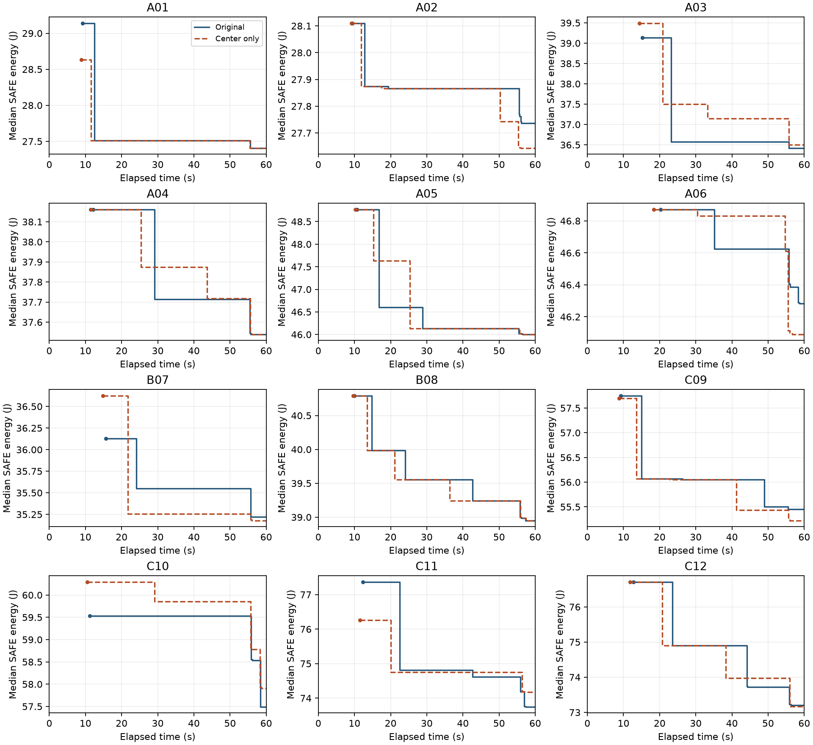
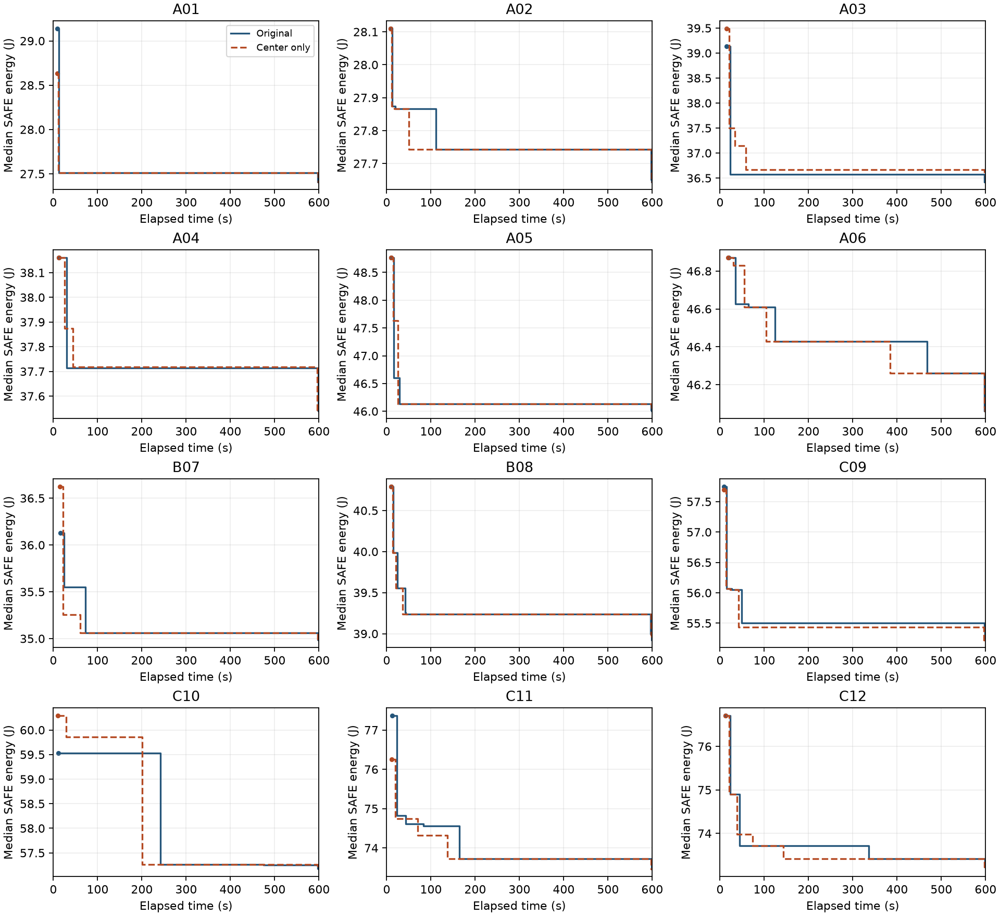

# 第三章配额生成结构简化：十二流最终确认

**简化版覆盖了原版 60 秒可靠成功的全部任务流，但有任务流的中位能耗较高。按任务书单列差额，由用户决定是否接受。**

|比较（简化版相对原版）|共同可靠流|严格较低／重叠／严格较高|逐流能耗变化范围|
|---|---|---|---|
|60 秒对 60 秒|12|5／3／4|-0.4147% 至 0.7203%|
|600 秒对 600 秒|12|2／6／4|-0.0642% 至 0.3540%|
|600 秒对 60 秒|12|8／1／3|-0.6663% 至 0.3540%|

正差表示简化版耗能更多。前两行在相同时间下比较完整算法。第三行回答多给简化版求解时间能否保持最终质量，包含额外时间带来的收益。只有两方能耗认证区间严格分离才判高低；区间重叠单列。

## 安全覆盖与重复稳定性

每条流三次独立运行，至少两次在截止前交付 SAFE 才算可靠。各流能耗与上下界分别取成功重复的中位数。空缺表示覆盖不足。

|设置|SAFE 次数|可靠流|三次全成功流|三次排程相同流|三次设备映射相同流|最大流内能耗极差／中位数（%）|最高峰温上界（°C）|最小期限余量（ms）|
|---|---|---|---|---|---|---|---|---|
|原版 60 秒|36/36|12/12|12|12|12|0.0000|78.137|0.000|
|原版 600 秒|36/36|12/12|12|12|12|0.0000|78.058|0.100|
|仅中心 60 秒|36/36|12/12|12|12|12|0.0000|78.049|0.000|
|仅中心 600 秒|36/36|12/12|12|12|12|0.0000|78.058|0.100|

## 逐流能耗与采用条件

表中能耗单位为 J，采用比较以原版 60 秒为分母。同为 600 秒的差距独立列出。每格的成功数、两侧认证界、三次极差和排程身份见原始表。

|任务流|原版 60 秒|原版 600 秒|简化 60 秒|简化 600 秒|简化 600 对原版 60（%）|同为 600 秒（%）|采用比较|
|---|---|---|---|---|---|---|---|
|A01|27.40792|27.40792|27.40792|27.40792|0.0000|0.0000|区间重叠|
|A02|27.73732|27.64398|27.64398|27.64398|-0.3365|0.0000|简化版较低|
|A03|36.42200|36.42200|36.50077|36.55093|0.3540|0.3540|简化版较高|
|A04|37.53993|37.53993|37.54004|37.54004|0.0003|0.0003|简化版较高|
|A05|46.00566|46.00566|46.00566|46.01776|0.0263|0.0263|简化版较高|
|A06|46.28300|46.06161|46.09107|46.06161|-0.4783|0.0000|简化版较低|
|B07|35.22012|34.98546|35.17930|34.98546|-0.6663|0.0000|简化版较低|
|B08|38.95129|38.92393|38.95129|38.92393|-0.0702|0.0000|简化版较低|
|C09|55.45162|55.25673|55.22466|55.22466|-0.4093|-0.0580|简化版较低|
|C10|57.49369|57.17319|57.90781|57.19494|-0.5196|0.0380|简化版较低|
|C11|73.75084|73.46649|74.17780|73.46649|-0.3856|0.0000|简化版较低|
|C12|73.20714|73.23041|73.16060|73.18337|-0.0325|-0.0642|简化版较低|

## 能耗退化与重复一致性

|比较|流|简化多耗（J）|多耗（%）|三次同编号重复：低／重叠／高／缺|
|---|---|---|---|---|
|C-A|A03|0.07878|0.2163|0／0／3／0|
|C-A|A04|0.00011|0.0003|0／0／3／0|
|C-A|C10|0.41412|0.7203|0／0／3／0|
|C-A|C11|0.42696|0.5789|0／0／3／0|
|D-B|A03|0.12893|0.3540|0／0／3／0|
|D-B|A04|0.00011|0.0003|0／0／3／0|
|D-B|A05|0.01209|0.0263|0／0／3／0|
|D-B|C10|0.02175|0.0380|0／0／3／0|
|D-A|A03|0.12893|0.3540|0／0／3／0|
|D-A|A04|0.00011|0.0003|0／0／3／0|
|D-A|A05|0.01209|0.0263|0／0／3／0|

同编号重复的严格胜负刻画波动。流级判定仍使用三次成功结果的中位数，逐次严格胜负不作多数表决。设备映射以每个请求的 GPU/NPU 选择为准，完整排程还包括频档等状态。

## 实际算法开销

下表是各设置全部 36 次的算术平均秒数，含未成功运行。认证时间包括搜索内认证和调频后认证。构造、认证、调频及其他项分别记账。

|设置|实际计费|实例|构造|搜索认证|提名|交接|普通调频核|温度修正调频核|调频后认证|其余|
|---|---|---|---|---|---|---|---|---|---|---|
|原版 60 秒|58.556|0.039|29.562|16.889|0.171|0.431|1.109|0.839|0.665|8.852|
|原版 600 秒|599.760|0.040|367.327|218.984|1.846|0.371|0.961|0.708|0.584|8.938|
|仅中心 60 秒|58.625|0.039|30.313|16.178|0.168|0.368|1.231|0.878|0.678|8.771|
|仅中心 600 秒|599.884|0.041|368.635|217.633|1.920|0.374|0.972|0.717|0.581|9.011|

实际开销为单核端到端经过时间。截止时正在进行的构造和认证按可观察边界截断。调频内核只计已返回的计时记录，无法拆出的启动、日志、未完成内核等列入其余。分析、压缩与校验在各格时钟结束后进行。

## 已认证能耗随求解时间的变化

每条曲线从三次中第二次成功交付 SAFE 的时刻开始。每个时刻使用当时已经交付的安全端点取中位数；第三次首次交付时参与中位数的样本数会变化。原始逐次曲线数据保留具体时间、排程和映射。

## 简化前后算法结构

|环节|原完整第三章|仅中心简化版|
|---|---|---|
|候选起点|均衡中心，加上沿均衡线的远点和按非共线条件构造的侧点|只预留原负载均衡中心|
|配额排序的能耗系数|三个锚点预重放后解三元线性方程|从设备画像直接取各任务类型的增量能耗系数|
|其余候选|容量整数切片，按能耗、负载和配额距离补充；原候选补位|同一切片、顺序、距离、槽位数及补位规则|
|热预测|末窗专用锚点 50 ms 功率矩按时长合并成 250 ms|统一直接计算 250 ms 功率矩|
|最终求解与接纳|时序重放、跨场景状态继承、束搜索、终端排序、多映射提名、超温映射处理、全局调频、温度修正及连续认证|复用原完整算法的这些环节|

两版均从空排程开始。每条流使用同一运行机和同一逻辑核，四种设置的顺序随流及重复轮换。60 秒和 600 秒分别按 55+5、595+5 分配；分界前无 SAFE 时搜索可用至总截止点。每个设置按实际截止交付计分。

本轮 144 个正式单元实际计费 47405.692／47,520 核秒。原版、解析替代、仅中心和物理模型的不可变提交见[决策记录](decision.json)。

[逐流及区间](tables/flows.csv) · [中位数配对](tables/median_pairs.csv) · [逐次配对](tables/repeat_pairs.csv) · [逐次能耗、认证与计时](tables/cells.csv) · [重复间排程与映射](tables/repeat_identities.csv) · [逐请求映射及频档变化](tables/mapping_changes.csv) · [开销汇总](tables/overheads.csv) · [逐次能耗更新时间](tables/improvements.csv) · [完整物理档案](lanes)

每条流的 SHA256SUMS 对应运行时归档。每个重复目录的 final_endpoints.tar.gz 提供其最终 SAFE 排程、证书和完整 31 列轨迹。重复目录下 paired_results 中每个记录的计划哈希均可借助[还原程序](../ch3_mapping_first_nested/restore_plan.py)从同目录的 physical 索引恢复，包括未接纳的超温方案。
