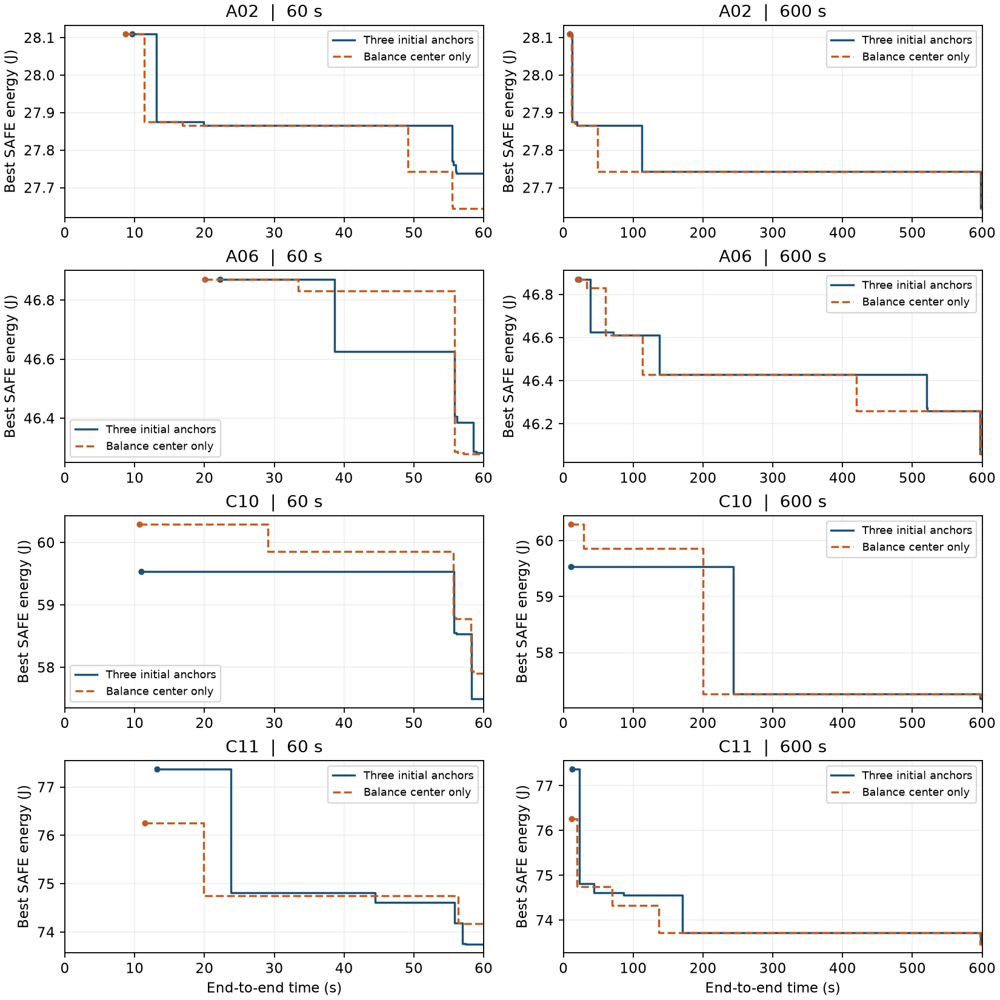

# 第三章能否取消专用非共线锚点

**四流初筛通过，建议把“解析能耗＋仅保留负载均衡中心”送入十二流三次重复确认；正式第三章的替换决定留到确认后。**

在相同的 600 秒预算下，四条流均获得安全排程，其中三条的最终排程哈希完全相同，另一条多耗 0.021754 J（0.0380%）。简化版 600 秒在四条流上均低于现行算法历史 60 秒的完整安全能耗。60 秒时，两条流分别多耗 0.7203% 和 0.5789%。这一短预算代价应随简化结论一起保留。本轮按允许增加求解时间的目标判断，没有预设统计等效界限。

## 完整系统能耗

每格从空排程启动一次。正差表示取消锚点后耗电更多。严格高低要求一方证书的能耗上界低于另一方下界，区间重叠单列。

|任务流|预算（秒）|三锚点（J）|仅中心（J）|差（J）|差（%）|连续认证判定|改换设备请求数／总数|同设备改频请求数|
|---|---|---|---|---|---|---|---|---|
|A02|60|27.737318|27.643975|-0.093343|-0.3365|简化版较低|89/480|20|
|A02|600|27.643975|27.643975|0.000000|0.0000|证书区间重叠|0/480|0|
|A06|60|46.283000|46.279389|-0.003610|-0.0078|简化版较低|26/800|0|
|A06|600|46.061610|46.061610|0.000000|0.0000|证书区间重叠|0/800|0|
|C10|60|57.493693|57.907809|0.414117|0.7203|简化版较高|154/960|359|
|C10|600|57.173187|57.194941|0.021754|0.0380|简化版较高|66/960|5|
|C11|60|73.750845|74.177803|0.426958|0.5789|简化版较高|173/1280|229|
|C11|600|73.466495|73.466495|0.000000|0.0000|证书区间重叠|0/1280|0|

60 秒安全覆盖为三锚点 4/4、仅中心 4/4。仅中心严格较低 2 条、区间重叠 0 条、严格较高 2 条、缺安全配对 0 条。

600 秒安全覆盖为三锚点 4/4、仅中心 4/4。仅中心严格较低 0 条、区间重叠 3 条、严格较高 1 条、缺安全配对 0 条。

全部已接纳端点中，最高峰温上界为 78.13737 °C，最小期限余量为 0.00000 ms。

## 允许更多求解时间时

现行算法取上一轮三点拟合版归档的 60 秒端点。中间一列给出本轮解析三锚点的 60 秒端点，便于区分两种参照。历史结果与本轮跨机器批次，不能单独据此归因。

|任务流|现行历史 60 秒（J）|解析三锚点 60 秒（J）|仅中心 600 秒（J）|相对现行变化（%）|相对现行判定|
|---|---|---|---|---|---|
|A02|27.737318|27.737318|27.643975|-0.3365|简化版较低|
|A06|46.091065|46.283000|46.061610|-0.0639|简化版较低|
|C10|57.493693|57.493693|57.194941|-0.5196|简化版较低|
|C11|73.750845|73.750845|73.466495|-0.3856|简化版较低|

## 相同父状态下，候选配额发生了什么变化

四条流各取首窗、中窗及末窗的同一条归档父前缀，每个状态检查 30 对设备频档。原解析版逐项复现上一轮归档的候选集合。360 组中有 360 组更换了至少一个配额。删除的 720 个专用锚点位置中，容量切片直接重选 23 个，原始候选补位再找回 0 个，余下 697 个未入选。

最低参考能耗仅在各组实际通过 FIFO 时序检查的配额中比较，平局容差为 1e−10 J。多样性取组内所有候选两两间的平均归一化欧氏距离，两个坐标分别除以窗口内对应类型的请求数。热风险取合法候选的最低预测风险。这些数据只解释筛选变化。

|任务流|组数|集合改变|合法候选数（三锚点／仅中心）|最低参考能耗（降／平／升／缺配对）|多样性（三锚点／仅中心）|配对最低热风险平均变化（°C）|
|---|---|---|---|---|---|---|
|A02|90|90|342／292|10／43／21／16|0.4825／0.5243|0.14928|
|A06|90|90|265／217|8／34／23／25|0.4239／0.4596|0.29531|
|C10|90|90|349／293|13／33／29／15|0.4813／0.5217|0.17035|
|C11|90|90|388／347|9／55／17／9|0.5572／0.6050|-0.09717|
|合计|360|360|1344／1149|40／165／90／65|0.4862／0.5277|0.11914|

直接筛选只找回 23/720 个被删除的位置。虽然配额分布更分散，合法候选总数从 1344 降到 1149，但有合法候选的仍是同样的 295 组。C10 的 600 秒搜索记录还显示，仅中心版未访问三锚点版最终胜出的设备映射。这解释了两版在该流上找到了不同的排程，单次运行还不能确定差异在重复实验中是否持续。

## 末窗口热计算核对

对末窗 4 × 30 × 3 = 360 个原锚点，固定同一请求前缀、配额和频档，独立重放两次。50 ms 细格按实际覆盖时长加权聚合；250 ms 路径直接积分，末尾不足一格时两者都使用实际时长。时序、参考能耗、设备状态和切换决定逐项一致。八分量功率矩的最大绝对差为 2.22e-15，四节点温度序列最大差 4.26e-14 °C，峰值最大差 4.26e-14 °C。连续热认证仍逐排程使用原认证器。

## 实际删除的逻辑

旧版从均衡中心再构造两点。先在近均衡线上选距中心较远的配额，再用行列式选出与前两点不共线的配额，并让三点预先占用候选名额。简化版只让原均衡中心占一个名额，直接调用原整数切片与排序，空位沿用原始配额顺序补齐。一并删除三个锚点的预重放、校准记录及末窗专用细格聚合。解析能耗系数、负载评价、距离补充和配额去重沿用原实现。

各个实际入选的配额继续进行时序和热评价。后端沿用冻结第三章的父状态继承、束搜索、终端排序、多映射提名、超温映射处理、全局调频和温度修正。正式评分采用物理重放后的完整安全能耗。

## 实验口径与证据

正式完成 16 格，累计计费 5269.556 核秒，上限 5280 核秒。每条流的四格使用同一运行机、同一逻辑核、单线程及独立冷启动。60 秒与 600 秒分别预留末尾 5 秒调频；搜索分界前无 SAFE 时允许搜索延续到总截止点。每格一次，时间截断可能影响能耗端点，四流不足以估计重复运行波动。

[同预算能耗及映射配对](tables/pairs.csv) · [历史现行 60 秒对照](tables/archived_fit60_vs_center600.csv) · [本轮解析版跨预算配对](tables/long_vs_short.csv) · [逐格证书界与时间](tables/cells.csv) · [逐请求设备及频档](tables/request_assignments.csv)

[完整候选及来源](diagnostic/candidates.csv) · [共同状态汇总](diagnostic/groups.csv) · [热网格逐点核对](diagnostic/terminal_grid.csv) · [简化组实际执行代码](simplified.py) · [全部在线认证归档](paired_results) · [最终排程、证书和轨迹](final_evidence.tar.gz)

冻结版本为完整第三章 `798f5586`、解析有锚点版及历史数据 `bc584198`、统一物理模型 `be641ce0`。本次正式运行的代码、运行机、逻辑核、预算及实际计费见各格的 `receipt.json`。比较执行前，离线诊断曾因两个同名 Python 模块导入问题停止。修正后才开始正式运行，未消费额外正式单元。
