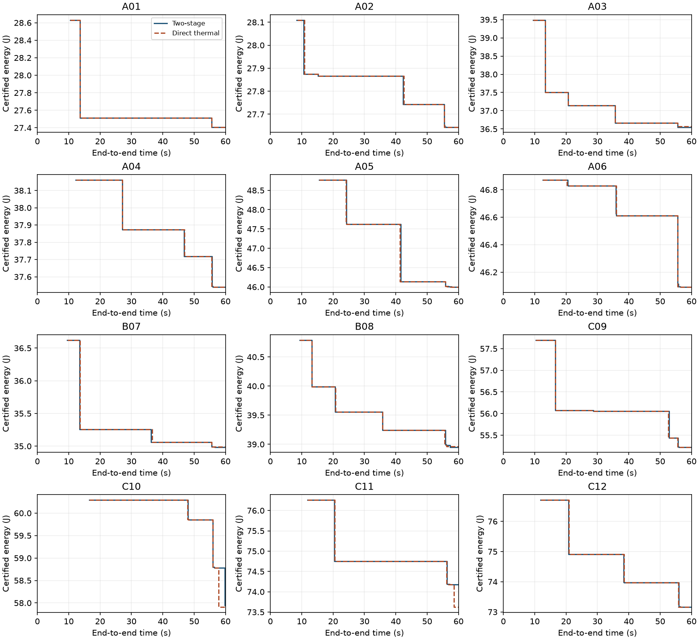

# 第三章直接热感知调频端到端确认

**两种方法均可用于完整求解。直接版存在已认证的逐流能耗代价，建议暂保留两阶段，由用户决定是否为简化结构接受所列损失。**

十二条 35°C 流各做三对独立冷启动，两阶段与直接版均采用单中心解析配额。60 秒下，两组分别交付 36/36 和 36/36 个按时 SAFE 排程，可靠覆盖分别为 12/12 和 12/12。

以共同可靠流等权计算，直接版相对两阶段的平均能耗变化为 -0.06009%。相对增幅最大的流为 A03，差额 0.013027 J（0.03564%）。正数表示直接版耗能较高。平均 +0.01% 与最大单流 +0.05% 是任务书预先给出的低损失参照。覆盖、超温恢复与逐流损失共同参与版本判断。

第二阶段安排为本阶段的能耗和安全结果已足以形成建议，结束实验。

## 能耗与重复稳定性

可靠成功沿用十二流确认口径，三次至少两次按时交付 SAFE。能耗及认证上下界分别取成功重复的中位数。两方法区间严格分离才判高低；区间刻画物理认证精度，三次重复的波动另列。

### 直接版 60 秒与两阶段 60 秒

直接版严格较低 4 流，区间重叠 4 流，严格较高 4 流，缺少可靠配对 0 流。

|流|安全次数 A/B|两阶段中位 J|直接版中位 J|差额 J|变化 %|逐次低/重叠/高/缺|
|---|---|---|---|---|---|---|
|A01|3/3|27.407922|27.407746|-0.000176|-0.00064|3/0/0/0|
|A02|3/3|27.643975|27.643951|-0.000024|-0.00009|3/0/0/0|
|A03|3/3|36.550928|36.563955|0.013027|0.03564|0/0/3/0|
|A04|3/3|37.540043|37.540043|0.000000|0.00000|0/3/0/0|
|A05|3/3|45.995482|45.996028|0.000545|0.00119|0/0/3/0|
|A06|3/3|46.091065|46.091065|0.000000|0.00000|0/3/0/0|
|B07|3/3|34.985460|34.989331|0.003870|0.01106|0/0/3/0|
|B08|3/3|38.951287|38.965061|0.013774|0.03536|0/0/3/0|
|C09|3/3|55.224662|55.224662|0.000000|0.00000|0/3/0/0|
|C10|3/3|57.938894|57.906849|-0.032045|-0.05531|3/0/0/0|
|C11|3/3|74.177803|73.622703|-0.555100|-0.74834|3/0/0/0|
|C12|3/3|73.160599|73.160599|0.000000|0.00000|0/3/0/0|

两阶段在 12 条流三次均安全，三次最终排程相同的有 12 条。流内三次能耗极差占中位数的最大值为 0.00000%。

直接版在 12 条流三次均安全，三次最终排程相同的有 12 条。流内三次能耗极差占中位数的最大值为 0.00000%。

## 超温提名与恢复

|方法|实际超温提名|开始处理|阶段全部完成|取得 SAFE|改善当时全局在位解|成为最终解|
|---|---|---|---|---|---|---|
|两阶段|6|3|0|3|3|3|
|直接版|6|6|6|6|6|6|

同编号重复提名了相同超温排程且轨迹哈希相同的对照共 6 处。其中 A 未完成且未恢复，B 完成并交付 SAFE 的有 3 处；A 已恢复而 B 未恢复的有 0 处。提名集合不同时，仅报告各自观察次数。

## 共同映射与能耗退化来源

每个提名记录完整系统能耗、35°C 参考能耗、温度相关能耗及其他分量。相同设备映射仍可能有不同初始频档。只有初始排程与轨迹均相同且双方完整完成，才能直接比较该映射上的调频输出。

|流|增加 J|增加 %|相同初解均完成的位置|其中 B 较高|最终胜出映射不同的重复|A 胜出映射未获 B 提名的重复|两法完成数不同的重复|
|---|---|---|---|---|---|---|---|
|A03|0.013027|0.03564|12|12|3|0|0|
|A05|0.000545|0.00119|12|3|0|0|0|
|B07|0.003870|0.01106|12|3|0|0|0|
|B08|0.013774|0.03536|12|6|0|0|0|

逐个共同映射的输入、调频后能耗和完成标志均保留。下列见证只对相应映射成立，映射池变化及截止截断可以同时发生。

- A03 的第 1 对重复中，共同初解 3cf1b91e293f 的两条调频路径均完成。对应映射的完整能耗相差 +0.017802 J。
- A05 的第 1 对重复中，共同初解 d45c74695a56 的两条调频路径均完成。对应映射的完整能耗相差 +0.000545 J。
- B07 的第 1 对重复中，共同初解 3596d7ab2e2f 的两条调频路径均完成。对应映射的完整能耗相差 +0.003870 J。
- B08 的第 1 对重复中，共同初解 5f08955dd474 的两条调频路径均完成。对应映射的完整能耗相差 +0.013774 J。

## 调频结构与开销

|环节|两阶段|直接版|
|---|---|---|
|搜索与提名|单中心解析配额、窗口搜索、原超温规则，最多四种映射|相同|
|调频参考|先做普通全局调频，按冻结规则选取热修正参考轨迹|始终使用该提名的原始轨迹|
|优化与回退|热感知动态规划及必要的期限预留重试|一次热感知优化及相同预留重试，无普通调频补救|
|安全接纳|原 SAFE 可在位，HOT 仅作候选；新解重放并连续认证，严格改善才接纳|相同|

下表为每次正式运行的平均秒数。未返回的调频核时间归入其余开销。积分、认证及在线证据写入均处于求解预算内。

|方法|实例|构造|搜索认证|提名|交接|普通调频|热调频|调频后认证|其余|
|---|---|---|---|---|---|---|---|---|---|
|A|0.040|27.919|18.550|0.199|0.395|1.259|0.875|0.653|8.785|
|B|0.040|27.909|18.536|0.198|0.416|0.000|0.987|0.359|8.846|

正式运行合计 4174.659 核秒；搜索前失败启动合计 1.635 核秒；本阶段总计 4176.294/4320 核秒。每个单元从进程启动前开始计时。证据打包、哈希核验和离线制表在各单元退出后完成。

曲线在三次重复中至少两次已交付 SAFE 后开始，第三次首次交付时中位数的样本数随之增加。

[逐流及区间](tables/median_pairs.csv) · [逐次配对](tables/repeat_pairs.csv) · [安全与稳定性](tables/flows.csv) · [逐次开销](tables/cells.csv) · [超温见证](tables/hot_witnesses.csv) · [映射能耗分解](tables/mapping_energy.csv) · [各阶段能耗](tables/stage_energy.csv) · [共同映射核查](tables/common_mappings.csv) · [退化诊断](tables/loss_diagnosis.csv) · [逐次能耗时间记录](tables/improvements.csv) · [全部物理证据](../../lanes/60) · [最终排程与完整温度轨迹](endpoints)
