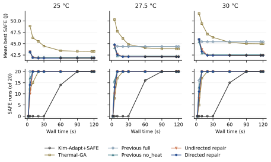
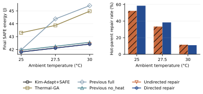
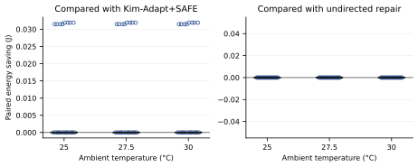

# 第三章正式实验：低能耗探索与连续热约束修复

**主要发现。** 在 `f6df387` 的扩展域内，能耗优先搜索更稳定地找到了历史最低已见安全方案。与同种子 Kim-Adapt+SAFE 比较，定向修复法 24 次能耗更低、36 次持平、0 次更高，平均配对节能 **0.0301%**。两种新算法在全部 60 对中返回相同能耗。定向修复提高了部分温度下超温父方案产生安全子方案的比例，这项局部收益没有转化为最终节能。

## 最终方案与时间

四种场景配置 × 三个环境温度 × 五种子。复用历史四法 240 次运行，新增定向修复和普通超温保留各 60 次。全部 **360/360** 个最终方案满足 500 个请求的 40 ms 期限和四节点连续 80°C 温限。表中节能按同域、同工况、同种子在 120 s 时配对计算，正值表示定向版能耗更低。期限失败按首次测试的不同完整策略计数。

| 方法 | 平均 SAFE 能耗 J | 定向版相对节能 | 首次 SAFE 中位 s | 实际搜索中位 s | 候选期限失败率 |
|---|---:|---:|---:|---:|---:|
| Kim-Adapt+SAFE | 42.12646 | 0.0301% | 53.78 | 53.78 | 0.00% |
| Thermal-GA | 44.04841 | 4.3483% | 5.37 | 48.94 | 72.43% |
| 原 full | 43.91760 | 3.9941% | 4.03 | 8.89 | 59.14% |
| 原 no_heat | 42.25458 | 0.3331% | 4.04 | 8.90 | 55.93% |
| 普通超温保留（energy_only） | 42.11378 | 0.0000% | 5.06 | 116.01 | 29.06% |
| 定向修复（directed） | 42.11378 | — | 4.73 | 116.01 | 27.13% |

**微小差额的来源可定位到一个切点。** 两种新方法每次都返回部署 `X4139374`。Kim 有 36 次返回同一部署，另 24 次选择 `X4139372`。后一种部署的 YOLOv3 在 DLA1 执行到第 10 层，前一种延伸到第 12 层。其余三网的切分、DLA 绑定及对应的四场景频率均相同。这 24 对分别节省 0.03148–0.03193 J。两种新方法均在 12/12 工况重现基准归档中的最低已见值，扩展域全局最优仍未知。新方法最终峰温上界为 72.405–78.833°C，最小请求期限裕量为 0.731 ms。[逐运行结果及各网切点](tables/runs.csv) · [各工况的历史见证](tables/witnesses.csv)

**相同墙钟下的质量。** 10 s 时定向版已有 60/60 个 SAFE 结果，平均 42.57923 J；定向版此时比原 no_heat 平均多耗能 0.45%（按 no_heat 分母计算）。20 s 时定向版平均降至 42.11445 J，对原 no_heat 的 60 对均取得更低能耗。普通超温保留在 20 s 时已全部达到本次最终值；定向版在 30 s 时全部达到。Kim 在前 30 s 仍处于候选生成阶段，60 s 时已返回 45/60 个 SAFE，90 s 时为 60/60。取各自配对 Kim 的最终能耗为事后目标，定向版首次达到该目标的中位时间是 **11.99 s**，60/60 对均早于 Kim 首次认证。实际运行仍用满搜索窗口，30–116 s 的继续探索没有刷新记录。历史与新算法分批计时，首次认证速度、最佳解命中速度和进程总耗时须分别解读。[截止时点有效配对与胜平负](tables/paired.csv) · [逐次改进事件](tables/improvements.csv) · [追平 Kim 的时间](tables/kim_target.csv)

图 1 上排为各时点已有 SAFE 解的运行均值，下排为对应覆盖数，每温度 20 次；空缺表示尚无安全见证，连线只连接预设采样时刻。[可编辑矢量图](figures/anytime.svg) · [图数据](tables/anytime.csv)

## 热定向修复贡献

两种新方法共用档案、起点、候选生成、SetFreq、预筛和截止时间。普通版本扩展低能耗超温父方案，按估计焦耳填充提案名额；定向版本利用父方案的违规节点、发生场景及前序热继承估计剩余超温量。表中“修复率”的分母为各组从已证超温父方案直接产生并首次测试的子策略，含被期限拒绝者。

| 环境 | Kim 平均 J | 两种新方法平均 J | 定向修复率 | 普通修复率 | 定向版相对普通版最终节能 |
|---|---:|---:|---:|---:|---:|
| 25°C | 41.82148 | 41.80880 | 58.48% | 52.28% | 0 |
| 27.5°C | 42.12646 | 42.11378 | 38.38% | 33.42% | 0 |
| 30°C | 42.43145 | 42.41877 | 11.00% | 11.55% | 0 |

- **总体局部收益为 2.69 个百分点。** 定向版有 6,714/24,839 个超温父方案子代成为 SAFE，普通版为 6,011/24,696。到 30°C，局部成功率优势消失，普通版高约 0.55 个百分点。两组搜索过程中实际选择的父状态不同，这些比例描述整套搜索策略产生的结果。所有最终能耗则可逐种子直接比较。
- **局部节点恢复与全窗可行可以区分。** 对定向版中由热点排序补入的提案，25、27.5、30°C 分别有 933、2,438、640 个在目标场景解除目标节点超温，相应整窗 SAFE 数为 933、2,436、634。其余 8 个仍受其他场景或节点限制。随温度升高，该类已完成热回放提案的目标峰温预测平均绝对误差从 0.048°C 增至 0.200°C。所有最终证书均由完整模型产生。
- **期限预筛减少了进入整窗连续评价的策略数量。** 定向版测试 98,809 个不同策略，其中 26,803 个因超期提前结束，72,006 个通过预筛后完成热回放；普通版对应为 99,586、28,943、70,643。计数按运行内去重。Kim 的 0% 仅覆盖排序后提交的 60 个完整策略，其 SetFreq 的场景级试探另计。此次没有单独测量关闭预筛后的墙钟开销。
- **归因边界。** 两组新方法在 30 s 已全部等能耗，仅在定向版中使用的热修复排序不能解释最终相对 Kim 的收益。共同的低能耗排序、完整单网切点扫描、跨网名额调整、重启和超温探索在本轮作为整体比较，各自的独立贡献尚未拆分。30°C 的结果也没有支持“越热越应加强定向修复”的推论。[分操作计数](tables/repair_summary.csv) · [逐父子状态](tables/repair_events.csv)

图 2 左为全部六法的最终系统能耗，右为两个新版本从超温父方案产生 SAFE 子方案的比例，橙色为普通版，蓝色为定向版。[可编辑矢量图](figures/energy_and_repair.svg) · [12 工况结果表](tables/summary.csv)

图 3 每点为一对同工况同种子结果，纵轴为对照减定向版的系统焦耳，横线为中位数。两个面板使用各自的纵轴刻度。[可编辑矢量图](figures/paired_energy.svg) · [配对源数据](tables/runs.csv)

## 实现与复算

[算法流程、伪代码、文献与 M2 场景核适配](method.md) · [正式参数](config.json) · [搜索源码](optimizer.py) · [复算命令与统计口径](reproduce.md) · [原始归档与 SHA-256](archives/manifest.json)

本轮沿用 4,319,803 代表部署、FP16、完整系统计能和 10.04 s 观察窗。归档包含 120 次新增运行的完整搜索日志与最终逐请求证据；四个对照直接引用 `f6df387`。M2 场景核的复用范围与缓存键已列在算法说明中，本轮没有运行 M2 搜索或测量加速比。

三幅图的 SVG 随提交发布。仓库忽略 PDF；执行 figures.py 会在同一目录同时生成排版用 PDF 和可编辑 SVG。
