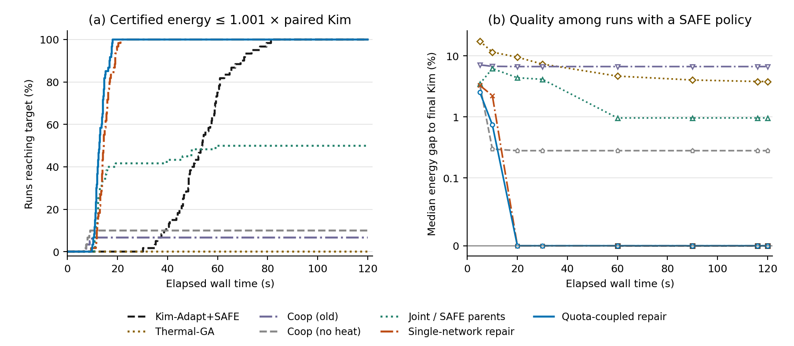

# 第三章实验报告：DLA 常驻名额耦合的联合切点修复

**四网联合调度可以更早找到 Kim 水平的 SAFE 解。** 12 个工况、五个种子的 60 个配对中，联合修复全部在 **18 s 内**达到或低于同种子 Kim-Adapt+SAFE 的最终能耗，中位数 **12.80 s**。Kim 首次取得该能耗的中位数为 **53.78 s**。最终联合修复 24 次更低、36 次持平，平均节能 **0.0301%（0.01268 J/窗）**。两种方法都找到了相同的各工况最低已见能耗，联合修复提高了重复找到该方案的比例。扩展部署域的全局最优未知。

## 能耗与安全证书

复用 `f6df387` 的四组扩展域基线共 240 次，另做联合修复、单网修复、仅 SAFE 起点联合修复各 60 次。所有方法最终均为 60/60 SAFE。下表为全窗系统能耗均值，每个温度含 20 次。能耗差逐工况、逐种子配对，平局容差为 10⁻⁷ J。

| 方法 | 25°C，J | 27.5°C，J | 30°C，J | 20 s 内达到 Kim +0.1% | 首次 SAFE 中位数，s |
|---|---:|---:|---:|---:|---:|
| Kim-Adapt+SAFE | 41.8215 | 42.1265 | 42.4314 | 0/60 | 53.78 |
| Thermal-GA | 43.3000 | 43.8737 | 44.9715 | 0/60 | 5.37 |
| 原协同算法 | 41.9709 | 44.3749 | 45.4070 | 4/60 | 4.03 |
| 原 no_heat | 41.9496 | 42.2546 | 42.5596 | 6/60 | 4.04 |
| **双网联合修复** | **41.8088** | **42.1138** | **42.4188** | **60/60** | **5.33** |
| 单网修复 | 41.8088 | 42.1138 | 42.4188 | 58/60 | 7.48 |
| 双网修复，仅 SAFE 起点 | 41.8088 | 42.6937 | 44.3684 | 25/60 | 4.42 |

联合修复相对 Thermal-GA、原协同算法、原 no_heat 的配对平均节能率分别为 **4.348%、3.994%、0.333%**，三组均为 60/60 次能耗更低。与 Kim 比较，每个温度均为 8 次更低、12 次持平。Kim 在 36 次运行已找到部署 `X4139374`。余下 24 次返回 `X4139372`，仅 YOLOv3 的 DLA 前缀端点从第 12 层变为第 10 层，物理绑定相同。联合修复 60 次均找到前者，各工况的五个种子返回相同能耗。联合修复的最终解均完成全部 500 个请求，最小期限裕量为 **0.731332 ms**。最高连续峰温上界 **78.83347°C** 出现在 30°C 逆序、交替长短工况。[12 工况汇总](tables/case_summary.csv) · [逐运行证书与部署](tables/run_results.csv) · [同种子比较](tables/paired_runs.csv)

## 时间与解质量

下图左侧为累计达到配对 Kim 最终能耗 1.001 倍以内的运行比例，分母固定为 60。右侧为当时已经取得 SAFE 证书的运行相对配对 Kim 最终能耗的中位差距，正数表示耗能更多。已结束的历史方法沿用最后的 SAFE 值。每个时点的有效样本数见配套 CSV。

联合修复首次**追平或优于**配对 Kim 的范围为 9.71–17.97 s，60 对均比 Kim 更早，配对时间差中位数为 **40.50 s**。在冻结的 10 s 时点，联合修复有 49/60 次已找到 SAFE，但只有 2/60 次进到 Kim +0.1% 范围。到 20 s 时两者均为 60/60。Kim 要先完成代理种群搜索再做有序热回退，首次证书较晚。联合修复每验证一个候选就更新当前最低安全能耗。

新方法按预设一直搜索至 116 s 接纳截止，实际搜索中位数 **116.01 s**，全流程硬上限 120 s。上述 12.80 s 是日志中首次命中时刻，算法在线无法据此判断已穷尽改进空间。历史基线与本轮在同机不同批次执行。完成相同 A、C 部署及频率初始化的中位时刻，联合修复为 4.53 s，原完整算法为 4.08 s。保留原始时间，未对两批作比例校正。[逐次改进事件](tables/improvements.csv) · [时点覆盖与能耗](tables/time_checkpoints.csv) · [首次命中](tables/time_to_target.csv) · [可编辑图](figures/time_quality.svg)

## 机制消融与失败条件

**双网名额协调主要改善到解时间。** 联合修复的 60 条最终方案首次发现路径全部包含跨网名额转让。单网版本通过连续几步改变单网切点、名额和绑定，也在 60/60 个配对中得到同一最终能耗。以精确追平或优于 Kim 为目标，联合修复在 41/60 对更早，配对时间优势中位数为 **0.93 s**。单网版本目标命中中位数 14.46 s，最迟 21.14 s。两者每次运行经完整物理回放的不同策略数中位数分别为 737 和 563.5。二元组和一元组的数量不同。因此观察到的是两种搜索策略在同一墙钟预算下的效果。[配对命中时间](tables/paired_time_summary.csv)

**允许超温中间态的作用集中在高温。** 仅允许 SAFE 起点时仍然 60/60 返回安全方案，但只有 30/60 达到 Kim +0.1%。与该消融相比，开放超温起点在 25°C 的 20 对全部持平。27.5°C 有 11/20 对更低，平均节能 1.334%。30°C 有 19/20 对更低，平均节能 **4.346%**。30°C 逆序、交替长短下，仅 SAFE 起点平均 45.2570 J，开放超温起点为 42.4892 J。此处失败指在预算内未达到质量目标，所有交付方案仍通过温度与期限认证。[配对消融](tables/paired_summary.csv)

例如，30°C 正序、近等长，种子 20261121 的联合修复从常驻段数 (2,1,1,0)、峰温上界 82.017°C 的 C 出发。第一次转让得到 (2,1,0,1)，峰温仍为 80.177°C。第二次得到 (1,1,1,1)，峰温降到 78.069°C，能耗 42.619 J。随后将 YOLOv2tiny 的 DLA 前缀端点从第 16 层延至第 22 层，到 14.17 s 得到 42.350 J、77.950°C 的最终解。共有 35/60 条联合修复赢家路径曾经过超温状态。180 次新运行的候选日志保留 33,321 次期限失败和 2,165 次确认超温。路径记录用于说明可达性，消融用于衡量允许该动作的实际效果。[全部赢家路径](tables/winning_paths.csv)

## 是否继续投入

**值得保留能耗优先、允许离线超温探索的修复搜索，作为 M2 的安全初始上界生成器。** 本批的 20 s 截止点已覆盖全部联合修复运行，适合作为这 12 个既定工况的短预算参照。继续增加驱逐链深度的优先级较低：双网动作能提早命中，但单网修复已复现相同最终能耗。主要缺口是跨独立负载与硬件的泛化、可靠的在线早停条件，以及 M2 接收这些上界后的实际加速幅度。本轮未测这三项。

实现直接复用 4,319,803 个部署代表、原 SetFreq、合法频率和四节点连续热评价器。四网、FP16、500 请求、40 ms 期限、10.04 s 计能窗和 80°C 温限均沿用基准。数据验收从新旧 24 份工况归档核对了 420 个最终方案、210,000 条请求完成记录，重建 3,739 次最低 SAFE 能耗更新。[文献借鉴与算法伪代码](method.md) · [正式配置](config.json) · [复算命令](reproduce.md) · [新实验原始档案](archives/) · [验收哈希](tables/audit.json) · [12 条 M2 上界记录](tables/m2_incumbents.jsonl)
