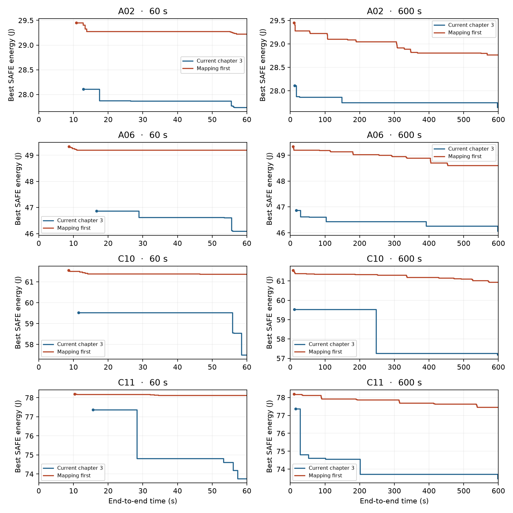

# 第三章结构统一化研究决策报告

**本轮保留现行第三章。独立调频得到验证，外层配额坐标搜索尚未证明可以替代现行映射搜索。**

给定原来的设备分配，仅靠独立调频就能重建十二条历史最终排程。把寻找设备分配也交给新算法后，600 秒时现行版取得 SAFE 4/4，统一版取得 SAFE 4/4；同预算严格比较，统一版更省 0 条、现行版更省 4 条、证书重叠 0 条。

## 独立找到映射后的能耗

两种算法分别从头运行。能耗为全系统连续认证值，差值为统一版减现行版，正数表示统一版更耗能。证书区间重叠表示按当前误差界无法判定严格高低。空白能耗用“—”表示。

|任务流|预算 s|现行版 J|统一版 J|差值 J|差值 %|证书比较|
|---|---|---|---|---|---|---|
|A02|60|27.737318|29.226821|1.489503|5.3700|现行更省|
|A02|600|27.643975|28.764587|1.120612|4.0537|现行更省|
|A06|60|46.091065|49.199016|3.107951|6.7431|现行更省|
|A06|600|46.061610|48.608112|2.546502|5.5285|现行更省|
|C10|60|57.493693|61.373908|3.880215|6.7489|现行更省|
|C10|600|57.173187|60.940976|3.767789|6.5901|现行更省|
|C11|60|73.750845|78.124905|4.374060|5.9309|现行更省|
|C11|600|73.466495|77.450404|3.983909|5.4228|现行更省|

对于允许延长求解时间的采用条件，另将统一版 600 秒与现行版 60 秒直接对照。

|任务流|现行 60 s（J）|统一 600 s（J）|比较|
|---|---|---|---|
|A02|27.737318|28.764587|现行更省|
|A06|46.091065|48.608112|现行更省|
|C10|57.493693|60.940976|现行更省|
|C11|73.750845|77.450404|现行更省|

## 为什么出现差异

逐一核对现行版胜出映射在统一搜索中的访问记录。“访问”包含已进入评价、到期未完成的候选；“已认证”要求交付完整证书。两种版本都对完整轨迹采用同一电热认证规则。

|流|预算 s|统一版访问／认证映射|完成坐标数|访问现行最佳映射|同映射交付证书数|访问历史最佳映射|
|---|---|---|---|---|---|---|
|A02|60|128／85|2|否|0|否|
|A02|600|1409／1032|34|否|0|否|
|A06|60|110／67|2|否|0|否|
|A06|600|1084／786|26|否|0|否|
|C10|60|85／59|1|否|0|否|
|C10|600|896／636|21|否|0|否|
|C11|60|42／42|1|否|0|否|
|C11|600|576／464|15|否|0|否|

A02 的统一搜索没有访问本次现行版最佳映射。至少有一个已知可行且更省电的设备分配落在其已访问集合之外。

A06 的统一搜索没有访问本次现行版最佳映射。至少有一个已知可行且更省电的设备分配落在其已访问集合之外。

C10 的统一搜索没有访问本次现行版最佳映射。至少有一个已知可行且更省电的设备分配落在其已访问集合之外。

C11 的统一搜索没有访问本次现行版最佳映射。至少有一个已知可行且更省电的设备分配落在其已访问集合之外。

给定优质映射时，十二次独立调频复现历史最终排程，支持把频率求解统一成一个可独立调用的步骤。现行版的窗口频率还参与生成和筛选设备映射。能否删去它的这项作用，取决于端到端比较。本轮整体替换了多项外层机制，不能据此给每个旧机制单独归因。

未访问某个映射可以直接证明搜索覆盖存在缺口。它不能证明该映射是唯一好解，也不能区分增加预算、改变坐标顺序或改变邻域将带来多少收益。

## 安全性、首次交付与失败类型

|流|预算 s|版本|首次 SAFE（s）|访问映射|SAFE／HOT／模型外／未决证书|DP 无路径／后处理时序失败调用|最终峰温上界 °C|最小余量 ms|
|---|---|---|---|---|---|---|---|---|
|A02|60|现行|12.81|6926|228／0／0／0|0／0|71.608|1.200|
|A02|600|现行|12.54|72741|2040／0／0／0|0／0|70.988|0.600|
|A02|60|统一|10.77|128|166／4／0／0|42／0|71.786|0.500|
|A02|600|统一|10.78|1409|1879／167／9／0|376／70|75.837|0.033|
|A06|60|现行|16.60|7747|76／8／0／0|0／0|73.377|0.400|
|A06|600|现行|16.84|43161|2702／8／0／0|0／0|72.980|0.600|
|A06|60|统一|8.66|110|122／12／0／0|42／2|73.216|0.500|
|A06|600|统一|7.88|1084|1425／133／7／0|297／95|76.899|0.000|
|C10|60|现行|11.46|3264|15／218／0／0|0／0|78.137|0.000|
|C10|600|现行|11.45|41497|1289／240／0／0|0／0|78.058|0.100|
|C10|60|统一|8.57|85|71／47／0／0|25／0|78.172|0.000|
|C10|600|统一|7.98|896|549／706／8／0|260／95|79.364|0.000|
|C11|60|现行|15.63|3768|41／0／0／0|0／0|78.030|0.000|
|C11|600|现行|15.33|27783|1393／0／0／0|0／0|77.986|0.100|
|C11|60|统一|10.36|42|83／0／0／0|0／0|77.829|0.000|
|C11|600|统一|10.49|576|897／29／1／0|111／13|77.810|0.433|

映射数按逐请求设备身份去重。现行版统计可观测的完整闭合 FIFO 调用及已认证映射，前缀扩展单独属于构造工作。DP 无路径按调用计数；后处理期限失败可能触发冻结的余量重求。实际访问、完成评价、到期未完成、超温及模型外均分列在[逐次明细](tables/cells.csv)。

## 能耗如何随求解时间变化

横轴为各自从进程启动开始的端到端时间，阶梯仅从首次交付 SAFE 时开始。两列是独立启动的实验。图中每一次下降都对应已落盘的完整证书。

[全部指定时间点](tables/checkpoints.csv) · [每次安全在位解更新](tables/improvements.csv)

下表追踪同一次 600 秒运行在各截止点实际可交付的能耗（J）。60 秒列与前面的独立 60 秒运行分别计量。

|流|版本|10 s|30 s|60 s|180 s|300 s|600 s|
|---|---|---|---|---|---|---|---|
|A02|现行|—|27.8662|27.8662|27.7436|27.7436|27.6440|
|A02|统一|—|29.2770|29.2268|29.0885|29.0454|28.7646|
|A06|现行|—|46.6258|46.6105|46.4285|46.4285|46.0616|
|A06|统一|49.2253|49.1990|49.1990|49.1009|48.9478|48.6081|
|C10|现行|—|59.5315|59.5315|59.5315|57.2620|57.1732|
|C10|统一|61.5079|61.3924|61.3739|61.3589|61.2997|60.9410|
|C11|现行|—|74.8180|74.6167|74.5568|73.7201|73.4665|
|C11|统一|—|78.1795|78.1249|77.9193|77.8625|77.4504|

## 负载均衡起点与独立调频

负载均衡起点按最高合法频档的占用时长估计两台设备的完成时间，逐窗口选较晚完成时间最小的配额；相同时先比较 A、再比较 B 的整数配额。单个设备映射自身没有唯一的物理能耗。普通调频首次给出可计量的完整排程，再记录温度修正后的候选。

|流|预算 s|起点普通|普通 J|起点修正|修正 J|搜索最终 SAFE J|
|---|---|---|---|---|---|---|
|A02|60|SAFE|29.452346|SAFE|29.451216|29.226821|
|A06|60|SAFE|49.336437|SAFE|49.310129|49.199016|
|C10|60|SAFE|61.555598|SAFE|61.507908|61.373908|
|C11|60|SAFE|78.191531|SAFE|78.179461|78.124905|
|A02|600|SAFE|29.452346|SAFE|29.451216|28.764587|
|A06|600|SAFE|49.336437|SAFE|49.310129|48.608112|
|C10|600|SAFE|61.555598|SAFE|61.507908|60.940976|
|C11|600|SAFE|78.191531|SAFE|78.179461|77.450404|

## 给定十二条历史映射的独立验证

每流固定取冻结第三轮版本第一次正式重复。核验计划及证书后投影为逐请求设备编号。下表只比较这十二个固定映射上的内层求解。

|流|原 SAFE J|普通 J／状态|修正 J／状态|最终 SAFE J|与原排程哈希|
|---|---|---|---|---|---|
|A01|27.407922|27.408154／SAFE|27.407922／SAFE|27.407922|相同|
|A02|27.737318|27.742421／SAFE|27.737318／SAFE|27.737318|相同|
|A03|36.421998|36.421998／SAFE|36.443681／SAFE|36.421998|相同|
|A04|37.539932|37.544536／SAFE|37.539932／SAFE|37.539932|相同|
|A05|46.005663|46.008170／SAFE|46.005663／SAFE|46.005663|相同|
|A06|46.283000|46.287380／SAFE|46.283000／SAFE|46.283000|相同|
|B07|34.985460|34.985460／SAFE|34.989331／SAFE|34.985460|相同|
|B08|39.132346|39.132428／SAFE|39.132346／SAFE|39.132346|相同|
|C09|55.451621|55.451621／SAFE|55.454578／SAFE|55.451621|相同|
|C10|57.493693|57.493693／SAFE|57.484207／HOT|57.493693|相同|
|C11|73.750845|73.758066／SAFE|73.750845／SAFE|73.750845|相同|
|C12|73.207144|73.207144／SAFE|73.210576／SAFE|73.207144|相同|

普通调频直接获得 12/12 SAFE。温度修正在 7 条上进一步节能。C10 的修正候选为 57.484207 J，峰温上界达 82.107 °C，超过 80 °C 上限；保留普通解可满足热约束。两阶段择优后，十二个计划哈希逐项相同。

## 实际删掉了哪些步骤

|决策|现行第三章|统一算法|变化性质|
|---|---|---|---|
|分组与设备分配|一秒窗口、A/B 整数配额、确定性均匀分配|相同|保留原表示|
|搜索变量|窗口配额与共享频档联合生成|仅修改一个窗口的一类任务配额，完整映射缓存|实际删除窗口频档决策|
|寻找设备映射|近似热风险、互补束路径及候选排序|确定性负载均衡起点，按窗口及 A/B 顺序试遍单坐标合法整数|实际替换构造及搜索|
|进入调频的条件|多映射提名，达阈值的 HOT 可占第四位|每个新映射均进入同一内层优化|实际删除两类提名与独立交接|
|频率与热修正|固定设备映射下普通全局 DP，再做一次温度修正|仍执行两步；温度步仅读本次普通轨迹|保留两个不同目标，统一调用入口|
|安全判定|三阶段 FIFO 重放、因果空闲、连续认证和完整计能|相同；SAFE 优先，无 SAFE 时比较超温与能耗|保留物理约束与独立验收|

## 预算与证据

第一阶段 24.066/120 核秒。正式比较 5274.022/5280 核秒，四条流各四格、每格一次。每条流的四次运行共用同一主机和 CPU 核，单线程，从独立进程及独立 JIT 缓存启动。任务初始化、搜索、DP、认证及在线证据写入均计时。截止监督与压缩归档分开记录；压缩、制表和绘图在实验后完成。共校验 13,661 个按流去重的配对实验物理计划。

60 秒对照沿用 55+5 秒，600 秒仅将冻结截止点扩至 595+5 秒；沿用现行版的首次 SAFE 判断以及无 SAFE 时继续构造的规则。短预算不会为长预算提供初解。单次观测适用于本次结构筛选，无法估计重复间波动或对全部十二流的外层覆盖。

冻结核对覆盖 P1 的模型、连续热认证、两份设备画像及配置，以及全局调频的 C++ 内核和 Python 求解入口。八个 Git blob 在相应来源与实际运行版本中逐一相同。详情见[来源核对](source_bindings.json)。

[独立调频逐流结果](stage1/results.csv) · [完整配对表](tables/pairs.csv) · [映射覆盖诊断](tables/mapping_diagnosis.csv) · [起点质量](tables/initial.csv) · [失败事件](tables/failure_events.csv) · [最终排程、证书和轨迹压缩包](selected_endpoints.tar.gz) · [全部物理证据](paired_results) · [配对证据校验清单](PAIRED_SHA256SUMS)
