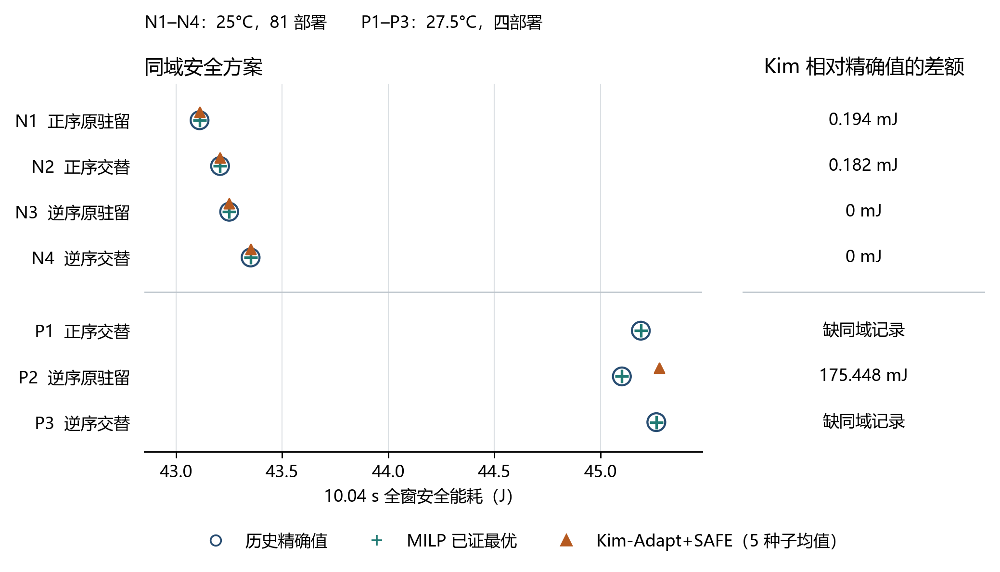
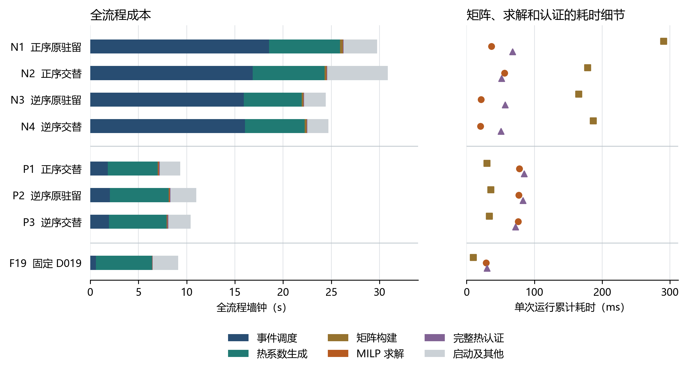

# 第三章 MILP 主算法验证 · 第一、第二阶段

**建议按“连续热约束下的多 DNN 部署与场景频率联合优化”组织第三章，将 MILP 作为主算法候选，M2 作为有限域精确参照。** 七个正式工况全部取得同域最低 SAFE 能耗证书。三个压力工况中，完整热认证都改变了最终部署；固定 D019 时，还能排除全部合法频率序列。现有材料足以写数学模型、算法、正确性及这些工况的验证。两种反馈各自的必要性、多次反馈后的收敛表现以及同机相对速度，仍是选型边界。

执行冻结提交为 `8a7bc4c4e71c41519bfedb591589502e8a1a6d3d`。本次新增五个正式工况和一个预登记的固定部署判别案例，沿用原 A/B 两份运行。每个新增工况运行一次。完整域、频档、请求、物理模型、求解停止规则及 120 s 墙钟均继承自可行性实验。实验入口在每次运行前校验原 worker、master 与 launcher 的 SHA-256，逐字节使用原实现。登记仅绑定输入，未使用已知解热启动。[预登记](registration.json) · [建模推导与原协议](../ch3_milp_feasibility/README.md)

## 七个正式工况

每个 SAFE 解均用原评价器核对四场景连续温度、温度相关漏电、10.04 s 系统总能耗以及 500 个请求的 40 ms 期限。“取证”指安全上界与有效下界在 10⁻⁷ J 内闭合。本批最大实际差约 1.031×10⁻⁸ J。下表峰温为连续峰温上界。

| 编号 | 顺序、驻留 | 部署域与温度 | 最优部署 | SAFE 能耗 J | 峰温 °C | 最小期限裕量 ms | 首次 SAFE s | 取证 s | 总墙钟 s | 求解 / 反馈 |
|---|---|---|---|---:|---:|---:|---:|---:|---:|---:|
| N1（原 A） | 正序原驻留 | 81，25°C | D005 | 43.110688 | 76.5040 | 2.721279 | 10.23 | 29.42 | 29.74 | 1 / 0 |
| N2 | 正序交替 | 81，25°C | D005 | 43.207258 | 77.8359 | 2.721279 | 13.49 | 30.60 | 30.86 | 1 / 0 |
| N3 | 逆序原驻留 | 81，25°C | D000 | 43.250300 | 79.2103 | 0.723385 | 7.75 | 24.19 | 24.43 | 1 / 0 |
| N4 | 逆序交替 | 81，25°C | D000 | 43.351353 | 79.3855 | 0.723385 | 7.98 | 24.49 | 24.71 | 1 / 0 |
| P1 | 正序交替 | 四部署，27.5°C | D001 | 45.190071 | 75.0940 | 0.308690 | 9.09 | 9.09 | 9.35 | 2 / 1 |
| P2（原 B） | 逆序原驻留 | 四部署，27.5°C | D001 | 45.100779 | 76.3196 | 0.308690 | 10.73 | 10.73 | 10.98 | 2 / 1 |
| P3 | 逆序交替 | 四部署，27.5°C | D001 | 45.263204 | 76.5389 | 0.308690 | 10.16 | 10.16 | 10.40 | 2 / 1 |

**常温工况。** 四组各覆盖 81×27⁴=43,046,721 个完整编码，各有 2,141,829 条序列满足期限，最优能耗分别吻合四份历史 M2 全域证书。每组都有 5,272 个满足期限的部署–场景–频档选项，已认证上界与能耗下界将其中 5,248 个固定为零，全部由 HiGHS 预处理闭合，整数树节点数均为零。逆序两组的安全温度裕量降至 0.790°C、0.614°C，最优部署也由 D005 变为 D000；这两个现象并未造成额外的整数求解困难。[M2 历史全域记录](../kim_multidnn_search_trial/results/run_metrics.csv)

**压力工况。** 三组使用相同的 A/C/D001/D015 四部署，各覆盖 2,125,764 个完整编码，其中 142,884 条满足期限。同域参照取四个部署各自的完整精确分类。A、C 各有 59,049 条期限可行序列且全部超温，D001 的 18,225 条、D015 的 6,561 条期限可行序列各自均 SAFE，三组的这一分类结构一致。改变场景顺序与驻留检验了同类约束作用的稳定性，不能由此推广到三类不同热难题。[历史四部署分类](../kim_pressure_feasibility/raw_execution/summary.json)



图 1 的圆和十字重合。Kim-Adapt+SAFE 使用已有同域五种子 SAFE 均值，在 N1、N2 分别高 0.194、0.182 mJ，在 N3、N4 达到相同能耗，在 P2 高 175.448 mJ（0.389%）。P1、P3 缺少同域 Kim 正式记录，故留空。常温和压力行采用不同部署域，跨组绝对能耗差无法单独归因于环境温度。[可编辑图 1](figures/01_safe_energy.svg) · [Kim 原运行](../ch3_final_experiments/formal/tables/run_results.csv)

## 表 2　压力工况的上下界与反馈

每个压力工况各有一次有效反馈，故以迭代表呈现。初始贪心候选和首轮 MILP 候选均无 SAFE 上界。第二轮求出解后，须回放全窗得到 SAFE 上界才能取证。下界与上界均按 J 计；表中四舍五入，足位数值及逐事件墙钟见 CSV。

| 工况 | 首轮有效下界 | 首轮候选与峰温下界 °C | 被拒绝的部署及频档前缀 | 反馈后下界 | 完整认证的上界 | 热约束抬高最优能耗 J | 矩阵行数变化 |
|---|---:|---|---|---:|---:|---:|---:|
| P1 | 43.519628429 | C，80.599468 | C，LLL/LLL/LHL | 45.190071219 | 45.190071230 | 1.670443 | 1453 → 2526 |
| P2 | 43.547994601 | C，81.921708 | C，LHL/LHL | 45.100779477 | 45.100779487 | 1.552785 | 2109 → 3182 |
| P3 | 43.649038073 | C，82.096936 | C，LHL/LHL | 45.263203810 | 45.263203820 | 1.614166 | 2109 → 3182 |
| F19，固定部署 | 43.668966981 | D019，80.313889 | D019，LLL/LLL/LHL | 松弛不可行 | 无 SAFE 解 | 不适用 | 485 → 774 |

P1–P3 各新增 1 条超温前缀排除约束，另有 1072 条点温度必要约束（268 个可用场景模式 × 4 节点）。反馈前后整数树均只处理根节点。三个正式工况的松弛最优都是 C，反馈后都变为 D001。1.553–1.670 J 衡量同域连续温限引起的最优值变化，不是算法间的节能率。[逐次建模、求解、热认证和上下界](iterations.csv)

**固定部署 D019 的真实结论。** 正序交替、25°C、500 个请求。原无温限最优编码 168 的能耗为 43.668967 J，全部请求按时完成，连续峰温下界为 80.313889°C。固定 D019 后，第二次求解于 8.891 s 返回 HiGHS 状态 2（不可行），总墙钟 9.124 s。冻结 worker 的终态文本为 `no_solver_incumbent`，没有填写 SAFE 证书时间。独立核验确认全过程没有基于 SAFE 上界的选项固定，反馈约束均为必要条件，并用归档热系数对 531,441 个频率编码作互斥覆盖：472,392 条未通过期限，余下 59,049 条全有超温点见证。表中无解结论依据这项覆盖和求解器不可行状态；8.891 s 是运行内得到不可行信号的时刻，离线审查不计入该时刻。历史记录中的回退指转入约束搜索，该固定域没有 SAFE 频率解。[D019 历史全域记录](../kim_multidnn_expansion/raw/expanded/forward_alternating_25C/deployment_D019.json) · [本轮独立核验](verification.json)

D019 也提供了一条可以直接核算的机制证据。给定被拒的三场景前缀，仅剩末场景 9 个期限可行频档，因此这一条前缀约束单独排除 9 条完整可行编码。用本次存下的点温度见证可以覆盖全部 59,049 条。这说明在该实例上点温度约束能跨不同前缀排除超温方案。实际运行同时启用两种反馈，单独使用它们各需多少时间或轮次仍待实验区分。

## 图 3　求解成本及论文选型



A/B 与本轮各次运行均在计时前分配独立空 Numba 缓存，工作进程启动、物理输入验证、调度、构核、求解、认证及退出计入 120 s。四个常温工况事件调度耗时 15.93–18.53 s，七个正式工况的 HiGHS 累计仅 0.020–0.078 s。事件调度与热系数合计占七个正式工况总墙钟的 74%–90%（取整）。历史 M2 对四个常温工况的取证时间为 49.41–56.49 s，本实现为 24.19–30.60 s；两批计时包含不同的热核准备工作。压力工况的历史证据为逐部署分类，缺少合并的同口径 M2 墙钟。本轮结果支持报告端到端实测成本，速度归因需另行配对。[可编辑图 3](figures/03_wall_time.svg) · [全精度指标及各项成本](summary.csv)

**第三章可以主张的贡献。** 仿射热传播与漏电能耗关系沿用 M1/M2。适配工作是将全窗固定部署、各场景频档和四节点入口状态条件线性化，在保留原确定性事件调度的前提下，由期限筛查、能耗界和全窗安全认证共同得到可审查的有限域证书。发生超温时，通过确定性违规前缀和按入口温度变化的必要点约束更新主问题。七组同域精确值、三次由 C 转 D001 的反馈以及一次固定域无解核查，可以支撑这条论证链。MILP、约束生成和仿射热模型本身均有既有来源。

**选型边界。** 若章节目标是给出保真模型、有效反馈与可验证解，现有证据支持优先按 MILP 主线起草。若要声称两类反馈各自不可缺少，或声称多轮反馈、高难整数树、未见工况上的普遍速度优势，当前证据不足。最有价值的待决项是压力案例的反馈消融；是否进行同机留出对照取决于论文是否要作速度或泛化主张。本轮在第一、第二阶段结束。

## 原始记录与复算

- [新增六次运行](raw) 各保留输入摘要、事件日志、HiGHS 日志、墙钟回执、模式和系数表、候选物理证书及 500 请求完成账本。原 A/B 位于[先前归档](../ch3_milp_feasibility/raw)，直接复用。原 A/B 的帧数显示勘误见原报告；校验以请求摘要和四段服务窗口为准。
- 在仓库根目录用冻结的 Python 3.12.4 环境运行下面前两条即可复算本报告的表与图。校验器独立检查所有取证解的原始账本、温度连续性与编码域覆盖，不重新求解。最后一条仅用于有意复现实验，须指定新目录。反馈消融图随第三阶段的执行决定再行安排。

```text
python -B research/ch3_milp_validation/analyze.py
python -B research/ch3_milp_validation/plot.py
python -B research/ch3_milp_validation/execute.py <新的输出目录>
```
