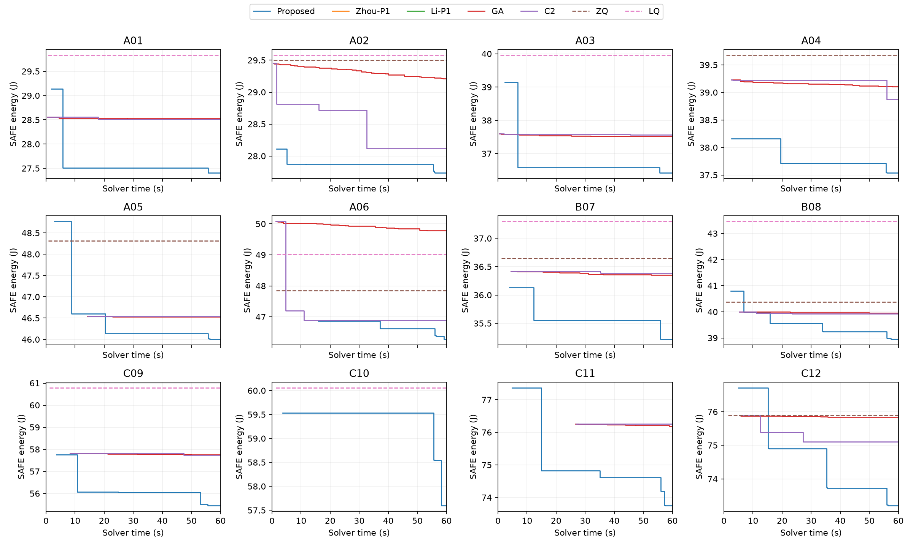
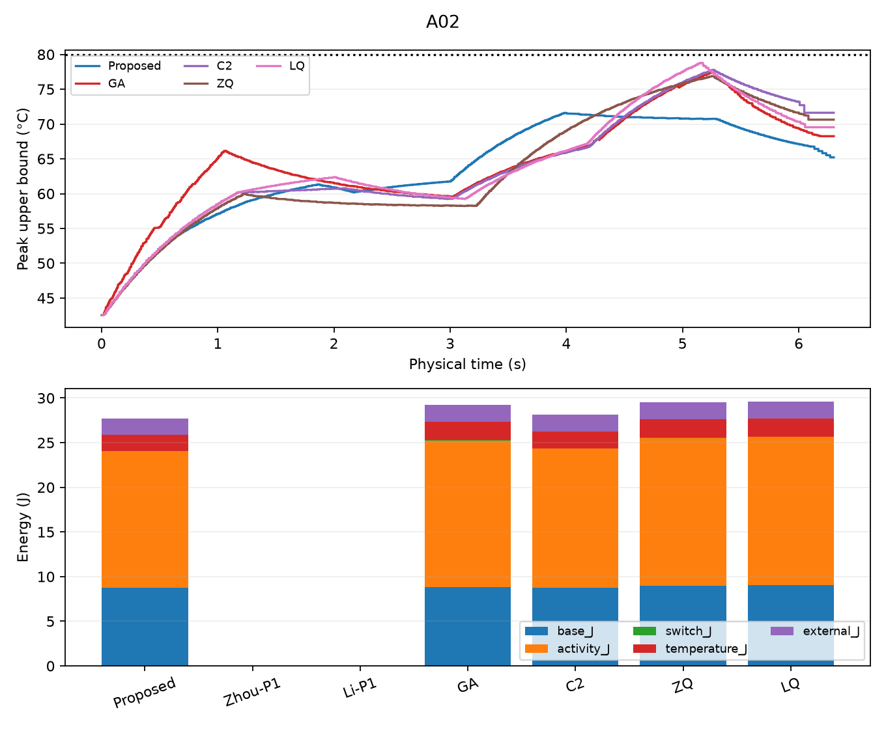
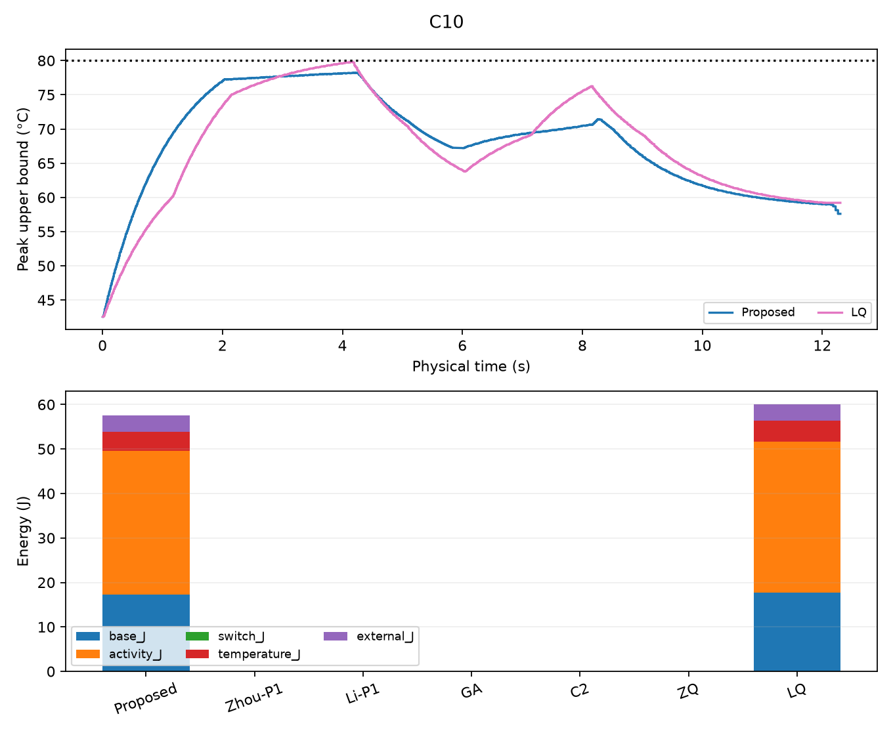

# 第三章完整算法的统一性能比较

七种方法各自从空开始，每个单元最多 60 秒。主比较 180 次、辅助比较 72 次。实际合计 6520.390／15120 核秒。按流去重核验 28,737 份完整物理排程、证书及 31 列温度轨迹。

## 安全覆盖与求解时间

| 方法 | SAFE 次数／36 | 可靠流／12 | 三次全成功流 | 首次 SAFE 中位秒（成功运行） | 实际结束中位秒（全部运行） |
|---|---:|---:|---:|---:|---:|
| Proposed | 36 | 12 | 12 | 3.203 | 58.265 |
| Zhou-P1 | 0 | 0 | 0 | — | 0.690 |
| Li-P1 | 0 | 0 | 0 | — | 0.182 |
| GA | 33 | 11 | 11 | 4.435 | 59.468 |
| C2 | 33 | 11 | 11 | 4.429 | 60.000 |
| ZQ | 21 | 7 | 7 | 0.790 | 0.771 |
| LQ | 24 | 8 | 8 | 0.990 | 1.324 |

## 完整安全能耗的配对比较

先取每流成功重复的能耗中位数，双方均至少两次 SAFE 才进行配对。按逐流节能率等权平均，分母为相应基线。区间重叠记平，仅单侧成功时能耗差留空。

| 基线 | 配对流数 | Proposed 平均节能率 % | 胜／平／负 | 仅 Proposed／仅基线可靠 |
|---|---:|---:|---:|---:|
| Zhou-P1 | 0 | — | 0／0／0 | 12／0 |
| Li-P1 | 0 | — | 0／0／0 | 12／0 |
| GA | 11 | 3.6661 | 11／0／0 | 1／0 |
| C2 | 11 | 2.6866 | 11／0／0 | 1／0 |
| ZQ | 7 | 4.3321 | 7／0／0 | 5／0 |
| LQ | 8 | 7.1980 | 8／0／0 | 4／0 |

Zhou-P1 与 Li-P1 在可用物理设备、CPU 频档和真实时间空档中逐任务安排三个阶段。ZQ 与 LQ 共享窗口配额生成器并只保留一个前缀，辅助成绩只代表这些窗口适配。GA 用本次 C2 首份 SAFE 启动；当没有安全初解，遗传算子无法进入工作阶段。不同自由度、构造器和求解策略共同影响结果。

## 十二流 60 秒能耗中位数（J）

| 任务流 | Proposed | Zhou-P1 | Li-P1 | GA | C2 | ZQ | LQ |
|---|---:|---:|---:|---:|---:|---:|---:|
| A01 | 27.407922 | — | — | 28.525770 | 28.513181 | — | 29.833313 |
| A02 | 27.737318 | — | — | 29.209456 | 28.116305 | 29.494502 | 29.579580 |
| A03 | 36.421998 | — | — | 37.513159 | 37.567473 | — | 39.959172 |
| A04 | 37.539932 | — | — | 39.104845 | 38.870464 | 39.676606 | — |
| A05 | 46.005663 | — | — | 46.527767 | 46.536757 | 48.316202 | — |
| A06 | 46.283000 | — | — | 49.783025 | 46.893285 | 47.845398 | 49.013276 |
| B07 | 35.220120 | — | — | 36.354525 | 36.387636 | 36.644112 | 37.297090 |
| B08 | 38.951287 | — | — | 39.958269 | 39.917388 | 40.368946 | 43.457618 |
| C09 | 55.451621 | — | — | 57.756741 | 57.743675 | — | 60.783700 |
| C10 | 57.597755 | — | — | — | — | — | 60.055951 |
| C11 | 73.750845 | — | — | 76.190440 | 76.255085 | — | — |
| C12 | 73.207144 | — | — | 75.840218 | 75.108239 | 75.890792 | — |

曲线从该流该方法第二次重复取得安全解时开始显示，三次运行分别按各自的绝对时刻截取。提前结束后保留已交付解。缺线表示该时段可靠覆盖不足。

## 典型工况

温度图显示各物理事件内四节点峰温上界的最大值。能耗图按原证书分解为频档驻留基值、计算活动增量、切换、温度修正和外部固定项。失败工况留空。

## 失败与适用范围

- Proposed 的逐次结果为 SAFE 36 次。
- Zhou-P1 的逐次结果为 NO_CONSTRUCTION 36 次。
- Li-P1 的逐次结果为 NO_CONSTRUCTION 36 次。
- GA 的逐次结果为 SAFE 33 次, HOT 3 次。
- C2 的逐次结果为 SAFE 33 次, HOT 3 次。
- ZQ 的逐次结果为 HOT 3 次, SAFE 21 次, NO_CONSTRUCTION 12 次。
- LQ 的逐次结果为 SAFE 24 次, HOT 12 次。

正式计算版本 `6a3d8636bbef7b3f3f740507895751e6e202d9bd`。通用预热 110.498 秒，离线压缩 272.815 秒。原始未完成构造（如有）在各单元 partial 目录，超时只记录已交付候选；工作进程结束和监督收尾分列。

[协议](PROTOCOL.md) · [逐流三截面](tables/flows.csv) · [逐次时间/证书/能耗分项](tables/runs.csv) · [各流配对](tables/pairs.csv) · [配对统计](tables/comparison.csv) · [绘图数据](tables) · [逐单元原始证据](archive) · [SHA-256](SHA256SUMS)
