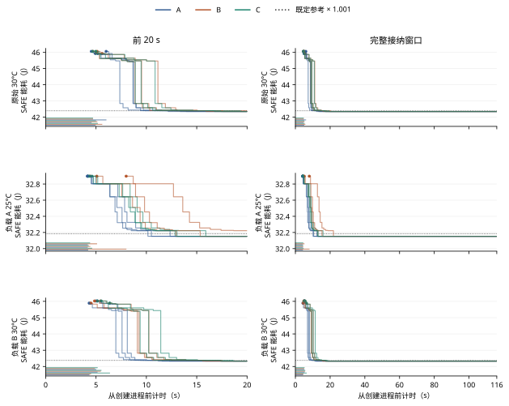
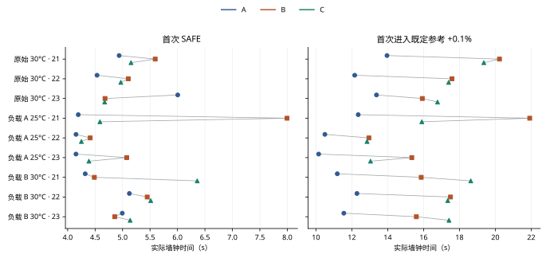
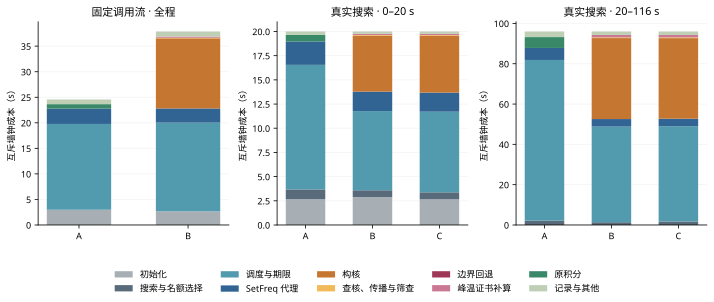

# 第四章最小判别实验

**第四章保留旧有限域 M2 的精确场景复用与认证成果。扩展域继续使用 Energy-Only＋原评价器（A），取消新增名额规则。** 在九个同种子配对中，B 的主目标命中时间中位增加 42.43%；C 相对 B 只缩短 0.87%，相对 A 增加 38.67%。B、C 均未通过预定的时间或 20 s 解质量采用路线。可以进入结果审查与论文整理。[采用门槛结算](tables/adoption.csv)

## 匹配实验

原始 30°C、请求份额 A 25°C、共现 B 30°C，三个预定种子。A 为 ed437fc 的 Energy-Only 与原评价器，B 保留其全部搜索决策并接入按需 M2，C 只改变 B 的剩余评价名额选择。三法均从创建进程前计时，同机单核、空进程级缓存、116 s 停止接纳、120 s 硬限。输入为原四网、500 请求、40 ms 期限、10.04 s 计能窗、四节点连续热与温度相关漏电，部署域有 4,319,803 个带物理绑定的代表。目标沿用第三章的对应参考 SAFE 能耗乘 1.001；阈值只在运行结束后用于分析。

完成 27 次主运行及两次同流回放，无硬超时、缺失或删失目标。三法各 9/9 达到同工况参考能耗，均选择 X4139374 与 LLL/LLL/LHL/LHL；最终证书共覆盖 13,500 条请求，最小期限裕量 0.731332 ms，四节点峰温上界的运行间范围为 68.081–78.739°C。没有发现低于旧参考的新解。

| 方法 | 首次 SAFE 中位 s | 主目标中位 s | 5 / 10 / 20 / 116 s 已有 SAFE 次数（各 9 次） | 20 s 主目标命中 | 116 s 精确命中 |
|---|---:|---:|---|---:|---:|
| A 原评价器 | 4.53 | 12.16 | 7 / 9 / 9 / 9 | 9/9 | 9/9 |
| B 按需 M2 | 5.08 | 15.93 | 4 / 9 / 9 / 9 | 7/9 | 9/9 |
| C 按需 M2＋名额规则 | 4.97 | 17.35 | 5 / 9 / 9 / 9 | 9/9 | 9/9 |

5 s 和 10 s 的三法主目标命中数均为 0，116 s 均为 9。三法实际停止搜索的中位时间均约 116.01 s；表中的主目标时间是首次拿到对应质量证书的墙钟。采用判定按每对的时间比再取中位数，因此与表中两列中位数相除可有差异。

| 工况 | 参考 J/窗 | A / B / C 主目标时间中位 s | B/A 配对时间比 | C/B 配对时间比 |
|---|---:|---|---:|---:|
| original 30°C | 42.34993 | 13.37 / 17.58 / 17.40 | 1.446 | 0.989 |
| A 25°C | 32.15280 | 10.50 / 15.34 / 13.04 | 1.511 | 0.850 |
| B 30°C | 42.33500 | 11.55 / 15.87 / 17.42 | 1.418 | 1.117 |

九对中的三种工况，B/A、C/B、C/A 的 20 s 工况中位能耗差均为 0 J。没有一个工况出现三个种子均改善超过 10⁻⁷ J。各独立工况的实际 20 s 焦耳和个体差额可从[配对明细](tables/paired.csv)回算。

三种工况的焦耳各自比较。每条能耗曲线自首次 SAFE 开始，各面板底部的细短线标出对应种子的尚无证书区间；虚线为本工况既定目标。[原始改善曲线](tables/improvements.csv) · [逐时点能耗与 SAFE 覆盖](tables/checkpoints.csv)

配对图中同一横行对应同一工况同一种子，末两位 21、22、23 对应 20261121、20261122、20261123。首 SAFE 包含八个起点的初始化工作；C 的名额规则自后续主循环才开始起作用。[逐运行证书指标](tables/runs.csv) · [每个配对及两条采用路线](tables/paired.csv)

## 评价器的贡献与代价

真实请求到达时才构核，按场景上下文、频率与活跃网络的完整物理阶段复用。每次查询重新传入真实入口温度；相同基点可直接使用已经完整积分的峰温信息。原 M2 接口的仿射能耗、末温及连续分类不能单独生成 Energy-Only 所需的每场景精确双峰温界。分类不确定时调用原积分回退，分类已定但入口变化时补算精确峰温。已有积分记录给出原精度的能耗与末温，用于保留严格能耗排序，仿射量在每次查询中核对。SetFreq 保留独立场景语义，优先使用已有标量缓存。最终证书保留 500 条完成记录和逐场景四节点状态。

**同流等价成立，达标前没有摊销。** 首区组 20 s 前缀有 2,492 个 SetFreq 代理请求、662 个期限筛查、148 次完整回放。两种评价器对全部 3,302 次调用给出完全相同的返回字段，包括各段的真实入口/出口、双侧峰温界、期限和整窗焦耳。九个真实 A/B 配对另有共 159,043 次共同前缀调用，参数、顺序与返回逐项相同。

| 固定前缀口径 | A 原评价器 s | B 按需 M2 s |
|---|---:|---:|
| A 首次达标之前的同序调用本体 | 12.68 | 19.55 |
| 3,302 次同序调用本体合计 | 20.96 | 34.57 |
| 含各自初始化、核验、日志及退出的固定回放进程 | 24.92 | 38.28 |

固定流 B 进行了 233 次冷构核、592 次查询，其中 359 次复用合法核；另有 8 次期限拒绝命中。构核花费 **13.73 s**，边界不确定回退 **0 次**；155 次精确峰温补算共 **0.22 s**。A 对应的原连续热积分仅 **0.88 s**。固定流截止处没有持续摊销点。九个真实 A/B 配对在到达 A 目标时及各自整段共同前缀末尾，B 的累计评价本体秒数均高于 A。未验证更长或不同调用流中的摊销点。

| 真实搜索阶段，每次平均墙钟 s | A 事件调度 | A 原连续积分 | B 事件调度 | B 构核 | B 峰温补算 |
|---|---:|---:|---:|---:|---:|
| 各自首次达标前 | 6.30 | 0.31 | 6.51 | 4.78 | 0.09 |
| 0–20 s | 12.81 | 0.68 | 8.14 | 5.77 | 0.13 |
| 20–116 s | 79.03 | 5.39 | 47.02 | 40.17 | 1.19 |

九次 B 共构核 9,788 次，28,124 次核查询中合法命中 18,336 次（65.2%）。全期边界回退仍为 0，精确峰温补算 10,786 次，平均每个运行 1.32 s；平均构核 45.95 s。A 的原连续积分平均 6.06 s，事件调度平均 91.90 s。固定预算内 B 完成的搜索量较少，分阶段表中 B 调度秒数较低不能解释为同一批调度调用变快。核心限制是这批调用的冷构核开销与有效复用次数。

成本图左侧为同一固定调用流的两次独立回放；右侧为真实搜索在两个互斥时间段的单次平均成本。固定回放含其自身初始化和读写，不执行候选生成或重新搜索；同预算下完成的调用数在真实搜索中可以不同。[逐项一致性](tables/fixed_agreement.csv) · [同流摊销](tables/amortization.csv) · [互斥分项秒数](tables/exclusive_costs.csv) · [缓存与内存](tables/cache_stats.csv)

## 名额规则、边界与论文口径

首区组 B 在评价前已能区分四段中 0、1、2、3、4 个冷核，具备启用 C 的成本信息。九次 C 共记录 **1,312 轮**剩余名额选择，保留规则应用后，最终填充名单及顺序**一次也没有改变**。在 C/B 共同完成的 148,687 次顶层调用中，参数和返回值均一致。规则计算本身每次运行平均花费 0.48 s。由于候选未改变，C 在 20 s 达标次数从 B 的 7 增至 9 不能归因为选择了更好的候选；三种子均改善的预算质量门槛也未达到。B 负载 30°C 的 C/B 配对中位时间比为 1.117，超过允许退化 10% 的界限。首 SAFE 位于初始化，不能用其微小差别给 C 记功。未再引入评分、参数或种子。

论文可将固定流的数值等价作为迁移正确性证据，将当前扩展域实现的负结果用于界定场景核的适用条件。标量 SetFreq、短前缀和精确峰温需求共同决定实际调用结构；本轮没有把每种因素单独消融，无法给它们分别赋予因果效应。三种工况、每种子数为三，且每个工况内部的方法次序固定，秒级差异仅支持本轮工程取舍。

旧 81 域的覆盖与最优性认证保留原证据范围：历史固定四部署 M2 将构核从 280 降到 199，固定子域证书用时从 20.82 s 降到 18.30 s。已结算留出中 M2 的四次全库认证为 47.37–61.96 s，历史中断槽的第三次重复仍缺失。有限域须扫描大量同场景频率与入口组合，核有重复使用机会；本轮则按搜索实际访问决定是否付出构核成本。二者的计分目标和证书范围须分开。[旧有限域停止与恢复记录](../kim_multidnn_search_trial/results/STOP_RECORD.md)

本研究的数值等价与能耗、温度证书限于冻结合成平台和给定网络池。本轮没有扩展域全局最优证明、真实 DLA 构建或板端能耗/温度测量。[第三章切点证据边界](../ch3_algorithm_selection/hardware.md)

[执行协议](PROTOCOL.md) · [实际运行与源码身份](tables/actual_run_config.csv) · [全量原始归档](archives/manifest.json) · [复算命令](REPRODUCE.md) · [论文 PDF 插图](../latex/figures/ch4_budget_reuse)
