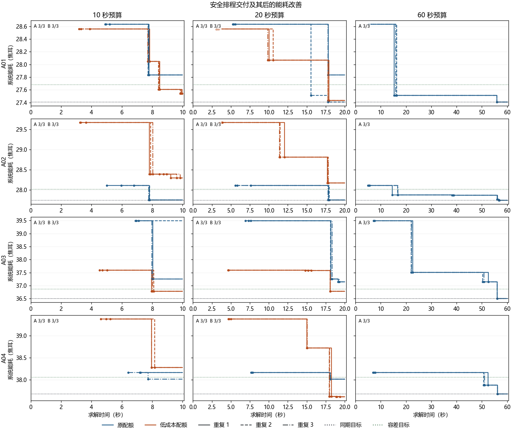
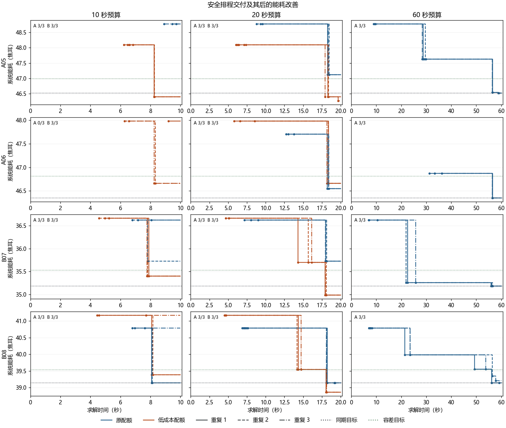
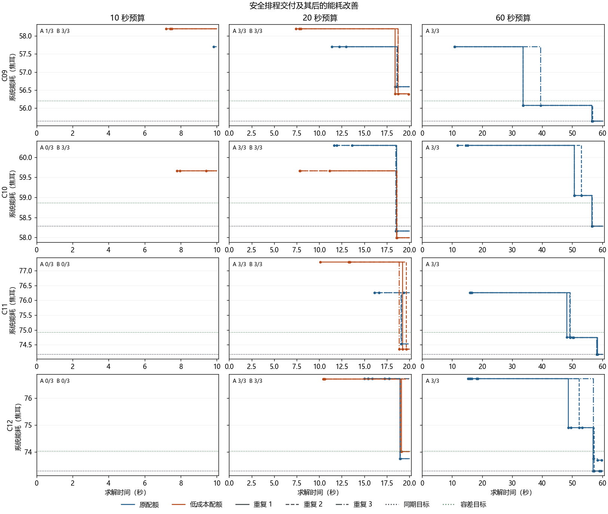

# 能耗随求解时间的变化

每条线从首次按时交付的安全排程开始。蓝色为原配额，橙色为低成本配额。线型对应三次独立重复，点为严格改善，虚点水平线为同期长预算目标及其百分之一容差。各图左上角给出安全交付次数。同一任务流共用能耗纵轴。

[全部按时安全能耗改善点](results/improvements.csv) · [逐次未达标记录](results/quality_targets.csv)
