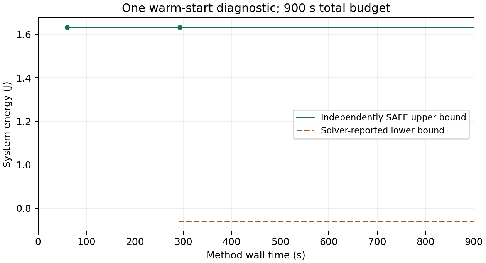

# 第三章实验实现与预检

## 材料信息（Material Passport）

| 字段 | 当前内容 |
|---|---|
| 用途 | 将已审阅的第三章数值配置落实为可复跑输入和实验程序 |
| 模型与输入依据 | [配置草案第7—10节](../第三章实验输入来源核查与配置草案.md)、[第三章正文](../latex/chapter03.tex) |
| 授权与范围 | 用户确认暂保留400 ms窗口、5 ms启动间隔及功耗／热参数，并授权逐步推进实验 |
| 当前阶段 | K.108完成期限前置过滤／事件重建预检及六次独立配对诊断；表达与准备成本下降，最终U未改善；原115项保留 |
| 证据等级 | 文献指导的抽象仿真；物理数字为自设或由自设输入派生，非实机标定 |

用户本次授权更新了配置草案此前“不编程、不实验”的阶段限制。平台、工作负载与模型保持；HEFT／SA细则、数值实现和正式批量执行协议尚未全部冻结。

**最新执行状态（K.108）：** [57项必要预检](results/prefilter_precheck02/checks.json)与独立审查通过后，按冻结顺序完成三个原R1条件×current／prefilter、每次300秒，6/6技术验收。三对最终U相同、0次严格改善、0条反馈；变量／行数及构模和首SAFE时间下降。第六次有一条预算内后续SAFE，但与种子完全相同。见[§3.12q](#312q-期限前置过滤与事件重建的六次诊断k108)、[完整分析](../chapter3_formal_analysis/prefilter_diagnostic01/summary.md)及[运行独立审查](results/prefilter_diagnostic01/independent_review.md)。阶段结束，不追加实验；下方K.107及更早的待批／待实现状态是历史。

**修正状态（K.106）：** 固定原逻辑子问题LP basic报告无解、LP none返回原x0，后续入口显式关闭LP预处理并归档。已加入本次x0／内部无解冲突未决保护，公共115项与原生接口13项通过。见[§3.12p](#312p-milp预处理兼容与数值冲突保护k106)和[独立审查](results/infeasible_audit01/independent_review.md)。完整自由调度性能仍未由本次证明，未补跑原正式案例。

**首批执行结果（K.105）：** 用户接受仅续行原110项，各300秒，已执行完成。见[§3.12o](#312o-110项续行与首批完整结果k105)、[合并详表](../chapter3_formal_analysis/results02/summary.md)及[运行终审](results/formal_comparison02/independent_review.md)。原SA103技术失败保留；原批准未重置，续行另立批准与源码凭据。K.104中断记录和下文“待批／未启动”均为历史，不能用来再次启动调用。

**K.103当前入口：** [首批完整链方法协议](formal_comparison_protocol.md)、[115次清单](results/formal_protocol01/proposed_manifest.json)、[96项预检](results/formal_precheck01/checks.json)。HEFT／SA规则及实现现已完成，复用原连续热能耗接纳；300秒／次、115次仍为待确认提案，批准示例为false。本批不含Q1重跑、新Stage／DAG或新增热条件。下文“尚未实现”及675次属于当时状态，当前以本段及研究Brief为准。

**当前计划入口：** [K.98审查稿及执行更新](../第三章当前进展与正式实验推进计划_审查稿.md)。Q1与首批原15问题／115次均已执行，五组实验并未全部完成；可选热补充、Stage／DAG扩展没有自动排期。下文95问题／675调用／60秒等为历史，最新状态以`RESEARCH_BRIEF.md`为准。

**Q1已完成：** 依D126冻结[执行协议](q1_quality_protocol.md)，完成54项必要预检、一次整体MILP与一次独立遍历（各300秒上限），结果见[§3.12l](#312l-q1小规模优化质量参照完成)。这两次是K.99中的质量补充，未启动完整链正式主比较；上段“无新增运行”描述的是K.99交付时状态。

## 1．已实现的基础层

| 工作 | 核查内容 | 不能据此宣称 |
|---|---|---|
| 数值输入落地 | 2 CPU＋GPU＋NPU、合法工作点、响应与功率、四节点RC、场景与逐请求期限、窗口和启动集合 | 已获得安全解或参数符合真实硬件 |
| 输入可复跑预检 | 单位、合法支持、参数范围、基准去重、热网络相容性、五组输入生成及去重 | 已验证调度可行性或方法效果 |
| 完整安排合法性与功率片段重构预检 | 共享部署、依赖、资源互斥、同域工作点、忙段锁频与空闲保持、非整数结束、逐请求期限；重建完整窗口各片段的仿射功率与注热来源 | 已完成连续热轨迹、峰温和能量积分评价 |
| 环境探针 | 记录可用运行时、MATLAB／工具箱与求解接口情况；分别保存可用、未验证或失败状态 | 求解器可访问即等于模型编码正确或许可已验证 |
| 共同连续评价 | 本地温度漏电、四节点耦合传播、连续峰温及完整能量；只在全部场景有效时汇总 | 已找到最优方案、已证明算法收益或可运行全部正式对照 |
| MILP与热反馈 | 共享部署、有限选项、逐忙段工作点、状态条件温度传播及完整能量；明确违规后添加有效温限行 | 浮点求解器的界／收敛就是独立证书，或小域通过代表正式规模已可运行 |

预检夹具只用于程序正确性，不加入正式95个问题的统计。片段重构通过不等于安全通过；只有共同评价器完成连续检查后，才能给安排登记安全状态。

## 2．复跑入口与产物

从项目根目录执行：

```text
python research/chapter3_experiments/run_precheck.py --output research/chapter3_experiments/results/input_precheck04
python research/chapter3_experiments/probe_environment.py --output research/chapter3_experiments/results/environment03
python research/chapter3_experiments/run_thermal_precheck.py --output research/chapter3_experiments/results/thermal_precheck03
python research/chapter3_experiments/run_milp_precheck.py --out research/chapter3_experiments/results/milp_precheck05
```

实际结果目录：

- `results/input_precheck01/`：初版224/224通过。
- `results/input_precheck02/`：补NPU排队／冲突及局部功率夹具，228/228通过。
- **`results/input_precheck03/`：最新233/233通过**；增加参数范围、期限恰等边界及同场景请求副本共享部署夹具。保存源码快照、95项输入哈希清单、局部选项／事件统计及检查记录。
- `results/environment01/`：首次启动超过60 s，随后清理超时，记录为环境错误；没有取得MATLAB返回，不据此判断许可不可用。
- **`results/environment02/`：MATLAB R2023b、Optimization Toolbox许可测试与签出成功**；使用现有工作区偏好目录`.runtime/matlab_prefs`，在提升执行环境下核查；两项启动条件均有变化，不能单独归因首次失败。Python 3.12.4、NumPy 1.26.4、SciPy 1.13.1；没有执行优化问题。
- `results/thermal_precheck01/`：首轮连续评价预检36/36通过，保留首版源码及记录。
- **`results/thermal_precheck02/`：当前50/50通过**；增加GPU／NPU活动、非整数结束、本地温度、真实温限跨包络未决、数值异常和外层／资源中断。源码运行前后哈希一致，配置与input_precheck03逐字节相同。保存全部夹具、闭式解／独立DOP853核对、区间结果、环境和源码快照。
- `results/milp_bridge_precheck01/`、`02/`：早期真实求解接口记录，02为4/4；其源码属于当时版本，后续文件发布修复与兼容选项以完整04为准。
- `results/milp_precheck01/`：结构检查41/42；唯一失败为检查期间源码变化，不能作为当前源码通过凭据。
- `results/milp_precheck02/`：46/47；Windows返回文件短暂不可读导致集成检查中止。修复为完整关闭后原子发布，并在原截止时间内等完整可读JSON；锁／半写及到期行为已加入回归。
- `results/milp_precheck03/`：75/76；默认整数预处理对已知可行小域报告无解，后续四项诊断与统一兼容设置见§3.3。保留失败，不将求解器状态改写为问题不可行。
- **`results/milp_precheck04/`：当前81/81通过**。五个小域共438条赋值全部核对；六个安全模式方案的完整能量与MILP择优一致，目标值距共同能量包络约2.22e-16 J。解析段内峰温夹具实际4轮求解、3次反馈后报告无解，仅保存solver-reported状态。完整输入、源码（含继承的区间核心）、实际选项、回调、安排、反馈及中断记录均归档，前后源哈希一致；97.422 s仅是本次整包预检耗时。原配置SHA256仍为`615be096bfbcb3e7c53ba9b0810d888264d48adbc428f1f7d2f94a5c6a29a4fe`。

以上路径相对于本目录。复跑必须选用新目录，程序拒绝覆盖既有记录；示例目录只是下次可用名称。后续输入或代码改变时重跑受影响检查，保留失败记录。输入、热评价检查各有自己的`checks.json`及源码快照，不能互相代替；`formal_experiments_ready`仍为false。

### 输入与检查接口

- `load_config()`读取原数值；`build_instances(config)`生成95项输入；`expand_options(instance, config)`只展开局部Stage—单元—工作点—起点，不枚举完整安排。
- 时间及派生物理量用规范有理数字符串保存，内部用`Fraction`；`101又1/3 ms`不会被四舍五入。字段时间为ms，后续热传播和能量积分须显式换为s。
- `validate_schedule(instance, candidate)`的候选格式为`{"scenes": {场景id: [{"stage_id": 实例id, "unit": 单元id, "opp": 工作点id, "start_ms": 有理字符串}]}}`。单元与起点是候选选择，时长、功率和结束由原输入决定，候选不能覆盖它们。
- 合法候选仅返回`SCHEDULE_VALID_THERMAL_UNCHECKED`及完整功率片段。非法候选返回原因，不输出有效前缀或能量。温度状态与能量状态均为`NOT_EVALUATED`。
- 基准R1共有6422个局部选项，AB／AC的潜在事件数为852／929；全包单场景局部选项2512—9771、潜在事件471—1659。这里只测输入表达规模，没有验证完整MILP构造开销。
- `schedule_fixtures.json`中的手写安排只测试接口；不作为算法初始化、正式比较结果或参考答案。
- `evaluate_candidate(instance, candidate, accuracy, budget)`先检查完整安排，再重建功率片段、逐场景连续评价。全部场景合法、完整且热安全后才返回`weighted_energy_J`与`safe_upper_bound_J`；上界采用能量区间的上端。
- `evaluate_piecewise(...)`是解析夹具与底层核对入口；它不验证调度，不能绕过`evaluate_candidate`用于正式接纳。共同评价器不调用枚举库、优化器或历史答案，不修改候选。

## 3．方法规则、数值实现与后续接口

### 3.1 HEFT与SA的可执行适配规则

HEFT需要固定跨场景优先级、共享单元选择、插入与并列规则、工作点及时序节能调整、失败退出。SA需要固定初始化、部署／工作点／时序编码与邻域、合法性处理、接受和退火规则、种子与停止方式。

这些属于既定比较方法的实施工作，不重新筛选算法或修改模型。方法覆盖范围应如实说明，不能把固定解码器称为覆盖全部时序；最终方案都通过同一检查器。具体规则和超参数在正式运行前归档，不按正式结果调整以寻找优势。

### 3.2 已实现的连续热能耗与数值协议

共同评价器按实际工作点和活动状态传播四节点温度，覆盖内部峰温、等待和空闲尾段。固定一个功率状态片段，令温升为\(\theta=T-T_a\)、本地温度系数为\(\Lambda=\operatorname{diag}(\lambda_i)\)，则

\[
\dot\theta=C^{-1}(\Lambda-G)\theta+C^{-1}[p^0+\Lambda(T_a-T_{\rm ref})].
\]

\(p^0\)仅含分配后的基准和本地活动功率；CPU共享基准只计一次，边界外公共功率计入能量但不注入节点。每个节点使用自己的温度计算漏电修正，同域CPU也不共用平均温度。片段内固定的是工作点与活动状态，功率仍可随温度变化。

实现将\(\theta\)除以100缩放，增加四个温升积分坐标和常数坐标，得到9维线性系统。缩放不改变物理参数。每个数值子段重置积分坐标，按该段的\(\lambda_i\)累计

\[
E_{\rm temp}=\sum_i\lambda_i\left[\int\theta_i(t)\,dt+(T_a-T_{\rm ref})\Delta t\right].
\]

最后加上基准、活动和边界外公共能量。另以\(\sum_i[C_i\Delta\theta_i+\sum_jG_{ij}\int\theta_j\,dt]+E_{\rm ext}\)核对完整能量区间；两者不相交则记内部一致性未决。该恒等式核对和独立ODE积分提供不同检查，均不替代误差包络。

**连续误差依据。** 复用[旧区间算术核心](../v1_evaluator/interval.py)，不复用旧输入或场景评价逻辑。使用60位定向舍入、18阶Taylor传播。每片段分成\(N=\max(1,\lceil4\lVert M\rVert_\infty\Delta t\rceil)\)个数值子段，使\(x=\lVert M\rVert_\infty h\le1/4\)；余项按

\[
\lVert r\rVert_\infty\le\lVert y(0)\rVert_\infty
\frac{x^{19}/19!}{1-x/20}
\]

向外包围，同时涵盖系数和运算舍入。子段内的区间多项式覆盖所有时刻；导数符号明确时收紧到端点，否则二分时间区间。最大值下界来自明确时刻的点值，最大值上界覆盖整段；同样求最小值以核查功率模型有效温区。模型温区无法认证时记未分辨，不向区间外外推安全结论。**数值子段不是启动网格，也不是按固定间隔采样查温。**

沿用配置的温度包络宽度 `1e-3 K`、能量绝对／相对目标 `1e-6 J`／`1e-6`。能量宽度须不大于\(\max(\epsilon_{\rm abs},\epsilon_{\rm rel}\max(0,E_{\rm lower}))\)，相对项使用可靠下端。温限接纳用峰温上界不超过温限；明确违规用点温下界严格超过温限；跨界则未分辨。精度目标不是允许超温的容差。

| 输出 | 接纳条件／用途 |
|---|---|
| `SAFE` | 所有场景包括零权重场景均合法、完整，温区及连续温限通过，能量误差达标；可形成加权能量与安全上界 |
| `THERMAL_VIOLATION` | 至少一个有效点值见证；保存场景、节点、精确时刻、温度区间和形成时间；没有有效加权能量 |
| `UNRESOLVED` | 温限或模型有效温区未分辨、误差目标未达到、预算／资源不足、数值运算或内部一致性失败；不得当作不可行证明 |
| `INVALID_SCHEDULE`／`INVALID_INPUT` | 非法安排或输入字段／物理条件不相容；不提供有效前缀能量 |

预算从候选入口开始，包含合法性检查、所有场景与汇总；默认60 s只是评价器调用保护值，接入方法时必须传入其共用剩余预算。每个违规见证在形成后独立提交；外层先接收已有见证再检查时间，避免旧问题“内层已证违规、外层超时丢失”。完整场景和加权能量提交前均检查预算。场景前缀、未决能量及不安全场景的完整诊断能量均不参与排名。支持可捕获的内存异常，不声称能从操作系统强杀恢复。没有跨方法共享结果缓存。

时间边界保留真实时长与非整数结束，不沿用旧0.25 ms或0.0625 mJ格值证书。MILP系数和反馈适配见下节。安全能量范围、可靠界和求解器报告的界／退出状态分列，不另开完整MILP认证项目。

### 3.3 已接入的完整热能耗MILP与连续反馈

新增`milp.py`、`milp_coefficients.py`、`matlab_bridge.py`和`solve_model.m`。`build_model(instance, config, budget=budget)`从完整局部选项生成MILP，不枚举完整安排；`solve_with_feedback(model, session, accuracy, budget=budget)`求解、解码并调用原共同评价器。输入展开、系数生成、矩阵导出和反馈使用同一`Budget`。`starts`缩小选项域仅允许以`fixture_`命名的正确性夹具，研究输入不得通过该参数删选项。

| 表达层 | 实现规则 |
|---|---|
| 共享部署与Stage选项 | 每个共享Stage选一个具体单元，各场景及请求副本链接同一部署；每次执行选择一个合法单元／工作点／起点选项 |
| 时序与资源 | 使用真实半开区间和精确有理时间表达依赖、逐请求期限及单元互斥；保留CPU同频并发、异频冲突与GPU／NPU设备排队 |
| 域工作点 | 所有潜在起止事件构成固定事件集；逐段域状态、当刻启动指示与活动锁点共同表达忙段选择、持续工作不改点、空闲保持及清空后换点 |
| 温度与完整能量 | 对每段联合控制状态生成温度递推及能量积分的仿射系数；事件温度、活动功率及分段能量为连续变量，由二元状态条件约束连接 |
| 目标 | 加权完整窗口能量，包括基准、活动、本地温度修正、外部公共功率及空闲尾段；不另加一次活动能量 |

**系数与浮点行。** 在固定状态、固定时长下，使用10维增广系统`[θ/100, q, 1, E]`。活动功率`q`在该段保持；本地温度和能量随时间演化。18阶有理Taylor多项式配合无穷范数余项包围矩阵指数，缩放后用定向区间平方恢复时长。系数缓存只属于当前模型，不保存其他方法的候选或评价结果。

设真实行的系数位于区间内，取浮点名义值`â`，对有限变量盒`z_j∈[l_j,u_j]`，将每项系数偏差乘`max(|l_j|,|u_j|)`加入右端，再将右端向上舍入。等式写成两条向外不等式；条件行的M由整个变量盒上的残差上界推导，随后同样处理最终浮点舍入。这样得到原关系的**外包表达**，不会以已知系数误差故意缩小原可行域；求解器内部数值误差仍未认证。温度变量界来自声明模型有效温区与节点温限，分段能量界来自输入功率和该温度范围。

**连续反馈。** 解码后先做原独立合法性检查，再评价全部场景的完整连续温度和能量。明确违规时，按见证的场景、节点、时刻及主问题固定事件段，生成状态条件温限行；入口温度仍是该段的变量，不能把失败候选的入口温度固定到其他安排。若同一违规重复出现，允许只排除该场景的完整模式／起点赋值，不删除其余时序或整个配置。反馈回执绑定完整输入与候选哈希、合法性结果和真实温限；数值未分辨不产生排除。

**返回状态。** 安全方案与上界只来自共同评价器；预算内已形成的安全／违规证据先保存，再处理外层超时。求解器无整数候选、报告无解、接口异常、预算／资源耗尽和热未分辨分别保留。首版外层最多50轮，达到上限为未决；这是计算保护，不是物理约束或不可行证明。安全返回且`intlinprog`退出1只记工程级收敛，`independently_proven_optimal`与`independently_proven_infeasible`不因此变为真。内部能量界、gap和退出状态原样归档，不能与安全上界合称独立最优证书。

**实际求解接口。** MATLAB R2023b使用现有许可和工作区偏好目录；固定`AbsoluteGapTolerance=0`、`RelativeGapTolerance=0`、`ConstraintTolerance=1e-9`、`IntegerTolerance=1e-6`及`IntegerPreprocess='none'`，其余默认值归档。回调记录实际`lowerbound/fval/phase/time`，不修改约束或候选。每轮只获得外层剩余预算；收到完整可读返回后才判其是否及时，禁止预算后结果进入安全输出。当前小域预检复用MATLAB进程以核对接口隔离；正式独立调用和启动计费尚须接入。

整数预处理设置来自本轮可复跑接口诊断：默认`basic`对单Stage、六选项的完整物理模型报告无解，而六个独立物理解均合法、安全，原行残差约1e-15。传输矩阵逐元素一致；行缩放、列与行缩放、精确反向行折成等式三种数学等价表示均未解决。只将整数预处理设为`none`后，原矩阵返回CPU1／L／0 ms，完整能量与独立枚举最低值一致。记录保存在`results/milp_numeric_diagnostic01`—`04`；不据此断定求解器内部具体缺陷或预处理普遍失效。正式协议原本标记`solver_options_complete=false`；本项作为统一工程兼容设置，适用于后续本文MILP及其反馈消融，不改变研究参数、目标、约束或安全标准。前三种诊断变换未采用到活跃代码，也没有增加物理行的经验容差。

**小域核对的范围。** 独立笛卡尔积检查共享两场景、同频并发、依赖与非整数结束、加速器替代及单Stage能量域，共438条完整赋值；非法和合法安排都与MILP投影比较。另用独立物理坐标`expm`补全温度与能量变量，核对行残差和完整目标，并以共同区间评价复核真实MILP返回。

两个反馈夹具单独标记为正确性输入：一项复制原物理模型，仅设置测试温限以核对失败安排排除及其他安全安排保留；另一项为有闭式解的四节点纯导热系统，事件端点均合格而段内峰温违规，用于实际MATLAB反馈闭环。它们不修改`config_v01.json`，不计入95个研究问题，也不用于挑选节能参数。独立浮点`expm`是实现交叉检查，系数误差保证来自前述区间构造。

### 3.4 已落实的方法级计时

`timing.py`的`MethodBudget`在读取配置前建立唯一单调时钟截止期；`method_runner.py`将其传给单例展开、模型构造、MATLAB独立启动、稀疏导出、每轮求解、合法性／连续评价和反馈。`build_instance`只展开当前问题，95项逐一与原生成器对照一致，不因独立调用先免费生成全批输入。Python解释器启动和模块导入在计时外，所有方法需沿用同一口径；MATLAB启动与许可准备在计时内。

每轮`MaxTime`只能使用原剩余时间，桥接同时受原绝对截止期限制。安全能量须在截止前完成共同评价；恰好到期也不接纳。已形成的安全或违规证据先保存再处理中断，晚完成的反馈只留诊断记录、不计预算内反馈。MATLAB中间回调目前只存档，不能称全部中间整数解均已及时热复核。

阶段记录采用排他耗时，另列停止延迟、进程清理、结果序列化和源码快照时间；预算后只归档，不再搜索、复核能量或修复。启动失败后即使清理跨过期限，也按清理前的原因分类。这里保证的是证据接纳截止，执行在检查点协作停止；底层I/O或矩阵操作仍可能晚返回。`execute_milp`每次新建模型、缓存和MATLAB会话，不接收上一方法的候选或会话。

预检：[method_precheck04](results/method_precheck04/checks.json)23/23，包括各阶段到期、多轮不重置、晚返回、已有见证保留、清理超期不改写错误原因、构造观察不改变矩阵。桥接[method_bridge_precheck01](results/method_bridge_precheck01/checks.json)11/11，含一次真实单二元等式求解；其启动至返回40.203 s、清理6.562 s只是接口记录，不是研究方法性能。原MILP小域回归[06](results/milp_precheck06/checks.json)81/81通过；05及方法计时01—03均保留为增补检查过程的旧记录。

### 3.5 原基准构造成本诊断

K.74仅运行一次原`base__R1`，使用未修改的400 ms窗口、5 ms起点及全部6422选项。K.75等价优化后的独立核查见§3.6。入口不提供删选项、扩预算或调用求解器的开关：

```text
python research/chapter3_experiments/run_build_diagnostic.py --out research/chapter3_experiments/results/base_build_diagnostic04
```

上面的04仅为后续获授权时的新目录示例，不表示已授权再次运行。本节保留优化前[base_build_diagnostic01](results/base_build_diagnostic01/result.json)的结果；02／03分别见§3.6／3.7，均是各阶段单独获授权的一次60 s核查，未覆盖或追加旧结果的预算。

| 项目 | 本次记录 |
|---|---|
| 预算与停止 | 60 s；60.015 s停止，15 ms为检查点停止延迟 |
| 已完成 | 6422选项展开、共享部署和首场景基本约束 |
| 停止位置 | AB首场景的控制状态构造，851个事件区间中第297个已开始；不表示该区间已完成 |
| 已生成部分 | 17988变量、107151行、387974个行非零元；均不是完整模型规模 |
| 阶段耗时 | 控制状态58.968 s；选项展开0.063 s、选项变量0.141 s、场景约束0.765 s、事件拓扑0.063 s |
| 尚未开始 | 热系数、能量变量、第二场景的约束构造及MILP求解 |
| 内存 | Python进程峰RSS159.078 MiB，包含导入；不含MATLAB、不表示最终所需内存 |
| 记录成本 | 进度观察0.593 s，约占预算0.99%，已计费；结果归档约0.844 s另列 |
| 证据状态 | `UNRESOLVED`，模型／矩阵不完整，没有安全U、最优或不可行结论 |

输入读取／展开记录为0 s源于本机单调时钟分辨率，不是免费预计算。执行前后13项源码哈希一致；配置SHA256仍为`615be096bfbcb3e7c53ba9b0810d888264d48adbc428f1f7d2f94a5c6a29a4fe`。诊断后仅修正“MATLAB启动失败后长清理”的分类和净耗时，未改变本次实际执行的构造路径；原执行源码独立留存，未覆盖或重跑结果。

该次记录定位到控制状态约束的Python构造开销，尚未进入热传播系数和整数求解，不能判断完整MILP求解慢、模型不可行或热系数才是瓶颈。随后用户授权保持合法域与数学行等价的构造优化及一次同基准核查，结果如下。

### 3.6 等价构造优化与语言选择

本次仅改`milp.py`的构造实现，原数学行、合法选项和参数不变：

| 改动 | 保持等价的依据 |
|---|---|
| 一次解析起止有理时间与活动功率，建立有序索引 | 用同一精确值替代重复解析和筛选，保留原选项及变量顺序 |
| 按事件增删活动选项，累积域可达工作点 | 结束先删、启动后加，保持真实半开区间；按原编号恢复约束行顺序 |
| 精确整数与二元边界快速处理 | `|a|≤2^53`的整数、区间单点±1和0／1边界可被binary64精确表示，转换误差为0；一般分数、区间与Big-M仍走原外包通道 |
| 同次构造复用工作点的基准和温度系数 | 缓存只保存给定输入下的纯参数计算，不跨方法共享候选、见证或热评价 |

没有删除冗余约束、压缩设备标签、改变频点／启动集合或降低温度检查精度。旧版本固定为提交`ae3c5d8`；新入口`run_construction_precheck.py`从该提交读取旧源码并归档，独立构造新旧小域，核对选项、变量、边界、目标、控制元数据、完整行及稀疏矩阵，包括反馈后的排除范围。

**预检结果。** [construction_precheck02](results/construction_precheck02/checks.json) **138/138通过**：五个原小域438条完整赋值与独立合法性一致；调度层及完整物理层的原始行、包络／Big-M文字、变量与目标相同，导出数值数组按位核对。覆盖初始空闲、同时结束启动、无选项、整数`2^53`边界／回退、分数和区间系数，以及三轮热反馈后的矩阵和延迟安全方案保留。[01](results/construction_precheck01/checks.json)137/138保留：唯一失败是测试误将两次独立热评价的形成时间戳要求全等；02比较物理见证，完整回执仍归档，并[另核各自证据在预算内](results/construction_precheck02/receipt_timing_audit.json)。原MILP／实际MATLAB反馈回归[07](results/milp_precheck07/checks.json)81/81、方法计时[05](results/method_precheck05/checks.json)23/23通过。预检是正确性核对，记录的单次用时不作方法性能结果。

上述预检通过并核对源码哈希后，仅运行一次优化后[base_build_diagnostic02](results/base_build_diagnostic02/result.json)：

| 项目 | 优化前01 | 优化后02 |
|---|---|---|
| 原问题与预算 | `base__R1`，6422选项，60 s | 相同，配置逐字节不变 |
| 首场景控制层 | 58.968 s后第297/851区间已开始，尚未完成 | 10.188 s完成全部851区间 |
| 到期位置 | 控制状态构造 | 热能耗约束第74/851区间已开始，尚未完成 |
| 热系数组／能量变量 | 0／0 | 351组完成／74变量已创建，不代表74区间完成 |
| 已生成部分 | 17988变量、107151行、387974非零元 | 43411变量、348282行、1361211非零元 |
| Python进程峰RSS | 159.078 MiB | 382.789 MiB；生成的模型部分更多，不是同一完成规模的内存比较 |
| 进度观察耗时 | 0.593 s | 4.054 s，约6.76%，已包含在阶段及60 s内 |
| 完成状态 | 模型未完成；求解器未启动 | 相同；60.000 s停止，未追加计算 |

优化后选项展开0.047 s、选项变量与索引0.078 s、首场景基本约束0.234 s、物理变量0.125 s；热能耗阶段49.312 s，包含系数生成、条件约束及观察开销，**尚未分离三者成本**。第二场景尚未构造，稀疏矩阵未导出；安全U、最优和无解证明均未取得。运行前后源码哈希一致，原配置SHA256仍为`615be096bfbcb3e7c53ba9b0810d888264d48adbc428f1f7d2f94a5c6a29a4fe`。记录仅支持当前实现的控制层构造改善，不支持完整求解加速或算法收益。

**Python与MATLAB。** 当前Python承担模型构造，MATLAB R2023b承担`intlinprog`。旧60 s记录还没进入MATLAB，能定位当前构造实现的问题，不能证明换语言就能解决。MATLAB同样需避免[逐项稀疏赋值](https://www.mathworks.com/help/matlab/math/accessing-sparse-matrices.html)和[循环扩容](https://www.mathworks.com/help/matlab/matlab_prog/preallocating-arrays.html)；这两项官方建议是实现依据，不是本机两种语言的速度对照。当前Python已采用COO一次转CSR；迁移需单独证明构造等价并实测，尤其不能用普通双精度`expm`替换区间热系数后仍声称相同误差保证。首选先保留现有混合实现，按实测阶段处理开销。

### 3.7 热能耗构造的分项核查与等价复用

K.76沿用原参数和合法域，先在两个既有正确性夹具上区分系数计算、条件约束和记录成本，再优化实现。[剖析01](results/thermal_construction_profile01/profile.json)中链式夹具的系数阶段18.203 s、条件行（扣除嵌套观察）9.572 s；[最终剖析03](results/thermal_construction_profile03/profile.json)分别为7.492 s、5.608 s。02保留中间实现：只做矩阵幂和边界复用后，系数成本下降，条件行未见下降；进一步核查后复用重复的系数转换。**这些数字包含cProfile开销，作用是定位；不是正式方法跑分或稳定加速比。** 两夹具的物理输入均沿用冻结配置，仅有原正确性夹具的任务／起点限制。

| 成本 | 本轮改动与等价依据 |
|---|---|
| 系数计算 | 对每种联合工作点缓存精确的`M^k/k!`，不同片段长度以有理Horner求值；不重复计算同一状态的矩阵幂 |
| 条件约束 | 按变量索引复用不变的外包边界，按系数区间端点复用名义浮点值与确切转换误差；原Big-M和余量计算不变 |
| 记录 | 每次追加约束时累计非零元数量，观察器读取计数，不再每秒重扫全部已生成行 |

矩阵幂复用只改变计算顺序。原Taylor项为`(hM)^k/k!`；预存`M^k/k!`后乘`h^k`得到同一有理数，Horner也只进行精确有理运算。缩放次数、18阶、范数余项、定向区间平方和精确零／单位块均保持，因此数值包络也须逐端点相同，不能只比较近似温度。一个状态的多项式全部准备完才发布；新时长的系数全部完成才加入缓存，中断不留下半成品。缓存仅在一次模型构造内存在；系数转换缓存上限4096项，满后清空只影响重算次数，不删除候选或约束。

计时分别记录`coefficient_lookup_and_generation`、`thermal_conditional_rows`的调用数、含观察时间和扣除嵌套观察后的时间；观察器另按构造阶段累计记录成本。正在执行的计时块在异常退出时也归账，预算截止不变。使用高分辨率秒表分项，原方法截止仍用原单调时钟；分项与阶段时间的差额包含活动功率行、变量／上界准备、循环及计时开销，不能全归为某种数值计算。最终归档单列，未把观察成本移出60 s。

**预检：** [construction_precheck03](results/construction_precheck03/checks.json)157/157通过，对照本轮开始前的`bb53928`。保留五域438条完整赋值、完整物理行与三轮反馈核对；新增零传播时长／零矩阵、需缩放平方的矩阵、同状态多时长、矩阵幂准备／系数求值中断、缓存清理及增量非零元计数。新旧原始行、误差记录、导出矩阵及系数区间端点相同。[方法06](results/method_precheck06/checks.json)24/24，包括计时块中断与嵌套观察扣除；[MILP08](results/milp_precheck08/checks.json)81/81，含实际MATLAB小域与连续反馈。没有新增研究工作负载或修改参数。

**原基准唯一一次复核。** 上述预检全部通过、源码哈希匹配后运行[base_build_diagnostic03](results/base_build_diagnostic03/result.json)。仍为原`base__R1`全部6422选项、400 ms、5 ms；预算60 s，在检查点60.015 s停止，15 ms停止延迟另列。全部首场景控制区间构造11.672 s；随后热能耗阶段47.875 s，停在第205/851区间（索引204），仍非完整模型。上轮02停在第74区间，不能将区间数之比直接当成完整求解加速比。

| 本次热能耗阶段 | 已测成本 | 计费含义 |
|---|---:|---|
| 系数查找与生成 | 4.001 s | 含本次准备27种状态多项式、完成351组状态／时长系数以及后续查询；不使用预算外预计算 |
| 条件约束组装 | 40.010 s | 扣除嵌套观察后的时间，包含原Big-M、外舍入及逐行存储 |
| 本阶段进度记录 | 0.139 s | 已计入方法预算，不能再重复加到条件行含观察时间上 |
| 其余差额 | 约3.725 s | 活动功率行、变量／上界、循环和计时等；不同计时分辨率下的差额，不是独立剖析结果 |

全部构造阶段的观察成本为**0.203 s**，上轮02为4.054 s；两轮记录均计入各自预算。03生成的部分模型为44066变量、384804行、1800247非零元；205个能量变量已创建不代表205段已完成。Python峰RSS442.410 MiB对应更多已生成行和本次缓存，不是等规模内存对照。第二场景未开始，矩阵未完整，求解器未启动，状态`UNRESOLVED`；没有安全上界、最优或无解证明。结果归档0.719 s、源码归档0.031 s另列，运行前后源哈希一致、配置哈希不变。

本轮定位到新的主要成本为条件约束组装。下一步建议只审查同一系数与边界下的条件行模板、Big-M及舍入量能否复用，优先保持逐行等价；尚未实施，不因此删约束、改模型或扩预算。本轮在这次诊断后停止，正式对照未运行。

### 3.8 条件约束模板复用

K.77只修改条件行的构造实现，不改模型、约束数量、合法选择或冻结输入。首次遇到一类条件行时，仍按原算法计算Big-M、浮点导出系数、舍入补偿和右端包围；以后只在以下完整键一致时复用：**按原插入顺序排列的系数及变量上下界、右端区间、条件变量在行中的位置及其边界**。变量编号按位置重新填入，行标签使用当前标签。模板保留零系数项的位置、整数与区间类型差别，以及Decimal端点的符号和指数拼写，避免数值相等但原始证据记录不同。

等价依据：Big-M是有序区间残差在给定变量盒上的函数；舍入补偿是系数转换误差和同一盒边界的函数。完整键相同，仅作变量的双射重编号，这两项及最终行均不变。键不相同就原样重算，不按相近系数命中。每个模型独享最多4096项模板，满后清空仅导致重算；模板在完整行形成后发布，输出系数字典和右端记录不与缓存共享可变对象。所有准备、查询、复制和存储均在原绝对截止期内计费。观察器新增命中、未命中和清理计数。

**预检：** [construction_precheck04](results/construction_precheck04/checks.json) **171/171**，对照阶段起点`720194e`：五小域438条完整赋值、完整物理行、Big-M、舍入证据、求解器矩阵及三轮反馈保持一致；另覆盖变量重编号、边界变化、条件变量已在行内、反向插入顺序、带符号零、缓存清理、可变对象隔离及命中／未命中时预算中断。[方法计时07](results/method_precheck07/checks.json) **24/24**；[MILP09](results/milp_precheck09/checks.json) **81/81**，包含实际MATLAB与连续反馈。输入和源码哈希核对通过后才运行原基准。

**原基准只核查一次：** [base_build_diagnostic04](results/base_build_diagnostic04/result.json)，仍为`base__R1`、6422选项、400 ms窗口、5 ms启动间隔及60 s统一预算。

| 项目 | 上次03 | 本次04 |
|---|---:|---:|
| 60 s内构造位置 | 第一场景热区间第205/851 | 第一场景851段全部完成，第二场景控制区间第163/928 |
| 热条件行组装（扣除嵌套观察） | 40.010 s，部分第一场景 | 25.378 s，完整第一场景 |
| 系数查找／生成 | 4.001 s | 4.420 s |
| 全过程观察记录 | 0.203 s | 0.260 s |

本次57.829 s进入第二场景，60.000 s中断。第一场景热阶段47.594 s，其中条件行25.378 s、系数4.420 s、观察0.213 s，余下约17.583 s包含活动功率行、变量与功率上界、循环及计时开销，尚未进一步拆分。模板命中226260次、未命中3510次、未触发清理，全部229770条条件行仍逐行保留。部分模型为53622变量、610324行、4187002非零元，Python峰RSS613.742 MiB；生成内容更多，不能直接作等规模内存比较。结果归档0.797 s、源码归档0.031 s单列，不补搜索。

**结论：** 复用在这次核查中推进了构造，但完整模型和矩阵仍未完成，求解器未启动，状态为`UNRESOLVED`，不产生安全上界或最优／无解证明。不同完成范围及单次计时不能推出稳定加速比。正式对照未运行，本轮不追加原基准补跑。下一小目标建议：只拆分模板命中后的键构造／重编号成本与非条件热能耗组装成本，再决定是否还有等价改进；不继续假定Big-M重算是全部剩余成本。

### 3.9 命中后的组装、活动功率行与功率上界

K.78延续原数学表达、6422合法选项、400 ms／5 ms及全部参数。增加互不重叠的顶层计时：活动功率变量与行、功率上界与能量变量、系数生成、条件行；条件行内部另记键查询、命中组装、未命中构造。**内部明细包含在父项中，不能再相加；通用模板明细又包含在成对模板未命中项中。** 异常退出也归账，所有成本仍计入原绝对截止期。

本次等价改动：

- 热传播／能量的仿射等式按上下两行成对复用。键保存源区间系数的精确文本与所有变量边界；命中后只重编号，保留两行、原标签及原误差记录。成对缓存上限2048，通用缓存4096，各模型独享；清理只影响重算。不同系数／边界不命中，预算在两行之间结束时保留已完成前缀，但不发布半个模板或完整模型。
- 变量盒改用分子／分母整数签名，避免重复计算Fraction哈希；边界仍由原`var()`给出，构造后不修改。
- 活动功率行复用有理系数的原区间转换、负号转换和浮点导出。舍入补偿仍是精确的`sum(deviation * maxabs)`，只将相同误差与相同幅值的重复乘积计数求和；不合并变量或删行。分组持有误差对象引用，缓存中途清理也不会使对象编号复用混淆误差；数值相同但对象不同可分组计算，最终有理和相同。
- 各场景内先算每种工作点组合的固定功率上界项，再加本区间共同的`sum(qmax)`。因为全程为精确有理数，`max_s(C_s+Q)=max_s(C_s)+Q`，不是近似或收紧上界。

**成本定位记录：** [profile04](results/thermal_construction_profile04/profile.json)先拆分两个原小域；它们模板命中较少，不能代表原规模的重复开销。[profile06](results/thermal_construction_profile06/profile.json)增加提取自链式夹具的热等式与活动系数表达各2000次重复组装，不求解、不构成研究案例。热表达中键查询0.178 s、命中复制0.032 s，整个重复热组装0.477 s；活动表达3.257 s。[profile07](results/thermal_construction_profile07/profile.json)为中间实现，活动表达反而3.791 s；进一步处理负号转换和重复误差求和后，[profile08](results/thermal_construction_profile08/profile.json)对应0.139 s、1.853 s。全部含cProfile及计时开销，完整链式夹具未普遍变快，不作为稳定加速证据。[profile05失败记录](results/thermal_construction_profile05/failure.json)保留诊断脚本归档阶段变量重名错误，修正后另存06，没有覆盖失败目录。

**最终预检：** [construction_precheck06](results/construction_precheck06/checks.json) **186/186**，相对本轮起点`7bbe999`：五小域438条完整赋值、所有约束、变量盒、目标、Big-M、原始舍入证据、矩阵及三轮反馈一致；新核成对模板重编号、系数／边界变化、可变记录隔离、两行之间中断、缓存清理、不同变量盒下的重复误差、行中途清理及嵌套计时。中间[预检05](results/construction_precheck05/checks.json)183/183也保留，但只支持其中归档的中间源码。最终[计时08](results/method_precheck08/checks.json) **24/24**、[MILP10](results/milp_precheck10/checks.json) **81/81**；实际MATLAB和连续热反馈通过，当前源码与这些最终凭据匹配。

**唯一一次原基准诊断：** [base_build_diagnostic05](results/base_build_diagnostic05/result.json)，60.000 s停止。第一场景完成，29.031 s进入第二场景（上轮04为57.829 s），最后停在第二场景第732/928个热区间。第二场景控制层已完成，732个能量变量已创建不代表732个热区间全部完成。

| 本次60 s内已构造部分 | 耗时 | 范围 |
|---|---:|---|
| 控制状态约束 | 23.438 s | 两场景控制区间均已遍历 |
| 热条件行 | 20.086 s | 第一场景全部及第二场景部分；扣除嵌套观察 |
| 活动功率变量与行 | 9.978 s | 同上 |
| 系数查找／生成 | 4.653 s | 27状态内核、486组时长系数及查询 |
| 功率上界与能量变量 | 0.216 s | 不再是主要成本 |

热条件行内部为成对键查询6.131 s、命中组装2.511 s、未命中绑定6.156 s，其余约5.287 s包含参数检查、调用、计时及循环；未命中项内含通用模板计算，不再重复加总。顶层热阶段35.954 s扣除四项及本阶段观察0.171 s后，仅余约0.850 s。全部观察0.264 s，已计费。

成对缓存命中210102次、未命中3533次、清理1次，保留1485项；未命中是尝试计数，不能代表完整区间。部分模型90864变量、1117935行、7719033非零元，Python峰RSS1066.492 MiB。相比上次生成更多内容，不能据内存增量判断等规模效率；后续还须关注存储。归档0.906 s、源码归档0.047 s单列，运行前后源哈希相同。

**结论：** 本次构造进度改善，完整模型／矩阵仍未完成、求解器未启动，`UNRESOLVED`；未运行正式对照，不追加60 s补跑。下一项建议优先核控制状态与活动功率行的重复组装／存储成本，功率上界暂不再优化；继续保持同一合法域和逐行等价，不自动改语言、参数或预算。

### 3.10 控制状态与活动功率行的组装和存储复用

K.79仅优化重复构造，对照本轮起点`d870514`。6422合法选项、400 ms窗口、5 ms起点、全部物理参数和60 s预算保持。没有删减相同约束、减少控制状态或更改温度误差要求。

**成本及等价处理：**

- 控制行虽大多只有整数系数，原实现仍逐行构造精确零补偿、转换右端区间、向外导出并复制相同文本。新`row_rhs`复用右端端点文本和精确补偿共同确定的不可变导出结果；整数与区间分键，保留符号零和小数指数写法。有非零误差的行仍使用原精确补偿，绝不直接按整数行处理。
- 同一活动选项跨区间反复出现。先按精确功率与变量盒准备原上下两行的系数导出及`deviation × maxabs`，每个区间再按原活动选项顺序绑定。上下方向分别转换，不假定十进制区间可以无条件用浮点取负替代；精确误差乘积按次数求和。目标功率变量系数仍为±1，选项列全部保留。
- 共享不可变的±1数值、右端数值／文本和标签；每条约束的字典、系数字典和右端列表独立。右端、功率转换缓存各最多4096项，模型内独享；当前选项持有的已准备数值不会因缓存清理失效。缓存与预备成本都计费，预算中断保留已完成行前缀，不把半个等式或部分模型当完整输入。

可复跑定位入口：[run_row_assembly_profile.py](run_row_assembly_profile.py)。从原链式正确性夹具提取控制行重复20次、活动等式重复2000次，不生成新研究工作负载，不求解。[profile01](results/row_assembly_profile01/profile.json)新旧 **34300行、258460非零元及原始行记录相同**：

| 同内容重复组装 | 旧实现 | 本次实现 |
|---|---:|---:|
| 控制行30300条，含cProfile | 2.399 s | 0.460 s |
| 活动功率行4000条，含cProfile及新预备成本 | 2.740 s | 0.611 s |
| 行与相关缓存持有的唯一Python对象 | 32.165 MB | 22.430 MB |

旧控制行中`_up`累计0.782 s、Fraction构造0.535 s，存在嵌套，不能相加为独占成本。存储按对象身份递归去重计`getsizeof`，MB为10⁶字节；不是进程RSS、全模型内存或一般规模结论。两版行字典／右端列表数量相同，下降主要来自重复浮点数与字符串。剖析时另有小域正确性检查并行运行，单次计时含测量与系统负载影响，不作为稳定加速统计。

**最终预检：** [逐行07](results/construction_precheck07/checks.json) **198/198**，五小域438条完整赋值、目标／变量盒／全部物理行／Big-M、原始舍入记录、矩阵及三轮反馈保持。新增核零和负功率、非二进制有理数、超2⁵³系数、不同变量盒、右端符号零和浮点位、缓存清理、输出隔离及等式中途停止。[计时09](results/method_precheck09/checks.json) **24/24**；[MILP11](results/milp_precheck11/checks.json) **81/81**，实际MATLAB小域求解和完整热反馈通过。本轮预检无失败重试，源码及输入哈希在原基准运行前后均匹配。

**唯一一次原基准核查：** [诊断06](results/base_build_diagnostic06/result.json)在 **47.469 s**内完成全部模型和稀疏矩阵；模型构造38.797 s，矩阵导出8.656 s，其他计费差额0.016 s。两场景851／928个热区间均完成，91844变量（75825二元）、1172563行、8331273非零元。求解器未启动，`CONSTRUCTION_COMPLETE / CONSTRUCT_ONLY_NO_SOLVE`只表示构造完成。

| 原基准构造成本 | 上轮05 | 本次06 |
|---|---:|---:|
| 两场景控制状态 | 23.438 s | 4.891 s |
| 活动功率变量与行 | 9.978 s，1583区间 | 3.827 s，1779区间 |
| 活动导出预备 | 未分离 | 0.025 s，全部6422选项 |
| 热条件行 | 20.086 s，第二场景未完 | 22.778 s，两场景完整 |
| 系数查询／生成 | 4.653 s，访问部分区间 | 5.376 s，全部区间 |
| 完整矩阵导出 | 未到达 | 8.656 s |

本次功率上界及能量变量0.247 s；热阶段33.390 s，含热阶段观察0.189 s，其他未单独计时部分约0.950 s。全部观察0.227 s已计费；数值准备并未从预算外搬入。右端元数据保留3436项，活动导出模式30项；后者是功率／变量盒转换种类，不是合法调度模式数。热条件模板和前轮的语义不变。

Python峰RSS **1340.375 MiB**包括本次新增到达的矩阵导出阶段；上轮只有部分行，不可直接据峰值差判断等规模存储增减。归档0.688 s、源码归档0.031 s单列，无预算外搜索或复核。完整模型首次构造完成支持实现可用性进展，尚不支持求解速度、能耗收益或最优性。

**下一步仅建议核完整方法级衔接。** 当前构造后余12.531 s，MATLAB启动、矩阵交接、求解和候选完整评价均未执行，还需计入同一60 s。先核这一整条调用的可实施性，不因构造门槛通过直接启动正式对照；本轮不追加原基准运行，不改参数或预算。

### 3.11 原基准完整方法级调用核查

K.80新增固定入口`run_method_diagnostic.py --out 新目录`，只调用原`base__R1`一次，预算60 s。旧`run_build_diagnostic.py`仍只构造／导出，不自动调用求解器。原输入、合法选项、模型、热系数与连续评价器和`6b8edfd`逐字节相同；不改求解器选项、不添加启发式候选或预算外预计算。

**完整调用沿用的顺序：** 输入读取／展开 → 模型构造 → 本次独立MATLAB启动 → 稀疏矩阵导出 → 数值转换／MAT文件写入与提交 → 求解返回 → 解码与合法性检查 → 完整连续热能耗复核；明确热违规仍沿已有反馈规则继续，共享原截止时间。这里MATLAB先于矩阵导出启动，与K.79仅构造诊断的顺序不同。未到达环节记“未执行”，不能按零成本已完成计算。

新增观测包括Python转换、输入记录、MAT序列化／发布、请求发布及等待回执；MATLAB返回其读入、选项准备、`intlinprog`调用、原生结果归档耗时。MATLAB明细包含在Python等待范围内，不能再相加。历史字段`solver_started`原意为MATLAB会话已就绪，现明确该语义，并新增`matlab_worker_ready`、`solver_request_attempts`及`integer_solver_entered`；后者只有已返回证据才报告调用，无法确认时为null。就绪与调用都不表示得到安全解。

**预检：** [method_precheck10](results/method_precheck10/checks.json)29/29，新增数值转换、序列化、等待及归档耗尽预算检查；[bridge_budget_precheck03](results/bridge_budget_precheck03/checks.json)9/9，核绝对截止期、重复轮次、取消与清理；[milp_precheck12](results/milp_precheck12/checks.json)82/82，实际MATLAB小域、完整热反馈、固定选项及原生分项互不重复检查通过。K.79的构造预检198/198所对应的构造代码未修改；本轮只重做受影响的接口／回归检查。

**唯一一次原基准结果：** [base_method_diagnostic01](results/base_method_diagnostic01/result.json)：

| 环节 | 本次耗时／状态 |
|---|---|
| 输入读取与展开 | 0.015 s |
| 完整模型构造 | 38.344 s；调用开始后38.359 s完成 |
| MATLAB启动等待 | 21.641 s，截止时未取得就绪回执 |
| 方法预算 | 60.000 s，停止于`solver_startup` |
| 矩阵导出、MAT交接、`intlinprog`、连续复核 | 均未执行，不能判断这些环节的原规模速度 |
| 本次进程清理 | 14.062 s，单列；进程正常退出，返回码0 |
| 结果归档／源码归档 | 0.672 s／0.031 s，单列 |

完整模型仍为6422选项、91844变量、1172563行、8331273非零元。没有提交`.request.json`，没有求解器候选，也没有安全上界或最优／无解证明。结果为`UNRESOLVED / WALL_TIME_LIMIT`，不是模型不可行。Python进程峰RSS约886.336 MiB不含MATLAB，且本次没有矩阵导出，不与上轮峰值直接作内存优化结论。

启动异常记录在[session.json](results/base_method_diagnostic01/matlab/session.json)，清理回执在[closed.json](results/base_method_diagnostic01/matlab/closed.json)。启动调用因内部清理直到74.062 s才返回；方法计费为60 s，清理14.062 s不提供新的计算预算。清理后目录中虽存在R2023b、许可签出成功的READY文件，也未将其补记为预算内就绪。它不能说明本次已进入求解，更不能补出求解／热评价结果。

**结论及下一步：** 当前串行实现本次无法在60 s内完成完整方法；准确瓶颈是模型构造后的剩余时间不足以取得独立MATLAB启动回执。小域回归的启动耗时40.547 s只作环境记录，不用它推算原基准精确总耗时。下一项建议核“本次计时开始后，独立MATLAB初始化与模型构造重叠”是否可实施：启动握手不依赖模型矩阵，仍需验证资源竞争、单一截止期及异常清理；不在预算外预热、不跨方法复用进程。不自动继续原基准补跑或开展正式对照。

### 3.12 一次900秒完整流程诊断

K.81按用户D106授权执行[预先固定协议](diagnostic_900_protocol.md)：原`base__R1`、400 ms／5 ms、6422选项，独立新MATLAB进程，从输入读取前计900秒。仍按构造→启动→交接→求解的串行顺序执行，不为进入求解再设置60秒门槛。900秒只用于本次诊断，正式比较预算尚待讨论。

`run_extended_diagnostic.py`要求通过且源码哈希匹配的检查记录，创建一次性调用声明后才进入原基准。新增`diagnostic_search.py`复用原解码、连续评价和热反馈：MATLAB回调只发布事件，不改约束；Python在求解期间核查收到的完整候选。同一安排可复用本次完整检查回执；最终候选若明确超温，仍用原反馈规则进入下一轮。回调及连续复核的时间和资源竞争全部计入墙钟，未因首个安全方案主动中断求解。

四个时刻分别记录：求解器调用入口事件收到、完整候选收到、合法性核查完成、独立SAFE回执形成。MATLAB请求相对时间另外保留，不据预算后文件倒填这些时刻。安全U从完整评价器取得；`lowerbound`、`fval`和gap保持solver-reported。尤其根节点回调的`fval`不代表已有可行时间表。中断可保留此前安全见证和违规证据，未完成／超时评价不贡献前缀能量。

**预检：** [实时接口03](results/diagnostic_precheck03/checks.json)18/18，包括实际MATLAB小域、重复候选、非法近整数、迟到回执、已有安全解后中断、内部界不提升、完整能耗择优；[方法计时12](results/method_precheck12/checks.json)29/29、[桥接05](results/bridge_budget_precheck05/checks.json)9/9、[原MILP13](results/milp_precheck13/checks.json)82/82通过。源码、输入与原数学文件核对见[运行前检查](results/diagnostic_precheck03/original_prerequisites.json)。

中间失败记录保留：实时接口01误用夹具参数名`start_sets`，尚未启动MATLAB；改为既有`starts`。02实际小域检查通过，但运行期间修改记录元数据及注释，源码稳定性检查失败，不作为通行凭据。冻结源码后03重新全部通过。它们均为预检夹具，不计研究案例，也不覆盖或改写旧结果。

**唯一原规模结果：** [结果](results/base_long_diagnostic01/result.json)、[摘要](results/base_long_diagnostic01/diagnostic_summary.json)、[时间线](results/base_long_diagnostic01/timeline.csv)。完整模型仍为91844变量、75825二元变量、1172563行、8331273非零元。输入实例与K.80相同，运行前后源码哈希一致。

| 环节／事件 | 本次记录 |
|---|---|
| 输入读取／展开 | 0.015 s |
| 完整模型构造 | 25.235 s |
| 独立MATLAB启动 | 11.125 s |
| 矩阵导出 | 6.156 s |
| 数值转换、元数据、MAT序列化及请求发布 | 0.234 s |
| `intlinprog`调用入口事件收到 | 方法开始后44.203 s |
| 根节点LP阶段回调收到 | 179.187 s；无整数候选，内部下界为空 |
| 割平面阶段回调收到 | 359.125 s；无整数候选，solver-reported下界0 |
| 等待求解结果及读取 | 857.235 s；截止时未收到最终响应 |
| 首次完整候选／首次合法候选／首次安全方案 | 均为空；预算内候选0、连续评价0、安全U为空 |
| 证据截止／方法停止返回 | 900.000 s／900.047 s；47 ms为中断处理，无新增有效证据 |
| 清理／结果归档／源码归档 | 15.547 s／0.343 s／0.032 s，单列 |

结果`UNRESOLVED / wall_time_limit`，提交请求1、热反馈0，没有最优或无解证明。截止后第5条done事件及最终响应到达，不能补记预算内进展；最终`exitflag=0`、`output.numfeaspoints=0`、`numnodes=0`，消息为时间限制停止且未找到整数可行点。原生`MaxTime=855.836 s`，`intlinprog_call=863.455 s`反映合作式停止延迟，不把这段预算外运行转成额外求解授权。进程正常退出，未强制终止。

预算外done回调的`numfeaspoints=1`与最终输出0不一致，且该回调及最终结果的`x`均为空；不能只凭计数字段推定已有方案。本次完整候选接收数0是根据预算内消息及实际向量记录得出的。`result.json`中实时检查布尔字段表示接口启用，实际完成检查数见摘要`independent_checks=0`，不据布尔值声称做过原规模热复核。

**阶段结论：** 本次已跨过构造、启动和交接，主要已测时间在求解过程，不能再将未产出归因于Python构造慢或MATLAB尚未启动。求解器提供的松弛下界0未形成有用收敛区间；尚未分离松弛强度、数值条件、割平面成本与求解器实现的影响。这既不是原问题不可行证明，也不足以确定合适的正式预算。建议下一步只审查原MILP为何迟迟没有整数可行解，重点定位条件约束的松弛与整数结构；暂不继续加时、迁移语言、改参数或启动正式对照。

本次未补跑、未临时延长、未事后评价候选。`summarize_long_diagnostic.py`只从已有回执生成摘要和CSV，并核输入一致性、源哈希与安全上界来源，不调用求解、解码或热评价。单次耗时不提供稳定加速结论；本轮构造／启动较K.80短不能归因某项算法改进。

### 3.12a 松弛与整数结构静态审查

K.82只读原900秒矩阵、输入和日志。详见[结构审查及证明](milp_structure_audit.md)和[静态计数回执](results/structure_audit01/static_audit.json)。确定原期限必零选项4741个；逐项频点锁定580712行可改21313条单位级聚合行；69403个辅助变量可由整数y及原逻辑推出整数性。聚合行加强LP，辅助整数连续化不改变根LP，两项作用不能混写。条件热能耗行480330条，能量下界另有明确强化接口。

本次未实施这些改法，生产源码和参数与K.81匹配。新增audit_saved_milp.py只读取归档及重数单Stage选择，不构造MILP、不运行求解或热仿真。下一项建议先核调度层强化与辅助整数连续化的小域投影等价；保留原事件／尾段／误差包络。不补跑、不扩预算，也不恢复必须先通过60秒的门槛。

### 3.12b 调度层强化与辅助整数连续化的分项预检

K.83承接D108，已在`build_model`落实三个独立开关，研究输入、物理系数、合法选项及安全接纳标准保持：

| 开关 | 默认值 | 行为 |
|---|---|---|
| `fix_late_options` | `True` | 用精确有理时间判`end > deadline`，在原行全部构造后将对应选项上界固定为0；相等保留 |
| `aggregate_opp_locks` | `True` | 以单执行单元／频点／事件段的活动和连接工作点，替换逐选项锁定；双CPU同频并发保留 |
| `relax_auxiliary_integrality` | `False` | 独立预检版本；开启后只有y声明为整数，x／rho／J／w仍受原唯一选择、保持及边缘等式约束 |

期限必零不删除选项或事件，不提前改变活动功率上界；已有物理行和误差元数据保持原样。收紧上界后同步更新边界并清除对应变量的边界缓存，后续反馈按新边界取值。解码始终检查所有逻辑二元量的原整数容差，即使某些量未列入`intcon`，也不会将明显分数状态直接接纳为物理解。

**分项预检：** [formulation_precheck01](results/formulation_precheck01/checks.json) **165/165通过**，对照提交`e6eb792`。六版本为原表达、仅期限必零、仅聚合、仅辅助连续化、两项调度强化、两项强化＋辅助连续化。10个小域共1050条完整赋值、555条数学合法安排；独立笛卡尔积与有理行／边界核对一致。原始五个域438条赋值保留，新增仅为期限相等、期限上下邻近、全部超期及半开边界／空闲保持夹具，不增加研究案例。

旧版关闭全部开关时，稀疏矩阵及行记录与旧提交一致。四类物理夹具逐行核对全部未修改行、系数包络、Big-M、事件、目标和物理补全；辅助连续化单独开启时LP行及边界不变。相同的六个单Stage方案经完整连续评价均安全；实际R2023b中，旧版、两项强化版和两项强化＋辅助连续化版都取得相同安全能量约0.7227105066 J，全部超期夹具都报告无解。该能量属于单Stage测试夹具，不能与原基准能量下界或研究收益比较。

**原回归：** [milp_precheck14](results/milp_precheck14/checks.json) **82/82**，核默认强化版的段内峰温、连续违规反馈、同配置等待后安全、完整赋值排除、未决及中断保留；[method_precheck13](results/method_precheck13/checks.json) **29/29**，核统一计时及全部95项输入展开与旧生成器一致。完整评价器、热系数、输入文件和求解器选项源码未变。源快照与运行前后哈希均通过。

预检入口：`run_formulation_precheck.py --out <新目录> --with-matlab`。它只生成命名的小域正确性夹具，不构造或求解原`base__R1`。原始MAT仍遵守忽略规则，仅留本机。辅助连续化已通过本轮独立核对，但未因其整数声明更少就默认替换主版本；后续性能诊断须显式记录启用状态。

**本轮结论：** 两项调度强化可保持原数学合法安排；不要求保留浮点外包可能额外允许的微小超期点，接纳仍按原精确期限。没有原规模性能结果，未补跑900秒、未改变60秒草案或正式预算；原规模能否更快产生首解仍未知。能量下界强化未在本轮实现，不自动增加其他组件。

### 3.12c 两项调度强化后的单次900秒完整诊断

K.84依D109，只运行一次原`base__R1`。采用`21c483b`生产源码，期限必零／单位级频点聚合开启，辅助整数连续化关闭；输入、工作负载、物理参数、求解器选项及连续热安全标准均未改变。执行前[实时预检04](results/diagnostic_precheck04/checks.json)18/18通过，[前提记录](results/diagnostic_precheck04/original_prerequisites.json)核对K.83分项165/165、MILP82/82、计时29/29与桥接预检的源码哈希；[一次性声明](results/diagnostic_precheck04/original_run_claim.json)先于调用保存。

**结果：15分钟内仍无整数候选，无安全方案，未决。** [完整结果](results/base_long_diagnostic02/result.json)、[摘要](results/base_long_diagnostic02/diagnostic_summary.json)、[回调时间线](results/base_long_diagnostic02/timeline.csv)均保留；没有完整候选可进入连续热检查，因此本轮没有温度合格率、能耗值或安全能量收敛曲线。

| 项目 | K.81原表达 | K.84两项强化 |
|---|---:|---:|
| 原选项数 | 6422 | 6422（其中4741上界固定0） |
| 变量／二元声明 | 91844／75825 | 91844／75825 |
| 约束行数 | 1172563 | 613164 |
| 非零系数数 | 8331273 | 7771874 |
| 模型构造 | 25.235 s | 25.359 s |
| 独立MATLAB启动 | 11.125 s | 6.688 s |
| 矩阵导出 | 6.156 s | 4.640 s |
| 求解器入口回执 | 44.203 s | 37.844 s |
| 根LP回调回执 | 179.187 s | 154.625 s |
| 割平面回调回执 | 359.125 s | 285.328 s |
| 预算内整数候选／安全方案 | 0／0 | 0／0 |
| 最新预算内solver-reported下界 | 0 | 0 |

回调时刻均为方法开始后的Python收到时刻，不等于精确的内部阶段分界。约束减少47.71%，非零系数减少约6.71%；构造耗时基本相当，矩阵导出及已记录求解阶段在本次更早到达。独立启动时间也不同，不能把总时间差全部归因于数学强化，更不能据两次单次诊断宣布普遍加速。两项强化尚未解决首解问题，割平面回调之后的具体内部开销仍未分解。

**计费和迟到记录：** 本次输入读取／展开在计时器分辨率内记录为0.000 s，并不表示没有计费；方法在900.000 s终止等待，900.031 s返回，31 ms为中断处理。清理13.797 s、既有结果归档0.156 s、源码归档0.016 s单列。仅一次求解请求，MaxTime取剩余预算；原生求解实际调用865.514 s，停止存在延迟。迟到`exitflag=0`、最终`output.numfeaspoints=0`、`x=[]`不计为预算内证据。迟到done回调的`numfeaspoints=1`与最终output不一致，且无向量；K.81同样如此，原样归档，不能作为候选或安全解。

**核验与结论：** [只读复核](results/base_long_diagnostic02/verification.json)59/59通过，可用同目录`verify_archive.py`复跑；只读既有回执，不构模、求解、解码或追加热评价。输入与K.81完全相同，全部生产源码在本轮运行前后匹配，辅助连续化关闭，除剩余MaxTime外求解选项一致。模型无解、独立最优和热安全失败均未证。本阶段到此停止，无补跑、临时加时或正式对照；后续如何处理首解问题另行讨论。

### 3.12d 辅助整数连续化的数值接纳与单次900秒诊断

用户于2026-10-16确认D110：保留期限必零及单位级频点聚合，仅本次调用显式开启辅助整数连续化；不改默认版本、原输入或热安全标准。模型构造函数与`8bf2ba1`逐字一致，变化限于整数索引、数值接纳和诊断记录。运行协议见[协议K.86](diagnostic_900_protocol.md)。

**数值接纳：** 原近整数检查会接受辅助值2或−1，现补齐合法二元范围检查，仍用1e-6容差；不修复候选、不放宽热判定。记录y／x／J／rho／w各族距最近整数的最大偏差、超出二元范围的数量、解码结果与完成时刻。数值二元检查不等于独立认证全部辅助等式；最终安排、工作点保持及温度能耗从选项重新构建，不使用辅助能量值作为安全上界。

| 必要核对 | 最终记录 | 结果 |
|---|---|---|
| 二元范围、近整数边界、851／928长度全量扫描、迟到拒收及日志跨预算 | [auxiliary_precheck04](results/auxiliary_precheck04/checks.json) | 325/325 |
| 六版本小域投影、物理行及实际MATLAB结果 | [formulation_precheck03](results/formulation_precheck03/checks.json) | 165/165 |
| MILP及完整热反馈回归 | [milp_precheck16](results/milp_precheck16/checks.json) | 82/82 |
| 方法计时与中断保留 | [method_precheck15](results/method_precheck15/checks.json) | 29/29 |
| 开启连续化的真实MATLAB回调、解码及独立SAFE回执 | [diagnostic_precheck05](results/diagnostic_precheck05/checks.json) | 19/19 |

原桥接预算预检与未修改的桥接源码匹配。原基准入口同时检查生产源码、两张接纳凭据的脚本哈希及三项开关；[全部前提回执](results/diagnostic_precheck05/original_prerequisites.json)形成后才创建一次调用声明。纯逻辑长链夹具只检查扫描与阈值，未声称模拟了满足MILP全部行的数值误差。

**保留的检查过程：** `formulation_precheck02`结构核对通过，MATLAB在沙箱启动访问冲突，且辅助测试脚本正在补项导致全目录源码快照失配；记录155/157，不作准入凭据。固定文件后在正常运行环境完成03。`auxiliary_precheck03`仅因CRLF／LF读取差异导致逐字源码核对失败，修正测试读取方式后04通过；不改生产模型。01／02辅助记录及14计时、15结构回归保留，不将其数量累加成独立研究结果。

**唯一一次原基准结果：** [诊断摘要](results/base_long_diagnostic03/diagnostic_summary.json)为`UNRESOLVED / wall_time_limit`。900秒内候选0、首次合法候选为空、首次安全方案为空、安全U为空；解码记录为空，拒收数0仅因为没有候选，不能称原规模辅助数值已验证无误。完整热评价和反馈均为0。

| 项目 | K.84：辅助仍为整数 | K.86：辅助连续化 |
|---|---:|---:|
| 总变量／初始约束 | 91844／613164 | 91844／613164 |
| 显式整数声明 | 75825 | 6422 |
| 构模 | 25.359 s | 20.609 s |
| MATLAB启动 | 6.688 s | 7.375 s |
| 矩阵导出 | 4.640 s | 4.938 s |
| 求解器入口回执 | 37.844 s | 34.344 s |
| 根LP完成回执／目标 | 154.625 s／0 | 165.719 s／0 |
| 割阶段回执／下界 | 285.328 s／0 | 279.094 s／0 |
| 预算内候选／安全方案 | 0／0 | 0／0 |

**只读核对：** [verification.json](results/base_long_diagnostic03/verification.json) **89/89**通过。直接比较两轮已保存MAT：`A/b/Aeq/beq/c/lb/ub`全部相同，只有`intcon`从75825项改为原6422个选项；未重新构模或评价。原输入、物理函数、反馈函数、求解选项和热安全标准保持，源码运行前后匹配。用以下入口可重读归档：

```powershell
F:/Anaconda3/python.exe research/chapter3_experiments/verify_aux_diagnostic.py --result-dir research/chapter3_experiments/results/base_long_diagnostic03
```

**计时：** 一次请求，总截止900秒；900.047 s返回含47 ms中断处理，清理11.000 s、结果归档0.156 s、源码归档0.094 s单列。输入读取／展开记录为0.000 s是计时分辨率，不表示未计费。原生MaxTime865.691 s只取剩余预算，迟到原生调用867.809 s、`exitflag=0`、最终节点0／可行点0、向量空，仅留档。迟到done计数1但向量空，不能补认候选。

**结论与停止：** 辅助连续化没有解决本次900秒内的首解问题，原始松弛仍未体现必要能量代价。构模与阶段回调有快有慢，单次记录不能归因出稳定加速或退化，也不能断言辅助连续化普遍无用。下一小目标建议转向既有导出条件行的分段／状态能量有效下界及小域等价核对；本轮未实施，不继续围绕该开关补跑或扩大预算。正式对照尚未运行，模型不可行和独立最优均未证。

### 3.12e 热能耗条件行的能量下界强化

K.87依D111只实施有效下界与小域预检，不构造或求解原`base__R1`。`build_model(..., strengthen_energy_lower_bounds=True)`为独立、默认关闭的试验开关；期限必零和单位级频点聚合保持，辅助整数开／关分别核查。方法级原规模入口未自动启用此项。

**做法：** 每个事件片段，从所有联合工作点状态已导出的能量下行提取共同斜率及状态相关截距，增加一条不带Big-M的能量下界。下界保留活动功率和温度对能量的作用，所有系数与余量均由原导出行及实际变量盒推得；不直接加入物理能量常数，不缩小旧M，不改温度递推。推导见[结构审查§8](milp_structure_audit.md#8由已导出条件行生成能量下界k87d111)。

**正确性口径：** 原整数联合状态只取一个值，新行由对应旧激活行和变量盒推出；辅助量连续化版引用已有“整数选项经精确逻辑强制联合状态取整”的证明。原行、变量、目标和合法安排保持；分数LP域允许收紧。逐状态精确有理数检查核验最终导出行，不用物理轨迹样本或求解器容差替代有效性证明。

**本轮预检范围：** 五个既有正确性小域，四版本（强化开／关×辅助整数开／关），全体合法安排、共同连续评价、纯代数数值边界及小域LP观察。可用`run_energy_bound_precheck.py --out <新目录> --with-matlab`复跑；实际MATLAB只求单Stage夹具四版本，不涉及原基准。无解／未决／反馈和计时由既有接口回归核查。记录目录只能新建，失败不得覆盖；所有预检均不属于正式研究对照。

**完成结果：** [强化预检02](results/energy_bound_precheck02/checks.json)342/342通过；[原MILP回归17](results/milp_precheck17/checks.json)82/82、[方法计时16](results/method_precheck16/checks.json)29/29通过。对照`1074340`，关闭强化时矩阵及全部旧表达保持；开启时仅新增每片段一行。438条完整赋值／209条调度合法安排的编码一致；209条物理补全通过原／新行数值回归（阈值2e-8），不据此认证连续安全。严格域保留由130份行证书、2262个状态的精确有理全盒检查支持。

| 既有小域 | 新增行数 | 原LP目标（J） | 强化LP目标（J） |
|---|---:|---:|---:|
| 两场景共享部署 | 8 | 0.063224 | 0.633119 |
| CPU并发 | 13 | 0.057750 | 0.621500 |
| 非整数时长链式任务 | 23 | 0 | 0.649430 |
| 加速器排队 | 17 | 0 | 0.749526 |
| 单Stage能量核对 | 4 | 0.063224 | 0.633119 |

以上为[小域LP求解器报告](results/energy_bound_precheck02/small_LP_results.json)，不是独立数学界证书或原规模性能结果。辅助整数开关不改变两侧LP矩阵；全部原变量、整数合法安排和物理参数保留。

[单Stage原生四版本](results/energy_bound_precheck02/native_results.json)均经共同连续评价取得SAFE，能量区间一致、约0.722710506574 J，与[六模式独立完整评价](results/energy_bound_precheck02/continuous_energy_oracle.json)的最小能量一致。安全标准、空闲尾段及求解器选项未修改。这个相同结果用于核对整数方案不变，不表示强化降低了真实方案能耗。

首轮[预检01](results/energy_bound_precheck01/checks.json)303/304，在进入MATLAB前因`OSError(22)`停止。原记录无堆栈，具体根因未确定；修补预检JSON原子发布、只针对errno13／22／32的有限IO重试和异常堆栈后，在新目录重做。没有重复原基准、调整输入或修改数学构造；02无IO重试。新增记录入口及原失败均归档，源码／输入哈希核对通过。

**结论：** 新行保留旧导出整数域并改善这些小域的LP松弛；原规模新增行成本、根LP、首解和总耗时尚未验证。本轮原规模零构模、零求解；`strengthen_energy_lower_bounds`仍默认False，正式实验未就绪。

### 3.12f 能量下界强化后的单次900秒诊断

K.88／D112依用户授权只运行一次原`base__R1`。显式开启`strengthen_energy_lower_bounds=True`和辅助整数连续化，期限必零与单位级频点聚合保持；参数、完整合法安排、温度模型及安全接纳不变。新增入口传参和能量凭据检查，`milp.py`与已核K.87提交`5efaebd`逐字节相同。默认开关未改，正式比较未运行。

**运行前：** [实时预检06](results/diagnostic_precheck06/checks.json)20/20，实际小域确认每片段一条能量切、四旗标、合法候选和独立SAFE回执；[辅助预检05](results/auxiliary_precheck05/checks.json)325/325、[计时17](results/method_precheck17/checks.json)29/29。复用能量342/342、MILP82/82、桥接9/9的匹配依赖；辅助预检仅含结构逻辑，能量切有效性由单独342项凭据支持。能量凭据失败、检查不完整、缺少原生小域检查或数学源码变化时，入口均拒绝；[前提记录](results/diagnostic_precheck06/original_prerequisites.json)及[一次性声明](results/diagnostic_precheck06/original_run_claim.json)在原调用前形成。

| 观察项 | K.86：辅助连续化 | K.88：再加能量下界 |
|---|---:|---:|
| 变量／整数声明 | 91844／6422 | 91844／6422 |
| 约束行／非零元 | 613164／7771874 | 614943／7835918 |
| 构模完成 | 20.609 s | 46.906 s |
| 求解入口收到 | 34.344 s | 63.531 s |
| 根LP回调收到 | 165.719 s | 369.062 s |
| 根LP报告目标 | 0 J | 0.740331756 J |
| 割阶段回调收到 | 279.094 s | 525.968 s |
| 最新预算内内部下界 | 0 J | 0.740333147 J |
| 完整候选／LEGAL／SAFE | 0／0／0 | 0／0／0 |
| 安全U／首次合法／首次SAFE | 空／空／空 | 空／空／空 |

[完整结果](results/base_long_diagnostic04/result.json)、[摘要](results/base_long_diagnostic04/diagnostic_summary.json)和[预算内时间线](results/base_long_diagnostic04/timeline.csv)分别保留。下界生成独立区域耗时10.679 s，原模型其他构造区间也有耗时变化，不能将全部26.297 s构模增量归给新行。根LP目标与内部下界均为solver-reported；没有安全U，不能计算安全解的最优差距或宣称能耗下降。后段只有有限回调，不能将其全部耗时归为割平面或某个内部步骤。

**预算：** 900.062 s方法返回含62 ms中断处理；清理16.484 s、既有结果归档0.266 s、源码归档0.015 s单列，未扩充900秒证据窗口。仅一次请求，原生MaxTime836.4962 s取剩余预算；迟到调用842.492 s、`exitflag=0`、最终可行点0／节点0／向量空，仅留档。迟到done事件计数1但无向量，与最终计数0不一致，不补认候选。首次收到／合法／SAFE均为空，辅助解码没有触发。

**只读核对：** [verify_energy_diagnostic.py](verify_energy_diagnostic.py)只读取归档，不构模、求解、解码或评价；[125/125通过](results/base_long_diagnostic04/verification.json)。首轮A／b前613164行、c／lb／ub／Aeq／beq／intcon与K.86相同；只增加1779条能量行，事件及热系数集合保持。原参数、评价器和求解选项哈希一致，所有预算内回调与凭据匹配。该核对认证归档一致性；新增行有效性依K.87推导、小域证书及数学源码一致，不称原规模逐条切证书。内部只读独立审查通过，非主线6跨会话审查。

**判断：** 原规模松弛改善已观察到，但本次计算成本增加、首解仍未解决，无求解加速或实际节能证据。本阶段结束，无补跑、扩时或正式对照。后续宜先审查整数首解的构造与接入条件，不自动继续堆下界或启动新诊断。

### 3.12g 初始安全见证与可选初始解的小域接入

K.90／D113落实[首解协议](initial_point_protocol.md)，只实现接口并做小域正确性检查。新增`initial_schedule.py`、`initial_point.py`，桥接和MATLAB支持可选`x0`；`milp.py`、原输入、连续评价器及求解容差保持。原900秒入口未自动接入，未构造或求解原`base__R1`。

**构造与接纳：** 按Stage编号选择共享具体单元，以最短合法时长、已分配参考负载和单元编号破并列；最多尝试三档域工作点模板。场景内按请求期限／Stage编号选择就绪工作，扫描最早合法启动格点，保留精确时长、同频CPU并发和加速器排队。完整候选逐一进入原连续评价器，首个SAFE即保存；随后用名义矩阵指数补全原MILP全量变量，核原安排解码往返、全部逻辑量及1e-9行／边界残差、1e-6整数容差。未舍入或放宽接纳要求。

同域统一工作点仅用于种子模板，未成为MILP约束。构造器不读取历史答案或穷举库；有限尝试失败只记未决。浮点向量接纳和连续SAFE分别记录，向量拒收不能抹掉已有安全U。`solve_with_initial_witness`只在SAFE且向量就绪时进入求解器，首轮传`x0`，后续热反馈轮次不重复注入；本接口未就绪时停止，不自动转为冷启动。

| 检查 | 最终凭据 | 结果 |
|---|---|---:|
| 构造、连续SAFE、补全、异常保留及实际接入 | [initial_point_precheck01](results/initial_point_precheck01/checks.json) | 109/109 |
| 无初始解载荷一致、向量数值拒收及预算边界 | [initial_bridge_precheck02](results/initial_bridge_precheck02/checks.json) | 19/19 |
| 方法统一计时 | [method_precheck19](results/method_precheck19/checks.json) | 29/29 |
| 桥接截止与错误保留 | [bridge_budget_precheck07](results/bridge_budget_precheck07/checks.json) | 9/9 |
| 原无初始解MILP、连续评价及反馈回归 | [milp_precheck18](results/milp_precheck18/checks.json) | 82/82 |

五个既有小域的438条完整赋值、209条合法安排由独立笛卡尔积核对；构造器与求解器均不读取该答案。五域均在首模板取得SAFE和可接纳向量，最大行残差约1.42e-14。构造／补全前后模型的变量、目标、边界和全部矩阵行一致；原模型全部合法选择保持。未分辨、违规、接纳失败、预算跨界及求解器异常分别注入，已有SAFE保留，失败不产生排除或无解结论。

**一次实际接入：** [单Stage结果](results/initial_point_precheck01/native_one_stage/result.json)由`execute_milp`从输入读取前开始180秒统一预算，MATLAB实际接收108维`x0`。初始安全U为1.049678500948 J，10.859 s形成；后续MILP方案独立复核U为0.722710506574 J，完整能量区间不重叠。方法17.422 s完成，清理3.140 s单列；初始构造、完整评价、补全、MATLAB启动和传输均计费。初始U、后续U及来源分列，求解器重报初始方案不算改进。该夹具核对接入及归因，不比较有／无初始解的效率，也不证明原规模首解或最优性。

**保留的失败：** [initial_bridge_precheck01](results/initial_bridge_precheck01/checks.json)19/20通过，实际两调用共用60秒的检查停于MATLAB启动，尚未提交求解请求；未加时重做该检查，实际接入由上面预先安排的180秒端到端夹具及原无初始解回归分别覆盖。[method_precheck18](results/method_precheck18/checks.json)24/29，五项旧计时模拟不接受新增`x0=None`关键字；默认路径恢复原`_prepare(model)`调用后19通过。[bridge_budget_precheck06](results/bridge_budget_precheck06/failure_record.json)在沙箱临时目录创建／清理时权限中止；正常环境新目录07通过，未改参数、表达或安全门槛。失败记录不覆盖，不计研究结果。

可在新目录复跑：

```powershell
F:/Anaconda3/python.exe research/chapter3_experiments/run_initial_point_precheck.py --out <新目录> --with-matlab
F:/Anaconda3/python.exe research/chapter3_experiments/run_initial_bridge_precheck.py --out <另一新目录>
```

本阶段结束。下一项只建议讨论原规模有限见证构造与向量接纳的一次诊断，先声明总预算及源码／输入凭据；无新增优化运行许可，正式对照仍未就绪。

### 3.12h 原基准安全见证与完整初始向量的有限诊断

K.91／D114按[协议§6](initial_point_protocol.md#6原规模见证与数值接纳诊断的预声明)只运行一次原`base__R1`首解诊断，事前固定180秒上限，不优化、不补跑、不扩时。新入口`run_initial_witness_diagnostic.py`独立调用原构模和`prepare_initial_witness`，不启动MATLAB、不调用任何MILP求解函数；原900秒入口、生产数学及安全标准未改。

**运行前：** 新入口[预检02](results/initial_seed_entry_precheck02/checks.json)36/36通过，覆盖两个既有小域、准入拒收、共享预算、SAFE先形成但向量晚完成、外层晚接收已形成证据、内存／接口异常及独占声明。复用109／19／29／9／82项当前源码匹配凭据。首轮01也是36/36，内部审查后将`matrix_complete`补为预算内完成口径，并在原边界项内增加断言；新目录02重做通过，原01保留。原调用前创建[一次声明](results/initial_seed_entry_precheck02/original_seed_run_claim.json)，此后没有第二次原规模调用。

**原输入与模型：** [输入配置](results/base_initial_witness01/input_config.json)及[展开实例](results/base_initial_witness01/input_instance.json)与K.88逐字节相同，保留400 ms窗口、5 ms起点、温度漏电、四节点及逐忙段调频。模型摘要与K.88相同：91844变量、6422整数声明／选项、75825逻辑二元量、614943行、486组系数。期限必零、单位级频点聚合、辅助连续化和能量下界强化均开启；种子模板没有新增为主MILP约束。

| 阶段 | 本次完成时刻／耗时 |
|---|---:|
| 原输入读取与展开 | 0.015 s |
| 原完整模型构造 | 50.907 s；50.922 s完成 |
| 首个完整合法安排 | 50.922 s |
| 全场景连续SAFE | 52.531 s；评价1.609 s |
| 全变量名义补全 | 1.875 s |
| 解码往返、矩阵导出及全行数值接纳 | 5.594 s |
| 方法合计／事前上限 | 60.000 s／180 s |

构造计时0表示低于本次时钟分辨率，已计入统一预算。结果归档前处理0.344 s、源码归档0.031 s分别保存，不补搜索、评价或向量接纳。180秒只是本项工程上限；实际60秒完成不自动变成正式60秒比较的通过记录。

**一张安全安排：** 首个H档模板即成功，未尝试另两档。共享部署中A、B主计算使用NPU0，C主计算使用GPU0，前后处理使用固定CPU标签。两个场景分别完整评价至400 ms，空闲尾段及保持工作点计入。

| 场景 | 请求完成时刻 | 系统能量上界（约） | 最高节点峰温上界（约） |
|---|---|---:|---:|
| A＋B | A：45 ms；B：81 ms | 1.487148 J | NPU：53.129463°C |
| A＋C | A：45 ms；C：68 ms | 1.777782 J | GPU：52.083547°C |

期限分别为A 123.5 ms、B 157.3 ms、C 143 ms，原温限均80°C。表中小数为展示值，SAFE依据保存的未舍入区间。两场景各权重1/2，完整加权能量区间上端为 **1.63246481655731864640098853403740765520284997579506076426707 J**。该U来自连续评价器，不采用浮点MILP目标替代。这里只提供一张安全方案，不主张它能量较优或热约束已改变选择。

**向量与证据等级：** [完整数值向量](results/base_initial_witness01/initial_point_vector.json)91844维，按原1e-9行／边界、1e-6整数容差接纳；最大不等式残差2.1316282072803006e-14，其余残差0，无舍入／修复。该数值检查不等于连续热证明，也不等于MATLAB实际接纳。结果分别保存`state=SAFE`、`point_ready=true`、`matlab_actual_acceptance=NOT_TESTED`、求解器请求0及独立最优／无解均false。

**只读终审：** [39/39](results/base_initial_witness01/verification.json)核输入、模型摘要、16项源快照、回执身份、完整尾段、期限、峰温记录、加权区间包络、向量哈希和预算。检查不重建模型、不重算热轨迹或行残差，不能替代原评价器。首次只读脚本误用加权端点精确相等，37/39；实际向外舍入上端比精确加权和高5e-60 J，安全性正确。改为包络包含及U等于发布区间上端后通过，原[失败报告](results/base_initial_witness01/verification_failed01.json)和脚本保留；未改评价器或重跑原案例。内部独立终审无阻断，非主线⑥跨会话审查。

复核入口：

```powershell
F:/Anaconda3/python.exe research/chapter3_experiments/verify_initial_witness.py --result-dir research/chapter3_experiments/results/base_initial_witness01
```

**结论：** 原基准已由完整SAFE见证确认模型内可行，并形成Python数值接纳通过的全变量起点。K.88的900秒无候选是那次搜索未取得首解，不是不可行证据。下一项只建议把同一构造器接入一次事前定预算的完整方法调用，核MATLAB实际接纳及后续优化；所有首解工作重新计费，初始U与后续改善分列，不免费注入历史向量。本轮到此结束，正式比较尚未就绪。

### 3.12i 首解辅助的完整900秒诊断

K.92／D115按[协议§7](initial_point_protocol.md#7首解辅助完整milp调用的预声明)，用新一次性入口`run_warm_diagnostic.py`复用原完整方法生命周期和首解包装，运行一次原`base__R1`，总截止900秒。首解由本次输入重新构造，不读取K.91历史候选、向量或热缓存。四项表达开关、原输入、数学构造、完整合法选择、求解选项及连续热安全保持；无补跑、扩时或正式对照。

**必要改动与前提：** 首解包装只新增可选回执检查点，在求解前保存本次SAFE和向量接纳状态，不改变候选、变量或约束；写盘计费，异常／超时保留已有SAFE。更新后[核心预检02](results/initial_point_precheck02/checks.json)109/109，新[入口预检01](results/warm_entry_precheck01/checks.json)24/24通过，含实际单Stage调用；当前源码匹配的桥接19、计时29、预算9和原MILP82项凭据复用。入口覆盖检查点异常／跨截止、首轮独占x0、初始重报不计收益、能量区间重叠不称严格收益、晚回调／最终结果不补证据。调用前保存[一次性声明](results/warm_entry_precheck01/original_warm_run_claim.json)。

**原规模结果：** [result.json](results/base_warm_diagnostic01/result.json)为`SAFE / wall_time_limit`，安全方案始终保留；[摘要](results/base_warm_diagnostic01/diagnostic_summary.json)分列初始U、求解器已复核U和来源。原输入快照与K.88逐字节一致，91844变量／6422整数／614943行／6422选项保持，21项依赖源码运行前后及快照一致。只有一次求解请求，无热反馈。

| 观测项 | 本次结果 |
|---|---:|
| 原模型构造 | 47.828 s |
| MATLAB启动 | 10.078 s |
| 初始方案连续SAFE | 59.938 s |
| 全向量数值接纳 | 66.266 s |
| 初始回执落盘完成 | 66.297 s |
| 求解入口回执 | 73.250 s |
| 根LP回调／报告目标 | 289.406 s／0.740331756 J |
| 首个求解器整数候选／合法解码 | 290.328 s／290.766 s |
| 首个求解器候选独立SAFE | 292.297 s |
| 最新预算内内部界 | 0.740333147 J，408.860 s |
| 初始安全U／MILP已复核安全U | 均约1.632464816557 J |
| 严格能量改善／独立最优证明 | 无／无 |

**实际接纳与归因：** MATLAB传输记录包含91844维`x0`，入口事件确认调用开始；更强的预算内依据是`event4`产生一个整数候选，完整映射／工作点／起点与初始方案一致，连续复核SAFE，worker报告可行点1。因此可记录“观察到种子成为求解器可行解”，不再只凭`provided=true`。这张方案不是新优化成果，安全U完全相同，`milp_improved_initial_upper_bound=false`、`strict_energy_improvement_certified=false`；最终来源保留`initial_constructor`。首次求解器SAFE时间不能冒充首次初始SAFE，也不能称首次新方案。

**预算与迟到：** 方法900.031 s返回，31 ms为中断处理；清理13.407 s、结果归档0.234 s、额外源码归档0.031 s单列，不扩900秒证据窗口。MaxTime826.8156 s取剩余预算。迟到原生结果exitflag2、可行点1、节点0，消息为达到时间限制且已有整数可行点；fval约1.632465 J。它与已知种子相容，但未在预算后重新解码或评价。预算内只接收5个worker事件，原生第6个done仅归档；内部gap、下界及状态均为solver-reported，不作为独立最优证书。

**只读终审：** [verify_warm_diagnostic.py](verify_warm_diagnostic.py)的[81/81](results/base_warm_diagnostic01/verification.json)核输入、模型摘要、源码快照、凭据与独占声明、初始检查点、回执身份、截止时间、重报模式／起点、U选择及改善标记；不构模、解码、重算行残差或热轨迹。内部独立审查通过，非主线⑥跨会话审查。CSV与图仅使用保存的预算内记录，迟到数据另列于raw-native字段。



图中安全U保持不变；虚线是内部报告界，不能据图宣称可信最优差距。可重读及重绘：

```powershell
F:/Anaconda3/python.exe research/chapter3_experiments/verify_warm_diagnostic.py --result-dir research/chapter3_experiments/results/base_warm_diagnostic01
F:/Anaconda3/python.exe research/chapter3_experiments/plot_warm_progress.py --result-dir research/chapter3_experiments/results/base_warm_diagnostic01
```

**判断与停止：** 首解辅助使这次原规模调用能够保存预算内安全输出，并观察到MATLAB采用该起点；900秒没有取得比种子更低的安全能量，也未证明最优。相较K.88的无安全输出，变化来自本次构造器提供见证，不等于MILP优化带来节能。根LP等单次阶段时刻变化不作因果加速判断。首解接入诊断到此结束；下一项建议先确定工程参照的正式比较口径、预算和独立最优小域范围，不自动追加900秒、强化或正式实验。

### 3.12j 固定部署的单场景构模与未加权评价

K.95／D117落实[K.94结构核查](fixed_deployment_structure_audit.md)建议。新增接口供固定共享部署下的场景子问题使用，尚未指定外层部署搜索算法，不改变原基准、物理参数、连续安全标准或正式预算。原整体入口默认表达保持；本轮仅核小域，没有原规模构模／求解或正式对照。

| 接口 | 输入与处理 | 输出与边界 |
|---|---|---|
| `milp.build_model(..., fixed_deployment=x)` | 先在完整实例上核具体单元部署，再保留对应单元全部合法工作点／起点 | 固定部署的全场景模型；原场景权重保持 |
| `prefilter_deadlines=True` | 在事件构建前删除真实结束严格晚于所属请求期限的选项，重新建立全部剩余起止事件 | 整体或固定部署表达均可启用；默认关闭；不取整结束，不删合法等待 |
| `fixed_scene_id=sid` | 必须同时提供完整`x`；仅投影该场景任务，子目标按单位权重计算 | 未加权单场景模型；记录原输入、完整部署和原权重身份 |
| `scene_adapter.evaluate_scene` | 接收原完整实例、场景、完整`x`及单场景候选，显式核外层部署，复用原完整连续评价 | 未加权能量区间／安全U、违规或未决；不证明该部署最优或不可行 |
| `scene_adapter.aggregate_scene_receipts` | 核全部场景回执、候选和同一预算身份，最后应用原权重 | 全部匹配SAFE后才发布加权U；零权重场景仍须SAFE |

三个构模参数均为显式选项，未接入原规模默认入口。`fixed_deployment`不固定工作点、顺序或启动时刻；`fixed_scene_id`也不允许各场景自行改变共享单元。某Stage过滤后没有选项时，保留其唯一选择的矛盾行及原因，不删掉该Stage或请求。部署来源仍是待共同选择的外层变量，本轮没有拿历史首解部署给新方法免费提供答案。

**物理与数值。** 过滤后从0、W及全部保留选项的精确起止点重建事件，重新生成状态／时长传播系数、活动功率上界、温度盒、Big-M和能量下界证书。完全无工作的域显式固定入口档；CPU1／CPU2／GPU0／NPU0的热状态、基准、局部温度漏电、完整导热矩阵及空闲尾段仍在。保留的是实际合法安排及RC评价关系，不要求新旧数值外包矩阵逐行相同。

**调用与回执。** 单场景评价必须接收原完整实例，候选格式为`{'scenes': {sid: rows}}`；不能把已裁剪的模型视图冒充原输入。各场景评价与最终汇总共用同一`Budget`，不分别获得新预算。回执绑定全输入、完整部署、场景／入口、平台、执行规则、误差要求、候选、评价源码及预算唯一标识；这些哈希用于发现意外混用，不是防伪证书。安全提交时间严格早于截止。已经形成的违规先转存，再检查外层预算；截止后只保留旧证据，不新增全局U。

新场景回执与旧MILP反馈回执具有不同身份范围。`add_thermal_feedback`继续只接收`evaluate_model_candidate(model, ...)`针对当前模型视图产生的回执；不能直接传入绑定原完整实例的场景回执。本轮保留旧反馈能力，未设计新的外层部署排除规则。

可复跑小域入口：

```powershell
F:/Anaconda3/python.exe research/chapter3_experiments/run_scene_precheck.py --out research/chapter3_experiments/results/scene_adapter_precheck_NEW
F:/Anaconda3/python.exe research/chapter3_experiments/run_milp_precheck.py --out research/chapter3_experiments/results/scene_legacy_structural_NEW --structural-only
```

入口拒绝覆盖旧结果目录。小域限制只用于正确性夹具；原400 ms窗口、5 ms启动集合及研究输入保持。Python全行残差核查不代表MATLAB已实际接纳该新模型，也不产生最优性证明。

**本轮结果：** [完整预检02](results/scene_precheck02/summary.json)227/227通过；[旧入口结构回归02](results/scene_legacy_structural02/checks.json)44/44通过，均匹配当前源码。六个正确性夹具共456条完整赋值、213条合法安排、30种局部部署枚举，核对完整固定部署域与各单场景域乘积相同。默认模型相对提交`724dc01`的变量、行和物理区间系数保持；参数配置SHA仍为`615be096…9a4fe`。

真正重分段使用已有`chain_fractional`夹具，固定A.pre在CPU1、A.main在NPU0，仍保留全部相容工作点与两种起点；事件24→12。两条不同合法安排的新旧Python物理补全均通过原1e-9行／界门槛；重新生成的区间传播能量、终温与原连续评价相容，新的逐片段能量下界证书通过全盒有理数检查。见[重分段记录](results/scene_precheck02/changed_event_physics.json)。这些数值仅说明小域表达核对，不作为速度或节能收益。

双场景单独评价后按原权重汇总，与原共同评价得到**完全相同的能量区间**。检查还覆盖非整数结束及期限等号、同频并发／异频拒绝、等待与NPU排队、投影前完整部署验证、无选项Stage的矛盾行、未用域非L入口、未决、回执错配／篡改、跨预算旧违规保留、零权重场景的安全要求，以及场景回执不得直接复用为旧反馈回执。见[回执](results/scene_precheck02/scene_receipts.json)及[逐项检查](results/scene_precheck02/checks.json)。源码、配置、NumPy／SciPy版本见[来源记录](results/scene_precheck02/source_integrity.json)。

01保留为补齐覆盖前的开发记录：当时204项通过，但单Stage的CPU标签过滤没有实际删除事件。内部审查提出该缺口后，02补充了上述真正重分段，以及只在另一场景出现的部署键、非L入口等必要边界。44项旧入口回归01也保留，02对应最终构模源码。[内部独立终审](results/scene_precheck02/review.json)通过，无阻断；非主线⑥跨会话审查。生产评价器、热参数及研究输入未改，未运行MATLAB或任何MILP求解。

**下一项建议：接入固定部署单场景的MATLAB候选求解、原连续反馈与统一计时，先做小域端到端核查。** 尚未验证该新表达的求解器实际接纳；不因本轮正确性通过就运行原规模、确定外层算法、增加预算或启动正式比较。

### 3.12k 固定部署的MATLAB小域端到端接通

K.96／D118新增[scene_method.py](scene_method.py)，将单场景模型、原`solve_with_feedback`、原输入下的场景复核及加权汇总接通。完整调用从输入读取前启动一个`MethodBudget`，覆盖所有场景构模、一次新MATLAB工作进程、每轮传输／求解／原连续反馈、原输入复核及汇总。没有实现外层部署搜索，未增加初始解、修复或新算法，也未修改原方法入口、构模器、评价器、桥接或研究参数。

旧模型视图内的评价用于原温限反馈；其SAFE候选再由`evaluate_scene`核原完整输入，全部匹配SAFE才按原权重汇总。两次评价均计费。模型视图证据、原输入回执及全局U分别保存；视图SAFE后若原输入复核未完成，不补造场景回执或全局U。两份评价不一致时保留证据并报告未决。求解器内部目标／界按单场景未加权J记录，不合成为认证全局界。当前仅核每轮最终返回候选，首次时间不是实时callback首个整数解时间。

**门槛与实际调用：** [纯Python预检02](results/scene_method_precheck02/summary.json)37/37通过并冻结源码；随后严格按[预声明协议](scene_method_protocol.md)，运行三项既有小域，各一次180秒完整调用。[实际预检](results/scene_method_native01/summary.json)28/28通过，三次独立方法调用共7次求解请求，R2023b及Optimization Toolbox许可均实际确认；没有研究原规模构模／求解或正式比较。

| 小域 | 预算内结果 | 方法耗时／MATLAB启动 | 请求／温限反馈 | 安全U |
|---|---|---:|---:|---:|
| 双场景共享部署 | 两场景均SAFE，原权重汇总成功 | 75.813／64.000 s | 2／0 | 0.722710506574 J |
| 真正重分段链式 | 依赖、工作点及完整连续评价通过 | 17.204／10.156 s | 1／0 | 0.762629388463 J |
| 解析内部峰 | 连续违规→三条条件温限反馈→solver-reported无解；无独立无解证明 | 16.281／9.454 s | 4／3 | 无 |

双场景均将A.pre固定CPU1，实际返回L档0—14 ms；链式返回CPU1的A.pre在0—14 ms，NPU0的A.main在15—57 ms。其他合法工作点及其非整数结束仍在模型中，未为取得候选删去。以上均为正确性夹具结果，不属于论文工作负载上的能耗收益。

解析夹具继承已有闭式定义，不是新温限扫描。已保存的严格违规见证例如CPU1在422.5 ms的温度下界25.5608075°C，高于25.55°C上限。实际三条反馈分别作用于L／M／H状态，第四次请求报告`exitflag=-2`；包装结果保持`UNRESOLVED`、U为空、`independently_proven_infeasible=false`。本次实际未触发完整赋值删除，该路径只在模拟预检中覆盖，不能混写为原生已验证。

**计费与证据。** 所有原生请求均未提供`x0`，方法间未共享候选或热缓存；每轮仅取同一绝对截止下的剩余时间。三次方法均在180秒内结束；清理20.281／3.406／2.969秒另列，事后只复核已保存方案，不补搜索或预算内U。首次启动64秒包含在方法耗时中，不能把这三次单次时间横向解释为算法快慢。原生入口、内部界、首次已复核返回候选／视图SAFE／场景SAFE／全局SAFE时间分列；迟到原生信息不升级为预算内接通证据。

输入、部署、源码／协议快照、环境、原生回执、完整方案、反馈和分阶段计时见[实际记录](results/scene_method_native01/native_results.json)及[声明](results/scene_method_native01/declaration.json)；[独立内部终审](results/scene_method_native01/review.json)通过，非主线⑥跨会话审查。原始MAT按`.gitignore`留本机。开发预检01曾30/32通过：非整数断言误选H档整数结束，且开发期间源码修改使哈希失配；失败与快照保留，修正并冻结后的02是当前门槛，没有原生补跑。

可复跑入口如下；新的原生调用须先确认相应阶段范围，不能覆盖旧结果或借复跑扩展本次预算：

```powershell
F:/Anaconda3/python.exe research/chapter3_experiments/run_scene_method_precheck.py --out research/chapter3_experiments/results/scene_method_precheck_NEW
F:/Anaconda3/python.exe research/chapter3_experiments/run_scene_method_precheck.py --out research/chapter3_experiments/results/scene_method_native_NEW --with-matlab --precheck-record research/chapter3_experiments/results/scene_method_precheck_NEW
```

**阶段结论与下一项建议：** 小域的“候选—连续评价—温限反馈—重求解”及多场景同预算安全汇总已实际接通。还没有原规模可实施性、加速、额外节能或全局最优证据。下一项可讨论一次固定部署下的原规模可实施性诊断，事前明确部署来源及总预算，先核结构缩减是否转化为可用输出；本轮不自动执行，也不先确定外层分解算法。

### 3.12l Q1小规模优化质量参照完成

**结论：** MILP与独立遍历得到完全相同的安全时间表和安全能量上端，约0.845572004074 J。遍历在300秒内覆盖全部11520个联合赋值，最优值包络宽约1.35646×10⁻²⁹ J。Q1质量参照已经完成，不补跑；正式主实验仍为完整三Stage链。

**输入与范围。** 从原`base__R1`仅保留AB／AC的main，共3个Stage身份、4次执行；A.main跨两场景固定到同一具体单元，所有合法CPU标签／GPU／NPU及H／M／L仍可选。显式起点{0,45} ms、400 ms窗口、50°C入口／80°C上限、原逐请求期限和四节点温度漏电／耦合均保留。原始配置SHA仍为`615be096…9a4fe`，两调用输入SHA均为`9bf40eff…3d2810`。继承期限只约束main子工作负载，不能证明完整请求链质量。

| 项目 | 整体MILP＋首解＋连续反馈 | 独立联合赋值遍历 |
|---|---:|---:|
| 预声明上限 | 300 s | 300 s |
| 方法耗时 | 74.985 s | 106.937 s |
| 进程总墙钟 | 82.453 s | 107.500 s |
| 首个完整安全输出 | 41.563 s（初始构造） | 1.156 s |
| 首个MILP候选／合法／安全 | 48.391／48.453／50.172 s | 不适用 |
| 最终安全能量上端U | 0.845572004074 J | 0.845572004074 J |
| 本调用独立L₀ | 0.723331920415 J | 0.723331920415 J |
| 独立覆盖 | 未认证MILP搜索树 | 11520／11520 |
| 热反馈／热排除 | 0条反馈 | 0项热排除 |
| 数值未决／预算耗尽 | 无相应阻断／否 | 0／否 |
| 最优证据 | solver-reported收敛；非独立精确最优 | 完整有限域最优值包络；上下端未严格相等 |

进程总墙钟另含导入、入口身份校验及清理／归档；MATLAB启动12.234秒已计入MILP方法耗时，清理6.375秒单列。两方法均从实际读取／派生输入前独立计时；不用第二次的界回写第一次的预算内字段。单次记录不能支持耗时稳定性或普遍加速结论。

**实际最佳安排。** 两方法选择完全相同：

| 场景 | Stage | 单元／工作点 | 起点→真实结束（ms） |
|---|---|---|---|
| AB | A.main | NPU0／L | 0→42 |
| AB | B.main | NPU0／L | 45→101 |
| AC | A.main | NPU0／L | 45→87 |
| AC | C.main | GPU0／L | 45→126 |

完整400 ms连续温度和空闲尾段均通过，所选安排最大峰温约50.1572°C，低于80°C。MILP在本调用重建初始H档方案，41.563秒得到U=1.284120126709441 J，随后将其严格降低约34.1516%；该比例只表示相对本次种子的改善，不是相对其他调度方法的收益。模型为84个模式／起点选项、2934个变量、20090行，其中28个选项由期限固定为零。一次原生请求、181节点及零内部gap均按求解器报告保存。

**独立参照覆盖与界。** 筛前全笛卡尔积186624项；要求A共享具体单元后为46656项；精确单项期限过滤并保持共享后为11520项。遍历排除4374项资源／频率等非法安排，7146项完整安排均有局部安全回执，0项热排除、0项未决。调用内共297次不同局部评价、13995次缓存命中，以及17次改善候选的完整共同复核；`2×7146=297+13995`。所有热评价、缓存和全局U更新均计费，没有预算外热库。

完整遍历给出的有限域最优值范围为：

```text
L = 0.845572004073790825415290022904207361765166830031107556807233 J
U = 0.845572004073790825415290022917771922645302560036504873403872 J
U-L = 1.3564560880135730005397316596639e-29 J
```

因此，MILP保存的安全方案距该有限域真实最优值至多上述包络宽；不把小数显示相同或solver的0 gap改写为独立精确闭合，也未证明唯一最优。只使用共同L₀时，两方法差距口径均约14.4565%；遍历的更强认证界来自额外的完整域覆盖，单独保存，不伪装为MILP自己的证明。

**能支持什么。** 这次验证了受限Q1上，整体MILP能够改善自己的种子，并取得与完整独立参照一致的高质量安全解。本例热约束不活跃、无反馈，因此不能证明热反馈贡献、热约束带来节能或完整链上的算法优势。

**实现与验收。** 新`start_domain`贯通输入展开、共同检查、初始化和场景投影；缺省保留旧完整网格。`q1_reference`自行生成联合赋值，保留未知及处理中覆盖，局部缓存不跨调用共享。必要预检[54/54](results/q1_precheck01/checks.json)包含真实既有小夹具的连续评价／x0、默认行矩阵等价及模拟截止边界；不预跑研究Q1的热答案。开发中TEMP权限、断言格式及测试目标键错误见[开发记录](results/q1_precheck01/development_notes.json)，均在冻结前修正，没有研究补跑。

两种保存见证事后再次通过共同连续复核，能量区间一致；事后成本单列，不新增候选、不补预算内U。[内部独立终审](results/q1_quality01/independent_review.md)通过，非主线⑥跨会话审查。

结果入口：

- [汇总JSON](results/q1_quality01/summary.json)、[CSV](results/q1_quality01/summary.csv)、[能量与界曲线](results/q1_quality01/energy_bounds.png)。
- [MILP原始结果](results/q1_quality01/milp/result.json)、[遍历原始结果](results/q1_quality01/reference/result.json)、[完整见证事后复核](results/q1_quality01/poststop_rechecks.json)。
- [调用声明](results/q1_quality01/declaration.json)、[输入／源码完整性](results/q1_quality01/source_integrity.json)、两套输入／规则／环境／源码快照及事件日志均在同目录。原始MAT依`.gitignore`只保留本机。

复现入口为`run_q1_quality.py precheck --out NEW`及`run_q1_quality.py run --precheck-record NEW/checks.json --out NEW_RUN`。运行入口拒绝旧输出、缺失／不匹配凭据及同一凭据的重复claim；本次两调用已结束，不能借复现说明追加研究运行。

**下一项：** 回到K.99正式实验的比较方法与执行准备；优先落实共同评价下的HEFT／SA和共享部署规则，保留本次小域质量锚点。Q1不再新增参数／调用，也不以本例未触发热反馈为由扩展扫描。

### 3.12m 首批正式方法实现与必要预检（K.103）

新增[共享部署HEFT](heft_method.py)、[SA](sa_method.py)、[共同精确列表解码](heuristic_common.py)、[启发式独立计费入口](heuristic_runner.py)及[两版MILP包装](formal_milp.py)。原`initial_point`只增加可选求解函数注入，默认路径不变；原配置／物理评价器／MILP数学表达及旧结果未改。规则与出处集中见[正式协议](formal_comparison_protocol.md)，参数由[JSON](formal_comparison_protocol.json)维护，不重复维护另一套算法定义。

HEFT继承TPDS 2002的秩与空隙插入，新增场景共同部署／频点和一轮完整SAFE节能调整；SA借鉴Huang／Xu DATE 2010的退火组织，搜索部署、频点、次序与等待，完整SAFE能量中点仅作启发式评分，最终U用可靠上端。两方法都保留构造／解码未覆盖的安排为未决，不报告精确最优或无解。SA五种子不共享候选，初始化和缓存均计费。

**预检：** [formal_precheck01](results/formal_precheck01/checks.json) **96/96通过**，共18.516秒。91个unittest核精确时序／设备／共享域、两启发式规则、MILP反馈排除范围与统一入口；另两次既有单Stage夹具真实连续评价、两项完整SAFE技术核对及源码一致性。小夹具中两启发式均输出SAFE，SA按8秒限额停止并保留已得U；不作正式解质量或耗时比较。预检输出的模拟`START base__R1`只来自替换worker的控制器测试，没有运行该研究问题、MATLAB或Q1。[内部独立审查](results/formal_precheck01/independent_review.md)另存，非主线⑥跨会话审查。

开发时沙箱内临时目录ACL曾导致清理失败，升级执行后通过；完整96项记录以本次为准。审查补齐同一批准记录原子消费、15个派生输入哈希／候选绑定、首次合法时间、晚SAFE拒收、SA到期原因、源码首调用前变化的空调用记录。没有因技术检查失败重跑研究案例。所有预检输入、环境、源码快照、日志和连续回执在同目录。

**首批清单已生成，尚待具体预算确认：** [formal_protocol01](results/formal_protocol01/proposed_manifest.json)含原15问题、115次调用，各300秒建议；最多9小时35分方法时间。`approval_record_example.json`明确为false，不构成授权。首`base__R1`8次只验接口／完整回执／身份与计时，无SAFE、无种子改善或零反馈也允许技术通过。技术错误停止后续、不自动重跑；Q1、新DAG与热补充不加入本批。

入口：`run_formal_comparison.py precheck --out NEW`、`prepare --out NEW`。`run`还必须取得哈希匹配的全通过记录及该清单的真实用户批准记录；每次新建输入、候选、缓存与进程。预先展开仅用于身份登记，实际方法独立重新加载且计费。输出将分开SAFE／预算／覆盖／数值未决、U／L0／内部界、种子／MILP贡献及方法／进程耗时，不能把SA最好种子与一次MILP作同预算排名。

### 3.12n 首批正式对照的中断与归档修正（K.104）

依D128确认，原15问题／115调用／各300秒于本阶段正式启动。使用K.103的96项PASS及冻结的68项源码；每次独立读入、计时、构造与评价。唯一输出为[formal_comparison01](results/formal_comparison01/declaration.json)，没有Q1重跑、新工作负载或参数变化。

| 首例base R1调用 | 结果 | U（J） | 首SAFE（s） | 方法耗时（s） |
|---|---|---:|---:|---:|
| MILP | 技术通过；只有本次初始构造见证 | 1.632464817 | 131.438 | 300.031 |
| HEFT | 技术通过 | 0.985107069 | 1.360 | 33.579 |
| SA101 | 技术通过，预算结束 | 0.869718499 | 0.906 | 300.000 |
| SA102 | 技术通过，预算结束 | 0.873163866 | 1.063 | 300.000 |
| SA103 | 搜索已结束，补写归档失败；仅保留审计SAFE | 0.871735533 | 1.344 | 300.000 |

方法耗时包括协作式停止延迟，能量证据均在300秒内形成。MILP进入了求解器，但预算内无后续SAFE候选、严格种子改善或热反馈；不能将种子U称MILP优化收益。SA103的最佳U于281.391秒形成，不是表中首次SAFE时刻。SA仅2个技术合格种子，不能将其成功样本中位数当完整五种子结果。

**具体故障。** 第5次worker在调用生命周期已保存完整`result.json`后，再补写call／输入哈希等标签；`run_formal_comparison.py`的`save`直接`Path.write_text`覆盖同一文件，在打开阶段报`OSError: [Errno 22] Invalid argument`。worker退出1，控制器按约保存[停止记录](results/formal_comparison01/stop.json)，后110项未启动、首8项技术验收未完成。不是温度违规或问题不可行，也没有因结果输赢停止。

103原文件24137585 bytes、SHA256 `de74b116c2f73ee438b6cbce4c2036936fed1d0cf0801e3e6e6de1de395d5c1e`，完整可解析；独立审查核其安排、预算内回执及评估条目绑定。原退出码／技术失败不改写，审计SAFE与正式成功统计分开。三次隔离24 MB字节写入均成功，未复现原故障；这不能定位具体Windows组件，也不证明不会再发生。[审计依据](results/formal_comparison01/archive_failure_audit_before_repair.json)、[I/O记录](results/formal_comparison01/archive_io_probe.json)均保留，无研究重算。

**修正与预检。** 停止后仅修改driver的JSON发布：完整序列化到同目录唯一pending文件、关闭后原子替换；不直接截断已有目标。发布失败保留旧文件及待发布文件并继续报错，不自动重试方法。两项注入检查核替换失败与NaN序列化失败保留原证据。[formal_precheck02](results/formal_precheck02/checks.json) **98/98通过**，16.734秒；含93单测及与01相同的5项夹具／接纳／源码检查，无研究／Q1／MATLAB调用。新凭据对应修正后的源码；旧批次的冻结快照、运行结束哈希及结果均保持，不能互换凭据。

**产物与完成范围。** 新[只读后处理](../chapter3_formal_analysis/README.md)经25项合成检查，输出115项完整状态清单、技术失败SAFE审计、能耗组成、计时和三图。只读取保存回执，不补热计算；未运行不填零。此批不完整，不形成15问题总体排名、热反馈收益或统计稳定加速结论。[运行独立审查](results/formal_comparison01/independent_review.md)及[归档修正复审](results/formal_precheck02/independent_review.md)另存，均为内部代理而非主线⑥。

下一步只提出[剩余110项提案](results/formal_comparison01/remaining_scope_proposal.json)：保持原顺序、各300秒，原五项不重跑；方法上限33000秒。原批准已消费，修正不自动重置。具体续行入口／凭据及确认应另行落实，本阶段未启动续行或正式失败调用补跑。

### 3.12o 110项续行与首批完整结果（K.105）

用户D129接受仅执行原未启动110项、各300秒。新增`run_formal_continuation.py`核原115项清单、5项调用／claim、停止原因、旧68项快照及24份档案哈希，再选原清单后110项；不向方法传旧候选、缓存、见证或U。另立批准并仅消费一次，入口复用原worker；原算法、参数及完整5 ms启动域不变。续行115/115必要预检通过，其中98项共同检查、14项模拟续行检查和3项完整性检查；无新增原生／研究预跑。

[formal_comparison02](results/formal_comparison02/declaration.json)实际110项全部退出0、技术通过，70项源码前后匹配，旧24份档案不变。与原5项只读合并后：115项都有调用终态，114项技术正常且SAFE；SA103维持原技术失败，预算内审计SAFE不补入正式统计。base R1的SA样本为4/5，其余14题为5/5；原8项验收仍7/8，新3项入口验收不回填旧验收。

| 本批能够回答什么 | 实际结果 |
|---|---|
| 安全输出 | MILP15/15、HEFT15/15、SA74/75、完整赋值反馈消融10/10；失败项为归档失败，不是模型不可行 |
| 本次能量比较 | SA成功种子中位数在14/15题低于HEFT；热入口R4中HEFT为0.969888 J，优于SA中位1.003226 J及最小0.987199 J |
| MILP对初始解的改善 | 15次主版及10次消融均0次严格改善；4次主版重报相同安全能量，其余无后续SAFE；最终U均由初始构造见证确定 |
| 连续反馈的已测作用 | 全部0条新增反馈行；两版同能量，不能据此宣称反馈改善质量或效率 |
| 热约束的已测作用 | HEFT已存记录中26个完全相同候选、35个严格点见证：除入口外输入相同，50°C全窗SAFE，78°C明确超温 |
| 独立证明 | 全部U与L0未闭合，0项独立最优／无解；共同L0差距、内部界和数值／覆盖状态分列 |

**一项内部状态异常。** `response_R__R2__milp`于233.047秒报告`exitflag=-2`，同时保留已核SAFE种子U=1.626667530 J。没有严格改善目标截断：`ObjectiveCutOff=Inf`，无热反馈行，归档请求与原生`initialPoint`相同；77347变量／511952行的x0最大不等式残差约2.13×10⁻¹⁴，其余接纳残差为0。这是表示／数值一致性待核，不能解释成预算到期、无更优方案或原合法域无解。本轮不重启求解，也不推断具体根因。

结果详表、原始精确值、成功分母、首SAFE、时间阶段、全窗能耗组成、界轨迹及三图统一见[只读汇总](../chapter3_formal_analysis/results02/summary.md)。入口温度配对仅重读已存回执，没有增加热评价；支持热筛查，不证明全局最优选择改变。响应组按各自声明输入评价，跨组能量差不能直接当成响应修正的节能率。当前回执仍不足以拆分执行期和尾段的温度修正能耗。

本次为L3抽象输入、每方法300秒的单次记录；SA以预定种子的中位数／范围展示，不取最好种子作单次公平排名。两批版本差异仅归档发布及续行入口，逐调用保留来源。[运行独立审查](results/formal_comparison02/independent_review.md)与分析审查另存，均非主线⑥跨会话审查。阶段在原115项与结果审查结束，不追加压力、调参或补跑。下一项建议只核上述内部无解与初始点一致性，再决定怎样写MILP参照的适用范围。

### 3.12p MILP预处理兼容与数值冲突保护（K.106）

用户要求先解决`response_R__R2__milp`内部无解与已数值接纳x0的异常。[诊断总记录](results/infeasible_audit01/summary.md)保留矩阵审查、原生追踪及三次预声明隔离诊断：完整自由调度原矩阵LP none仍超时、无候选，且返回跨外部预算；固定全部64037个真实逻辑列、保留原物理矩阵／界、零目标时，LP basic于2.359秒报告无解，同一输入改none于26.066秒返回原x0，独立原行复核通过既有容差。这是固定子问题的数值兼容证据，不是精确可行证书或完整规模性能提升。

后续`solve_model.m`显式采用`LPPreprocess='none'`，保留原Integer none及所有容差／间隙，并归档旧properties枚举遗漏的隐藏字段。桥接层仅对本次实际提交且数值接纳的显式x0核对无解回执，冲突记`SOLVER_NUMERICAL_CONSISTENCY_UNRESOLVED`；保留raw状态、SAFE/U及预算信息，不接受冲突候选、不排除、不重试。主版与反馈消融共同采用，新17项检查纳入共同入口。

[当前公共预检](results/infeasible_audit01/final_common_precheck/checks.json)115/115通过，绑定71项源码／输入／规则；[唯一两变量R2023b接口预检](results/infeasible_audit01/native_interface_precheck/checks.json)13/13通过，总12.438秒，核真实x0、LP字段、容差与正常返回，无研究／热评价。首轮冲突测试因临时目录ACL报错的失败记录保留，适配后17项通过，另有37项正式入口和19项桥接回归通过。[内部独立审查](results/infeasible_audit01/independent_review.md)核证据边界，非主线⑥跨会话审查。

原115项结果、失败、上界和快照均不改写，没有新增正式U；下文及§3.12o的“待核”是修复前记录。旧批准／预检不再匹配当前源码，不据本次预检启动旧清单。阶段到此结束，返回第三章现有结果整理；后续比较另定范围，不继续数值调参或自动补跑。

### 3.12q 期限前置过滤与事件重建的六次诊断（K.108）

用户确认[六次有界协议](prefilter_diagnostic_protocol.md)，不改原配置、三Stage完整链、400 ms／5 ms、合法设备／OPP／等待、共享域及连续热标准。新增`prefilter_method.py`包装和`run_prefilter_diagnostic.py`入口，复用已有必要过滤及原正式方法；不调用旧答案，不改初始化、不新增分解或热压力。原八项核心字节保持。按精确期限过滤必零选项后重建全部保留起止事件及物理包络，保持真实合法安排投影；数值外包矩阵不要求逐行相同，效果只能归于过滤与重建整体。

[必要预检57/57](results/prefilter_precheck02/checks.json)覆盖完整合法安排投影、真实删事件、非整数结束及期限等号、原容差的实际x0补全接纳、预算和单次批准。开发ACL／测试哨兵失败及首轮56/57记录保留；一次合并审查修订补齐真实x0路径、修正过期checkpoint测试预期及driver真实技术错误拦截。源／规则77项、清单、用户范围记录、预检与[独立准入审查](results/prefilter_precheck02/independent_review.md)绑定，批准一次消费。原生接口及数值核心与K.106匹配，未重复原生预检或原规模预跑。

三个问题均先current后prefilter，每次独立300秒，6/6技术验收，结果见[完整报告、CSV及图](../chapter3_formal_analysis/prefilter_diagnostic01/summary.md)。下表均为current→prefilter：

| 条件 | 选项 | 变量／总行 | 构模秒 | 首SAFE秒 | 最终U（J，两版相同） |
|---|---|---|---|---|---|
| base R1 | 6422→1681 | 91844／614943→29599／200205 | 29.578→19.188 | 46.594→28.063 | 1.632465 |
| initial_78 R1 | 6422→1681 | 91844／614943→29599／200205 | 26.562→19.922 | 34.188→28.547 | 1.823226 |
| response_R R1 | 6350→1628 | 59084／382003→20378／134868 | 19.156→12.437 | 27.750→21.157 | 1.632465 |

事件点总数分别1781→583、1781→583、1100→392；对应片段数1779→581、1779→581、1098→390。六次原容差x0数值接纳通过，不将它称为精确可行证书或原生求解器独立接纳证明。前五次无后续SAFE；仅response_R过滤版在287.500秒报告rootlp、287.797秒报告heuristics，在288.891秒取得与种子完全相同的后续SAFE。内部界0.780765945 J只作solver-reported，节点0；全部独立最优／无解标记false，0次严格改善、0条反馈。两版均conditional，本轮不是反馈消融。

六方法elapsed合计1800.080秒，0.080秒为合作式截止处理，无预算外新U；六进程总耗时1871.750秒，导入、清理、归档单列。前五次有迟到原生最终回执，不能补为预算内输出；第六次无最终原生response／native.mat，300秒后清理20.282秒并终止本次MATLAB进程树，原生returncode=1，Python worker仍正常归档exit0。这不是六次原生全部正常返回，预算内已成SAFE不受影响。无watchdog、重试、扩时或补跑。[独立运行审查](results/prefilter_diagnostic01/independent_review.md)逐项核候选、回执、预算、独立进程与77项源码，旧24档案未改；不是主线⑥跨会话审查。

伴随只读原15题／45份SAFE的[能耗归因](../chapter3_formal_analysis/prefilter_diagnostic01/summary_existing.md)及95项来源哈希，发现MILP种子的全窗基准、活动及温度修正项均高于HEFT／SA代表。base R1与HEFT差额中基准占约73.5%；多因素同时变化，不作尾段单因素因果归因，旧回执不足以拆漏电尾段。阶段判断为表达和准备成本改善，尚无后续节能／反馈收益，不推断稳定或普遍加速。六次完成即停，原115项和Q1不覆盖；下一项仅建议审阅既有固定部署／场景分解的外层组织，未获新运行范围或预算。

### 3.13 正式计费协议的剩余工作（早期记录，K.108更新见上）

归档实际运行环境、求解器选项、容差、所有方法的计时起止与停止行为。输入展开、构造、系数生成、初始化、修复和完整评价均计入本方法预算；不得共享其他方法的候选、见证或热缓存。预算外的新结果不能补记为预算内证据，中断时保留已经形成的安全方案或明确违规记录。

原草案建议每次调用60 s；D106、D109、D110、D112分别授权四个版本各一次900 s原规模诊断，结果见§3.12、§3.12c、§3.12d、§3.12f。900 s不自动成为正式比较设定。MILP／确定性HEFT各一次，SA按种子101—105各一次仍为待落实的比较组织。五次SA不能取最好一次与另一个方法单次结果作同预算排名。

## 4．后续顺序与正式运行门槛

**历史范围说明：** 以下95问题／675次是早期全量提案，不能据此执行。当前方法实现及必要预检已完成；实际下一批仅沿§3.12m的15问题／115次提案，待用户确认具体预算后执行。

1. **已完成基础层。** 输入、基础合法性、功率片段和环境记录可重复核查。
2. **已实现共同连续热能耗评价器并做必要预检。** 覆盖四节点、温度漏电、内部峰温与尾段，核对能量双算、误差包络、未分辨及中断状态。
3. **已接入完整能耗MILP和连续反馈，进行小域正确性核对。** 尚需落实HEFT／SA适配规则及独立调用、共同预算和结果汇总；不把小域通过当作正式规模性能结论。
4. **通过必要预检后运行正式对照。** 冻结输入、规则、源码与环境标识，按95个问题、三种主方法及10次反馈消融的方案执行；按草案重复口径合计675次调用。逐步保存检查点，不用正式结果反调输入。

评价器阶段静态复审由本线程辅助审查完成，非主线6跨会话结论；原50项只覆盖评价层。本轮另作MILP数学与接口复审，检查域状态、完整目标、系数外包、M和反馈排除范围；修正回执身份、预算内安全证据保留及接口异常处理。两轮记录分别维护，后续源码改变时重做受影响检查。

当前无需新增模型选择。若实现需要改变400 ms窗口、5 ms启动集合、设备与工作负载、功热参数或安全接纳要求，应先说明原因并与用户讨论；不能把实现便利直接变成新的既定假设。资源不足或求解超时如实记录，不单独追加某个方法的预算。

K.79构造诊断47.469 s完成模型和矩阵；K.80完整调用60 s停于启动；K.81依D106只作一次900 s诊断，已进入求解但未取得整数候选。K.83完成分项小域核对；K.84依D109用两项强化版、关闭辅助连续化，再作一次900 s完整诊断，仍无整数候选。K.86依D110显式开启辅助连续化，完成数值接纳预检及第三次单次900 s诊断，仍无候选；仅整数声明改变，原始LP及其他数学系数不变。K.87依D111完成热能耗有效下界及342项小域核对，五域LP目标提高，原整数安排保留。K.88依D112启用新强化完成第四次单次900 s诊断，根LP从0提高至0.740332 J，但仍无候选。K.90小域接通安全见证及可选初始解；K.91取得原规模SAFE和数值起点；K.92一次首解辅助900秒调用已观察到种子成为求解器可行解，U仍约1.632465 J，没有后续改善或最优证明。首解接入阶段结束，下一项先讨论工程参照的正式口径与预算，不再默认追加诊断。正式预算及任何后续原规模调用仍待讨论，不自动加时、改变默认开关、迁移语言、改参数或补跑。HEFT／SA尚未实现，不能把计时公共入口已落实写成三方法均已可运行。原始MAT按`.gitignore`保留本机，Git保存可重建的输入、源码、JSON证据与诊断脚本，不强制加入二进制文件。

正式结果仍限定于声明的抽象平台与有限启动域。可行输出、无解证明、求解器报告、超时及数值未分辨分别统计；是否有能耗或计算收益由结果决定。
