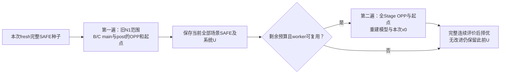

# K.136：全开放搜索的结构代价与两阶段修订建议

**建议只修订搜索组织：同一调用内先搜索旧N1，再用剩余预算开放全部Stage的工作点与起点，并持续保留自己取得的完整安全方案。** 不再直接从初始方案一次跳入最大固定设备子域。本轮仅分析K.135存档和源码，未构模、热重算、调用求解器或修改生产程序；修订尚未实现，也没有新增节能结果。

## 材料信息

| 项目 | 口径 |
|---|---|
| 状态 | ANALYZED；非复现实验或求解认证 |
| 输入材料 | 提交`181039c`的[K.135配对](../augmented_quality_pair01/summary.md)、原生事件／MAT、当前相关源码及[K.128分析](../../../第三章当前进展与正式实验推进计划_审查稿.md) |
| 不变范围 | 原base__R1、AB／AC完整三Stage链、400 ms窗口、5 ms起点、auto-L、功热参数、连续热安全与原数值接纳标准 |
| 方法范围 | 给定共享部署，全部执行单元固定为本次fresh种子的内层搜索；不开发共享部署或本地设备重选 |
| 独立核对 | 本线程子代理；非主线⑥跨会话审查；仅读已存数据，结论见[审查记录](independent_review.md) |

## 1．已确认的事实与仍未隔离的原因

K.135旧N1从1.080823451833 J降至0.962885037941 J，新版仍为初始1.080823451833 J。旧版只开放B／C的main、post；新版还开放A全部Stage和B／C.pre的OPP／起点。两版所有执行设备都固定，A跨场景共享的是具体设备，场景内OPP／起点没有被要求相同。

存档载荷的规模、整数／连续结构、事件及条件行明细见[静态指标](metrics/summary.md)。它区分新版增广前的原模型与实际发给求解器的增广模型，不能把新增连续补变量计作新增调度选择。

| 场景 | 旧→新选项／整数列 | 旧→新事件数 | 旧变量→新原模型→新发送模型 | 旧→新发送总行 |
|---|---:|---:|---:|---:|
| AB | 167→441 | 150→271 | 4621→8525→10925 | 21376→42133 |
| AC | 137→405 | 144→296 | 4635→13810→21006 | 22741→97169 |

实际整数列全部是[0,1]界选择变量；旧逻辑辅助量已连续化，不能把逻辑标签数误报为求解器整数维数。新发送模型额外加入AB2400／AC7196个连续补变量及同数链接等式；AC约9.7万行包含89973不等式和7196等式。保留固定界列的维数与真正自由整数数分别登记，不由总维数直接预测耗时。

| 存档事件 | 旧N1 | 增广全Stage |
|---|---:|---:|
| AB首rootlp事件，原生自报秒 | 6.091 | 52.058 |
| AC首rootlp事件 | 2.276秒 | 未发布 |
| AB首次不同于x0的非空候选，原生自报秒 | 48.920 | 未发布 |
| AC首次不同于x0的非空候选，原生自报秒 | 60.288 | 未发布 |
| 方法计费／300秒上限 | 159.532秒 | 150.063秒 |

旧版两个改进都来自启发式阶段，四个请求最终节点数均为0。新版AB直到52秒才发布rootlp，随后只重报x0；AC没有新向量。**据此优先处理进入大域前的可用解质量与阶段衔接，不优先追加分支参数或割平面扫描。** 但开放范围、物理表达规模和增广运输同时改变，这些事实不能单独证明某一约束、LP松弛或预处理是根因。AC未发布rootlp也不能改写为“全部时间必定用于根LP”。

**增广处理本身没有强化原LP松弛。** 物理行由`aᵀx+Mw≤b`改写为`aᵀx−Mv≤b−M`并加入`v+w=1`，在精确算术下消去连续v仍是原行；即使原整数变量作连续松弛，投影关系也成立。增加补变量与等式是数值表达处理，可能改变计算路径和成本，不增加合法调度，也不提供更紧的数学下界。新增调度选择来自Stage开放；两者须分别记账。

两个方法都在预定场景片结束后停止，没有用满300秒。此时不是总预算已经耗尽，而是当前组织不再访问其他范围。另一方面，旧改进分别到48.920／60.288秒才出现，没有依据把旧60秒场景片硬拆成30＋30秒并期待保留它们。60.288秒是合作式停止的实测延迟，原方法总截止仍满足，不能反称为严格60秒内事件。

## 2．唯一建议：先小域取得改进，再携带见证进入大域

1. **只生成一次fresh种子。** 从原输入确定本次固定设备表D及共享A部署a；两遍都不改D。原种子继续作为范围条件的锚点，当前最佳SAFE是另一个对象，不将它伪装为新的免费初始化。
2. **第一遍保留旧N1搜索机会。** 按原场景顺序、每场景原60秒合作式上限搜索，仅开放本地main＋post。每次更新须有原输入完整场景回执，并在截止前与其他场景回执形成完整系统U。
3. **第二遍只使用同一300秒的剩余时间。** 再按原场景顺序访问一次全Stage OPP／起点子域。建议每次在模型及x0准备后，给剩余k个场景中的当前场景分配不超过`min(60秒，当前剩余时间/k)`的合作片；准备、变换、核查、反馈及汇总仍消耗同一总预算。没有余量就停止，不保证两场景都能进入第二遍。不补领300秒，不重置原生停止延迟。
4. **携带的是自己的完整安排和物理回执。** 第二遍必须从最后一次成功提交的`safe_candidate＋aggregation＋U`一致快照提取场景安排，在新模型下重新准备和检查x0。不能直接拼接各场景“最新”记录或`_solve_scene.best`：现有发布路径先更新局部回执，再尝试完整聚合，中断时两者可能不属于同一代。无法完成数值提升时，可在剩余预算内使用既有裸MILP退路，但已有系统SAFE不撤销；数值冲突或worker异常则停止受影响搜索，不能靠进入下一遍清除失败状态。
5. **最多两遍，不轮换到收敛。** 本输入最多四个场景搜索入口；每个入口的热处理仍沿用既有片内反馈循环，不在片外重开。没有新增邻域排序、HEFT种子、设备迁移、温度扫描或算法调参。

这是待实现的方法建议，**不是下一次研究调用的冻结协议**。保留第一遍60秒、使用余量进行第二遍，会同时改变决策开放顺序和预算利用率；未来结果应按完整方法比较，不能独占归因为“分阶段”本身。300秒总上限和实际方法／原生／清理时钟仍分列，不能用更多请求数冒充公平性，也不能按更短退出时间宣称节能。

**这项修订没有缩小第二遍的大域，也没有强化它的LP松弛。** 它先保留已观察到可用的小域改进，再把该改进作为更好的初始化；52秒级的前段成本仍可能存在，第二遍甚至可能来不及取得新点。因此本次推荐依据是有界衔接及避免退回初始方案，不是已经找到降低大域求解成本的根本办法。若仅重复保存第一遍结果、第二遍没有新增改善，应记“接续实现完成、额外质量收益未证”。

### 能保证什么

在固定D、原入口和原合法起点下，第一遍调度可行域包含于第二遍：

\[
\mathcal F_{\mathrm{N1}}(D,z_0)\subseteq
\mathcal F_{\mathrm{all}}(D)\subseteq\mathcal F_{\mathrm{original}},
\]

其中z₀是本次原种子中闭合Stage的OPP／起点。扩大范围不改变已评价安排的物理含义。将原输入、精度、预算身份和候选哈希匹配的完整SAFE保存在模型外，按能量上端择优，可使同一调用的已认证上界不回退：

\[
U_{k+1}=\min\{U_k,U(\sigma_{k+1})\}.
\]

这只保证保留本次已有证据；**不保证另一独立旧N1调用的结果可重复，不保证新版一定优于旧N1或HEFT，也不保证每份物理SAFE都能数值提升成新模型的合格辅助向量。** 严格节能证据仍用新区间上端小于参照区间下端判断；重叠只登记上界变化。固定a后各场景入口分别给定，不在此引入跨场景热状态继承。零权重场景也须SAFE。

## 3．必须改的接口，以及可直接继承的部分

| 接口 | 现状与修订要求 |
|---|---|
| 生命周期 | `neighborhood_method.py:420—498`只建一次condition，并先建好各场景模型／初始x0后逐场景求解。不能串联调用两次现有顶层入口：那会重造seed、worker和结果容器。需在一个生命周期内增加有限的两遍调度与模型外SAFE账本。 |
| 条件与见证 | 原输入回执和完整聚合身份与搜索condition分离；两遍的condition／模型视图须分别登记。第二遍可继续用原种子固定D，不能改写旧回执或把旧condition哈希贴到新模型。完整账本必须原子保存candidate、aggregation及U；局部记录更新不等于完整账本已更新。 |
| 模型与x0 | 选项过滤先于事件／控制状态生成，放开Stage会改变事件、状态、系数及向量布局。重建当前场景模型、模型视图SAFE和`complete_initial_point`；不能简单解锁旧列、补零或复制旧x0。 |
| 增广与反馈 | 新请求重新绑定当前`names/row_tags`及补变量映射。旧事件索引、补变量位置、条件切面和nogood列不跨模型复制；首版直接重建并按既有连续检查重新反馈。数值失败锁存跨阶段保留，异常后不重试。 |
| 接纳与缓存 | 继承原行1e−9／整数1e−6检查、原输入合法性、完整窗口／空闲尾段连续热能耗评价。模型视图缓存分阶段隔离；相同原输入／候选／精度／预算身份的原物理回执可核身份复用，仍核当前范围成员资格。 |
| U与界 | 复用`aggregate_partial_scene_receipts`及原完整U门；不得用局部目标或单场景SAFE替代系统U。原L₀继续有效，旧小域内部下界不能随范围扩大继承为新域下界。 |

关键定位：[旧开放集](../../run_neighborhood_diagnostic.py#L85)、[旧N1成员定义](../../neighborhood.py#L199)、[全开放定义](../../fixed_unit_neighborhood.py#L31)、[完整U更新](../../neighborhood_method.py#L163)、[原输入汇总](../../scene_adapter.py#L508)、[新模型x0](../../initial_point.py#L101)、[逐请求增广](../../augmented_method.py#L226)、[场景片与反馈](../../partial_method.py#L215)。行号只是代码定位，不作为可执行指令。

## 4．下一步的最小验收，不再扩展方法

建议下一项只实现上述两遍生命周期并做小域／mock正确性预检，不同时启动原规模诊断。至少核清：

| 检查 | 完成依据 |
|---|---|
| 设备与范围 | D全程相同；第一遍保持旧N1；第二遍允许A在AB／AC独立选择OPP／起点；原有限起点、等待、同频并发及完整三Stage不删减。 |
| 自身SAFE延续 | 第一遍改善确实作为第二遍x0的安排来源；局部回执已更新、完整聚合中断时，只继承上一次成功完整快照；第二遍无候选、劣解、x0拒绝或技术失败时，原完整SAFE及U保持。不同方法／调用的旧结果不能进入。 |
| 新模型身份 | 同维不同事件、旧x0误用、旧condition／反馈行／映射混入被拒绝；异常锁存不因阶段重建解除。 |
| 总预算与切换 | 输入、两遍构模、worker、变换、热评价和汇总共用一个计时器；第一遍到期不启动第二遍；晚返回不得补新U，已形成SAFE／违规仍保留。 |
| 质量与证据 | 完整上界单调保留；局部界、原L₀、solver-reported分列；旧默认路径做必要等价回归。mock或回声结果不计节能证据。 |

**判断：值得实现这一项有界修订，尚不值得恢复正式批量。** 它既保留K.135中实际产生改进的小域搜索，也给被冻结的A等决策一次有预算的访问机会；新增工作集中于生命周期和凭据衔接，不重写热评价器或MILP物理表达。若实现后仍没有质量收益，应据结果收缩方法主张，不继续添加阶段或搜索组件。本轮到此结束，研究求解调用为0。

交付核验：主线程重新读取四份MAT的维数、整数索引／界及行非零计数，与附录一致；144份生产源及快照保持、288份已跟踪历史工件保持、47份本次读取文件前后SHA／大小相同，本地引用完整。[核验回执](delivery_verification.json)只确认存档与范围，不当作新算法预检或节能证明。
