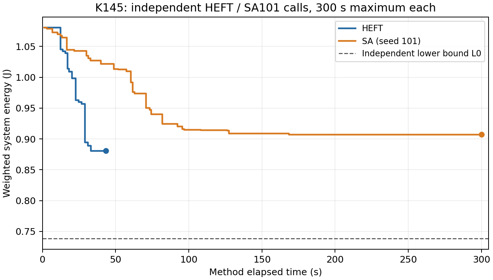

# K.145：HEFT与SA101独立冻结执行

**两次授权调用完成，均取得完整安全结果；本次HEFT能耗更低。** HEFT在43.250秒完成既定搜索，安全上界为0.881087997281 J；SA101在300秒截止，上界为0.907346431253 J，比HEFT高2.9802%。没有补跑、额外种子、预算延长或参数调整。

| 记录项 | 内容 |
|---|---|
| 阶段／类型 | K145，已冻结算法的两次独立代码实验与存档复核 |
| 执行依据 | [用户授权](k145_execution_authorization.md)、原[协议](protocol.md)及declaration.json |
| 输入与标准 | 原base__R1完整AB／AC三Stage，400 ms窗口、5 ms启动集合，auto-L，50°C入口／80°C温限，原连续热与能量误差要求 |
| 调用／源码 | HEFT→SA(seed101)，各一次、各最多300秒；165份源码及输入身份保持，无生产源码修改 |
| 状态 | 账本COMPLETED、消费2；HEFT正常完成，SA正常截止且末候选未决；无技术／数值故障记录 |
| 复核范围 | 已存候选、精确格值／期限／共享部署／资源、连续峰包络、能量区间及计时；事后未重跑搜索或热轨迹 |

## 能量、预算与安全

| 指标 | HEFT | SA101 |
|---|---:|---:|
| 最终完整安全U／J | 0.881087997281 | 0.907346431253 |
| 初始完整安全U／J | 1.080825263898 | 1.080825263898 |
| 相对自身初始U下降 | 18.4801% | 16.0506% |
| 首个完整SAFE／s | 1.125 | 1.125 |
| 首次区间严格改善／s | 12.266 | 2.782 |
| 最终U形成／s | 43.234 | 169.797 |
| 方法停止时钟／s | 43.250 | 300.000 |
| 返回含封存墙时／s | 44.281 | 301.125 |
| 其中结果封存／s | 1.031 | 1.094 |
| 返回后回执提取／记录／s | 0.438 | 1.718 |
| 候选请求数 | 44 | 277 |
| 实际候选热评价调用（含未决） | 44 | 242 |
| 缓存命中 | 0 | 35 |
| 已接纳不同完整安全时间表 | 44 | 241 |
| 末候选未决 | 0 | 1 |
| 最终方案最高节点峰包络上端／°C | 50.710882 | 50.179360 |
| 共同独立L0／J | 0.738285994489 | 0.738285994489 |
| 认证差距上界(U−L0)/U | 16.2075% | 18.6324% |

这里的241份SA安全回执不含35次本调用缓存复用；SA内部276次SAFE返回包含缓存，不能混记为276张新评价时间表。双方MATLAB启动均为“不适用”，不填成测得0秒。包装实测348.563秒，覆盖两次方法、导入和主要记录；外围进程总墙钟未单独测量，不把包装时间当全进程时间。返回及封存超过300秒的部分只写既成结果，没有追加搜索证据。

SA最后一次候选的AB场景在299.672秒完成，AC仅覆盖45 ms，未取得完整能量或完成时间；该候选保持UNRESOLVED且accepted_safe=false。169.797秒形成的旧完整安全U保留，最终分类为NORMAL_TIME_LIMIT_PENDING_LAST_REQUEST。没有把部分场景能量作为新U，也没有因末候选未决撤销先前安全结果。

所有接纳方案重新核对原合法模式、未取整结束、请求期限、共享Stage具体单元、同单元互斥和同域异频冲突；安全回执均覆盖原两个场景、0—400 ms及空闲尾段，四节点连续峰包络均低于80°C。两方法均0热违规记录，不能从本次结果论证热反馈带来收益。两者均未覆盖全域，独立最优性／不可行性仍未证；以上认证差距是L0给出的上限，不是已知精确最优差距。

## 能量差异说明

| 加权能量组成／J | HEFT | SA101 | SA−HEFT |
|---|---:|---:|---:|
| 频率域基准 | 0.503150 | 0.518180 | 0.015030 |
| Stage活动增量 | 0.156587 | 0.165254 | 0.008667 |
| 温度修正 | 0.101351 | 0.103912 | 0.002561 |
| 外部公共项 | 0.120000 | 0.120000 | 0 |

两套最终方案均将A.main、B.main放在NPU0，C.main放在GPU0；差异包括CPU工作点、后处理核选择、NPU工作点以及顺序和等待。HEFT的确定性下降在本次路径上较快降到低能量区域；SA允许中途接受较高能量，并保留历史最好解，但单种子300秒内没有找到更低最终U。这解释了保存的过程，不能据此宣布HEFT普遍优于SA或增加种子寻找反转。

HEFT上界下降记录中，工作点改动后累计下降约0.199720923 J，随后一格起点调整约0.000016344 J；SA的最好上界也主要在工作点改动后下降。它们是各自搜索路径上的记账，不是独立消融结论。连续评价占HEFT约42.518／43.250秒、SA约295.124／300秒，评价成本仍是本次启发式搜索的主要开销。

## 与主线的关系及下一步

K142存档的联动U为0.962885037941 J，本次HEFT和SA101均给出更低的安全能量，算法竞争力不足仍需正面处理。但K142与本次属于不同批次、不同运行包装，不补拼成完整四法同轮，不据此发布四法排名或稳定耗时结论。

**建议下一步只做保存方案的决策差异分析：** 比较K142联动与本次HEFT的共享部署、场景工作点、时序和能量组成，明确低能量方案为何未被联动搜索到，再确定一项方法改动。先利用已有证据，不恢复115次正式批量、不扫描温限、不新增SA种子或再补质量调用。

## 可复核材料

- 原始结果：heft/result.json、sa101/result.json、ledger.json及claims；原K144准备文件、预检和快照保留。
- [静态数学核对](k145_analysis.json)、[分析入口](k145_analyze.py)、[指标CSV](k145_metrics.csv)、[完整时间表](k145_schedules.csv)、[能量事件](k145_progress.csv)。
- 事后分析初版误要求trace首条记录为0；原实现的trace记录子片段末点，初温另由输入给定。已改为核对保存功率片段从0连续覆盖窗口，保留[k145_analysis_revision01_failure.json](k145_analysis_revision01_failure.json)及原分析快照；未改生产、原始结果或热计算。
- 独立终审另见k145_independent_review.md和k145_independent_verification.json；本线程子代理审查，非主线⑥跨会话审查。
