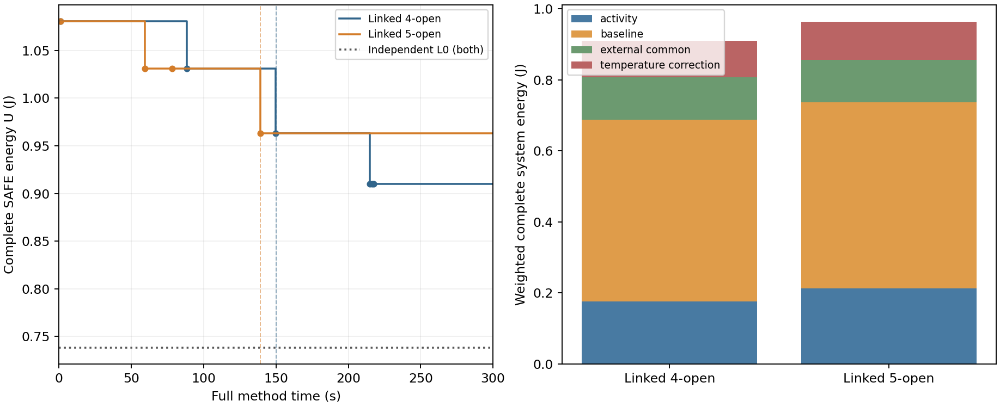

# K.148：5开1闭未改善原基准的预算内方案质量

**本次结果不支持以5开1闭替代旧4开2闭。** 两方法各运行一次，均在独立300秒预算内正常结束，完整连续热安全复核通过；新版最终系统能耗比旧版高5.783699%。没有补跑、延长预算或调整物理参数。

| 指标 | 旧联动：4开2闭 | 新联动：5开1闭 |
|---|---:|---:|
| 初始完整安全能耗／J | 1.080823451833 | 1.080823451833 |
| 第一遍结束能耗／J | 0.962885037941 | 0.962884840560 |
| 最终完整安全能耗／J | **0.910239340728** | 0.962884840560 |
| 第二遍完整改善次数 | **3** | 0 |
| 首个完整SAFE／s | 0.953 | 1.093 |
| 首次严格改善／s | 88.375 | 59.375 |
| 方法计时／s | 282.703 | 274.734 |
| 第二遍含准备／s | 132.875 | 135.563 |
| MATLAB启动／s（计入方法） | 18.437 | 7.782 |
| 清理／s（单列） | 6.313 | 5.844 |
| 连续热违规／新增反馈行 | 0／0 | 0／0 |

共同条件为原`base__R1`完整AB／AC三Stage链、400 ms窗口、5 ms合法起点、auto-L、50°C入口及80°C温限。两方法独立加载输入、生成seed、启动MATLAB和创建缓存。第一遍算法相同；第二遍新版只增加本地main的OPP和起点选择，设备不变，post保持各自第一遍最后完整SAFE。

## 本次查明的原因线索

旧版在AB场景第二遍将A整链和B.pre由H改为L，三次降低完整U；新版第二遍AB、AC只重新得到自身warm，没有新增完整改善。两个最终AC方案相同；主要差异位于AB。

| 第二遍指标 | 旧AB | 新AB | 旧AC | 新AC |
|---|---:|---:|---:|---:|
| 变量数 | 5,322 | 6,301 | 6,149 | 10,073 |
| 约束行数 | 24,192 | 29,227 | 28,358 | 65,475 |
| 根LP回调原生自报／s | 4.317 | 15.913 | 8.256 | 45.067 |
| 原生自报可行点数 | 4 | 1 | 1 | 1 |

新增main扩大了模型，且本次根LP前段明显变慢；新版两场景均只复核出warm。它比旧版多约10.7秒进入第二遍的余量，仍未找到更低能耗。现有证据更支持“扩大开放域没有转化为预算内有效搜索”，不支持把失败归为总预算更少或热安全筛掉了改善。

两次第一遍的B.post起点分别为145／150 ms，warm并非逐字相同，所以这不是固定同一warm的单因素试验；不能将全部耗时变化唯一归因于main。域包含只对同一seed／warm成立，不自动保证两个独立调用的结果优劣。

新版比旧版多0.052645500 J：活动项约0.037364520 J，基准项0.012250000 J，温度修正约0.003030980 J，公共项差0。这里是两个完整方案的账差，不是各因素独立的因果效应。

## 安全、界与执行故障

两方法最终方案均覆盖全部场景、完整400 ms及空闲尾段；节点连续峰温上界最高约51.178°C，低于原80°C温限。原条件下本次仍为0热反馈，不能新增反馈收益结论。独立L0均约0.738286 J，未与U闭合；本轮没有全域最优或网格无解证明。

运行中发现并纠正了一处**新增包装审计错误**：聚合器向外舍入后的上端比逐场景精确加权上端多5×10⁻⁶¹ J；包装误要求端点完全相等，将旧方法标为BLOCKED。旧原方法本身正常结束，安全回执在217.547秒已形成。7项回归及两次独立只读核对确认原区间有效，修正采用严格包容并精确复现原60位向外舍入，不增加容差。

原误报、旧结果、global claim及旧消费记录全部保留。按[恢复附记](../five_open_preparation01/recovery_protocol.md)只执行尚未开始的新版一次；原165核心、167冻结源及原301历史工件均保持，旧方法未重跑。两进程活跃时间合576.422秒；中间诊断暂停388.623秒，完整日历历时约965.037秒。不能称原连续900秒内无中断完成；恢复进程实际600秒硬上限比脚本遗留607秒元数据更严格。

恢复启动时绑定的分析脚本保留为`analysis01/analyze_bound_before_run.py`；后续分析版只增加计时／L0图及恢复分类。两版本分别留存，不声称该分析路径全程未变。MAT载荷依`.gitignore`仅在本地保留并存哈希，JSON／CSV／源码用于公开核查，不要求被忽略的MAT成为远程Git文件。

## 完成与下一步

已完成包装、24项必要预检、504项小域组合核对、7项舍入修复回归、两次原基准调用和存档复核；研究调用配额2次／600秒已消费。初次预检的临时目录权限失败、舍入误报和图例颜色修订均保留。

**建议暂保留4开2闭为当前版本，停止直接扩大开放数量。** 下一步只围绕本次已有模型与根LP记录，确定一项能改善整数候选生成的结构修订；不再补跑5开1闭、不加温度扫描，也不恢复115次正式批量。本次失败是这一具体求解组织的结果，不否定原研究问题。

证据入口：[完整指标与审计](analysis01/facts.json)、[阶段成本](analysis01/phase_timing.csv)、[原生状态](analysis01/native.csv)、[时间表](analysis01/schedules.csv)、[执行及修复细节](analysis01/summary.md)、[内部独立审查](independent_review.md)。内部审查不冒充另一ChatGPT会话的外部审批。

