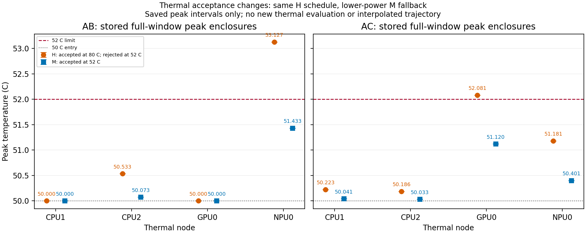
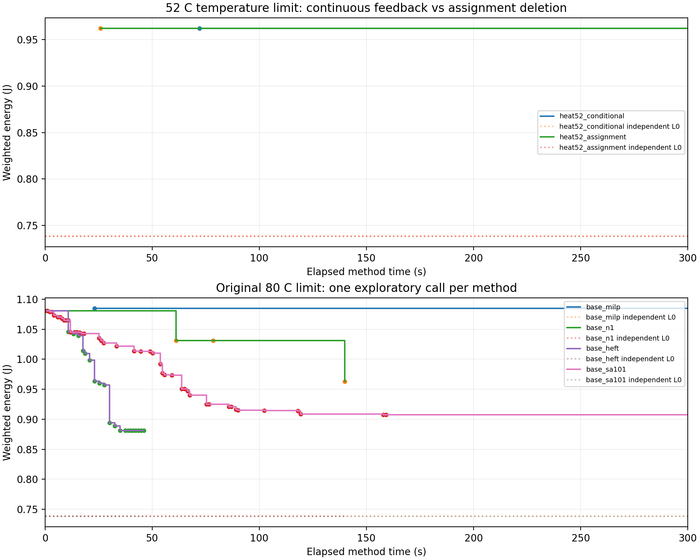

# K.127：夜间热证据与最小auto-L对照总结

**已完成冻结设计、必要预检和6次独立方法调用，无重试、延时或技术阻断。热约束改变了同一完整安排的安全接纳与初始化选择；连续热反馈未触发。原基准单次对照中HEFT能量最低，N1未优于HEFT或SA101。** 本报告只解释本组抽象模型，不升级为实际设备收益或一般方法排名。

## 1．执行范围与预算

| 项目 | 实际情况 |
|---|---|
| 阶段 | 热证据设计完成；1组新条件、2次配对完成；4方法最小对照完成 |
| 调用 | 6／8次上限，单次上限300秒；没有使用剩余2次寻找效果 |
| 方法耗时 | 合计1385.875秒；六次已声明预算1800秒 |
| 包装墙钟／清理 | 合计1416.578／28.110秒，清理只归档既有证据 |
| 整体时长 | 从北京时间22:50:19至本摘要形成约42.5分钟；远早于六小时截止次日04:50:19（用户最迟07:00） |
| 正确性与冻结 | 最终67／67预检；125份源及输入哈希保持；6份最终SAFE存档一致性核验均通过 |
| 原生求解请求 | 合计5次：3项整体各1、N1两个scene各1；HEFT／SA无原生MILP。与独立方法调用数分列 |

新代码仅为显式auto-L启发式准入、对应独立下界及夜间有界执行包装；HEFT排序／下降规则、SA邻域／参数不变，旧hold默认入口及历史结果保留。预检02出现8项Windows临时目录权限错误，改用继承工作区权限的测试目录后03全部通过；失败记录保留，未消费研究调用。初版零调用声明已标废止，唯一实际根为本目录。

单方法预算包含输入展开、初始化、构模、MATLAB启动／数据交接、求解、缓存、连续复核和反馈；沿既有共同口径，公共Python导入、进程清理及既有证据序列化单列。原生请求只取剩余时间；到期后形成的native回执不补记预算内U、界或最优／无解证明。MAT文件及绘图PDF按.gitignore留本机，未强制上传。

## 2．热约束作用已经观察到，反馈收益仍未证明

唯一新增情景是入口仍50°C、温限80→52°C；原完整AB／AC三Stage、400 ms窗口、5 ms起点、物理参数、合法模式及auto-L全部保持。52°C依据K.126已保存完整可靠峰温区间，在功耗适用温区20—100°C内预先选定；它是条件性L3压力情景，不是实测常见温限。全部条件、方法、预算和用途先冻结，求解后未调整。

**直接证据：** 原80°C整体方法的H初始化与52°C方法首次H初始化逐字段相同，完整温度轨迹和能量区间也相同。H在80°C可接纳；在52°C时，AB的NPU于75 ms约53.127366°C、AC的GPU于60 ms约52.081279°C明确超温。两次52°C调用均拒收H、访问M模板，完整安全U同为0.962111586360 J。因此热约束确实改变了本次接纳及最终初始化选择，不只改变一个统计标签。

这两次初始化热拒绝**不是外层反馈**。所有六项调用实际反馈记录和新增反馈行均为0；三个整体MILP都没有在预算内返回新的整数候选，其最终U均来自各自fresh初始化。两热版实际初始八组数值数组及27971维x0逐值相同，原生选项除随剩余时间变化的MaxTime外相同。两版未进入不同的热排除路径，不能比较连续反馈相对赋值删除的收益。已知H违规峰在事件端点，主模型已有端点温限，也不应通过弱化它们制造反馈。

固定目标与其余输入时，\(\mathcal F_{52}\subseteq\mathcal F_{80}\)，故\(E^*_{52}\ge E^*_{80}\)。本次52°C安全U低于80°C整体方法U，只说明有限预算构造器从H转M、访问了不同方案，不能称收紧温限降低了真实最优能耗。

## 3．同auto-L、同总预算的最小方法对照

所有方法重新加载同一原输入、独立初始化与评价，不读取其他方法历史最优、热缓存或预算外见证。下面U均来自完整两scene、完整400 ms及连续热复核；计时为本次实际记录。

| 调用 | 最终安全U／J | 首SAFE／s | 方法耗时／s |
|---|---:|---:|---:|
| 52°C／连续反馈 | 0.962111586360 | 72.047 | 300.000 |
| 52°C／赋值删除 | 0.962111586360 | 25.906 | 300.000 |
| 原80°C／整体MILP | 1.084886371304 | 23.110 | 300.000 |
| 原80°C／N1 | 0.962884840560 | 0.969 | 139.828 |
| 原80°C／HEFT | 0.881087997281 | 0.765 | 46.047 |
| 原80°C／SA101 | 0.907346431253 | 1.110 | 300.000 |

N1本次相对自身SAFE种子严格减少约10.911922%，但HEFT上界比N1低0.081796843279 J（约8.4950%），且调用更短。SA固定101的单次U介于HEFT与N1之间，只是探索性结果，不推断一般排名。N1与HEFT按既定搜索规则提前结束，未使用余量追加搜索。

**差异已有具体落点。** HEFT实际修改了N1冻结的共享A工作点、A.pre设备、本地pre和B.post设备，并改变NPU顺序；N1仍冻结A及pre，仅开放本地main＋post的OPP／起点。两份输出能量差可记账分为基准0.020300000000、活动0.056607631680、温度修正0.004889211599 J，公共项不变。这些决定同时变化，尚未作反事实分离，不能将总差全部归给单个机制，也不能将局部N1包装为全域等能力搜索。

三个整体调用构模约14—15秒，native等待约224—274秒，后续候选为0；本次主要未解决环节已不是构模成本。HEFT约45.378秒、SA约294.979秒用于连续评价；N1主要为两次局部native请求等待。不同原生节点计数不直接比较。热两版首SAFE72.047／25.906秒的差异主要伴随54.172／7.766秒启动差，不能归因于未执行的反馈规则。

## 4．证明、未决及实现状态

各调用重新计算的全域独立\(L_0=1152169123/1560600000\approx0.738285994489\) J相同，来源与形成时间独立保存。所有U均高于L₀，均未证全域最优或网格不可行。\((U-L_0)/U\)只是可信界间差，不能当成已知真实最优差距；N1的Lₐ及未加权单scene内部界不提升为全域界。预算后native退出状态只存档。

| 状态 | 已到达的范围 |
|---|---|
| 已实现 | 原完整MILP与N1生命周期、HEFT／SA显式auto-L适配、不可逆claim及统一截止 |
| 已预检 | 必要接口67／67；旧N1匹配范围复用；不是新的性能证据 |
| 已运行 | 一组热条件配对及原base__R1四方法，共6次，全部保留SAFE |
| 已核实／可靠包络支持 | 指定H安排在52°C违规、M替代完整安全；N1对自身种子严格改善；各输出能量区间和身份一致 |
| 仍未完成 | 新模型连续反馈求解收益、MILP相对强基线优势、全域最优、跨实例稳定性、五组正式实验 |

SA末次热评价因到期而未决，正确保留159.141秒已经形成的最佳SAFE，没有将末次未决当违规或新U。持续／窗口外保证不在本次400 ms有限场景结论内。主线⑥未参与此次跨会话审查；[独立结果审查](independent_review.md)为本线程另一代理只读核对。适配作者自查与独立结果审查分别保存，不以多代理一致替代原始记录。

## 5．下一步及停止投入项

**下一步只建议收敛一项最小方法修订：依据本轮真实选择差，讨论怎样解除N1对共享A工作点／时序等关键决定的长期冻结，再决定是否有必要实施及对照。** 保留HEFT／SA作强基线，不将旧结果免费注入新调用；此为待讨论建议，本夜未实现或运行。当前不宜直接启动115次批量来重复已知弱点。

停止本轮热温限扫描、同类冷态正例、求解器参数扫描、只以构模变小／更快充当质量收益、N2及MILP认证支线。热约束作用可写入论文；连续热反馈目前写成已实现的安全保障接口与无触发结果，不能写已取得求解或节能优势。

## 6．证据入口

- [先冻结设计](stage1_design.md)、[不可逆调用账本](ledger.json)、[125源及输入声明](declaration.json)、[最终源及环境核查](final_scope_audit.json)。
- [六次事实](analysis01/facts.json)、[结果CSV](analysis01/results.csv)、[U更新CSV](analysis01/energy_updates.csv)、[峰温原值](analysis01/thermal_acceptance_values.json)。
- [实际模型／x0配对审计](thermal_pair_array_audit.json)、[方法选择与分项差](method_difference.md)、[适配自查](method_adaptation_review.md)、[独立结果审查](independent_review.md)。

本摘要形成于2026-10-19T15:32:50.277084+00:00；研究调用至此结束，不留新的自动运行任务。
