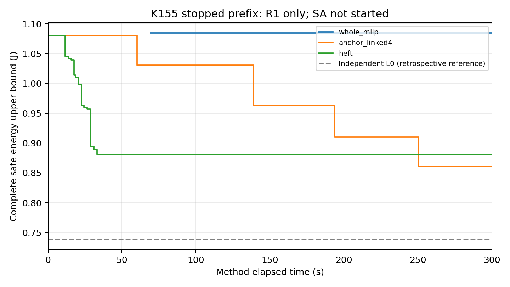

# K.155：P0基准批中断与前三次结果

**本批因方法返回后的账本写入故障停止：已消费3/40次，剩余37次未启动，没有补跑或延长方法预算。** 三个原方法均取得完整安全结果，并各完成一次原定事后连续复核。故障不是HEFT求解失败，也不是热模型或调度问题无解；40次正式对照尚未完成。

## 已执行结果

全部为base__R1、原完整AB／AC三Stage、400 ms／5 ms、auto-L、50°C入口／80°C温限及原连续误差要求；共享部署／合法选择与K154保持。每次独立300秒，无旧见证或跨方法缓存初始化。

| 方法 | 安全U/J | 首次完整SAFE/s | 首次严格改善/s | 方法停止/s | MATLAB启动/s | 事后复核 |
|---|---:|---:|---:|---:|---:|---|
| 整体MILP | 1.084886371304 | 69.250 | 未观察到 | 300.016 | 53.625 | SAFE |
| 预消元联动 | 0.860663343334 | 0.922 | 60.187 | 266.765 | 7.766 | SAFE |
| HEFT | 0.881087997281 | 0.828 | 11.563 | 43.438 | 不适用 | SAFE |

整体属于`NORMAL_TIME_LIMIT_PENDING_LAST_REQUEST`：末请求未决，不接纳迟到候选；此前安全初始化保留。联动、HEFT方法状态均为`NORMAL_COMPLETION`，HEFT后续账本保存另列包装故障，不能混为算法未产出安全解。

联动第一阶段U＝0.962884840560 J，第二阶段U＝0.860663343334 J；两段时间分别约0.969—138.875秒、138.953—266.765秒，第二阶段确有完整安全改善。本次最终上端严格低于HEFT下端，相对HEFT低2.318117%；HEFT完成更早。只有R1三法的预算内质量／时间事实，不是40次总体结论、SA比较或普遍加速。三方独立L0均为1152169123/1560600000≈0.738286 J，未闭合，无新全域最优／无解证明；已存记录没有新增热违规／反馈。

三个方法停止时钟合计610.219秒，已消费的预算预留900秒；监督进程637.579秒后以退出码1停止，没有触发外部硬超时。三份post热评价各约0.797／1.187／1.250秒，最后一份是故障后对既成HEFT方案完成其原定、此前尚未执行的一次post；没有重跑HEFT、搜索、修复或补记新的预算内U。不能把诊断暂停并入“连续637秒完成全部审查”。

## 故障与证据保全

实际错误位于执行总控`batch.py`第207行：HEFT返回、原结果与核查记录形成后，`ledger.json.pending`替换`ledger.json`时抛出`PermissionError: [WinError 5]`。旧账本仍显示第3次RUNNING；临时账本完整保存了HEFT的正常方法状态和安全U。进程实际上已退出，后续槽没有启动。

原账本、临时账本、原结果、claims及退出日志全部保留，**不重写原RUNNING为正常完成**。派生[终态记录](terminal_receipt.json)与[27项存档核查](failure_review01/review.json)说明实际终态；原153工件及197冻结源保持，HEFT回执重放与临时账本记录一致。核查来自本会话，不冒称外部独立批准。

Windows小型文件夹具复现了“读句柄未关闭时拒绝替换”的机制；尚未确定真实占用者，不能断言一定是监测器、编辑器或杀毒程序。[8项IO检查](failure_review01/io_checks.json)表明，候选修复可只对同一次完整pending文件的替换作最多1秒重试：短暂占用后成功、永久拒绝仍报错、旧pending不删除／复用、方法绝不重跑。该候选仅放在故障核查目录，**未接入或修改本批冻结源码**。

## 下一步

先将账本写入修复与独立故障终态记录接入新总控，补Windows并发读写／异常终止预检。然后单独冻结尚未执行的37槽是否继续；前三次不重跑，旧claims／原结果不覆盖，后续若继续须明确记录分段执行及新增执行层版本。不能直接重启本批或把剩余预算自动变成新调用配额。本轮不调模型、参数、求解选项、邻域或温限。

材料：[逐方法CSV](failure_review01/results_prefix.csv)、[核查与阶段数据](failure_review01/review.json)、[原始账本](ledger.json)、[退出记录](launcher_result.json)、[冻结协议](protocol.md)。

图中实线只取已成完整SAFE回执的累计最好值，虚线为事后展示的独立L0参考，不表示各方法在0秒取得该界。早期候选轨迹误作最好上界的图及绘图脚本已另存，不改变任何结果、计时或安全结论。
