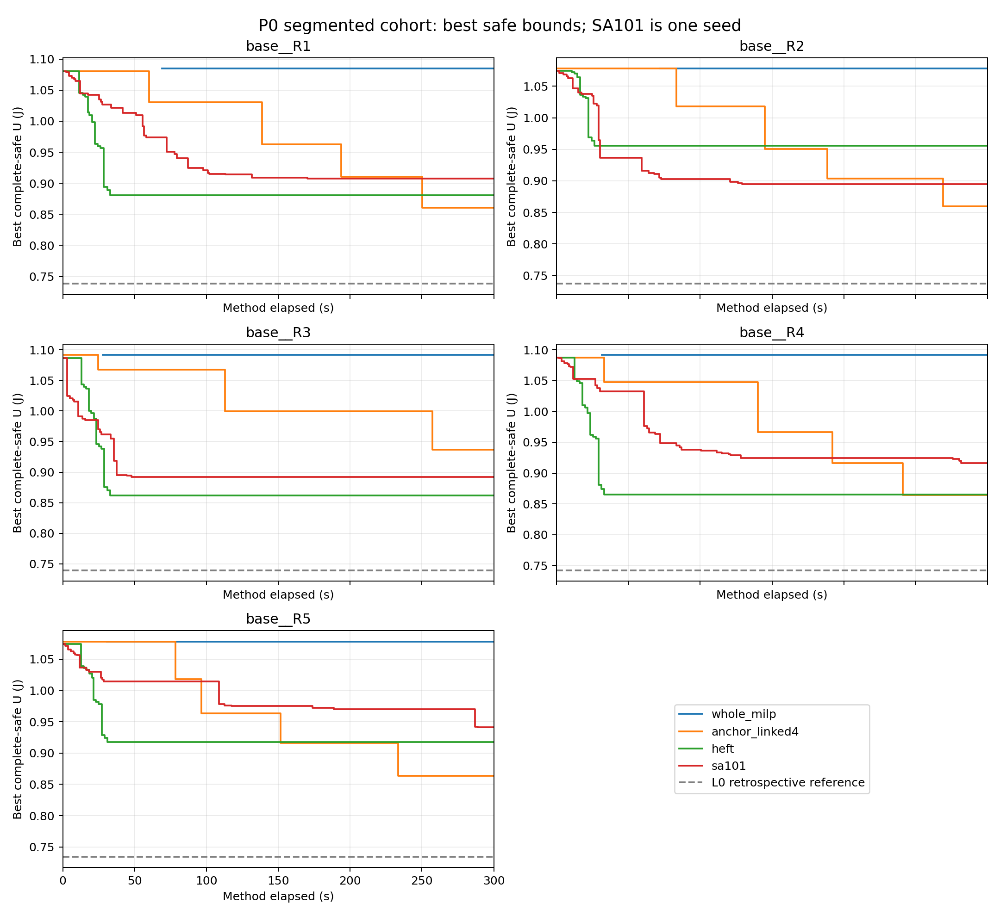
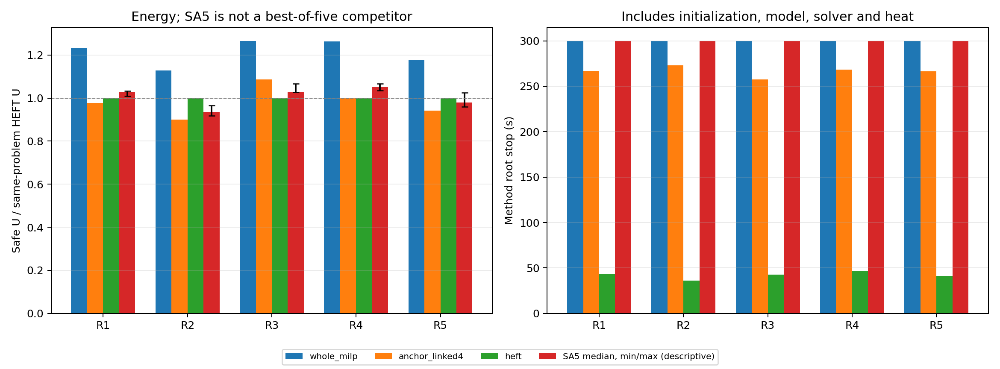
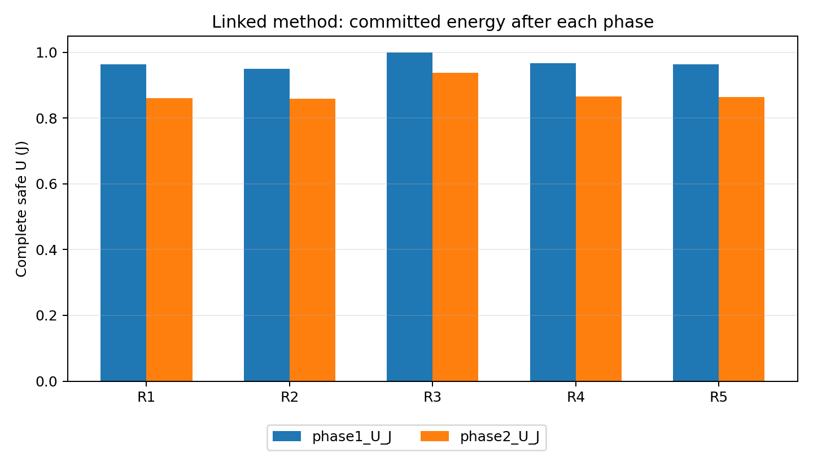

# K.156：账本修复、37次续接及P0完整结果

2026-10-21。原3次＋续接37次＝40次全部完成，40份最终安全方案均完成原定一次完整事后复核。前三次没有重跑，旧账本、pending、claims、源码与结果保持；未延长单次预算或原日历上限。

联动版在R1、R2、R4、R5取得比HEFT更低的安全能耗，R3高8.662912%；R4差异只有0.011967%。HEFT五题均更快。不能据此写成普遍优于HEFT。

## 1．修复与执行核查

- 修复限定在执行层：Windows 5／32原子替换最多等待1秒；监督只读compact状态；不可变方法回执先落盘；worker与supervisor分别写终态。没有修改候选生成、物理模型或安全判定。
- 必要预检167/167通过；首轮5项夹具接口失败及修正记录保留。终态存档核查453/453通过，属于本会话存档一致性核查，不冒称外部独立批准。
- 37个新槽一次消费，前三槽未重复；203项冻结源及旧工件哈希全部保持。37次续接无技术故障、无补跑，worker／supervisor均COMPLETED、退出0。
- 每次新建输入、候选、初始化与缓存，MATLAB启动、构模、求解和内部连续评价全部计费。事后复核只验证已接纳方案，不搜索、不替换原U、不补预算外候选。

## 2．最终安全能耗

能量单位J；列示完整场景加权系统能耗上端。负改善表示联动更差。严格高低核对使用原精确区间，表中小数仅作展示。

| 输入 | 整体MILP | 联动 | HEFT | SA五种子中位数 | 联动相对HEFT降低 |
|---|---:|---:|---:|---:|---:|
| base__R1 | 1.084886371 | 0.860663343 | 0.881087997 | 0.904843626 | 2.318117% |
| base__R2 | 1.078187304 | 0.859268325 | 0.955459935 | 0.894782431 | 10.067571% |
| base__R3 | 1.091492239 | 0.936947396 | 0.862251326 | 0.886293393 | -8.662912% |
| base__R4 | 1.091752315 | 0.864618168 | 0.864721654 | 0.908640735 | 0.011967% |
| base__R5 | 1.078128354 | 0.863782259 | 0.917706681 | 0.899555458 | 5.875998% |

每题8/8次取得可用安全输出。联动五题均低于整体MILP；与SA五次分布相比，R1／R2／R4／R5均低于对应五个已观察结果，R3高于对应五个结果。这只是本批五输入的描述，SA五次最小值不作为单次等预算竞争者。

## 3．阶段质量与耗时

| 输入 | 联动阶段1 U/J | 阶段2 U/J | 联动总时钟/s | HEFT总时钟/s | 联动首次严格改善/s |
|---|---:|---:|---:|---:|---:|
| base__R1 | 0.962884841 | 0.860663343 | 266.765 | 43.438 | 60.187 |
| base__R2 | 0.950321218 | 0.859268325 | 272.969 | 35.922 | 83.609 |
| base__R3 | 0.999661967 | 0.936947396 | 257.422 | 42.922 | 24.703 |
| base__R4 | 0.966221752 | 0.864618168 | 268.422 | 46.531 | 33.313 |
| base__R5 | 0.963611872 | 0.863782259 | 266.625 | 41.156 | 78.547 |

两阶段在5/5题均有严格安全改善记录；第二阶段改善原阶段1的U。这证明本版在同次预算内能进一步降能耗，不构成“没有第二阶段的等预算算法”消融，也不证明已达到固定配置、局部或全域真实能耗最优。

| 输入 | 整体首个SAFE/s | 整体MATLAB启动/s | 联动首个SAFE/s | 联动MATLAB启动/s |
|---|---:|---:|---:|---:|
| base__R1 | 69.250 | 53.625 | 0.922 | 7.766 |
| base__R2 | 71.781 | 55.391 | 1.109 | 10.485 |
| base__R3 | 27.828 | 9.985 | 0.969 | 6.609 |
| base__R4 | 31.609 | 9.516 | 0.985 | 7.656 |
| base__R5 | 30.766 | 7.453 | 0.875 | 6.703 |

方法根时钟合计10542.234秒；预留仍为3×300＋37×300＝12000秒。续接监督墙钟10327.672秒；从原K155启动到最终终态的日历时间12685.815秒，小于19200秒，包含故障诊断和准备暂停。三者含义不同，不能相加充当求解时间。实际停止／返回延迟已保留；安全证据接纳仍严格截止300秒。

状态为10次正常完成、29次正常时限且末请求未决、1次正常时限。末请求未决未抹掉已有U；原前三次之一另有包装IO归档故障，方法状态与执行层故障分别记录。MATLAB启动差异较大，尤其整体R1／R2约54／55秒，已计费且未剔除；本批不足以确定时差原因或稳定性。

## 4．热证据、界与证明范围

本批保存热违规记录0、连续热反馈记录0。40份最终方案均覆盖完整场景、400 ms窗口及尾段并通过一次事后复核；这支持本批安全输出，不支持反馈产生了求解收益。不新增温度扫描或重跑以制造正例。热约束改变选择的既有K127证据仍按原条件单列。

R1—R5独立L0依次约0.738285994、0.736830913、0.739741076、0.742190780、0.734381209 J。L0均未与最终U闭合，0项独立全域最优、0项独立全域无解，0项L0高于安全U异常。认证差距见逐调用CSV；solver内部界及局部子问题状态保留于原始结果，不提升为全域证书。

本批采用相同科学输入与方法规则，但前三次和后37次分段执行，不能描述成无中断批次；不并入K152先导或旧hold实验。每个确定性方法每输入仅一次，不能声称统计稳定性、普遍加速或实机节能。

## 5．文件与下一步

- [冻结续接协议](protocol.md)、[声明](declaration.json)、[账本](ledger.json)、[worker终态](worker_terminal.json)、[process终态](process_terminal.json)。
- [453项存档核查](record_review01.json)、[40次结果CSV](analysis01/results40.csv)、[原始汇总事实](analysis01/facts.json)、[衍生指标](analysis01/report_metrics.json)。
- calls／claims保存逐方法原始回执、最终完整安排、一次post、计时和工件哈希；原前三次位于p0_execution01，未复制改写。MAT遵守gitignore，本地保留及hash记录，不强制上传。

本阶段结束，不自动启动后续批次。建议先审阅本P0基准结果及R3反向表现，再确认下一组既定实验的调用和预算；不把本轮结果反向用于改参数、换种子或增加邻域。

