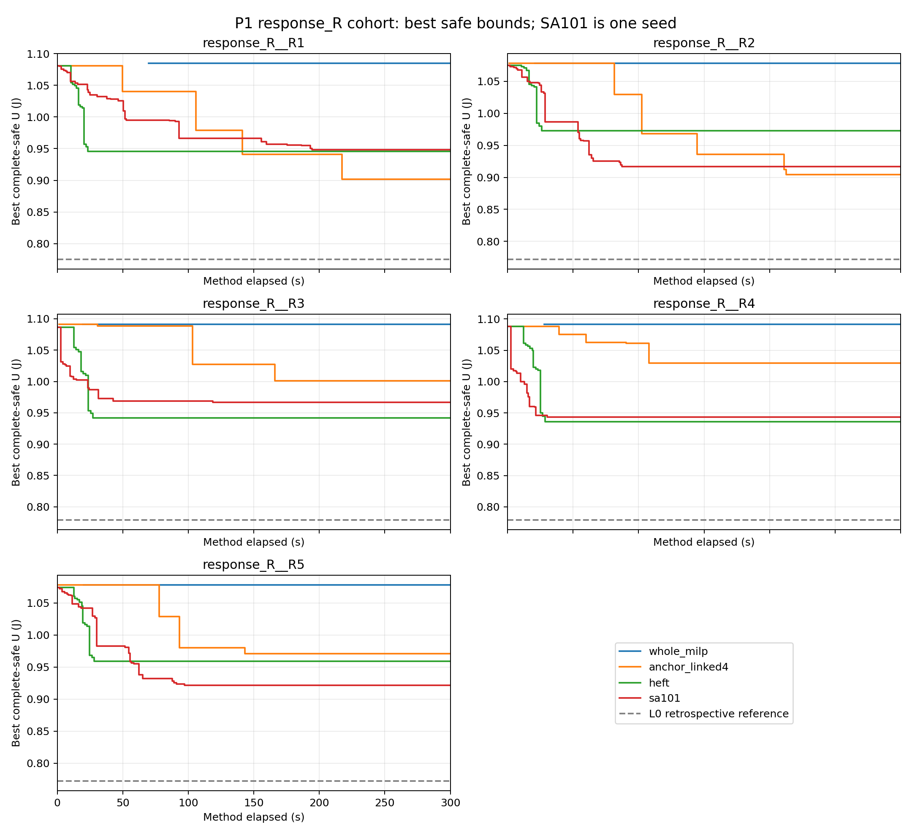
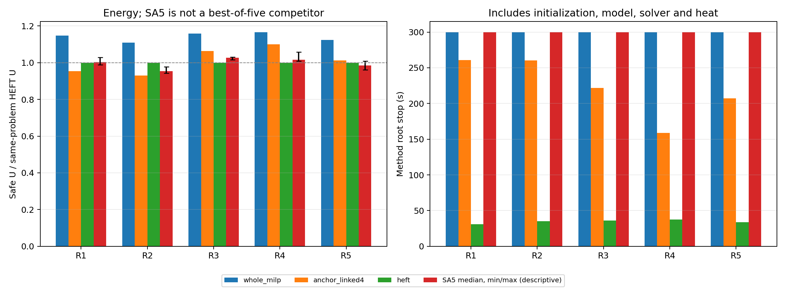
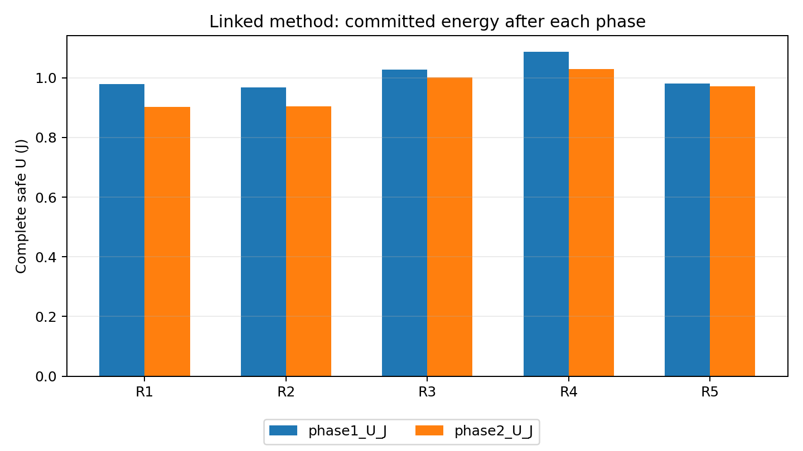

# K.158：统一1/f响应组P1冻结对照

2026-10-22。40/40次完成，40份最终方案均完成原定一次完整连续热事后复核。单次300秒、方法预留12000秒、全批日历19200秒均保持，没有补跑或临时延长。

联动版在2/5个输入上取得严格低于HEFT的安全能耗；HEFT在5/5个输入上更快。下表保留所有正反结果。

## 1．任务及可复核范围

- 使用原response_R R1—R5：统一反比响应α=1；原功热、合法设备／工作点、400 ms窗口、5 ms起点、真实结束、CPU-H参考期限与auto-L不变。所有方法接收相同真实输入。
- 18项新适配检查＋167项继承检查全部通过；首轮5个目录元数据预期差异及修订保留，未修改研究输入。211源及五输入哈希冻结后执行，独立输入／初解／缓存／L0均在本次计费。
- 终态存档核查489/489通过；这是本会话对已存证据的机械核查，没有新增求解或重复物理复核，也不是外部独立审查批准。

## 2．最终系统能耗

单位J，显示完整场景加权安全能量上端；严格高低由原精确区间判断。负百分比表示联动更差。

| 输入 | 整体MILP | 联动 | HEFT | SA五次中位数 | 联动相对HEFT降低 |
|---|---:|---:|---:|---:|---:|
| response_R__R1 | 1.084886371 | 0.901812648 | 0.945480804 | 0.948445521 | 4.618619% |
| response_R__R2 | 1.078187304 | 0.904029114 | 0.972953681 | 0.928287792 | 7.084054% |
| response_R__R3 | 1.091492239 | 1.001135476 | 0.941675943 | 0.966557846 | -6.314225% |
| response_R__R4 | 1.091752315 | 1.029573489 | 0.935833456 | 0.950611414 | -10.016743% |
| response_R__R5 | 1.078128354 | 0.970744328 | 0.959143426 | 0.945202315 | -1.209506% |

SA101—105逐次结果、均值、中位数、范围和标准差保留；五次最好值不是一次300秒竞争者。每个确定性方法每题只有一次，不作统计稳定性或普遍优势结论。

## 3．联动阶段及实际时间

| 输入 | 阶段1 U/J | 阶段2 U/J | 联动根时钟/s | HEFT根时钟/s | 联动首严格改善/s |
|---|---:|---:|---:|---:|---:|
| response_R__R1 | 0.978797556 | 0.901812648 | 260.578 | 31.047 | 49.797 |
| response_R__R2 | 0.968002851 | 0.904029114 | 260.093 | 35.297 | 81.406 |
| response_R__R3 | 1.027202939 | 1.001135476 | 221.563 | 36.265 | 30.688 |
| response_R__R4 | 1.087760463 | 1.029573489 | 158.578 | 37.391 | 39.234 |
| response_R__R5 | 0.980019276 | 0.970744328 | 207.406 | 33.859 | 77.672 |

第二阶段在5/5题有严格改善。这是同次运行内的质量进展，不是去掉第二阶段的等预算消融，也不证明局部或全域最优。

| 输入 | 整体首SAFE/s | 整体MATLAB启动/s | 联动首SAFE/s | 联动MATLAB启动/s |
|---|---:|---:|---:|---:|
| response_R__R1 | 69.719 | 59.453 | 0.953 | 7.531 |
| response_R__R2 | 21.000 | 10.110 | 1.140 | 10.015 |
| response_R__R3 | 19.640 | 9.484 | 1.360 | 11.047 |
| response_R__R4 | 28.031 | 11.328 | 0.984 | 7.281 |
| response_R__R5 | 20.156 | 6.485 | 1.015 | 6.281 |

方法根时钟合计10282.141秒，预留12000秒；监督墙钟10645.906秒，从本批启动到终态日历10645.915秒＜19200秒。MATLAB启动、构模、求解和内部热复核均计费；停止延迟、一次事后核查、归档另列。监督超时不是证据期限延长，预算后新U未接纳。

方法状态计数：NORMAL_TIME_LIMIT_PENDING_LAST_REQUEST=30；NORMAL_COMPLETION=10。正常时限及末请求未决保留此前完整安全U，不等于技术失败或模型无解。

## 4．热、界及可支持的结论

保存的热违规记录0条、连续热反馈记录0条。最终安全输出覆盖全部场景、完整400 ms及空闲尾段；本组没有触发反馈，未观察到反馈求解收益。既有热约束证据按原独立条件保留，不临时扫描温度。

独立全域最优0项、独立全域无解0项；L0高于U异常0项。各次共同L0及认证差距见CSV；solver-reported界、gap及局部状态留在原记录，不提升为全域证书。

P0与P1分别按各自的共同真实响应输入评价，跨条件表仅描述结果变化。本组没有把两类方案放回同一个评价模型，因此不能直接将P0/P1能量差称为非统一响应的建模收益。

## 5．证据入口与完成边界

- [协议](../../p1_batch/protocol.md)、[声明](declaration.json)、[账本](ledger.json)、[进程终态](process_terminal.json)、[存档核查](record_review01.json)。
- [40次CSV](analysis01/results40.csv)、[全部事实](analysis01/facts.json)、[阶段及时间指标](analysis01/report_metrics.json)、[P0/P1分条件表](analysis01/P0_P1_separate_conditions.json)、[11项解释范围核查](analysis01/interpretation_review.json)。
- [逐场景能量组成](analysis01/scene_energy.csv)、[节点连续峰温包络](analysis01/scene_peak_temperature.csv)来自原定一次post的只读投影，没有重复热评价。
- calls／claims保留每次原始结果、完整时间表、内部界、一次post和哈希；MAT在本地保存并登记哈希，遵守gitignore，不强制上传。

P1本阶段结束，不自动启动下一批。下一项应先审阅本组与P0结果，再从既定计划中确认后续条件及预算；本组结果不触发改参数、添邻域、换种子或补跑。

